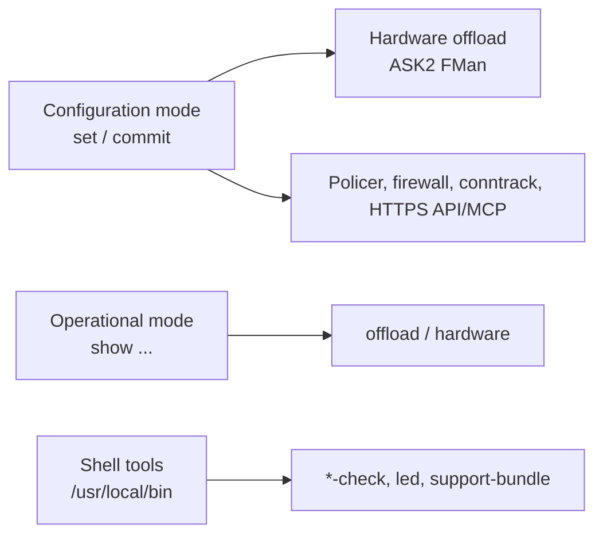

# CLI Commands & Bundled Tools — Mono Gateway DK (LS1046A)

Everything this build adds on top of stock VyOS: new configuration commands,
operational (`show`) commands, shell diagnostics, and third-party tools baked
into the ISO. Sources: `data/vyos-1x-*.patch`, `data/vyos-1x-files/`,
`board/scripts/`, `bin/ci-build-iso.sh`, `bin/ci-install-extra-packages.sh`.

Hardware-control recipes (LED, fan sysfs) are in [HWCTL.md](HWCTL.md);
installation is in [INSTALL.md](INSTALL.md).



## 1. Configuration commands

All are entered in configuration mode (`configure` … `commit` / `save`).

### 1.1 Hardware routing offload (ASK2)

Patches: `031`, `036`, `039`, `053`/`054` (final form), `051`, `052`.

```
set interfaces ethernet eth<n> offload ipv4
set interfaces ethernet eth<n> offload ipv6
```

| Item | Detail |
|------|--------|
| Meaning | Engages FMan hardware forwarding on that port for the given IP family. Each family is independent. |
| Ports | `eth0`–`eth4` (eth0 is management by convention; avoid it). |
| Automatic parts | VLAN, NAT44/NAT66/PAT, PPPoE (on the PPPoE source port) and bridge offload follow an engaged port. There are **no** `offload vlan` / `offload pppoe` leaves (removed by patch `054`), and no `ask` keyword. |
| Side effects | Forces RPS on the port and enables `hw-tc-offload`. |
| Validation | Commit fails if the helper `/usr/local/bin/vyos-offload-ask` is missing/errors, or if the MTU is outside **1280–3600**. |

The ISO's factory default config (`board/vyos-config/config.boot.dhcp`, installed as
`/opt/vyatta/etc/config.boot.default`) ships with `offload ipv4` and `offload ipv6`
on eth1–eth4 (not eth0, the management port), plus the hardware flowtable `FT`
over eth1–eth4, IPv4 and IPv6 forward rule 10 `action offload`, and
`hardware-offload-delay 500` shown below. Delete them to boot without hardware offload.

Engaging a port only arms it. Routed flows are learned **only** from a hardware
flowtable (next section); bridged traffic uses static FDB entries instead (see
"Bridge offload" below). An engaged port with neither offloads nothing.

#### Flow learning: hardware flowtable

```
set firewall flowtable FT interface eth3
set firewall flowtable FT interface eth4
set firewall flowtable FT offload hardware
set firewall ipv4 forward filter rule 10 action offload
set firewall ipv4 forward filter rule 10 offload-target FT
set firewall ipv4 forward filter rule 10 state established
set firewall ipv4 forward filter rule 10 state related
set firewall global-options hardware-offload-delay 500
```

* `action offload` is non-terminal: an earlier `accept` rule matching established
  traffic in the same chain shadows it (commit warns for global state-policy accepts, patch `038`).
* `hardware-offload-delay` (patch `055`): minimum flow age in ms, `0–60000`, default `0` (offload at once). It writes `/sys/module/ask/parameters/offload_delay_ms`.
* Flowtable MTU guard (`037`) mirrors the 1280–3600 range; VLAN sub-interfaces are handled when the parent is listed (`043`).
* Add the same flowtable rule for `ipv6` for IPv6 flows.

#### Bridge offload

When ports that are members of the same bridge are engaged, the FMan forwards
known-unicast traffic between them. No flowtable and no static entries are
needed: the first frames of each conversation go through the software bridge,
then the pair (source MAC, destination MAC) is forwarded in hardware.

```
set interfaces bridge br0 member interface eth3
set interfaces bridge br0 member interface eth4
set interfaces ethernet eth3 offload ipv4
set interfaces ethernet eth4 offload ipv4
```

* `show bridge br0 fdb` marks hosts whose traffic is in hardware with
  `offload`; learned ones also show `extern_learn`, because ask.ko takes them
  over from the bridge's ageing and ages them itself from hardware hit counts
  (same ageing time). A host that moves to another port is picked up from its
  first frame there.
* Static entries (`bridge fdb replace <mac> dev eth4 master static`) work too
  and are never aged or taken over.
* Only IPv4 and IPv6 frames are offloaded, for the families engaged on the
  ingress port (`offload ipv4` alone → IPv4 only). ARP, broadcast, multicast and
  unknown destinations take the software bridge.
* Not offloaded: VLAN-aware bridges (`enable-vlan`), member ports with VLAN
  sub-interfaces, ports not in STP forwarding, isolated or locked ports.
* A bridge member port does bridge offload only: its routed, VLAN and PPPoE
  offload stops until it leaves the bridge.
* Bridge-family firewall rules see the first frames of each MAC pair; a pair
  they accept is then forwarded in hardware without them, as on NXP's ASK.

#### Kill switches (diagnosis)

Global `ask.ko` parameters, all default on and not persistent across reboots:
`bridge_offload`, `vlan_offload`, `pppoe_offload`, `nat44_offload`,
`nat66_offload`, `ipv6_hw_frag`.

```
echo 0 | sudo tee /sys/module/ask/parameters/bridge_offload   # removes all bridge records
```

#### Disable

```
delete interfaces ethernet eth3 offload
```

This removes both family leaves. Flowtable traffic does not re-enable a
disabled port; only restoring `offload ipv4` and/or `offload ipv6` does.
Images up to and including `2026.10.16-0357-rolling` had a bug where new flows
re-armed the port within seconds of the disable; later images fix it (pending
board validation).

### 1.2 Hardware ingress policer (FMan Policer)

Patches `024`, `025`.

```
set interfaces ethernet eth3 ingress-policer bandwidth 1gbit
set interfaces ethernet eth3 ingress-policer burst 256kb
set interfaces ethernet eth3 ingress-policer peak-bandwidth 2gbit
```

| Leaf | Meaning |
|------|---------|
| `bandwidth` | **Required.** CIR; `<n>`, `bit`, `kbit`, `mbit`, `gbit`, `tbit`. |
| `burst` | Burst bytes (`<n>`, `kb`, `mb`, `gb`). |
| `peak-bandwidth` | Optional PIR; upgrades srTCM to two-rate trTCM. |

Auto-enables `hw-tc-offload` on the port and installs a matchall→police filter
(`skip_sw`/`in_hw`). Verify with `tc -s filter show dev eth3 ingress`.
Software `tc police` counters stay 0 because the policer is fully offloaded.
Test with a few pings, **never a flood** (open issue in the policer-removal path).

### 1.3 Conntrack: WireGuard bypass

Patches `056`, `057`. WireGuard listen-port UDP flows are **not tracked by default** (fast path).

```
set system conntrack disable-wireguard-bypass     # track them again
```

### 1.4 HTTPS API and MCP server (default off)

Patch `041` (+ `vyos-http-api-tools` rebuild by `bin/ci-build-http-api-tools.sh`).

```
set service https api keys id mykey key '<secret>'
set service https api mcp
set service https api mcp mode read-only        # default; or read-write
set service https api mcp introspection         # expose schema resources
```

Local stdio access for an agent: `ssh vyos@<board> vyos-mcp` (exits non-zero
with "MCP is not enabled" until `api mcp` is configured).

### 1.5 Console / system tweaks

* `set system console device ttyS0 speed 115200` — console is `ttyS0` (patch `001`).
* `set interfaces ethernet eth<n> hw-id <mac>` — pins a port name; always wins over the DT-based ordering (patch `027`/`047`).
* Hidden: LRO/TSO ethtool offload leaves are not offered (hardware-impossible, patch `034`). Supported: `gro gso sg rps`.
* Jumbo frames: kernel parameter `fsl_dpaa_fman.fsl_fm_max_frm=9600` (RJ45 MTU up to 9578).

### 1.6 Image management (behaviour changes, same commands)

| Command | LS1046A behaviour |
|---------|-------------------|
| `add system image latest` / `<url>` | Copies kernel, DTB, writes `/boot/vyos.env` and re-asserts the U-Boot boot order (`006`, `011`, `028`). |
| `show system image` | Works under U-Boot (live-boot detection `009`). |
| `install image` | USB-live only; never on an installed system. |

## 2. Operational commands

| Command | Shows |
|---------|-------|
| `show offload config` | Per-port IPv4/IPv6 offload intent vs. live FMan armed state. |
| `show offload flow` | Flows the FMan has learned (via `ynl --family ask`). |
| `show interfaces ethernet eth<n> offload ask flows` | Offloaded flows for one port. |
| `show hardware dpaa` / `… ports` / `… fman` / `… raw` | DPAA1 complex, MEMAC↔interface map, FMan + MURAM, JSON. |
| `show hardware crypto` / `… all` / `… raw` | CAAM SEC 5.4 status, all registered algorithms, JSON. |
| `show hardware fan` | Thermal zones and EMC2305 fan controller. |
| `show hardware firmware` | Boot firmware and FMan microcode inventory. |
| `show interfaces ethernet eth<n> physical offload` | ethtool offload feature state (LRO/TSO hidden). |
| `show cpu` / `show hardware` | ARM64-aware CPU and hardware info (`015`, `029`). |

## 3. Shell tools shipped by this build

Installed in `/usr/local/bin/`. Diagnostics use exit codes **0** healthy,
**1** fault, **2** wrong board / feature absent. Full table: [HWCTL.md §3](HWCTL.md).

| Tool | Purpose |
|------|---------|
| `dpaa1-check` | DPAA1 networking posture (FMan/QMan/BMan, drivers, ports). |
| `sfp-check` | Decode SFP/SFP+ EEPROM, print quirk line for rollball modules. |
| `fan-check` | Thermal zones, PWM/RPM, `fan-pid` health. |
| `caam-check` | CAAM crypto engine, job rings, hwrng. |
| `ask-check` | ASK2 datapath health, layer by layer. Use `sudo`. |
| `firmware-check` | U-Boot, QSPI, FMan microcode, `vyos.env`. Use `sudo`. |
| `support-bundle` | One paste-ready report: `sudo support-bundle > bundle.txt`. |
| `pcd-snapshot capture\|diff\|show` | Capture/diff FMan PCD register state (reversibility gate; mutate eth3 only, never eth0). |
| `vyos-offload-ask` | Low-level ASK engage/disengage helper called by the CLI; avoid direct use. |
| `ynl --family ask …` | Vendored YNL client talking straight to `ask.ko`. |
| `led` | RGBW status LED: `led 17`, `led R G B W`, `led '#33003300'`, `led off`. See [HWCTL.md §1.6](HWCTL.md). |
| `fan-pid` / `monoledd` / `fman-fq-qdisc` | Daemons (systemd): PID fan control, load-driven LED, `fq` qdisc on 10G ports. |
| `vyos-postinstall` | Writes U-Boot env and `/boot/vyos.env` (runs automatically). |
| `vyos-mcp` | MCP stdio endpoint (see 1.4). |

## 4. Third-party tools in the image

**Debian packages** (`--custom-package` in `bin/ci-build-iso.sh`):

| Category | Packages |
|----------|----------|
| Editors / shell | `vim-tiny`, `tmux`, `tree`, `jq`, `ripgrep`, `ncdu`, `btop` |
| Network testing | `iperf3`, `netperf`, `nuttcp`, `flent`, `hping3`, `fping`, `mtr-tiny`, `socat`, `ngrep`, `iftop` |
| Network inspection | `ethtool`, `iproute2`, `nftables`, `conntrack`, `wget` |
| DDoS detection | `fastnetmon` |
| Debugging | `strace`, `lsof`, `psmisc`, `sysstat`, `binutils` |
| Boot / firmware | `u-boot-tools`, `libubootenv-tool` (`fw_printenv`/`fw_setenv`), `grub-efi-arm64-signed` |
| Containers | `containernetworking-plugins`, `skopeo`, `catatonit`, `uidmap`, `fuse-overlayfs` |

**Static binaries** (`bin/ci-install-extra-packages.sh`, best-effort): Ookla
`speedtest`, `bandwhich`, `trippy`, `gping`, `doggo`.

**Built from source in CI:** `accel-ppp-ng` (PPPoE/IPoE daemon plus `ipoe.ko`/`vlan_mon.ko`), rebuilt `vyos-http-api-tools` (MCP SDK), patched `vyos-1x`, and the Linux kernel with signed out-of-tree modules (`ask.ko`, LP5812 LED driver).

**Hardware related:** `libatomic1`; `fancontrol.service` is masked in favour of `fan-pid`.