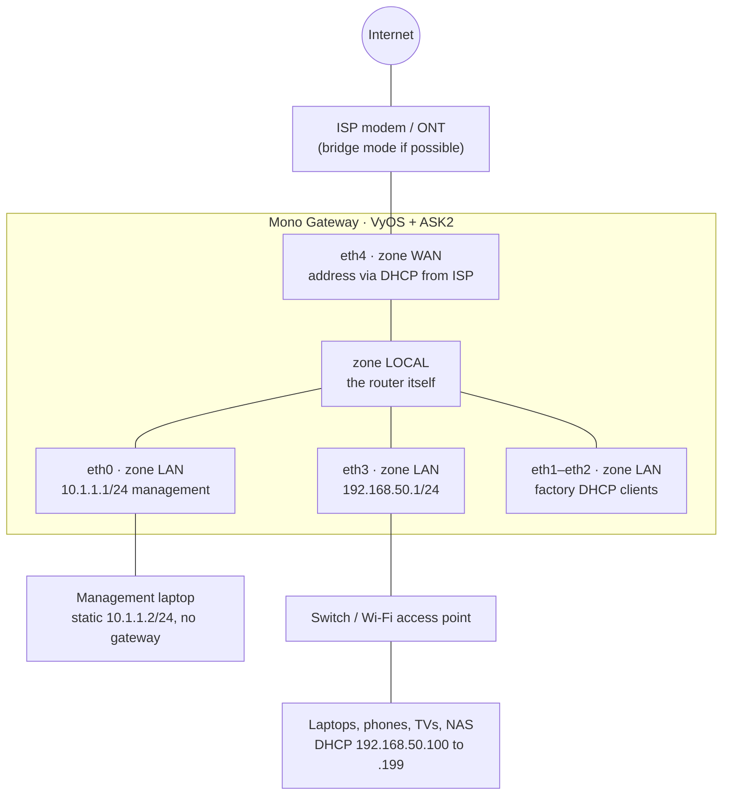

# Mono Gateway: VyOS Router Configuration with ASK2

This guide configures the Mono Gateway Development Kit with this repository's LS1046A VyOS image. It builds a stateful home router and explains how to check that eligible traffic uses the board's ASK2/FMan hardware offload. It assumes basic terminal and IP-networking knowledge, but not prior VyOS experience.

The commands are an example for the current single-image build, not a generic VyOS recipe. They assume a **freshly installed board running the factory configuration shipped in the ISO**, with nothing changed yet. Chapter 1 lists exactly what that starting point contains.

**What you end up with**

| Piece | Result |
|---|---|
| WAN | `eth4`, address from your ISP via DHCP |
| Trusted LAN zone | `eth0`, `eth1`, `eth2`, `eth3`; `eth1`–`eth2` keep their factory DHCP clients |
| Example LAN network | `eth3`, router at `192.168.50.1/24` |
| DHCP | On `eth3` only: `192.168.50.100` to `192.168.50.199` |
| DNS | The router resolves names itself (no third-party resolver), with DNSSEC validation |
| Firewall | Stateful IPv4 and IPv6 policy between WAN, LAN, and the router |
| NAT | The example `eth3` subnet masqueraded behind the WAN address |
| Time | The factory NTP servers, served to the example LAN only |
| Management | `eth0` at static `10.1.1.1/24`; SSH allowed from the trusted LAN zone; the published factory key removed; optional key-only login |
| Offload | ASK2 hardware forwarding for eligible traffic; optional IPv6 |

Time budget: 60 to 90 minutes the first time, most of it reading.

---

## Table of contents

1. [Before you start](#1-before-you-start)
2. [How VyOS thinks (10-minute crash course)](#2-how-vyos-thinks-10-minute-crash-course)
3. [System basics](#3-system-basics)
4. [Interfaces](#4-interfaces)
5. [Firewall](#5-firewall)
6. [NAT](#6-nat)
7. [Routing](#7-routing)
8. [LAN services: DHCP, DNS, NTP, SSH](#8-lan-services-dhcp-dns-ntp-ssh)
9. [ASK2 hardware offload](#9-ask2-hardware-offload)
10. [IPv6 (optional)](#10-ipv6-optional)
11. [Living with it: backups, upgrades, troubleshooting](#11-living-with-it-backups-upgrades-troubleshooting)
- [Appendix A: Complete configuration as set commands](#appendix-a-complete-configuration-as-set-commands)
- [Appendix B: Further reading](#appendix-b-further-reading)

Most configuration chapters follow the same rhythm:

- **Why**: what problem this solves
- **Configure**: a hierarchical view where useful, followed by the commands
- **Verify**: commands that prove it works
- **So what**: what you have now, and what it unlocks

---

## 1. Before you start

### Installation, console, and defaults

First install the LS1046A image using [INSTALL.md](./INSTALL.md). Initial installation is performed from the USB-live system; **never run `install image` on an installed system**. Keep the serial console connected at 115200 8N1 while configuring interfaces and firewall rules, especially while changing `eth0`, the management port.

Log in on the serial console as `vyos`, using the password you typed at the `install image` prompt. The installer accepts the well-known default `vyos` with only a warning, and the USB-live system you installed from uses `vyos`/`vyos`, so treat this password as **temporary** whatever you chose: chapter 3 replaces it before the WAN is connected. Until chapter 4 gives `eth0` a fixed address, the console is the only path whose address you know in advance.

### The factory starting point

A fresh install boots the factory configuration from the ISO:

| Area | Factory setting | Changed in this guide |
|---|---|---|
| Interfaces | DHCP client on all five ports; `eth0` described as `MGMT (left RJ45)` | Chapter 4: static `eth0` and `eth3`, `eth4` stays DHCP |
| ASK2 offload | `offload ipv4` and `offload ipv6` on `eth1`–`eth4`; none on `eth0` | Unchanged |
| Flowtable | Hardware flowtable `FT` on `eth1`–`eth4`; IPv4 and IPv6 forward rule 10 `action offload`; `hardware-offload-delay 500` | Unchanged; chapter 9 explains it |
| Firewall | No zones, no rulesets, no input filtering | Chapter 5 |
| NAT | None | Chapter 6 |
| SSH | Enabled on port 22, listening on every address | Chapter 5 firewalls it; chapter 8.4 disables passwords |
| Login | User `vyos` with the temporary install-time password (possibly the default `vyos`), **plus** the published factory `vanityssh@vyos` public key | Chapter 3 sets a new password and replaces the key |
| NTP | Servers `time.apple.com`, `time.cloudflare.com`, `time.google.com`; clients allowed from all private ranges | Chapter 8.3 limits clients |
| System | Host name `vyos`, 100 commit revisions, update check, watchdog | Chapter 3 |
| DHCP server, DNS, IPv6 | None | Chapters 8 and 10 |

There is **no firewall** in the factory configuration. SSH answers on every port that has an address, the install-time password may be the default `vyos`, and the private half of the `vanityssh@vyos` key is published in [INSTALL.md](./INSTALL.md#ssh-access--vanity-key). Anyone who can reach the router may be able to log in until you replace those credentials.

> **Do not connect the WAN yet.** Until chapter 5 ends, connect only:
> - the serial console;
> - `eth0` (left RJ45), to your management laptop;
> - `eth3` (left SFP+), to your LAN switch, if you want to test from it.
>
> Leave `eth4` (right SFP+) and `eth1`–`eth2` unplugged. Plug in the WAN only after the [WAN gate in section 5.8](#58-connect-the-wan) passes: the password changed, the factory key replaced with your own, and the firewall committed and verified.

ASK2 still has open feature and safety-validation gaps. Because it is enabled in the factory configuration, review chapter 9 and the linked master plan before relying on hardware forwarding in your network.

To confirm the starting point, run `show version`, `show configuration commands` and `show offload config` in operational mode. See [CLI-AND-TOOLS.md](./CLI-AND-TOOLS.md) for the build-specific commands.

### Identify the physical ports

| VyOS interface | Mono Gateway port | Role in this example |
|---|---|---|
| `eth0` | Left RJ45 | Trusted LAN; management at static `10.1.1.1/24` |
| `eth1` | Center RJ45 | Trusted LAN; factory DHCP client unchanged |
| `eth2` | Right RJ45 | Trusted LAN; factory DHCP client unchanged |
| `eth3` | Left SFP+ | Trusted LAN; example `192.168.50.0/24` network |
| `eth4` | Right SFP+ | WAN; DHCP client |

The SFP+ cages support **10G only** on this build. A 1G-only module or peer will not provide the intended link. If your ISP or LAN is 1G-only, choose an RJ45 port instead and adjust every affected zone membership, interface, flowtable, NAT and service setting consistently; preserve a management path. A fresh install names the ports as shown above. Confirm by plugging in one cable at a time and checking `show interfaces`; see [HARDWARE.md](./HARDWARE.md#33-vyos-port-naming).

### The network we are building



The LAN zone is a **firewall grouping**, not a switch or bridge. `eth0` gets a fixed management address; `eth1`–`eth2` keep their factory DHCP clients. None of them automatically shares the `eth3` subnet, DHCP service, or NAT rule. Intra-zone traffic is not isolated by the zone by default; use separate zones or intra-zone filtering if those networks should not trust one another.

### The plan, written down

Write these values down before you type anything. Changing a subnet later is possible but annoying.

| Setting | Value in this guide | Your value |
|---|---|---|
| WAN interface | `eth4` | |
| Trusted LAN zone members | `eth0`, `eth1`, `eth2`, `eth3` | |
| Management interface | `eth0` | |
| Management address | `10.1.1.1/24` | |
| Management laptop | static `10.1.1.2`–`10.1.1.254`, no gateway | |
| Example addressed LAN interface | `eth3` | |
| LAN subnet | `192.168.50.0/24` | |
| Router LAN address | `192.168.50.1` | |
| DHCP pool | `192.168.50.100` to `192.168.50.199` | |
| Static/reserved range | `192.168.50.2` to `192.168.50.99` | |
| Local domain | `home.arpa` | |
| Time zone | `America/Los_Angeles` | |

Choose an example LAN subnet that does **not** overlap the WAN, the `10.1.1.0/24` management network, or any other connected network. If you change it, update the interface, `LAN-NETS`, NAT, DHCP, DNS, NTP, and SSH examples consistently. Multiple DHCP clients can also install multiple default routes; check that the intended WAN route is selected in chapter 7.

---

## 2. How VyOS thinks (10-minute crash course)

Read this chapter even if you skim the others. Almost every mistake with VyOS comes from not knowing the three layers of configuration.

### Two modes

| Prompt | Mode | What you do there |
|---|---|---|
| `vyos@router:~$` | **Operational** | Look at things: `show`, `ping`, `traceroute`, `monitor`, `reboot` |
| `vyos@router#` | **Configuration** | Change things: `set`, `delete`, `commit`, `save` |

Enter configuration mode with `configure`, leave with `exit`. From config mode you can run any operational command by prefixing it with `run`, for example `run show interfaces`.

### Three layers of configuration


- `set` and `delete` only change the **candidate**. Nothing happens on the network yet.
- `compare` shows the difference between candidate and running.
- `commit` makes the candidate live. If it fails validation, nothing changes.
- `save` writes the running config to disk. **Forget `save`, and a reboot quietly undoes your work.** Everyone does this once. Ideally only once.

### Two ways to look at the same config

VyOS config is a tree. `show` (in config mode) prints it as a tree:

```text
interfaces {
    ethernet eth3 {
        address 192.168.50.1/24
        description LAN
    }
}
```

`show | commands` prints the same thing as the flat `set` commands that build it:

```text
set interfaces ethernet eth3 address '192.168.50.1/24'
set interfaces ethernet eth3 description 'LAN'
```

The guide uses both where useful. The tree is for understanding; the flat commands are for typing.

You can also move around the tree like directories:

```text
vyos@router# edit interfaces ethernet eth3
[edit interfaces ethernet eth3]
vyos@router# set description 'LAN'
vyos@router# top
```

### Tab and `?` are your manual

Press `Tab` to complete, `?` to list options with a short description. You can explore the whole configuration tree this way. It is faster than any documentation, including this one.

### Your safety net

| Command | What it does |
|---|---|
| `compare` | Show pending changes before committing |
| `discard` | Throw away all uncommitted changes |
| `commit-confirm 5` | Commit, but roll back automatically unless you type `confirm` within 5 minutes |
| `confirm` | Keep a `commit-confirm` change |
| `show system commit` (op mode) | List previous commits |
| `compare 3` | Diff the candidate against commit revision 3 |
| `rollback 3` | Return to commit revision 3 (check `rollback ?` on your build; behavior has changed between versions) |

> **Golden rule:** whenever you change firewall rules, interface addresses, or SSH over a remote session, use `commit-confirm`. If you lock yourself out, the router lets you back in after a few minutes. The alternative is walking to the box with a keyboard.

### Habits worth having from day one

- Give everything a `description`. Future you is a stranger who does not remember why rule 40 exists.
- Number rules with gaps (10, 20, 30). You will want to insert something between them. Yes, this is the BASIC line-numbering trick from the 1980s, and yes, it still works.
- `commit`, test, then `save`. In that order.

---

## 3. System basics

### Why

Hostname, domain, and time zone appear in logs, DHCP, and DNS. Getting them right now avoids confusing logs later. The factory configuration already keeps 100 commit revisions; the command below only makes that explicit.

More importantly, the factory login is not secret. The install-time password is temporary and may be the default `vyos`, and the login trusts the `vanityssh@vyos` public key, whose private key is published in [INSTALL.md](./INSTALL.md#ssh-access--vanity-key). Replace both now, before any network beyond your management laptop is connected. This is the first of the three conditions for connecting the WAN.

On your laptop, create a key if you do not have one yet:

```bash
ssh-keygen -t ed25519
cat ~/.ssh/id_ed25519.pub
# ssh-ed25519 AAAAC3NzaC1lZDI1NTE5AAAA...  you@laptop
```

The key is the long middle part. Replace the abbreviated placeholder below with the complete public key, and the passphrase with your own long passphrase, before entering the commands on the router.

### Configure

Hierarchical view:

```text
system {
    config-management {
        commit-revisions 100
    }
    domain-name home.arpa
    host-name router
    login {
        user vyos {
            authentication {
                plaintext-password ****************
                public-keys laptop {
                    key AAAAC3NzaC1lZDI1NTE5AAAA...
                    type ssh-ed25519
                }
            }
        }
    }
    time-zone America/Los_Angeles
}
```

Commands:

```text
configure
set system host-name 'router'
set system domain-name 'home.arpa'
set system time-zone 'America/Los_Angeles'
set system config-management commit-revisions '100'
set system login user vyos authentication plaintext-password 'a-long-passphrase-you-will-remember'
delete system login user vyos authentication public-keys 'vanityssh@vyos'
set system login user vyos authentication public-keys laptop key 'AAAAC3NzaC1lZDI1NTE5AAAA...'
set system login user vyos authentication public-keys laptop type 'ssh-ed25519'
commit
save
```

The plaintext password is hashed on commit; `show system login` shows only the hash. Stay logged in on the serial console: you cannot test SSH until chapter 4 gives `eth0` an address. Chapter 8.4 disables password login over SSH once your key is proven.

> **Why `home.arpa`?** It is the domain reserved for home networks by RFC 8375. Do not use `.local` (taken by mDNS, which your printer and phone use) or a made-up TLD like `.lan` or `.home` (they may become real some day, and `.internal` is reserved for private use too, but `home.arpa` says exactly what it is).

### Verify

```text
run show configuration commands | match system
run show configuration commands | match public-keys
run show date
```

The `public-keys` output must list `laptop` and must not list `vanityssh@vyos`. Log out of the console and back in with the new password.

### So what

The router has an identity, a long undo history, and credentials that only you know. Next: give it addresses.

---

## 4. Interfaces

### Why

The example LAN gets a fixed address for its gateway, and `eth0` gets a fixed, easy-to-remember management address. The WAN asks the ISP for an address via DHCP. `eth1` and `eth2` keep their factory DHCP clients.

`10.1.1.1` is used for management because it is short and unlikely to collide with other networks. Consumer routers and ISP modems commonly use `192.168.0.1`, `192.168.1.1` and `10.0.0.1`; one of those could clash with the WAN or another network you join. A static address also avoids a second default route from a DHCP client on `eth0`. The management network does not need DHCP or a gateway: give the laptop a static address such as `10.1.1.2/24`, then use `ssh vyos@10.1.1.1`.

> **Make this change from the serial console.** Any SSH session using the DHCP address `eth0` received at boot drops when the address changes.

> **Keep the WAN cable unplugged until section 5.8.** Factory SSH and offload are already active, and there is no firewall yet.

### Configure

Hierarchical view:

```text
interfaces {
    ethernet eth0 {
        address 10.1.1.1/24
        description MGMT
    }
    ethernet eth3 {
        address 192.168.50.1/24
        description LAN
    }
    ethernet eth4 {
        address dhcp
        description WAN
    }
}
```

Commands:

```text
delete interfaces ethernet eth0 address 'dhcp'
set interfaces ethernet eth0 description 'MGMT'
set interfaces ethernet eth0 address '10.1.1.1/24'
delete interfaces ethernet eth3 address 'dhcp'
set interfaces ethernet eth3 description 'LAN'
set interfaces ethernet eth3 address '192.168.50.1/24'
set interfaces ethernet eth4 description 'WAN'
set interfaces ethernet eth4 address 'dhcp'
compare
commit-confirm 5
```

The two `delete` commands remove the factory DHCP clients from `eth0` and `eth3`; `eth4` keeps its factory DHCP client. From the console, verify the addresses. Give the management laptop the static address `10.1.1.2/24` and run `ssh vyos@10.1.1.1` before the timer expires. It should log in with your key, not ask for a password. Then:

```text
confirm
save
```

Notes:

- `hw-id` lines you see in `show interfaces ethernet` are the MAC addresses that pin each name to a physical port. Leave them alone.
- Leave MTU at 1500 unless you have an end-to-end reason to change it. ASK2 validates an MTU of 1280–3600 on engaged ports; VPP/AF_XDP has its own, lower limit.
- Do not add a bridge to make these ports share a subnet: on this ASK2 build, bridge-member ports use the bridge offload path instead of routed offload.

### Verify

```text
run show interfaces
```

Expected: `eth0` shows `10.1.1.1/24`, and `eth3` shows `192.168.50.1/24` and has link if its cable and 10G peer are connected. `eth4` should have no DHCP lease yet with its cable unplugged. `eth1` and `eth2` still have their factory DHCP clients.

### So what

Both sides exist. Before the WAN side talks to the internet, it needs a firewall.

---

## 5. Firewall

This is the longest chapter because it matters most. Take your time.

### 5.1 Concepts in four paragraphs

**Stateful.** Conntrack recognizes replies to accepted connections. The rulesets below allow established and related packets explicitly, while a global policy drops invalid traffic.

**Default deny between zones.** Unsolicited WAN-to-LAN and WAN-to-router traffic is dropped except for the explicit rules. LAN-to-WAN and router-originated traffic have their own permissions; traffic within the LAN zone is not isolated by default.

**Zones.** Instead of writing rules per interface, you group interfaces into zones and write one ruleset per *direction between zones*. We use three:

| Zone | Contains | Meaning |
|---|---|---|
| `WAN` | `eth4` | The internet. Untrusted. |
| `LAN` | `eth0`, `eth1`, `eth2`, `eth3` | Trusted networks; the ports remain separate interfaces. |
| `LOCAL` | the router itself | Traffic *to* or *from* VyOS, not *through* it. |

**The matrix.** Every arrow between zones gets a ruleset. Reading it row by row: "traffic **from** this zone **to** that zone":

| from \ to | **LAN** | **WAN** | **LOCAL** (router) |
|---|---|---|---|
| **LAN** | No intra-zone isolation by default; not a bridge | `LAN-WAN`: allow configured sources | `LAN-LOCAL`: DHCP, DNS, NTP, SSH, ping |
| **WAN** | `WAN-LAN`: allow replies, drop other new traffic | | `WAN-LOCAL`: replies, DHCP, rate-limited ping |
| **LOCAL** | `LOCAL-LAN`: allow | `LOCAL-WAN`: allow | |

Each ruleset exists twice: one for IPv4 (`-v4`), one for IPv6 (`-v6`). We configure IPv6 rules even if you do not have IPv6 yet. When your ISP turns it on one day, you are already protected instead of accidentally wide open.

### 5.2 Global options

#### Why

These are kernel-level protections and the global invalid-packet policy. Established and related traffic is accepted in the individual rulesets.

#### Configure

Hierarchical view:

```text
firewall {
    global-options {
        all-ping enable
        broadcast-ping disable
        ip-src-route disable
        ipv6-src-route disable
        log-martians enable
        receive-redirects disable
        send-redirects disable
        source-validation loose
        state-policy {
            invalid {
                action drop
            }
        }
        syn-cookies enable
    }
}
```

Commands:

```text
set firewall global-options state-policy invalid action 'drop'
set firewall global-options all-ping 'enable'
set firewall global-options broadcast-ping 'disable'
set firewall global-options ip-src-route 'disable'
set firewall global-options ipv6-src-route 'disable'
set firewall global-options receive-redirects 'disable'
set firewall global-options send-redirects 'disable'
set firewall global-options log-martians 'enable'
set firewall global-options syn-cookies 'enable'
set firewall global-options source-validation 'loose'
```

**ASK2 ordering matters.** The factory hardware flowtable has an `action offload` rule in each forward filter. A global `established` or `related` **accept** shadows those rules, and this build rejects that combination at commit. That is why this guide sets only the global `invalid` drop and accepts established and related traffic in each ruleset instead. Do not add a global `state-policy established` or `related` accept. See chapter 9 for the hardware flowtable.

What each one buys you:

| Option | Plain English |
|---|---|
| `state-policy invalid drop` | Drop packets conntrack considers invalid; established/related accepts are in the zone rulesets. |
| `all-ping enable` | The router *can* answer pings. Whether it *does* is decided by the zone rules below. |
| `broadcast-ping disable` | Do not answer pings sent to a broadcast address (classic amplification trick). |
| `ip-src-route` / `ipv6-src-route disable` | Ignore packets that try to dictate their own path through the network. |
| `receive-redirects` / `send-redirects disable` | ICMP redirects are a routing shortcut nobody needs at home and an attacker might enjoy. |
| `log-martians enable` | Log packets with impossible source addresses. Interesting to read, occasionally useful. |
| `syn-cookies enable` | Survive SYN floods without running out of memory. |
| `source-validation loose` | IPv4 reverse-path validation requires a route to the source, without requiring the return route to use the incoming interface. This is less likely to break management with multiple DHCP-connected ports. It is not IPv6 source validation. |

Do not commit yet; the rulesets come next and we commit everything together.

### 5.3 Groups

#### Why

Groups are named lists of addresses or ports. Rules reference the name, so when something changes you update one group instead of ten rules.

#### Configure

Hierarchical view:

```text
firewall {
    group {
        network-group BOGONS-V4 {
            description "Addresses that must never appear as a source on the internet"
            network 0.0.0.0/8
            network 10.0.0.0/8
            network 127.0.0.0/8
            network 169.254.0.0/16
            network 172.16.0.0/12
            network 192.0.2.0/24
            network 192.168.0.0/16
            network 198.18.0.0/15
            network 198.51.100.0/24
            network 203.0.113.0/24
            network 224.0.0.0/4
            network 240.0.0.0/4
        }
        network-group LAN-NETS {
            description "Our own LAN subnets"
            network 192.168.50.0/24
        }
    }
}
```

Commands:

```text
set firewall group network-group LAN-NETS description 'Our own LAN subnets'
set firewall group network-group LAN-NETS network '192.168.50.0/24'

set firewall group network-group BOGONS-V4 description 'Addresses that must never appear as a source on the internet'
set firewall group network-group BOGONS-V4 network '0.0.0.0/8'
set firewall group network-group BOGONS-V4 network '10.0.0.0/8'
set firewall group network-group BOGONS-V4 network '127.0.0.0/8'
set firewall group network-group BOGONS-V4 network '169.254.0.0/16'
set firewall group network-group BOGONS-V4 network '172.16.0.0/12'
set firewall group network-group BOGONS-V4 network '192.0.2.0/24'
set firewall group network-group BOGONS-V4 network '192.168.0.0/16'
set firewall group network-group BOGONS-V4 network '198.18.0.0/15'
set firewall group network-group BOGONS-V4 network '198.51.100.0/24'
set firewall group network-group BOGONS-V4 network '203.0.113.0/24'
set firewall group network-group BOGONS-V4 network '224.0.0.0/4'
set firewall group network-group BOGONS-V4 network '240.0.0.0/4'
```

> **Why is `100.64.0.0/10` not in the bogon list?** That range is "carrier-grade NAT" space. Some ISPs put customers behind CGNAT and their own infrastructure uses it. Blocking it can break your connection in ways that are miserable to debug. The same caution applies if your WAN sits behind an ISP router that hands out `192.168.x.x`: in that case, remove `192.168.0.0/16` from this group.

### 5.4 IPv4 rulesets

#### Router-facing rules from the internet: `WAN-LOCAL-v4`

```text
firewall {
    ipv4 {
        name WAN-LOCAL-v4 {
            default-action drop
            description "Internet to router"
            rule 5 {
                action accept
                description "Established and related"
                state established
                state related
            }
            rule 10 {
                action accept
                description "DHCP replies from ISP"
                destination {
                    port 68
                }
                protocol udp
                source {
                    port 67
                }
            }
            rule 20 {
                action drop
                description "Spoofed or reserved sources"
                source {
                    group {
                        network-group BOGONS-V4
                    }
                }
            }
            rule 30 {
                action accept
                description "Ping, rate limited"
                icmp {
                    type-name echo-request
                }
                limit {
                    burst 10
                    rate 5/second
                }
                protocol icmp
            }
        }
    }
}
```

```text
set firewall ipv4 name WAN-LOCAL-v4 default-action 'drop'
set firewall ipv4 name WAN-LOCAL-v4 description 'Internet to router'
set firewall ipv4 name WAN-LOCAL-v4 rule 5 action 'accept'
set firewall ipv4 name WAN-LOCAL-v4 rule 5 description 'Established and related'
set firewall ipv4 name WAN-LOCAL-v4 rule 5 state 'established'
set firewall ipv4 name WAN-LOCAL-v4 rule 5 state 'related'
set firewall ipv4 name WAN-LOCAL-v4 rule 10 action 'accept'
set firewall ipv4 name WAN-LOCAL-v4 rule 10 description 'DHCP replies from ISP'
set firewall ipv4 name WAN-LOCAL-v4 rule 10 protocol 'udp'
set firewall ipv4 name WAN-LOCAL-v4 rule 10 source port '67'
set firewall ipv4 name WAN-LOCAL-v4 rule 10 destination port '68'
set firewall ipv4 name WAN-LOCAL-v4 rule 20 action 'drop'
set firewall ipv4 name WAN-LOCAL-v4 rule 20 description 'Spoofed or reserved sources'
set firewall ipv4 name WAN-LOCAL-v4 rule 20 source group network-group 'BOGONS-V4'
set firewall ipv4 name WAN-LOCAL-v4 rule 30 action 'accept'
set firewall ipv4 name WAN-LOCAL-v4 rule 30 description 'Ping, rate limited'
set firewall ipv4 name WAN-LOCAL-v4 rule 30 protocol 'icmp'
set firewall ipv4 name WAN-LOCAL-v4 rule 30 icmp type-name 'echo-request'
set firewall ipv4 name WAN-LOCAL-v4 rule 30 limit rate '5/second'
set firewall ipv4 name WAN-LOCAL-v4 rule 30 limit burst '10'
```

Why this order: after established/related traffic, **DHCP precedes the bogon rule**. Some ISPs send DHCP replies from private addresses; blocking those before rule 10 can prevent an address assignment.

Why allow ping: it helps your ISP (and you) diagnose problems, and "stealth mode" buys nothing real: the scanners already know your address is there. If you disagree, delete rule 30. It is your router.

Nothing is logged here on purpose. The internet throws junk at every public address all day; logging it fills your disk and teaches you nothing.

#### Traffic from the internet to your devices: `WAN-LAN-v4`

```text
firewall {
    ipv4 {
        name WAN-LAN-v4 {
            default-action drop
            description "Internet to LAN"
            rule 5 {
                action accept
                description "Established and related"
                state established
                state related
            }
        }
    }
}
```

```text
set firewall ipv4 name WAN-LAN-v4 default-action 'drop'
set firewall ipv4 name WAN-LAN-v4 description 'Internet to LAN'
set firewall ipv4 name WAN-LAN-v4 rule 5 action 'accept'
set firewall ipv4 name WAN-LAN-v4 rule 5 description 'Established and related'
set firewall ipv4 name WAN-LAN-v4 rule 5 state 'established'
set firewall ipv4 name WAN-LAN-v4 rule 5 state 'related'
```

Rule 5 allows replies to accepted connections. Other inbound traffic is dropped unless you add a specific rule, as in the optional port-forward example in chapter 6.

#### Your devices going out: `LAN-WAN-v4`

```text
firewall {
    ipv4 {
        name LAN-WAN-v4 {
            default-action drop
            description "LAN to Internet"
            rule 5 {
                action accept
                description "Established and related"
                state established
                state related
            }
            rule 10 {
                action accept
                description "Anything from our own subnet"
                source {
                    group {
                        network-group LAN-NETS
                    }
                }
            }
        }
    }
}
```

```text
set firewall ipv4 name LAN-WAN-v4 default-action 'drop'
set firewall ipv4 name LAN-WAN-v4 description 'LAN to Internet'
set firewall ipv4 name LAN-WAN-v4 rule 5 action 'accept'
set firewall ipv4 name LAN-WAN-v4 rule 5 description 'Established and related'
set firewall ipv4 name LAN-WAN-v4 rule 5 state 'established'
set firewall ipv4 name LAN-WAN-v4 rule 5 state 'related'
set firewall ipv4 name LAN-WAN-v4 rule 10 action 'accept'
set firewall ipv4 name LAN-WAN-v4 rule 10 description 'Anything from our own subnet'
set firewall ipv4 name LAN-WAN-v4 rule 10 source group network-group 'LAN-NETS'
```

New IPv4 connections are accepted only from `LAN-NETS`, which initially contains the example `eth3` subnet. If another LAN-zone interface should route traffic to the internet, add its actual subnet to `LAN-NETS` and provide an appropriate NAT rule; zone membership alone does neither. The `10.1.1.0/24` management network is deliberately left out: it can reach the router, but not the internet.

#### Your devices talking to the router: `LAN-LOCAL-v4`

```text
firewall {
    ipv4 {
        name LAN-LOCAL-v4 {
            default-action drop
            description "LAN to router"
            rule 5 {
                action accept
                description "Established and related"
                state established
                state related
            }
            rule 10 {
                action accept
                description "DHCP requests to router"
                destination {
                    port 67
                }
                protocol udp
                source {
                    port 68
                }
            }
            rule 11 {
                action accept
                description "DHCP replies to router"
                destination {
                    port 68
                }
                protocol udp
                source {
                    port 67
                }
            }
            rule 20 {
                action accept
                description DNS
                destination {
                    port 53
                }
                protocol tcp_udp
            }
            rule 30 {
                action accept
                description NTP
                destination {
                    port 123
                }
                protocol udp
            }
            rule 40 {
                action accept
                description SSH
                destination {
                    port 22
                }
                protocol tcp
            }
            rule 50 {
                action accept
                description ICMP
                protocol icmp
            }
            rule 999 {
                action drop
                description "Log everything else"
                log
            }
        }
    }
}
```

```text
set firewall ipv4 name LAN-LOCAL-v4 default-action 'drop'
set firewall ipv4 name LAN-LOCAL-v4 description 'LAN to router'
set firewall ipv4 name LAN-LOCAL-v4 rule 5 action 'accept'
set firewall ipv4 name LAN-LOCAL-v4 rule 5 description 'Established and related'
set firewall ipv4 name LAN-LOCAL-v4 rule 5 state 'established'
set firewall ipv4 name LAN-LOCAL-v4 rule 5 state 'related'
set firewall ipv4 name LAN-LOCAL-v4 rule 10 action 'accept'
set firewall ipv4 name LAN-LOCAL-v4 rule 10 description 'DHCP requests to router'
set firewall ipv4 name LAN-LOCAL-v4 rule 10 protocol 'udp'
set firewall ipv4 name LAN-LOCAL-v4 rule 10 source port '68'
set firewall ipv4 name LAN-LOCAL-v4 rule 10 destination port '67'
set firewall ipv4 name LAN-LOCAL-v4 rule 11 action 'accept'
set firewall ipv4 name LAN-LOCAL-v4 rule 11 description 'DHCP replies to router'
set firewall ipv4 name LAN-LOCAL-v4 rule 11 protocol 'udp'
set firewall ipv4 name LAN-LOCAL-v4 rule 11 source port '67'
set firewall ipv4 name LAN-LOCAL-v4 rule 11 destination port '68'
set firewall ipv4 name LAN-LOCAL-v4 rule 20 action 'accept'
set firewall ipv4 name LAN-LOCAL-v4 rule 20 description 'DNS'
set firewall ipv4 name LAN-LOCAL-v4 rule 20 protocol 'tcp_udp'
set firewall ipv4 name LAN-LOCAL-v4 rule 20 destination port '53'
set firewall ipv4 name LAN-LOCAL-v4 rule 30 action 'accept'
set firewall ipv4 name LAN-LOCAL-v4 rule 30 description 'NTP'
set firewall ipv4 name LAN-LOCAL-v4 rule 30 protocol 'udp'
set firewall ipv4 name LAN-LOCAL-v4 rule 30 destination port '123'
set firewall ipv4 name LAN-LOCAL-v4 rule 40 action 'accept'
set firewall ipv4 name LAN-LOCAL-v4 rule 40 description 'SSH'
set firewall ipv4 name LAN-LOCAL-v4 rule 40 protocol 'tcp'
set firewall ipv4 name LAN-LOCAL-v4 rule 40 destination port '22'
set firewall ipv4 name LAN-LOCAL-v4 rule 50 action 'accept'
set firewall ipv4 name LAN-LOCAL-v4 rule 50 description 'ICMP'
set firewall ipv4 name LAN-LOCAL-v4 rule 50 protocol 'icmp'
set firewall ipv4 name LAN-LOCAL-v4 rule 999 action 'drop'
set firewall ipv4 name LAN-LOCAL-v4 rule 999 description 'Log everything else'
set firewall ipv4 name LAN-LOCAL-v4 rule 999 log
```

Rule 10 allows requests to the `eth3` DHCP server; rule 11 allows replies to the router's factory DHCP clients on `eth1`–`eth2`. DHCP servers on those interfaces must be trusted. The other rules allow only the listed services to the router; the final drop is logged.

#### The router talking out: `LOCAL-WAN-v4` and `LOCAL-LAN-v4`

```text
firewall {
    ipv4 {
        name LOCAL-LAN-v4 {
            default-action accept
            description "Router to LAN"
        }
        name LOCAL-WAN-v4 {
            default-action accept
            description "Router to Internet"
        }
    }
}
```

```text
set firewall ipv4 name LOCAL-WAN-v4 default-action 'accept'
set firewall ipv4 name LOCAL-WAN-v4 description 'Router to Internet'
set firewall ipv4 name LOCAL-LAN-v4 default-action 'accept'
set firewall ipv4 name LOCAL-LAN-v4 description 'Router to LAN'
```

The router needs to reach DNS root servers, NTP servers, image updates, and answer LAN clients. If you cannot trust the router itself, firewall rules are the wrong layer to fix that.

### 5.5 IPv6 rulesets

Even with no IPv6 from your ISP today, configure these now. IPv6 has two differences that change the rules:

- **No NAT is used in this example.** Devices with delegated global addresses depend on the firewall, not address translation, to reject unsolicited inbound connections.
- **ICMPv6 is not optional.** IPv6 uses ICMPv6 for neighbor discovery (its version of ARP), router advertisements, and path MTU discovery. Block it and IPv6 breaks in slow, mysterious ways (RFC 4890 has the full story).

#### `WAN-LOCAL-v6`

```text
firewall {
    ipv6 {
        name WAN-LOCAL-v6 {
            default-action drop
            description "Internet to router (IPv6)"
            rule 5 {
                action accept
                description "Established and related"
                state established
                state related
            }
            rule 10 {
                action accept
                description "DHCPv6 replies from ISP"
                destination {
                    port 546
                }
                protocol udp
                source {
                    port 547
                }
            }
            rule 20 {
                action accept
                description "Ping, rate limited"
                icmpv6 {
                    type 128
                }
                limit {
                    burst 10
                    rate 5/second
                }
                protocol icmpv6
            }
            rule 21 {
                action drop
                description "Ping over the limit"
                icmpv6 {
                    type 128
                }
                protocol icmpv6
            }
            rule 30 {
                action accept
                description "Other ICMPv6 (neighbor discovery, RA, errors)"
                protocol icmpv6
            }
        }
    }
}
```

```text
set firewall ipv6 name WAN-LOCAL-v6 default-action 'drop'
set firewall ipv6 name WAN-LOCAL-v6 description 'Internet to router (IPv6)'
set firewall ipv6 name WAN-LOCAL-v6 rule 5 action 'accept'
set firewall ipv6 name WAN-LOCAL-v6 rule 5 description 'Established and related'
set firewall ipv6 name WAN-LOCAL-v6 rule 5 state 'established'
set firewall ipv6 name WAN-LOCAL-v6 rule 5 state 'related'
set firewall ipv6 name WAN-LOCAL-v6 rule 10 action 'accept'
set firewall ipv6 name WAN-LOCAL-v6 rule 10 description 'DHCPv6 replies from ISP'
set firewall ipv6 name WAN-LOCAL-v6 rule 10 protocol 'udp'
set firewall ipv6 name WAN-LOCAL-v6 rule 10 source port '547'
set firewall ipv6 name WAN-LOCAL-v6 rule 10 destination port '546'
set firewall ipv6 name WAN-LOCAL-v6 rule 20 action 'accept'
set firewall ipv6 name WAN-LOCAL-v6 rule 20 description 'Ping, rate limited'
set firewall ipv6 name WAN-LOCAL-v6 rule 20 protocol 'icmpv6'
set firewall ipv6 name WAN-LOCAL-v6 rule 20 icmpv6 type '128'
set firewall ipv6 name WAN-LOCAL-v6 rule 20 limit rate '5/second'
set firewall ipv6 name WAN-LOCAL-v6 rule 20 limit burst '10'
set firewall ipv6 name WAN-LOCAL-v6 rule 21 action 'drop'
set firewall ipv6 name WAN-LOCAL-v6 rule 21 description 'Ping over the limit'
set firewall ipv6 name WAN-LOCAL-v6 rule 21 protocol 'icmpv6'
set firewall ipv6 name WAN-LOCAL-v6 rule 21 icmpv6 type '128'
set firewall ipv6 name WAN-LOCAL-v6 rule 30 action 'accept'
set firewall ipv6 name WAN-LOCAL-v6 rule 30 description 'Other ICMPv6 (neighbor discovery, RA, errors)'
set firewall ipv6 name WAN-LOCAL-v6 rule 30 protocol 'icmpv6'
```

Two things worth noticing:

- Rules 20/21 are a pattern: "accept up to the limit, then drop the rest". Without rule 21, excess pings would fall through to rule 30 and be accepted anyway. Order matters.
- There is no IPv6 bogon list here. Router advertisements and some DHCPv6 replies use link-local addresses, so a blanket WAN link-local drop can break IPv6. Add deployment-specific IPv6 anti-spoofing if required; IPv4 `source-validation` does not provide it.

#### `WAN-LAN-v6`, `LAN-WAN-v6`, `LOCAL-*-v6`

```text
firewall {
    ipv6 {
        name LAN-WAN-v6 {
            default-action accept
            description "LAN to Internet (IPv6)"
        }
        name LOCAL-LAN-v6 {
            default-action accept
            description "Router to LAN (IPv6)"
        }
        name LOCAL-WAN-v6 {
            default-action accept
            description "Router to Internet (IPv6)"
        }
        name WAN-LAN-v6 {
            default-action drop
            description "Internet to LAN (IPv6)"
            rule 5 {
                action accept
                description "Established and related"
                state established
                state related
            }
        }
    }
}
```

```text
set firewall ipv6 name WAN-LAN-v6 default-action 'drop'
set firewall ipv6 name WAN-LAN-v6 description 'Internet to LAN (IPv6)'
set firewall ipv6 name WAN-LAN-v6 rule 5 action 'accept'
set firewall ipv6 name WAN-LAN-v6 rule 5 description 'Established and related'
set firewall ipv6 name WAN-LAN-v6 rule 5 state 'established'
set firewall ipv6 name WAN-LAN-v6 rule 5 state 'related'
set firewall ipv6 name LAN-WAN-v6 default-action 'accept'
set firewall ipv6 name LAN-WAN-v6 description 'LAN to Internet (IPv6)'
set firewall ipv6 name LOCAL-WAN-v6 default-action 'accept'
set firewall ipv6 name LOCAL-WAN-v6 description 'Router to Internet (IPv6)'
set firewall ipv6 name LOCAL-LAN-v6 default-action 'accept'
set firewall ipv6 name LOCAL-LAN-v6 description 'Router to LAN (IPv6)'
```

`LAN-WAN-v6` allows new IPv6 traffic from all four trusted LAN interfaces. It does **not** validate the source prefix. Add prefix-aware filtering if that trust model is too broad, particularly when delegations can change. Rule 5 in `WAN-LAN-v6` allows established and related replies, including connection-related ICMPv6 errors.

#### `LAN-LOCAL-v6`

```text
firewall {
    ipv6 {
        name LAN-LOCAL-v6 {
            default-action drop
            description "LAN to router (IPv6)"
            rule 5 {
                action accept
                description "Established and related"
                state established
                state related
            }
            rule 10 {
                action accept
                description "ICMPv6 (neighbor discovery, router solicitation, ping)"
                protocol icmpv6
            }
            rule 11 {
                action accept
                description "DHCPv6 replies to router"
                destination {
                    port 546
                }
                protocol udp
                source {
                    port 547
                }
            }
            rule 20 {
                action accept
                description DNS
                destination {
                    port 53
                }
                protocol tcp_udp
            }
            rule 30 {
                action accept
                description NTP
                destination {
                    port 123
                }
                protocol udp
            }
            rule 40 {
                action accept
                description SSH
                destination {
                    port 22
                }
                protocol tcp
            }
            rule 999 {
                action drop
                description "Log everything else"
                log
            }
        }
    }
}
```

```text
set firewall ipv6 name LAN-LOCAL-v6 default-action 'drop'
set firewall ipv6 name LAN-LOCAL-v6 description 'LAN to router (IPv6)'
set firewall ipv6 name LAN-LOCAL-v6 rule 5 action 'accept'
set firewall ipv6 name LAN-LOCAL-v6 rule 5 description 'Established and related'
set firewall ipv6 name LAN-LOCAL-v6 rule 5 state 'established'
set firewall ipv6 name LAN-LOCAL-v6 rule 5 state 'related'
set firewall ipv6 name LAN-LOCAL-v6 rule 10 action 'accept'
set firewall ipv6 name LAN-LOCAL-v6 rule 10 description 'ICMPv6 (neighbor discovery, router solicitation, ping)'
set firewall ipv6 name LAN-LOCAL-v6 rule 10 protocol 'icmpv6'
set firewall ipv6 name LAN-LOCAL-v6 rule 11 action 'accept'
set firewall ipv6 name LAN-LOCAL-v6 rule 11 description 'DHCPv6 replies to router'
set firewall ipv6 name LAN-LOCAL-v6 rule 11 protocol 'udp'
set firewall ipv6 name LAN-LOCAL-v6 rule 11 source port '547'
set firewall ipv6 name LAN-LOCAL-v6 rule 11 destination port '546'
set firewall ipv6 name LAN-LOCAL-v6 rule 20 action 'accept'
set firewall ipv6 name LAN-LOCAL-v6 rule 20 description 'DNS'
set firewall ipv6 name LAN-LOCAL-v6 rule 20 protocol 'tcp_udp'
set firewall ipv6 name LAN-LOCAL-v6 rule 20 destination port '53'
set firewall ipv6 name LAN-LOCAL-v6 rule 30 action 'accept'
set firewall ipv6 name LAN-LOCAL-v6 rule 30 description 'NTP'
set firewall ipv6 name LAN-LOCAL-v6 rule 30 protocol 'udp'
set firewall ipv6 name LAN-LOCAL-v6 rule 30 destination port '123'
set firewall ipv6 name LAN-LOCAL-v6 rule 40 action 'accept'
set firewall ipv6 name LAN-LOCAL-v6 rule 40 description 'SSH'
set firewall ipv6 name LAN-LOCAL-v6 rule 40 protocol 'tcp'
set firewall ipv6 name LAN-LOCAL-v6 rule 40 destination port '22'
set firewall ipv6 name LAN-LOCAL-v6 rule 999 action 'drop'
set firewall ipv6 name LAN-LOCAL-v6 rule 999 description 'Log everything else'
set firewall ipv6 name LAN-LOCAL-v6 rule 999 log
```

### 5.6 Zones: wiring it together

#### Why

So far you have written rulesets, but nothing uses them. Zones say which interfaces belong where, and which ruleset applies to each direction. Zones are where the matrix from 5.1 becomes real.

#### Configure

```text
firewall {
    zone LAN {
        default-action drop
        description "Home network"
        from LOCAL {
            firewall {
                ipv6-name LOCAL-LAN-v6
                name LOCAL-LAN-v4
            }
        }
        from WAN {
            firewall {
                ipv6-name WAN-LAN-v6
                name WAN-LAN-v4
            }
        }
        member {
            interface eth0
            interface eth1
            interface eth2
            interface eth3
        }
    }
    zone LOCAL {
        description "The router itself"
        from LAN {
            firewall {
                ipv6-name LAN-LOCAL-v6
                name LAN-LOCAL-v4
            }
        }
        from WAN {
            firewall {
                ipv6-name WAN-LOCAL-v6
                name WAN-LOCAL-v4
            }
        }
        local-zone
    }
    zone WAN {
        default-action drop
        description Internet
        from LAN {
            firewall {
                ipv6-name LAN-WAN-v6
                name LAN-WAN-v4
            }
        }
        from LOCAL {
            firewall {
                ipv6-name LOCAL-WAN-v6
                name LOCAL-WAN-v4
            }
        }
        member {
            interface eth4
        }
    }
}
```

```text
set firewall zone WAN description 'Internet'
set firewall zone WAN default-action 'drop'
set firewall zone WAN member interface 'eth4'
set firewall zone WAN from LAN firewall name 'LAN-WAN-v4'
set firewall zone WAN from LAN firewall ipv6-name 'LAN-WAN-v6'
set firewall zone WAN from LOCAL firewall name 'LOCAL-WAN-v4'
set firewall zone WAN from LOCAL firewall ipv6-name 'LOCAL-WAN-v6'

set firewall zone LAN description 'Home network'
set firewall zone LAN default-action 'drop'
set firewall zone LAN member interface 'eth0'
set firewall zone LAN member interface 'eth1'
set firewall zone LAN member interface 'eth2'
set firewall zone LAN member interface 'eth3'
set firewall zone LAN from WAN firewall name 'WAN-LAN-v4'
set firewall zone LAN from WAN firewall ipv6-name 'WAN-LAN-v6'
set firewall zone LAN from LOCAL firewall name 'LOCAL-LAN-v4'
set firewall zone LAN from LOCAL firewall ipv6-name 'LOCAL-LAN-v6'

set firewall zone LOCAL description 'The router itself'
set firewall zone LOCAL local-zone
set firewall zone LOCAL from LAN firewall name 'LAN-LOCAL-v4'
set firewall zone LOCAL from LAN firewall ipv6-name 'LAN-LOCAL-v6'
set firewall zone LOCAL from WAN firewall name 'WAN-LOCAL-v4'
set firewall zone LOCAL from WAN firewall ipv6-name 'WAN-LOCAL-v6'
```

How to read a zone block: `zone LOCAL from WAN firewall name WAN-LOCAL-v4` means traffic arriving at the router **from** WAN is checked against `WAN-LOCAL-v4`. All four LAN ports share the same trust policy, but their addresses and L2 networks stay separate. Without intra-zone filtering, the zone does not isolate traffic routed between them.

The `LOCAL` zone has no `default-action` line; it defaults to drop. Any direction without a `from` block is also dropped by the zone default. Default deny, all the way down.

Now commit everything from chapter 5 at once, keeping the console open:

```text
compare
commit-confirm 5
```

Verify SSH to `10.1.1.1` from the management laptop and, if used, DHCP on `eth1`–`eth2`. Open a second management session before confirming. Once those checks pass:

```text
confirm
save
```

If `commit` fails, read the error before retrying. If connectivity is lost, let the confirmation timer roll the change back and use the serial console.

### 5.7 Verify

```text
run show firewall
run show firewall ipv4 name LAN-LOCAL-v4
run show configuration commands | match 'firewall zone LAN member'
run show interfaces ethernet eth0
```

Confirm that the zone contains `eth0`–`eth3` and that `eth0` still has `10.1.1.1/24`. For the ground truth, from an operational shell look at what the kernel actually received:

```text
sudo nft list ruleset | less
```

You will see chains named after your rulesets and the zone jumps that connect them. This is the same firewall, without the VyOS abstraction on top. Worth a skim once, so it is not a mystery when you need it.

### 5.8 Connect the WAN

Plug in the WAN only when every item below is true:

| Check | How to confirm |
|---|---|
| Password replaced (chapter 3) | You logged in on the console with the chapter 3 password, not the install-time one |
| Factory key removed, your key added (chapter 3) | `run show configuration commands \| match public-keys` lists `laptop` but not `vanityssh@vyos`; `ssh vyos@10.1.1.1` logs in with your key |
| Firewall committed and saved (this chapter) | `confirm` and `save` completed in 5.6 |
| Zones in place | `run show firewall` shows the `WAN`, `LAN` and `LOCAL` zones; `eth4` is the only `WAN` member |
| SSH closed from the WAN | `run show firewall ipv4 name WAN-LOCAL-v4` has no SSH accept rule |

If any check fails, fix it first. Then plug the ISP cable into `eth4` (right SFP+). Within a few seconds:

```text
run show interfaces ethernet eth4
```

should show an address from your ISP. If you also use `eth1` or `eth2`, connect them now, only to networks you trust.

### 5.9 So what

The WAN-facing policy drops unsolicited inbound connections except for the listed router-local traffic. The four LAN ports are trusted members of the same zone; only `eth3` has the example client subnet. Test the rules from the actual networks, including IPv6, before relying on them. Chapter 6 adds NAT for the example subnet.

---

## 6. NAT

### Why

`192.168.50.0/24` is private address space; the internet will not route replies to it. Source NAT rewrites outgoing packets so they appear to come from your single public WAN address, then reverses the rewrite on the replies. "Masquerade" is source NAT that automatically uses whatever address `eth4` currently has, which matters because your ISP's DHCP address can change.

### Configure

```text
nat {
    source {
        rule 100 {
            description "LAN to Internet"
            outbound-interface {
                name eth4
            }
            source {
                address 192.168.50.0/24
            }
            translation {
                address masquerade
            }
        }
    }
}
```

```text
set nat source rule 100 description 'LAN to Internet'
set nat source rule 100 outbound-interface name 'eth4'
set nat source rule 100 source address '192.168.50.0/24'
set nat source rule 100 translation address 'masquerade'
commit
save
```

### Verify

From the router, try an internet address. This pings `a.root-servers.net`:

```text
run ping 198.41.0.4 count 3
```

Some networks filter ICMP, so a failed ping alone does not establish that the route is broken.

From a LAN device: DHCP is not running yet (chapter 8), so give your laptop a temporary static address `192.168.50.10/24`, gateway `192.168.50.1`, and ping the same address. Then watch the translation happen:

```text
run show nat source translations
```

### Optional: port forwarding

Port forwarding is the one case where traffic from the internet *starts* a connection to a LAN device. It needs **two** pieces: a destination NAT rule to rewrite the address, and a firewall rule to allow it. Forgetting the second one is the most common "my port forward does not work" cause.

Example: forward TCP 25565 (a game server) to `192.168.50.50`.

```text
nat {
    destination {
        rule 100 {
            description "Game server"
            destination {
                port 25565
            }
            inbound-interface {
                name eth4
            }
            protocol tcp
            translation {
                address 192.168.50.50
            }
        }
    }
}
firewall {
    ipv4 {
        name WAN-LAN-v4 {
            rule 100 {
                action accept
                description "Game server port forward"
                destination {
                    address 192.168.50.50
                    port 25565
                }
                protocol tcp
                state new
            }
        }
    }
}
```

```text
set nat destination rule 100 description 'Game server'
set nat destination rule 100 inbound-interface name 'eth4'
set nat destination rule 100 protocol 'tcp'
set nat destination rule 100 destination port '25565'
set nat destination rule 100 translation address '192.168.50.50'

set firewall ipv4 name WAN-LAN-v4 rule 100 action 'accept'
set firewall ipv4 name WAN-LAN-v4 rule 100 description 'Game server port forward'
set firewall ipv4 name WAN-LAN-v4 rule 100 protocol 'tcp'
set firewall ipv4 name WAN-LAN-v4 rule 100 destination address '192.168.50.50'
set firewall ipv4 name WAN-LAN-v4 rule 100 destination port '25565'
set firewall ipv4 name WAN-LAN-v4 rule 100 state 'new'
```

Note the firewall rule matches the **internal** address: destination NAT happens before the firewall looks at the packet. Give the target device a DHCP reservation (chapter 8) so its address does not wander off. Review the candidate, use `commit-confirm 5`, test from an external network, then `confirm` and `save`.

Every port forward is a door into your house. Open the ones you need, close the ones you stopped using, and prefer a VPN for remote access to anything with a login page.

### So what

Your LAN reaches the internet. Inbound stays closed except where you deliberately punched a hole.

---

## 7. Routing

### Why

A router's core job is deciding where each packet goes next. At home, that decision is almost always "LAN stuff stays on the LAN, everything else goes to the ISP". The good news: you have already configured it.

- `eth3` has `192.168.50.1/24`, so VyOS automatically knows `192.168.50.0/24` is directly connected on `eth3`.
- If the ISP provides a gateway via DHCP on `eth4`, VyOS can install it as a default route (`0.0.0.0/0`).

The factory DHCP clients on `eth1`–`eth2` may also supply default routes. Check the selected route rather than assuming it points to `eth4`. Adjust route preferences for your networks if needed. The `10.1.1.0/24` management network is directly connected, so it needs no route.

### Verify

```text
run show ip route
```

Expected output, roughly:

```text
S>* 0.0.0.0/0 [210/0] via 203.0.113.1, eth4
C>* 192.168.50.0/24 is directly connected, eth3
C>* 203.0.113.0/24 is directly connected, eth4
```

How to read it:

| Code | Meaning |
|---|---|
| `C` | Connected: the router has an address in this subnet |
| `S` | Static: here installed by the DHCP client |
| `>` | Selected as the best route |
| `*` | Installed in the kernel forwarding table |
| `[210/0]` | `[administrative distance / metric]`. Lower distance wins when several sources offer the same prefix. DHCP routes default to 210 so a manually configured static route (distance 1) overrides them. |

### Optional: a static route

If you add a second router later (say, a lab network `10.20.0.0/24` behind a device at `192.168.50.250`), tell VyOS where it lives:

```text
protocols {
    static {
        route 10.20.0.0/24 {
            description "Lab network behind 192.168.50.250"
            next-hop 192.168.50.250 {
            }
        }
    }
}
```

```text
set protocols static route 10.20.0.0/24 description 'Lab network behind 192.168.50.250'
set protocols static route 10.20.0.0/24 next-hop '192.168.50.250'
```

If that network should reach the internet, add `10.20.0.0/24` to `LAN-NETS` and supply a suitable additional NAT rule or source group. Review and commit the change, verify the route, then save.

### So what

Packets know where to go. Dynamic routing (OSPF, BGP) exists in VyOS and is excellent, but a home with one ISP does not need it. Resist the urge. Or do not resist it, but do it in a lab first.

---

## 8. LAN services: DHCP, DNS, NTP, SSH

These are the services your devices actually feel. Each one is small.

### 8.1 DHCP server

#### Why

Devices joining your network need an address, a gateway, and a DNS server. DHCP hands out all three automatically. This server listens on `eth3` only; it does not serve the management network on `eth0`, change the factory DHCP clients on `eth1`–`eth2`, or serve devices attached to those separate networks.

#### Configure

```text
service {
    dhcp-server {
        hostfile-update
        listen-interface eth3
        shared-network-name LAN {
            authoritative
            subnet 192.168.50.0/24 {
                lease 86400
                option {
                    default-router 192.168.50.1
                    domain-name home.arpa
                    name-server 192.168.50.1
                    ntp-server 192.168.50.1
                }
                range 0 {
                    start 192.168.50.100
                    stop 192.168.50.199
                }
                static-mapping nas {
                    ip-address 192.168.50.10
                    mac 00:11:22:33:44:55
                }
                subnet-id 1
            }
        }
    }
}
```

```text
set service dhcp-server listen-interface 'eth3'
set service dhcp-server hostfile-update
set service dhcp-server shared-network-name LAN authoritative
set service dhcp-server shared-network-name LAN subnet 192.168.50.0/24 subnet-id '1'
set service dhcp-server shared-network-name LAN subnet 192.168.50.0/24 lease '86400'
set service dhcp-server shared-network-name LAN subnet 192.168.50.0/24 option default-router '192.168.50.1'
set service dhcp-server shared-network-name LAN subnet 192.168.50.0/24 option name-server '192.168.50.1'
set service dhcp-server shared-network-name LAN subnet 192.168.50.0/24 option domain-name 'home.arpa'
set service dhcp-server shared-network-name LAN subnet 192.168.50.0/24 option ntp-server '192.168.50.1'
set service dhcp-server shared-network-name LAN subnet 192.168.50.0/24 range 0 start '192.168.50.100'
set service dhcp-server shared-network-name LAN subnet 192.168.50.0/24 range 0 stop '192.168.50.199'
commit
save
```

Reservations (always the same address for one device) are `static-mapping` entries. The `nas` entry in the hierarchical example is optional. Use addresses *outside* the dynamic range, replace the example MAC address, and commit and save after adding it:

```text
set service dhcp-server shared-network-name LAN subnet 192.168.50.0/24 static-mapping nas ip-address '192.168.50.10'
set service dhcp-server shared-network-name LAN subnet 192.168.50.0/24 static-mapping nas mac '00:11:22:33:44:55'
```

Field notes:

- `subnet-id` is a unique number per subnet, required by the DHCP engine (Kea). Any number works; keep it stable.
- `authoritative` makes the server correct clients holding stale leases from a previous router quickly, instead of letting them time out.
- `hostfile-update` publishes DHCP lease names to the local host service. Whether a particular `nas.home.arpa` name appears depends on the client's lease name and domain; verify it with a DNS query.
- One-day leases (`86400` seconds) are a good balance: short enough that departed guests free their address, long enough that nothing chats with the server all day.

#### Verify

Switch your laptop back to DHCP, reconnect, and on the router:

```text
run show dhcp server leases
```

### 8.2 DNS: resolve it yourself

#### Why

Every website visit starts with a DNS lookup, so whoever answers your DNS queries sees a list of everything your household does online. Most routers forward all queries to the ISP or to a big public resolver by default.

VyOS includes a full **recursive resolver** (PowerDNS Recursor). With no upstream configured, it asks the DNS root servers, then the `.com` servers, then the domain's own servers, exactly like the big public resolvers do internally. The result:

- **Neutral:** no single third party receives your full query history.
- **Validated:** with DNSSEC set to `validate`, forged answers for signed domains are rejected on your own router.
- **Cached:** repeat lookups can be answered locally.

The trade-off: the first lookup of a never-seen domain is a little slower than hitting a giant shared cache, and queries leave your network unencrypted (each authoritative server sees only the queries for its own zone). For most homes that is a good trade.

#### Configure

```text
service {
    dns {
        forwarding {
            allow-from 127.0.0.0/8
            allow-from 192.168.50.0/24
            cache-size 10000
            dnssec validate
            listen-address 192.168.50.1
            listen-address 127.0.0.1
        }
    }
}
system {
    name-server 127.0.0.1
}
```

```text
set service dns forwarding listen-address '192.168.50.1'
set service dns forwarding listen-address '127.0.0.1'
set service dns forwarding allow-from '192.168.50.0/24'
set service dns forwarding allow-from '127.0.0.0/8'
set service dns forwarding cache-size '10000'
set service dns forwarding dnssec 'validate'
set system name-server '127.0.0.1'
commit
save
```

On a clean DNS configuration, with no forwarding `name-server`, `dhcp`, `system` or domain-specific upstream configured, the recursor resolves directly. `system name-server 127.0.0.1` adds the local resolver for the router's own lookups. The factory DHCP clients on `eth1`, `eth2` and `eth4` may still learn resolvers from their networks; check `show dns forwarding` statistics if lookups take an unexpected path.

#### If you prefer forwarding

Some networks block or intercept outbound DNS, and some people prefer a filtering resolver. Pick **one** approach:

```text
# Forward to whatever your ISP's DHCP provides
set service dns forwarding dhcp 'eth4'

# Or forward to a public resolver of your choice (repeat for each address)
set service dns forwarding name-server '<resolver-ip>'
```

Common public options include Quad9 (`9.9.9.9`), Cloudflare (`1.1.1.1`), and Google (`8.8.8.8`). They differ in logging policy, filtering, and jurisdiction; read their privacy policies and choose deliberately rather than by habit. Replace `<resolver-ip>` before committing; the two alternatives above are not meant to be pasted together.

#### Verify

From a LAN device:

```bash
dig @192.168.50.1 example.com            # should return an A record
dig @192.168.50.1 example.com +dnssec    # look for the "ad" flag: authenticated data
dig @192.168.50.1 dnssec-failed.org      # deliberately broken DNSSEC: expect SERVFAIL
```

A `SERVFAIL` for the deliberately broken domain is expected when validation works, but can also result from connectivity or time problems. Check the successful signed-domain lookup as well.

On the router:

```text
run show dns forwarding statistics
```

### 8.3 NTP: keep time honest

#### Why

TLS certificates, logs, two-factor codes, and DNSSEC signatures all depend on correct time. The factory configuration already syncs from `time.apple.com`, `time.cloudflare.com` and `time.google.com`, but allows clients from every private range and answers on every address. Keep the servers and narrow the service to the example LAN.

#### Configure

```text
service {
    ntp {
        allow-client {
            address 192.168.50.0/24
        }
        listen-address 192.168.50.1
        server time.apple.com {
        }
        server time.cloudflare.com {
        }
        server time.google.com {
        }
    }
}
```

```text
delete service ntp allow-client
set service ntp allow-client address '192.168.50.0/24'
set service ntp listen-address '192.168.50.1'
commit
save
```

The `delete` removes the factory private-range client list. VyOS permits only one IPv4 NTP listen address, so the service answers on the `eth3` address only; the management network on `eth0` does not need it.

#### Verify

```text
run show ntp
```

Within a minute or two you should see sources with one marked as selected.

### 8.4 SSH: trusted-LAN access and keys

#### Why

SSH is permitted by `LAN-LOCAL` from all four trusted LAN interfaces and denied for new WAN connections by `WAN-LOCAL`. The factory SSH service listens on every address; the firewall, not an `eth3`-only bind, preserves management via `eth0` at `10.1.1.1`. Chapter 3 already replaced the factory key with yours. Once that key is proven from each management path, turn off password login over SSH.

#### Configure

Make the port explicit:

```text
service {
    ssh {
        port 22
    }
}
```

```text
set service ssh port '22'
commit
save
```

Test from the laptop **in a new terminal**, keeping the console session open:

```bash
ssh vyos@192.168.50.1
```

Also test `ssh vyos@10.1.1.1` from the management laptop on `eth0`. The `WAN-LOCAL` firewall is what keeps SSH closed to the internet.

Only once key login works, turn off passwords:

```text
set service ssh disable-password-authentication
commit-confirm 5
```

Open another SSH session to confirm you can still get in, then type `confirm` and `save`. This is the `commit-confirm` habit from chapter 2 earning its keep.

### 8.5 So what

Devices on the example `eth3` network can obtain addresses, use the resolver, and reach the router's time service. `eth1` and `eth2` keep their factory DHCP clients; expand services and source rules deliberately if those networks need them. ASK2 verification and optional IPv6 come next.

---

## 9. ASK2 hardware offload

### Why

ASK2 programs the LS1046A FMan to forward eligible established flows in hardware. Linux still handles connection setup, firewall decisions, misses, and traffic that cannot be offloaded. The hardware fast path can bypass subsequent Linux firewall and queue processing, so check existing flows when changing policy and test the behavior you depend on; do not assume every packet continues to increment software rule counters.

The current implementation supports routed IPv4/IPv6 TCP and UDP and eligible NAT44/NAT66/PAT, single-tag VLAN, and PPPoE traffic. These are not a blanket guarantee for every combination or image. Multicast, IPsec, tunnels, and several bridge, fragment, and QoS cases still have gaps or use software. In particular, the FMan ingress policer does not police ASK-forwarded traffic on an ASK-engaged port. Check the current [ASK2 master plan](./plans/ASK2-MASTER-PLAN.md) before relying on a feature.

> **Safety status:** Validation is not complete. The master plan records possible IPv6 fragment-ID reuse when concurrent oversized flows use hardware fragmentation, and NAT44 TCP FIN handling still needs measurement. Test the behavior your network requires and use the software path where these risks are unacceptable.

### Configure

The factory `FT` is a **hardware** flowtable covering `eth1`–`eth4`, with IPv4 and IPv6 forward rules and a 500 ms minimum flow age. It has been active since first boot. The following commands show the pieces needed for the example IPv4 path on `eth3` and `eth4`; they change nothing on the factory configuration and are listed so you can see, or rebuild, each piece:

```text
firewall {
    flowtable FT {
        interface eth3
        interface eth4
        offload hardware
    }
    ipv4 {
        forward {
            filter {
                rule 10 {
                    action offload
                    offload-target FT
                    state established
                    state related
                }
            }
        }
    }
}
```

```text
set interfaces ethernet eth3 offload ipv4
set interfaces ethernet eth4 offload ipv4
set firewall flowtable FT interface 'eth3'
set firewall flowtable FT interface 'eth4'
set firewall flowtable FT offload 'hardware'
set firewall ipv4 forward filter rule 10 action 'offload'
set firewall ipv4 forward filter rule 10 offload-target 'FT'
set firewall ipv4 forward filter rule 10 state 'established'
set firewall ipv4 forward filter rule 10 state 'related'
set firewall global-options hardware-offload-delay '500'
compare
commit-confirm 5
```

Verify connectivity from a second session, then:

```text
confirm
save
```

Do not put the same interface in a second flowtable or replace forward rule 10 with a different action. A software flowtable is **not** ASK2 hardware offload.

Each `offload ipv4` or `offload ipv6` leaf engages that family on one physical ingress port. NAT, VLAN and PPPoE are automatic for eligible flows; there is no `ask`, `vlan`, `nat` or `pppoe` offload leaf. `eth0` remains outside the factory hardware flowtable and is not changed here, preserving the management path. `eth1` and `eth2` keep their factory offload settings.

On images containing the newer automatic-flowtable support, an engaged port not listed in a user flowtable can instead join the generated `VYOS_FLOWTABLE_ASK_AUTO`. A user flowtable such as factory `FT` takes precedence for every port it lists. The generated chain excludes certain FTP, PPTP and SIP control flows; do not assume that custom `FT` rules apply the same exclusions. The 500 ms delay reduces immediate offload of short flows but is not a substitute for testing TCP teardown and policy changes. The delay is global to ASK, not specific to `eth3` and `eth4`.

### Verify

Start a sustained TCP transfer **through** the router, for example from an `eth3` LAN client to an `iperf3` server you control on the WAN side. Replace `SERVER_IP` with that server's address:

```bash
iperf3 -c SERVER_IP -t 30
```

While it runs, in the router's operational shell:

```text
show offload config
show offload flow
sudo ask-check
sudo ynl --family ask --dump dump-flows --output-json
sudo conntrack -L -f ipv4
```

Look for the test tuple in the ASK flow dump with `offloaded` set to `1`, and repeat the dump while traffic continues: its hardware packet/byte counters should increase. A corresponding `[HW_OFFLOAD]` conntrack entry and `ask-check` results are useful corroboration, but a conntrack tag alone does not prove packets are hitting hardware. An empty flow list while idle is normal; an unsupported flow can remain in software.

For VLAN CC-path flows, the per-flow packet and byte fields may stay at zero; the reported `agg-packets` and `agg-bytes` are port-wide hardware totals, not proof that one particular flow hit. The untagged test above uses per-flow counters.

Some builds of `show offload config` mark configured ports with `*` when their debugfs state is unavailable, including production images without debugfs. Treat the display as configuration intent, not conclusive proof of live hardware state; use the production YNL flow counters and `ask-check`.

### Returning the example ports to software

To disable ASK on `eth3` and `eth4`, remove **both** family leaves that are present on each port, then commit and verify connectivity. Removing only IPv4 leaves IPv6 offload enabled. Do this in a maintenance window, keep the serial console available, and do not touch the `eth0` management port.

```text
delete interfaces ethernet eth3 offload ipv4
delete interfaces ethernet eth3 offload ipv6
delete interfaces ethernet eth4 offload ipv4
delete interfaces ethernet eth4 offload ipv6
compare
commit-confirm 5
```

Confirm and save only after checking the transition. Older images had a flowtable re-arm bug; see [CLI-AND-TOOLS.md](./CLI-AND-TOOLS.md#11-hardware-routing-offload-ask2) for the version caveat. ASK and VPP are mutually exclusive **per port**; remove one assignment before putting that port in the other dataplane.

---

## 10. IPv6 (optional)

### Why

If your ISP offers IPv6 prefix delegation, the example `eth3` LAN can use global IPv6 addresses without NAT. Chapter 5 sets the corresponding WAN firewall policy. Skip this chapter if the ISP does not provide suitable IPv6 service.

With **DHCPv6 prefix delegation (PD)**, the router receives a block such as a `/56` or `/60` and assigns a `/64` to `eth3`. Devices use router advertisements (SLAAC). This does not assign prefixes or router advertisements to `eth0`–`eth2`; the management network stays IPv4-only.

### Configure

```text
interfaces {
    ethernet eth4 {
        address dhcp
        address dhcpv6
        dhcpv6-options {
            pd 0 {
                interface eth3 {
                    address 1
                    sla-id 0
                }
                length 56
            }
        }
        ipv6 {
            address {
                autoconf
            }
        }
    }
}
service {
    router-advert {
        interface eth3 {
            prefix ::/64 {
            }
        }
    }
}
```

```text
set interfaces ethernet eth4 address 'dhcpv6'
set interfaces ethernet eth4 ipv6 address 'autoconf'
set interfaces ethernet eth4 dhcpv6-options pd 0 length '56'
set interfaces ethernet eth4 dhcpv6-options pd 0 interface eth3 address '1'
set interfaces ethernet eth4 dhcpv6-options pd 0 interface eth3 sla-id '0'
set service router-advert interface eth3 prefix '::/64'
compare
commit-confirm 5
```

Verify IPv4 management and the new IPv6 connectivity, then:

```text
confirm
save
```

What each piece does:

| Line | Meaning |
|---|---|
| `address dhcpv6` | Ask the ISP for IPv6 via DHCPv6 |
| `ipv6 address autoconf` | Accept the ISP's router advertisement, which is where the IPv6 default route comes from |
| `pd 0 length 56` | Request a `/56` prefix. Use the size your ISP documents; `/60` and `/48` are also common. |
| `interface eth3 sla-id 0` | Give `eth3` the first `/64` out of the delegated block |
| `interface eth3 address 1` | The router takes `::1` in that `/64` |
| `router-advert ... prefix ::/64` | Advertise whatever `/64` `eth3` currently has, so devices configure themselves |

Dual-stack devices can keep using `192.168.50.1` over IPv4 for DNS; the resolver can also return IPv6 AAAA answers. IPv6-only clients need a reachable IPv6 DNS listener and appropriate advertisement and firewall settings, which are outside this example.

### Verify

```text
run show interfaces
run show ipv6 route
```

`eth3` should have a global IPv6 address ending in `::1`, and there should be a `::/0` default route via `eth4`. From a LAN device, run `ping -6 2001:4860:4860::8888` or use an IPv6 test site. Test that unsolicited inbound connections from WAN are denied.

### IPv6 hardware offload

The factory configuration already sets `offload ipv6` on `eth3` and `eth4` and has the `FT` IPv6 forward rule, so no change is needed. These commands rebuild those pieces if you removed them:

```text
set interfaces ethernet eth3 offload ipv6
set interfaces ethernet eth4 offload ipv6
set firewall ipv6 forward filter rule 10 action 'offload'
set firewall ipv6 forward filter rule 10 offload-target 'FT'
set firewall ipv6 forward filter rule 10 state 'established'
set firewall ipv6 forward filter rule 10 state 'related'
compare
commit-confirm 5
```

Confirm and save after verification. Repeat the chapter 9 test with an IPv6 TCP/UDP flow and `sudo conntrack -L -f ipv6`; check the matching YNL flow counters, not just the presence of the CLI leaves.

To undo the PD example, remove the specific DHCPv6, PD and router-advert settings added above, after checking that no other configuration uses them. This does not remove factory ASK2 IPv6 offload leaves; disable those separately as shown in chapter 9 if desired.

---

## 11. Living with it: backups, upgrades, troubleshooting

### Backups

The saved VyOS configuration is `/config/config.boot`. Back it up; the backup contains secrets and does not include every external file or image.

```text
# Readable dump of the config as set commands (op mode)
show configuration commands

# Ask VyOS to redact known private configuration fields
show configuration commands | strip-private
```

From a trusted client, copy the saved file to protected storage:

```bash
scp vyos@192.168.50.1:/config/config.boot ./mono-config.boot
chmod 600 ./mono-config.boot
```

> Configurations can contain password hashes, VPN/API keys, private keys, addresses and other sensitive data. Use `strip-private` before sharing, but inspect the result manually: it is not a guarantee that every sensitive value or identifying detail has been removed.

For automatic off-box history on every commit, see `set system config-management commit-archive location ?`.

### Upgrades

VyOS can keep multiple images side by side. Keep a working previous image and serial access, and follow [INSTALL.md](./INSTALL.md) for the Mono Gateway upgrade and recovery procedure.

```text
add system image <url-or-path-to-new-image>
show system image
reboot
```

The installed-system `add system image` path retains the configuration and updates the board's U-Boot image selection. If something misbehaves and the previous image remains installed, select it:

```text
set system image default-boot '<previous-version>'
reboot
```

Use the LS1046A ISO and its matching signature sidecar. Do not use `install image` from the installed system: it repartitions eMMC.

### Troubleshooting cheat sheet

| Symptom | Look here |
|---|---|
| Something on the LAN cannot reach the router | `show log firewall` and look for `LAN-LOCAL` drops (that is what rule 999 logs) |
| Lost `eth0` management | Use the serial console; check `show interfaces ethernet eth0` for `10.1.1.1/24`, LAN zone membership, and that the laptop has a static `10.1.1.x/24` address |
| Lost DHCP renewal on `eth1`/`eth2` | Check LAN zone membership and the DHCP-reply rule in `LAN-LOCAL-v4` |
| No link on `eth3` or `eth4` | Check `show interfaces ethernet eth3`/`eth4` and `sfp-check`; the SFP+ cages require a compatible 10G peer |
| Watch logs live | `monitor log` |
| No WAN address | `show interfaces ethernet eth4`, then `monitor traffic interface eth4 filter "udp port 67 or udp port 68"` to see whether DHCP packets flow at all |
| No internet from LAN, router itself works | Check the selected default route, `LAN-NETS`, the NAT source subnet and `show nat source translations`; the example NAT covers `eth3` only |
| ASK2 has no hardware flows | Check `show offload config`, `show offload flow`, `sudo ask-check` and the YNL dump during sustained eligible traffic; inspect flowtable membership and global state-policy ordering |
| Names do not resolve | `dig @192.168.50.1 example.com` from LAN; `show dns forwarding statistics`; temporarily try a forwarder (8.2) to see if your ISP blocks outbound DNS |
| Port forward does not work | Both pieces present? `show nat destination rules` and `WAN-LAN-v4` rule. Test from *outside* your network (mobile data), not from the LAN. |
| What connections are open | `show conntrack table ipv4` |
| Which route is used | `show ip route <address>` |
| What did I change last week | `show system commit`, then `compare <N>` in config mode |
| What does the kernel actually do | `sudo nft list ruleset`; compare software firewall counters with ASK YNL hardware counters |

### So what

Keep a current backup and serial access, and re-test the policy and hardware path after changes. Software and hardware counters describe different parts of the datapath.

---

## Appendix A: Complete configuration as set commands

This is a consolidated reference for the example, not a script to paste blindly. It starts from the factory configuration of a fresh install, including `FT`. It sets `eth0` to the static management address `10.1.1.1/24` and leaves the `eth1`–`eth2` DHCP clients unchanged. Replace the SSH key and other example values, and follow the staged commits and verification in the chapters above. Apply it from the serial console. Replace the password placeholder too. The optional IPv6 commands are intentionally commented out.

```text
# ---------- System ----------
set system host-name 'router'
set system domain-name 'home.arpa'
set system time-zone 'America/Los_Angeles'
set system config-management commit-revisions '100'
set system login user vyos authentication plaintext-password 'a-long-passphrase-you-will-remember'
delete system login user vyos authentication public-keys 'vanityssh@vyos'
set system name-server '127.0.0.1'
set system login user vyos authentication public-keys laptop key 'REPLACE-WITH-YOUR-PUBLIC-KEY'
set system login user vyos authentication public-keys laptop type 'ssh-ed25519'

# ---------- Interfaces ----------
delete interfaces ethernet eth0 address 'dhcp'
set interfaces ethernet eth0 description 'MGMT'
set interfaces ethernet eth0 address '10.1.1.1/24'
delete interfaces ethernet eth3 address 'dhcp'
set interfaces ethernet eth3 description 'LAN'
set interfaces ethernet eth3 address '192.168.50.1/24'
set interfaces ethernet eth4 description 'WAN'
set interfaces ethernet eth4 address 'dhcp'

# ---------- Firewall: global ----------
set firewall global-options state-policy invalid action 'drop'
set firewall global-options all-ping 'enable'
set firewall global-options broadcast-ping 'disable'
set firewall global-options ip-src-route 'disable'
set firewall global-options ipv6-src-route 'disable'
set firewall global-options receive-redirects 'disable'
set firewall global-options send-redirects 'disable'
set firewall global-options log-martians 'enable'
set firewall global-options syn-cookies 'enable'
set firewall global-options source-validation 'loose'

# ---------- Firewall: groups ----------
set firewall group network-group LAN-NETS description 'Our own LAN subnets'
set firewall group network-group LAN-NETS network '192.168.50.0/24'
set firewall group network-group BOGONS-V4 description 'Addresses that must never appear as a source on the internet'
set firewall group network-group BOGONS-V4 network '0.0.0.0/8'
set firewall group network-group BOGONS-V4 network '10.0.0.0/8'
set firewall group network-group BOGONS-V4 network '127.0.0.0/8'
set firewall group network-group BOGONS-V4 network '169.254.0.0/16'
set firewall group network-group BOGONS-V4 network '172.16.0.0/12'
set firewall group network-group BOGONS-V4 network '192.0.2.0/24'
set firewall group network-group BOGONS-V4 network '192.168.0.0/16'
set firewall group network-group BOGONS-V4 network '198.18.0.0/15'
set firewall group network-group BOGONS-V4 network '198.51.100.0/24'
set firewall group network-group BOGONS-V4 network '203.0.113.0/24'
set firewall group network-group BOGONS-V4 network '224.0.0.0/4'
set firewall group network-group BOGONS-V4 network '240.0.0.0/4'

# ---------- Firewall: IPv4 rulesets ----------
set firewall ipv4 name WAN-LOCAL-v4 default-action 'drop'
set firewall ipv4 name WAN-LOCAL-v4 description 'Internet to router'
set firewall ipv4 name WAN-LOCAL-v4 rule 5 action 'accept'
set firewall ipv4 name WAN-LOCAL-v4 rule 5 description 'Established and related'
set firewall ipv4 name WAN-LOCAL-v4 rule 5 state 'established'
set firewall ipv4 name WAN-LOCAL-v4 rule 5 state 'related'
set firewall ipv4 name WAN-LOCAL-v4 rule 10 action 'accept'
set firewall ipv4 name WAN-LOCAL-v4 rule 10 description 'DHCP replies from ISP'
set firewall ipv4 name WAN-LOCAL-v4 rule 10 protocol 'udp'
set firewall ipv4 name WAN-LOCAL-v4 rule 10 source port '67'
set firewall ipv4 name WAN-LOCAL-v4 rule 10 destination port '68'
set firewall ipv4 name WAN-LOCAL-v4 rule 20 action 'drop'
set firewall ipv4 name WAN-LOCAL-v4 rule 20 description 'Spoofed or reserved sources'
set firewall ipv4 name WAN-LOCAL-v4 rule 20 source group network-group 'BOGONS-V4'
set firewall ipv4 name WAN-LOCAL-v4 rule 30 action 'accept'
set firewall ipv4 name WAN-LOCAL-v4 rule 30 description 'Ping, rate limited'
set firewall ipv4 name WAN-LOCAL-v4 rule 30 protocol 'icmp'
set firewall ipv4 name WAN-LOCAL-v4 rule 30 icmp type-name 'echo-request'
set firewall ipv4 name WAN-LOCAL-v4 rule 30 limit rate '5/second'
set firewall ipv4 name WAN-LOCAL-v4 rule 30 limit burst '10'

set firewall ipv4 name WAN-LAN-v4 default-action 'drop'
set firewall ipv4 name WAN-LAN-v4 description 'Internet to LAN'
set firewall ipv4 name WAN-LAN-v4 rule 5 action 'accept'
set firewall ipv4 name WAN-LAN-v4 rule 5 description 'Established and related'
set firewall ipv4 name WAN-LAN-v4 rule 5 state 'established'
set firewall ipv4 name WAN-LAN-v4 rule 5 state 'related'

set firewall ipv4 name LAN-WAN-v4 default-action 'drop'
set firewall ipv4 name LAN-WAN-v4 description 'LAN to Internet'
set firewall ipv4 name LAN-WAN-v4 rule 5 action 'accept'
set firewall ipv4 name LAN-WAN-v4 rule 5 description 'Established and related'
set firewall ipv4 name LAN-WAN-v4 rule 5 state 'established'
set firewall ipv4 name LAN-WAN-v4 rule 5 state 'related'
set firewall ipv4 name LAN-WAN-v4 rule 10 action 'accept'
set firewall ipv4 name LAN-WAN-v4 rule 10 description 'Anything from our own subnet'
set firewall ipv4 name LAN-WAN-v4 rule 10 source group network-group 'LAN-NETS'

set firewall ipv4 name LAN-LOCAL-v4 default-action 'drop'
set firewall ipv4 name LAN-LOCAL-v4 description 'LAN to router'
set firewall ipv4 name LAN-LOCAL-v4 rule 5 action 'accept'
set firewall ipv4 name LAN-LOCAL-v4 rule 5 description 'Established and related'
set firewall ipv4 name LAN-LOCAL-v4 rule 5 state 'established'
set firewall ipv4 name LAN-LOCAL-v4 rule 5 state 'related'
set firewall ipv4 name LAN-LOCAL-v4 rule 10 action 'accept'
set firewall ipv4 name LAN-LOCAL-v4 rule 10 description 'DHCP requests to router'
set firewall ipv4 name LAN-LOCAL-v4 rule 10 protocol 'udp'
set firewall ipv4 name LAN-LOCAL-v4 rule 10 source port '68'
set firewall ipv4 name LAN-LOCAL-v4 rule 10 destination port '67'
set firewall ipv4 name LAN-LOCAL-v4 rule 11 action 'accept'
set firewall ipv4 name LAN-LOCAL-v4 rule 11 description 'DHCP replies to router'
set firewall ipv4 name LAN-LOCAL-v4 rule 11 protocol 'udp'
set firewall ipv4 name LAN-LOCAL-v4 rule 11 source port '67'
set firewall ipv4 name LAN-LOCAL-v4 rule 11 destination port '68'
set firewall ipv4 name LAN-LOCAL-v4 rule 20 action 'accept'
set firewall ipv4 name LAN-LOCAL-v4 rule 20 description 'DNS'
set firewall ipv4 name LAN-LOCAL-v4 rule 20 protocol 'tcp_udp'
set firewall ipv4 name LAN-LOCAL-v4 rule 20 destination port '53'
set firewall ipv4 name LAN-LOCAL-v4 rule 30 action 'accept'
set firewall ipv4 name LAN-LOCAL-v4 rule 30 description 'NTP'
set firewall ipv4 name LAN-LOCAL-v4 rule 30 protocol 'udp'
set firewall ipv4 name LAN-LOCAL-v4 rule 30 destination port '123'
set firewall ipv4 name LAN-LOCAL-v4 rule 40 action 'accept'
set firewall ipv4 name LAN-LOCAL-v4 rule 40 description 'SSH'
set firewall ipv4 name LAN-LOCAL-v4 rule 40 protocol 'tcp'
set firewall ipv4 name LAN-LOCAL-v4 rule 40 destination port '22'
set firewall ipv4 name LAN-LOCAL-v4 rule 50 action 'accept'
set firewall ipv4 name LAN-LOCAL-v4 rule 50 description 'ICMP'
set firewall ipv4 name LAN-LOCAL-v4 rule 50 protocol 'icmp'
set firewall ipv4 name LAN-LOCAL-v4 rule 999 action 'drop'
set firewall ipv4 name LAN-LOCAL-v4 rule 999 description 'Log everything else'
set firewall ipv4 name LAN-LOCAL-v4 rule 999 log

set firewall ipv4 name LOCAL-WAN-v4 default-action 'accept'
set firewall ipv4 name LOCAL-WAN-v4 description 'Router to Internet'
set firewall ipv4 name LOCAL-LAN-v4 default-action 'accept'
set firewall ipv4 name LOCAL-LAN-v4 description 'Router to LAN'

# ---------- Firewall: IPv6 rulesets ----------
set firewall ipv6 name WAN-LOCAL-v6 default-action 'drop'
set firewall ipv6 name WAN-LOCAL-v6 description 'Internet to router (IPv6)'
set firewall ipv6 name WAN-LOCAL-v6 rule 5 action 'accept'
set firewall ipv6 name WAN-LOCAL-v6 rule 5 description 'Established and related'
set firewall ipv6 name WAN-LOCAL-v6 rule 5 state 'established'
set firewall ipv6 name WAN-LOCAL-v6 rule 5 state 'related'
set firewall ipv6 name WAN-LOCAL-v6 rule 10 action 'accept'
set firewall ipv6 name WAN-LOCAL-v6 rule 10 description 'DHCPv6 replies from ISP'
set firewall ipv6 name WAN-LOCAL-v6 rule 10 protocol 'udp'
set firewall ipv6 name WAN-LOCAL-v6 rule 10 source port '547'
set firewall ipv6 name WAN-LOCAL-v6 rule 10 destination port '546'
set firewall ipv6 name WAN-LOCAL-v6 rule 20 action 'accept'
set firewall ipv6 name WAN-LOCAL-v6 rule 20 description 'Ping, rate limited'
set firewall ipv6 name WAN-LOCAL-v6 rule 20 protocol 'icmpv6'
set firewall ipv6 name WAN-LOCAL-v6 rule 20 icmpv6 type '128'
set firewall ipv6 name WAN-LOCAL-v6 rule 20 limit rate '5/second'
set firewall ipv6 name WAN-LOCAL-v6 rule 20 limit burst '10'
set firewall ipv6 name WAN-LOCAL-v6 rule 21 action 'drop'
set firewall ipv6 name WAN-LOCAL-v6 rule 21 description 'Ping over the limit'
set firewall ipv6 name WAN-LOCAL-v6 rule 21 protocol 'icmpv6'
set firewall ipv6 name WAN-LOCAL-v6 rule 21 icmpv6 type '128'
set firewall ipv6 name WAN-LOCAL-v6 rule 30 action 'accept'
set firewall ipv6 name WAN-LOCAL-v6 rule 30 description 'Other ICMPv6 (neighbor discovery, RA, errors)'
set firewall ipv6 name WAN-LOCAL-v6 rule 30 protocol 'icmpv6'

set firewall ipv6 name WAN-LAN-v6 default-action 'drop'
set firewall ipv6 name WAN-LAN-v6 description 'Internet to LAN (IPv6)'
set firewall ipv6 name WAN-LAN-v6 rule 5 action 'accept'
set firewall ipv6 name WAN-LAN-v6 rule 5 description 'Established and related'
set firewall ipv6 name WAN-LAN-v6 rule 5 state 'established'
set firewall ipv6 name WAN-LAN-v6 rule 5 state 'related'
set firewall ipv6 name LAN-WAN-v6 default-action 'accept'
set firewall ipv6 name LAN-WAN-v6 description 'LAN to Internet (IPv6)'
set firewall ipv6 name LOCAL-WAN-v6 default-action 'accept'
set firewall ipv6 name LOCAL-WAN-v6 description 'Router to Internet (IPv6)'
set firewall ipv6 name LOCAL-LAN-v6 default-action 'accept'
set firewall ipv6 name LOCAL-LAN-v6 description 'Router to LAN (IPv6)'

set firewall ipv6 name LAN-LOCAL-v6 default-action 'drop'
set firewall ipv6 name LAN-LOCAL-v6 description 'LAN to router (IPv6)'
set firewall ipv6 name LAN-LOCAL-v6 rule 5 action 'accept'
set firewall ipv6 name LAN-LOCAL-v6 rule 5 description 'Established and related'
set firewall ipv6 name LAN-LOCAL-v6 rule 5 state 'established'
set firewall ipv6 name LAN-LOCAL-v6 rule 5 state 'related'
set firewall ipv6 name LAN-LOCAL-v6 rule 10 action 'accept'
set firewall ipv6 name LAN-LOCAL-v6 rule 10 description 'ICMPv6 (neighbor discovery, router solicitation, ping)'
set firewall ipv6 name LAN-LOCAL-v6 rule 10 protocol 'icmpv6'
set firewall ipv6 name LAN-LOCAL-v6 rule 11 action 'accept'
set firewall ipv6 name LAN-LOCAL-v6 rule 11 description 'DHCPv6 replies to router'
set firewall ipv6 name LAN-LOCAL-v6 rule 11 protocol 'udp'
set firewall ipv6 name LAN-LOCAL-v6 rule 11 source port '547'
set firewall ipv6 name LAN-LOCAL-v6 rule 11 destination port '546'
set firewall ipv6 name LAN-LOCAL-v6 rule 20 action 'accept'
set firewall ipv6 name LAN-LOCAL-v6 rule 20 description 'DNS'
set firewall ipv6 name LAN-LOCAL-v6 rule 20 protocol 'tcp_udp'
set firewall ipv6 name LAN-LOCAL-v6 rule 20 destination port '53'
set firewall ipv6 name LAN-LOCAL-v6 rule 30 action 'accept'
set firewall ipv6 name LAN-LOCAL-v6 rule 30 description 'NTP'
set firewall ipv6 name LAN-LOCAL-v6 rule 30 protocol 'udp'
set firewall ipv6 name LAN-LOCAL-v6 rule 30 destination port '123'
set firewall ipv6 name LAN-LOCAL-v6 rule 40 action 'accept'
set firewall ipv6 name LAN-LOCAL-v6 rule 40 description 'SSH'
set firewall ipv6 name LAN-LOCAL-v6 rule 40 protocol 'tcp'
set firewall ipv6 name LAN-LOCAL-v6 rule 40 destination port '22'
set firewall ipv6 name LAN-LOCAL-v6 rule 999 action 'drop'
set firewall ipv6 name LAN-LOCAL-v6 rule 999 description 'Log everything else'
set firewall ipv6 name LAN-LOCAL-v6 rule 999 log

# ---------- Firewall: zones ----------
set firewall zone WAN description 'Internet'
set firewall zone WAN default-action 'drop'
set firewall zone WAN member interface 'eth4'
set firewall zone WAN from LAN firewall name 'LAN-WAN-v4'
set firewall zone WAN from LAN firewall ipv6-name 'LAN-WAN-v6'
set firewall zone WAN from LOCAL firewall name 'LOCAL-WAN-v4'
set firewall zone WAN from LOCAL firewall ipv6-name 'LOCAL-WAN-v6'
set firewall zone LAN description 'Home network'
set firewall zone LAN default-action 'drop'
set firewall zone LAN member interface 'eth0'
set firewall zone LAN member interface 'eth1'
set firewall zone LAN member interface 'eth2'
set firewall zone LAN member interface 'eth3'
set firewall zone LAN from WAN firewall name 'WAN-LAN-v4'
set firewall zone LAN from WAN firewall ipv6-name 'WAN-LAN-v6'
set firewall zone LAN from LOCAL firewall name 'LOCAL-LAN-v4'
set firewall zone LAN from LOCAL firewall ipv6-name 'LOCAL-LAN-v6'
set firewall zone LOCAL description 'The router itself'
set firewall zone LOCAL local-zone
set firewall zone LOCAL from LAN firewall name 'LAN-LOCAL-v4'
set firewall zone LOCAL from LAN firewall ipv6-name 'LAN-LOCAL-v6'
set firewall zone LOCAL from WAN firewall name 'WAN-LOCAL-v4'
set firewall zone LOCAL from WAN firewall ipv6-name 'WAN-LOCAL-v6'

# ---------- NAT ----------
set nat source rule 100 description 'LAN to Internet'
set nat source rule 100 outbound-interface name 'eth4'
set nat source rule 100 source address '192.168.50.0/24'
set nat source rule 100 translation address 'masquerade'

# ---------- DHCP ----------
set service dhcp-server listen-interface 'eth3'
set service dhcp-server hostfile-update
set service dhcp-server shared-network-name LAN authoritative
set service dhcp-server shared-network-name LAN subnet 192.168.50.0/24 subnet-id '1'
set service dhcp-server shared-network-name LAN subnet 192.168.50.0/24 lease '86400'
set service dhcp-server shared-network-name LAN subnet 192.168.50.0/24 option default-router '192.168.50.1'
set service dhcp-server shared-network-name LAN subnet 192.168.50.0/24 option name-server '192.168.50.1'
set service dhcp-server shared-network-name LAN subnet 192.168.50.0/24 option domain-name 'home.arpa'
set service dhcp-server shared-network-name LAN subnet 192.168.50.0/24 option ntp-server '192.168.50.1'
set service dhcp-server shared-network-name LAN subnet 192.168.50.0/24 range 0 start '192.168.50.100'
set service dhcp-server shared-network-name LAN subnet 192.168.50.0/24 range 0 stop '192.168.50.199'

# ---------- DNS (full recursion, no upstream) ----------
set service dns forwarding listen-address '192.168.50.1'
set service dns forwarding listen-address '127.0.0.1'
set service dns forwarding allow-from '192.168.50.0/24'
set service dns forwarding allow-from '127.0.0.0/8'
set service dns forwarding cache-size '10000'
set service dns forwarding dnssec 'validate'

# ---------- NTP ----------
delete service ntp allow-client
set service ntp allow-client address '192.168.50.0/24'
set service ntp listen-address '192.168.50.1'

# ---------- SSH (add disable-password-authentication after testing your key) ----------
set service ssh port '22'
# set service ssh disable-password-authentication

# ---------- ASK2 IPv4 hardware offload ----------
set interfaces ethernet eth3 offload ipv4
set interfaces ethernet eth4 offload ipv4
set firewall flowtable FT interface 'eth3'
set firewall flowtable FT interface 'eth4'
set firewall flowtable FT offload 'hardware'
set firewall ipv4 forward filter rule 10 action 'offload'
set firewall ipv4 forward filter rule 10 offload-target 'FT'
set firewall ipv4 forward filter rule 10 state 'established'
set firewall ipv4 forward filter rule 10 state 'related'
set firewall global-options hardware-offload-delay '500'

# ---------- IPv6 (optional, only if your ISP provides DHCPv6-PD) ----------
# set interfaces ethernet eth4 address 'dhcpv6'
# set interfaces ethernet eth4 ipv6 address 'autoconf'
# set interfaces ethernet eth4 dhcpv6-options pd 0 length '56'
# set interfaces ethernet eth4 dhcpv6-options pd 0 interface eth3 address '1'
# set interfaces ethernet eth4 dhcpv6-options pd 0 interface eth3 sla-id '0'
# set service router-advert interface eth3 prefix '::/64'
# set interfaces ethernet eth3 offload ipv6
# set interfaces ethernet eth4 offload ipv6
# set firewall ipv6 forward filter rule 10 action 'offload'
# set firewall ipv6 forward filter rule 10 offload-target 'FT'
# set firewall ipv6 forward filter rule 10 state 'established'
# set firewall ipv6 forward filter rule 10 state 'related'
```

## Appendix B: Further reading

- [INSTALL.md](./INSTALL.md) — USB installation, upgrades and recovery.
- [HARDWARE.md](./HARDWARE.md#3-network-port-layout) — physical ports and VyOS naming.
- [CLI-AND-TOOLS.md](./CLI-AND-TOOLS.md) — ASK2 controls and board diagnostics.
- [Dual-dataplane contract](./plans/DUAL-DATAPLANE.md) — ASK, kernel and VPP ownership and per-interface switching.
- [ASK2 master plan](./plans/ASK2-MASTER-PLAN.md) — current feature status, known limitations and hardware-validation gates.
