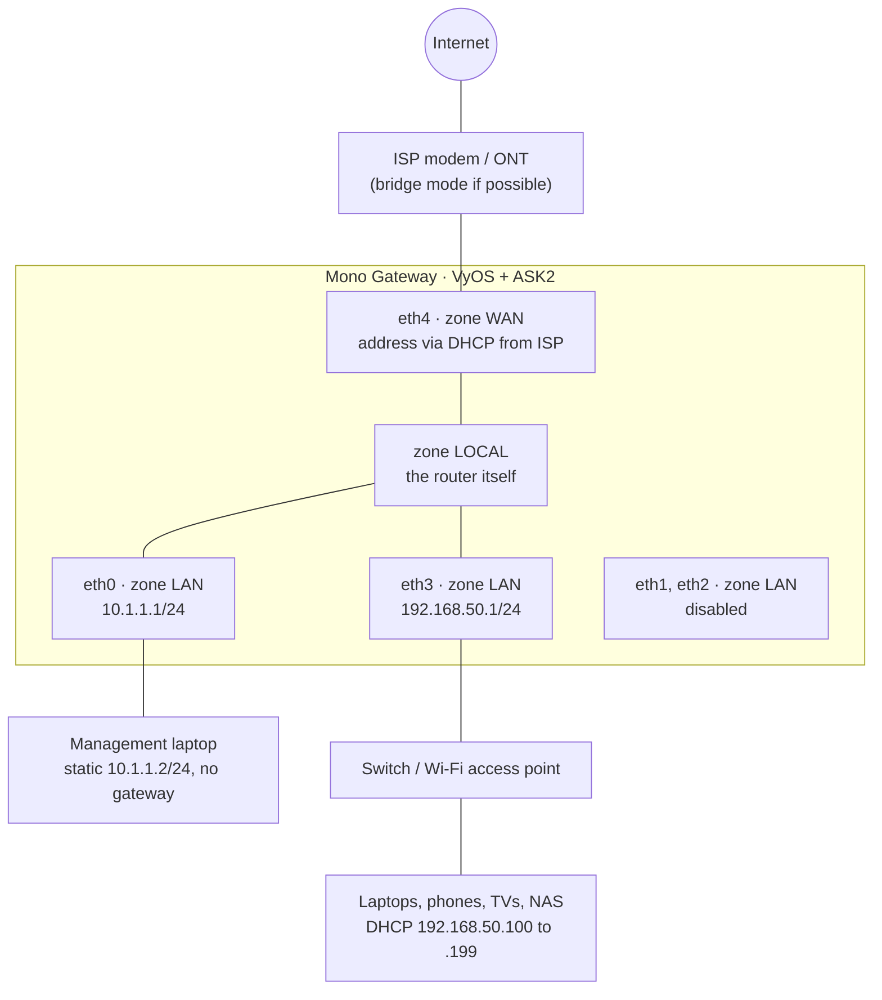
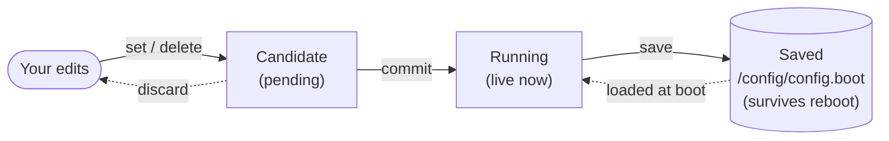

# Mono Gateway: VyOS Router Configuration with ASK2

This guide configures the Mono Gateway Development Kit with this repository's LS1046A VyOS image. It builds a stateful home router with a WAN zone and a LAN zone that includes the management network, then shows how to check that eligible traffic uses the board's ASK2/FMan hardware offload. It assumes basic terminal and IP-networking knowledge, but not prior VyOS experience.

The commands are written for this repository's single-image build, starting from a **freshly installed board running the factory configuration shipped in the ISO**. Chapter 1 lists exactly what that starting point contains.

> **Validation status:** This is a draft based on the repository's factory configuration and current source, not a walkthrough verified end to end on a named ISO. The current port-mapping changes still need fresh-install and upgrade checks on a board. Check your image and physical port names, and complete the tests below before relying on this configuration. Record the image version and test date here when that validation is done.

**What you end up with**

| Piece | Result |
|---|---|
| WAN | `eth4` (right SFP+), address from your ISP via DHCP. RJ45 alternative in chapter 1. |
| Home LAN | `eth3` (left SFP+), router at `192.168.50.1/24` |
| Management | `eth0` (left RJ45) at `10.1.1.1/24`, in the LAN zone; the only interface allowed to initiate SSH to the router |
| Spare ports | `eth1` and `eth2` are LAN-zone members but remain disabled until you need them |
| DHCP | On `eth3` only: `192.168.50.100` to `192.168.50.199` |
| DNS | The router runs its own recursive resolver, with DNSSEC validation |
| Firewall | Zone-based, default deny, stateful, IPv4 and IPv6 |
| NAT | The home LAN masqueraded behind the WAN address |
| Time | The factory NTP servers, served to the home LAN only |
| SSH | Management network only, key-only, published factory key removed |
| Offload | ASK2 hardware forwarding for eligible IPv4 traffic; IPv6 offload off until validated |

Allow at least one to two hours the first time, plus time to test your ISP connection and hardware offload. Do not rush a confirmed commit.

---

## Table of contents

1. [Before you start](#1-before-you-start)
2. [How VyOS thinks (10-minute crash course)](#2-how-vyos-thinks-10-minute-crash-course)
3. [System basics and credentials](#3-system-basics-and-credentials)
4. [Interfaces](#4-interfaces)
5. [Firewall](#5-firewall)
6. [NAT](#6-nat)
7. [Routing](#7-routing)
8. [LAN services: DHCP, DNS, NTP, SSH](#8-lan-services-dhcp-dns-ntp-ssh)
9. [ASK2 hardware offload](#9-ask2-hardware-offload)
10. [IPv6 (optional)](#10-ipv6-optional)
11. [Living with it: backups, upgrades, troubleshooting](#11-living-with-it-backups-upgrades-troubleshooting)
- [Appendix A: Complete configuration as set commands](#appendix-a-complete-configuration-as-set-commands)
- [Appendix B: Plan B and C staged commands](#appendix-b-plan-b-and-c-staged-commands)
- [Appendix C: Further reading](#appendix-c-further-reading)

Every configuration chapter follows the same rhythm:

- **Why**: what problem this solves
- **Configure**: where shown, an abridged *hierarchical view* of the plan A target state, then the *set commands* that build it
- **Verify**: checks for the expected behavior, with limitations called out where applicable
- **So what**: what you have now, and what it unlocks

---

## 1. Before you start

### Installation, console, and defaults

First install the LS1046A image using [INSTALL.md](./INSTALL.md). Installation is performed from the USB-live system; **never run `install image` on an installed system**, because it repartitions eMMC.

Keep the serial console connected at 115200 8N1 for the whole guide. It is the recovery path if an interface or firewall change interrupts SSH, but it still requires valid login credentials; keep a working authenticated session while changing them.

Log in on the serial console as `vyos`, using the password you typed at the `install image` prompt. The installer accepts the well-known default `vyos` with only a warning, so treat this password as **temporary** whatever you chose: chapter 3 replaces it before any network is connected.

### Test equipment and tools

Have a management laptop, a separate home LAN client, and a test device on a reachable WAN-side network. The examples assume a Unix-like shell; the clients need `ping`, `nc` and `dig`, and the management laptop needs `ssh` and `ssh-keygen`. To test offload in chapter 9, provide `iperf3` on the LAN client and a reachable server you control on the WAN side.

The router-side tests use `tcpdump`, `nft`, `conntrack` and `ynl`. Check that they are available on your image with `command -v tcpdump`, `command -v nft`, `command -v conntrack` and `command -v ynl`; do not assume a missing tool produced a passing result. If router-side capture is unavailable, capture the router-facing WAN port with a suitable mirror or tap and still check the firewall counters. Prepare any missing test equipment before the WAN gate rather than connecting an unprotected router to obtain it.

### The factory starting point

A fresh install boots the factory configuration from the ISO:

| Area | Factory setting | Changed in this guide |
|---|---|---|
| Interfaces | DHCP client on all five ports; `eth0` described as `MGMT (left RJ45)` | Chapter 4: static `eth0` and `eth3`, `eth4` stays DHCP, `eth1` and `eth2` disabled |
| ASK2 offload | `offload ipv4` and `offload ipv6` on `eth1` to `eth4`; none on `eth0` | Chapter 4: IPv6 offload turned off on the active ports before connecting WAN; chapter 9 explains why |
| Flowtable | Hardware flowtable `FT` on `eth1` to `eth4`; IPv4 and IPv6 forward rule 10 `action offload`; `hardware-offload-delay 500` | Unchanged; chapter 9 explains it |
| Firewall | No zones, no rulesets, no input filtering | Chapter 5 |
| NAT | None | Chapter 6 |
| SSH | Enabled on port 22, listening on every address | Chapter 5 firewalls it; chapter 8.4 binds it to management and disables passwords |
| Login | User `vyos` with the temporary install-time password, **plus** the published factory `vanityssh@vyos` public key | Chapter 3 sets a new password and replaces the key |
| NTP | Servers `time.apple.com`, `time.cloudflare.com`, `time.google.com`; clients allowed from all private ranges | Chapter 8.3 limits clients |
| System | Host name `vyos`, 100 commit revisions, update check, watchdog | Chapter 3 |
| DHCP server, DNS, global IPv6 | None configured; IPv6 link-local addresses may exist | Chapters 8 and 10 |

There is **no firewall** in the factory configuration. SSH answers on every port that has an address, the install-time password may be the default `vyos`, and the private half of the `vanityssh@vyos` key is published in [INSTALL.md](./INSTALL.md#ssh-access--vanity-key). Until chapter 3 is done, anyone who can reach the router may be able to log in.

> **Do not connect the WAN yet.** Start with only the serial console connected. After replacing the credentials in chapter 3, and until the [WAN gate in section 5.9](#59-connect-the-wan) passes, connect only:
> - the serial console;
> - `eth0` (left RJ45), to your management laptop;
> - your LAN port (default `eth3`, left SFP+), to a LAN client or switch for testing.
>
> Leave the WAN port and the spare ports unplugged.

To confirm the starting point, run `show version`, `show configuration commands` and `show offload config` in operational mode. See [CLI-AND-TOOLS.md](./CLI-AND-TOOLS.md) for the build-specific commands.

### Choose your WAN and LAN ports

| VyOS interface | Mono Gateway port |
|---|---|
| `eth0` | Left RJ45 |
| `eth1` | Center RJ45 |
| `eth2` | Right RJ45 |
| `eth3` | Left SFP+ |
| `eth4` | Right SFP+ |

`eth0` is always management in this guide. The other decision depends on your cables:

> **The SFP+ cages support 10G only on this build.** A 1G-only module or peer will not link. Most home ISP modems and ONTs hand off over RJ45, so check yours before deciding.

| Plan | When to use it | WAN | Home LAN | Disabled |
|---|---|---|---|---|
| **A (default)** | ISP hands off 10G SFP+, LAN switch has 10G SFP+ | `eth4` | `eth3` | `eth1`, `eth2` |
| **B** | ISP hands off over RJ45, LAN switch has 10G SFP+ | `eth2` | `eth3` | `eth1`, `eth4` |
| **C** | Both ISP and LAN switch are RJ45 | `eth2` | `eth1` | `eth3`, `eth4` |

The main chapters are written for **plan A**. For plan B or C, follow the same stages but use the replacement commands and checks in [Appendix B](#appendix-b-plan-b-and-c-staged-commands) whenever a chapter points there; do not also run the plan A interface-specific commands. The appendix keeps `eth0` as management and puts every non-WAN port in the LAN zone. Confirm the physical naming with one cable at a time after chapter 3, checking `show interfaces`; see [HARDWARE.md](./HARDWARE.md#33-vyos-port-naming).

All three plans assume an Ethernet WAN that obtains IPv4 addressing and a default route by DHCP. A provider requiring PPPoE, a VLAN tag, a static address, or another authentication method needs additional configuration not covered by this walkthrough. Check the ISP's requirements and make sure its subnet does not overlap either local subnet before proceeding.

### The network we are building



The internet is untrusted. The home and management networks are separate IP subnets in the same LAN firewall zone, not a bridge or a single Ethernet segment. The home subnet gets internet access and the router's services; a rule restricts new SSH connections to the management cable and subnet.

**Same zone is not isolation.** VyOS permits routed traffic between interfaces in the same zone by default, so a device with suitable routes can reach another LAN subnet. The management laptop's example configuration has no gateway, but that is not a firewall. If the management devices must be isolated from the home LAN, add and test an intra-zone policy; do not assume the shared zone provides isolation. Disabled spare ports join the zone now but have no address or service until deliberately configured.

### The plan, written down

Write these values down before you type anything. Changing a subnet later is possible but annoying.

| Setting | Value in this guide | Your value |
|---|---|---|
| WAN interface | `eth4` | |
| Home LAN interface | `eth3` | |
| Management interface | `eth0` | |
| Management network | `10.1.1.0/24`, router `10.1.1.1` | |
| Management laptop | static `10.1.1.2/24`, no gateway | |
| Home LAN subnet | `192.168.50.0/24`, router `192.168.50.1` | |
| DHCP pool | `192.168.50.100` to `192.168.50.199` | |
| Static/reserved range | `192.168.50.2` to `192.168.50.99` | |
| Local domain | `home.arpa` | |
| Time zone | `America/Los_Angeles` | |

Why `192.168.50.0/24` and `10.1.1.0/24`? Consumer routers and ISP modems commonly use `192.168.0.x`, `192.168.1.x` and `10.0.0.x`. Avoiding those means your LAN will not collide with the network on the other side of the ISP box, or with a network your laptop joins elsewhere. If you change either subnet, update the interface, groups, NAT, DHCP, DNS and NTP examples consistently.

---

## 2. How VyOS thinks (10-minute crash course)

Read this chapter even if you skim the others. Almost every beginner mistake with VyOS comes from not knowing the three layers of configuration.

### Two modes

| Prompt | Mode | What you do there |
|---|---|---|
| `vyos@router:~$` | **Operational** | Look at things: `show`, `ping`, `traceroute`, `monitor`, `reboot` |
| `vyos@router#` | **Configuration** | Change things: `set`, `delete`, `commit`, `save` |

Enter configuration mode with `configure`, leave with `exit`. From config mode you can run any operational command by prefixing it with `run`, for example `run show interfaces`.

### Three layers of configuration



- `set` and `delete` only change the **candidate**. Nothing happens on the network yet.
- `compare` shows the difference between candidate and running.
- `commit` makes the candidate live. If it fails validation, nothing changes.
- `save` writes the running config to disk. **Forget `save`, and a reboot quietly undoes your work.** Everyone does this once. Ideally only once.

### Two ways to look at the same config

VyOS config is a tree. `show` (in config mode) prints it as a tree:

```text
interfaces {
    ethernet eth3 {
        address 192.168.50.1/24
        description LAN
    }
}
```

`show | commands` prints the same thing as the flat `set` commands that build it:

```text
set interfaces ethernet eth3 address '192.168.50.1/24'
set interfaces ethernet eth3 description 'LAN'
```

Every chapter shows both. The tree is for understanding, the commands are for typing.

You can also move around the tree like directories:

```text
vyos@router# edit interfaces ethernet eth3
[edit interfaces ethernet eth3]
vyos@router# set description 'LAN'
vyos@router# top
```

### Tab and `?` are your manual

Press `Tab` to complete, `?` to list options with a short description. You can explore the whole configuration tree this way. It is faster than any documentation, including this one.

### Your safety net

| Command | What it does |
|---|---|
| `compare` | Show pending changes before committing |
| `discard` | Throw away all uncommitted changes |
| `commit-confirm 5` | Commit, but revert automatically unless you type `confirm` within 5 minutes |
| `confirm` | Keep a `commit-confirm` change |
| `show system commit` (op mode) | List previous commits |
| `compare 3` | Diff the candidate against commit revision 3 |
| `rollback 3` | Restore commit revision 3 and reboot |

With the current VyOS default, an unconfirmed commit causes a reboot into the last **saved** configuration. The optional `set system config-management commit-confirm action reload` changes that behavior to a reload of the previous committed revision; check the confirmation prompt on your image. Ordinary `rollback 3` also prompts for a reboot. These behaviors are based on the pinned source and still need validation on the named target image.

> **Golden rule:** save the last known-good configuration before changing credentials, firewall rules, interface addresses, or SSH; use `commit-confirm`, test from a second session, then `confirm` and `save`. Do not save an unconfirmed change. A timer is a recovery aid, not a substitute for a working serial login and a tested recovery path.

### Habits worth having from day one

- Give everything a `description`. Future you is a stranger who does not remember why rule 40 exists.
- Number rules with gaps (10, 20, 30). You will want to insert something between them. Yes, this is the BASIC line-numbering trick from the 1980s, and yes, it still works.
- `commit`, test, then `save`. In that order.

---

## 3. System basics and credentials

### Why

Hostname, domain, and time zone appear in logs, DHCP, and DNS. Getting them right now avoids confusing logs later. The factory configuration already keeps 100 commit revisions; the command below only makes that explicit.

More importantly, the factory login is not secret. The install-time password may be the default `vyos`, and the login trusts the `vanityssh@vyos` public key, whose private key is published in [INSTALL.md](./INSTALL.md#ssh-access--vanity-key). Replace both now, before anything but the serial console is connected.

On your laptop, create a key if you do not have one yet:

```bash
ssh-keygen -t ed25519
cat ~/.ssh/id_ed25519.pub
# ssh-ed25519 AAAAC3NzaC1lZDI1NTE5AAAA...  you@laptop
ssh-keygen -y -f ~/.ssh/id_ed25519
```

The last command derives the public key from the private key; its type and long middle part must match the `.pub` file. It may ask for the private key's local passphrase. Replace the abbreviated placeholder below with the complete matching public key, and the router password with your own, before entering the commands.

### Configure

What `show system` will print after the commit (the password appears only as a hash):

```text
system {
    config-management {
        commit-revisions 100
    }
    domain-name home.arpa
    host-name router
    login {
        user vyos {
            authentication {
                encrypted-password $6$...
                public-keys laptop {
                    key AAAAC3NzaC1lZDI1NTE5AAAA...
                    type ssh-ed25519
                }
            }
        }
    }
    time-zone America/Los_Angeles
}
```

Commands:

```text
configure
set system host-name 'router'
set system domain-name 'home.arpa'
set system time-zone 'America/Los_Angeles'
set system config-management commit-revisions '100'
set system login user vyos authentication plaintext-password 'a-long-passphrase-you-will-remember'
delete system login user vyos authentication public-keys 'vanityssh@vyos'
set system login user vyos authentication public-keys laptop key 'AAAAC3NzaC1lZDI1NTE5AAAA...'
set system login user vyos authentication public-keys laptop type 'ssh-ed25519'
compare
commit-confirm 10
```

You type the password as `plaintext-password`; VyOS hashes it on commit and stores only `encrypted-password`.

> **Why `home.arpa`?** It is the domain reserved for home networks by RFC 8375. Do not use `.local` (taken by mDNS, which your printer and phone use) or a made-up TLD like `.lan` or `.home` (they may become real some day). `home.arpa` says exactly what it is.

### Verify

```text
run show configuration commands | match public-keys
run show date
```

The `public-keys` output must list `laptop` and must not list `vanityssh@vyos`. Keep the original serial login open. Leave configuration mode with `exit`, then, as the unprivileged `vyos` user, start a nested login:

```text
/usr/bin/su - vyos
```

Enter the **new router password** when prompted. A successful nested login tests the password without discarding the original session; type `exit` once to return to that session, then run `configure`, `confirm`, and `save`. The SSH key is tested independently in chapter 4 before WAN is connected.

If `su` fails, does not ask for a password, or the timer expires, do not treat it as a successful password test and do not confirm or save. Let the timer restore the saved configuration, regain the serial login with the previous password, and retry or use a tested second-login recovery method. The nested-login procedure itself must be verified on the target ISO.

### So what

The router has an identity, a long undo history, and credentials that only you know. That is the first of the conditions for connecting the WAN. Next: give it addresses.

---

## 4. Interfaces

### Why

Each active port gets a clear job:

- **`eth0`, management:** a fixed, easy-to-remember address. It needs no DHCP and no gateway, because the only thing on it is your laptop.
- **`eth3`, home LAN:** a fixed address, because every device will use it as its gateway.
- **`eth4`, WAN:** keeps the factory DHCP client for the DHCP-based ISP connection assumed by this guide.
- **`eth1` and `eth2`, spare:** disabled and without DHCP. An unused DHCP client could obtain a competing default route. They will be LAN-zone members, but re-enable and address one only when you have a job for it and have considered the intra-zone policy.

> **Make this change from the serial console.** Any SSH session using the DHCP address `eth0` received at boot drops when the address changes.

### Configure

Hierarchical view:

```text
interfaces {
    ethernet eth0 {
        address 10.1.1.1/24
        description MGMT
    }
    ethernet eth1 {
        description SPARE
        disable
    }
    ethernet eth2 {
        description SPARE
        disable
    }
    ethernet eth3 {
        address 192.168.50.1/24
        description LAN
    }
    ethernet eth4 {
        address dhcp
        description WAN
    }
}
```

Commands for **plan A**. For plan B or C, use the chapter 4 block in [Appendix B](#appendix-b-plan-b-and-c-staged-commands) instead.

```text
delete interfaces ethernet eth0 address 'dhcp'
set interfaces ethernet eth0 description 'MGMT'
set interfaces ethernet eth0 address '10.1.1.1/24'
delete interfaces ethernet eth1 address 'dhcp'
set interfaces ethernet eth1 description 'SPARE'
set interfaces ethernet eth1 disable
delete interfaces ethernet eth2 address 'dhcp'
set interfaces ethernet eth2 description 'SPARE'
set interfaces ethernet eth2 disable
delete interfaces ethernet eth3 address 'dhcp'
set interfaces ethernet eth3 description 'LAN'
set interfaces ethernet eth3 address '192.168.50.1/24'
set interfaces ethernet eth4 description 'WAN'
delete interfaces ethernet eth3 offload ipv6
delete interfaces ethernet eth4 offload ipv6
compare
commit-confirm 10
```

Give the management laptop the static address `10.1.1.2/24` with no gateway, and before the timer expires run:

```bash
ssh -o PreferredAuthentications=publickey -o PasswordAuthentication=no -o KbdInteractiveAuthentication=no vyos@10.1.1.1
```

It must log in with your key, not the router password. A prompt to unlock your private key is local to the laptop and is different from the router password. If this fails, keep the original console session and let the timer revert; do not confirm or save. If it succeeds, return to the console:

```text
confirm
save
```

Notes:

- The current pinned VyOS port-naming work uses `/config/interface-mapping.json` rather than keeping `hw-id` in the interface configuration. Fresh-install and upgrade validation is still pending; verify each physical port before relying on its name and do not hand-edit the mapping file.
- Leave MTU at 1500 unless you have an end-to-end reason to change it. ASK2 validates an MTU of 1280 to 3600 on engaged ports.
- Do not bridge ports to make them share a subnet: on this ASK2 build, bridge-member ports use the bridge offload path instead of routed offload.
- The disabled ports stay listed in the factory flowtable `FT`. That is harmless: a disabled port carries no traffic.
- The two `delete ... offload ipv6` commands turn off IPv6 **hardware** offload on the active ports before WAN is connected. IPv6 can still use software forwarding; chapter 9 explains the open limitation.

### Verify

```text
run show interfaces
```

For plan A, `eth0` should show `10.1.1.1/24`; `eth3` should show `192.168.50.1/24` and have link if its cable and 10G peer are connected; `eth1` and `eth2` should show `A/D` (administratively down); `eth4` should have no lease yet with its cable unplugged. Use the plan-specific checks in Appendix B for plans B and C.

### So what

Every port now has exactly one job, and the ones without a job are off. Before the WAN side talks to the internet, it needs a firewall.

---

## 5. Firewall

This is the longest chapter because it matters most. Take your time.

### 5.1 Concepts in four paragraphs

**Stateful.** The firewall tracks connections. When your laptop opens a connection to a website, reply packets are recognized as part of that connection. The default-drop rulesets below start with a rule 5 that accepts those *established* and *related* packets; subsequent rules decide which new connections are allowed. The router-origin `LOCAL-*` rulesets instead default to accept. Section 5.2 explains why the state accept is not global.

**Default deny.** Anything not explicitly allowed is dropped. You open holes on purpose; you never close them in a panic after the fact.

**Zones.** Instead of writing rules per interface, you group interfaces into zones and write one ruleset per *direction between zones*. For plan A we use three:

| Zone | Contains | Meaning |
|---|---|---|
| `WAN` | `eth4` | The internet. Untrusted. |
| `LAN` | `eth0`, `eth1`, `eth2`, `eth3` | Management and home LAN subnets; `eth1` and `eth2` remain disabled. |
| `LOCAL` | the router itself | Traffic *to* or *from* VyOS, not *through* it. |

**The matrix.** Every arrow between zones gets a ruleset. Read it row by row: traffic **from** this zone **to** that zone. "Dropped" means there is no ruleset for that direction, so the zone default applies.

| from \ to | **LAN** | **WAN** | **LOCAL** (router) |
|---|---|---|---|
| **LAN** | intra-zone traffic allowed by default | `LAN-WAN`: new connections from the home subnet | `LAN-LOCAL`: DHCP, DNS, NTP, ping; SSH from management only |
| **WAN** | `WAN-LAN`: replies only | | `WAN-LOCAL`: replies, DHCP from ISP, rate-limited ping |
| **LOCAL** | `LOCAL-LAN`: allow | `LOCAL-WAN`: allow | |

Each ruleset exists twice: one for IPv4 (`-v4`), one for IPv6 (`-v6`). We configure IPv6 rules even if you do not have IPv6 yet. When your ISP turns it on one day, you are already protected instead of accidentally wide open.

### 5.2 Global options

#### Why

These are kernel-level protections, plus the one global state rule this build allows: drop invalid packets.

#### Configure

Hierarchical view:

```text
firewall {
    global-options {
        all-ping enable
        broadcast-ping disable
        ip-src-route disable
        ipv6-src-route disable
        log-martians enable
        receive-redirects disable
        send-redirects disable
        source-validation strict
        state-policy {
            invalid {
                action drop
            }
        }
        syn-cookies enable
    }
}
```

Commands:

```text
set firewall global-options state-policy invalid action 'drop'
set firewall global-options all-ping 'enable'
set firewall global-options broadcast-ping 'disable'
set firewall global-options ip-src-route 'disable'
set firewall global-options ipv6-src-route 'disable'
set firewall global-options receive-redirects 'disable'
set firewall global-options send-redirects 'disable'
set firewall global-options log-martians 'enable'
set firewall global-options syn-cookies 'enable'
set firewall global-options source-validation 'strict'
```

> **Why no global "accept established"?** Most VyOS guides accept established and related traffic once, globally. On this build that would break hardware offload: the factory forward rule 10 (`action offload`, chapter 9) must see established packets to hand them to the hardware, and a global accept runs first and shadows it. The build rejects that combination at commit. So the global policy only drops `invalid`, and each default-drop ruleset accepts established and related traffic itself, in rule 5. Do not add a global `state-policy established` or `related` accept.

What each option buys you:

| Option | Plain English |
|---|---|
| `state-policy invalid drop` | Packets that fit no known connection and are not a valid start of one are garbage or an attack. |
| `all-ping enable` | The router *can* answer pings. Whether it *does* is decided by the zone rules below. |
| `broadcast-ping disable` | Do not answer pings sent to a broadcast address (classic amplification trick). |
| `ip-src-route` / `ipv6-src-route disable` | Ignore packets that try to dictate their own path through the network. |
| `receive-redirects` / `send-redirects disable` | ICMP redirects are a routing shortcut nobody needs at home and an attacker might enjoy. |
| `log-martians enable` | Log packets with impossible source addresses. Interesting to read, occasionally useful. |
| `syn-cookies enable` | Survive SYN floods without running out of memory. |
| `source-validation strict` | IPv4 reverse-path filtering: drop packets when the best return route to their source uses a different interface. This fits the example's single uplink and symmetric routes; use `loose` if you introduce asymmetric routing. It does not cover IPv6. |

Do not commit yet; the rulesets come next and we commit everything together.

### 5.3 Groups

#### Why

Groups are named lists of addresses. Rules reference the name, so when something changes you update one group instead of ten rules.

#### Configure

Hierarchical view:

```text
firewall {
    group {
        network-group BOGONS-V4 {
            description "Addresses that must never appear as a source on the internet"
            network 0.0.0.0/8
            network 10.0.0.0/8
            network 127.0.0.0/8
            network 169.254.0.0/16
            network 172.16.0.0/12
            network 192.0.2.0/24
            network 192.168.0.0/16
            network 198.18.0.0/15
            network 198.51.100.0/24
            network 203.0.113.0/24
            network 224.0.0.0/4
            network 240.0.0.0/4
        }
        network-group LAN-NETS {
            description "Home LAN subnets"
            network 192.168.50.0/24
        }
        network-group MGMT-NETS {
            description "Management subnets"
            network 10.1.1.0/24
        }
    }
}
```

Commands:

```text
set firewall group network-group LAN-NETS description 'Home LAN subnets'
set firewall group network-group LAN-NETS network '192.168.50.0/24'
set firewall group network-group MGMT-NETS description 'Management subnets'
set firewall group network-group MGMT-NETS network '10.1.1.0/24'

set firewall group network-group BOGONS-V4 description 'Addresses that must never appear as a source on the internet'
set firewall group network-group BOGONS-V4 network '0.0.0.0/8'
set firewall group network-group BOGONS-V4 network '10.0.0.0/8'
set firewall group network-group BOGONS-V4 network '127.0.0.0/8'
set firewall group network-group BOGONS-V4 network '169.254.0.0/16'
set firewall group network-group BOGONS-V4 network '172.16.0.0/12'
set firewall group network-group BOGONS-V4 network '192.0.2.0/24'
set firewall group network-group BOGONS-V4 network '192.168.0.0/16'
set firewall group network-group BOGONS-V4 network '198.18.0.0/15'
set firewall group network-group BOGONS-V4 network '198.51.100.0/24'
set firewall group network-group BOGONS-V4 network '203.0.113.0/24'
set firewall group network-group BOGONS-V4 network '224.0.0.0/4'
set firewall group network-group BOGONS-V4 network '240.0.0.0/4'
```

> **Why is `100.64.0.0/10` not in the bogon list?** That range is carrier-grade NAT space, which some ISPs use on their infrastructure. A private WAN may also legitimately receive traffic from `10.0.0.0/8`, `172.16.0.0/12`, or `192.168.0.0/16`: rule 20 below drops new router-directed traffic from those ranges after the DHCP and established-flow exceptions. If you need a specific upstream diagnostic or service, add and test a narrowly scoped exception before the bogon rule rather than removing an entire range without considering the effect. Private WAN addressing must not overlap either local subnet.

### 5.4 IPv4 rulesets

#### Router-facing rules from the internet: `WAN-LOCAL-v4`

```text
firewall {
    ipv4 {
        name WAN-LOCAL-v4 {
            default-action drop
            description "Internet to router"
            rule 5 {
                action accept
                description "Established and related"
                state established
                state related
            }
            rule 10 {
                action accept
                description "DHCP replies from ISP"
                destination {
                    port 68
                }
                protocol udp
                source {
                    port 67
                }
            }
            rule 20 {
                action drop
                description "Spoofed or reserved sources"
                source {
                    group {
                        network-group BOGONS-V4
                    }
                }
            }
            rule 30 {
                action accept
                description "Ping, rate limited"
                icmp {
                    type-name echo-request
                }
                limit {
                    burst 10
                    rate 5/second
                }
                protocol icmp
            }
        }
    }
}
```

```text
set firewall ipv4 name WAN-LOCAL-v4 default-action 'drop'
set firewall ipv4 name WAN-LOCAL-v4 description 'Internet to router'
set firewall ipv4 name WAN-LOCAL-v4 rule 5 action 'accept'
set firewall ipv4 name WAN-LOCAL-v4 rule 5 description 'Established and related'
set firewall ipv4 name WAN-LOCAL-v4 rule 5 state 'established'
set firewall ipv4 name WAN-LOCAL-v4 rule 5 state 'related'
set firewall ipv4 name WAN-LOCAL-v4 rule 10 action 'accept'
set firewall ipv4 name WAN-LOCAL-v4 rule 10 description 'DHCP replies from ISP'
set firewall ipv4 name WAN-LOCAL-v4 rule 10 protocol 'udp'
set firewall ipv4 name WAN-LOCAL-v4 rule 10 source port '67'
set firewall ipv4 name WAN-LOCAL-v4 rule 10 destination port '68'
set firewall ipv4 name WAN-LOCAL-v4 rule 20 action 'drop'
set firewall ipv4 name WAN-LOCAL-v4 rule 20 description 'Spoofed or reserved sources'
set firewall ipv4 name WAN-LOCAL-v4 rule 20 source group network-group 'BOGONS-V4'
set firewall ipv4 name WAN-LOCAL-v4 rule 30 action 'accept'
set firewall ipv4 name WAN-LOCAL-v4 rule 30 description 'Ping, rate limited'
set firewall ipv4 name WAN-LOCAL-v4 rule 30 protocol 'icmp'
set firewall ipv4 name WAN-LOCAL-v4 rule 30 icmp type-name 'echo-request'
set firewall ipv4 name WAN-LOCAL-v4 rule 30 limit rate '5/second'
set firewall ipv4 name WAN-LOCAL-v4 rule 30 limit burst '10'
```

Why this order: after replies, **DHCP comes before the bogon rule**. Some ISPs send DHCP replies from private addresses. If rule 20 came first, your router would block its own ISP and never get an address. Rules are evaluated top to bottom and the first match wins.

Why allow ping: it helps your ISP (and you) diagnose problems, and "stealth mode" buys nothing real: the scanners already know your address is there. If you disagree, delete rule 30. It is your router.

Nothing is logged here on purpose. The internet throws junk at every public address all day; logging it fills your disk and teaches you nothing.

#### Traffic from the internet to your devices: `WAN-LAN-v4`

```text
firewall {
    ipv4 {
        name WAN-LAN-v4 {
            default-action drop
            description "Internet to LAN"
            rule 5 {
                action accept
                description "Established and related"
                state established
                state related
            }
        }
    }
}
```

```text
set firewall ipv4 name WAN-LAN-v4 default-action 'drop'
set firewall ipv4 name WAN-LAN-v4 description 'Internet to LAN'
set firewall ipv4 name WAN-LAN-v4 rule 5 action 'accept'
set firewall ipv4 name WAN-LAN-v4 rule 5 description 'Established and related'
set firewall ipv4 name WAN-LAN-v4 rule 5 state 'established'
set firewall ipv4 name WAN-LAN-v4 rule 5 state 'related'
```

Replies to things your devices asked for come back through rule 5. Anything else is unsolicited and dropped. Port forwards (chapter 6) add rules here.

#### Your devices going out: `LAN-WAN-v4`

```text
firewall {
    ipv4 {
        name LAN-WAN-v4 {
            default-action drop
            description "LAN to Internet"
            rule 5 {
                action accept
                description "Established and related"
                state established
                state related
            }
            rule 10 {
                action accept
                description "New connections from the home LAN"
                source {
                    group {
                        network-group LAN-NETS
                    }
                }
            }
        }
    }
}
```

```text
set firewall ipv4 name LAN-WAN-v4 default-action 'drop'
set firewall ipv4 name LAN-WAN-v4 description 'LAN to Internet'
set firewall ipv4 name LAN-WAN-v4 rule 5 action 'accept'
set firewall ipv4 name LAN-WAN-v4 rule 5 description 'Established and related'
set firewall ipv4 name LAN-WAN-v4 rule 5 state 'established'
set firewall ipv4 name LAN-WAN-v4 rule 5 state 'related'
set firewall ipv4 name LAN-WAN-v4 rule 10 action 'accept'
set firewall ipv4 name LAN-WAN-v4 rule 10 description 'New connections from the home LAN'
set firewall ipv4 name LAN-WAN-v4 rule 10 source group network-group 'LAN-NETS'
```

Why not just `default-action accept`? Because a device with a misconfigured or spoofed address should not be able to send traffic out under your name. Allowing only `LAN-NETS` costs one rule.

#### Your devices talking to the router: `LAN-LOCAL-v4`

```text
firewall {
    ipv4 {
        name LAN-LOCAL-v4 {
            default-action drop
            description "LAN to router"
            rule 5 {
                action accept
                description "Established and related"
                state established
                state related
            }
            rule 10 {
                action accept
                description DHCP
                destination {
                    port 67
                }
                protocol udp
                source {
                    port 68
                }
            }
            rule 20 {
                action accept
                description DNS
                destination {
                    port 53
                }
                protocol tcp_udp
            }
            rule 30 {
                action accept
                description NTP
                destination {
                    port 123
                }
                protocol udp
            }
            rule 40 {
                action accept
                description ICMP
                protocol icmp
            }
            rule 50 {
                action accept
                description "SSH from management"
                destination {
                    address 10.1.1.1
                    port 22
                }
                inbound-interface {
                    name eth0
                }
                protocol tcp
                source {
                    group {
                        network-group MGMT-NETS
                    }
                }
            }
            rule 999 {
                action drop
                description "Log everything else"
                log
            }
        }
    }
}
```

```text
set firewall ipv4 name LAN-LOCAL-v4 default-action 'drop'
set firewall ipv4 name LAN-LOCAL-v4 description 'LAN to router'
set firewall ipv4 name LAN-LOCAL-v4 rule 5 action 'accept'
set firewall ipv4 name LAN-LOCAL-v4 rule 5 description 'Established and related'
set firewall ipv4 name LAN-LOCAL-v4 rule 5 state 'established'
set firewall ipv4 name LAN-LOCAL-v4 rule 5 state 'related'
set firewall ipv4 name LAN-LOCAL-v4 rule 10 action 'accept'
set firewall ipv4 name LAN-LOCAL-v4 rule 10 description 'DHCP'
set firewall ipv4 name LAN-LOCAL-v4 rule 10 protocol 'udp'
set firewall ipv4 name LAN-LOCAL-v4 rule 10 source port '68'
set firewall ipv4 name LAN-LOCAL-v4 rule 10 destination port '67'
set firewall ipv4 name LAN-LOCAL-v4 rule 20 action 'accept'
set firewall ipv4 name LAN-LOCAL-v4 rule 20 description 'DNS'
set firewall ipv4 name LAN-LOCAL-v4 rule 20 protocol 'tcp_udp'
set firewall ipv4 name LAN-LOCAL-v4 rule 20 destination port '53'
set firewall ipv4 name LAN-LOCAL-v4 rule 30 action 'accept'
set firewall ipv4 name LAN-LOCAL-v4 rule 30 description 'NTP'
set firewall ipv4 name LAN-LOCAL-v4 rule 30 protocol 'udp'
set firewall ipv4 name LAN-LOCAL-v4 rule 30 destination port '123'
set firewall ipv4 name LAN-LOCAL-v4 rule 40 action 'accept'
set firewall ipv4 name LAN-LOCAL-v4 rule 40 description 'ICMP'
set firewall ipv4 name LAN-LOCAL-v4 rule 40 protocol 'icmp'
set firewall ipv4 name LAN-LOCAL-v4 rule 50 action 'accept'
set firewall ipv4 name LAN-LOCAL-v4 rule 50 description 'SSH from management'
set firewall ipv4 name LAN-LOCAL-v4 rule 50 inbound-interface name 'eth0'
set firewall ipv4 name LAN-LOCAL-v4 rule 50 source group network-group 'MGMT-NETS'
set firewall ipv4 name LAN-LOCAL-v4 rule 50 destination address '10.1.1.1'
set firewall ipv4 name LAN-LOCAL-v4 rule 50 destination port '22'
set firewall ipv4 name LAN-LOCAL-v4 rule 50 protocol 'tcp'
set firewall ipv4 name LAN-LOCAL-v4 rule 999 action 'drop'
set firewall ipv4 name LAN-LOCAL-v4 rule 999 description 'Log everything else'
set firewall ipv4 name LAN-LOCAL-v4 rule 999 log
```

Rule 50 accepts new SSH connections only when all three match: they arrive on `eth0`, originate in `MGMT-NETS`, and target `10.1.1.1`. The home LAN's devices do not get a router login prompt. Other unmatched traffic is dropped and logged. Chapter 8.4 also binds SSH to the management address; neither control isolates the management laptop from other LAN devices.

#### The router talking out: `LOCAL-*-v4`

```text
firewall {
    ipv4 {
        name LOCAL-LAN-v4 {
            default-action accept
            description "Router to LAN"
        }
        name LOCAL-WAN-v4 {
            default-action accept
            description "Router to Internet"
        }
    }
}
```

```text
set firewall ipv4 name LOCAL-WAN-v4 default-action 'accept'
set firewall ipv4 name LOCAL-WAN-v4 description 'Router to Internet'
set firewall ipv4 name LOCAL-LAN-v4 default-action 'accept'
set firewall ipv4 name LOCAL-LAN-v4 description 'Router to LAN'
```

The router needs to reach DNS root servers, NTP servers, image updates, and answer its clients. If you cannot trust the router itself, firewall rules are the wrong layer to fix that.

### 5.5 IPv6 rulesets

Even with no IPv6 from your ISP today, configure these now. IPv6 has two differences that change the rules:

- **No NAT.** Devices get globally routable addresses. The firewall (specifically `WAN-LAN-v6` with default drop) is the *only* thing keeping inbound connections out. This is fine; it is exactly what NAT was accidentally doing for you in IPv4.
- **ICMPv6 is not optional.** IPv6 uses ICMPv6 for neighbor discovery (its version of ARP), router advertisements, and path MTU discovery. Block it and IPv6 breaks in slow, mysterious ways (RFC 4890 has the full story).

#### `WAN-LOCAL-v6`

```text
firewall {
    ipv6 {
        name WAN-LOCAL-v6 {
            default-action drop
            description "Internet to router (IPv6)"
            rule 5 {
                action accept
                description "Established and related"
                state established
                state related
            }
            rule 10 {
                action accept
                description "DHCPv6 replies from ISP"
                destination {
                    port 546
                }
                protocol udp
                source {
                    port 547
                }
            }
            rule 20 {
                action accept
                description "Ping, rate limited"
                icmpv6 {
                    type 128
                }
                limit {
                    burst 10
                    rate 5/second
                }
                protocol icmpv6
            }
            rule 21 {
                action drop
                description "Ping over the limit"
                icmpv6 {
                    type 128
                }
                protocol icmpv6
            }
            rule 30 {
                action accept
                description "Other ICMPv6 (neighbor discovery, RA, errors)"
                protocol icmpv6
            }
        }
    }
}
```

```text
set firewall ipv6 name WAN-LOCAL-v6 default-action 'drop'
set firewall ipv6 name WAN-LOCAL-v6 description 'Internet to router (IPv6)'
set firewall ipv6 name WAN-LOCAL-v6 rule 5 action 'accept'
set firewall ipv6 name WAN-LOCAL-v6 rule 5 description 'Established and related'
set firewall ipv6 name WAN-LOCAL-v6 rule 5 state 'established'
set firewall ipv6 name WAN-LOCAL-v6 rule 5 state 'related'
set firewall ipv6 name WAN-LOCAL-v6 rule 10 action 'accept'
set firewall ipv6 name WAN-LOCAL-v6 rule 10 description 'DHCPv6 replies from ISP'
set firewall ipv6 name WAN-LOCAL-v6 rule 10 protocol 'udp'
set firewall ipv6 name WAN-LOCAL-v6 rule 10 source port '547'
set firewall ipv6 name WAN-LOCAL-v6 rule 10 destination port '546'
set firewall ipv6 name WAN-LOCAL-v6 rule 20 action 'accept'
set firewall ipv6 name WAN-LOCAL-v6 rule 20 description 'Ping, rate limited'
set firewall ipv6 name WAN-LOCAL-v6 rule 20 protocol 'icmpv6'
set firewall ipv6 name WAN-LOCAL-v6 rule 20 icmpv6 type '128'
set firewall ipv6 name WAN-LOCAL-v6 rule 20 limit rate '5/second'
set firewall ipv6 name WAN-LOCAL-v6 rule 20 limit burst '10'
set firewall ipv6 name WAN-LOCAL-v6 rule 21 action 'drop'
set firewall ipv6 name WAN-LOCAL-v6 rule 21 description 'Ping over the limit'
set firewall ipv6 name WAN-LOCAL-v6 rule 21 protocol 'icmpv6'
set firewall ipv6 name WAN-LOCAL-v6 rule 21 icmpv6 type '128'
set firewall ipv6 name WAN-LOCAL-v6 rule 30 action 'accept'
set firewall ipv6 name WAN-LOCAL-v6 rule 30 description 'Other ICMPv6 (neighbor discovery, RA, errors)'
set firewall ipv6 name WAN-LOCAL-v6 rule 30 protocol 'icmpv6'
```

Two things worth noticing:

- Rules 20/21 are a pattern: "accept up to the limit, then drop the rest". Without rule 21, excess pings would fall through to rule 30 and be accepted anyway. Order matters.
- There is no IPv6 bogon list. Your ISP's router advertisements and DHCPv6 replies come from *link-local* (`fe80::/10`) addresses, so the naive "drop link-local from WAN" rule breaks IPv6 entirely.

#### `WAN-LAN-v6` and `LAN-WAN-v6`

```text
firewall {
    ipv6 {
        name LAN-WAN-v6 {
            default-action drop
            description "LAN to Internet (IPv6)"
            rule 5 {
                action accept
                description "Established and related"
                state established
                state related
            }
            rule 10 {
                action accept
                description "New connections from the home LAN port"
                inbound-interface {
                    name eth3
                }
            }
        }
        name WAN-LAN-v6 {
            default-action drop
            description "Internet to LAN (IPv6)"
            rule 5 {
                action accept
                description "Established and related"
                state established
                state related
            }
        }
    }
}
```

```text
set firewall ipv6 name WAN-LAN-v6 default-action 'drop'
set firewall ipv6 name WAN-LAN-v6 description 'Internet to LAN (IPv6)'
set firewall ipv6 name WAN-LAN-v6 rule 5 action 'accept'
set firewall ipv6 name WAN-LAN-v6 rule 5 description 'Established and related'
set firewall ipv6 name WAN-LAN-v6 rule 5 state 'established'
set firewall ipv6 name WAN-LAN-v6 rule 5 state 'related'

set firewall ipv6 name LAN-WAN-v6 default-action 'drop'
set firewall ipv6 name LAN-WAN-v6 description 'LAN to Internet (IPv6)'
set firewall ipv6 name LAN-WAN-v6 rule 5 action 'accept'
set firewall ipv6 name LAN-WAN-v6 rule 5 description 'Established and related'
set firewall ipv6 name LAN-WAN-v6 rule 5 state 'established'
set firewall ipv6 name LAN-WAN-v6 rule 5 state 'related'
set firewall ipv6 name LAN-WAN-v6 rule 10 action 'accept'
set firewall ipv6 name LAN-WAN-v6 rule 10 description 'New connections from the home LAN port'
set firewall ipv6 name LAN-WAN-v6 rule 10 inbound-interface name 'eth3'
```

For plan C, replace the last command with the chapter 5.5 command in [Appendix B](#appendix-b-plan-b-and-c-staged-commands); plan B uses `eth3` as shown. `LAN-WAN-v6` is the same policy as `LAN-WAN-v4`, written for IPv6's constraints. In IPv4, "new connections from `LAN-NETS`" works because the subnet is fixed. Your IPv6 prefix comes from the ISP and can change, so instead of matching the source prefix, rule 10 matches the home LAN port. Only that port starts new outbound connections.

#### `LAN-LOCAL-v6`

```text
firewall {
    ipv6 {
        name LAN-LOCAL-v6 {
            default-action drop
            description "LAN to router (IPv6)"
            rule 5 {
                action accept
                description "Established and related"
                state established
                state related
            }
            rule 10 {
                action accept
                description "ICMPv6 (neighbor discovery, router solicitation, ping)"
                protocol icmpv6
            }
            rule 20 {
                action accept
                description DNS
                destination {
                    port 53
                }
                protocol tcp_udp
            }
            rule 30 {
                action accept
                description NTP
                destination {
                    port 123
                }
                protocol udp
            }
            rule 999 {
                action drop
                description "Log everything else"
                log
            }
        }
    }
}
```

```text
set firewall ipv6 name LAN-LOCAL-v6 default-action 'drop'
set firewall ipv6 name LAN-LOCAL-v6 description 'LAN to router (IPv6)'
set firewall ipv6 name LAN-LOCAL-v6 rule 5 action 'accept'
set firewall ipv6 name LAN-LOCAL-v6 rule 5 description 'Established and related'
set firewall ipv6 name LAN-LOCAL-v6 rule 5 state 'established'
set firewall ipv6 name LAN-LOCAL-v6 rule 5 state 'related'
set firewall ipv6 name LAN-LOCAL-v6 rule 10 action 'accept'
set firewall ipv6 name LAN-LOCAL-v6 rule 10 description 'ICMPv6 (neighbor discovery, router solicitation, ping)'
set firewall ipv6 name LAN-LOCAL-v6 rule 10 protocol 'icmpv6'
set firewall ipv6 name LAN-LOCAL-v6 rule 20 action 'accept'
set firewall ipv6 name LAN-LOCAL-v6 rule 20 description 'DNS'
set firewall ipv6 name LAN-LOCAL-v6 rule 20 protocol 'tcp_udp'
set firewall ipv6 name LAN-LOCAL-v6 rule 20 destination port '53'
set firewall ipv6 name LAN-LOCAL-v6 rule 30 action 'accept'
set firewall ipv6 name LAN-LOCAL-v6 rule 30 description 'NTP'
set firewall ipv6 name LAN-LOCAL-v6 rule 30 protocol 'udp'
set firewall ipv6 name LAN-LOCAL-v6 rule 30 destination port '123'
set firewall ipv6 name LAN-LOCAL-v6 rule 999 action 'drop'
set firewall ipv6 name LAN-LOCAL-v6 rule 999 description 'Log everything else'
set firewall ipv6 name LAN-LOCAL-v6 rule 999 log
```

There is no IPv6 SSH allow rule. The ICMPv6 rule also keeps link-local neighbor discovery working on the management cable, even though no global IPv6 management address is configured.

#### The router talking out: `LOCAL-*-v6`

```text
set firewall ipv6 name LOCAL-WAN-v6 default-action 'accept'
set firewall ipv6 name LOCAL-WAN-v6 description 'Router to Internet (IPv6)'
set firewall ipv6 name LOCAL-LAN-v6 default-action 'accept'
set firewall ipv6 name LOCAL-LAN-v6 description 'Router to LAN (IPv6)'
```

### 5.6 Zones: wiring it together

#### Why

So far you have written rulesets, but nothing uses them. Zones say which interfaces belong where, and which ruleset applies to each direction. Zones are where the matrix from 5.1 becomes real.

#### Configure

```text
firewall {
    zone LAN {
        default-action drop
        description "Home and management networks"
        from LOCAL {
            firewall {
                ipv6-name LOCAL-LAN-v6
                name LOCAL-LAN-v4
            }
        }
        from WAN {
            firewall {
                ipv6-name WAN-LAN-v6
                name WAN-LAN-v4
            }
        }
        member {
            interface eth0
            interface eth1
            interface eth2
            interface eth3
        }
    }
    zone LOCAL {
        description "The router itself"
        from LAN {
            firewall {
                ipv6-name LAN-LOCAL-v6
                name LAN-LOCAL-v4
            }
        }
        from WAN {
            firewall {
                ipv6-name WAN-LOCAL-v6
                name WAN-LOCAL-v4
            }
        }
        local-zone
    }
    zone WAN {
        default-action drop
        description Internet
        from LAN {
            firewall {
                ipv6-name LAN-WAN-v6
                name LAN-WAN-v4
            }
        }
        from LOCAL {
            firewall {
                ipv6-name LOCAL-WAN-v6
                name LOCAL-WAN-v4
            }
        }
        member {
            interface eth4
        }
    }
}
```

```text
set firewall zone WAN description 'Internet'
set firewall zone WAN default-action 'drop'
set firewall zone WAN member interface 'eth4'
set firewall zone WAN from LAN firewall name 'LAN-WAN-v4'
set firewall zone WAN from LAN firewall ipv6-name 'LAN-WAN-v6'
set firewall zone WAN from LOCAL firewall name 'LOCAL-WAN-v4'
set firewall zone WAN from LOCAL firewall ipv6-name 'LOCAL-WAN-v6'

set firewall zone LAN description 'Home and management networks'
set firewall zone LAN default-action 'drop'
set firewall zone LAN member interface 'eth0'
set firewall zone LAN member interface 'eth1'
set firewall zone LAN member interface 'eth2'
set firewall zone LAN member interface 'eth3'
set firewall zone LAN from WAN firewall name 'WAN-LAN-v4'
set firewall zone LAN from WAN firewall ipv6-name 'WAN-LAN-v6'
set firewall zone LAN from LOCAL firewall name 'LOCAL-LAN-v4'
set firewall zone LAN from LOCAL firewall ipv6-name 'LOCAL-LAN-v6'

set firewall zone LOCAL description 'The router itself'
set firewall zone LOCAL local-zone
set firewall zone LOCAL from LAN firewall name 'LAN-LOCAL-v4'
set firewall zone LOCAL from LAN firewall ipv6-name 'LAN-LOCAL-v6'
set firewall zone LOCAL from WAN firewall name 'WAN-LOCAL-v4'
set firewall zone LOCAL from WAN firewall ipv6-name 'WAN-LOCAL-v6'
```

For plans B and C, replace the five `member interface` commands above with the chapter 5.6 commands in [Appendix B](#appendix-b-plan-b-and-c-staged-commands); enter the other zone commands unchanged. How to read a zone block: `zone LOCAL from WAN firewall name WAN-LOCAL-v4` means "traffic arriving **in** zone LOCAL **from** zone WAN is checked against `WAN-LOCAL-v4`".

The `LOCAL` zone has no `default-action` line; it defaults to drop. Any direction between different zones without a `from` block is also dropped by the destination zone default. Intra-zone traffic is a separate policy and is allowed by default, as explained in chapter 1.

### 5.7 Commit with a safety net

Commit everything from this chapter at once, from the serial console:

```text
compare
commit-confirm 10
```

Before the timer expires, keep the console session open and test from **two** clients:

1. From the management laptop, open a **new** key-only SSH session using the command in chapter 4. It must work.
2. Connect a LAN client to the home LAN port. Give it `192.168.50.20/24` and gateway `192.168.50.1` temporarily; DHCP comes in chapter 8. For plan A or B the port is `eth3`; for plan C it is `eth1`.
3. On the console, note the rule 999 packet count in `run show firewall ipv4 name LAN-LOCAL-v4`. From the LAN client, run:

   ```bash
   ping -c 3 192.168.50.1
   ping -c 3 10.1.1.1
   nc -vz -w 5 192.168.50.1 22
   nc -vz -w 5 10.1.1.1 22
   ```

   Both pings should succeed, proving the client can reach both router addresses. Both new TCP connections must fail; the rule 999 count should increase when repeated. A failed SSH attempt alone is not proof of firewall enforcement. If pings, counters, or the management login do not behave as expected, do not confirm or connect WAN.

Then:

```text
confirm
save
```

If `commit` fails, read the error: it names the exact path that is wrong (usually a typo in a ruleset name referenced by a zone). If you lose the management session, let the timer revert the change and use the serial console.

### 5.8 Verify

```text
run show firewall
run show firewall ipv4 name LAN-LOCAL-v4
run show configuration commands | match 'firewall zone'
```

For the ground truth, look at what the kernel actually received:

```text
sudo nft list ruleset | less
```

You will see chains named after your rulesets and the zone jumps that connect them. This is the same firewall, without the VyOS abstraction on top. Worth a skim once, so it is not a mystery when you need it.

### 5.9 Connect the WAN

Plug in the WAN only when every item below is true:

| Check | How to confirm |
|---|---|
| Password replaced (chapter 3) | The nested login prompted for and accepted the chapter 3 password |
| Factory key removed, your key added (chapter 3) | `run show configuration commands \| match public-keys` lists `laptop` but not `vanityssh@vyos` |
| Spare ports off (chapter 4) | `run show interfaces` shows the two selected spare ports as `A/D` |
| Firewall committed and saved (5.7) | `confirm` and `save` completed |
| Zones in place | The chosen WAN port is the only `WAN` member; `eth0` and all other non-WAN ports belong to `LAN` |
| IPv6 hardware offload disabled | The active LAN and WAN ports have no `offload ipv6` leaf; see chapters 4 and 9 |
| SSH limited to management | Both LAN-side reachability and SSH-denial tests in 5.7 passed; a new management key login worked |

If any check fails, fix it first. Then plug the ISP cable into the selected WAN port: `eth4` for plan A, `eth2` for B or C. For plan A:

```text
run show interfaces ethernet eth4
```

should show an address from your ISP. For B or C, use the chapter 5.9 check in Appendix B. Write the address down for the next test; confirm that the WAN subnet does not overlap either local subnet.

**Test from the WAN side.** An address in RFC 1918 private space or `100.64.0.0/10` cannot normally be reached directly from a phone on the public internet. In that case use a separate test device on the router's upstream network; if you also want to test exposure through the ISP device, test its public address and any upstream port forwarding separately. A public WAN can be tested from a phone on mobile data or another external network.

First prove that the packets reach this router. From a second management session, capture on the selected WAN interface while the test device sends the probes below. For plan A:

```text
sudo tcpdump -ni eth4 'icmp or tcp port 22 or tcp port 53 or udp port 53'
```

For B or C, use the capture command in Appendix B. Stop the capture with Ctrl-C after testing. From the test device, replacing `<wan-address>`:

```bash
ping -c 3 <wan-address>                        # positive control when permitted
nc -vz -w 5 <wan-address> 22                  # must not connect
nc -vz -w 5 <wan-address> 53                  # must not connect
dig @<wan-address> example.com +time=2 +tries=1  # UDP DNS must not answer
```

An ICMP reply is a useful positive control when the test source is allowed by `WAN-LOCAL-v4` rule 30. A private upstream source may instead hit the earlier bogon rule, and upstream equipment may block ping. In either case, seeing the actual TCP and UDP probes arrive in the capture is the positive path check. Compare `run show firewall ipv4 name WAN-LOCAL-v4` counters before and after each probe: the bogon rule or default drop must increase. A timeout without a captured packet and matching counter is **inconclusive**, not proof that this firewall blocked it. If the test path cannot be established, leave WAN disconnected or behind a trusted upstream firewall until it can be checked.

If you enable IPv6 later, repeat an equivalent reachable-source test with TCP and UDP against the router's IPv6 WAN address, and TCP against a LAN device's global IPv6 address. Capture on WAN and check the IPv6 `WAN-LOCAL-v6` and `WAN-LAN-v6` counters; a remote timeout alone is still inconclusive.

### 5.10 So what

The intended policy drops unsolicited inbound traffic and restricts new router SSH sessions to the management cable. The WAN-side tests above are required before relying on it; repeat them for IPv6 if you enable it. The home LAN still needs NAT and services before it can use the internet.

---

## 6. NAT

### Why

`192.168.50.0/24` is private address space; the internet will not route replies to it. Source NAT rewrites outgoing packets so they appear to come from your single public WAN address, then reverses the rewrite on the replies. "Masquerade" is source NAT that automatically uses whatever address `eth4` currently has, which matters because your ISP's DHCP address can change.

### Configure

```text
nat {
    source {
        rule 100 {
            description "LAN to Internet"
            outbound-interface {
                name eth4
            }
            source {
                group {
                    network-group LAN-NETS
                }
            }
            translation {
                address masquerade
            }
        }
    }
}
```

```text
set nat source rule 100 description 'LAN to Internet'
set nat source rule 100 outbound-interface name 'eth4'
set nat source rule 100 source group network-group 'LAN-NETS'
set nat source rule 100 translation address 'masquerade'
commit
save
```

For plans B and C, use the chapter 6 source-NAT block in [Appendix B](#appendix-b-plan-b-and-c-staged-commands) instead. NAT uses the same `LAN-NETS` group as the firewall, so adding a subnet later is one edit, not two. This example includes only the home subnet: sharing the LAN zone does not automatically give management internet access.

### Verify

From the router, try a reachable internet address. This example pings `a.root-servers.net`:

```text
run ping 198.41.0.4 count 3
```

From the LAN client still on the temporary static address `192.168.50.20/24`, set its gateway to `192.168.50.1`, ping the same address, and watch the translation happen:

```text
run show nat source translations
```

If that server or the upstream network does not answer ICMP, use an endpoint you control that permits it; a timeout alone does not establish a NAT failure.

### Optional: port forwarding

Port forwarding is the one case where traffic from the internet *starts* a connection to a LAN device. It needs **two** pieces: a destination NAT rule to rewrite the address, and a firewall rule to allow it. Forgetting the second one is the most common "my port forward does not work" cause.

Example: forward TCP 25565 (a game server) to `192.168.50.50`.

```text
nat {
    destination {
        rule 100 {
            description "Game server"
            destination {
                port 25565
            }
            inbound-interface {
                name eth4
            }
            protocol tcp
            translation {
                address 192.168.50.50
            }
        }
    }
}
firewall {
    ipv4 {
        name WAN-LAN-v4 {
            rule 100 {
                action accept
                description "Game server port forward"
                destination {
                    address 192.168.50.50
                    port 25565
                }
                protocol tcp
                state new
            }
        }
    }
}
```

```text
set nat destination rule 100 description 'Game server'
set nat destination rule 100 inbound-interface name 'eth4'
set nat destination rule 100 protocol 'tcp'
set nat destination rule 100 destination port '25565'
set nat destination rule 100 translation address '192.168.50.50'

set firewall ipv4 name WAN-LAN-v4 rule 100 action 'accept'
set firewall ipv4 name WAN-LAN-v4 rule 100 description 'Game server port forward'
set firewall ipv4 name WAN-LAN-v4 rule 100 protocol 'tcp'
set firewall ipv4 name WAN-LAN-v4 rule 100 destination address '192.168.50.50'
set firewall ipv4 name WAN-LAN-v4 rule 100 destination port '25565'
set firewall ipv4 name WAN-LAN-v4 rule 100 state 'new'
compare
commit-confirm 5
```

Test from an external network, then `confirm` and `save`. Note the firewall rule matches the **internal** address: destination NAT happens before the firewall looks at the packet. Give the target device a DHCP reservation (chapter 8) so its address does not wander off.

For plans B and C, replace the `inbound-interface` command with the optional port-forward command in Appendix B; the other commands are unchanged. A private or CGNAT WAN also needs a reachable upstream path or port forward before an external test can prove anything.

> **Closing a port forward on this board needs an extra check.** Deleting the rules should stop *new* connections, but sessions already handed to the hardware may continue. After removing a forward, flush connection state and verify retirement as shown in [9.5](#95-after-changing-firewall-or-nat-policy).

Every port forward is a door into your house. Open the ones you need, close the ones you stopped using, and prefer a VPN for remote access to anything with a login page.

### So what

Your LAN reaches the internet. Inbound stays closed except where you deliberately punched a hole.

---

## 7. Routing

### Why

A router's core job is deciding where each packet goes next. At home, that decision is almost always "LAN stuff stays on the LAN, everything else goes to the ISP". The good news: you have already configured it. These examples use plan A; Appendix B lists the expected interfaces for plans B and C.

- `eth0` and `eth3` have static addresses, so VyOS automatically knows `10.1.1.0/24` and `192.168.50.0/24` are directly connected.
- The ISP's DHCP reply on `eth4` includes a **default gateway**. VyOS installs it as the default route (`0.0.0.0/0`).
- `eth4` is the only DHCP client left (chapter 4 disabled the others), so it is the only possible source of a default route. No competing routes, nothing to tune.

### Verify

```text
run show ip route
```

Expected plan A output, roughly:

```text
S>* 0.0.0.0/0 [210/0] via 203.0.113.1, eth4
C>* 10.1.1.0/24 is directly connected, eth0
C>* 192.168.50.0/24 is directly connected, eth3
C>* 203.0.113.0/24 is directly connected, eth4
```

How to read it:

| Code | Meaning |
|---|---|
| `C` | Connected: the router has an address in this subnet |
| `S` | Static: here installed by the DHCP client |
| `>` | Selected as the best route |
| `*` | Installed in the kernel forwarding table |
| `[210/0]` | `[administrative distance / metric]`. Lower distance wins when several sources offer the same prefix. DHCP routes default to 210 so a manually configured static route (distance 1) overrides them. |

For plan A, the selected default route should point to `eth4`. For B and C it should point to `eth2`; see Appendix B. Investigate any unexpected competing default routes.

### Optional: a static route

If you add a second router later (say, a lab network `10.20.0.0/24` behind a device at `192.168.50.250`), tell VyOS where it lives:

```text
protocols {
    static {
        route 10.20.0.0/24 {
            description "Lab network behind 192.168.50.250"
            next-hop 192.168.50.250 {
            }
        }
    }
}
```

```text
set protocols static route 10.20.0.0/24 description 'Lab network behind 192.168.50.250'
set protocols static route 10.20.0.0/24 next-hop '192.168.50.250'
set firewall group network-group LAN-NETS network '10.20.0.0/24'
commit
save
```

Adding `10.20.0.0/24` to `LAN-NETS` updates the outbound firewall rule and the NAT rule at once.

### So what

Packets know where to go, and there is only one way out. Dynamic routing (OSPF, BGP) exists in VyOS and is excellent, but a home with one ISP does not need it. Resist the urge. Or do not resist it, but do it in a lab first.

---

## 8. LAN services: DHCP, DNS, NTP, SSH

These are the services your devices actually feel. Each one is small.

### 8.1 DHCP server

#### Why

Devices joining your network need an address, a gateway, and a DNS server. DHCP hands out all three automatically. For plan A the server listens on `eth3` only; the management network uses a static address on purpose. See Appendix B for the other plans.

#### Configure

```text
service {
    dhcp-server {
        hostfile-update
        listen-interface eth3
        shared-network-name LAN {
            authoritative
            subnet 192.168.50.0/24 {
                lease 86400
                option {
                    default-router 192.168.50.1
                    domain-name home.arpa
                    name-server 192.168.50.1
                    ntp-server 192.168.50.1
                }
                range 0 {
                    start 192.168.50.100
                    stop 192.168.50.199
                }
                subnet-id 1
            }
        }
    }
}
```

```text
set service dhcp-server listen-interface 'eth3'
set service dhcp-server hostfile-update
set service dhcp-server shared-network-name LAN authoritative
set service dhcp-server shared-network-name LAN subnet 192.168.50.0/24 subnet-id '1'
set service dhcp-server shared-network-name LAN subnet 192.168.50.0/24 lease '86400'
set service dhcp-server shared-network-name LAN subnet 192.168.50.0/24 option default-router '192.168.50.1'
set service dhcp-server shared-network-name LAN subnet 192.168.50.0/24 option name-server '192.168.50.1'
set service dhcp-server shared-network-name LAN subnet 192.168.50.0/24 option domain-name 'home.arpa'
set service dhcp-server shared-network-name LAN subnet 192.168.50.0/24 option ntp-server '192.168.50.1'
set service dhcp-server shared-network-name LAN subnet 192.168.50.0/24 range 0 start '192.168.50.100'
set service dhcp-server shared-network-name LAN subnet 192.168.50.0/24 range 0 stop '192.168.50.199'
commit
save
```

For plan C, replace the `listen-interface` command with the chapter 8.1 command in [Appendix B](#appendix-b-plan-b-and-c-staged-commands). Plan B uses `eth3` as shown; the other DHCP commands are unchanged.

Reservations (always the same address for one device) are `static-mapping` entries. Use addresses in the reserved range `.2` to `.99`, outside the dynamic pool, and replace the example MAC address:

```text
set service dhcp-server shared-network-name LAN subnet 192.168.50.0/24 static-mapping nas ip-address '192.168.50.10'
set service dhcp-server shared-network-name LAN subnet 192.168.50.0/24 static-mapping nas mac '00:11:22:33:44:55'
commit
save
```

Field notes:

- `subnet-id` is a unique number per subnet, required by the DHCP engine (Kea). Any number works; keep it stable.
- `authoritative` makes the server correct clients holding stale leases from a previous router quickly, instead of letting them time out.
- `hostfile-update` publishes DHCP lease names to the router's local host list, so a client that sends its name (say, `nas`) becomes resolvable as `nas.home.arpa`. Verify with a DNS query; not every device sends a name.
- One-day leases (`86400` seconds) are a good balance: short enough that departed guests free their address, long enough that nothing chats with the server all day.

#### Verify

Switch the LAN client from its temporary static address back to DHCP, reconnect, and on the router:

```text
run show dhcp server leases
```

### 8.2 DNS: resolve it yourself

#### Why

Every website visit starts with a DNS lookup, so whoever answers your DNS queries sees a list of everything your household does online. Most routers forward all queries to the ISP or to a big public resolver by default.

VyOS includes a full **recursive resolver** (PowerDNS Recursor). With no upstream configured, it asks the DNS root servers, then the `.com` servers, then the domain's own servers, exactly like the big public resolvers do internally. The result:

- **Distributed:** no single recursive resolver receives every query; the ISP or another network observer can still see unencrypted DNS traffic.
- **Validated:** with DNSSEC set to `validate`, forged answers for signed domains are rejected on your own router.
- **Cached:** repeat lookups can be answered locally.

The trade-off: the first lookup of a never-seen domain may be slower than hitting a shared cache, and queries leave your network unencrypted (each authoritative server sees the queries for its own zone). For most homes that is a good trade.

#### Configure

```text
service {
    dns {
        forwarding {
            allow-from 127.0.0.0/8
            allow-from 192.168.50.0/24
            cache-size 10000
            dnssec validate
            listen-address 192.168.50.1
            listen-address 127.0.0.1
        }
    }
}
system {
    name-server 127.0.0.1
}
```

```text
set service dns forwarding listen-address '192.168.50.1'
set service dns forwarding listen-address '127.0.0.1'
set service dns forwarding allow-from '192.168.50.0/24'
set service dns forwarding allow-from '127.0.0.0/8'
set service dns forwarding cache-size '10000'
set service dns forwarding dnssec 'validate'
set system name-server '127.0.0.1'
commit
save
```

Notice what is *missing*: there is no `name-server`, `dhcp` or `system` option under `service dns forwarding`. That absence is what turns on full recursion. `system name-server 127.0.0.1` makes the router itself use its own resolver too (for NTP, updates, and so on).

#### If you prefer forwarding

Some networks block or intercept outbound DNS, and some people prefer a filtering resolver. Pick **one** approach:

```text
# Forward to whatever your ISP's DHCP provides
set service dns forwarding dhcp 'eth4'

# Or forward to a public resolver of your choice (repeat for each address)
set service dns forwarding name-server '<resolver-ip>'
```

For plans B and C, use the chapter 8.2 DHCP-forwarder command in Appendix B instead of the `eth4` command. This is optional; the default recursive resolver above does not need it.

After choosing a forwarder, `compare` and use `commit-confirm 5`; test the DNS queries below, then `confirm` and `save` only if they work.

Common public options include Quad9 (`9.9.9.9`), Cloudflare (`1.1.1.1`), and Google (`8.8.8.8`). They differ in logging policy, filtering, and jurisdiction; read their privacy policies and choose deliberately rather than by habit.

#### Verify

On the router, check `run show date` and confirm that it uses only its own resolver:

```text
cat /etc/resolv.conf
```

Expected: `nameserver 127.0.0.1` and nothing else. Then, from a LAN device:

```bash
dig @192.168.50.1 example.com            # should return an A record
dig @192.168.50.1 example.com +dnssec    # look for the "ad" flag: authenticated data
dig @192.168.50.1 dnssec-failed.org      # deliberately broken DNSSEC: expect SERVFAIL
```

Read the second and third results together: the `ad` flag shows validation succeeds on a good domain, and the `SERVFAIL` shows the router refuses an answer it cannot verify. A `SERVFAIL` alone could also mean a connectivity or clock problem. Correct an obviously wrong clock and check NTP synchronization in 8.3 before treating DNSSEC failures as conclusive.

### 8.3 NTP: keep time honest

#### Why

TLS certificates, logs, two-factor codes, and DNSSEC signatures all depend on correct time. The factory configuration already syncs from `time.apple.com`, `time.cloudflare.com` and `time.google.com`, but serves time to every private range on every address. Keep the servers; narrow the service to the home LAN.

#### Configure

The factory file stores NTP under `system ntp`; the pinned VyOS migration is expected to move it to `service ntp` at boot. Before changing it, check the running configuration:

```text
run show configuration commands | match 'service ntp'
```

Confirm that the three factory servers and the `allow-client` entries are present. If they are not, stop and check the image and migration before proceeding; do not assume this example retains working time sources.

```text
service {
    ntp {
        allow-client {
            address 192.168.50.0/24
        }
        listen-address 192.168.50.1
        server time.apple.com {
        }
        server time.cloudflare.com {
        }
        server time.google.com {
        }
    }
}
```

```text
delete service ntp allow-client
set service ntp allow-client address '192.168.50.0/24'
set service ntp listen-address '192.168.50.1'
commit
save
```

The `delete` removes the factory client list. VyOS permits one IPv4 NTP listen address, so the service answers on the home LAN only; the management laptop does not need it.

#### Verify

```text
run show ntp sources
```

Once synchronization succeeds, one source should be marked as selected (`^*`). If none is selected, check name resolution, WAN reachability and the system clock.

### 8.4 SSH: management-only, key-only

#### Why

The LAN-to-LOCAL firewall rule already limits new SSH sessions to `eth0` and the management subnet. Binding the SSH service to the management address adds a second layer: there is no listener on the WAN or home LAN address. Then, with your key proven, turn off passwords.

#### Configure

```text
service {
    ssh {
        disable-password-authentication
        listen-address 10.1.1.1
        port 22
    }
}
```

First bind the service:

```text
set service ssh listen-address '10.1.1.1'
set service ssh port '22'
commit-confirm 5
```

From the management laptop, open a **new** key-only session using the command in chapter 4. If it works, `confirm` and `save` the binding before the next confirmed commit. Then disable passwords:

```text
set service ssh disable-password-authentication
commit-confirm 5
```

Open another new key-only session to confirm your key still gets you in, then `confirm` and `save`. The serial console still accepts the tested router password; keep it and a recovery method available in case the key is lost.

#### Verify

```text
sudo ss -tlnp | grep ':22 '
```

Expected: one listener, on `10.1.1.1:22`.

### 8.5 So what

After the checks pass, home LAN devices can obtain addresses, use the validating resolver, and synchronize time. Management SSH is restricted to the management cable and key authentication. The next chapter checks which traffic actually uses hardware; continue to verify the firewall and services on your image.

---

## 9. ASK2 hardware offload

### 9.1 Why

Normally every packet walks the full Linux forwarding path and firewall. ASK2 can program the LS1046A's FMan to forward eligible **established** flows in hardware instead: Linux handles connection setup and the initial firewall decisions, then later packets can bypass the software forwarding path. Actual hardware use and throughput depend on the image, ports, and traffic; measure them rather than assuming line rate.

Two consequences follow, and the rest of this chapter is about handling them:

1. **The hardware does not re-check the firewall.** New connections should follow the changed policy, but a flow already in hardware may continue. Section 9.5 describes the reset and retirement checks needed before relying on a tighter policy.
2. **Not everything is validated yet.** IPv4 routed TCP/UDP and NAT44 are the main implemented path, but the master plan still records NAT44 FIN behavior as unmeasured. Per-port acceptance for the 1G RJ45 ports is also incomplete, including routed `eth1` HIT/load testing; plans B and C are not yet fully validated on those ports. This is a validation gap, not proof that they fail. IPv6 has an open issue: concurrent oversized flows using hardware fragmentation can reuse fragment IDs. Chapter 4 disables IPv6 hardware offload on the active ports before WAN is connected. Check the [ASK2 master plan](./plans/ASK2-MASTER-PLAN.md) for the status of your image and use the software fallback in 9.6 if these limitations are unacceptable.

### 9.2 Check what the factory enabled

The factory configuration has offload on from first boot. Chapter 4 already removed IPv6 offload from the active ports. From configuration mode:

```text
run show offload config
run show configuration commands | match offload
run show configuration commands | match flowtable
```

The active LAN and WAN ports should have `offload ipv4` but no `offload ipv6`. Disabled spare ports can still have both factory leaves. `FT` remains a hardware flowtable on `eth1` to `eth4`, with forward rule 10 set to `action offload` for both IP families and `hardware-offload-delay 500`; short-lived flows stay in software. `show offload config` may mark a port as not armed when the image lacks the debugfs status node, so use the traffic and counter proof below rather than relying on that marker alone.

### 9.3 Confirm IPv6 hardware offload is off

```text
interfaces {
    ethernet eth3 {
        offload {
            ipv4
        }
    }
    ethernet eth4 {
        offload {
            ipv4
        }
    }
}
```

This is the plan A result of the chapter 4 changes, not another command to enter. For B or C, check the selected active LAN and WAN ports instead. If either still has `offload ipv6`, remove that leaf from the console with `commit-confirm`, test connectivity, then `confirm` and `save`. IPv6 can still be forwarded and firewalled in software. Chapter 10 explains the later opt-in.

### 9.4 Prove packets hit the hardware

Start a sustained TCP transfer **through** the router, for example from a LAN client to a reachable `iperf3` server you control on the internet side, listening on the default TCP port 5201:

```bash
iperf3 -c SERVER_IP -t 30
```

While it runs, on the router:

```text
run show offload flow
sudo ynl --family ask --dump dump-flows --output-json
sudo conntrack -L -f ipv4 -p tcp --dport 5201 -o id
```

`show offload flow` decodes addresses for readability. The raw YNL JSON emits binary IP attributes such as `src-ip` and `dst-ip` as hexadecimal strings: for example, IPv4 `192.168.50.20` appears as `c0a83214`. Use the protocol and ports to correlate the data transfer across the views; `iperf3` also creates a separate control connection, which may remain in software. The decoded view alone does not establish hardware backing. In the raw data-flow record, `offloaded` should be `1`, and the same flow's `packets` and `bytes` should increase between dumps taken several seconds apart while the transfer is running. The matching conntrack entry should also show `[HW_OFFLOAD]`.

For IPv6, run `iperf3 -6 -c SERVER_IPV6 -t 30` on the LAN client against an IPv6-reachable server, use `-f ipv6` in the router's conntrack command, and correlate the 16-byte IPv6 addresses and ports in the YNL dump.

An empty list while idle is normal. For VLAN CC-path flows, `agg-packets` and `agg-bytes` are port-wide aggregates, not proof of an individual flow. For the offload configuration, `ask-check`, and the debugfs caveat, see [CLI-AND-TOOLS.md](./CLI-AND-TOOLS.md#11-hardware-routing-offload-ask2).

### 9.5 After changing firewall or NAT policy

Because offloaded flows skip the software firewall, plan for existing hardware flows whenever you **remove or tighten** a rule, such as closing a port forward or blocking a device, or change a NAT mapping that affects active sessions. Before the change, identify any affected flows by ID and tuple in the YNL dump and keep serial access available. After committing the change, from configuration mode:

```text
run reset conntrack
```

Answer the confirmation prompt only after warning users: this flushes **all** tracked and expected connections, not just the selected flow. It can interrupt SSH and other sessions, and applications may need manual reconnection. Hardware flow retirement can happen asynchronously, so do not assume the flush immediately removed every hardware entry.

While the previously allowed client continues to attempt the now-blocked traffic, inspect the dump again and allow time for retirement:

```text
sudo ynl --family ask --dump dump-flows --output-json
```

Verify that the old hardware record is gone, that the blocked traffic actually stops, and that a fresh connection is denied; use firewall counters or a packet capture as well as the flow ID and tuple. A listed flow may be a newly created connection, so compare identities rather than assuming every entry is old. If the prohibited traffic continues or retirement cannot be verified, disconnect or otherwise isolate the affected WAN/LAN path until it is safe, keep management available, and investigate or report the result. Do not rely on an unverified software fallback to enforce the new policy.

This also applies when you **add** a rule that denies traffic previously allowed. A purely permissive change does not require retiring previously allowed flows, but still test the new behavior.

### 9.6 Switching active ports to software

Before requesting software forwarding, record the IDs and tuples of existing hardware-backed flows in the YNL dump from 9.4. Keep serial access available. Remove the active ports' remaining IPv4 family leaves; these plan A commands assume chapter 4 already removed IPv6. For B or C use the chapter 9.6 commands in [Appendix B](#appendix-b-plan-b-and-c-staged-commands):

```text
delete interfaces ethernet eth3 offload ipv4
delete interfaces ethernet eth4 offload ipv4
compare
commit-confirm 5
```

If you later re-enabled IPv6 offload, also remove its leaf on each active port. After the commit, check connectivity and repeat the YNL dump: the recorded old flows must be gone or report `offloaded: 0`. Run a fresh sustained transfer and use the commands in 9.4 to find its matching conntrack entry without `[HW_OFFLOAD]`; a matching YNL record, if present, must report `offloaded: 0`. If IPv6 offload was active, repeat with an IPv6 transfer. A conntrack `[OFFLOAD]` tag without `[HW_OFFLOAD]` indicates the software flowtable, not ASK hardware forwarding. Repeat the checks to look for re-arming, and do not treat a failed or unavailable dump as an empty result. If old flows linger, allow time for retirement and, if needed, use the disruptive conntrack reset and checks in 9.5. If either old-flow retirement or the new software path cannot be verified, do not confirm; isolate the affected path if necessary and investigate. Confirm and save only when all checks pass.

This does not remove ASK from the image or the factory offload leaves from the disabled spare ports; re-enabling a spare can engage ASK again. The `FT` configuration remains present, so do not infer the live datapath from that configuration alone. Older images had a flowtable re-arm bug; see [CLI-AND-TOOLS.md](./CLI-AND-TOOLS.md#11-hardware-routing-offload-ask2) for the version caveat. ASK and VPP are mutually exclusive **per port**; remove one assignment before putting that port in the other dataplane.

### 9.7 Rebuilding the factory offload configuration

Only needed if you removed pieces and want the factory state back. This matches the factory configuration exactly, minus the IPv6 leaves this guide turns off:

```text
set firewall flowtable FT interface 'eth1'
set firewall flowtable FT interface 'eth2'
set firewall flowtable FT interface 'eth3'
set firewall flowtable FT interface 'eth4'
set firewall flowtable FT offload 'hardware'
set firewall ipv4 forward filter rule 10 action 'offload'
set firewall ipv4 forward filter rule 10 offload-target 'FT'
set firewall ipv4 forward filter rule 10 state 'established'
set firewall ipv4 forward filter rule 10 state 'related'
set firewall ipv6 forward filter rule 10 action 'offload'
set firewall ipv6 forward filter rule 10 offload-target 'FT'
set firewall ipv6 forward filter rule 10 state 'established'
set firewall ipv6 forward filter rule 10 state 'related'
set firewall global-options hardware-offload-delay '500'
set interfaces ethernet eth1 offload ipv4
set interfaces ethernet eth2 offload ipv4
set interfaces ethernet eth3 offload ipv4
set interfaces ethernet eth4 offload ipv4
compare
commit-confirm 5
```

Check connectivity and repeat the flow test in 9.4 before `confirm` and `save`. Do not put the same interface in a second flowtable, and do not change forward rule 10's action. A software flowtable is **not** ASK2 hardware offload.

### 9.8 So what

Eligible established IPv4 flows can run in hardware, but only a real flow and hardware counters establish that they do. IPv6 hardware offload was disabled by this guide, not by the factory default; policy changes need the retirement checks above.

---

## 10. IPv6 (optional)

### Why

If your ISP offers IPv6, using it gives every device a real public address (protected by the firewall rules you already wrote in 5.5), avoids NAT for modern services, and is where the internet is slowly heading. If your ISP does not offer it, skip this chapter: your firewall is already prepared for the day it does.

This example assumes **DHCPv6 prefix delegation (PD)**: your router receives a whole block (commonly a `/56` or `/60`) and assigns a `/64` out of it to `eth3`. Devices configure themselves from router advertisements (SLAAC). No global IPv6 management address is configured on `eth0`; its link-local address may still exist.

### Configure

```text
interfaces {
    ethernet eth4 {
        address dhcp
        address dhcpv6
        dhcpv6-options {
            pd 0 {
                interface eth3 {
                    address 1
                    sla-id 0
                }
                length 56
            }
        }
        ipv6 {
            address {
                autoconf
            }
        }
    }
}
service {
    router-advert {
        interface eth3 {
            prefix ::/64 {
            }
        }
    }
}
```

```text
set interfaces ethernet eth4 address 'dhcpv6'
set interfaces ethernet eth4 ipv6 address 'autoconf'
set interfaces ethernet eth4 dhcpv6-options pd 0 length '56'
set interfaces ethernet eth4 dhcpv6-options pd 0 interface eth3 address '1'
set interfaces ethernet eth4 dhcpv6-options pd 0 interface eth3 sla-id '0'
set service router-advert interface eth3 prefix '::/64'
compare
commit-confirm 5
```

For B or C, use the chapter 10 block in [Appendix B](#appendix-b-plan-b-and-c-staged-commands) instead. Check management access and IPv6 connectivity, then `confirm` and `save`.

What each piece does:

| Line | Meaning |
|---|---|
| `address dhcpv6` | Ask the ISP for IPv6 via DHCPv6 |
| `ipv6 address autoconf` | Accept the ISP's router advertisement, which is where the IPv6 default route comes from |
| `pd 0 length 56` | Request a `/56` prefix. Use the size your ISP documents; `/60` and `/48` are also common. |
| `interface eth3 sla-id 0` | Give `eth3` the first `/64` out of the delegated block |
| `interface eth3 address 1` | The router takes `::1` in that `/64` |
| `router-advert ... prefix ::/64` | Advertise whatever `/64` `eth3` currently has, so devices configure themselves |

Dual-stack devices keep using `192.168.50.1` over IPv4 for DNS, which happily returns IPv6 (AAAA) answers, so no extra DNS configuration is needed.

### Verify

```text
run show interfaces
run show ipv6 route
```

For plan A, `eth3` should have a global IPv6 address ending in `::1`, and there should be a `::/0` default route via `eth4`; see Appendix B for the other plans. From a LAN device, run `ping -6 2001:4860:4860::8888` or open an IPv6 test site. Then perform the IPv6 WAN-side capture, counter, and TCP/UDP tests described in 5.9. A timeout without evidence that the probes reached the router and matched a drop rule is inconclusive.

### Opting in to IPv6 hardware offload

Chapter 4 turned it off because of an open validation issue. Once the [ASK2 master plan](./plans/ASK2-MASTER-PLAN.md) marks IPv6 fragmentation as resolved for your image, re-enable it for plan A:

```text
set interfaces ethernet eth3 offload ipv6
set interfaces ethernet eth4 offload ipv6
compare
commit-confirm 5
```

For B or C, use the IPv6 opt-in commands in Appendix B instead. Then repeat the 9.4 proof with an IPv6 transfer before confirming and saving.

### So what

Dual-stack, with the same default-deny posture on both protocols. If something breaks, remove the six PD and router-advert lines and you are back to a working IPv4-only router; nothing else depends on them.

---

## 11. Living with it: backups, upgrades, troubleshooting

The commands in this chapter are in **operational mode** unless marked otherwise. After confirming and saving the last configuration change, enter `exit` to leave configuration mode. If you remain in configuration mode, prefix operational commands with `run`.

### Backups

Your entire router configuration is one text file: `/config/config.boot`. Back it up.

```text
# Readable dump of the config as set commands (op mode)
show configuration commands

# Same, with known secrets masked
show configuration commands | strip-private
```

From the management laptop, copy the saved file to protected storage:

```bash
scp vyos@10.1.1.1:/config/config.boot ./mono-config.boot
chmod 600 ./mono-config.boot
```

> Configurations contain password hashes, keys, addresses and other sensitive data. Use `strip-private` before sharing a config anywhere (forums, chats, AI assistants), and still read the result before you paste it: it masks the fields it knows about, not everything that might identify you.

For automatic off-box history on every commit, see `set system config-management commit-archive location ?`.

### Upgrades

VyOS keeps multiple images side by side, which can help recover from an upgrade. Configuration migrations and other changes are not necessarily backward-compatible, so keep a separate backup and test the recovery procedure. Keep serial access and follow [INSTALL.md](./INSTALL.md) for the Mono Gateway upgrade and recovery procedure. Use the LS1046A ISO and its matching signature sidecar.

```text
add system image <url-or-path-to-new-image>
show system image
reboot
```

`add system image` keeps your configuration and updates the board's U-Boot image selection. If something misbehaves:

```text
set system image default-boot '<previous-version>'
reboot
```

After any upgrade, rerun the 9.4 proof: offload behavior is image-specific.

### Troubleshooting cheat sheet

These interface-specific examples use plan A. For B or C, the exact WAN and LAN checks are listed by stage in Appendix B.

| Symptom | Look here |
|---|---|
| A LAN device cannot reach a router service | `show log firewall` and look for `LAN-LOCAL` drops (rule 999 logs them) |
| SSH from the LAN does not connect | By design. Use the management laptop on `eth0` |
| Lost management access | Serial console; check `show interfaces ethernet eth0` for `10.1.1.1/24`, `eth0` in zone `LAN`, `LAN-LOCAL-v4` rule 50, `ss -tlnp` for the SSH listener, and that the laptop has a static `10.1.1.x/24` address |
| No link on an SFP+ port | `show interfaces ethernet eth3` / `eth4` and `sfp-check`; the cages require a 10G peer (see chapter 1 for RJ45 plans) |
| No WAN address | `show interfaces ethernet eth4`, then `monitor traffic interface eth4 filter "udp port 67 or udp port 68"` to see whether DHCP packets flow at all |
| No internet from LAN, router itself works | One default route via `eth4` (`show ip route`)? Client inside `LAN-NETS`? `show nat source translations` empty means NAT is not matching |
| A rule change "does not take effect" | Existing flows may be in hardware: use the disruptive reset and retirement verification in 9.5, keeping serial access |
| No hardware flows | `show offload config` and the YNL dump during a sustained transfer (9.4); inspect flowtable membership; confirm nobody added a global `state-policy established` accept |
| Names do not resolve | `dig @192.168.50.1 example.com` from LAN; `cat /etc/resolv.conf` on the router; temporarily try a forwarder (8.2) to see if your ISP blocks outbound DNS |
| Port forward does not work | Both pieces present? `show nat destination rules` and the `WAN-LAN-v4` rule. Test from *outside* your network (mobile data), not from the LAN |
| What connections are open | `show conntrack table ipv4` |
| Which route is used | `show ip route <address>` |
| What did I change last week | `show system commit`, then `compare <N>` in config mode |
| What does the kernel actually do | `sudo nft list ruleset`; compare software firewall counters with the ASK YNL hardware counters |

### So what

Keep backups and serial access, test changes on the image you run, and verify that old hardware flows retire when tightening policy. The checks in this guide are a starting point, not a substitute for validating your own network.

---

## Appendix A: Complete configuration as set commands

The whole guide in one block, for **plan A** (WAN `eth4`, LAN `eth3`, spare `eth1` and `eth2`). It starts from the factory configuration of a fresh install, including `FT`. It is a reference, not a script to paste blindly: follow the staged commits and checks in the chapters, apply it from the serial console, and replace the password, SSH key and any example values first. The optional IPv6 commands are commented out.

For plans B and C, use the staged replacements in [Appendix B](#appendix-b-plan-b-and-c-staged-commands). If you also want a consolidated reference, save this block to a file and swap the interface names:

```bash
# Plan B: WAN on eth2 (RJ45), eth4 becomes the spare
sed -e 's/eth4/@@/g; s/eth2/eth4/g; s/@@/eth2/g' plan-a.txt > plan-b.txt

# Plan C: plan B, plus LAN on eth1 (RJ45), eth3 becomes the spare
sed -e 's/eth4/@@/g; s/eth2/eth4/g; s/@@/eth2/g; s/eth3/##/g; s/eth1/eth3/g; s/##/eth1/g' plan-a.txt > plan-c.txt
```

The swap keeps every interface reference in this block consistent; it does not convert the explanatory chapters or replace their staged tests. The SSH password-disable line is commented only to prevent premature use: chapter 8.4 requires it after a successful key-only login.

```text
# ---------- System and credentials ----------
set system host-name 'router'
set system domain-name 'home.arpa'
set system time-zone 'America/Los_Angeles'
set system config-management commit-revisions '100'
set system login user vyos authentication plaintext-password 'REPLACE-WITH-YOUR-PASSPHRASE'
delete system login user vyos authentication public-keys 'vanityssh@vyos'
set system login user vyos authentication public-keys laptop key 'REPLACE-WITH-YOUR-PUBLIC-KEY'
set system login user vyos authentication public-keys laptop type 'ssh-ed25519'

# ---------- Interfaces ----------
delete interfaces ethernet eth0 address 'dhcp'
set interfaces ethernet eth0 description 'MGMT'
set interfaces ethernet eth0 address '10.1.1.1/24'
delete interfaces ethernet eth1 address 'dhcp'
set interfaces ethernet eth1 description 'SPARE'
set interfaces ethernet eth1 disable
delete interfaces ethernet eth2 address 'dhcp'
set interfaces ethernet eth2 description 'SPARE'
set interfaces ethernet eth2 disable
delete interfaces ethernet eth3 address 'dhcp'
set interfaces ethernet eth3 description 'LAN'
set interfaces ethernet eth3 address '192.168.50.1/24'
set interfaces ethernet eth4 description 'WAN'
delete interfaces ethernet eth3 offload ipv6
delete interfaces ethernet eth4 offload ipv6

# ---------- Firewall: global ----------
set firewall global-options state-policy invalid action 'drop'
set firewall global-options all-ping 'enable'
set firewall global-options broadcast-ping 'disable'
set firewall global-options ip-src-route 'disable'
set firewall global-options ipv6-src-route 'disable'
set firewall global-options receive-redirects 'disable'
set firewall global-options send-redirects 'disable'
set firewall global-options log-martians 'enable'
set firewall global-options syn-cookies 'enable'
set firewall global-options source-validation 'strict'

# ---------- Firewall: groups ----------
set firewall group network-group LAN-NETS description 'Home LAN subnets'
set firewall group network-group LAN-NETS network '192.168.50.0/24'
set firewall group network-group MGMT-NETS description 'Management subnets'
set firewall group network-group MGMT-NETS network '10.1.1.0/24'
set firewall group network-group BOGONS-V4 description 'Addresses that must never appear as a source on the internet'
set firewall group network-group BOGONS-V4 network '0.0.0.0/8'
set firewall group network-group BOGONS-V4 network '10.0.0.0/8'
set firewall group network-group BOGONS-V4 network '127.0.0.0/8'
set firewall group network-group BOGONS-V4 network '169.254.0.0/16'
set firewall group network-group BOGONS-V4 network '172.16.0.0/12'
set firewall group network-group BOGONS-V4 network '192.0.2.0/24'
set firewall group network-group BOGONS-V4 network '192.168.0.0/16'
set firewall group network-group BOGONS-V4 network '198.18.0.0/15'
set firewall group network-group BOGONS-V4 network '198.51.100.0/24'
set firewall group network-group BOGONS-V4 network '203.0.113.0/24'
set firewall group network-group BOGONS-V4 network '224.0.0.0/4'
set firewall group network-group BOGONS-V4 network '240.0.0.0/4'

# ---------- Firewall: IPv4 rulesets ----------
set firewall ipv4 name WAN-LOCAL-v4 default-action 'drop'
set firewall ipv4 name WAN-LOCAL-v4 description 'Internet to router'
set firewall ipv4 name WAN-LOCAL-v4 rule 5 action 'accept'
set firewall ipv4 name WAN-LOCAL-v4 rule 5 description 'Established and related'
set firewall ipv4 name WAN-LOCAL-v4 rule 5 state 'established'
set firewall ipv4 name WAN-LOCAL-v4 rule 5 state 'related'
set firewall ipv4 name WAN-LOCAL-v4 rule 10 action 'accept'
set firewall ipv4 name WAN-LOCAL-v4 rule 10 description 'DHCP replies from ISP'
set firewall ipv4 name WAN-LOCAL-v4 rule 10 protocol 'udp'
set firewall ipv4 name WAN-LOCAL-v4 rule 10 source port '67'
set firewall ipv4 name WAN-LOCAL-v4 rule 10 destination port '68'
set firewall ipv4 name WAN-LOCAL-v4 rule 20 action 'drop'
set firewall ipv4 name WAN-LOCAL-v4 rule 20 description 'Spoofed or reserved sources'
set firewall ipv4 name WAN-LOCAL-v4 rule 20 source group network-group 'BOGONS-V4'
set firewall ipv4 name WAN-LOCAL-v4 rule 30 action 'accept'
set firewall ipv4 name WAN-LOCAL-v4 rule 30 description 'Ping, rate limited'
set firewall ipv4 name WAN-LOCAL-v4 rule 30 protocol 'icmp'
set firewall ipv4 name WAN-LOCAL-v4 rule 30 icmp type-name 'echo-request'
set firewall ipv4 name WAN-LOCAL-v4 rule 30 limit rate '5/second'
set firewall ipv4 name WAN-LOCAL-v4 rule 30 limit burst '10'

set firewall ipv4 name WAN-LAN-v4 default-action 'drop'
set firewall ipv4 name WAN-LAN-v4 description 'Internet to LAN'
set firewall ipv4 name WAN-LAN-v4 rule 5 action 'accept'
set firewall ipv4 name WAN-LAN-v4 rule 5 description 'Established and related'
set firewall ipv4 name WAN-LAN-v4 rule 5 state 'established'
set firewall ipv4 name WAN-LAN-v4 rule 5 state 'related'

set firewall ipv4 name LAN-WAN-v4 default-action 'drop'
set firewall ipv4 name LAN-WAN-v4 description 'LAN to Internet'
set firewall ipv4 name LAN-WAN-v4 rule 5 action 'accept'
set firewall ipv4 name LAN-WAN-v4 rule 5 description 'Established and related'
set firewall ipv4 name LAN-WAN-v4 rule 5 state 'established'
set firewall ipv4 name LAN-WAN-v4 rule 5 state 'related'
set firewall ipv4 name LAN-WAN-v4 rule 10 action 'accept'
set firewall ipv4 name LAN-WAN-v4 rule 10 description 'New connections from the home LAN'
set firewall ipv4 name LAN-WAN-v4 rule 10 source group network-group 'LAN-NETS'

set firewall ipv4 name LAN-LOCAL-v4 default-action 'drop'
set firewall ipv4 name LAN-LOCAL-v4 description 'LAN to router'
set firewall ipv4 name LAN-LOCAL-v4 rule 5 action 'accept'
set firewall ipv4 name LAN-LOCAL-v4 rule 5 description 'Established and related'
set firewall ipv4 name LAN-LOCAL-v4 rule 5 state 'established'
set firewall ipv4 name LAN-LOCAL-v4 rule 5 state 'related'
set firewall ipv4 name LAN-LOCAL-v4 rule 10 action 'accept'
set firewall ipv4 name LAN-LOCAL-v4 rule 10 description 'DHCP'
set firewall ipv4 name LAN-LOCAL-v4 rule 10 protocol 'udp'
set firewall ipv4 name LAN-LOCAL-v4 rule 10 source port '68'
set firewall ipv4 name LAN-LOCAL-v4 rule 10 destination port '67'
set firewall ipv4 name LAN-LOCAL-v4 rule 20 action 'accept'
set firewall ipv4 name LAN-LOCAL-v4 rule 20 description 'DNS'
set firewall ipv4 name LAN-LOCAL-v4 rule 20 protocol 'tcp_udp'
set firewall ipv4 name LAN-LOCAL-v4 rule 20 destination port '53'
set firewall ipv4 name LAN-LOCAL-v4 rule 30 action 'accept'
set firewall ipv4 name LAN-LOCAL-v4 rule 30 description 'NTP'
set firewall ipv4 name LAN-LOCAL-v4 rule 30 protocol 'udp'
set firewall ipv4 name LAN-LOCAL-v4 rule 30 destination port '123'
set firewall ipv4 name LAN-LOCAL-v4 rule 40 action 'accept'
set firewall ipv4 name LAN-LOCAL-v4 rule 40 description 'ICMP'
set firewall ipv4 name LAN-LOCAL-v4 rule 40 protocol 'icmp'
set firewall ipv4 name LAN-LOCAL-v4 rule 50 action 'accept'
set firewall ipv4 name LAN-LOCAL-v4 rule 50 description 'SSH from management'
set firewall ipv4 name LAN-LOCAL-v4 rule 50 inbound-interface name 'eth0'
set firewall ipv4 name LAN-LOCAL-v4 rule 50 source group network-group 'MGMT-NETS'
set firewall ipv4 name LAN-LOCAL-v4 rule 50 destination address '10.1.1.1'
set firewall ipv4 name LAN-LOCAL-v4 rule 50 destination port '22'
set firewall ipv4 name LAN-LOCAL-v4 rule 50 protocol 'tcp'
set firewall ipv4 name LAN-LOCAL-v4 rule 999 action 'drop'
set firewall ipv4 name LAN-LOCAL-v4 rule 999 description 'Log everything else'
set firewall ipv4 name LAN-LOCAL-v4 rule 999 log

set firewall ipv4 name LOCAL-WAN-v4 default-action 'accept'
set firewall ipv4 name LOCAL-WAN-v4 description 'Router to Internet'
set firewall ipv4 name LOCAL-LAN-v4 default-action 'accept'
set firewall ipv4 name LOCAL-LAN-v4 description 'Router to LAN'

# ---------- Firewall: IPv6 rulesets ----------
set firewall ipv6 name WAN-LOCAL-v6 default-action 'drop'
set firewall ipv6 name WAN-LOCAL-v6 description 'Internet to router (IPv6)'
set firewall ipv6 name WAN-LOCAL-v6 rule 5 action 'accept'
set firewall ipv6 name WAN-LOCAL-v6 rule 5 description 'Established and related'
set firewall ipv6 name WAN-LOCAL-v6 rule 5 state 'established'
set firewall ipv6 name WAN-LOCAL-v6 rule 5 state 'related'
set firewall ipv6 name WAN-LOCAL-v6 rule 10 action 'accept'
set firewall ipv6 name WAN-LOCAL-v6 rule 10 description 'DHCPv6 replies from ISP'
set firewall ipv6 name WAN-LOCAL-v6 rule 10 protocol 'udp'
set firewall ipv6 name WAN-LOCAL-v6 rule 10 source port '547'
set firewall ipv6 name WAN-LOCAL-v6 rule 10 destination port '546'
set firewall ipv6 name WAN-LOCAL-v6 rule 20 action 'accept'
set firewall ipv6 name WAN-LOCAL-v6 rule 20 description 'Ping, rate limited'
set firewall ipv6 name WAN-LOCAL-v6 rule 20 protocol 'icmpv6'
set firewall ipv6 name WAN-LOCAL-v6 rule 20 icmpv6 type '128'
set firewall ipv6 name WAN-LOCAL-v6 rule 20 limit rate '5/second'
set firewall ipv6 name WAN-LOCAL-v6 rule 20 limit burst '10'
set firewall ipv6 name WAN-LOCAL-v6 rule 21 action 'drop'
set firewall ipv6 name WAN-LOCAL-v6 rule 21 description 'Ping over the limit'
set firewall ipv6 name WAN-LOCAL-v6 rule 21 protocol 'icmpv6'
set firewall ipv6 name WAN-LOCAL-v6 rule 21 icmpv6 type '128'
set firewall ipv6 name WAN-LOCAL-v6 rule 30 action 'accept'
set firewall ipv6 name WAN-LOCAL-v6 rule 30 description 'Other ICMPv6 (neighbor discovery, RA, errors)'
set firewall ipv6 name WAN-LOCAL-v6 rule 30 protocol 'icmpv6'

set firewall ipv6 name WAN-LAN-v6 default-action 'drop'
set firewall ipv6 name WAN-LAN-v6 description 'Internet to LAN (IPv6)'
set firewall ipv6 name WAN-LAN-v6 rule 5 action 'accept'
set firewall ipv6 name WAN-LAN-v6 rule 5 description 'Established and related'
set firewall ipv6 name WAN-LAN-v6 rule 5 state 'established'
set firewall ipv6 name WAN-LAN-v6 rule 5 state 'related'

set firewall ipv6 name LAN-WAN-v6 default-action 'drop'
set firewall ipv6 name LAN-WAN-v6 description 'LAN to Internet (IPv6)'
set firewall ipv6 name LAN-WAN-v6 rule 5 action 'accept'
set firewall ipv6 name LAN-WAN-v6 rule 5 description 'Established and related'
set firewall ipv6 name LAN-WAN-v6 rule 5 state 'established'
set firewall ipv6 name LAN-WAN-v6 rule 5 state 'related'
set firewall ipv6 name LAN-WAN-v6 rule 10 action 'accept'
set firewall ipv6 name LAN-WAN-v6 rule 10 description 'New connections from the home LAN port'
set firewall ipv6 name LAN-WAN-v6 rule 10 inbound-interface name 'eth3'

set firewall ipv6 name LAN-LOCAL-v6 default-action 'drop'
set firewall ipv6 name LAN-LOCAL-v6 description 'LAN to router (IPv6)'
set firewall ipv6 name LAN-LOCAL-v6 rule 5 action 'accept'
set firewall ipv6 name LAN-LOCAL-v6 rule 5 description 'Established and related'
set firewall ipv6 name LAN-LOCAL-v6 rule 5 state 'established'
set firewall ipv6 name LAN-LOCAL-v6 rule 5 state 'related'
set firewall ipv6 name LAN-LOCAL-v6 rule 10 action 'accept'
set firewall ipv6 name LAN-LOCAL-v6 rule 10 description 'ICMPv6 (neighbor discovery, router solicitation, ping)'
set firewall ipv6 name LAN-LOCAL-v6 rule 10 protocol 'icmpv6'
set firewall ipv6 name LAN-LOCAL-v6 rule 20 action 'accept'
set firewall ipv6 name LAN-LOCAL-v6 rule 20 description 'DNS'
set firewall ipv6 name LAN-LOCAL-v6 rule 20 protocol 'tcp_udp'
set firewall ipv6 name LAN-LOCAL-v6 rule 20 destination port '53'
set firewall ipv6 name LAN-LOCAL-v6 rule 30 action 'accept'
set firewall ipv6 name LAN-LOCAL-v6 rule 30 description 'NTP'
set firewall ipv6 name LAN-LOCAL-v6 rule 30 protocol 'udp'
set firewall ipv6 name LAN-LOCAL-v6 rule 30 destination port '123'
set firewall ipv6 name LAN-LOCAL-v6 rule 999 action 'drop'
set firewall ipv6 name LAN-LOCAL-v6 rule 999 description 'Log everything else'
set firewall ipv6 name LAN-LOCAL-v6 rule 999 log

set firewall ipv6 name LOCAL-WAN-v6 default-action 'accept'
set firewall ipv6 name LOCAL-WAN-v6 description 'Router to Internet (IPv6)'
set firewall ipv6 name LOCAL-LAN-v6 default-action 'accept'
set firewall ipv6 name LOCAL-LAN-v6 description 'Router to LAN (IPv6)'

# ---------- Firewall: zones ----------
set firewall zone WAN description 'Internet'
set firewall zone WAN default-action 'drop'
set firewall zone WAN member interface 'eth4'
set firewall zone WAN from LAN firewall name 'LAN-WAN-v4'
set firewall zone WAN from LAN firewall ipv6-name 'LAN-WAN-v6'
set firewall zone WAN from LOCAL firewall name 'LOCAL-WAN-v4'
set firewall zone WAN from LOCAL firewall ipv6-name 'LOCAL-WAN-v6'
set firewall zone LAN description 'Home and management networks'
set firewall zone LAN default-action 'drop'
set firewall zone LAN member interface 'eth0'
set firewall zone LAN member interface 'eth1'
set firewall zone LAN member interface 'eth2'
set firewall zone LAN member interface 'eth3'
set firewall zone LAN from WAN firewall name 'WAN-LAN-v4'
set firewall zone LAN from WAN firewall ipv6-name 'WAN-LAN-v6'
set firewall zone LAN from LOCAL firewall name 'LOCAL-LAN-v4'
set firewall zone LAN from LOCAL firewall ipv6-name 'LOCAL-LAN-v6'
set firewall zone LOCAL description 'The router itself'
set firewall zone LOCAL local-zone
set firewall zone LOCAL from LAN firewall name 'LAN-LOCAL-v4'
set firewall zone LOCAL from LAN firewall ipv6-name 'LAN-LOCAL-v6'
set firewall zone LOCAL from WAN firewall name 'WAN-LOCAL-v4'
set firewall zone LOCAL from WAN firewall ipv6-name 'WAN-LOCAL-v6'

# ---------- NAT ----------
set nat source rule 100 description 'LAN to Internet'
set nat source rule 100 outbound-interface name 'eth4'
set nat source rule 100 source group network-group 'LAN-NETS'
set nat source rule 100 translation address 'masquerade'

# ---------- DHCP ----------
set service dhcp-server listen-interface 'eth3'
set service dhcp-server hostfile-update
set service dhcp-server shared-network-name LAN authoritative
set service dhcp-server shared-network-name LAN subnet 192.168.50.0/24 subnet-id '1'
set service dhcp-server shared-network-name LAN subnet 192.168.50.0/24 lease '86400'
set service dhcp-server shared-network-name LAN subnet 192.168.50.0/24 option default-router '192.168.50.1'
set service dhcp-server shared-network-name LAN subnet 192.168.50.0/24 option name-server '192.168.50.1'
set service dhcp-server shared-network-name LAN subnet 192.168.50.0/24 option domain-name 'home.arpa'
set service dhcp-server shared-network-name LAN subnet 192.168.50.0/24 option ntp-server '192.168.50.1'
set service dhcp-server shared-network-name LAN subnet 192.168.50.0/24 range 0 start '192.168.50.100'
set service dhcp-server shared-network-name LAN subnet 192.168.50.0/24 range 0 stop '192.168.50.199'

# ---------- DNS (full recursion, no upstream) ----------
set service dns forwarding listen-address '192.168.50.1'
set service dns forwarding listen-address '127.0.0.1'
set service dns forwarding allow-from '192.168.50.0/24'
set service dns forwarding allow-from '127.0.0.0/8'
set service dns forwarding cache-size '10000'
set service dns forwarding dnssec 'validate'
set system name-server '127.0.0.1'

# ---------- NTP (factory servers kept) ----------
delete service ntp allow-client
set service ntp allow-client address '192.168.50.0/24'
set service ntp listen-address '192.168.50.1'

# ---------- SSH (add the last line only after your key login works) ----------
set service ssh listen-address '10.1.1.1'
set service ssh port '22'
# set service ssh disable-password-authentication

# ---------- IPv6 (optional, only if your ISP provides DHCPv6-PD) ----------
# set interfaces ethernet eth4 address 'dhcpv6'
# set interfaces ethernet eth4 ipv6 address 'autoconf'
# set interfaces ethernet eth4 dhcpv6-options pd 0 length '56'
# set interfaces ethernet eth4 dhcpv6-options pd 0 interface eth3 address '1'
# set interfaces ethernet eth4 dhcpv6-options pd 0 interface eth3 sla-id '0'
# set service router-advert interface eth3 prefix '::/64'
```

---

## Appendix B: Plan B and C staged commands

These are **replacements**, not extra commands to add after the plan A equivalents. Follow chapters 1–11 in order, keep the same confirmed commits and tests, and substitute the blocks or individual lines below at the indicated stages. All other commands are unchanged. In particular, keep the `eth0` management address and SSH restriction unchanged, and do not bridge the ports.

| Plan | WAN | Home LAN | Disabled spares | LAN-zone members |
|---|---|---|---|---|
| B | `eth2`, right RJ45 | `eth3`, left SFP+ | `eth1`, `eth4` | `eth0`, `eth1`, `eth3`, `eth4` |
| C | `eth2`, right RJ45 | `eth1`, center RJ45 | `eth3`, `eth4` | `eth0`, `eth1`, `eth3`, `eth4` |

Both plans use RJ45 offload ports whose complete ASK2 per-port acceptance is still pending. Follow the software-fallback guidance in chapter 9 if this is not acceptable, and validate the chosen plan on the actual image.

### Chapter 4: Interfaces

Use the appropriate block **instead of** the chapter 4 plan A commands, from the serial configuration session. WAN stays unplugged.

**Plan B:**

```text
delete interfaces ethernet eth0 address 'dhcp'
set interfaces ethernet eth0 description 'MGMT'
set interfaces ethernet eth0 address '10.1.1.1/24'
delete interfaces ethernet eth1 address 'dhcp'
set interfaces ethernet eth1 description 'SPARE'
set interfaces ethernet eth1 disable
delete interfaces ethernet eth4 address 'dhcp'
set interfaces ethernet eth4 description 'SPARE'
set interfaces ethernet eth4 disable
delete interfaces ethernet eth3 address 'dhcp'
set interfaces ethernet eth3 description 'LAN'
set interfaces ethernet eth3 address '192.168.50.1/24'
set interfaces ethernet eth2 description 'WAN'
delete interfaces ethernet eth3 offload ipv6
delete interfaces ethernet eth2 offload ipv6
compare
commit-confirm 10
```

**Plan C:**

```text
delete interfaces ethernet eth0 address 'dhcp'
set interfaces ethernet eth0 description 'MGMT'
set interfaces ethernet eth0 address '10.1.1.1/24'
delete interfaces ethernet eth3 address 'dhcp'
set interfaces ethernet eth3 description 'SPARE'
set interfaces ethernet eth3 disable
delete interfaces ethernet eth4 address 'dhcp'
set interfaces ethernet eth4 description 'SPARE'
set interfaces ethernet eth4 disable
delete interfaces ethernet eth1 address 'dhcp'
set interfaces ethernet eth1 description 'LAN'
set interfaces ethernet eth1 address '192.168.50.1/24'
set interfaces ethernet eth2 description 'WAN'
delete interfaces ethernet eth1 offload ipv6
delete interfaces ethernet eth2 offload ipv6
compare
commit-confirm 10
```

Before confirming, perform the chapter 4 key-only SSH test from the management laptop. If it succeeds, `confirm` and `save` on the console. Then run `run show interfaces`: for B, `eth1` and `eth4` must be administratively down and `eth3` must have `192.168.50.1/24`; for C, `eth3` and `eth4` must be down and `eth1` must have that address. In both plans `eth0` must have `10.1.1.1/24`, and `eth2` keeps DHCP but has no WAN lease while unplugged.

### Chapter 5: Firewall and WAN gate

In section 5.5, use the appropriate home-LAN match as the last `LAN-WAN-v6` command. Plan B's command is the same as the main chapter; plan C's is different:

```text
# Plan B
set firewall ipv6 name LAN-WAN-v6 rule 10 inbound-interface name 'eth3'

# Plan C
set firewall ipv6 name LAN-WAN-v6 rule 10 inbound-interface name 'eth1'
```

In section 5.6, replace the five plan A zone-member commands with these commands for **either** plan. Enter the remaining zone descriptions, defaults, and `from` rules from the chapter unchanged:

```text
set firewall zone WAN member interface 'eth2'
set firewall zone LAN member interface 'eth0'
set firewall zone LAN member interface 'eth1'
set firewall zone LAN member interface 'eth3'
set firewall zone LAN member interface 'eth4'
```

Complete the section 5.7 tests before confirming: the home LAN test client plugs into `eth3` for B or `eth1` for C. Verify the WAN gate in 5.9 before connecting `eth2`. For both plans, use these WAN-side checks in place of the `eth4` examples:

```text
run show interfaces ethernet eth2
sudo tcpdump -ni eth2 'icmp or tcp port 22 or tcp port 53 or udp port 53'
```

For IPv6 testing later, use `sudo tcpdump -ni eth2 'icmp6 or tcp port 22 or tcp port 53 or udp port 53'`. Follow the same positive-path and firewall-counter checks in 5.9; a timeout alone is not a pass.

### Chapters 6 and 7: NAT and routing

For either plan, use this complete chapter 6 source-NAT block instead of the plan A block:

```text
set nat source rule 100 description 'LAN to Internet'
set nat source rule 100 outbound-interface name 'eth2'
set nat source rule 100 source group network-group 'LAN-NETS'
set nat source rule 100 translation address 'masquerade'
commit
save
```

If configuring the optional port forward, replace only its plan A `inbound-interface` command with:

```text
set nat destination rule 100 inbound-interface name 'eth2'
```

Enter the other destination-NAT and firewall commands from chapter 6 unchanged. In chapter 7, `run show ip route` should show the DHCP default route via `eth2`; the home connected route is via `eth3` for B or `eth1` for C, and the management route is via `eth0`.

### Chapter 8: LAN services

In section 8.1, use the corresponding DHCP listen command and enter the remaining DHCP commands from that section unchanged:

```text
# Plan B
set service dhcp-server listen-interface 'eth3'

# Plan C
set service dhcp-server listen-interface 'eth1'
```

If using the **optional** ISP-DHCP DNS forwarder in section 8.2, both plans use this command instead of the `eth4` example:

```text
set service dns forwarding dhcp 'eth2'
```

The DNS, NTP, and SSH address settings do not otherwise change. Test DHCP, DNS, NTP, and the management key-only login as described in chapter 8.

### Chapter 9: Software fallback

In section 9.2, inspect `run show offload config` and `run show configuration commands | match offload`. The active ports should have IPv4 offload configured and IPv6 offload removed: `eth3`/`eth2` for B, `eth1`/`eth2` for C. Use the same flow and counter tests as chapter 9.

If requesting the software fallback in section 9.6, use the applicable block instead of the plan A commands:

```text
# Plan B
delete interfaces ethernet eth3 offload ipv4
delete interfaces ethernet eth2 offload ipv4
compare
commit-confirm 5
```

```text
# Plan C
delete interfaces ethernet eth1 offload ipv4
delete interfaces ethernet eth2 offload ipv4
compare
commit-confirm 5
```

If IPv6 hardware offload was re-enabled later, remove its leaves on the same active ports too. Record and verify retirement of old hardware flows, then check a new sustained flow and connectivity before confirming and saving, as in section 9.6.

### Chapter 10: Optional IPv6

Use the appropriate complete block instead of the plan A prefix-delegation and router-advert commands. Change the requested prefix length if your ISP requires a different one.

**Plan B:**

```text
set interfaces ethernet eth2 address 'dhcpv6'
set interfaces ethernet eth2 ipv6 address 'autoconf'
set interfaces ethernet eth2 dhcpv6-options pd 0 length '56'
set interfaces ethernet eth2 dhcpv6-options pd 0 interface eth3 address '1'
set interfaces ethernet eth2 dhcpv6-options pd 0 interface eth3 sla-id '0'
set service router-advert interface eth3 prefix '::/64'
compare
commit-confirm 5
```

**Plan C:**

```text
set interfaces ethernet eth2 address 'dhcpv6'
set interfaces ethernet eth2 ipv6 address 'autoconf'
set interfaces ethernet eth2 dhcpv6-options pd 0 length '56'
set interfaces ethernet eth2 dhcpv6-options pd 0 interface eth1 address '1'
set interfaces ethernet eth2 dhcpv6-options pd 0 interface eth1 sla-id '0'
set service router-advert interface eth1 prefix '::/64'
compare
commit-confirm 5
```

Test before confirming and saving. `run show ipv6 route` should show the default route via `eth2`; `run show interfaces` should show the delegated `::1` address on `eth3` for B or `eth1` for C. Perform the WAN-side IPv6 capture and firewall-counter checks from section 5.9.

Only after the master plan clears the IPv6 hardware-fragmentation issue for your image, replace the chapter 10 opt-in commands with the matching block:

```text
# Plan B
set interfaces ethernet eth3 offload ipv6
set interfaces ethernet eth2 offload ipv6
compare
commit-confirm 5
```

```text
# Plan C
set interfaces ethernet eth1 offload ipv6
set interfaces ethernet eth2 offload ipv6
compare
commit-confirm 5
```

Repeat the IPv6 hardware-flow proof in 9.4 before confirming and saving.

---

## Appendix C: Further reading

- [INSTALL.md](./INSTALL.md) — fresh installation, image upgrades, serial access, and recovery.
- [HARDWARE.md](./HARDWARE.md) — physical ports, interface naming, and SFP+ requirements.
- [CLI-AND-TOOLS.md](./CLI-AND-TOOLS.md) — image-specific operational commands and ASK2 diagnostics.
- [ASK2 master plan](./plans/ASK2-MASTER-PLAN.md) — current feature, validation, and safety status.
- [Dual dataplane plan](./plans/DUAL-DATAPLANE.md) — ASK and VPP per-interface ownership and reversibility.
