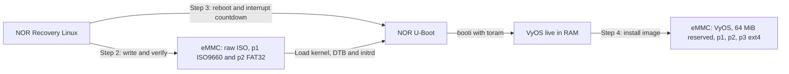

# Install VyOS on Mono Gateway without USB (console-only)

> **STATUS: EXPERIMENTAL; RECOVERY DOWNLOAD AND EMMC WRITE VERIFIED.**
> This guide is published so testers can try it and report back. Every step ends with a **checkpoint**: if the output does not match, stop and file a report (template at the bottom) instead of improvising.
>
> Hardware progress, 2026-10-19: Recovery DHCP, ISO digest verification, and the Step 2 eMMC write/read-back passed with `2026.10.16-2149-rolling`. Live boot and installation (Steps 3-6) remain unvalidated.

## Overview

This installs the published VyOS LS1046A ISO onto a Mono Gateway that currently runs OPNsense/OpenWrt, using **only the serial console and the ability to power-cycle the board**. No USB stick, no DIP switch changes, no PC-side imaging.

| You need | Why |
|----------|-----|
| Serial console, **115200 8N1** | All interaction happens here |
| Power on/off control | To restart into U-Boot |
| Ethernet cable with internet on one copper port (eth0 to eth2) | Recovery Linux downloads the ISO |
| DIP switch already on **NOR** (RIGHT) | Gate 0 verifies this; you cannot continue without it |

**Keep the DIP switch on NOR throughout this procedure.** Use only the tools already present in Recovery Linux and the board's U-Boot console; no extra recovery binaries or packages are required.

**What gets destroyed:** everything on the eMMC (the existing OPNsense/OpenWrt installation, its config, and the eMMC boot firmware region). NOR U-Boot, its environment and recovery Linux are not touched until the VyOS installer writes its boot environment at the end. Step 3 uses temporary U-Boot settings, not `saveenv`.

---

## How it works

1. **The board must boot from NOR.** The saved boot command depends on the existing OPNsense/OpenWrt installation and firmware; it does not identify the boot source. Confirm NOR in Gate 0. Wiping the eMMC then leaves NOR U-Boot and recovery Linux available.
2. **Recovery Linux can download.** It is reached with `run recovery` and has `udhcpc`, a full `curl`, `dd`, `sha256sum` and a RAM root of about 3.8 GB, enough for the roughly 571 MiB ISO.
3. **The ISO carries its own partition table.** The release ISO is hybrid: an MBR with two partitions.

   | Partition | Start | Size | Type | Contents |
   |-----------|-------|------|------|----------|
   | p1 | 0 MiB | 495 MiB | 0x17 | ISO9660 with `live/filesystem.squashfs` |
   | p2 | 495 MiB | 76 MiB | 0x0C FAT32 | `live/vmlinuz`, `live/initrd.img`, `mono-gw.dtb`, `boot.scr` |

   (Measured on `2026.10.16-2149-rolling`. Later builds may differ in size; the layout is the same.)

   Writing the ISO raw to `/dev/mmcblk0` turns the eMMC into the equivalent of the USB stick in [INSTALL.md](INSTALL.md). U-Boot can then `fatload mmc 0:2`.
4. **U-Boot starts the VyOS live system.** Writing the ISO does not replace the running Recovery Linux kernel or install VyOS. The tested recovery image lacks `fw_printenv`, `fw_setenv`, and `/etc/fw_env.config`, so this guide reboots into the existing U-Boot console instead of editing NOR from Recovery.
5. **`toram` is intended to let VyOS install onto the disk it booted from.** It copies the squashfs into RAM before userspace starts, so `install image` can repartition the eMMC under the running live system. This eMMC path still needs hardware validation; Checkpoint 4a must pass before installing. (`boot.cmd` warns against `toram` because of LS1046A USB xHCI stalls; this procedure uses eMMC, not USB.)



### Why this differs from OpenWrt installation

The [Mono OpenWrt guide](https://docs.mono.si/gateway-development-kit/installing-openwrt/) writes a ready-to-boot system image using two `dd` commands: the first 4 KiB, then everything from 32 MiB onward. That preserves the eMMC firmware region between 4 KiB and 32 MiB. It still requires a one-time interactive U-Boot setup; its later `mono-fw-setenv` commands run inside installed OpenWrt, not Recovery Linux.

The VyOS ISO is live installer media, not an installed-system disk image. **Do not use OpenWrt's split-write commands on this ISO:** skipping 4 KiB through 32 MiB would omit required ISO data. The whole-disk write in Step 2 deliberately overwrites the eMMC firmware region. **Do not follow OpenWrt's instruction to switch to eMMC boot afterwards; remain on NOR.**

---

## Gate 0: Confirm the board boots from NOR

Confirm that the DIP switch is already on **NOR** (RIGHT), or use an explicit boot-source indication in the board's startup log. If you cannot establish the boot source, stop before writing anything. Power-cycle the board and **press any key** during the U-Boot countdown, then record its boot command:

```
=> printenv bootcmd
```

**Checkpoint 0**
- NOR boot is confirmed independently of `bootcmd`, and the boot command includes the recovery fallback. The existing OPNsense/OpenWrt boot command alone is not proof of NOR boot.
- **If the boot source is uncertain or the recovery fallback is missing: STOP.** If the board boots U-Boot from eMMC, Step 2 makes it unbootable until someone physically flips the DIP switch.

---

## Step 0: Back up the existing configuration

Turn on session logging in your terminal program. Boot the existing OPNsense/OpenWrt installation and save its configuration before proceeding.

For OPNsense, choose **8) Shell** and capture the configuration:

```sh
cat /conf/config.xml
```

For OpenWrt, use its supported configuration backup/export procedure. Keep the backup off the eMMC; a backup left on this disk will be erased in Step 2.

Save the logged output or exported backup. The network served by this box is **down from Step 2 until VyOS is configured**. Plan the downtime.

---

## Step 1: Recovery Linux, network, download, verify

Power-cycle and interrupt U-Boot, then:

```
=> run recovery
```

Log in as `root` (no password). Find the port with a live cable and get an address (replace `eth0` in both commands if using another port). Interfaces may initially show `DOWN`; check for `UP,LOWER_UP` after bringing your port up:

```sh
ip -br link
ip link set eth0 up
udhcpc -i eth0
ip -4 addr; ip route                           # expect an address and a default route
date -u                                       # check the clock; TLS needs a correct one
df -h /tmp                                     # need at least ~600 MB free
```

The tested Recovery Linux image does not include `ntpd`. If the clock is wrong, set the current UTC time manually as described under "Recovery Linux: `curl` fails with a TLS or certificate error" before downloading.

Download the latest release named in the project's update feed:

```sh
cd /tmp
FEED=https://raw.githubusercontent.com/mihakralj/vyos-ls1046a-build/main/version.json
URL=$(curl -fsSL $FEED | sed -n 's/.*"url": *"\([^"]*\)".*/\1/p')
VER=$(curl -fsSL $FEED | sed -n 's/.*"version": *"\([^"]*\)".*/\1/p')
echo "$VER  $URL"
curl -fL -o vyos.iso "$URL"
```

Verify it against GitHub's published asset digest:

```sh
curl -fsSL https://api.github.com/repos/mihakralj/vyos-ls1046a-build/releases/tags/$VER \
  | grep -E '"name"|"digest"'
sha256sum vyos.iso
wc -c vyos.iso
```

**Checkpoint 1**
- `sha256sum` equals the `sha256:` digest printed under the `vyos-...-LS1046A-arm64.iso` name.
- `wc -c` equals the ISO size on the release page (598736896 for `2026.10.16-2149-rolling`).

> **Stronger check (optional, on your PC):** download the `.iso` and `.iso.minisig`, then run
> `minisign -Vm vyos-*.iso -P RWQoyCUx+dYqmHM24TcYg31sZvu0v6pYRkkq9cmPVrmurl/iV4ILyYOL`
> (key from [data/vyos-ls1046a.minisign.pub](data/vyos-ls1046a.minisign.pub)) and compare the PC's `sha256sum` with the device's.

**Nothing has been changed on the board yet.** You can stop here safely.

---

## Step 2: Write the ISO to the eMMC (point of no return)

Run this block in the recovery Bash shell. The trailing `&&` operators stop the sequence if any command fails. The ISO must have a positive size that is an exact multiple of 512 bytes. **This overwrites the eMMC; confirm NOR boot and your backup before proceeding.**

```sh
set -o pipefail &&
ISO_BYTES=$(wc -c < /tmp/vyos.iso) &&
[[ "$ISO_BYTES" -gt 0 && "$((ISO_BYTES % 512))" -eq 0 ]] &&
dd if=/tmp/vyos.iso of=/dev/mmcblk0 bs=4M &&
sync &&
READBACK_SHA=$(dd if=/dev/mmcblk0 bs=512 count="$((ISO_BYTES / 512))" | sha256sum) &&
printf '%s\n' "$READBACK_SHA" &&
fdisk -l /dev/mmcblk0
```

This uses the basic operands supported by the tested BusyBox `dd`; `conv=fsync` and `head -c` are unavailable in that recovery build. `sync` flushes the write before verification. `pipefail` and the captured read-back output prevent a failed read from printing a misleading hash of empty input. **If any command prints usage or an error: STOP; do not reboot into Step 3.**

**Checkpoint 2**
- The read-back `sha256sum` equals the ISO hash from Checkpoint 1.
- `fdisk -l` shows a DOS/MBR table with `mmcblk0p1` starting at sector 0 (type `0x17`, about 495M) and `mmcblk0p2` (type `0x0c`, about 76M, FAT32).
- **If either check fails: STOP.** Do not continue to Step 3 until the read-back hash and partition table match the verified ISO.

Hardware result for `2026.10.16-2149-rolling` (2026-10-19): `598736896` bytes written and read back with SHA-256 `504ad58f5e562cb8011ecb616a5a4cbe439eb67738e66571c9c712bd629dbedb`. The resulting DOS disk identifier was `0x56594f53`; p1 started at sector `0` with `1013760` sectors, and p2 at sector `1013760` with `155648` sectors. The read-back covered `1169408` sectors of 512 bytes.

The previous OPNsense/OpenWrt installation is now gone. This also overwrote the eMMC firmware region (first 32 MiB). A NOR-booted board does not read it, and a VyOS install breaks eMMC boot anyway ([issue #24](https://github.com/mihakralj/vyos-ls1046a-build/issues/24)). See "Optional: restore the eMMC firmware region" below.

---

## Step 3: Live-boot VyOS from the eMMC

Keep the DIP switch on **NOR**. After Checkpoint 2 passes, run `reboot` in Recovery Linux (or power-cycle), then **press any key** during the U-Boot countdown. Simply letting autoboot continue would still run the previous OPNsense/OpenWrt boot command, not the VyOS ISO.

Paste these **one line at a time** at the U-Boot prompt. These `setenv` commands only change the current session: **do not run `saveenv` or replace `bootcmd` here.** Keep the initrd load **last**, so `${filesize}` holds the initrd size for `booti`.

```
setenv kernel_addr_r 0x82000000
setenv fdt_addr_r 0x88000000
setenv ramdisk_addr_r 0xa4000000
setenv kernel_comp_addr_r 0x90000000
setenv kernel_comp_size 0x1600000
mmc dev 0 0
mmc rescan
mmc part
fatls mmc 0:2 live
```

Before loading anything, confirm a DOS table with p1 type `17`, p2 type `0c`, and a listing containing `vmlinuz` and `initrd.img`. **If any check fails: STOP** and use the U-Boot troubleshooting section below.

Then load and boot:

```
fatload mmc 0:2 ${kernel_addr_r} live/vmlinuz
fatload mmc 0:2 ${fdt_addr_r} mono-gw.dtb
fatload mmc 0:2 ${ramdisk_addr_r} live/initrd.img
setenv bootargs console=ttyS0,115200 earlycon=uart8250,mmio,0x21c0500 boot=live live-media=/dev/mmcblk0p1 toram rootdelay=10 components noeject nopersistence noautologin nonetworking union=overlay net.ifnames=0 fsl_dpaa_fman.fsl_fm_max_frm=9600 panic=60
booti ${kernel_addr_r} ${ramdisk_addr_r}:${filesize} ${fdt_addr_r}
```

These bootargs follow [board/scripts/boot.cmd](board/scripts/boot.cmd), with `live-media=/dev/mmcblk0p1` (where the squashfs lives), `toram`, and `panic=60` to match the VyOS default and avoid a parameter-mismatch kexec. USB-specific options are omitted. Expect a pause during early boot while the squashfs is copied into RAM. The DTB address `0x88000000` is separate from the decompression scratch area at `0x90000000`.

**Checkpoint 3**
- `fatls` lists `vmlinuz` and `initrd.img`.
- Each `fatload` prints `N bytes read`.
- The boot ends at a `vyos login:` prompt.

---

## Step 4: Install to eMMC

Log in as **vyos** / **vyos**. Before installing, **prove the live system runs from RAM**:

```sh
findmnt -n -o SOURCE /run/live/medium
grep -o toram /proc/cmdline
```

**Checkpoint 4a**
- `findmnt` prints anything **except** `/dev/mmcblk0p1` (typically `tmpfs`).
- `grep` prints `toram`.
- **If `findmnt` shows `/dev/mmcblk0p1`: STOP. Do not run `install image`.** You would overwrite the running system. Reboot and repeat Step 3, checking the `bootargs` line for typos.

```
install image
```

- Select installation target: **`mmcblk0`**
- Enter a root password
- Accept defaults for the rest

**Checkpoint 4b**
- `mmcblk0` is offered as a target. If it is not, the installer still sees it as the live boot medium, which means `toram` did not take effect. Report this.
- The installer completes without errors and mentions writing the U-Boot environment (`fw_setenv`).

---

## Step 5: Reboot into installed VyOS

```
reboot
```

The installer's `vyos-postinstall` has written this to the NOR U-Boot environment, replacing the previous OPNsense/OpenWrt `bootcmd`:

```
bootcmd=run usb_vyos || run vyos || run recovery
```

**Checkpoint 5**
- The board boots VyOS from eMMC to a `vyos login:` prompt, and the password from Step 4 works.
- `show version` reports the version from Step 1.

> **First boot may fail once.** After a fresh eMMC format, U-Boot's ext4 driver occasionally fails with `Failed to load '/boot/vyos.env'` and falls through to recovery. Power-cycle again. This is the same known quirk as in [INSTALL.md](INSTALL.md).

---

## Step 6: Remove the shipped SSH key (do this before connecting WAN)

The shipped images preconfigure user `vyos` with a public key whose **private key is published** in [INSTALL.md](INSTALL.md). Replace it with your own:

```
show system login user vyos authentication public-keys
configure
delete system login user vyos authentication public-keys <name-shown-above>
set system login user vyos authentication public-keys me key <your-ed25519-public-key-body>
set system login user vyos authentication public-keys me type ssh-ed25519
commit
save
exit
```

---

## Troubleshooting

### Recovery Linux: `curl` fails with a TLS or certificate error
Check `date -u` first. The tested recovery image does not include `ntpd`. If the clock is wrong, set the current UTC time by hand, for example `date -u -s "2026-10-19 05:00:00"` (replace this example with the actual current UTC time), then check `date -u` and retry the download. Do not disable TLS certificate verification.

### Recovery Linux: `dd` prints usage or the read-back hashes empty input
The tested BusyBox 1.37.0 build rejects `dd ... conv=fsync`, so that command exits before writing the ISO. Its `head` also rejects `-c`. The digest `e3b0c44298fc1c149afbf4c8996fb92427ae41e4649b934ca495991b7852b855` is SHA-256 of empty input; after a failed `head`, it does not describe the eMMC contents. Use the corrected Step 2 block, which calls `sync` separately and reads the exact number of 512-byte blocks instead of using `head -c`.

### Recovery Linux: why not edit U-Boot settings and just reboot?
The tested recovery image has neither `fw_printenv` nor `fw_setenv`, and no `/etc/fw_env.config`. This procedure does not add tools to Recovery. Use the existing U-Boot console in Step 3 for a temporary live boot; the VyOS installer configures persistent booting later.

`dd` copies bytes; it does not construct an environment with a valid CRC or perform the NOR erase/program handling needed to update it. **Do not use raw writes to `/dev/mtd*` to change boot variables.** Device numbering also differs between the two Linux environments: the tested Recovery labels `/dev/mtd3` as `uboot-env` and `/dev/mtd2` as `uboot`, whereas VyOS uses `/dev/mtd2` for the environment. Copying VyOS's device path into Recovery would target U-Boot itself.

### Recovery Linux: no DHCP lease
Try the other copper ports (`eth0`, `eth1`, `eth2`). The Mono's physical-to-logical port mapping is not intuitive; see [HARDWARE.md](HARDWARE.md) section 3. Static fallback:
```sh
ip addr add 192.168.1.50/24 dev eth0
ip route add default via 192.168.1.1
echo "nameserver 1.1.1.1" > /etc/resolv.conf
```

### U-Boot: `booti` says `kernel_comp_addr_r or kernel_comp_size is not provided`
Your NOR environment is missing the decompression scratch area. Set it and retry the `booti` line:
```
setenv kernel_comp_addr_r 0x90000000
setenv kernel_comp_size 0x1600000
```
Never load the DTB at `0x90000000`: decompression overwrites it.

### U-Boot: `Can't set block device` or `fatls mmc 0:2` shows nothing
Run these one line at a time:
```
mmc dev 0 0
mmc rescan
mmc part
fatinfo mmc 0:2
```
Expect a DOS/MBR table with partition 1 type `17` and partition 2 type `0c` (FAT32). Two DOS partitions alone are not sufficient: a FAT32 boot partition at sector `65536` followed by a type `a5` (FreeBSD) partition at sector `229376` is a leftover FreeBSD layout, not the raw VyOS ISO. `fatload` cannot read that FreeBSD partition as FAT32; changing the filename or bootargs will not fix it.

Return to NOR recovery with `run recovery`, inspect `fdisk -l /dev/mmcblk0`, and check the Step 2 read-back hash before deciding whether to retry the write. Files in `/tmp` do not survive a reboot; if `vyos.iso` is missing, repeat the download and verification in Step 1 before comparing it with the eMMC. Do not continue to Step 3 while the table still shows the old layout.

### Live boot drops to an initramfs shell, unable to find the live medium
Check the `live-media=/dev/mmcblk0p1` spelling in `bootargs`. As a fallback, remove `live-media=...` and let live-boot scan all block devices.

### After install, the board lands in recovery instead of VyOS
If it persists after a second power-cycle, `fw_setenv` probably failed. Interrupt U-Boot and paste the block from [INSTALL.md, "Manual U-Boot environment setup"](INSTALL.md#manual-u-boot-environment-setup-recovery-fallback).

---

## Rollback

| Where you stopped | State | How to recover |
|-------------------|-------|----------------|
| Before Step 2 | Existing OPNsense/OpenWrt installation intact | Power-cycle; the saved boot command starts the existing OS |
| After Step 2 | eMMC holds the raw ISO, previous OPNsense/OpenWrt installation gone | Repeat Step 3, or reinstall the previous OS from Recovery Linux using its installation procedure and restore the saved configuration |
| After Step 4 | VyOS installed | Normal VyOS operation; `run recovery` is still the fallback in `bootcmd` |

Recovery Linux remains reachable from the U-Boot prompt with `run recovery` at every stage, because both live in NOR.

## Optional: restore the eMMC firmware region

A NOR-booted board does not need it. If you want eMMC boot capability back (for example to go back to OpenWRT or Armbian later), boot recovery from NOR with `boot_medium=nor` and run `firmware update`, which rewrites the eMMC firmware region (4 KiB to 32 MiB). VyOS keeps its partitions above 64 MiB, so this does not touch the install. mono-imager's **Update eMMC firmware** menu option automates it. Details: [FIRMWARE.md](FIRMWARE.md).

---

## Test report template

Please open an issue (or post in the Discord thread) with this filled in. A failed run is as useful as a successful one.

```
### Console-only install test report

- VyOS version (from Step 1):
- Previous OS on eMMC: OPNsense/OpenWrt <name and version> / other:
- Board: Mono Gateway DK / other:
- NOR boot evidence (known DIP position or startup boot-source indication):
- `printenv bootcmd` output (Gate 0):
- Network port used in recovery (eth0/1/2), DHCP or static:

| Checkpoint | Pass/Fail | Notes (paste the relevant console lines) |
|------------|-----------|------------------------------------------|
| 0 NOR boot confirmed       | | |
| 1 Download + hash match    | | |
| 2 dd + read-back hash      | | |
| 3 Live boot to login       | | |
| 4a toram active (findmnt)  | | `findmnt` output: |
| 4b install image completes | | |
| 5 Boots from eMMC          | | needed 2nd power-cycle? y/n |
| 6 SSH key replaced         | | |

- Anything you had to do differently:
- Full console log attached: y/n
```
