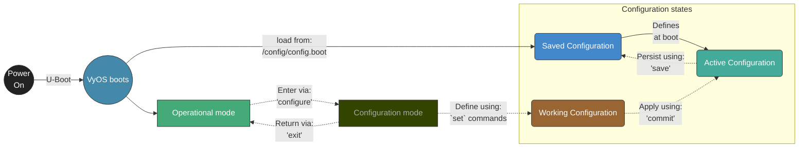

# Configuring VyOS on a Mono Gateway Development Kit

The primary source of truth for configuring VyOS is the [upstream 'rolling' documentation](https://docs.vyos.io/en/rolling/introducing/about.html). 'Rolling' in this context refers to the nightly release provided by the VyOS project ([more info](https://docs.vyos.io/en/rolling/installation/install.html)) - this is the main development branch of VyOS.

The documentation provides: 
- A quick orientation and overview of how VyOS configuration works
- A walk through an example VyOS configuration
- A tutorial to create a basic HW-offloaded VyOS config for the Mono Gateway Development Kit.

This document will heavily link to external content (wikipedia etc) for clarity/context, to remain concise. For more information - explore the links.
# Orientation
[VyOS](https://en.wikipedia.org/wiki/VyOS) is a [declarative](https://en.wikipedia.org/wiki/Declarative_programming), open-source [network operating system](https://en.wikipedia.org/wiki/Network_operating_system) based on [Debian Linux](https://en.wikipedia.org/wiki/Debian). It began as a fork of [Vyatta](https://en.wikipedia.org/wiki/Vyatta) in 2013 ([brief history](https://docs.vyos.io/en/rolling/introducing/history.html)), and has since become a widely deployed, enterprise-grade solution. 

Interaction with VyOS occurs primarily via the Command Line Interface (CLI). VyOS is extremely configurable, but the range of config options are so vast that it genuinely makes creating a (general) web Graphical User Interface (GUI) extremely challenging. Many have tried and failed. One more recent and promising option is [VyMANAGER](VYMANAGER.md), but to use this, you still need to understand how VyOS config works.
# Configuration: Overview
This extreme TL;DR of how configuration is performed in VyOS. It is a memory aid, not a substitute for [reading the docs](https://docs.vyos.io/en/rolling/cli.html).

There are two 'modes' (Operational and Configuration), and three 'configuration states' (Running, Working, Saved). Together these enable well-managed changes to a VyOS instance.


This diagram provides a a high-level picture of how 'Modes' and 'Configuration states' interact. The boot process is truncated for clarity.
# Modes
Modes dictate how you can interact with a VyOS instance. The separation is deliberate and ensures changes are well-managed, and recovery is straightforward.
## Two 'modes'
- **Operational** - (Default) - Allows querying status, info and Read-Only actions (generally).
- **Configuration** - Entered via the `configure` command - Enables configuration changes. 

>**NOTE:** The scope of a change made in Configuration mode depends on the configuration state that is modified - see below. **Understanding this is critical to using VyOS**.

>**NOTE:** A good visual indicator of which CLI mode you are in can be found in the prompt itself, which will change from `$` to `#` when moving from Operational to Configuration mode.

# Configuration states
VyOS configuration exists in a unified config file, located in `/config/config.boot` by default. However, in VyOS there are three configurational states that you MUST familiarise yourself with.

>**NOTE:** This matters, and exists to save you when you make mistakes, which you will. If you understand this, and use it as designed, you should never lock yourself out, or make a breaking change. Used correctly, you will never need to touch your device after initial setup.

## Three 'configuration states'
The configuration states define the context to which you apply a change. When you make a change that breaks stuff - this is how VyOS can save you and provide options to 'roll-back' a change.

- **Active / running Configuration** - This is the current 'live' config that dictates how the device runs, right now. Using `commit` within  Configuration mode will change this, and all changes live in RAM.

>**NOTE:** Configuration changes made, via `commit` to the active configuration are lost on reboot, by design. This is good for testing changes.

- **Working Configuration** - When you first enter Configuration mode, any changes you make exist here. This is a 'staged' configuration context, that does not yet apply. When executing the `commit` command, the working configuration becomes the Active configuration.

>**NOTE:** Any changes that are made in configuration mode, can be abandoned, by using `exit` to return to Operational mode. This will NOT change the Active configuration.

- **Saved Configuration** - This is what exists on-disk, by default in `/config/config.boot` and is loaded at boot. In configuration mode, the `save` command writes the active configuration to disk.

>**NOTE:** Any unsaved changes in the Active configuration are lost at reboot. Only using `save` will make a change persistent across a reboot. Use wisely. Use only after a change has been proven stable, effective AND non-breaking via the earlier `commit`.

## Testing changes: commit-confirm

```bash
commit-confirm <minutes>          # e.g. 'commit-confirm 5' for 5 minutes
```
If making a change to the working config which you suspect may break something when applying via 'commit', including breaking your access to the VyOS instance, consider using `commit-confirm`. This provides an automated roll-back action, if you do not enter `confirm` within the time interval stated.

The roll-back action itself can be defined via:
`set system config-management commit-confirm action`
Options: 
`reboot` (Default) or `reload` (the most recent previous config)

If this doesn't yet make sense - don't worry, read on. Just know this can, and will, save you at some point!

# Configuration: Structure
## The configuration 'tree' & nodes
The previous section covers 'how' configuration occurs in VyOS; this section describes 'what' the VyOS configuration file actually looks like, and how to use the information it contains.

>**NOTE:** You should never edit- or otherwise modify the `config.boot` file directly. **Use configuration mode.** It exists to provide you with safeguards for when things break!

To view the current configuration, from operational mode:
```bash
show configuration
```

Example section of the VyOS config, describing several basic interfaces.
```
interfaces {
    ethernet eth0 {
        address "dhcp"
        description "LAN"
        }
    }
    ethernet eth1 {
        address "dhcp"
        description "WAN"
        }
    }
    loopback lo {
    }
}
```
>**NOTE:** This isn't xml, yaml or json, but exporting in various formats is an option, if desired. e.g `show configuration json` or `show configuration json pretty` (if preferred)

The unified and hierarchical configuration system used by VyOS provides a structured 'tree' of nodes, where each 'branch' has well-defined child-nodes and values. This uses the set-style format shown above.

You may see references to 'config nodes' these are the individual sub-branches that contain 

## Declaratively recreating configuration
In VyOS, the config is evaluated every time you use 'commit'. One consequence of this is that you can readily establish what commands are required to re-establish the same state, and you can output this as a series of config commands.

Using:
```bash
show configuration commands
```

Will print out every VyOS config command required to re-create the present configuration. 

e.g.
```bash
...
set interfaces ethernet eth0 address 'dhcp'
set system host-name 'mono-vyos'
...
```
>**NOTE:** Your configuration, exported in this way *will* contain private info, e.g. SSH keys, password hashes etc. Be mindful of this. If you intended to share a configuration use `show configuration commands | strip-private` instead, which will omit your private info.

## Use Tab-completion 
The configuration shell is based on [bash](https://en.wikipedia.org/wiki/Bash_(Unix_shell)). When exploring the CLI, in either CLI mode, you can always press `tab` to view the valid and available options to complete the next section of a command. Where there is only one valid option, it will autocomplete, OR where there are multiple options, these will then be listed.

**For example:**
If typing 'show' and then pressing tab, the following is shown.
```bash
test@mono-vyos:~$ show [tab]
Possible completions:
  arp             Show Address Resolution Protocol (ARP) information
  bridge          Show bridging information
  cluster         Show clustering information
  configuration   Show running configuration
  conntrack       Show conntrack entries in the conntrack table
  conntrack-sync  Show connection syncing information
  date            Show system date and time
  dhcp            Show Dynamic Host Configuration Protocol (DHCP) information
  dhcpv6          Show status related to DHCPv6
  disk            Show status of disk device
  dns             Show Domain Name Server (DNS) information
  file            Show files for a particular image
  firewall        Show firewall information
  flow-accounting Show flow accounting statistics
  hardware        Show system hardware details
  history         Show command history
  host            Show host information
  incoming        Show ethernet input-policy information
  ...
```

This means you never need to memorise commands, and will always have context cues for how you can complete a command, or line of config that you are entering.
# Configuration: Example
This is an example VyOS configuration file, which we will now walk through. By the end of this, you will hopefully understand what this does!

You may find it helpful to open this in a text editor to follow along.
\<FILE REFERENCE HERE>

```
firewall {
    flowtable ft01 {
        interface "eth3"
        interface "eth4"
        interface "eth3.6"
        interface "eth4.8"
        offload "hardware"
    }
    ipv4 {
        forward {
            filter {
                rule 10 {
                    action "offload"
                    offload-target "ft01"
                    state "established"
                    state "related"
                }
            }
        }
    }
    ipv6 {
        forward {
            filter {
                rule 11 {
                    action "offload"
                    offload-target "ft01"
                    state "established"
                    state "related"
                }
            }
        }
    }
}
interfaces {
    ethernet eth0 {
        address "dhcp"
        address "10.64.0.32/24"
        description "MGMT (RJ45 left)"
        hw-id "<SNIP>"
        offload {
            gro
            gso
            sg
        }
    }
    ethernet eth1 {
        address "dhcp"
        description "RJ45 center"
        hw-id "<SNIP>"
        offload {
            gro
            gso
            sg
        }
    }
    ethernet eth2 {
        address "dhcp"
        description "WAN"
        hw-id "<SNIP>"
        offload {
            gro
            gso
            sg
        }
    }
    ethernet eth3 {
        address "dhcp"
        address "10.100.1.1/24"
        address "fd36:dead:beef:3::0a64:0101/64"
        description "SFP+ left"
        hw-id "<SNIP>"
        offload {
            gro
            gso
            hw-tc-offload
            ipv4
            ipv6
            sg
        }
        vif 6 {
            address "10.150.1.1/24"
            address "fd36:dead:beef:6::0a64:0101/64"
        }
    }
    ethernet eth4 {
        address "dhcp"
        address "10.200.1.1/24"
        address "fd36:dead:beef:4::0ac8:0101/64"
        description "SFP+ right"
        hw-id "<SNIP>"
        offload {
            gro
            gso
            hw-tc-offload
            ipv4
            ipv6
            sg
        }
        vif 8 {
            address "10.250.1.1/24"
            address "fd36:dead:beef:8::0ac8:0101/64"
        }
    }
    loopback lo {
    }
}
nat {
    source {
        rule 100 {
            outbound-interface {
                name "eth4"
            }
            source {
                address "10.100.1.0/24"
            }
            translation {
                address "masquerade"
            }
        }
    }
}
nat66 {
    source {
        rule 110 {
            outbound-interface {
                name "eth4"
            }
            source {
                prefix "fd36:dead:beef:3::/64"
            }
            translation {
                address "masquerade"
            }
        }
        rule 130 {
            outbound-interface {
                name "eth4.8"
            }
            source {
                prefix "fd36:dead:beef:6::/64"
            }
            translation {
                address "masquerade"
            }
        }
    }
}
protocols {
    static {
        route 0.0.0.0/0 {
            next-hop 10.1.9.1 {
            }
        }
    }
}
service {
    https {
        api {
            graphql {
                authentication {
                    type "key"
                }
            }
            keys {
                id vymanager {
                    key "<SNIP>"
                }
            }
            rest {
            }
        }
    }
    ntp {
        allow-client {
            address "127.0.0.0/8"
            address "169.254.0.0/16"
            address "10.0.0.0/8"
            address "172.16.0.0/12"
            address "192.168.0.0/16"
            address "::1/128"
            address "fe80::/10"
            address "fc00::/7"
        }
        server time.apple.com {
        }
        server time.cloudflare.com {
        }
        server time.google.com {
        }
    }
    ssh {
        disable-password-authentication
    }
}
system {
    config-management {
        commit-revisions "100"
    }
    conntrack {
        modules {
            ftp
            h323
            nfs
            pptp
            sip
            sqlnet
            tftp
        }
    }
    console {
        device ttyS0 {
            kernel
            speed "115200"
        }
    }
    domain-name "home.local"
    host-name "mono-vyos"
    login {
        user test {
            authentication {
                encrypted-password "<SNIP>"
                public-keys test@monovm {
                    key "<SNIP>"
                    type "ssh-ed25519"
                }
                public-keys vymanager {
                    key "<SNIP>"
                    type "ssh-ed25519"
                }
            }
        }
    }
    name-server "eth0"
    name-server "eth1"
    name-server "eth2"
    name-server "eth3"
    name-server "eth4"
    name-server "10.1.8.8"
    name-server "10.1.4.4"
    syslog {
        local {
            facility all {
                level "info"
            }
            facility local7 {
                level "debug"
            }
        }
    }
    time-zone "Europe/London"
    update-check {
        auto-check
        url "https://raw.githubusercontent.com/mihakralj/vyos-ls1046a-build/refs/heads/main/version.json"
    }
    watchdog {
        reboot-timeout "60"
        shutdown-timeout "60"
    }
}


// Warning: Do not remove the following line.
// vyos-config-version: "bgp@8:broadcast-relay@1:cluster@2:config-management@2:conntrack@6:conntrack-sync@2:container@3:dhcp-relay@2:dhcp-server@11:dhcpv6-server@6:dns-dynamic@5:dns-forwarding@4:firewall@20:flow-accounting@3:https@7:ids@2:interfaces@36:ipoe-server@4:ipsec@14:isis@3:l2tp@10:lldp@3:mdns@1:monitoring@2:nat@8:nat66@3:nhrp@1:ntp@3:openconnect@3:openvpn@6:ospf@3:pim@1:pki@1:policy@9:pppoe-server@13:pptp@6:qos@3:quagga@12:reverse-proxy@3:rip@1:rpki@2:snmp@3:ssh@3:sstp@7:system@33:vpp@6:vrf@4:vrrp@4:vyos-accel-ppp@2:wanloadbalance@4:webproxy@2"
// Release version: 2026.10.30-2012-rolling
```

Just to reiterate the point, the same configuration can be turned into the explicit declarative config commands to re-create it by using `show configuration commands`. For this example configuration that looks like this:

```
set firewall flowtable ft01 interface 'eth3'
set firewall flowtable ft01 interface 'eth4'
set firewall flowtable ft01 interface 'eth3.6'
set firewall flowtable ft01 interface 'eth4.8'
set firewall flowtable ft01 offload 'hardware'
set firewall ipv4 forward filter rule 10 action 'offload'
set firewall ipv4 forward filter rule 10 offload-target 'ft01'
set firewall ipv4 forward filter rule 10 state 'established'
set firewall ipv4 forward filter rule 10 state 'related'
set firewall ipv6 forward filter rule 11 action 'offload'
set firewall ipv6 forward filter rule 11 offload-target 'ft01'
set firewall ipv6 forward filter rule 11 state 'established'
set firewall ipv6 forward filter rule 11 state 'related'
set interfaces ethernet eth0 address 'dhcp'
set interfaces ethernet eth0 address '10.64.0.32/24'
set interfaces ethernet eth0 description 'MGMT (RJ45 left)'
set interfaces ethernet eth0 hw-id '<SNIP>'
set interfaces ethernet eth0 offload gro
set interfaces ethernet eth0 offload gso
set interfaces ethernet eth0 offload sg
set interfaces ethernet eth1 address 'dhcp'
set interfaces ethernet eth1 description 'RJ45 center'
set interfaces ethernet eth1 hw-id '<SNIP>'
set interfaces ethernet eth1 offload gro
set interfaces ethernet eth1 offload gso
set interfaces ethernet eth1 offload sg
set interfaces ethernet eth2 address 'dhcp'
set interfaces ethernet eth2 description 'WAN'
set interfaces ethernet eth2 hw-id '<SNIP>'
set interfaces ethernet eth2 offload gro
set interfaces ethernet eth2 offload gso
set interfaces ethernet eth2 offload sg
set interfaces ethernet eth3 address 'dhcp'
set interfaces ethernet eth3 address '10.100.1.1/24'
set interfaces ethernet eth3 address 'fd36:dead:beef:3::0a64:0101/64'
set interfaces ethernet eth3 description 'SFP+ left'
set interfaces ethernet eth3 hw-id '<SNIP>'
set interfaces ethernet eth3 offload gro
set interfaces ethernet eth3 offload gso
set interfaces ethernet eth3 offload hw-tc-offload
set interfaces ethernet eth3 offload ipv4
set interfaces ethernet eth3 offload ipv6
set interfaces ethernet eth3 offload sg
set interfaces ethernet eth3 vif 6 address '10.150.1.1/24'
set interfaces ethernet eth3 vif 6 address 'fd36:dead:beef:6::0a64:0101/64'
set interfaces ethernet eth4 address 'dhcp'
set interfaces ethernet eth4 address '10.200.1.1/24'
set interfaces ethernet eth4 address 'fd36:dead:beef:4::0ac8:0101/64'
set interfaces ethernet eth4 description 'SFP+ right'
set interfaces ethernet eth4 hw-id '<SNIP>'
set interfaces ethernet eth4 offload gro
set interfaces ethernet eth4 offload gso
set interfaces ethernet eth4 offload hw-tc-offload
set interfaces ethernet eth4 offload ipv4
set interfaces ethernet eth4 offload ipv6
set interfaces ethernet eth4 offload sg
set interfaces ethernet eth4 vif 8 address '10.250.1.1/24'
set interfaces ethernet eth4 vif 8 address 'fd36:dead:beef:8::0ac8:0101/64'
set interfaces loopback lo
set nat source rule 100 outbound-interface name 'eth4'
set nat source rule 100 source address '10.100.1.0/24'
set nat source rule 100 translation address 'masquerade'
set nat66 source rule 110 outbound-interface name 'eth4'
set nat66 source rule 110 source prefix 'fd36:dead:beef:3::/64'
set nat66 source rule 110 translation address 'masquerade'
set nat66 source rule 130 outbound-interface name 'eth4.8'
set nat66 source rule 130 source prefix 'fd36:dead:beef:6::/64'
set nat66 source rule 130 translation address 'masquerade'
set protocols static route 0.0.0.0/0 next-hop 10.1.9.1
set service https api graphql authentication type 'key'
set service https api keys id vymanager key '<SNIP>'
set service https api rest
set service ntp allow-client address '127.0.0.0/8'
set service ntp allow-client address '169.254.0.0/16'
set service ntp allow-client address '10.0.0.0/8'
set service ntp allow-client address '172.16.0.0/12'
set service ntp allow-client address '192.168.0.0/16'
set service ntp allow-client address '::1/128'
set service ntp allow-client address 'fe80::/10'
set service ntp allow-client address 'fc00::/7'
set service ntp server time.apple.com
set service ntp server time.cloudflare.com
set service ntp server time.google.com
set service ssh disable-password-authentication
set system config-management commit-revisions '100'
set system conntrack modules ftp
set system conntrack modules h323
set system conntrack modules nfs
set system conntrack modules pptp
set system conntrack modules sip
set system conntrack modules sqlnet
set system conntrack modules tftp
set system console device ttyS0 kernel
set system console device ttyS0 speed '115200'
set system domain-name 'home.local'
set system host-name 'mono-vyos'
set system login user test authentication encrypted-password '<SNIP>'
set system login user test authentication public-keys test@monovm key '<SNIP>'
set system login user test authentication public-keys test@monovm type 'ssh-ed25519'
set system login user test authentication public-keys vymanager key '<SNIP>'
set system login user test authentication public-keys vymanager type 'ssh-ed25519'
set system name-server 'eth0'
set system name-server 'eth1'
set system name-server 'eth2'
set system name-server 'eth3'
set system name-server 'eth4'
set system name-server '10.1.8.8'
set system name-server '10.1.4.4'
set system syslog local facility all level 'info'
set system syslog local facility local7 level 'debug'
set system time-zone 'Europe/London'
set system update-check auto-check
set system update-check url 'https://raw.githubusercontent.com/mihakralj/vyos-ls1046a-build/refs/heads/main/version.json'
set system watchdog reboot-timeout '60'
set system watchdog shutdown-timeout '60'
```

