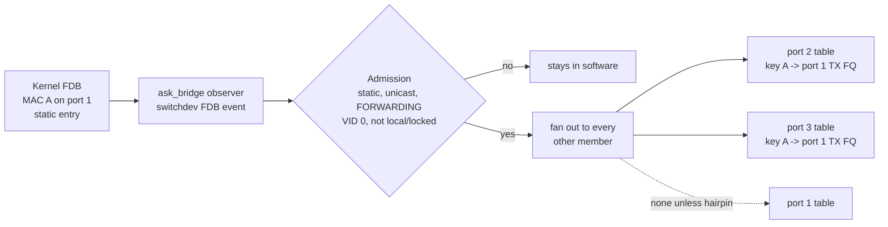
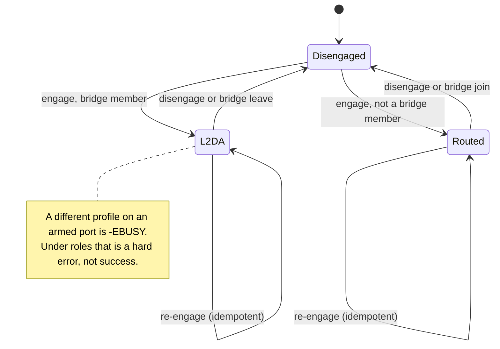
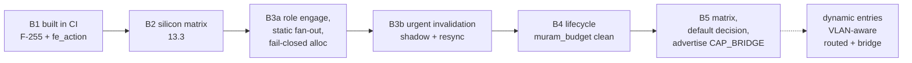

# ASK2 L2 bridge HW offload — switchdev FDB → L2 ehash (`PORT_ID|DA|SA|ETYPE`) → FE-VM `ENQUEUE_PKT`

**2026-10-09 · dpaa1 · T-M6-2 · Implementation plan (B0 done, B1 code written but dormant; DA-only key; production gap review and decisions in §13).**

> **2026-10-09 review.** The vendor bridge mechanism was re-read against
> ASK2 at `ab1660a7` (per-port + per-family offload granularity). The
> result is §13: a gap list (G1-G13), eight design decisions (D1-D8), the
> concrete B2 test matrix, and a re-ordered B2-B5 sequence. Where an older
> section below contradicts §13, §13 wins; the affected paragraphs carry an
> inline "2026-10-09" correction.

**Parity constraint (binding for every later offload).** ASK2 must reach
near-parity with the vendor (IPsec ESP, PPPoE, multicast, tunnels). Today a
port has exactly one KeyGen scheme, hence one key format and one ehash
table; the vendor walks several tables per port (IP tuples, ESP, PPPoE, L2).
F-255's per-port key profile is the extension point for new key formats, but
a port that must offload two traffic classes with different keys at once
(for example routed + ESP) needs multi-table dispatch per port, which ASK2
does not have yet. Design new offloads so they can ride a profile now and
move to multi-table dispatch later without changing their record format.

Offload the steady-state fast path of a Linux software bridge in FMan
silicon: a frame whose destination MAC is a known, non-local FDB entry
reachable on another bridge port forwards via a dedicated L2 ehash table,
with the CPU bypassed — the same ehash/FE-VM mechanism ASK2 already uses
for routed/NAT/VLAN offload (`plans/ASK2-REWRITE-PLAN.md` Baseline), keyed on L2
fields instead of an IP 5-tuple. Full architecture comparison against the
vendor and the rationale for this mechanism:
`plans/ASK2-BRIDGE-OFFLOAD-ARCHITECTURE-ANALYSIS.md`.

**Why ehash:**
- The vendor's own bridge dataplane (`cdx_ehash.c` `fill_bridge_actions()`,
  called from `add_l2flow_to_hw()`) is a dedicated ehash table
  (`cdx_ethernet_cc`, `specs/reference/nxp-ask-fmc/cdx_pcd.xml:53-57,207-219`),
  keysize 15 = `PORT_ID(1)+DA(6)+SA(6)+ETYPE(2)`, max 512 entries, reusing
  the identical opcode/action-chain mechanism (`STRIP_ETH_HDR`/
  `STRIP_ALL_VLAN_HDRS`/`INSERT_VLAN_HDR`/`INSERT_L2_HDR`/`ENQUEUE_PKT`) as
  routed flows — not a CC-tree/match-table classifier.
- A kprobe A/B on `rx_default_dqrr` (the software RX dequeue callback)
  showed ehash/FE_ENTER-dispatched traffic produces near-zero software-RX
  touches (197 hits for 8.77 GB transferred), confirming genuine CPU
  bypass. This is the mechanism this plan targets for bridging too.

**What's reused as-is:** the switchdev notifier skeleton (`ask_bridge.c`,
§5) and the kernel-authority/fail-closed model (§4) are topology-
independent and already built. **What's new:** the ehash key builder and
action emitter (§5, §6).

## 1. Goal and non-goals

**Goal.** Offload the steady-state fast path of a Linux software bridge: a frame
whose **destination MAC is a known, non-local FDB entry reachable on another
bridge port in the forwarding state** is forwarded in FMan silicon (DA match →
enqueue to the egress port TX FQ) with the CPU bypassed, exactly as routed
unicast is today. Everything else stays in the kernel bridge.

**Non-goals / permanently software (fail-closed, `-EOPNOTSUPP`):**
- **BUM traffic** — broadcast, unknown-unicast, multicast/flooded frames. No
  hardware replication in this task (multicast/MDB is T-M6-MC, a separate heavier
  primitive). Flooded frames go to the kernel.
- **Local termination** — frames to the bridge's own MAC (`is_local` FDB entries);
  the kernel must see them.
- **Control planes** — STP/RSTP BPDUs, LLDP, LACP, 802.1X: never offloaded; the
  bridge owns port state and these frames must reach it.
- **Learning / ageing / move** — done by the kernel bridge. ASK2 only mirrors the
  resulting FDB into hardware and removes entries the kernel deletes/ages.
- **Non-forwarding port states** — a port that is STP-blocked/listening/learning
  offloads nothing; only `BR_STATE_FORWARDING` ports carry HW entries.
- **VLAN-aware bridging with tag edits** — deferred (§9). The first cut is
  untagged bridging (and 802.1Q-transparent forwarding where no tag edit is
  needed). Tag push/pop on a bridged frame reuses the ehash VLAN opcode chain
  (`STRIP_ALL_VLAN_HDRS`/`INSERT_VLAN_HDR`, proven on the routed VLAN path —
  `plans/archive/ASK2-REWRITE-PLAN-2026-10-09.md` Phase 1, 2026-10-04/06), and is a later
  increment.

## 2. Why this is the leanest new capability (established facts)

Silicon-proven mechanisms already exist in-tree; the bridge lane is
composition, not new silicon research:

**KeyGen can extract L2 fields.** `KG_SCH_KN_MACDST` (bit 30, 6 B),
`KG_SCH_KN_MACSRC` (bit 29, 6 B), `KG_SCH_KN_ETYPE` (bit 26, 2 B),
`KG_SCH_KN_TCI1/2` (bits 28/27) are all hard-parser known-field bits
(`arch/fman-microcode-210-programming-reference.md:416-420`,
`specs/fman-keygen-flow-key-spec.md:292-296`). The **vendor** proves L2 is a
first-class offloaded class on this exact silicon: live `.106` scheme 11
`0xe4000000` = `PORT_ID|MACDST|MACSRC|ETYPE` (`kgse_mode 0x80000006`, AC_CC)
carried **1,225,734 packets — the busiest scheme on the board**
(`arch/fman-vendor-source-extraction-2026-08-07.md:145-146`). The vendor FMC
L2 classifier `cdx_ethernet_cc` is `keysize=15` = `PORT_ID(1)+DA(6)+SA(6)+
ETYPE(2)` (`specs/reference/nxp-ask-fmc/cdx_pcd.xml:53-57,207-219`) and is the
**last** distribution in each port's `dist_order` — the catch-all L2 lane
walked after the IP tuple lanes. **This is also the key format the ehash
design below uses verbatim** (§3, §6.3.1 of the architecture analysis).

**Consequence: a bridge FDB entry is an ehash record, keyed on
`PORT_ID|DA|SA|ETYPE`, whose action is `ENQUEUE_PKT` to the egress port's
no-confirm TX FQ** (plus the VLAN opcode chain for tagged bridging, §9).
This reuses ASK2's already-proven ehash/FE-VM infrastructure
(`ask_fe_flow_insert()`, CRC-64 bucket indexing, per-key incremental
add/remove) — it is the same kind of capability as routed/NAT/VLAN, with a
different KeyGen key.

## 3. Topology decision (the load-bearing choice)

```
                           ┌────────────────── bridge-only member ports (br0: eth3, eth4, ...)
ingress → Parser → KeyGen (per-port scheme: PORT_ID|DA|SA|ETYPE, 15 B)
                              │
                              │  ehash HIT (known unicast FDB entry, egress port FORWARDING)
                              ▼
                   FE-VM record: ENQUEUE_PKT (untagged)
                   or STRIP_ALL_VLAN_HDRS→INSERT_VLAN_HDR→INSERT_L2_HDR→ENQUEUE_PKT (tagged, §9)
                              │
                              ▼
                   enqueue → per-egress no-confirm TX FQ  (CPU bypassed — same FQ routed/NAT/VLAN use)

                              │  ehash MISS (BUM, unknown DA, control, or table-full fallback)
                              ▼
                        KG-default/PCD FQ → kernel bridge (floods/terminates/learns)
```

**Chosen model: a dedicated per-port L2 KeyGen scheme feeding a dedicated L2
ehash table, scoped to ports that are bridge-only** (no simultaneous routed
scheme on that physical port in v1). No CC-tree, no CC-miss→FE_ENTER chain,
no `miss_fe_off` wiring — an ehash miss falls straight through to the
ordinary KG-default FQ, the same as any other unclassified frame.

**Why this is scoped to bridge-only ports.** Arming a routed scheme and an
L2 scheme on the same port at the same time isn't possible on this
silicon: scheme selection is a first-match SI-walk, so a second match-all
(`kgse_mv=0`) scheme is dead on arrival (`specs/ask2-ipv6-dual-lane-key-design.md`;
`specs/ask2-shared-table-multi-protocol-design.md` §17.2); a distinct
non-zero-`kgse_mv` scheme needs an LCV/NetEnv split, which has repeatedly
wedged multi-port silicon (`ask2-shared-table-multi-protocol-design.md`
§16.3); and CCOBASE selects an ehash table per *scheme*, not per key field,
so one scheme cannot feed two differently-keyed tables either
(`ask2-ipv6-dual-lane-key-design.md`). **This only matters for a port that
needs both roles simultaneously.** A pure bridge member port (the common
case — "two hosts purely switched, no L3 involved", §1's goal) simply arms
the L2 scheme instead of the routed scheme, so there is no conflict to
resolve. This mirrors real switch deployments: a bridge's L3 role (an
IRB/SVI with an IP address) lives at the bridge/VLAN-interface level, not
on the physical member port. **A single physical port that must
simultaneously hardware-route some traffic and hardware-bridge other
traffic is explicitly out of scope for v1** and stays software-forwarded
until a later increment.

*2026-10-09 correction.* The vendor does support both on one port: every
port's `dist_order` walks the IP, ESP, multicast and PPPoE distributions
first and `cdx_ethernet_dist` last, so L2 is reached only when the L3
lookups miss (`dpa_app/files/etc/cdx_pcd.xml` `cdx_ethport_N_policy`).
ASK2 cannot do that yet (one scheme, one table per port), which is why v1
is bridge-only. How a port becomes bridge-only is decision D1 in §13; the
path to routed+bridge coexistence is multi-table dispatch (§13 G2).

**Key format (vendor-matched):** `PORT_ID(1)+DA(6)+SA(6)+ETYPE(2)` = 15
bytes, mirroring the vendor's `cdx_ethernet_cc` exactly
(`specs/reference/nxp-ask-fmc/cdx_pcd.xml:53-57,207-219`). The byte layout
and extraction order for this exact composite are already silicon-confirmed
via `probe3` mode 2 (§8 point 1). DA-only matching (masking SA/ETYPE to
don't-care) is a vendor-supported option (`cdx_ethernet_cc` declares
`masks="yes"`) worth testing as a simpler first cut, since it is closer to
a textbook FDB (keyed only by destination) than the vendor's full
flow-specific composite.

**Table capacity and admission (smart-switch pattern, from the vendor's
`auto_bridge.ko`):** the vendor's own hardware table caps at 512 entries
(`cdx_ethernet_cc max=512`) despite tracking up to 5000 flows in software
(`ABM_DEFAULT_MAX_ENTRIES`) — it does not install a hardware entry the
instant a MAC is learned. Mirror this with a flow-promotion ladder (seen →
confirmed → fast-forwarded) before an ehash install, not an immediate
install on the first `SWITCHDEV_FDB_ADD_TO_DEVICE` (§5, §12).

## 4. Kernel authority — switchdev FDB (not `ndo_fdb_add`)

The Linux bridge is the single source of truth. ASK2 subscribes to the switchdev
notifier chains and mirrors **only** offloadable FDB entries into hardware.
`ndo_fdb_add`/`ndo_fdb_del` are the "bridge bypass" path and are **explicitly
discouraged** for switchdev offload (`Documentation/networking/switchdev.rst`);
we do not implement them (optionally `ndo_fdb_dump` later to visualise the HW
table, not required).

**Registration (module-global, once):**
- `register_switchdev_notifier()` (atomic chain) — carries
  `SWITCHDEV_FDB_ADD_TO_DEVICE` / `SWITCHDEV_FDB_DEL_TO_DEVICE`. Runs under RCU;
  **must defer** to a workqueue (deep-copy `addr`, `dev_hold()`, `queue_work()`)
  because CC install sleeps.
- `register_switchdev_blocking_notifier()` (blocking chain) — carries
  `SWITCHDEV_PORT_ATTR_SET` (STP state, bridge port flags, ageing) and
  `SWITCHDEV_PORT_OBJ_ADD/DEL` (VLAN/MDB — reject/ignore for now).
- `register_netdevice_notifier()` — track `NETDEV_CHANGEUPPER` bridge join/leave;
  call `switchdev_bridge_port_offload()` / `_unoffload()` on join/leave.

**Event struct** `struct switchdev_notifier_fdb_info { addr; vid; added_by_user:1;
is_local:1; locked:1; offloaded:1; }`. Admission filter in the work item:
- **skip `is_local`** (terminate on bridge — kernel keeps it),
- **skip `locked`** (802.1X MAB — bridge does not offload these),
- program only `added_by_user` (static) unicast entries whose egress port is
  a DPAA member in `BR_STATE_FORWARDING` (2026-10-09: this bullet used to say
  "both static and dynamic", which contradicted §8 point 6 and §11 point 1;
  dynamic entries wait for an ageing mechanism, §13 D4);
- after a successful ehash install, fire `SWITCHDEV_FDB_OFFLOADED` (set
  `.offloaded = true`, `call_switchdev_notifiers()`) so `bridge fdb` shows
  `offload` and the bridge tracks HW ownership.

**Port attributes:**
- `SWITCHDEV_ATTR_ID_PORT_STP_STATE` — a port leaving `FORWARDING` must
immediately drop all its HW entries (remove the matching ehash keys, in
its own table and in every other member's table that points at it, §13
D3); a port entering `FORWARDING` may re-mirror the kernel FDB.
- `SWITCHDEV_ATTR_ID_BRIDGE_AGEING_TIME` — informational; ageing is the kernel's
  job. ASK2 removes an entry only when the kernel sends `FDB_DEL_TO_DEVICE`. To
  keep the kernel's ageing correct for *hardware-forwarded* flows (whose source
  MAC the CPU never sees), the driver must refresh FDB "used" via the same
  mechanism switchdev drivers use (`SWITCHDEV_FDB_ADD_TO_BRIDGE` learning-sync or
  periodic `fdb` update from HW hit counters) — see §8 open item.
- `SWITCHDEV_ATTR_ID_PORT_BRIDGE_FLAGS` — honour `BR_LEARNING`/`BR_FLOOD` etc.:
  if learning is off or a flag combination we cannot honour is set, fail closed
  (no HW entries for that port).

Reference drivers to mirror (API-identical, HW backend differs): DPAA2 switch
`dpaa2-switch.c` (closest Freescale shape), `am65-cpsw-switchdev.c` (compact),
`adin1110.c` (smallest two-chain example).

## 5. Board / driver API extensions required (all software)

1. **L2 ehash key builder.** A `cc_pack_key_l2()`-equivalent for the ehash
   path: pack the 15-byte `PORT_ID|DA|SA|ETYPE` composite (reusing the
   byte-layout fact already silicon-confirmed in §8 point 1), and compute
   the CRC-64 bucket index the same way the routed/
   NAT/VLAN ehash tables already do (`fman_pcd_crc64()`,
   `fman_pcd_ehash_bucket_index()`). KUnit vectors for DA-only and full
   `PORT_ID|DA|SA|ETYPE` keys, mirroring the existing routed 14-byte
   match-key fixup (`0167`).

2. **Dedicated per-port L2 KeyGen scheme.** EKFC `0xe4000000` =
   `PORT_ID(bit 31)|MACDST(bit 30)|MACSRC(bit 29)|ETYPE(bit 26)`, AC_CC
   dispatch to the new L2 ehash table's CCOBASE. Armed **only** on ports
   that are bridge-only in v1 (§3.1) — arming this scheme and the routed
   scheme on the same port at the same time is out of scope and must be
   rejected/fail closed, not silently attempted.

3. **Bridge-forward action = `ENQUEUE_PKT`, no HMTD for untagged.** Reuse
   the existing ehash/FE-VM record builder and the existing per-egress
   no-confirm TX FQ resolver (`ask_hw_resolve_oif_fqid`, F-199
   `0x2ba`/`0x2bb`) — the same FQ routed/NAT/VLAN flows already enqueue to.
   Tagged bridging adds the VLAN opcode chain (§9) on top of the same
   record, reusing the Phase 1 VLAN fixes (opcode ordering, byte order,
   RX buffer/alignment — `plans/archive/ASK2-REWRITE-PLAN-2026-10-09.md`
   patches `0215`/`0217`/`0218`) rather than rediscovering them.

4. **Per-port L2 ehash table + software shadow, with a flow-promotion
   ladder (not immediate install).** `ask.ko` keeps a per-port software
   shadow of candidate (DA, SA, ETYPE) tuples and promotes an entry through
   `SEEN → CONFIRMED → INSTALLED` before calling the ehash add-key path —
   mirroring the vendor `auto_bridge.ko`'s `L2FLOW_STATE_SEEN →
   CONFIRMED → FF` ladder (architecture analysis §2.4) — rather than
   installing on the first `SWITCHDEV_FDB_ADD_TO_DEVICE`. Installs/removes
   are **per-key**, not a whole-table rebuild (the ehash add/remove path
   ASK2 already uses for routed/NAT/VLAN flows) — this structurally
   eliminates the CC-tree's whole-tree-rebuild-under-churn lock-scope bug
   class §11 had to patch once. A table-capacity bound (start from the
   vendor's own 512-entry precedent, confirm the real per-table budget on
   this silicon) **fails closed to software** past the cap, same principle
   as the original plan.

5. **`ask_bridge.c` — replace the stub.** Unchanged in shape from the
   original plan: switchdev notifier registration (already done, B0),
   the FDB workqueue + admission filter (already done, B0) now additionally
   implementing the promotion ladder (item 4) and calling the ehash
   add/remove path (items 1-3) instead of `fman_pcd_cc_static_install`,
   STP-state handling, and teardown. Add a global `bridge_offload` kill-switch
   module param (the same role `vlan_offload`/`pppoe_offload`/`ipv6_hw_frag`
   play; default 0 until B5, then 1), the `ASK_CAP_BRIDGE` advertise gate in
   `ask_genl.c`, and `ask-check` / `show flows` / `support-bundle` bridge
   observability. 2026-10-09: the earlier `ask_bridge_offload` per-feature
   param and the per-port bridge bit no longer exist (§12 banner); there is
   no per-port bridge knob, only the engaged-port rule plus this one global
   switch (§13 D8).

## 6. Staged implementation increments (each build + silicon-gated)

- **B0 — DONE 2026-09-10 — S0 gate + host plumbing (dormant, zero datapath
  change).** The switchdev notifier skeleton (`ask_bridge.c`, replacing a
  21-line lifecycle-only stub) that **logs** offloadable FDB events
  (coalesced+bounded queue) but installs nothing. `ASK_CAP_BRIDGE` stays
  unadvertised; the `ask_bridge_offload` module param shipped default-off
  (historical: removed 2026-10-09, replaced by the `bridge_offload` global
  kill switch planned in §13 D8). Gate: builds
  clean; routed/NAT/VLAN byte-identical (untouched); `ask-check` reports
  bridge as legitimately dormant, not broken. Reused as-is for the ehash
  design — the switchdev notifier chains, workqueue, and admission filter
  are topology-independent (§4).

- **B1 — code written 2026-10-07, not yet built in CI — per-port key
  profiles + DA-only key + `ENQUEUE_PKT` action.**
  - *Key decision: DA-only first* (§8 point 4). The key is the frame's
    6-byte destination MAC (EKFC `0x40000000`, `KG_SCH_KN_MACDST`), one
    record per FDB entry, fed directly by switchdev FDB events. No
    PORT_ID byte (per-port tables already separate ingress ports, and it
    avoids the §8 point 1 `0x00`-vs-hwport question), no SA, no promotion
    ladder. The vendor's 15-byte `PORT_ID|DA|SA|ETYPE` composite stays a
    later option: it changes only the profile row and the key builder,
    plus a traffic-learning entry source that DA-only never needs.
  - *Kernel, F-255 (`bin/kernel-fixups/F_255.py`):* per-port FE key
    profiles. A port has one KeyGen scheme, so one key format and one
    per-port ehash table; until now both were hardwired to the 46-byte
    dual-lane routed key (F-224/F-225). `fman_pcd_fe_engage_profile(fm,
    port, fqid, profile)`; `fman_pcd_fe_engage()` = ROUTED (unchanged).
    L2_DA arms EKFC MACDST alone (`keygen_scheme.ekfc_only` skips the
    F-224 GEC override) and sizes the per-port table to 6 bytes.
    Re-engaging an armed port with another profile is `-EBUSY`; disengage
    resets it to ROUTED. Later offloads (ESP, PPPoE, L2 tunnels) add
    profile rows rather than new arming paths.
  - *ask.ko:* `ask_bridge_fe_action()` builds the record action for one
    FDB entry: key = DA, table 0, HIT = plain `ENQUEUE_PKT` to the egress
    port's no-confirm TX FQ via `rx_fqid` (`tx_fqid` stays 0, so no
    `INSERT_L2_HDR`). Rejects broadcast/multicast/zero DAs. KUnit suite
    `ask_bridge` (`tests/ask_test_bridge.c`).
  - *Verified so far:* F-255 applied to a locally derived copy of the CI
    kernel tree (same patch series + fixups), `fman/` compiles,
    `test-fixups.sh` [1]-[4] OK; ask.ko and `ask_kunit.ko` compile.
    Still to do: CI build, KUnit run (`kunit` input), and a routed
    regression run on `.185` showing ROUTED ports are byte-identical
    (`pcd-snapshot`, A6 spot check).
  - *Known ceiling:* every ehash record's `ENQUEUE_PKT` param carries
    MTU 1500 (routed records too); bridged jumbo frames need that
    revisited before B5. 2026-10-09: F-262 gave records that ask for it a
    real egress MTU plus the `05 PREEMPTIVE_CHECKS` opcode and a frag-info
    block. Bridge records must NOT ask for it: the vendor sets
    `l2_info.mtu = 0xffff` for bridge flows, and a bridge never fragments.
    Keep bridge records on the no-`05` path (§13 D7).
  - *Known dormancy (2026-10-09):* nothing calls
    `fman_pcd_fe_engage_profile(..., L2_DA)` at runtime.
    `ask_hw_offload_engage()` always calls `fman_pcd_fe_engage()` (ROUTED),
    so B1 compiles but no port can reach the L2 profile. Closing that is
    the first item of B3 (§13 D1, G1).

- **B2 — not started — ehash silicon de-risk (the decisive proof).**
  Hand-arm a single L2 ehash entry (fixed destination MAC → `ENQUEUE_PKT`
  to the other port's no-confirm TX FQ) on a sacrificial bridge-only port,
  cold boot. Prove on silicon: (a) the frame is forwarded out the egress
  port, **and** (b) it does so with the CPU genuinely bypassed — confirmed
  via a `rx_default_dqrr` kprobe A/B (near-zero hits for the bulk of the
  traffic, not just "frames arrive"; see
  `plans/ASK2-BRIDGE-OFFLOAD-ARCHITECTURE-ANALYSIS.md` §4.1 for why that's
  the right acceptance bar). **This is the single new silicon question
  gating B3.** The full test matrix (key A/B, PORT_ID byte, non-IP frame,
  arm/detach, capacity, tagged pass-through) is §13.3; run it as one
  cold-boot session per variable (AGENTS §10.9/§10.10).

- **B3 — `ask.ko` production switchdev wiring (gated on B2 PASS).** Replace the
  `ask_bridge.c` stub. 2026-10-09: B3 is larger than this paragraph first
  assumed; it has four prerequisites that B1 does not provide (§13 G1, G3,
  G5, G6): port-role selection at engage, FDB fan-out across the other
  members' ingress tables, an authoritative shadow with urgent invalidation,
  and a fail-closed table-allocation path. FDB workqueue (promotion ladder,
  §5 item 4, only if the 15-byte key wins at B2) installs/removes
  ehash records via the B1 builder; STP-state and port-flag handling;
  `SWITCHDEV_FDB_OFFLOADED` ack; bridge join/leave via
  `switchdev_bridge_port_offload`. BUM/unknown-DA/local/control all miss → kernel.
  Gate: two-port bridge (eth3↔eth4 in `br0`), a known-unicast flow forwards in HW
  (confirmed via the same kprobe test as B2), broadcast/unknown-unicast/BPDU stay
  in SW, no routing regression.

- **B4 — lifecycle + teardown.** FDB del / flush → remove the ehash key (per-key,
  no whole-tree rebuild to reason about); STP leave-FORWARDING → drop that port's
  entries (in every member's table, §13 D3); port down / bridge leave /
  `bridge_offload=0` / module unload /
  reboot → detach the L2 KeyGen scheme, restoring the port to its prior
  `next_engine` (RSS or routed, whichever it was before bridging armed), quiesce,
  never churn VyOS config mid-teardown; `pcd-snapshot` byte-clean after. Gate:
  forward+inverse + concurrency (CONFIG_DEBUG_LIST/lockdep) + resource
  (`muram_budget` returns to baseline).

- **B5 — matrix + productization.** Learn/move/delete/age, port down, STP blocked,
  multi-port bridge, FDB churn under load, table-full fallback, ageing
  correctness for HW-forwarded flows (§8 open item), performance vs SW bridge
  (must not regress the ~10 G routed path when both coexist on different ports),
  safety (no BUM/control bypass). Only then advertise `ASK_CAP_BRIDGE`, add the
  `show offload` bridge label, and make the default-on/off decision.

### De-risk experiments before B3 (cheap, sacrificial port)
1. Confirm the dedicated L2 scheme arms and detaches cleanly, restoring the
   port's prior `next_engine`.
2. B2 (above) is the gating go/no-go for the whole production path.

## 7. Per-feature acceptance contract (master-plan §4.6.5 — all must pass)

1. **Semantic:** capture proves a known-unicast bridged frame egresses the correct
   port in HW; broadcast/unknown-unicast/multicast/BPDU/local demonstrably stay in
   software (kernel bridge floods/terminates).
2. **Kernel-authority:** an FDB entry is `offload`-marked only after successful
   ehash install; the kernel bridge remains authoritative for learning/ageing/STP/VLAN;
   control frames stay visible to the bridge.
3. **Forward + inverse:** FDB add/del/flush, MAC move (port change), STP state
   change, bridge port add/remove, ageing expiry, interface down/up, config
   removal, module unload, reboot.
4. **Concurrency:** async FDB add/del under lockdep/CONFIG_DEBUG_LIST + ehash
   install/remove racing disengage; no poison/double-free/stale-generation/deadlock.
5. **Resource:** force the ehash table-capacity boundary/MURAM exhaustion → clean
   fallback to SW bridge; `muram_budget` + `pcd-snapshot` return to baseline; no
   partial publication.
6. **Performance:** HW bridge vs SW bridge on the reproducible harness (throughput,
   per-core CPU, error deltas, MTU); must not regress the ~10 G routed path when a
   port both bridges and routes.
7. **Safety:** BUM, unknown-DA, STP-blocked, local, and control frames cannot be
   silently HW-forwarded; no bypass of STP/VLAN/bridge semantics.
8. **Observability:** `ask-check`/`show flows`/`support-bundle` identify the bridge
   feature, owner (switchdev cookie), state, fallback reason, and errors without
   debugfs control writes.
9. **Capability:** only then set `ASK_CAP_BRIDGE` and mark T-M6-2 DONE.

## 8. Unresolved silicon questions (resolve read-only before arming)

1. **CC comparator window for a DA-bearing key — RESOLVED 2026-09-15.** Live
   `probe3` mode 2 capture on `.185`/eth1 (widened-RICP, `bin/kernel-fixups/
   F_240.py`/`F_241.py` + this session's mode-2 extension, F-247/F-248) directly
   observed the KeyGen-extracted composite for the armed L2 scheme
   (EKFC `0xe4000000`) against a real live frame. DST_MAC and ETHERTYPE landed
   at their exact expected byte positions with unambiguous real-world values
   (`33:33:00:00:00:fb` = the real `ff02::fb` multicast DST_MAC seen later in
   the same capture; `0x86dd` = the real IPv6 EtherType, matching this
   packer's own byte order) — confirming the 15-byte `PORT_ID|DA|SA|ETYPE`
   layout and field order are correct, not just byte-perfect against a guess.
   One real defect found and fixed (patch `0208`): PORT_ID (byte 0) extracts
   as the REAL hardware port id (`0x0d` on eth1) on this scheme, not the
   `0x00` every other CC key type on this ucode has shown — `cc_pack_key_l2()`
   was hardcoding `0x00`. The vendor's live 15-byte `cdx_ethernet_cc` was
   strong prior evidence the layout works; this is now direct, first-party
   confirmation, not just precedent.
2. **Does a bridge-only port's dedicated L2 scheme arm and detach cleanly?**
   Confirm the L2 KeyGen scheme arms without disturbing other ports, and
   that detaching it restores the port's prior `next_engine` exactly
   (routed, RSS, or disengaged, whichever it was). This is B2's actual
   scope (§6).
3. **Real per-table ehash capacity on this silicon.** The vendor's
   512-entry `cdx_ethernet_cc` is a precedent, not a confirmed ASK2 number
   — measure the actual MURAM/table budget for a dedicated L2 ehash table
   on this build before picking its capacity cap.
4. **DA-only vs full 15-byte key — DECIDED 2026-10-07: DA-only first** (B1
   above); the composite remains a later profile. 2026-10-09: B2 runs both
   keys as an A/B (§13.3), because the choice drives capacity and fan-out,
   not just simplicity: DA-only needs one record per (DA, other-ingress-port)
   and cannot carry a VID; the vendor's per-flow 15-byte key needs one record
   per observed flow and a traffic-driven entry source (§13 D2). Original note: the vendor's `cdx_ethernet_cc` supports
   masking (`masks="yes"`), so a DA-only key (6 bytes, SA/ETYPE wildcarded)
   is a plausible simpler first cut closer to a textbook FDB. Untested;
   worth an early A/B against the full 15-byte composite before committing
   to one in B1.
5. **Non-IP frame through the ehash/enqueue path.** The VLAN/routed proofs were IP
   frames. A pure L2 bridge forward of a non-IP known-unicast frame (e.g. a
   protocol the parser doesn't deep-parse) through an L2 ehash hit + plain
   `ENQUEUE_PKT` is unexercised. Base case (untagged, no VLAN opcodes) should be the
   safest possible path, but must be captured. Control/BUM stays SW regardless.
6. **Ageing of HW-forwarded flows.** The CPU never sees the source MAC of a
   hardware-bridged flow, so the kernel bridge could age out an entry that is
   actively forwarding in HW. Mirror the in-tree switchdev pattern: either
   periodically refresh the kernel FDB `used` timestamp from HW hit counters, or
   emit `SWITCHDEV_FDB_ADD_TO_BRIDGE` learning-sync. Decide in B5; until then a
   conservative option is to only offload **static** (`added_by_user`) FDB entries
   (no ageing concern) and treat dynamic entries as SW — a smaller but safe first
   ship. The vendor's `auto_bridge.ko` answers this with a `br_fdb_register_can_expire_cb()`
   callback instead of polling (architecture analysis §2.4) — a cleaner B5+ option
   than hit-counter polling, if dynamic-entry offload is ever wanted.
   2026-10-09: the vendor's callback needs a bridge kernel patch
   (`020-ask-bridge-hooks.patch` touches `br_fdb.c`, `br_input.c`,
   `br_private.h`, `br_stp_if.c`); ASK2 deliberately has none. The
   no-patch options are the hit-counter refresh or static-only (§13 D4).

## 9. VLAN-aware bridging (later increment, reuses the Phase 1 ehash VLAN opcodes)

Untagged bridging (§1) needs no VLAN opcodes at all — just `ENQUEUE_PKT`.
VLAN-aware bridging — a bridged frame that
must have a tag pushed/popped between ingress and egress bridge ports — reuses the
**exact** ehash VLAN opcode chain the routed-VLAN Phase 1 fix proved on silicon
(`plans/archive/ASK2-REWRITE-PLAN-2026-10-09.md` §1 item 1, patches `0215`/`0217`/`0218`:
`STRIP_ETH_HDR`/`STRIP_ALL_VLAN_HDRS`/`INSERT_VLAN_HDR`/`INSERT_L2_HDR` ahead of
`ENQUEUE_PKT`), minus the L3 rewrite/TTL-decrement opcodes a routed record also
carries (bridging doesn't touch TTL). This also matches the vendor's own
`fill_bridge_actions()` exactly (architecture analysis §2.1) — it is the same
opcode family the vendor uses for untagged and VLAN-aware bridging alike. This is
a clean follow-on once §1 base bridging lands; sequence it after B5 and after
multicast (T-M6-MC) if bridge+VLAN filtering is required. Do
not build it into the base case.

## 10. Provenance
- Capability scope + lean-model recommendation: `plans/OFFLOAD-CAPABILITY-PLAN.md`
  §1.5, §2, §3; master task **T-M6-2** (`plans/ASK2-MASTER-PLAN.md` §4.6.4 Phase
  M6-E, gates §4.6.5).
- L2 EKFC fields + vendor L2 evidence:
  `arch/fman-microcode-210-programming-reference.md:416-420`,
  `specs/fman-keygen-flow-key-spec.md:292-296`,
  `arch/fman-vendor-source-extraction-2026-08-07.md:145-146`,
  `specs/reference/nxp-ask-fmc/cdx_pcd.xml:53-57,207-219`.
- Scheme/dispatch constraints (no 2nd match-all, CCOBASE scheme-only, no FE
  branch): `specs/ask2-ipv6-dual-lane-key-design.md`,
  `specs/ask2-shared-table-multi-protocol-design.md` §7.4/§16.3/§17.2.
- switchdev FDB kernel authority (not `ndo_fdb_add`):
  `Documentation/networking/switchdev.rst`, `include/net/switchdev.h`,
  `net/bridge/br_switchdev.c`; reference drivers `dpaa2-switch.c`,
  `am65-cpsw-switchdev.c`, `adin1110.c`.
- Stub to replace: `kernel/ask/oot-modules/ask/ask_bridge.c`; capability bit
  `ASK_CAP_BRIDGE` `kernel/ask/oot-modules/ask/include/uapi/linux/ask/ask.h:204`.
- **Architecture rationale:** `plans/ASK2-BRIDGE-OFFLOAD-ARCHITECTURE-ANALYSIS.md`
  (full vendor-vs-ASK2 comparison, the `rx_default_dqrr` kprobe evidence, the
  per-port-scheme resolution); `plans/archive/ASK2-REWRITE-PLAN-2026-10-09.md`
  §1, §6 Phase 1 (the ehash/FE-VM VLAN fix this plan's mechanism mirrors);
  `/mnt/builds/ASK/auto_bridge/auto_bridge.c` + `auto_bridge_private.h` (vendor
  ABM flow-promotion ladder, the smart-switch admission pattern §5 item 4
  adopts); qdrant tags `ask2-bridge-offload`/`cc-tree-vs-ehash` (2026-10-07).

## 11. FDB churn prevention (design, not just survival)

Churn has four distinct sources; each gets its own lever rather than one
generic "handle churn better" fix:

1. **Ageing-induced churn (self-inflicted, avoidable by construction).** The
   CPU never sees the source MAC of a HW-forwarded flow, so kernel ageing can
   expire an entry that's still actively forwarding in hardware — DEL, then a
   fresh ADD the moment the next frame is punted and relearned.
   **Decision: B3 offloads only static (`added_by_user`) FDB entries by
   default.** Static entries never age — zero ageing-churn by construction.
   §8 point 6 already floated this as *an* option; make it the shipped
   default, not a fallback. Dynamic-entry ageing-refresh (HW hit-counter →
   kernel FDB `used` touch, or `SWITCHDEV_FDB_ADD_TO_BRIDGE` sync) stays a
   B5+ increment, deliberately out of the first cut.
2. **STP topology-change mass-flush.** Deliberate bridge behavior on a TC
   event (fast-age the whole FDB) — must not be prevented, only absorbed
   cheaply. **Add a coalescing/debounce window** (a few ms, e.g. via
   `mod_delayed_work`) between an FDB ADD event and the ehash add call it
   triggers: batch every ADD that arrives inside the window into one pass over
   the per-key ehash API instead of one install call per individual event, and
   don't promote a flapping entry through the SEEN→CONFIRMED ladder (§3)
   prematurely. **2026-10-09: debounce applies to ADD only.** A DEL,
   STP-block, MAC move or port-down is a correctness event: a stale record
   keeps forwarding frames the kernel bridge would no longer forward, so those
   are processed immediately, never delayed or coalesced away (§13 D3). A lock held
   across an install-and-drain-sleep sequence (the same mistake the VLAN
   CC-tree work hit and fixed — `ask_vlan_cc_flow_del()` serialized every
   port behind one flow's teardown until the lock was narrowed to not span
   the drain) must not be repeated here: unlock before any sleep, don't hold
   one global lock across a multi-port operation.
3. **MAC-move churn.** A DEL on the old port + ADD on the new port, close
   together. Process the DEL immediately and debounce only the ADD: the
   window between them is a short software-bridge fallback, which is safe;
   a delayed DEL is not (stale record forwards to the old port).
4. **Table-pressure thrashing.** Fail-install → SW fallback → retry-on-
   relearn can loop at the ehash table-capacity boundary (§8 point 3) under a
   churn burst. Keep deliberate headroom below the cap (do not fill to 100%) so a
   burst doesn't oscillate at the boundary.

**Consequence for B3's design:** the FDB workqueue item must NOT react to
every individual switchdev ADD notification with an immediate ehash install
call, and must not promote a flow through the SEEN→CONFIRMED ladder on a single
flapping event. Coalesce ADDs first (debounce timer keyed per port), then act
once, without serializing unrelated ports behind one port's operation. DEL,
STP-block, move and port-down bypass the debounce (§13 D3).

## 12. Per-port arming ABI + automatic CLI trigger

> **Superseded 2026-10-09 (offload granularity decision).** The per-port
> bridge bit, `ASK_ATTR_BRIDGE`, `ask_hw_offload_set_bridge()` and the
> `apply_ask_bridge_offload` bridge-membership trigger described below were
> removed. Bridge offload is now an automatic part of an engaged port:
> `ask_hw_bridge_offload_armed()` is true while any port has `offload
> ipv4`/`ipv6` armed. Granularity is per port + per IP family only (spec
> `specs/ask2-vlan-cli-grammar.md` §9). The text below is design history.

Extended the same genl engage mechanism VLAN uses (`ASK_CMD_ENGAGE` +
`ASK_ATTR_FAMILY_MASK`/`ASK_ATTR_VLAN`) with a parallel `ASK_ATTR_BRIDGE`
(u8 bool) attribute, and the matching kernel-side per-port array
(`ask_hw_port_bridge[]`, `ask_hw_offload_set_bridge()`,
`ask_hw_bridge_offload_armed_port()`/`_armed()` in `ask_hw.c` — byte-for-byte
mirroring the VLAN functions). `ask_bridge.c`'s FDB observer now reports the
real per-port armed state instead of the placeholder global module param B0
shipped with (removed — see below). `ASK_CAP_BRIDGE` deliberately stays
unadvertised through B0-B2 even though the arm/gate functions now exist for
real, since there is still no FDB install path consuming them (that's
B3).

**Design decision (explicit user direction): no CLI leafNode for bridge
offload.** Unlike VLAN's `offload vlan` (an explicit per-port opt-in the user
sets), bridge offload arms **automatically**: whenever a member port already
has `offload ipv4`/`offload ipv6` armed, joining a bridge (or the bridge
itself being created around it) arms that port's bridge bit with no separate
command. There is intentionally no global master-override module param either
(unlike `ask_vlan_offload`) — forcing bridge offload on for a port with no
family offload armed at all would have nothing to ride on, so a bare
"force everything on" debug knob doesn't mean anything here.

Implementation spans three layers, all now silicon-independent (dormant, same
B0 risk profile — this only changes when the genl bit gets set, not whether
anything installs into hardware):

1. **`board/scripts/vyos-offload-ask`** — `engage`/`family` gained an optional
   3rd `bridge` arg (mirroring `vlan`'s 2nd arg), plus a standalone `bridge
   <0|1>` verb (mirroring `vlan <0|1>`) for re-arming just that bit without
   touching family.
2. **vyos-1x `python/vyos/ifconfig/ethernet.py`** (`data/vyos-1x-051-bridge-
   hw-offload-auto.patch`) — `set_ask_offload()` gained a `bridge: bool`
   param threaded into the tool call. `update()` computes it automatically:
   `ask_mask != 0 and is_bridge_member is not None` — `is_bridge_member` is
   already populated generically for every interface by `configdict.py`'s
   `get_interface_dict()` (the same field `interfaces_bridge.py` itself
   reads), so this needed no new cross-tree lookup. Covers the "toggle
   `offload ipv4` on a port that's already in a bridge" direction entirely
   within ethernet.py's own existing commit path.
3. **vyos-1x `src/conf_mode/interfaces_bridge.py`** (same patch) — new
   `apply_ask_bridge_offload()`, called from `apply()`. Covers the reverse
   direction: a bridge's own commit (member added/removed) doesn't re-trigger
   `interfaces_ethernet.py`'s conf_mode script by itself, so this function
   directly reads each changed member's current `offload ipv4`/`ipv6`/`vlan`
   config (via `get_interface_dict(conf, ['interfaces', 'ethernet'],
   ifname=interface)`, the identical pattern this file already uses for
   vxlan/openvpn members) and calls `EthernetIf(interface).set_ask_offload(
   mask, vlan, bridge=<joined>)` directly. Deliberately does **not** use
   VyOS's declarative `set_dependents`/`call_dependents` dependency-graph
   machinery (the pattern the file uses for vxlan/wlan/firewall deps) —
   registering a new dependency type there needs an entry in a separate
   build-generated dependency-graph file, more moving parts than this
   self-contained direct call needs for what is still a B0-risk-profile,
   log-only change.

**Not yet done:** no full-CI build/deploy verification of this specific
patch (T-M6-2 B0's baseline commit `d4e50ac4` + these ABI/CLI additions were
built and syntax-checked locally — `ask.ko` against the CI kernel cache,
both vyos-1x Python files with `py_compile` plus a full patch-series
round-trip against a fresh vyos-1x clone — but not yet run through a real CI
build+deploy+live-bridge-test cycle the way B0 itself was).

## 13. Review 2026-10-09: vendor parity gaps, decisions, B2 matrix

This section records a read of the vendor bridge mechanism (`/mnt/builds/ASK`:
`cdx/cdx_ehash.c`, `auto_bridge/auto_bridge.c`,
`dpa_app/files/etc/cdx_pcd.xml`, `patches/kernel/020-ask-bridge-hooks.patch`)
against ASK2 at commit `ab1660a7`. Vendor-side detail is in
`plans/ASK2-BRIDGE-OFFLOAD-ARCHITECTURE-ANALYSIS.md` §2.5 and §6.7. Nothing
here changes the datapath; it fixes the order of work and the contract B3 must
meet. **D1 and D8 were confirmed by the operator on 2026-10-09**; D2-D7 follow
from vendor evidence and the existing plan decisions.

### 13.1 Where ASK2 stands

| Piece | State |
|---|---|
| B0: switchdev FDB observer, log-only (`ask_bridge.c`) | Done; queue holds 1024 events and drops on full |
| B1: F-255 `L2_DA` profile + `ask_bridge_fe_action()` | Code written, KUnit-covered, **not built in CI**, no runtime caller |
| `ask_hw_offload_engage()` | Always ROUTED; `-EBUSY` treated as idempotent success (F-122/F-124) |
| `ASK_CAP_BRIDGE` | Unadvertised (`ask_genl.c`); `ask_hw_bridge_offload_armed()` is true when any port is engaged |
| B2 silicon proof | Not started |

The vendor path for comparison: `auto_bridge.ko` hooks `NF_BR_FORWARD` /
`NF_BR_POST_ROUTING`, marks a frame `abm_ff` only on a known-unicast dst-FDB hit
in `br_handle_frame_finish`, tracks the flow SEEN → CONFIRMED → FF, and sends
`L2FLOW_ENTRY_NEW` over `NETLINK_L2FLOW` to cmm, which forwards
`FPP_CMD_RX_L2FLOW_ENTRY` over FCI to cdx. cdx builds one **per-flow** ehash
record in the ingress port's ETHERNET table with key
`portid(1)+DA(6)+SA(6)+ethertype(2)` = 15 B and `l2_info.mtu = 0xffff`
(no MTU check). ASK2 replaces that whole chain with switchdev FDB events and
needs no bridge kernel patch.

### 13.2 Gaps

| # | Gap | Why it matters | Closed by |
|---|---|---|---|
| G1 | Port role is not selectable. `ask_hw_offload_engage()` always arms ROUTED and swallows `-EBUSY`. | The `L2_DA` profile is unreachable; once roles exist, a profile mismatch must be a hard error, not idempotent success. | B3a, D1 |
| G2 | One KeyGen scheme and one ehash table per port. | A second match-all scheme is dead and the LCV split wedged silicon, so one port cannot route and bridge in hardware at once. The vendor does it by chaining distributions (`cdx_ethernet_dist` last in every `dist_order`). | v1 bridge-only members (D1); multi-table dispatch is a later epic |
| G3 | switchdev reports the **egress** port of an FDB entry, but tables belong to **ingress** ports. | A MAC learned on port X needs a record in every other member's table (M MACs × (N-1) ports). None in X's own table unless hairpin is on. | B3a, §13.4 |
| G4 | DA-only key has no VID. | Records are wrong on a `vlan_filtering` bridge or any entry with a non-zero VID. | Fail closed in B3a; real support §9 / D6 |
| G5 | B0 queue drops on overflow and §11 originally debounced DELs. | A dropped or delayed DEL / STP-block / move leaves a stale record forwarding frames the bridge would not. | D3 |
| G6 | `F_255.py` falls back to the global 46-byte table if the per-port `fman_pcd_ehash_table_set()` fails. | EKFC would extract 6 bytes against a 46-byte table key: the structural mismatch that stalled T-M3-R attempt 1 (`plans/archive/ASK2-MASTER-PLAN-2026-10-09.md` §4.1, KeyGen scheme 4 note). L2 engage must fail closed. | B3a |
| G7 | Per-table capacity and per-record footprint are unmeasured. | Bucket mask `0x7fff` means 32768 × 16 B per table, against the vendor's 512-entry cap; spec `ask2-shared-table-multi-protocol-design.md` says the bucket array dominates and every class must pass the live MURAM-budget gate. Fan-out multiplies records. | B2 matrix |
| G8 | Production `fman_pcd_fe_flow_add` passes `stats=false`. | No per-record hit counters, so no observability and no hit-based ageing refresh (D4). | B3/B5 |
| G9 | F-262 gives records that request it `05 PREEMPTIVE_CHECKS`, an MTU and a frag-info block. | Bridge records must not request it; vendor bridge MTU is `0xffff`. | D7 |
| G10 | Churn and lifecycle risks. | The CR-001 MURAM "leak" was F-133's diagnostic tracker, a false signal (`plans/archive/ASK2-MASTER-PLAN-2026-10-09.md` §5); keep `muram_budget` + `pcd-snapshot` as the only truth. Per-table delete cost under mass flush is unmeasured. | B4 gate |
| G11 | Routed flows whose egress (or ingress) is a bridge device (IRB/SVI) are not resolved to a member port. `ask.ko` has no `netif_is_bridge_master` handling outside `ask_bridge.c`'s `NETDEV_CHANGEUPPER`. | They stay in software. The vendor handles this with `cmmBrToFF`. Not board-verified. | Out of scope for v1; D1 documents it |
| G12 | The family mask cannot gate L2 flows. | A DA-only key matches any ethertype, so `offload ipv4` on a bridge member also forwards IPv6 and non-IP unicast in hardware. | D8 (document) |
| G13 | Exclusivity and in-place scheme reprogramming. | The L2 scheme must respect the ASK↔VPP per-interface mutex and must remain compatible with the ingress-policer's `kg_find_port_scheme()` in-place next-engine rewrite. | B3a gate |

### 13.3 B2 test matrix (silicon, cold boot, one variable per session)

B2 hand-arms one L2 record on a sacrificial bridge-only port (never eth0, the
SSH lifeline; eth3/eth4 pair per the board map). Each row is one cold-boot
experiment (AGENTS §10.9, §10.10); record the boot type.

| # | Question | Method | Pass criterion |
|---|---|---|---|
| 1 | Does a `L2_DA` hit plus plain `ENQUEUE_PKT` forward a frame? | Hand-armed DA record to the peer's no-confirm TX FQ | Frame egresses the other port |
| 2 | Is the CPU bypassed? | `rx_default_dqrr` kprobe A/B, bulk traffic | Near-zero hits for the bulk flow |
| 3 | DA-only 6 B vs vendor 15 B composite | A/B on the same flow | Pick by capacity, fan-out cost, VID need (D2) |
| 4 | PORT_ID byte on the L2 scheme | Passive `hash_probe` / CRC-64 check, not assumed | Real hw port id is what the scheme emits (e.g. `0x0d` on eth1 per the 2026-09-15 `probe3` mode-2 capture, patch 0208); never assume the routed `0x00` result transfers |
| 5 | Non-IP and tagged frames | ARP / LLDP-like / 802.1Q frame through a hit | Passes unmodified; documents the deviation from the vendor's unconditional `STRIP_ALL_VLAN_HDRS` (0x12) |
| 6 | Arm and detach restore the prior `next_engine` | `pcd-snapshot diff` after disengage | Byte-clean; `muram_budget used` back to baseline |
| 7 | Real per-table capacity | Insert until failure | Number recorded; sets the admission cap in B3 |
| 8 | Unknown DA, broadcast, BPDU | Send each through an armed port | Miss → default FQ → kernel bridge floods or terminates |

### 13.4 Decisions

**D1 — port role follows the engage trigger; no new CLI leaf (confirmed 2026-10-09).**
Engaging a port (`offload ipv4|ipv6`) selects `L2_DA` if the port is a bridge
member and ROUTED otherwise. A join or leave (`NETDEV_CHANGEUPPER`) is an
explicit disengage then re-engage; routed flows with that port as ingress are
flushed at join. A bridge member is bridge-only in v1, so VLAN, PPPoE and
routed hardware flows on it stay in software (the miss path keeps that
correct), and the routed insert path in `ask.ko` must refuse a port whose
profile is not ROUTED. This matches the 2026-10-09 granularity decision:
per-port engage plus per-family mask, everything else automatic.

**D2 — key format decided by B2 evidence.** DA-only is the B3 default because
FDB events feed it directly and it needs no traffic-learning source. Its cost
is one record per (DA, other-ingress-port). The vendor's per-flow 15-byte key
needs only records for flows actually seen and carries the ethertype, but needs
a traffic-driven entry source. Decide at B2 row 3.

**D3 — urgent, authoritative invalidation.** ADD may be debounced (§11). DEL,
STP-block, MAC move and port-down are processed immediately. The kernel FDB is
the source of truth, with an ask.ko shadow of installed records; on queue
overflow or allocation failure, resync from a bridge FDB dump rather than
trusting the dropped event stream. Never hold one global lock across a
multi-port fan-out.

**D4 — static entries first.** Only `added_by_user` entries. Dynamic entries
need ageing that does not strand a hardware-forwarded flow. The vendor patches
the bridge (`br_fdb_register_can_expire_cb`); ASK2 has no bridge patch, so the
options are a hit-counter refresh (needs `stats=true`, G8) or staying static.

**D5 — BUM, multicast, local, ARP, BPDU and unknown DA stay in the kernel.**
They miss the table and take the default FQ. Local entries (`is_local`) and
`locked` entries are never offloaded.

**D6 — VLAN-aware bridging later, fail closed now.** Skip any entry with a
non-zero VID or on a `vlan_filtering` bridge until §9 lands. The vendor's
`fill_bridge_actions()` calls `insert_remove_vlan_hm` unconditionally for
non-filtered flows, which always emits `STRIP_ALL_VLAN_HDRS` (0x12), even for
untagged frames. ASK2's plain `ENQUEUE_PKT` baseline is a deliberate deviation
and needs proof at B2 row 5; it is not byte-identical to the vendor.

**D7 — no MTU check on bridge records.** Bridge records carry the
no-`05` path (vendor mtu `0xffff`), never the F-262 frag-info block.

**D8 — one global kill switch (confirmed 2026-10-09).** `bridge_offload` module param,
default 0 until B5, same role as `vlan_offload`, `pppoe_offload` and
`ipv6_hw_frag`. `ASK_CAP_BRIDGE` is advertised only after B5. The family mask
is the engage trigger and is documented as not filtering L2 flows (G12); an
operator who wants a bridge's IPv6 in software does not engage that port.

### 13.5 FDB fan-out



### 13.6 Port role state



### 13.7 Re-ordered stages



B1 must first build in CI and pass the routed regression (`pcd-snapshot`,
A6 spot check) before any port is switched to `L2_DA`. B3a's gate is a
two-port bridge forwarding a known-unicast static entry in hardware with the
kprobe A/B, broadcast, unknown unicast and BPDU still in software, and no
routed regression on ports outside the bridge.

### 13.8 B2 results (2026-10-11, board .185, image 2026.10.11-0257, partial)

Boot type was not confirmed cold (operator install and reboot), so rows 1–3 are provisional until repeated on a cold boot.

Method: debugfs verbs `l2engage <iif>`, `l2add <iif> <mac> <oif>` and `l2del <iif> <mac>` on `/sys/kernel/debug/ask/offload`. They are compiled only with `CONFIG_NET_ASK_DEBUG_FS`, which `ci-build.sh` enables when `KUNIT=true`. eth3 (port 0x10) is already ROUTED-armed at boot by the firewall flowtable, so `disengage 0x10` comes first. 1000 raw frames with DA `02:00:00:aa:bb:01` were sent from dell1 into eth3, and an unknown-DA control stream was sent the same way.

| Row | Result |
|---|---|
| 1. Hit + `ENQUEUE_PKT` forwards | PASS: `pkt_count` 1000; dell2 X710 `port.rx_unicast` +1000 (the netdev `rx_packets` stat stays 0 because the NIC unicast filter drops the foreign DA). |
| 2. CPU bypass | PASS: eth3 `rx packets [TOTAL]` unchanged for hit frames; the unknown-DA control stream added 1000. |
| 3. 6-byte DA key | PASS: the per-port table reports `keysz=6`; no PORT_ID byte needed for the `L2_DA` profile. |
| 6. Restore | `l2del` + `disengage` + ROUTED `engage` returns `muram_budget` used to the 52922 B baseline (44101 B while disengaged). `pcd-snapshot diff` not yet run. |
| 4, 5, 7, 8 | Not yet run. |

Findings:
- A bridge port must be promiscuous (`ip link set eth3 promisc on`). Otherwise the mEMAC drops unknown-DA frames before KeyGen, so a miss never reaches the kernel bridge. B3a must set this when it takes a port into the `L2_DA` role.
- G1 gap confirmed: `fman_pcd_fe_engage_profile()` returns 0 on an already-armed port whatever the profile, so `l2engage` on a ROUTED-armed port is a silent no-op. The `-EBUSY` hard error in `ask_hw_offload_engage_profile()` never fires; the engage path itself must report the mismatch.

### 13.9 G1 root cause and vendor cross-check (2026-10-11)

- G1 root cause corrected: the fman layer (`fman_pcd_fe_engage_profile()`, F-255) already returns `-EBUSY` on a profile mismatch. The silent success came from `ask_hw_offload_engage_profile()` in `ask_hw.c`, whose software `p->offload_engaged` shortcut returned 0 before the fman call. Fix: the port slot records `engaged_profile`; a different profile now returns `-EBUSY`. Not yet built or verified on silicon.
- Vendor cross-check (`kernel/flavors/ask/sources/cdx/cdx-5.03.1/cdx_ehash.c` in the nxp-sdk worktree, `insert_bridge_flow_in_classif_table` / `fill_bridge_actions()`): the vendor bridge record is keyed `portid + DA + SA + ethertype` (15 B), consistent with §13.2. Every allocation step (`hw_ct`, `ExternalHashTableAllocEntry`, action building, `ExternalHashTableAddKey`) fails closed through a single `err_ret` that frees what was taken and returns FAILURE. It never falls back to another table. This confirms the B3a requirement: a failed per-port table allocation in `__fman_pcd_fe_arm_engage` (F-220/F-221 in `0173`, which currently falls back to the global template) must fail the engage and unwind. Needs a count-gated fixup, not a hand edit of `0173`.
- Vendor VLAN handling uses strip/insert header-manipulation opcodes on bridge records (`VLAN_STRIP_HM_VALID`, `VLAN_ADD_HM_VALID`); a DA-only record has none, so B3a keeps failing closed for VLAN-filtering bridges.

### 13.10 Image 0348 results (2026-10-11, DUT 192.168.1.185, reboot via add-image, cold/warm not confirmed)

- G1 VERIFIED: `l2engage eth3` on the ROUTED-engaged port now fails with `Device or resource busy` and logs `ask: hw: port 0x10 already engaged with profile 0`; same-profile `engage 0x10` stays idempotent (rc 0). `muram_budget` used 52922 B.
- Row 1 re-run with the corrected counters: 500 IPv4/UDP frames to the hit DA → `pkt_count` +500, CPU rx counters unchanged.
- Non-IP hit-DA frames (EtherType 0x88b5): only 4 of 500 counted as hits. The L2_DA scheme does not reliably classify non-IP frames; VLAN-tagged hit-DA frames: 0 hits. Row 5 is therefore NOT a pass: non-IP/tagged frames are not forwarded by the record.
- Misses (unknown DA, broadcast, BPDU) did NOT reach the CPU on this boot even with promisc on (`ethtool -S` rx and `statistics/rx_packets` both flat, no drops counted). This contradicts the 0257 observation (unknown-DA frames reached the CPU). Open: confirm on a confirmed cold boot whether the L2_DA miss FQID (`MISS FQID: 0x200`) delivers to the kernel; B3a is blocked until misses are proven to reach the bridge. Also still unexplained: `F-148 CC match table full (1 key max)` printed after `l2add`.

### 13.11 Cold-boot repeat (2026-10-11 ~04:50, image 0348, cold reset)

Order on a fresh cold boot (promisc on, one `L2_DA` record for `02:00:00:aa:bb:01` → eth4), 500 frames per row from dell1:

| Frame | Result |
|---|---|
| hit DA, IPv4 | `pkt_count` +500, CPU rx unchanged (PASS) |
| unknown DA IPv4, unknown DA non-IP, broadcast, BPDU `01:80:c2:00:00:00` | 500/500 each reached the CPU (`rx packets [TOTAL]` +500 per row) (PASS: misses reach the kernel on a clean boot) |
| hit DA, non-IP (0x88b5) | only 8/500 counted as hits; remaining frames neither hit nor reached the CPU; dell2 wire +0 |
| hit DA, VLAN-tagged | 0 hits, 0 CPU |

After the non-IP hit-DA row the eth3 RX path was wedged: a following IPv4 hit-DA burst, an unknown-DA burst, and even a burst after restoring the ROUTED profile (`disengage` / `engage`, `muram_budget` back at 52922 B) produced no hits and no CPU rx. This explains the earlier "misses vanish" observation on the warm boot (a preceding non-IP hit row wedged the port). Conclusion: a hit-DA non-IP or tagged frame in the `L2_DA` record's ENQUEUE_PKT path stalls the port (suspected buffer or FQ stall; no drop counter moves). B3a must not arm DA records on a port that can see non-IPv4 traffic until this is root-caused. Next experiment: cold boot, send ONLY a short non-IP hit burst (e.g. 20 frames) and read BMI/FMPL/FQ state plus `bpool` counters before and after; compare with the ENQUEUE_PKT frame-format requirements in `arch/fman-microcode-210-programming-reference.md`. The DUT needs another cold reset to clear the wedge.

### 13.12 Minimal wedge reproducer (2026-10-11 05:00, image 0348, cold boot)

Fresh cold boot, `l2engage eth3` + one DA record + promisc, then ONLY 20 hit-DA non-IP (0x88b5, 60 B) frames: `pkt_count` 0→4, eth3 `rx packets [TOTAL]` 36→37, `bpool [TOTAL]` 2524→2523, and the other ~15 frames were never accounted anywhere (dell2 wire +0). A follow-up 100-frame unknown-DA IPv4 burst then produced NO CPU rx and no `pkt_count` change: the port is dead after ≤20 frames. `pcd-snapshot diff` against the pre-burst capture reported PCD state matching the baseline, so KG/CC/MURAM configuration is unchanged; the stall is in RX frame processing, not in PCD programming. Working hypothesis: non-IP frames that HIT the `L2_DA` record are consumed by the FE-VM `ENQUEUE_PKT` path without ever being released (hash record / FE workspace / RX task leak), so a handful exhaust the port's frame-processing resources. Not yet distinguished from a bad FD format on the egress FQ; next: read the eth3 RX BMI counters (`FMBM_RFRC`, `FMBM_RFDC`, `FMBM_RBDC`) and the eth4 TX FQ state (`qman` FQ `state` / frame count) around a 4-frame burst, and run the same burst with an IPv4-but-non-TCP/UDP frame to see whether the trigger is "no parse result" or "no L3".

### 13.13 BMI view of the wedge (2026-10-11 05:10, image 0348, cold boot)

Enabled eth3's RX BMI statistics (`FMBM_RSTC` at port page `0x1A00000+0x80000+0x10*0x1000`+`0x200` ← `0x80000000`; it boots 0, see programming reference) and read `FMBM_RFRC` (+0x204, frames received) around the non-IP hit-DA bursts. Every counter other than RFRC (discard, filter, large, list-DMA-error, out-of-buffers) stayed 0.

- Cumulative RFRC after successive bursts of 4, 4, 4, 4, 8 non-IP hit-DA frames: 4, 9, 15, 19, 28; `pkt_count` only 4, 8, 8, 9, 9; dell2 wire +0 and eth3 CPU rx +0 at every step.
- The follow-up 200 IPv4 frames (100 hit DA, 100 unknown DA) raised RFRC only 28→51 (+23 of 200): after the non-IP hit frames the port accepts almost nothing, so the RX FIFO/pipeline is no longer draining and later frames die at the MAC (this is the same mEMAC overflow class the nxp-ask user sees as `rdrp`, but here it does not recover).
- Therefore non-IP frames that HIT the `L2_DA` record are not lost at the egress FQ: they are swallowed inside FMan (never reaching the CPU or the wire, no discard counted) and a few of them are enough to stall the port. Non-IP frames that MISS pass fine (500/500 to the CPU). Next experiments, one per cold boot: (a) a 1-frame non-IP hit then read RFRC/RTPC task counters and the mEMAC `RDRP`; (b) an IPv4 non-TCP/UDP (e.g. ICMP) hit frame; (c) tx3.py non-IP hit with the DA record's action changed to a plain to-CPU (miss-like) to isolate ENQUEUE_PKT from the lookup.

### 13.14 Correction: non-IP hit frames are forwarded 4 times, then the hit path stops (2026-10-11, cold boot, 0348)

Re-test with one `L2_DA` record on eth3 (hw port 0x10), `FMBM_RSTC` enabled, counters read after each step. This corrects §13.12/§13.13, which read the effect as a port wedge: the port keeps receiving and passing misses.

| Step | `pkt_count` | RFRC (+0x204) | Result |
|---|---|---|---|
| 1 non-IP hit frame | 0→1 | +1 | forwarded |
| 100 IPv4 miss frames | 1 | +102 | all reached the CPU (eth3 rx 84→186) |
| +3 non-IP hits | 1→4 | +3 | forwarded |
| +4 non-IP hits | 4 | +4 | counted by BMI, no `pkt_count` increment |
| 20 IPv4 misses after each burst | 4 | +20 each | all reached the CPU |
| +8 non-IP hits | 4 | +3 | `pkt_count` stuck at 4 |

- Discard, filter, large-frame and DMA-error counters stay 0 and mEMAC `RDRP` stays 0.
- Only the hit path stops, after exactly 4 non-IP hit frames. Every earlier run ended at `pkt_count` 4 as well. Something with a capacity of 4 is consumed per non-IP hit and never returned (suspect egress FQ/enqueue state or descriptor format). IPv4 hits are not affected (500/500).
- Consequence for B3a: the "IPv4-only port" mitigation is insufficient. Any non-IP or VLAN hit-DA frame permanently disables the hit path until cold reset, so DA records must not be armed until this is root-caused.
- Next (fresh cold boot): read eth4 tx FQ state and frame count after 4 non-IP hits to separate an egress-FQ limit from an FMan-internal one.

Follow-up on the same boot: `fe_ehash_stats` later read `pkt_count=8 pkt_bytes=480` (8 × 60 B), so the counter does advance, in steps of 4 (1, 4, 4, 4, 8). After 20 further non-IP hits it stayed at 8, dell2 `port.rx_unicast` did not move, and eth4 tx/confirm counters stayed equal (48/48, no stuck tx frames). The hit path therefore completes some frames in groups of 4 and silently drops the rest; eth4's TX FQ shows no backlog, which weakens the egress-FQ hypothesis. Next: one cold boot with a single non-IP hit, reading the FE-VM workspace/stats (spec §11 step 3) rather than counters.

### 13.15 Workspace pool is not leaking; hit path dies for ALL frames after ~8 non-IP hits (2026-10-11, cold boot, 0348)

- Port 0x10 FE workspace pool (`fe_pool`/`fe_buffer`) is identical before and after the non-IP hits: free list `00..0f ff` intact, `cursor=4`, available 11. The workspace-leak hypothesis is **disproved**.
- Counting: `pkt_count` 1 → 2 after 1 non-IP hit, 7 after 7 more (8 sent), then **7 after 50 more**. Nothing from the non-IP hits ever reached dell2 (`port.rx_unicast` flat).
- After that point **IPv4 hit frames also stop hitting** (20 sent, `pkt_count` stays 7), so the hit path is dead for every frame class, while misses still reach the CPU. This refines §13.14: the earlier "IPv4 hits are fine" holds only before the first ~8 non-IP hits.
- eth4 tx BMI (ports 0x30/0x31, `TSTC` enabled; `TFRC` at +0x204) moved by only 1–2 frames, so the stalled frames are not being transmitted either.
- Open: what state outside the workspace pool the non-IP hit consumes. Candidates: the egress FQ/channel taking the frames without transmitting, or a counter-based limit in the ENQUEUE_PKT FE. Next: cold boot, enable eth4 tx `TSTC` first, then correlate tx `TFRC`/`TFDC` with each of the first 8 hits.

### 13.16 The trigger is short non-IPv4/IPv6 frames, not "non-IP" (2026-10-11, DUT .185, ISO 0348, one cold boot per case)

Each case: fresh cold boot, `L2_DA` record on eth3, 20 frames, then 20 IPv4/UDP hit frames. `pkt_count` from `fe_ehash_stats`, dell2 from `port.rx_unicast`.

| Frame (total length) | `pkt_count` | dell2 | Then 20 IPv4 hits |
|---|---|---|---|
| IPv6/UDP, 60 B | 20 | +20 | 40, +20 |
| IPv4/ICMP | 20 | +20 | 40, +20 |
| 0x88b5, 1000 B | 20 | +20 | 40, +20 |
| IPv4/UDP, 1000 B | 20 | +20 | 40, +20 |
| ARP, 60 B | 4 | 0 | 4, 0 (dead) |
| 0x88b5, 60 B | about 7-8 | 0 | dead |

Size sweep of 0x88b5 on one boot, 20 frames per size: 512, 256 and 192 give +20 each; 128 gives +9 then dead; 100, 80, 64 and 60 give +0.

- Short (up to 128 B) frames that are neither IPv4 nor IPv6 are counted by the lookup for a handful of frames, never reach the wire, and then disable the whole hit path (all frame classes) until a cold reset. Frames of 192 B or more of the same type, and short IPv4/IPv6 frames, are unaffected.
- The workspace pool stays intact (§13.15), so this is not a pool leak. The signature matches the earlier VLAN freeze (counting stops after about 16 task numbers plus a few), so the ENQUEUE_PKT completion/retry loop that allocates task numbers (Qdrant, 2026-09-03 disassembly) remains the leading candidate.
- Consequence for B3a: DA records must not be reachable by short non-IP frames such as ARP. Working plan: gate the L2_DA KeyGen scheme with a classification plan on the parser's IPv4/IPv6 indication, so ARP and other L2 frames take the default FQ to the CPU and the software bridge keeps handling them. F-214 already has the CP passall plumbing. Check the CP-entry parse-result bits against the reference manual and Qdrant before any code.
- Not resolved: why short non-IP frames stall the FE-VM at microcode level; needs the workspace dump (spec §11 step 3) or microcode disassembly.

### 13.17 Offload-on-first-eligible-packet is a design cost, not a bug (2026-10-11)

`nft_flow_offload_eval()` (`net/netfilter/nft_flow_offload.c`) gates on `nf_ct_is_confirmed(ct)` and, for UDP, nothing else — there is no established/assured requirement like TCP's. A conntrack entry is confirmed as soon as its first packet clears the hook chain, so the very next packet that matches the `offload` rule — for a single-shot UDP exchange, that is the *reply* packet, i.e. the second packet of the whole flow — already triggers `flow_offload_add()`.

On a software flowtable this is cheap (a route-cache lookup). On ASK2 the same reply packet now walks the full install chain: VLAN ingress resolution, next-hop/gateway lookup (§13.14-ish machinery, see also the routed-endpoint fix in `ask_flow_offload.c`), FE key construction, and a PCD table insert — for a flow that, by construction, will never send a third packet. The hardware fast path is built and then immediately goes cold, so a one-shot DNS query/response pair pays the full silicon-programming cost for zero amortized benefit.

This is inherent to nftables' offload policy (first eligible packet, no minimum flow length or packet count), not an ASK2-specific defect; it is only more expensive here because the install path is heavier than the kernel's own software flowtable entry. Net effect: short-lived UDP flows (DNS, NTP, QUIC handshakes with few packets) incur extra per-flow CPU/latency arming hardware they never use. No fix implemented; flagged as a known cost of the current architecture. A mitigation would need a packet-count/time heuristic before attempting hardware install (lazy offload), which nftables' `nft_flow_offload` does not provide today — such a heuristic would have to live in our own offload path, deferring `flow_offload_add`'s hardware-install side until N packets or T time have been observed, while still letting the software path forward packets in the meantime.

### 13.18 Correction to the §13.16 working plan: LCV/`kgse_mv` scheme-gating is very likely non-viable on FE-engaged ports (2026-10, pre-code Qdrant review)

Before writing any code for the §13.16 "working plan" (gate `L2_DA`'s KeyGen scheme with a classification-plan match on the parser's IPv4/IPv6 LCV indication), a Qdrant review of the 2026-08-19 IPv6 family-selection work turned up a directly applicable, already-paid-for silicon result that contradicts the premise:

- The IPv6-productization effort needed exactly this mechanism — two KeyGen schemes on the same FE-engaged 10G port, selected by `kgse_mv` against the per-frame LCV, to pick an IPv4 scheme vs an IPv6 scheme. Vendor NCSW source confirmed the mechanism is real (`QLCV = classification_plan_mask & LCV`; `GetPrsHdrNum`: IPv4 = HXS slot 5, IPv6 = slot 6; a scheme's `kgse_mv` must equal those assigned bits).
- A live single-variable sweep on `eth3` (already FE-engaged, i.e. the same production transit datapath `L2_DA` would run on) found that **only HXS slot 0 carries a selectable LCV bit for both IPv4 and IPv6 frames on the FE-dispatched transit path**; narrowing a scheme's `kgse_mv` to slots 5 or 6 (or any slot 1-15) produced `FM_FD_ERR_NO_SCHEME` storms and a deaf port, not family discrimination. The parse profile that mainline programs for FE-engaged ports (`fman_port.c:707`, blanket `pmda[].lcv = 0xffffffff`) does not confirm the IPv4/IPv6 HXS slots into the per-frame LCV the way the vendor's `FM_PCD_NetEnvCharacteristicsSet` does — so those slots exist per the silicon map but are dark in our profile. An earlier "it works" result for slot-based discrimination was on an eth1 RSS/local-receive sandbox scheme, not the FE-dispatched path, and does not carry over.
- Conclusion carried over directly to this plan: a classification-plan/`kgse_mv` gate that depends on the IPv4/IPv6 HXS LCV bits being confirmed is the same mechanism that already failed on this exact datapath class. §13.16's "working plan" should not be implemented as written without first doing the enablement work that v6 family-selection also still needs (STEP B/C there: program per-header LCV confirmation for the IPv4/IPv6 HXS slots, NetEnv-style, without clobbering slot 0) — which is unstarted, non-trivial, shared risk with the still-open v6 blocker, and not something to take on just to fix bridge's short-frame wedge.

**Alternative hypothesis, not yet tried, that does not depend on LCV/scheme selection:** the vendor's own bridge action record (`fill_bridge_actions()` / `cdx_ehash.c`, reviewed 2026-10-09) always wraps `ENQUEUE_PKT` with `STRIP_ETH_HDR (0x11)` → (unconditional) VLAN-strip opcode → optional VLAN-insert → `ethernet_hm` (`INSERT_L2_HDR`, 0x41) before the terminal enqueue. ASK2's `ask_bridge_fe_action()` (`ask_bridge.c`) currently emits a **bare** `ENQUEUE_PKT` with none of that — confirmed by re-reading the record builder (`fman_pcd_ehash_add_key()`, patch `0173`): the routed/NAT path already has the exact opcode-emission machinery needed (`l2_dst`/`l2_src`/`eth_type` parameters drive `UPDATE_TTL`/`UPDATE_HOPLIMIT` + `INSERT_L2_HDR` + `ENQUEUE_PKT`), it is just never wired up for bridge records, which pass `l2_dst = l2_src = NULL` implicitly (the `fman_pcd_fe_flow_action` fields are zeroed in `ask_bridge_fe_action()`). The next concrete, hardware-testable experiment — and the one that doesn't require the open v6 LCV-enablement work — is: build the bridge record with the same `STRIP_ETH_HDR` + `INSERT_L2_HDR`(copying the frame's own, unchanged DA/SA/ethertype back) + `ENQUEUE_PKT` chain the vendor uses, instead of the current bare terminal `ENQUEUE_PKT`, and re-run the §13.16 size/type sweep (ARP 60B, 0x88b5 60-128B) to see whether the stall disappears. This targets the suspected root cause directly (the `tnum.alloc` retry loop lives inside `ENQUEUE_PKT`'s own completion code; the hypothesis is that short non-IP frames reach that opcode in a workspace/parse-result state that a preceding header-manipulation opcode normally conditions, and IP frames' `UPDATE_TTL`/`INSERT_L2_HDR` path in the routed case happens to avoid it) without touching KeyGen scheme selection at all. Not yet implemented or tested on hardware — needs a `ask_bridge_fe_action()` change to pass the frame's own DA/SA/ethertype through the existing routed-style opcode builder, a module rebuild+sign+deploy, and a cold-boot sweep rerun.

### 13.19 Second correction and chosen fix: the `INSERT_L2_HDR`-wrap idea is unsuitable for production; implemented a DA+EtherType compound KeyGen key instead (2026-10, pre-hardware-test implementation)

The §13.18 "wrap with `STRIP_ETH_HDR`/`INSERT_L2_HDR`" hypothesis was re-examined before writing code and found unsuitable **as a shippable fix**, for a reason distinct from the LCV correction above:

- `fman_pcd_ehash_add_key()`'s `INSERT_L2_HDR` opcode emission (patch `0173`) bakes a **static** DA/SA/EtherType into the hardware record at flow-install time. That is correct for the *routed* path, where a route's egress MAC is legitimately fixed for the life of the record. It is wrong for *bridging*: `L2_DA` keys on destination MAC only, so one hardware record legitimately serves frames from many different source MACs and, if ethertype is not also constrained, many different ethertypes. Reusing the routed opcode builder for a bridge record would silently rewrite every matching frame's SA/ethertype to whatever was true at install time — a correctness bug (frame corruption), not merely a missed optimization. It would need an unconfirmed "verbatim strip-then-reinsert-the-frame's-own-header" microcode addressing mode to be safe even as a diagnostic, and no such mode has been established to exist. This idea is retired; do not resurrect it without first confirming that addressing mode on hardware.
- Re-reading plan §D5 ("BUM, multicast, local, ARP, BPDU and unknown DA stay in the kernel" — already the intended design) pointed at the real defect: the **hardware key** (DA-only, 6 bytes) has no way to exclude non-IP ethertypes from matching a learned DA. The fix belongs at the **KeyGen key-extraction level**, not the opcode/action level (ruled out above) and not the LCV/scheme-selection level (ruled out in §13.18).

**Chosen fix, implemented this session (not yet hardware-tested):** extend the `L2_DA` EKFC from `KG_SCH_KN_MACDST` only (`0x40000000`, 6-byte key) to `KG_SCH_KN_MACDST | KG_SCH_KN_ETYPE` (`0x44000000`, 8-byte key = DA(6) + EtherType(2), MSB-first per `arch/fman-microcode-210-programming-reference.md` §4.3: bit30 extracts before bit26). This is a silicon-supported EKFC combination (the same mechanism already used for the routed path's multi-field 5-tuple/dual-lane keys), requires zero change to the already-proven-working bare `ENQUEUE_PKT` HIT action, and requires no LCV/scheme-selection gating:

- A record installed for `(DA, 0x0800)` (IPv4) structurally cannot be hit by a frame with the same DA but a different ethertype (ARP 0x0806, LLDP, 0x88b5, ...) — the key simply differs, so the frame **misses** the hardware table and falls to the port's default FQ (kernel software bridge), which is exactly §D5's already-intended behaviour, achieved by construction rather than by classification-plan gating.
- No regression risk for the previously-working IPv4/IPv6 ≥128B hits: those records are installed (and looked up) with a key that now includes their own, correct ethertype, so they still hit.
- Caveat / new scope for the real (non-debugfs) B3a FDB-driven installer, not yet designed: since the key is now (DA, ethertype) instead of DA alone, a learned MAC that carries both IPv4 and IPv6 traffic needs **two hardware records** (one per observed ethertype, at minimum 0x0800 and 0x86dd), not one. This is new design scope beyond the debugfs test-harness fix and is deferred until the stall-fix itself is hardware-confirmed.

**Implementation (this session, code only — not yet built/deployed/tested on hardware):**
- `bin/kernel-fixups/F_255.py` / `bin/kernel-fixups/manifest.json`: `FMAN_PCD_FE_L2_DA_KEY_SIZE` 6→8; `fman_pcd_fe_profiles[FMAN_PCD_FE_PROFILE_L2_DA].ekfc` `0x40000000`→`0x44000000`; comments/manifest text updated to match.
- `kernel/ask/oot-modules/ask/ask_bridge.c`: `ask_bridge_fe_action()` gained an `eth_type` (`__be16`) parameter, appends it after the 6-byte DA to build the 8-byte key; `BUILD_BUG_ON` now asserts `FMAN_PCD_FE_L2_DA_KEY_SIZE == ETH_ALEN + sizeof(__be16)`.
- `kernel/ask/oot-modules/ask/ask_hw.c`: `ask_hw_b2_l2_record()` gained the same `eth_type` parameter; the delete path now builds an explicit 8-byte `(da, eth_type)` key buffer for `fman_pcd_fe_flow_del()` (previously it passed the caller's bare 6-byte `da` pointer directly, which would have read 2 bytes out of bounds once the key size changed to 8).
- `kernel/ask/oot-modules/ask/ask_debugfs.c`: the debugfs test syntax changed from `l2add <iif> <mac> <oif>` / `l2del <iif> <mac>` to `l2add <iif> <mac> <ethertype-hex> <oif>` / `l2del <iif> <mac> <ethertype-hex>` (e.g. `l2add eth3 aa:bb:cc:dd:ee:ff 0x0800 eth4`), since the key is no longer DA-only.
- `kernel/ask/oot-modules/ask/include/ask_internal.h`: declarations updated to match.
- `kernel/ask/oot-modules/ask/tests/ask_test_bridge.c`: KUnit cases updated for the 8-byte key, asserting the DA occupies bytes 0-5 and the EtherType occupies bytes 6-7 (network byte order), with the remaining `FMAN_FE_FLOW_KEY_MAX - 8` bytes still zero.

**Not yet done:** build the modified kernel (F-255's EKFC/key-size live in the in-kernel `fman_pcd.c`, not the OOT module, so this requires a full `Image` rebuild + TFTP dev-boot or ISO, not just an `ask.ko` hot-swap) and OOT `ask.ko` rebuild/sign, deploy to the DUT, cold-boot, and re-run the §13.16 B2 matrix (ARP 60B and 0x88b5 60-128B stall cases, plus a regression check that IPv4/IPv6 ≥128B hits with a matching-ethertype key still work). No hardware verification has occurred for this fix yet.

### 13.20 B1-closing verification runbook (prepared 2026-10-12, not yet executed)

Both the prod (`vyos-2026.10.12-0117-rolling`, already on `.185`) and debug/KUnit
(`vyos-2026.10.12-0139-rolling`, staged on lxc200, not yet installed) ISOs
built clean in CI from commit `9acaab6c`. This is the exact sequence to close
B1 (and, with it, re-run the §13.16 stall repro) once the debug ISO is
installed and the board cold-booted — one boot covers all three checks below.
Steps 1-4 are automated by `bin/testrig-bridge-b2.sh`. It runs from the
Cobalt 100 runner, which does reach dell1/dell2 as `admin@` (corrected
2026-10-13). It also fixes three errors in the hand sequence below. Stats live
in `/sys/kernel/debug/fman_pcd/0/fe_ehash_stats` (the `keysz=8` lines), not
under `ask/`. The debugfs `disengage` verb takes a port number (`0x10`), so
`disengage eth3` returns `-EINVAL`. eth3 must be promiscuous (§13.8), or the
mEMAC drops foreign-DA frames before KeyGen. The restore step re-engages
ROUTED before `pcd-snapshot diff`, because the baseline was captured with eth3
ROUTED-armed. The production image has no `ask` debugfs
(`CONFIG_NET_ASK_DEBUG_FS`), so a kunit/debug ISO is required.

1. **Built-in FMan PCD KUnit suites (boot-time):** `dmesg | grep -A2 KTAP`
   immediately after boot; expect all `ok` lines, no `not ok`.
2. **`ask_bridge` KUnit suite (OOT harness):**
   `sudo modprobe ask && sudo modprobe ask_kunit`, then
   `dmesg | grep -i ask_bridge` and `cat /sys/kernel/debug/kunit/ask_bridge/results`.
   Expect every case (DA-byte, EtherType-byte, zero-padding assertions) `ok`.
3. **§13.16 stall re-repro (needs dell1/dell2):**
   - `sudo /usr/local/bin/pcd-snapshot capture -o /tmp/baseline.json` (clean
     boot, before any bridge engage — this is the ROUTED-untouched reference).
   - `echo "disengage 0x10" | sudo tee /sys/kernel/debug/ask/offload` (eth3 is
     ROUTED-armed at boot by the firewall flowtable; must disengage first).
   - `echo "l2engage eth3" | sudo tee /sys/kernel/debug/ask/offload`
   - `echo "l2add eth3 02:00:00:aa:bb:01 0x0800 eth4" | sudo tee /sys/kernel/debug/ask/offload`
   - From dell1, send to DA `02:00:00:aa:bb:01` on eth3: 20× ARP 60B, 20×
     0x88b5 60B, 20× 0x88b5 128B (the three cases that wedged the port
     pre-fix), then 20× IPv4/UDP matching ethertype `0x0800` (regression —
     must still hit).
   - After each burst, read `cat /sys/kernel/debug/ask/fe_ehash_stats` on
     `.185` and `port.rx_unicast` on dell2.
   - **Pass:** ARP/0x88b5 bursts produce **zero** `pkt_count` increment (they
     structurally miss the 8-byte key, fall to the kernel software bridge —
     no port wedge, no stall on the subsequent IPv4 burst). IPv4 burst still
     shows `pkt_count +20` and dell2 `rx_unicast +20`.
   - **Fail signature to watch for (old bug):** `pkt_count` advances by a
     handful then freezes, and the following IPv4 burst also produces zero
     movement anywhere (the port-wedge signature from §13.14-13.16).
   - `echo "l2del eth3 02:00:00:aa:bb:01 0x0800" | sudo tee /sys/kernel/debug/ask/offload`,
     `echo "disengage eth3" | sudo tee /sys/kernel/debug/ask/offload`.
4. **Teardown/restore regression:**
   `sudo /usr/local/bin/pcd-snapshot diff /tmp/baseline.json` — must report
   byte-clean (ROUTED scheme restored on eth3, `muram_budget used` back to
   baseline), confirming disengage correctly unwinds the L2_DA profile.

Record results as a new subsection here and store the verdict in Qdrant
(pass/fail per step, boot type, image version) following this session's
pattern. If step 3 passes, B1 is closed and B2's open stall question is
resolved; B3 (real FDB-driven switchdev wiring) becomes the next increment.
If it fails, capture the FE-VM workspace dump (spec §11 step 3) before
rebooting — this would be the first hardware falsification of the
DA+EtherType key hypothesis and needs root-causing before any further B1/B2
attempt.

### 13.21 B1 closed: DA+EtherType key verified on silicon (2026-10-13, DUT .185, image 2026.10.12-0139-rolling debug/KUnit, kernel 6.18.55-vyos)

Boot type: the operator rebooted after `add system image`. A cold power-cycle
was not confirmed, so the boot type is unknown. The result is a pass, and
leftover state from a warm boot could only have caused a false failure, so
the verdict stands. `bin/testrig-bridge-b2.sh` ran twice in the same boot,
with a full arm → test → restore cycle each time. Log of run 2:

| Step | Result |
|---|---|
| 1. Built-in FMan PCD KUnit | All suites pass, 0 `not ok` |
| 2. `ask_bridge` KUnit | 3/3 ok (`action_unicast`, `action_rejects_bum`, `action_rejects_bad_target`) |
| 3. Engage eth3 (0x10) as L2_DA | `profile 1 key 8B` |
| 3. 20× ARP 60 B → record DA | `pkt_count` +0, kernel rx +22, dell2 +0: **miss to kernel, PASS** |
| 3. 20× 0x88b5 60 B | +0 / +21 / +0: **PASS** |
| 3. 20× 0x88b5 128 B | +0 / +22 / +0: **PASS** |
| 3. 20× IPv4/UDP 1000 B, sent after the three non-IP bursts | `pkt_count` +20, kernel rx +1, dell2 `port.rx_unicast` +20: **hit, forwarded, CPU bypassed, no freeze. PASS** |
| 4. `l2del` + disengage + re-engage ROUTED | `muram_budget used` 52922 B, back at baseline; `pcd-snapshot diff`: matches baseline, **PASS** |

Before the fix, the first short non-IP burst froze the hit path after 4–8
hits, and every later hit (IPv4 included) stopped until a cold reset
(§13.14–13.16). With the 8-byte key those frames cannot match a `0x0800`
record, so the freeze does not occur. The fix avoids the freeze rather than
explaining it: a record that short non-IP frames can match would presumably
still freeze the port. B3a must therefore only install `0x0800` and `0x86dd`
records, never a non-IP EtherType.

B2 row 5 (tagged frames) closed on the same boot with
`CASES="tag_v4_1000 tag_v4_64 tag_arp64 v4udp1000"`. KeyGen's EtherType field
is the inner EtherType, after the 802.1Q tag. Tagged IPv4 1000 B and 64 B both
hit the `0x0800` record (`pkt_count` +20, dell2 +20, kernel +1-2) with no
freeze. Tagged ARP misses to the kernel (+22). The untagged IPv4 burst that
followed still hit +20/+20. A `tcpdump -e` on dell2 shows the forwarded frame
unchanged: same MACs, `802.1Q vlan 10, p 0`, 64 B. A hit therefore forwards
the frame transparently with its tag intact, which matches the kernel bridge
when VLAN filtering is off. On a `vlan_filtering` bridge it would ignore the
VID, so D6 (fail closed on `vlan_filtering`) stands.

Still open:
- Row 7 per-table capacity.
- `F-148 CC match table full` is printed on the first `l2add` of a boot and
  is still unexplained.
- The `0x7`/`0x6` channel-table gap. Mainline `fman_get_qman_channel_id()`
  lists port `0x7` twice and never `0x6`, so offline port `1a86000` fails its
  probe with `incorrect qman-channel-id` on every boot since 0175. This is
  harmless: it fails before registering in the active-port list.

Next increment: B3a (§13.7).

### 13.22 B3a implemented (2026-10-13, not yet built in CI or board-tested)

Kernel (`bin/kernel-fixups/F_255.py`, gap G6): when a port's per-port table
allocation fails, `__fman_pcd_fe_arm_engage()` now returns `-ENOMEM` for any
non-ROUTED profile. It frees the three scaffold blocks first; F-139 has not
recorded them yet, which is the F-125 unwind pattern. Previously the F-221
fallback to the ROUTED-sized template table applied to every profile. The
qdrant gate (S0) found nothing against the change. A clean 6.18.55 CI replay
gave 0 FATALs, `fman_pcd.o` compiles W=1 clean, and `test-fixups.sh` passes
4/4.

ask.ko:

- **Kill switch (D8).** `ask.bridge_offload` (bool, 0644, default 0). Setting
  it to 0 removes every bridge record. `ask_hw_bridge_offload_armed()` is now
  the kill switch, not "any port engaged".
- **Port role (D1).** `ask_hw_offload_engage_role()`. A genl engage under rtnl
  picks L2_DA for a bridge member (while the switch is on) and ROUTED
  otherwise. A port armed with the other profile is disengaged and
  re-engaged, and its family mask survives. `NETDEV_CHANGEUPPER` to or from a
  bridge does the same for an engaged port. VyOS's
  `apply_ask_bridge_offload()` re-sends engage after a join, which is then
  idempotent.
- **Routed refusal.** A lockless `ask_hw_port_l2` bitmap makes
  `ask_hw_flow_family_ok()`, `ask_hw_port_bind()` (quiet `-ENODEV`), and the
  VLAN and PPPoE port gates refuse L2_DA ports.
- **Installer** (`ask_bridge.c`, rewritten from the B0 observer):
  - Only events for user-added, VID-0, non-local, unlocked FDB entries are
    queued (D4, D6).
  - The worker keeps a shadow of those entries (cap 512) and, under rtnl,
    diffs installed against wanted records (cap 2048).
  - An entry for MAC A behind port E gives (A, `0x0800`) and (A, `0x86dd`)
    in every other member P's table, pointing at E's no-confirm TX FQ.
  - A pair qualifies when P and E are both L2_DA-engaged DPAA ports of the
    same bridge, both FORWARDING, neither `BR_ISOLATED` nor `BR_PORT_LOCKED`.
    P must have no VLAN uppers, the bridge must not filter VLANs, and E's FQ
    must already be cached (no allocation under rtnl, CR-012).
- **Resync triggers.** FDB events, engage, `CHANGEUPPER`, STP state,
  `PRE_BRIDGE_FLAGS` (the bridge never sends `BRIDGE_FLAGS` when no driver
  claims it), VLAN filtering, and the kill switch.
- **Disengage race.** Disengage calls `ask_bridge_forget_port()`.
  `ask_hw_l2_record()` re-checks the L2_DA profile under `h->lock`, because
  `fman_pcd_ehash_table_for_port()` falls back to the global ROUTED table for
  a port with no per-port table.
- **Lost events (D3).** A lost FDB event (queue full or OOM) drops the whole
  shadow, so it fails closed. There is no FDB dump to resync from.
- **Lock order:** rtnl → `ask_bridge_lock` → `h->lock` → `fe_lock`.
- **Builds.** ask.ko and `ask_kunit.ko` compile W=1 against the replayed tree.
  The `hw_auto_gate_needs_engaged_port` KUnit case is updated, since the
  bridge gate no longer follows engagement.
- **Bridge module dependency.** ask.ko now uses `br_port_get_stp_state`,
  `br_port_flag_is_set` and `br_vlan_enabled`. `CONFIG_BRIDGE=m`, so loading
  ask.ko pulls in `bridge.ko`.

Known gaps, by design for v1:

- Bridge-family nftables rules are bypassed for offloaded destination MACs.
- Static entries must be added with `bridge fdb add <mac> dev <port> master
  static`; VyOS has no CLI for this.
- Dynamic entries and MAC moves the CPU cannot see stay in software.
- Records are not counted (`stats=false`, G8).

Board gate: `bin/testrig-bridge-b3a.sh`. It needs the B3a image, a cold boot,
and a DUT reboot afterwards, because it builds `br-b3a` with ip(8) and
deletes eth3.10/eth4.20 and the eth3/eth4 addresses.

- Hit rows: v4 and v6 dell1→dell2, and v4 dell2→dell1. Each must show
  `pkt_count` +20 with peer +20 and the kernel below 5.
- Miss rows: ARP to a known MAC, unknown DA, and broadcast. Each must show
  hits 0 and the kernel +20.
- Deleting one entry takes the record count from 4 to 2.
- Leaving the bridge takes it to 0, triggers the role change back, and must
  leave `pcd-snapshot diff` clean.

### 13.23 B3a gate passed on silicon (2026-10-13, DUT .185, image 2026.10.13-1557-rolling KUnit/PROVE_LOCKING, commit 23b62683)

Boot type: post-install boot by the operator; cold or warm was not confirmed.
CI run 38426326707: F-255 with the G6 edit, 0 FATALs, `ask_kunit.ko` built.

| Check | Result |
|---|---|
| Boot KUnit (FMan PCD suites) | 0 `not ok` |
| `ask_kunit` (11 suites, incl. `ask_bridge`, `ask_hw_pcd`) | all `ok` |
| Lockdep / PROVE_RCU over boot + gate | 0 reports; taint 0x41000 = out-of-tree + KUnit only |
| Default state | `bridge_offload=N`; eth3/eth4 engage ROUTED through the rtnl-wrapped genl path; MURAM 52922 B |
| Join `br-b3a` (eth3+eth4, `bridge_offload=1`) | 0x10 and 0x11 `role change to profile 1` (disengage → engage, `key 8B`) |
| 2 static entries (dell1 MAC on eth3, dell2 MAC on eth4) | 4 records |
| v4 dell1→dell2, 20× 1000 B | hits +20, kernel +0, dell2 +20: **PASS** |
| v6 dell1→dell2, 20× 100 B | +20 / +1 / +20: **PASS** |
| v4 dell2→dell1 | +20 / +0 / +20: **PASS** |
| ARP to dell2's MAC | hits 0, kernel +22, dell2 +20 (software bridge forwards): **PASS** |
| Unknown DA | hits 0, kernel +20, dell2 +20 (flooded): **PASS** |
| Broadcast | hits 0, kernel +20, dell2 broadcast +20: **PASS** |
| `bridge fdb del` dell2's MAC | 4 → 2 records; that MAC then forwards in software (hits 0, kernel +20, dell2 +20): **PASS** |
| Leave bridge + `bridge_offload=0` | `role change to profile 0` on both ports, 0 records, MURAM 52922 B, `pcd-snapshot diff` matches baseline: **PASS** |
| Routed regression after reboot (`testrig-offload-quick.sh`, 15 s) | unicast-v4 9.41 Gbit/s HW, unicast-v6 9.15 Gbit/s HW, busy ~0.6 %: **PASS** (2026-10-09 baseline 9.38/9.24) |

B3a is closed. Still open:

- B3b on silicon: STP state change, port isolation, and VLAN-filter toggle
  removing records. The code is in, but not board-tested.
- B4: churn/soak of FDB add/del and join/leave cycles against
  `muram_budget`.
- B2 row 7: table capacity.
- B5: matrix, then `ASK_CAP_BRIDGE`.
- Bridge throughput: these rows only counted frames, so line rate through
  the bridge has not been measured.

### 13.24 B3b invalidation and bridge throughput on silicon (2026-10-13, DUT .185, image 1557, warm boot)

`bin/testrig-bridge-b3a.sh`, extended with B3b rows and a throughput pair.
Two full runs; the table below is run 2, which uses the corrected test method.

| Check | Result |
|---|---|
| Bridge egress port `state 0` (disabled) | 4 → 0 records; v4 to that MAC: hits 0, peer 0 (dropped, not hardware-forwarded): **PASS** |
| Back to forwarding | 0 → 4 records: **PASS** |
| `isolated on` / `off` on eth3 | 0 / 4 records: **PASS** |
| `vlan_filtering 1` / `0` | 0 / 4 records (D6): **PASS** |
| `bridge fdb replace` M2 → eth3 | still 4 records, now all in eth4's table; v4 dell1→M2 on eth3: hits 0, the software bridge drops the hairpin (peer 0): **PASS** |
| Move M2 back to eth4 | hits +20, peer +20: **PASS** |
| Throughput dell1→dell2 across the bridge, iperf3 -P 4, 15 s | **9.31 Gbit/s with `bridge_offload=1`** (15.2 M hardware hits, DUT busy 11.7 %) vs 0.36 Gbit/s software bridge at 41 % busy, both on the PROVE_LOCKING debug kernel |
| Setting `bridge_offload=0` with the bridge up | all records removed (software forwarding); setting 1 again brings back 4 |
| Lockdep after both runs and a manual teardown | 0 reports |

Test-method corrections:

- **STP blocking test.** `bridge link set ... state 4` (blocking) cannot be
  tested with STP off: `br_set_port_state()` calls
  `br_port_state_selection()`, which makes every non-disabled port
  designated and forwarding again at once (run 1 showed 4 records and the
  kernel forwarding too). Use `state 0`.
- **Carrier loss.** It could not be produced. With `link-down-on-close` set
  on dell2's X710, `ip link set down` really drops dell2's PHY ("Link
  detected: no"), yet the DUT's eth4 stays `carrier=1`, `operstate=up`.
  The LS1046A 10G port does not see a DAC peer go away. This is a platform
  carrier-detection gap (see AGENTS S5 on FMan 10G in-band PCS / LOS), not
  a bridge-offload issue: the kernel bridge is equally blind. The record
  invalidation for a real carrier loss runs through the same
  `br_stp_disable_port()` → `br_set_state(DISABLED)` notification the
  passing `state 0` row exercises.

Still open:

- **DUT busy 11.7 % at 9.31 Gbit/s.** Routed offload is ~0.6 %. Unexplained.
  Candidates: the debug kernel, frames that miss (the ARP/NDP refresh is too
  small to explain it), or the TX path of HW-forwarded frames. Measure on a
  production build before reading anything into it.
- B4 churn/soak.
- B2 row 7 capacity.
- B5.

### 13.25 B4 churn soak passed on silicon (2026-10-13, DUT .185, image 1557, warm boot)

The boot was warm, after about 8 bridge setup/teardown cycles that each ended
with `pcd-snapshot` clean.

`bin/testrig-bridge-soak.sh CYCLES=200 JOIN_EVERY=10`:

- **Bridge.** eth3+eth4 with static entries for dell1 and dell2, and iperf3
  `-P 4` dell1→dell2 across the bridge for the whole run.
- **Per cycle.** Add 64 static MACs (32 per port, 128 records), then delete
  them. Every 10th cycle eth3 also leaves and rejoins the bridge: a role
  change to ROUTED and back, freeing and rebuilding its table.
- **Totals.** About 25,600 record adds and 25,600 SYNC deletes under line-rate
  traffic, plus 40 role changes.

| Criterion | Result |
|---|---|
| Cycles | 200/200, no STOP |
| Records at peak / after delete | 132 / 4 on every cycle |
| MURAM | 52922 B on every cycle and after teardown |
| New kernel errors (per-cycle journal-cursor scan: F-256, SYNC timeout, DMA bus error, WARNING, BUG, lockdep) | 0 on every cycle |
| Background flow hardware hits per cycle | > 0 on every cycle (min 3.67 M, in join/leave cycles) |
| Background throughput | 9.26 Gbit/s steady for 47 min. Each leave/rejoin shows as one 10 s interval at ~7.8 Gbit/s, i.e. ~1.5 s of outage while eth3 is out of the bridge |
| Teardown | 0 records, MURAM 52922, `pcd-snapshot diff` matches baseline |
| Whole-boot `journalctl -k -b -1` | 60 role changes, 0 lockdep/WARNING/BUG/DMA-bus-error/SYNC-timeout lines. The only pattern hit was the boot-time `ramoops@b0000000` reserved-mem line, a known false positive for `Oops` |

Harness findings:

- **Use `bridge fdb replace` for static entries.** Within ~3 s of a port
  joining, the bridge learns the peer MAC dynamically from live traffic, and
  `bridge fdb add ... master static` over a learned entry fails with EEXIST.
  The entry then stays dynamic and is not offloaded (D4). Both bridge
  harnesses now use `replace`. Operators adding static entries on a live
  bridge need the same.
- **Poll on the DUT, not over SSH.** Waiting for a record count needs one
  remote loop, not repeated SSH round trips (1-2 s each).

CPU: the 11.7 % "busy" in §13.24 was not datapath cost. Sampled during the
soak at ~9.3 Gbit/s bridged: eth3/eth4 kernel RX +3 packets each over 5 s,
NET_RX softirqs +~100 in total, and the softirq CPU column unchanged. The
busy time is user and system time from sshd, sudo, journald and logind, all
driven by the harness polling. Hardware-bridged frames cost no measurable
CPU.

B4 is closed on this image. Remaining before B5:

- B2 row 7 (per-table capacity; the software caps are 512 entries and 2048
  records).
- Throughput on a production build.
- The B5 matrix and `ASK_CAP_BRIDGE`.

### 13.26 B2 row 7: L2_DA table capacity (2026-10-13, DUT .185, image 1557)

`bin/testrig-bridge-capacity.sh` engages eth3 as L2_DA through debugfs and
inserts N `(02:00:dd:xx:xx:xx, 0x0800) → eth4` records into the one table. It
then sends 20 IPv4 frames from dell1 to the first, middle and last DA,
deletes everything, and restores ROUTED.

| N | Insert | Lookup (first / middle / last) | Delete | RAM while installed | MURAM | Teardown |
|---|---|---|---|---|---|---|
| 8,192 | 0 failures, 33.6 s | 20/20 hit + delivered each | 0 failures, 33.2 s | | 52922 flat | `pcd-snapshot` clean, 0 kernel errors |
| 32,768 (= bucket count, so collision chains exist) | 0 failures, 139 s (~4.2 ms/record via debugfs) | 20/20 hit + delivered each | 0 failures, 139 s | −288 MiB (~9 KiB/record) | 52922 flat | clean |

Findings:

- **No capacity limit was reached.** A port table takes at least 32,768
  records with correct lookups through the collision chains, 16× the software
  record cap and 64× the vendor's 512-entry ETHERNET table. The ceiling is
  host RAM, not the table: records live in DDR and the bucket array is fixed
  at 32,768 × 16 B.
- **RAM cost is ~9 KiB per record, not 336 B.** Every record makes two
  `dma_alloc_coherent()` calls: the 320 B record (0122/0130) and the 16 B
  F-175 FE context (0169). Each is rounded up to a 4 KiB page. 0122 already
  says "a dma_pool would avoid per-record page rounding (future
  optimization)". This applies to routed flows too: 8,192 bidirectional
  routed flows (16,384 records) is ~144 MiB. Not a blocker on a 7.5 GB board,
  but worth fixing before raising any caps.
- **No leak.** One full 8,192 add+delete cycle, checked per cache: every
  kmalloc cache within ±76 objects. Repeated cycles: unreclaimable slab
  within ±0.3 MB. MemFree after `drop_caches` moved −11 / +10 / −24 MB across
  cycles, which is allocator noise (per-CPU free lists), not a leak.
- **Caps.** The software caps (`ASK_BRIDGE_ENTRY_MAX` 512,
  `ASK_BRIDGE_REC_MAX` 2048) stay as they are for v1: memory-bounded at
  ~18 MiB, and vendor-parity on entries. Raising them is a B5 decision and
  should come after the dma_pool change.

### 13.27 Decision (operator, 2026-10-13): bridge gating is identical to VLAN

Supersedes D8's "default 0 until B5", D8's "`ASK_CAP_BRIDGE` only after B5",
and G12 ("the family mask does not filter L2 flows").

| | VLAN | Bridge (now) |
|---|---|---|
| Per-port trigger | `offload ipv4\|ipv6` on the physical port | same |
| Feature condition | a VLAN vif exists | the port is a bridge member (D1 role switch) |
| Kill switch | `ask.vlan_offload`, default 1 | `ask.bridge_offload`, **default 1** |
| Family mask | per flow, ingress port's mask | per record, ingress port's mask: (MAC, `0x0800`) only with `offload ipv4`, (MAC, `0x86dd`) only with `offload ipv6` |
| Capability | `ASK_CAP_VLAN` while the switch is on | `ASK_CAP_BRIDGE` while the switch is on |

Code (ask.ko only, no kernel change):

- `ask_bridge_offload = true`.
- New `ask_hw_port_family_mask()` accessor.
- `ask_bridge_walk()` installs the IPv4 and IPv6 records per the ingress
  port's family mask. The mask is set by every genl engage, which then kicks
  a resync, so changing `offload ipv4` → `ipv4 ipv6` adds the IPv6 records.
- `ask_genl.c` advertises `ASK_CAP_BRIDGE` while the switch is on.
- The KUnit `hw_auto_gate_*` expectations follow the default-on switch.

Debug and production ask.ko variants compile W=1 clean against the replayed
6.18.55 tree. Not yet CI-built or board-tested. Harness record counts are
unchanged on the rig (eth3/eth4 engage with `family_mask=0x3`).

### 13.28 B5 on the production image (2026-10-13, DUT .185, image 2026.10.13-2002-rolling, commit aee5bbbf)

Production kernel 6.18.55-vyos (no KUnit/PROVE_LOCKING). The operator
installed it and rebooted; cold or warm was not confirmed.

| Check | Result |
|---|---|
| Defaults after boot | `bridge_offload=Y`; `get-info` capabilities 95 (0x5F) includes `ASK_CAP_BRIDGE` (0x10) |
| Routed regression, `bin/testrig-offload-quick.sh` (10 base cells) | All `HW`, 9.23–9.41 Gbit/s, DUT busy ≤ 6.4 % (`quick-20261013-2222.csv`) |
| Bridge gate + B3b rows, `bin/testrig-bridge-b3a.sh` | All PASS except "dell2 link down", the known 10G carrier gap (§13.24) |
| eth3 `offload ipv4` only (`vyos-offload-ask --port 0x10 family 1`) | 4 → 3 records; v4 dell1→dell2 hits 20; v6 dell1→dell2 hits 0, software bridge +20; v6 dell2→dell1 (ingress eth4, mask 0x3) hits 20; `family 3` → 4 records: **PASS** |
| Throughput dell1→dell2, iperf3 -P 4, 15 s | **9.41 Gbit/s at 1.4 % busy** (15.4 M hits) vs 2.44 Gbit/s at 31.2 % with `bridge_offload=0` |
| Teardown | 0 records, MURAM 52922, `pcd-snapshot diff` matches baseline |
| `journalctl -k -b` | 4 role changes; 0 lockdep/WARNING/BUG/DMA-bus-error/SYNC-timeout |

The harness now carries the family-mask rows.

The software bridge on the production kernel does 2.44 Gbit/s; the 0.36 Gbit/s
in §13.24 was the PROVE_LOCKING debug kernel.

Open, not bridge-specific: TCP retransmits in the routed quick cells are in
the thousands per 30 s cell (6–11 k; pppoe-up-v6 40 k). The 2026-10-09 runs
had tens to hundreds. The 16:52 debug-image run today was already at ~3 k,
so the rise predates the §13.27 change. Throughput is unaffected.

### 13.29 Vendor parity gaps and order (2026-10-13)

Read of `/mnt/builds/ASK` (`auto_bridge/auto_bridge.c`, `cdx/cdx_ehash.c`
`fill_bridge_actions()`, `cmm/src/ffbridge.c`,
`patches/kernel/020-ask-bridge-hooks.patch`) against ASK2 after B5:

| # | Capability | Vendor | ASK2 after B5 |
|---|---|---|---|
| 1 | Learned MACs | Traffic-driven per-flow records (`NF_BR_FORWARD` hook at `NF_BR_PRI_LAST`), 15 B key `PORT_ID\|DA\|SA\|ETYPE`; bridge patch `br_fdb_register_can_expire_cb` keeps HW-forwarded MACs alive | Static entries only |
| 2 | Routing through a bridge (IRB) | `cmmBrToFF` resolves the member port | Software (G11) |
| 3 | Routed and bridged on one port | `cdx_ethernet_dist` last in every `dist_order` | Bridge-only members (G2) |
| 4 | VLAN-aware bridge, QinQ | `STRIP_ALL_VLAN_HDRS` / `INSERT_VLAN_HDR` per `VLAN_FILTERED`/`VLAN_UNTAGGED` | Fails closed |
| 5 | PPPoE session frames | Offloaded (`ETH_P_PPP_SES`) | IPv4/IPv6 only; blocked by the short non-IP frame freeze (§13.16) |
| 6 | Bridge firewall | Honoured at MAC-pair granularity (hook after the filter) | Bypassed |
| 7 | Visibility | Per-flow counters, `/proc` listing | debugfs only |

Not gaps: the vendor's mark/QoS path is a TODO (`control_bridge.c:401`);
multicast and broadcast stay in software on both; the vendor table caps at
512 entries per port, ASK2 holds 32,768.

Order: 7, 1, 4, then 2/3 (multi-table epic). 5 waits for the short-frame
root cause.

### 13.30 B6: visibility and learned MACs (design, 2026-10-13)

**Visibility (#7).** `ask.ko` sends `SWITCHDEV_FDB_OFFLOADED` for FDB entries
with hardware records, so `bridge fdb show` and VyOS `show bridge <br> fdb`
print `offload`. The bridge only flips the bit on request and never clears
it, so the resync states it explicitly every pass. No vyos-1x change: the
VyOS FDB table already prints iproute2's flags.

**Key.** The L2 profile becomes EKFC `0x64000000` = `KG_SCH_KN_MACDST |
KG_SCH_KN_MACSRC | KG_SCH_KN_ETYPE`, 14 bytes `DA(6)|SA(6)|ETYPE(2)`.
Qdrant gate: MACSRC is bit 29 / 6 B in `fman_keygen.c`, spec §2 table line
293 and the 210 reference §438; the vendor's live scheme 11 on .106 runs
`0xe4000000` (the same plus PORT_ID, unneeded with per-port tables) and
carried 1.2 M frames (`arch/fman-vendor-source-extraction-2026-08-07.md`
§4). Extraction is MSB-first, so DA precedes SA. The SA is what makes learned
MACs correct: with a DA-only key a moved host's frames hit in hardware and
the bridge never sees the move or the source.

**Records.** One per (ingress port, DA, SA, EtherType), created from
traffic. A bridge `NF_BR_FORWARD` hook at `NF_BR_PRI_LAST` (after the bridge
filter, like the vendor) picks untagged IPv4/IPv6 unicast frames between two
L2 ports, deduplicates them in a small hash, and queues a candidate. The
worker (rtnl) admits it only if `br_fdb_find_port()` puts DA behind the
egress port and SA behind the ingress port, both ports pass the existing
member checks, and the ingress port's family mask allows the EtherType.
Flooded frames fail the DA check. Static entries need no special path.

**Liveness.** The CPU no longer sees a hardware-forwarded source, so its
dynamic FDB entry would age out. When a record is installed for a learned SA,
`ask.ko` takes the entry over as externally learned
(`SWITCHDEV_FDB_ADD_TO_BRIDGE`, offloaded): the bridge does not age those
(`has_expired()`), and takes them back by itself on a move
(`br_fdb_update()` "Take over HW learned entry", which also sends us the
DEL/ADD events). `ask.ko` ages its entries: every few seconds it reads each
record's hardware packet count (written unconditionally on 320 B records,
qdrant 2026-08-22) and, when all records of a source have been idle for the
bridge's ageing time, deletes them and the entry
(`SWITCHDEV_FDB_DEL_TO_BRIDGE`). Static entries are never taken over:
`br_fdb_external_learn_del()` would delete them. A lost static-entry event
therefore disables takeover until reload (fail closed).

**Invalidation.** Any FDB event, port state change, engage or kill-switch
change revalidates every record against the live FDB and port state and
deletes the stale ones. Records are not re-created by the resync; traffic
re-creates them. This replaces the static-entry shadow and the D3 desync
problem: the live FDB is the authority, there is nothing to replay.

**Counter reads** use `fman_pcd_fe_flow_get_stats()` under `h->lock`. It is
O(records on that port) per call, so one ageing pass is O(R²) on the port's
table; the record cap (2048) bounds it. It never runs on the nf_flowtable
stats path that caused the 2026-10-10 convoy.

Gate: B2 row on silicon first (does a DA+SA+EtherType record hit), then the
B3a/B3b harness reworked for traffic-driven records, ageing (records and
the taken-over entry go after `ageing_time` idle, come back with traffic),
a MAC move between ports, and the B4 soak.

**Implemented (2026-10-13, not yet CI-built or board-tested).**

- `F_255.py`: L2 profile EKFC `0x64000000`, `FMAN_PCD_FE_L2_DA_KEY_SIZE`
  14. A replay of the CI patch and fixup block on a fresh 6.18.55 tarball
  applies it with 0 FATAL.
- `ask_bridge.c` rewritten as above. The static-entry shadow, the FDB event
  queue and the desync path are gone; the FDB notifier only sets a sticky
  hashed bit for user-added and local MACs (never taken over: a local entry
  taken over would be deleted by `br_fdb_external_learn_del()`) and kicks
  the worker. `SWITCHDEV_FDB_OFFLOADED` now marks the SA entry while it has
  records (taken-over entries get it through `ADD_TO_BRIDGE`); a moved entry
  has the stale bit cleared on its new port.
- `ask_hw.c`: `ask_hw_l2_record()` takes the SA; new
  `ask_hw_l2_record_hits()`; debugfs `l2add <iif> <da> <sa> <ethertype>
  <oif>` / `l2del <iif> <da> <sa> <ethertype>`.
- KUnit `ask_test_bridge.c` pins the 14-byte key and rejects a non-unicast SA.
- Harnesses: `bin/testrig-bridge-b6.sh` replaces `testrig-bridge-b3a.sh`
  (static-entry semantics no longer apply); `testrig-bridge-soak.sh` now
  churns 64 learned MACs per cycle under iperf3 (peak 66, base 2);
  `testrig-bridge-b2.sh` and `testrig-bridge-capacity.sh` use the new debugfs
  syntax and count `keysz=14` records.
- Production and debug `ask.ko` plus `ask_kunit.ko` compile W=1 clean.

Kernel facts this relies on (6.18.55 source):
`has_expired()` and `br_fdb_cleanup()` skip `BR_FDB_ADDED_BY_EXT_LEARN`;
`br_fdb_update()` clears it on a move and sends DEL (old port) then ADD
(new port); `fdb_add_entry()` (`bridge fdb replace ... static`) does not
clear it; `br_fdb_external_learn_del()` deletes by (MAC, VID) regardless of
port and of static/local; `br_fdb_offloaded_set()` is the only writer of
`BR_FDB_OFFLOADED` besides `br_fdb_clear_offload()`; `br_fdb_find_port()`
needs rtnl; `CONFIG_NETFILTER_FAMILY_BRIDGE=y`.

### 13.31 B6 passed on silicon (2026-10-14, DUT .185, image 2026.10.13-2319-rolling production, commit d2311554)

Boot: operator install then power cycle (cold) for the gate; the routed
check and the soak ran after a warm `reboot`.

`bin/testrig-bridge-b6.sh` (gate, cold boot):

| Check | Result |
|---|---|
| Bridge up, no traffic | 0 records |
| Warm v4+v6 both ways | 4 records: the 14-byte DA+SA+EtherType key hits on silicon |
| v4/v6 dell1→dell2, v4 reverse | hits 20, kernel ≤ 1, peer 20: **PASS** |
| ARP to a known MAC, unknown DA, broadcast | hits 0, kernel 20: **PASS** |
| FDB flags | learned M1 `extern_learn offload`; VyOS `show bridge br-b6 fdb` prints `extern_learn,offload` |
| STP disabled / isolated / vlan_filtering 1 | 0 records; restored + warm → 4: **PASS** |
| Dynamic move (spoofed frame from M2 on eth3) | 0 records, v4 to M2 in software; M2 back on eth4 + warm → 4, hits 20: **PASS** |
| eth3 `offload ipv4` only | 3 records; v4 hits, v6 on eth3 software, v6 on eth4 hits; back to ipv4+ipv6 + warm → 4: **PASS** |
| Ageing, `ageing_time` 10 s, no traffic | 0 records after 25 s; traffic again → 4: **PASS** |
| Throughput, iperf3 -P 4, 15 s | **9.41 Gbit/s at 4.3 % busy** vs 2.29 Gbit/s at 29.7 % with `bridge_offload=0` |
| Static entry over a learned one | records stay 4, hits 20; deleting it → 0, v4 to M2 floods in software: **PASS** |
| Teardown | 0 records, MURAM 52922, `pcd-snapshot diff` clean, 0 kernel errors |

The first run's FDB-flag row failed only because the harness ran `bridge`
without `sudo` (vbash takes it as a VyOS command); fixed, then checked by
hand. M2 showed `offload` without `extern_learn` there because the static
row had marked it user-added for the rest of that boot, as designed.

Routed regression on the same image (`quick-20261014-0132.csv`): all 10
cells `HW`, 9.11-9.41 Gbit/s. pppoe-up-v6 had 2,461 retransmits, so the 40 k
in §13.28 was noise.

`bin/testrig-bridge-soak.sh`, 100 cycles (warm boot): every cycle peak 66,
after 2, MURAM 52922, 0 new kernel errors; 6,400 learned MACs churned and 10
leave/rejoin role changes. Background iperf3 9.41 Gbit/s, dips to ~7.3 only
in the leave/rejoin intervals. Whole-boot kernel log: 24 role changes, 0
lockdep/WARNING/BUG/DMA-bus-error/SYNC-timeout. Teardown clean.

Vendor-parity items #1 (learned MACs) and #7 (visibility) are done. Next: #4
VLAN-aware bridging.

### 13.32 B7: VLAN-aware bridging (vendor parity #4, design 2026-10-14)

**B7a: the tag in the key, same-tagging pairs (no frame edit).**

- Key: L2 EKFC `0x74000000` = `MACDST | MACSRC | TCI1 | ETYPE`, 16 bytes
  `DA(6)|SA(6)|TCI(2)|ETYPE(2)`. TCI1 is EKFC bit 28, 2 B (`fman_keygen.c`,
  spec §2 line 294, 210 reference line 439). An untagged frame should
  extract TCI `0x0000`: F-179 zeroes `kgse_ekdv`, which selects the global
  default register, and mainline zeroes `fmkg_gdv0r` at init. That is an
  inference, not a measurement (the vendor's TCI1 scheme 10 carried 0
  frames on .106), so **the B7a gate must re-prove untagged hits first**:
  if untagged frames extract anything else, B6 untagged bridging breaks.
  TCI includes PCP/DEI, so each PCP value of a flow is its own record.
- With the tag in the key a record only matches frames of the VLAN it was
  learned in, so the B3a "ingress port has no VLAN uppers" exclusion goes;
  instead a tagged record is invalid while its ingress port has a VLAN
  device for that VID (tagged frames for a vif never reach the bridge).
- At `NF_BR_FORWARD` the skb carries the **egress** VLAN state:
  `__br_forward()` runs `br_handle_vlan()` before the hook. Ingress
  taggedness is inferred.
  - VLAN-filtering bridge, egress untagged: assume untagged ingress, VID =
    PVID(in); require `out` has that VID with `BRIDGE_VLAN_INFO_UNTAGGED`;
    key TCI 0.
  - VLAN-filtering bridge, egress tagged with VID V: require V ≠ PVID(in)
    (V = PVID is almost always untagged → tagged, which is B7b), `out` has V
    without `UNTAGGED`; key TCI = the tag.
  - Non-filtering bridge: key TCI = the tag or 0; FDB VID 0.
  - FDB lookups use the VID (`br_fdb_find_port(br, mac, vid)`).
  - A wrong inference cannot misforward: the record is validated against
    what the bridge does with frames carrying exactly that key, so at
    worst it never hits and the flow stays in software.
- 802.1ad bridges (`br_vlan_get_proto()` ≠ 0x8100) and 802.1ad tags fail
  closed. VLAN membership/PVID changes arrive as `SWITCHDEV_PORT_OBJ_ADD/DEL`
  on the blocking chain and kick the revalidation.

**B7b: tagged ↔ untagged (pop/push).** Needs an L2-only record chain
(vendor `fill_bridge_actions()`: `04 11 12 [42] 41 01`, no TTL opcode) with
INSERT_L2 carrying the record's own DA/SA (fixed per record now that SA is
in the key). The routed chain's pop, push and translate work on silicon
since patch 0217 (RX headroom), but the emitter always adds the TTL
opcode; B7b needs an emitter flag. Later.

Gate (B7a): untagged rows of `testrig-bridge-b6.sh` unchanged; new rows on
a non-filtering bridge with tagged frames (VID 10 both sides, hits, frames
arrive tagged), on a VLAN-filtering bridge (access PVID 10 untagged both
ports; trunk VID 20 tagged both ports; mixed access→trunk stays software),
PCP 5 frames make their own record, and a vif on the ingress port for a
learned VID removes its records.

**B7a implemented (2026-10-14, not yet CI-built or board-tested).**
`F_255.py` L2 EKFC `0x74000000`, key 16 (fresh-tarball replay 0 FATAL).
`ask.ko`: records carry the 16-byte key, the bridge VID and the filtering
mode they were learned under; owned entries and FDB calls carry the VID;
the hook takes the egress 802.1Q hwaccel tag (802.1ad and in-band tags are
skipped); `ask_bridge_vid()` applies the PVID rule above;
`ask_bridge_vlan_ok()` requires the ingress port to stay a member of a
tagged record's VLAN and the egress tagging to match; a tagged record is
invalid while its ingress port has a vif for the VID; `PORT_OBJ_ADD/DEL`
(VLAN) and `BRIDGE_VLAN_PROTOCOL` kick revalidation. The record API now
takes the prebuilt key (`ask_hw_l2_record(port, key, fqid, add)`); debugfs
`l2add <iif> <da> <sa> <tci> <ethertype> <oif>`. KUnit pins the 16-byte
layout with TCI `0xa00a`. Production, debug and KUnit modules compile W=1
clean. Harness: `testrig-bridge-b6.sh` gained the B7a rows (VLAN=0 skips),
all harnesses count `keysz=16`.
