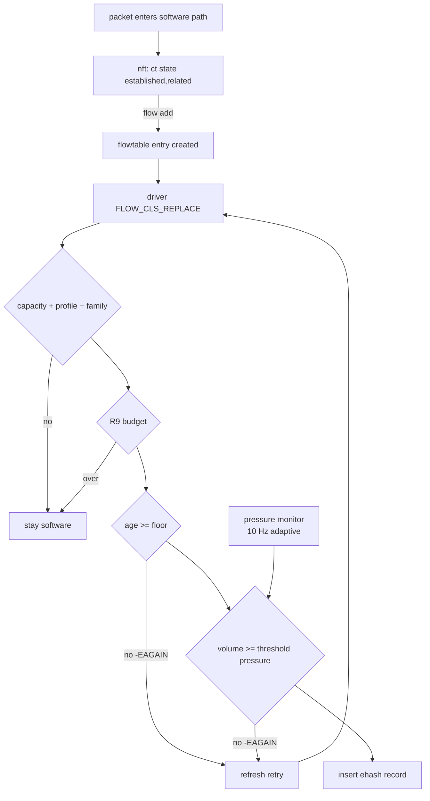

# ASK2 flow scaling and pressure-aware elephant admission plan

**Status:** Analysis and design only (2026-11-07, revised the same day). No code, patch, or image change described here is implemented. The revision replaces the BMan query helper with a CCSR pool-content read, removes the need for a REPLACE-time kernel patch, adds the retry cost of deferred admission, and puts a measurement phase (§3.0) before any adaptive work. The changes touch the flow insert path and therefore require the regression and board gates in §8; they do not close the F-291 teardown contract.

## Goal

Keep hardware flow capacity high without spending FMan insert/delete work on flows that never amortise it, and make the decision **adaptive to the current state of the box** rather than to a fixed time interval.

Two parts:

1. **Capacity.** Keep the DDR-backed ehash as the capacity mechanism, with the operator-tunable `ask.max_flows` admission budget as the only ceiling, and document the verified practical limits rather than claiming "unbounded".
2. **Admission.** Classify a flow by the volume it has actually carried, weighted by live FMan/BMan/QMan pressure. An idle dataplane admits almost everything immediately; a loaded one admits only flows that have proved themselves. Age is a floor, not the classifier.

Non-goals:

- No change to the ehash record format, key layout, or F-269 cumulative-node encoding.
- No eviction, LRU, or preemption of installed flows.
- No change to F-291 owner/teardown semantics; patch `150` stays as shipped.
- No claim of "unbounded" capacity: the verified ceiling is finite (§2).

## 1. Corrections to the proposal text

1. **"Unbounded" is not accurate.** `ask.max_flows` defaults to 262,144 directions (`kernel/ask/oot-modules/ask/ask_flow.c:364-376`). The code comment records the measurements: vendor documents 32,768 directions; ASK2 held 131,072 bidirectional flows (262,144 directions, which is the default) at 0 % loss, 100 % hardware, MURAM unchanged; and 262,144 bidirectional flows (524,288 directions) collapsed on both DUTs. Over-budget inserts return `-ENOSPC`, stay in software, and increment `ask_flow_overflow`.
2. **Flow inserts never traverse YNL.** They arrive as nftables flowtable block callbacks (`TC_SETUP_CLSFLOWER`, `FLOW_CLS_REPLACE`) on the dpaa backend. YNL is the control and observability plane only (`dump-flows`, `get-flow`, `get-info`). The churn cost is in `pcd->fe_lock`, the per-port ehash bucket chain, and the `FMFP_EXTC[INV0]` SYNC that F-177 issues after every insert (retried up to 3 x 100 ms by F-271), not in netlink.
3. **The driver cannot see conntrack counters at REPLACE time.** `nf_flow_table_offload.c:896` sets `cls_flow->cookie = (unsigned long)tuple` and `:939-949` passes `NULL` stats for `FLOW_CLS_REPLACE`; `cls_flow.stats` is copied only for `FLOW_CLS_STATS`. The volume is still reachable without a kernel change: the cookie is the tuple address, and `ask.ko` already maps it back to the flow with `container_of(t, struct flow_offload, tuplehash[dir].tuple)` in `ask_flow_cookie_pppoe()` (`ask_flow_offload.c:3124-3138`). From there `nf_conn_acct_find(flow->ct)` gives the counters (§4.1).
4. **A `ct bytes`/`ct packets` match on the nft rule does not gate promotion.** The nft rule is evaluated in the slow path and creates the flowtable entry once. Hardware insertion retries are issued by `flow_offload_refresh()` -> `nf_flow_offload_add()` directly (`nf_flow_table_core.c:361-378`), bypassing nft rules.
5. **TCP ESTABLISHED and FIN/RST handling mostly exist already.** VyOS's rule matches `ct state established,related`, and the flowtable only offloads confirmed conntracks (`nf_flow_table_core.c:533`). `tcp_ctl_punt` (default on, `ask_hw.c:703-800`) sends SYN/FIN/RST on ROUTED-engaged ports to the kernel; patches `140` (hw close fixup), `145` (final stats on delete), and `150` (owner-settled delete) implement the close path. What remains is verification (the F-266 closure matrix is still open in `ASK2-MASTER-PLAN.md` §5), not a new state machine.

## 2. What exists today (verified 2026-11-07)

| Component | Evidence |
|---|---|
| Admission budget | `ask.max_flows`, default 262,144 directions, `0` = unlimited; `-ENOSPC` + `ask_flow_overflow`; reported as `max-flows` in `get-info` (`ask_flow.c:364-414`, `ask_genl.c:289-290`) |
| Age gate | `ask.offload_delay_ms`; `ask_offload_too_young()` returns `-EAGAIN`; retried by `flow_offload_refresh()` at most once per second; VyOS `hardware-offload-delay 0-60000` (patch `055`) |
| Auto flowtable | `VYOS_FLOWTABLE_ASK_AUTO` + `VYOS_ASK_AUTO_FORWARD` at `filter + 10` (patch `058`, R10), hardware-verified 2026-10-30 |
| Safe delete | F-254 (64-bit unlink, `INV0` SYNC, free after SYNC), F-269 quarantine, F-271 bounded retries, patch `150` owner-settled delete |
| Close path | `tcp_ctl_punt` default on; patches `140`/`145`/`150` |
| Conntrack accounting | `nf_ct_acct_ext_add()` gated by `net->ct.sysctl_acct` (`nf_conntrack_acct.h:30`); module param `nf_conntrack_acct` defaults to **false**; nothing in `board/`, `data/`, or the kernel fragments currently enables it |
| Flowtable counter | `nftables-offload.j2` emits `counter`; `nf_flow_table_ip.c:460` calls `nf_ct_acct_update()` while the flow is in the software fastpath |
| QMan query | `qman_query_fq_np()` is exported (`qman.c:2175-2201`); `ask.ko` already uses it for `fq_probe` (`ask_hw.c:1196-1263`) |
| MURAM | `ask_hw` owns the allocator; only a debugfs budget view exists today |
| BMan free count | The portal Query command (`BM_MCC_VERB_CMD_QUERY 0x40`, `bman.c:141`) returns only the 64-pool availability and depletion bitmaps `BP_AS`/`BP_DS` (DPAA RM ch. 4), **not counts**. The free count is the CCSR register `POOL_CONTENT` at BMan base `0x01890000` + `0x600` + 4·BPID (NXP SDK `REG_POOL_CONTENT(n)`, `bm_pool_free_buffers()`); `bin/bman-pool-count.py` already reads it on `.185`. Mainline exports no accessor for either |

## 3. Capacity-aware admission design

The classifier is a function of two things only:

- **observed volume** of the flow (packets and bytes, from conntrack accounting),
- **current pressure** of the dataplane (FMan, BMan, QMan, flow-table occupancy).

There is no "flow survived 1 s, therefore it is an elephant" rule. A 1-second old flow that has moved 3 packets is a mouse; a 200 ms old flow that has moved 2 MB is an elephant.

### 3.1 Pressure monitor (new, `ask.ko`)

A delayed-work sampler maintains one smoothed pressure value. Inputs:

| Signal | Source | Normalisation |
|---|---|---|
| Flow-table occupancy | `num_flows / max_flows` | 0–100 % (skipped when `max_flows == 0`) |
| MURAM free | `ask_hw` allocator getter (new, cheap) | 100 % when exhausted |
| BMan RX pool free buffers | new exported `bman_pool_free_count(bpid)` reading CCSR `POOL_CONTENT` (see §4.2) | 100 % when free < configured floor (default 5 % of the pool's configured count). The raw count also drops by ordinary per-CPU refill (threshold 80 buffers per CPU, WGFP soak 2026-11-02), so use a sustained floor, not a single sample |
| QMan egress backlog | `qman_query_fq_np()` on the per-port no-confirm TX FQs (same objects `fq_probe` uses) | 100 % at a configured depth (default 4096 frames); sustained backlog is the 2026-10-05 A6-LOSS signature |
| FMan sync health | F-271 `ehash_sync_timeouts` / `ehash_sync_wedged` deltas | any new delta pins pressure at 100 for a cool-down period |
| FE workspace depletion | per-port FE pool counters (debugfs build only today) | optional input |
| Deferred-admission backlog | count of flows `ask.ko` has answered with `-EAGAIN` in the last second (new counter; each such answer queues another REPLACE work item, see §3.4) | 100 % at a configured rate (default 2000/s); prevents the gate from creating the workqueue convoy it is meant to avoid |

Sampling is adaptive:

- 10 Hz (100 ms) while any pending admission exists or pressure is above the idle band;
- 1 Hz when idle and no pending flows.

This is a measurement cadence, not an admission rule: a flow is never classified by how long it has existed. EMA smoothing (alpha ~0.2) plus hysteresis bands prevents oscillation. The monitor is read-only except for QMan/BMan queries and runs on a workqueue, never in softirq.

Queries are cheap: a handful of QMan portal commands per tick (5–7 no-confirm FQs) and one CCSR register read per engaged BMan pool.

### 3.0 Measure first (gate before §3.1 onward)

The problem this plan solves has not been measured on the current image. Before building the pressure monitor, run one experiment on `.185`: a DNS-like single-packet UDP flood (20k new flows/s) plus a 4-stream `iperf3` elephant, with `hardware-offload-delay 0` and then 500 ms (`offload_delay_ms`, already shipped). Record the insert and delete rate, `nf_ft_offload_*` kworker count, F-271 SYNC counters, p99 ping across the DUT and elephant throughput.

- If 500 ms already removes the mouse churn without hurting the elephant, the first release is a static volume threshold (§3.3, §4.1) added beside the existing age gate, with no pressure monitor. That cuts §4.2, most of §4.3 and A4.
- Build the adaptive bands below only if the static gate leaves a measured deficit: idle-time mice that should have been offloaded, or loaded-time churn that a fixed threshold cannot separate.

### 3.2 Pressure-scaled thresholds

Let `p` be the smoothed pressure (0–100) and the operator baselines be `min_packets`, `min_bytes`, `min_age_ms` (all default 0 = feature off). Effective values are interpolated from `p`:

| p | packets | bytes | age | intent |
|---|---|---|---|---|
| < 20 (idle) | 0 | 0 | 0 | admit at first REPLACE, like the vendor; free capacity is used |
| 20–50 | 0.25x | 0.25x | 0.5x | admit short flows that show a little volume |
| 50–75 | 1x | 1x | 1x | baseline operator policy |
| 75–90 | 2x | 2x | 1x | only flows that keep growing |
| > 90 (critical) | 4x | 4x | 1x | require growing volume in **both** dimensions |

`0` remains "no gate"; when the operator baselines are 0 the feature is inert regardless of pressure. Interpolation is linear inside each band; the bands use hysteresis (enter 20/50/75/90, leave 15/45/70/85). Never evict; over-budget flows keep `-ENOSPC`.

The recommended operator baseline when enabled is the proposal's preset (`min_age 500 ms`, `min_packets 16`, `min_bytes 16 KB`); at idle pressure those collapse to 0 automatically, which is the point.

### 3.3 Volume semantics

- Admit when **either** `packets >= effective_packets` **or** `bytes >= effective_bytes`, so QUIC-like heavy/few-packet flows and many-small-packet flows both promote. In the critical band require both.
- Evaluate the **original** direction counters for both directions of a connection so the reply record installs together with the forward record.
- Counters come from `nf_conn_acct` (`IP_CT_DIR_ORIGINAL`), read at REPLACE.

### 3.4 Promotion cadence

Two mechanisms exist and the plan supports both:

- **Baseline (no extra kernel hook):** the flow stays in the software fastpath and `flow_offload_refresh()` retries `nf_flow_offload_add()` at most once per second (`nf_flow_table_core.c:361-378`). At idle pressure thresholds are 0, so the first REPLACE installs immediately; under pressure an elephant is promoted within about a second of crossing the threshold. Volume is read live at each attempt, so the decision is volume-based even though the opportunity is periodic.
- **Optional event-driven promotion:** patch the software fastpath (`nf_flow_table_ip.c`, after `nf_ct_acct_update`) to schedule an add when a pending flow crosses the currently published thresholds. This removes the up-to-1 s delay under pressure at the cost of one extra check per packet while a flow is pending. Thresholds are published by `ask.ko` through an exported setter. Recommended only if measurements show the 1 s window matters.

The 1 s retry must not be described as the elephant detector; it is only the promotion opportunity.

Deferral is not free. Each `-EAGAIN` leaves the flow in the software fastpath, and its next packet after a 1 s gap calls `flow_offload_refresh()` → `nf_flow_offload_add()` (`nf_flow_table_core.c:361-376`, `nf_flow_table_offload.c:1178-1188`). That allocates a `flow_offload_work` (`GFP_ATOMIC`), queues it, and the worker rebuilds both directions' flow rules before calling the driver again. A gated mouse that lives a few seconds costs a few such work items; 100k gated flows cost up to 100k work items per second, the same workqueue class as the 2026-10-10 stats convoy. The pressure monitor therefore includes the deferred-admission backlog (§3.1), and A3 measures kworker count, not only ehash inserts. The `NF_FLOW_PENDING` bit prevents more than one queued item per flow, which bounds the backlog to the number of pending flows but not the rate.

### 3.5 Accounting prerequisite

The gate requires `net.netfilter.nf_conntrack_acct=1` whenever a baseline is non-zero. The sysctl affects only newly allocated conntracks. If accounting is absent at REPLACE the gate **fails open** (offload as today), increments `adm_reject_no_acct`, and warns once per minute; it must never block traffic because a sysctl was missed. Memory cost is `struct nf_conn_acct` (32 B plus extension header) per conntrack, single-digit MB at 131k connections.

## 4. Implementation work items

### 4.1 `ask.ko`: conntrack volume at REPLACE (no kernel patch)

- Add `ask_flow_cookie_acct(cookie, &packets, &bytes)` beside `ask_flow_cookie_pppoe()`, using the same checks (`virt_addr_valid`, `dir` bounds, `container_of` to the flow) and then `nf_conn_acct_find(flow->ct)` with `IP_CT_DIR_ORIGINAL`. Return "no accounting" when the extension is absent, so §3.5 fails open.
- Lifetime: REPLACE runs from the flowtable work item, which holds the flow until it completes; read the counters there, never cache the pointer. The same assumption already carries the PPPoE path.
- Coupling: this depends on `struct flow_offload` from `include/net/netfilter/nf_flow_table.h`, which `ask.ko` already uses and builds against the matching kernel, so no ABI is added.
- Host test: extend the existing ASK cookie tests with an accounting case (present, absent, reply direction).

Fallback, only if the cookie mapping is rejected in review: the original proposal's additive `flow_cls_offload.ct_acct` field filled in `nf_flow_offload_tuple()` for REPLACE (a new `fixes/155` patch, 3–5 days, header ABI change).

Effort 1–2 days.

### 4.2 Kernel: BMan free-count accessor (only if §3.0 justifies the monitor)

- Export `u32 bman_pool_free_count(u8 bpid)` from `bman_ccsr.c`, which already owns the CCSR mapping: a big-endian read of `POOL_CONTENT` at offset `0x600 + 4 * bpid`, `bpid < 64`. No portal command, so no MC/RR ownership question (the QMan MC hazards in `ASK2-WIREGUARD-FASTPATH-PLAN.md` do not apply).
- The portal Query command is not an alternative for counts: it returns only the `BP_AS`/`BP_DS` bitmaps. Those are useful as a cheap depletion flag (`BP_DS` bit set = below the software depletion threshold) if a boolean is enough, but they would need a new portal-command helper.
- `ask.ko` takes the BPID from the engaged port (`/sys/class/net/<if>/bpids` shows the same value; the DPAA private data holds the pool), so no new pool-object accessor is needed.
- Validate against `bin/bman-pool-count.py` on `.185` at idle and under a 4-stream run.

Effort 1–2 days. Risk: low — one exported read-only register accessor; the address and byte order are already proven on this board.

### 4.3 `ask.ko`: pressure monitor, threshold gate, counters

- `ask_flow_offload.c`: parameters `offload_min_packets`, `offload_min_bytes`, `offload_min_age_ms` (0 = inert), plus monitoring knobs `admission_pressure_hz` and per-signal weights/floors.
- New `ask_admission.c` (or a section of `ask_flow_offload.c`): delayed work, signal collection, EMA + hysteresis, band interpolation, and `ask_admission_verdict()` returning `-EAGAIN`/`-ENOSPC` plus a reason code.
- Wire the verdict into `ask_flow_offload_replace()` immediately after the existing `ask_offload_too_young()` call (`ask_flow_offload.c:3934`).
- Counters exported through YNL: `adm_reject_young`, `adm_reject_packets`, `adm_reject_bytes`, `adm_reject_budget`, `adm_reject_state`, `adm_reject_no_acct`, `adm_reject_pressure`; plus `adm_pressure` (current), `adm_band`, effective thresholds.
- MURAM getter in `ask_hw.c` (used/free bytes) for the monitor.
- KUnit: pressure interpolation and hysteresis tables; verdict table (idle/moderate/critical; packets-only; bytes-only; no-acct fail-open; budget precedence; monitor tick with synthetic signals).

Effort 2–2.5 weeks. Risk: medium — evaluated only at REPLACE, but it reads smoothed globals; the monitor itself must be allocation-free in its tick.

### 4.4 VyOS CLI and sysctl

New patch `data/vyos-1x-060-firewall-offload-admission.patch` (pattern of `055`), under `firewall global-options`:

- `hardware-offload-min-packets` (`u32:0-65535`)
- `hardware-offload-min-bytes` (`u32:0-4294967295`)
- `hardware-offload-min-age` (ms, `u32:0-60000`)

Behaviour: write the module parameters; when any baseline is non-zero, also write `net.netfilter.nf_conntrack_acct = 1` through the same `/run/sysctl/10-vyos-firewall.conf` mechanism patch `055` uses. When all are zero, do not disable accounting.

Effort 3–5 days. Risk: low. Must be written against the pinned vyos-1x commit (`91bf0ef51`, T3871 issue in `ci-setup-vyos1x.sh`).

### 4.5 Observability

- `ask_genl.c` / `ask.yaml`: admission attributes in `get-info` (`adm-min-*`, `adm-effective-*`, `adm-pressure`, `adm-band`, `adm-reject-*`, `adm-overflow`). Allocate attribute numbers centrally and add KUnit coverage (precedent: the `get-flow` collision bug fixed in `056b1d64`).
- `board/scripts/ask-check`: print admission configuration, live pressure and per-signal breakdown, band, and reject counters.
- `plans/DUAL-DATAPLANE.md`: state that hardware flow share, not netdev counters, is the authoritative offload indicator.

Effort 3–5 days.

### 4.6 Test rig and board validation

- **Mice:** single-packet UDP flood (DNS/NTP shape) at 20k pps; Happy-Eyeballs short TCP attempts; SYN-only scans (these never reach flow add because `ct state established` excludes them — verify that claim).
- **Elephants:** `iperf3 -P 4 -t 60` bidirectional across two 10G ports.
- **Pressure injection:** fill the ehash toward `max_flows`; saturate a TX FQ to create QMan backlog; drain the BMan pool with a burst; verify each signal moves the band and changes admission.
- **Measure:** HW share (`dump-flows`), reject counters, insert/delete rate, loadavg and `nf_ft_offload_stats` kworker count, F-271 counters, MURAM, p99 ping during churn, 30-minute soak.
- **Scale:** re-run the R8 stats-cost measurement at 16k flows (`ASK2-MASTER-PLAN.md` §8 still lists it as not run).

Effort 1.5–2 weeks.

## 5. Effort summary

| Workstream | Effort | Risk |
|---|---|---|
| 3.0 measurement (static age gate vs none) | 2–3 d | Low |
| 4.1 `ask.ko` ct-acct at REPLACE | 1–2 d | Low |
| 4.2 BMan free-count accessor (if needed) | 1–2 d | Low |
| 4.3 pressure monitor + gate | 2–2.5 w | Medium |
| 4.3 KUnit | 3–5 d | Low |
| 4.4 VyOS CLI + sysctl | 3–5 d | Low |
| 4.5 YNL + ask-check | 3–5 d | Low |
| 4.6 rig + board | 1.5–2 w | Medium |

**Total:** the rows sum to about 6–9 engineer-weeks serial for the full adaptive design (the earlier 6–7 weeks undercounted its own rows). If §3.0 shows the static gate is enough, the first release is 3.0 + 4.1 + a static threshold in 4.3 (about 1 week) + 4.4 + 4.5 + a reduced 4.6 (about 1 week), roughly 4–5 weeks.

## 6. Non-goals for the first release

- Event-driven promotion (§3.4 second option) — only if the 1 s window proves material.
- Pressure weighting by CPU load or conntrack table occupancy; the first release uses only FMan/BMan/QMan and ehash occupancy.
- Bridge/VLAN/PPPoE admission thresholds: ROUTED profile only in release 1; the others inherit the existing gates.

## 7. Open questions

- ~~Exact MCQ response layout for the BMan pool-count query~~: resolved 2026-11-07. The Query response holds only the `BP_AS`/`BP_DS` bitmaps; counts come from CCSR `POOL_CONTENT` (§4.2).
- BMan pressure direction: low free buffers makes offload *more* valuable (it drains kernel backlog) but also more expensive under churn. The plan treats it as "be conservative under pressure"; this is a policy choice to confirm on the rig, and it may need to be inverted for RX-pool exhaustion.
- Which QMan FQ set represents "FMan pressure": per-port no-confirm TX FQs (congestion) or the kernel RX FQ backlog (CPU congestion)? Plan uses TX FQs; verify during A4/A5.
- Default preset to ship (the proposal's 500 ms / 16 packets / 16 KB), or keep everything off in `config.boot.default`.
- Whether the collector path (IPFIX plan) should export reject reasons as option records so operators can explain low hardware share.

## 8. Acceptance gates

**A1 — Inert by default.** With baselines 0, behaviour equals today: quick matrix (routed v4/v6, NAT, VLAN, PPPoE, bridge smoke) unchanged, `dump-flows` counts and throughput unchanged, no new sync timeouts.

**A2 — Idle is permissive.** With pressure < 20 and baselines enabled, flows are admitted at the first REPLACE (thresholds collapse to 0); mice are offloaded; throughput and CPU are not worse than baseline.

**A3 — Loaded is picky.** With pressure > 75, >= 95 % of single-packet UDP flows and short TCP probes never produce an ehash record; elephants are promoted within 2 s (baseline mechanism) or within 200 ms (event-driven option); throughput within ±2 % of baseline.

**A4 — Pressure signals are real.** Each injectable signal (flow occupancy, MURAM, BMan, QMan backlog, sync-timeout delta) independently moves the reported pressure and band; hysteresis prevents oscillation across the band boundary.

**A5 — Fail-open accounting.** With `nf_conntrack_acct=0`, offload behaves as today, `adm_reject_no_acct` increments, and no flow is permanently blocked.

**A6 — Scale.** 16k+ flows with the telemetry plan's stats-scaling item (or the R8 measurement): no stats-kworker convoy, insert rate >= 1000/10 s, MURAM back to baseline after teardown.

**A7 — Close path.** FIN/RST punt functional on all engaged port types; no lingering `[HW_OFFLOAD]` after `conntrack -F`.

## 9. Risk register

| Risk | Likelihood | Impact | Mitigation |
|---|---|---|---|
| BMan free count noisy (per-CPU refill moves it without pressure) | High | Low | sustained-floor normalisation, EMA; validate against `bman-pool-count.py` |
| Cookie-to-flow mapping in `ask.ko` breaks on a flowtable struct change | Low | Medium | same mapping already used by the PPPoE path; host test; kernel patch fallback in §4.1 |
| Deferred admission recreates the workqueue convoy | Medium | High | deferred-admission backlog as a pressure input (§3.1); A3 measures kworkers |
| Pressure monitor overhead | Low | Low | 10 Hz max, workqueue, few portal commands; adaptive idle 1 Hz |
| Oscillation at band boundaries | Medium | Low | EMA + hysteresis; KUnit table |
| Pressure signals disagree (BMan vs QMan) | Medium | Medium | weighted max, per-signal breakdown exported; rig tuning |
| 1 s promotion window under pressure | Medium | Low | acceptable for elephants; event-driven patch available |
| `nf_conntrack_acct` off in the field | Medium | Medium | fail-open + counter + CLI sets the sysctl with baselines |
| Churn reduction helps, but FIN/RST deletes increase F-269/F-271/F-291 exposure | Medium | High | keep patch `150`; no new delete paths; A7 |
| `max_flows` counts directions | Certain | Low | documented; bands computed on directions |
| HA failover: synced cts may lack acct baselines | Medium | Medium | fail-open; document post-takeover behaviour |

## 10. Sequencing

1. §3.0 measurement on `.185`, then 4.1 `ask.ko` accounting read (host test, no board change). Add 4.2 only if the measurement justifies the pressure monitor.
2. 4.3 gate with baselines 0 merged first, A1 proves it inert.
3. 4.4 CLI + sysctl, 4.5 observability.
4. A2–A5 on the lab DUT with mice/elephant generators and pressure injection.
5. A6 only with the telemetry stats-scaling item or the R8 measurement, so the result is not confounded by the known stats convoy.
6. Do not claim release readiness while F-291 remains open; this plan reduces churn, it does not fix teardown ownership.

## 11. References

- `kernel/ask/oot-modules/ask/ask_flow.c:364-414` (R9 budget, ceilings, `-ENOSPC`, overflow counter).
- `kernel/ask/oot-modules/ask/ask_flow_offload.c:171-221` (age gate, retry cadence, first-seen xarray), `:3934` (gate placement).
- `kernel/ask/oot-modules/ask/ask_hw.c:1196-1263` (`fq_probe`, `qman_query_fq_np`), `:695-800` (`tcp_ctl_punt`, `ttl_punt`).
- `kernel/common/work/linux-6.18.60/net/netfilter/nf_flow_table_offload.c:896, 905-949` (cookie is the tuple; REPLACE carries no stats).
- `kernel/common/work/linux-6.18.60/net/netfilter/nf_flow_table_core.c:361-378` (refresh -> `nf_flow_offload_add`), `:533` (confirmed ct gate).
- `kernel/common/work/linux-6.18.60/net/netfilter/nf_flow_table_ip.c:448, 460` (refresh and `nf_ct_acct_update` in the software fastpath).
- `kernel/common/work/linux-6.18.60/include/net/netfilter/nf_conntrack_acct.h:30` (acct gated by `sysctl_acct`).
- `kernel/common/work/linux-6.18.60/drivers/soc/fsl/qbman/bman.c:133-160` (portal Query command; result union carries no counts) and `bin/bman-pool-count.py` (CCSR `POOL_CONTENT` read, proven on `.185`).
- `kernel/ask/oot-modules/ask/ask_flow_offload.c:3124-3138` (`ask_flow_cookie_pppoe()`: cookie → `struct flow_offload`).
- `kernel/common/work/linux-6.18.60/net/netfilter/nf_flow_table_offload.c:1155-1188` (`NF_FLOW_PENDING`, `GFP_ATOMIC` work per REPLACE retry).
- `kernel/common/patches/fixes/140,145,150` (close, final stats, owner-settled delete).
- `plans/ASK2-MASTER-PLAN.md` §5 (F-266 closure matrix open), §8 (R8 stats-cost measurement not run), G8/R9.
- `data/vyos-1x-055-firewall-hardware-offload-delay.patch`, `data/vyos-1x-058-offload-auto-flowtable.patch`.
