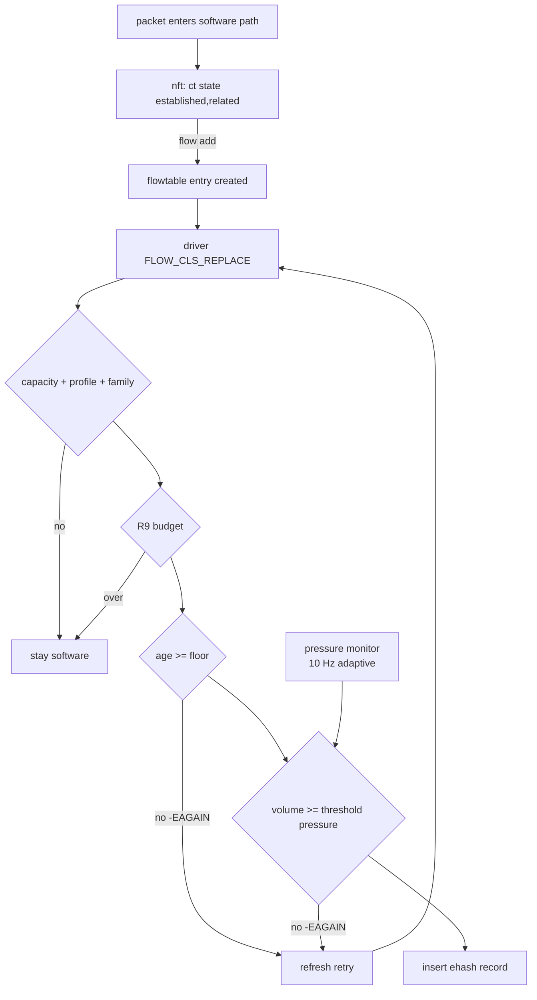

# ASK2 flow scaling and pressure-aware elephant admission plan

**Status:** §0 (2026-11-13) is the active programme: measured scaling state on image 2026.11.13-0317 (F-312) and the staged work to make ASK2 consistent, fast and stable from one flow to the admission budget. F-312 (stats read off `fe_lock`) is shipped and board-verified. §1 onwards is the 2026-11-07 admission design (analysis only, not implemented); it is stage S6 of §0 and keeps its own gates in §8. Nothing here closes the F-291 teardown contract.

## 0. Stability programme (2026-11-13)

### 0.1 Measured state

Rig: DUT1 (`.185`), dell1 TRex v3.08, routed IPv4 UDP 64 B, bidirectional, flows differ by UDP port (single 16-bit counter up to 64511 flows, a 256 x N sport x dport grid above that; the grid avoids the SIP ports 5060/5061, which ASK2 keeps in software by design). Ladder step: drain, hold N flows at 200 kpps for 120 s, then a 30 s trial at 3 Mpps (half the 64 B ceiling). Data: dell2 `/mnt/builds/ask2-review/oracle/trex-ladder-*`.

- Forwarding is in silicon and lossless at every count up to the admission budget, 131,072 flows (262,144 directions), on the v2 harness (S0): 100 % offloaded, 0 of 90 M packets lost at 3 Mpps and at 0.5 Mpps, also with one or with back-to-back `conntrack -L` dumps running through hold and trial. The v1 harness collapsed at 131,072 flows (60-65 % loss, offloads torn down) on 3 of 3 runs, including with static ARP and with `max_flows` 524,288; neither ARP, the budget nor conntrack dumps reproduce it on v2, so it is attributed to the v1 procedure. Best remaining candidate: v1's drain wait gave up after 10 min, so a step could start while the previous step's overlapping tuples were still being torn down; S1's churn cases exercise that deliberately.
- Throughput (best of all reps, image 0524, Mpps both directions): 64 B 4.71-4.94 (1 flow) and 6.06-6.09 (1024 flows); 512 B 3.62-3.76 (~80 % of line); 1518 B 1.53-1.62 (94-99 % of line). Curves are flat from NDR to MRR; MRR at 64 B is generator-limited to ~11 Mpps offered with a flow VM.
- Control plane before F-312: the per-flow `FLOW_CLS_STATS` read slept on `pcd->fe_lock`, which inserts and deletes hold across FMFP_EXTC SYNC; above ~16k flows ~1000 `nf_ft_offload_stats` kworkers blocked (D state, the workqueue cap `WQ_DFL_ACTIVE` 1024) and install times doubled.
- Control plane after F-312: no stats worker blocks at any count; up to 32,768 flows install in <= 12 s with 0 blocked tasks and >= 47 % CPU idle (load-average spikes are runnable bursts, not CPU saturation). Above 32,768 flows ~1020 `nf_ft_offload_add` workers queue on ASK's global `ask_flow_lifecycle_lock` (FLOW_CLS_REPLACE and DESTROY both take it, F-286/F-288 ownership); install runs at ~4k records/s (24-27 s at 49k-98k flows, 41-43 s at 122k-131k).
- SYNC is not the insert cost: with `ehash_sync_diag_enable`, 99.4 % of ehash SYNCs (INV0 only; `ehash_hc_sync_enable=N`) finish in < 1 us, max 644 us. The ~200 us per record is software under the lifecycle lock.
- Per-table bucket count is capped by the silicon at 32,768 (lookup microcode: mask = (1 << (hash_mask_bits & 0xf)) - 1). The bucket hash (reflected CRC-64 over the 50-byte key; offline model `bin/ehash-bucket-sim.py`) is linear over GF(2), so structured tuple sets fill buckets very unevenly: the 64,511-flow single-counter set uses only 16,384 eth3 buckets (15,359 hold 4 records, and that step passed), 131,072 grid flows produce the first 6-record buckets (64 per table).
- Test-rig artifact found: TRex answers ARP only in service mode, so during long steps the DUT's neighbour entries for the generator hosts are probed and fail. Flows not yet in hardware then cannot be offloaded: `nf_flow_offload_rule_alloc()` fails on the unresolved neighbour (the PR14o diagnostic, `fixes/130`, reports it as `alloc failed err=-12` although it is not an allocation failure) and `flow_offload_refresh()` retries every such flow about once a second. Installed flows are not torn down (S5). Static neighbour entries on the DUT remove it (122,880 flows: 450 missing -> 0 missing).
- Harness weakness: the ladder sampled with `conntrack -L`, which takes 13-37 s per sample at 100k+ flows, overlaps the trial and is itself control-plane load; "full after" was quantised to ~11 s. `ynl --family ask --do get-info` returns `num-flows` (directions, atomic read) in 0.3 s.

### 0.2 Stages

Each stage keeps the repository rules: qdrant gate before FMan PCD changes, failing check first, independent review for FMan/PCD diagnoses and fixes, CI build, cold-boot board verification.

- **S0 Harness (no image change).** Ladder v2: sample `num-flows` from `get-info` and `vmstat`/`/proc/net/softnet_stat` every 1 s (offload completion with 1 s resolution, CPU and kernel-path packet rate), no `conntrack -L` during holds or trials; static neighbour entries for the generator hosts on the DUT for every TRex run (or keep TRex in service mode, measured for its own cost); trial rate as a parameter; tuple shapes as a parameter (single counter, power-of-two grid, non-power-of-two grid, stride) with the offline bucket histogram printed for each set; three reps per step, cold boot per ladder. Retest the TRex NDR cells with static ARP, since DUT2's sporadic low NDRs may be neighbour aging.
- **S1 Wide-variety baseline.** On the F-312 image with the S0 harness: flow counts 1 to 131,072 x tuple shapes, plus churn (new flows per second 1k/5k/20k with a fixed live set) and mixed frame sizes. Output one table per shape: completion time, peak blocked tasks, CPU, loss. This is the reference every later stage is judged against.
- **S2 131,072-flow collapse.** Root-cause with S0 instrumentation: a 0.5 Mpps trial (overload vs miss), kernel-path packet rate during the trial (frames that missed hardware), per-bucket occupancy of the offloaded set, and A/B of dynamic vs static ARP and of the 0524 image, to settle regression vs procedure. Fix shape decided only after an independent review.
- **S3 Insert path.** Profile one install burst at 64k flows (static perf build) to place the ~200 us per record. Candidate fixes, chosen by the profile: narrow `ask_flow_lifecycle_lock` to per-flow or hash-sharded ownership, batch the FE insert under one `fe_lock` hold, move the F-177 always-on INV0 probe after the `fe_lock` release (silicon-facing ordering: ask first, A/B on the ladder). Target: 64k flows installed in < 10 s with < 50 blocked tasks.
- **S4 Remaining per-flow `fe_lock` users.** `fman_pcd_fe_ehash_keysize()` (WGFP calls it on every add, delete and stats poll) and the debugfs `fe_flow`/`fe_ehash_stats` walkers, which hold `fe_lock` for tens to hundreds of ms at 64k records: move the former to `fe_stats_lock`, make the walkers chunked or snapshot-based.
- **S5 Neighbour-change cost.** The premise that a failing neighbour tears down its flows is wrong: `ask.ko` acts only on transitions into `NUD_VALID` (`ask_neigh.c`), and no inet flowtable sets `type->gc`, so a failed neighbour leaves installed records forwarding to the last MAC. Each `NUD_VALID` event (any state change into REACHABLE/STALE/DELAY/PROBE/PERMANENT, not only a MAC change) runs `ask_flow_neigh_mac_changed()`, which walks every installed flow (RCU, `system_wq`, serial) and rebuilds those whose next hop moved, one at a time under `ask_flow_lifecycle_lock` (FE withdraw + republish).
  - Measured (`bin/testrig-neigh-flap.sh`, image 2026.11.13-2108, warm, 65,536 flows at 100 kpps per direction, ftrace on `ask_flow_neigh_mac_changed`): same-MAC flap (delete, 5 s, re-pin) 2 calls of 41 ms and 57 ms, 0 flows rebuilt, no flow left hardware, kernel path unchanged (~10 pps). MAC change on the eth4 generator neighbour (65,536 flow directions behind it): 4.33 s to repoint to a bogus MAC and 4.17 s back (~65 us per record), `num-flows` stayed at 65,536 throughout, CPU bursts to 60-93 % on one worker. During a real failover the flows not yet repointed keep the dead MAC for up to those 4 s. TRex lost 10.97 % over the 150 s hold; the 14 s bogus-MAC window explains ~1.4 M of the 3.29 M lost and the install phase (kernel path ~100 kpps at 90 % CPU) the rest; the rig has no per-second receive counter to separate them.
  - Costs to fix, in order: (1) the O(all flows) walk per neighbour event even when the MAC is unchanged: ~50 ms of one CPU per event at 65k flows, ~100 ms at 131k; a router whose LAN hosts are next hops sees an event per host every reachable cycle, so 500 hosts would cost most of a CPU. Fix: a per-(dev, address) last-MAC cache in `ask_neigh.c` that skips the walk when the MAC is unchanged (keep the pending-insert drain). (2) The repoint rate: rewriting the six next-hop MAC bytes of each record's INSERT_L2_HDR in place instead of withdraw + republish would take ~1 us per record (65 ms at 65k) but writes a live record (silicon-facing: qdrant gate, independent review, ask first). Vendor comparison on `.70` not run.
- **S7 Flood path.** At 20k new flows/s the CPU sits at 91-94 % although no mouse reaches hardware (500 ms gate). Every mouse costs two `ask_flow_lifecycle_lock` round trips with no hardware work: a REPLACE that runs the ownership check (`ask_flow_retained_owner()`) and then returns `-EAGAIN` from the age gate, and at expiry a DESTROY that erases the first-seen entry, writes a generation tombstone and looks up a flow that never existed (image 1458 profile: `flow_offload_work_del` 21.7 %, `ask_flow_offload_destroy` 4.5 %, `mutex_spin_on_owner` 7.6 % of CPU). Candidate: decide both outside the lock for a cookie ASK has never installed: REPLACE rejected by the age gate before the lock, DESTROY of a cookie with no flow, no generation entry and no pending deferred insert reduced to the first-seen erase. Safety rests on nf_flowtable serialising work per flow (`NF_FLOW_PENDING`) and not freeing a flow, so not recycling its cookie, before its DESTROY completes; it touches the F-286/F-288 ownership protocol, so qdrant gate, independent review and an explicit go-ahead come first. Measure with `bin/testrig-churn.sh` (CPU, kernel-path pps, elephant loss) and a perf profile at 20k mice/s.
  - Design (draft, not implemented). A cookie is *unknown* when `ask_flow_lookup()` finds no flow (RCU), `gen_by_cookie` has no entry and `ask_flow_owner_block` has no entry. Pending deferred inserts always carry a generation from a live `gen_by_cookie` entry, so an unknown cookie has none. In `ask_flow_offload_setup_tc_block_cb()`, before `mutex_lock(&ask_flow_lifecycle_lock)`:
  - REPLACE: if `offload_delay_ms` is nonzero, the block is bound, the cookie is unknown and `ask_offload_too_young()` is true, return `-EAGAIN`. The locked path does exactly this for an unknown cookie: `ask_flow_owned_replace()` inserts a fresh owner entry, `ask_flow_retained_owner()` returns 0 (no flow), the age gate returns `-EAGAIN`, and `ask_flow_owner_forget_settled()` erases the fresh owner entry again; the net state change is the first-seen timestamp in both paths. The retained-owner check still precedes the age gate for every known cookie (F-291).
  - DESTROY: if the cookie is unknown, erase its first-seen entry and return 0. The locked path does exactly this: `ask_flow_gen_tombstone()` returns 0 without creating an entry, the flow lookup fails, the destroy returns 0 and `ask_flow_owner_forget_settled()` finds no owner entry.
  - Why the check-then-act is safe without the lock: every state change for a cookie comes from a flowtable work item for that flow (REPLACE, STATS, DESTROY), nf_flowtable runs at most one per flow (`NF_FLOW_PENDING`), the callbacks of one REPLACE run sequentially in that work item, and the flow (whose tuple address is the cookie) is not freed or reused before its DESTROY completes. Paths that act on existing flows (PPPoE flush, neighbour rebuild, route retirement, UNBIND withdrawal over `ask_flow_owner_block`) have nothing to act on for an unknown cookie.
  - Expected effect at 20k mice/s with the 500 ms gate: no `ask_flow_lifecycle_lock` acquisition for any mouse; the remaining per-mouse cost is two xarray operations on `ask_offload_first_seen` and one RCU lookup.
  - Independent review (2026-11-13): safe with four changes, all adopted. (1) REPLACE order: table non-NULL, `cb_priv` non-NULL and bound, the three-way unknown test, and only then `ask_offload_too_young()`, because it stores the first-seen timestamp as a side effect. (2) Return without the lock only when it says too young; otherwise fall through to the locked path. (3) DESTROY fast path requires a table, erases first-seen whatever the current delay, and keeps `ask_flow_owner_block` in the unknown test: the route/VLAN/PPPoE flush releases the generation but leaves the owner entry, and only the locked DESTROY clears it. (4) Failing checks first: a cookie with only an owner entry must take the locked path, and an unbound block must not store first-seen. The reviewer confirmed that only REPLACE in the cookie's own work item creates state (every other context only removes it), that `ask_flow_block_priv_bound()` has its own lock, and that return codes, `IPS_HW_OFFLOAD` accounting and traces are unchanged. Optional: the two rate-limited `pr_info` lines at the top of the callback become `ask_pr_dbg`.
  - Implemented and verified (commit 38361d54, image 2026.11.13-2108, A/B against image 1724 on the same rig): at 20k mice/s with the 500 ms gate CPU avg 90 % -> 49 %, mice loss 1.17 % -> 0.0037 % (the earlier mice loss was mostly CPU saturation), elephant loss ~0 in both; profile: offload work items 74.4 % -> 29.7 %, delete jobs 32.7 % -> 8.6 %, lifecycle-lock spinning 23.5 % and the destroy handler 6.4 % gone, idle 0.9 % -> 39.1 %. At 5k mice/s CPU 24 % -> 16 %. With the gate at 0 every mouse is offloaded, S7 does not apply and the numbers are unchanged.
  - S1 on image 1724 (F-312..F-314, workqueue cap, UDP fix): the 64 B ladder 2,048..131,072 flows is 100 % offloaded with 0 loss at every step, at most 2 blocked tasks, install 8 s -> 23 s, CPU avg 12 % (65,536 flows) and 25 % (131,072) over the hold. The TRex NDR table (one rep, ARP pinned) is within ~2 % of the 0524 best of all runs for PDR/TP99/TP90/MRR; NDR moves both ways by up to 10 % between single runs and needs 3 reps to compare.
  - Pre-existing defect found in the same review (not introduced by S7): nf_tables unbinds the blocks before `nf_flow_table_free()`, so age-gated flows get their DESTROY over an empty callback list; their first-seen entries leak and a reused address inherits the old timestamp, skipping the age gate.
- **S6 Admission.** The 2026-11-07 design below (§1-§10), starting with its §3.0 measurement, now on top of the S1 baseline.

### 0.3 Progress

- S0: `bin/testrig-flow-ladder.sh` (v2) with a persistent DUT sampler (one YNL session, 0.2 ms per `get-info`; the per-second `ynl` CLI it replaced cost ~15 % of DUT CPU in a profile), pinned generator neighbours, trial rate parameter. `bin/ehash-bucket-sim.py` models bucket occupancy of a tuple set (self-test: the F-307 silicon datum). Tuple-shape parameter and reps still to add.
- S2: closed as a v1-harness artifact (see §0.1); the drain-race candidate moves to S1 churn.
- S3 profile (perf, 30 s from the start of a 65,536-flow install, image 0317): offload work items 58.8 % of CPU; stats polls 16.2 % (bit-serial CRC under `fe_stats_lock` 5.7 % self, spin on that lock 4.8 %); add workers spinning on `ask_flow_lifecycle_lock` 14.6 %; `ask_flow_offload_replace` under the lock 10.5 %, of which the FMan insert itself is only 2.9 %; softirq for first packets before offload 21.5 %.
- S3 fix 1, F-314: table-driven CRC-64 (NXP `crc64.h` form) and the stats read hashes before taking `fe_stats_lock`. Host check `bin/test-ehash-crc.py` (bit-serial reference, RM self-test vector, silicon bucket 0x507f); independent review OK. Board measurement pending.
- S3 fix 2, workqueue concurrency: `nf_ft_offload_{add,del,stats}` `max_active` 1024 -> 4 (runtime A/B, same harness): blocked tasks 1,022 -> 1-2, run queue 120 -> 13, install of 131,072 flows 29 s -> 25 s, CPU and loss unchanged. Shipped as `board/scripts/99-nf-flowtable-wq.rules` in image 2026.11.13-1458.
- Image 1458 (F-312..F-314, cap 4) vs 0317 (F-312, max_active 1024), v2 ladder, cold boot, 0 loss throughout: 65,536 flows 17 s -> 15 s, blocked 1,021 -> 3, run queue 77 -> 8, hold CPU 26 % -> 14 %; 131,072 flows 29 s -> 23 s, blocked 1,023 -> 1, run queue 120 -> 8, hold CPU 50 % -> 30 %. Profile of the 65,536-flow install: stats read 10.7 % -> 4.7 %, `fe_stats_lock` spin 4.4 % -> 1.1 %; add workers spinning on `ask_flow_lifecycle_lock` became the largest waste (20.8 %).
- Add/delete concurrency A/B on 1458 (stats 4): 1 worker removes the spin but installs 131,072 flows in 26 s (rule building no longer overlaps the locked section); 2 workers keep 23 s (65,536: 15 s) with peak CPU 76-86 % instead of 99 %. The rule is now add/del 2, stats 4 (verified live).
- S3 remaining: the ~95 us per REPLACE under `ask_flow_lifecycle_lock` outside the FMan insert (xarray, ownership bookkeeping, route/neighbour work); profile with the two fixes in, then decide on narrowing the lock.
- §3.0 churn measurement (image 1458, `bin/testrig-churn.sh` + `bin/trex/ask2_churn.py`: 4 elephants of 1518 B at 200 kpps per direction, DNS-like mice of one query plus one reply, 60 s): at 5k new flows/s elephants lose nothing with the 500 ms age gate or without it; with 500 ms no mouse reaches hardware (CPU avg 26 %), with 0 ms every mouse is installed and hardware fills to the 131,072-flow budget (CPU avg 73 %). So the shipped age gate already removes single-exchange mice at moderate churn; a volume gate only adds value for mice that live longer than the gate. At 20k new flows/s elephants lose 29 % (500 ms) and 42 % (0 ms): the CPU saturates (95-99 %, ~190k kernel-path pps of which mice are ~40k) and on average only 2 of the 4 elephants stay in hardware. A mice flood evicting established hardware flows is the open robustness defect. Root cause (per-second tracker of the elephant conntracks, 20k mice/s, 500 ms gate): the elephants stay `[HW_OFFLOAD]` until ~11-18 s into the flood, then their conntracks are deleted or fall back to the software fastpath while conntrack `early_drop` climbs ~770k. UDP is marked `IPS_ASSURED` only by a packet the kernel processes at least 2 s after the first (`nf_conntrack_udp_packet`, `stream_ts`); the flowtable never sets it, so an elephant offloaded at 500 ms stays non-assured for life (verified: `[HW_OFFLOAD]` without `[ASSURED]`), and `early_drop_list` evicts any non-assured entry when the table is full. TCP is assured at the handshake and unaffected. Offloaded UDP also stays `[UNREPLIED]`: UDP is offload-eligible once confirmed, the flowtable takes it on its first packet and both directions then bypass conntrack. Fixed in `ask.ko` (`ask_flow_cookie_assure_udp()`, image 2026.11.13-1724): packets counted on the reply-direction silicon record set `IPS_SEEN_REPLY`, and past the 2 s stream window the flow gets `IPS_ASSURED`, the kernel's own UDP rule driven by silicon evidence. Verified: elephant loss at 20k mice/s 28.6 % -> 0.00007 % (500 ms gate) and 43.8 % -> 0 (0 ms); elephants in hardware in 54 of 54 tracked samples while early drop removed ~1.05 M mice; kernel path ~200k -> ~40k pps. Remaining: mice dropped at a full conntrack table (0.85-4.5 %, intended) and 91-94 % CPU under 20k new flows/s, the next flood-resilience limit. Note: conntrack-tools prints one status tag in priority `[HW_OFFLOAD]` > `[OFFLOAD]` > `[ASSURED]`. Conntrack fills even at 5k/s because replied UDP takes the 180 s stream timeout.
- S3 round 2 (profile of a 65,536-flow install on image 2026.11.13-2108, 13 s to full offload, 0 loss): `_raw_spin_unlock_irqrestore` 3.0 % of CPU under REPLACE is irq-off time, spread over ___ratelimit's own lock at five per-flow success-path `pr_info_ratelimited` sites and the `gen_by_cookie` irqsave lock taken only to read a value entry; `ask_port_stats_add` 2.9 % self, all in LL/SC retry loops on four shared atomic64 counters (the A72 has no LSE atomics); the stats getter's byte-wise CRC-64 2.9 % (about 3 M stats polls in 25 s, since nf_flowtable re-polls each flow once 10 % of its timeout has passed); add workers spinning on `ask_flow_lifecycle_lock` 13.7 %. Fixes (host checks `tests/ask_replace_hot_path.py`, `tests/ask_port_stats.py`): success-path prints to `ask_pr_dbg` (`hw_insert OK` kept, `caam-check` counts it), lockless `ask_flow_gen_current()`/`ask_flow_gen_is_current()`, per-CPU port counters with zero as a baseline. Board A/B (image 2026.11.14-0030 vs 2108, cold boot, same 65,536-flow step and 25 s profile): full offload 13 s in both, 0 loss in both, hold CPU 11.4 % -> 10.8 %; `___ratelimit` 0.60 % -> 0.05 %; ASK-side irq-off samples under REPLACE ~2.6 % -> ~0.7 % (the rest is `ask_flow_gen_next()`, which still stores under the lock); `ask_flow_cookie_unknown` 4.3 % -> 3.2 %; lifecycle-lock spin 13.7 % -> 11.9 % self. `ask_port_stats_add` only 2.9 % -> 2.4 %: per-CPU adds on arm64 are still LL/SC plus preempt bookkeeping, and the call count (two calls per stats poll, ~3 M polls in 25 s) dominates, so the lever is the poll rate, not the counter. Install time is bounded by the serial section under `ask_flow_lifecycle_lock` (S4). Left for S4: caching the bucket per flow so stats polls skip the CRC (silicon-facing), and narrowing the lifecycle lock.
- First-seen leak (pre-existing, found in the S7 review): the last ASK block unbind now empties `ask_offload_first_seen` (check in `tests/dut/ask_flow_block_lifetime.c`).
- S6 first release, static volume gate (§3.0 rule: the age gate already removes single-exchange mice, so no pressure monitor): `ask.offload_min_packets` / `ask.offload_min_bytes`, default 0 (off); admit when either is met, counted over both directions of the conntrack so both REPLACEs decide alike; read at REPLACE from `nf_conn_acct` through the cookie; fails open with a once-a-minute warning without `net.netfilter.nf_conntrack_acct=1`; applied on the locked path and the S7 lock-free path. Host checks `tests/ask_offload_volume.py`, `tests/ask_flow_unknown_fast.py`. No VyOS CLI yet; build it, and measure long-lived low-volume mice (which pass the age gate), before recommending a default.
- S4: F-313 moves `fman_pcd_fe_ehash_keysize()` (WGFP, every add/delete/stats) to `fe_stats_lock`; independent review OK. The debugfs `fe_flow`/`fe_ehash_stats` walkers are deferred (they only cost when read).

### 0.4 Exit criteria

- Every tuple shape: 100 % offload and 0 trial loss up to the admission budget; over-budget flows forwarded in software without loss at the trial rate.
- Install of 64k flows in < 10 s, < 50 blocked tasks at any count, no stats or add convoy visible in `ps`.
- Three reps per cell within 2 % of each other; no wedgecap capture, sync timeout or kernel warning over the full S1 matrix.

## Goal

Keep hardware flow capacity high without spending FMan insert/delete work on flows that never amortise it, and make the decision **adaptive to the current state of the box** rather than to a fixed time interval.

Two parts:

1. **Capacity.** Keep the DDR-backed ehash as the capacity mechanism, with the operator-tunable `ask.max_flows` admission budget as the only ceiling, and document the verified practical limits rather than claiming "unbounded".
2. **Admission.** Classify a flow by the volume it has actually carried, weighted by live FMan/BMan/QMan pressure. An idle dataplane admits almost everything immediately; a loaded one admits only flows that have proved themselves. Age is a floor, not the classifier.

Non-goals:

- No change to the ehash record format, key layout, or F-269 cumulative-node encoding.
- No eviction, LRU, or preemption of installed flows.
- No change to F-291 owner/teardown semantics; patch `150` stays as shipped.
- No claim of "unbounded" capacity: the verified ceiling is finite (§2).

## 1. Corrections to the proposal text

1. **"Unbounded" is not accurate.** `ask.max_flows` defaults to 262,144 directions (`kernel/ask/oot-modules/ask/ask_flow.c:364-376`). The code comment records the measurements: vendor documents 32,768 directions; ASK2 held 131,072 bidirectional flows (262,144 directions, which is the default) at 0 % loss, 100 % hardware, MURAM unchanged; and 262,144 bidirectional flows (524,288 directions) collapsed on both DUTs. Over-budget inserts return `-ENOSPC`, stay in software, and increment `ask_flow_overflow`.
2. **Flow inserts never traverse YNL.** They arrive as nftables flowtable block callbacks (`TC_SETUP_CLSFLOWER`, `FLOW_CLS_REPLACE`) on the dpaa backend. YNL is the control and observability plane only (`dump-flows`, `get-flow`, `get-info`). The churn cost is in `pcd->fe_lock`, the per-port ehash bucket chain, and the `FMFP_EXTC[INV0]` SYNC that F-177 issues after every insert (retried up to 3 x 100 ms by F-271), not in netlink.
3. **The driver cannot see conntrack counters at REPLACE time.** `nf_flow_table_offload.c:896` sets `cls_flow->cookie = (unsigned long)tuple` and `:939-949` passes `NULL` stats for `FLOW_CLS_REPLACE`; `cls_flow.stats` is copied only for `FLOW_CLS_STATS`. The volume is still reachable without a kernel change: the cookie is the tuple address, and `ask.ko` already maps it back to the flow with `container_of(t, struct flow_offload, tuplehash[dir].tuple)` in `ask_flow_cookie_pppoe()` (`ask_flow_offload.c:3124-3138`). From there `nf_conn_acct_find(flow->ct)` gives the counters (§4.1).
4. **A `ct bytes`/`ct packets` match on the nft rule does not gate promotion.** The nft rule is evaluated in the slow path and creates the flowtable entry once. Hardware insertion retries are issued by `flow_offload_refresh()` -> `nf_flow_offload_add()` directly (`nf_flow_table_core.c:361-378`), bypassing nft rules.
5. **TCP ESTABLISHED and FIN/RST handling mostly exist already.** VyOS's rule matches `ct state established,related`, and the flowtable only offloads confirmed conntracks (`nf_flow_table_core.c:533`). `tcp_ctl_punt` (default on, `ask_hw.c:703-800`) sends SYN/FIN/RST on ROUTED-engaged ports to the kernel; patches `140` (hw close fixup), `145` (final stats on delete), and `150` (owner-settled delete) implement the close path. What remains is verification (the F-266 closure matrix is still open in `ASK2-MASTER-PLAN.md` §5), not a new state machine.

## 2. What exists today (verified 2026-11-07)

| Component | Evidence |
|---|---|
| Admission budget | `ask.max_flows`, default 262,144 directions, `0` = unlimited; `-ENOSPC` + `ask_flow_overflow`; reported as `max-flows` in `get-info` (`ask_flow.c:364-414`, `ask_genl.c:289-290`) |
| Age gate | `ask.offload_delay_ms`; `ask_offload_too_young()` returns `-EAGAIN`; retried by `flow_offload_refresh()` at most once per second; VyOS `hardware-offload-delay 0-60000` (patch `055`) |
| Auto flowtable | `VYOS_FLOWTABLE_ASK_AUTO` + `VYOS_ASK_AUTO_FORWARD` at `filter + 10` (patch `058`, R10), hardware-verified 2026-10-30 |
| Safe delete | F-254 (64-bit unlink, `INV0` SYNC, free after SYNC), F-269 quarantine, F-271 bounded retries, patch `150` owner-settled delete |
| Close path | `tcp_ctl_punt` default on; patches `140`/`145`/`150` |
| Conntrack accounting | `nf_ct_acct_ext_add()` gated by `net->ct.sysctl_acct` (`nf_conntrack_acct.h:30`); module param `nf_conntrack_acct` defaults to **false**; nothing in `board/`, `data/`, or the kernel fragments currently enables it |
| Flowtable counter | `nftables-offload.j2` emits `counter`; `nf_flow_table_ip.c:460` calls `nf_ct_acct_update()` while the flow is in the software fastpath |
| QMan query | `qman_query_fq_np()` is exported (`qman.c:2175-2201`); `ask.ko` already uses it for `fq_probe` (`ask_hw.c:1196-1263`) |
| MURAM | `ask_hw` owns the allocator; only a debugfs budget view exists today |
| BMan free count | The portal Query command (`BM_MCC_VERB_CMD_QUERY 0x40`, `bman.c:141`) returns only the 64-pool availability and depletion bitmaps `BP_AS`/`BP_DS` (DPAA RM ch. 4), **not counts**. The free count is the CCSR register `POOL_CONTENT` at BMan base `0x01890000` + `0x600` + 4·BPID (NXP SDK `REG_POOL_CONTENT(n)`, `bm_pool_free_buffers()`); `bin/bman-pool-count.py` already reads it on `.185`. Mainline exports no accessor for either |

## 3. Capacity-aware admission design

The classifier is a function of two things only:

- **observed volume** of the flow (packets and bytes, from conntrack accounting),
- **current pressure** of the dataplane (FMan, BMan, QMan, flow-table occupancy).

There is no "flow survived 1 s, therefore it is an elephant" rule. A 1-second old flow that has moved 3 packets is a mouse; a 200 ms old flow that has moved 2 MB is an elephant.

### 3.1 Pressure monitor (new, `ask.ko`)

A delayed-work sampler maintains one smoothed pressure value. Inputs:

| Signal | Source | Normalisation |
|---|---|---|
| Flow-table occupancy | `num_flows / max_flows` | 0–100 % (skipped when `max_flows == 0`) |
| MURAM free | `ask_hw` allocator getter (new, cheap) | 100 % when exhausted |
| BMan RX pool free buffers | new exported `bman_pool_free_count(bpid)` reading CCSR `POOL_CONTENT` (see §4.2) | 100 % when free < configured floor (default 5 % of the pool's configured count). The raw count also drops by ordinary per-CPU refill (threshold 80 buffers per CPU, WGFP soak 2026-11-02), so use a sustained floor, not a single sample |
| QMan egress backlog | `qman_query_fq_np()` on the per-port no-confirm TX FQs (same objects `fq_probe` uses) | 100 % at a configured depth (default 4096 frames); sustained backlog is the 2026-10-05 A6-LOSS signature |
| FMan sync health | F-271 `ehash_sync_timeouts` / `ehash_sync_wedged` deltas | any new delta pins pressure at 100 for a cool-down period |
| FE workspace depletion | per-port FE pool counters (debugfs build only today) | optional input |
| Deferred-admission backlog | count of flows `ask.ko` has answered with `-EAGAIN` in the last second (new counter; each such answer queues another REPLACE work item, see §3.4) | 100 % at a configured rate (default 2000/s); prevents the gate from creating the workqueue convoy it is meant to avoid |

Sampling is adaptive:

- 10 Hz (100 ms) while any pending admission exists or pressure is above the idle band;
- 1 Hz when idle and no pending flows.

This is a measurement cadence, not an admission rule: a flow is never classified by how long it has existed. EMA smoothing (alpha ~0.2) plus hysteresis bands prevents oscillation. The monitor is read-only except for QMan/BMan queries and runs on a workqueue, never in softirq.

Queries are cheap: a handful of QMan portal commands per tick (5–7 no-confirm FQs) and one CCSR register read per engaged BMan pool.

### 3.0 Measure first (gate before §3.1 onward)

The problem this plan solves has not been measured on the current image. Before building the pressure monitor, run one experiment on `.185`: a DNS-like single-packet UDP flood (20k new flows/s) plus a 4-stream `iperf3` elephant, with `hardware-offload-delay 0` and then 500 ms (`offload_delay_ms`, already shipped). Record the insert and delete rate, `nf_ft_offload_*` kworker count, F-271 SYNC counters, p99 ping across the DUT and elephant throughput.

- If 500 ms already removes the mouse churn without hurting the elephant, the first release is a static volume threshold (§3.3, §4.1) added beside the existing age gate, with no pressure monitor. That cuts §4.2, most of §4.3 and A4.
- Build the adaptive bands below only if the static gate leaves a measured deficit: idle-time mice that should have been offloaded, or loaded-time churn that a fixed threshold cannot separate.

### 3.2 Pressure-scaled thresholds

Let `p` be the smoothed pressure (0–100) and the operator baselines be `min_packets`, `min_bytes`, `min_age_ms` (all default 0 = feature off). Effective values are interpolated from `p`:

| p | packets | bytes | age | intent |
|---|---|---|---|---|
| < 20 (idle) | 0 | 0 | 0 | admit at first REPLACE, like the vendor; free capacity is used |
| 20–50 | 0.25x | 0.25x | 0.5x | admit short flows that show a little volume |
| 50–75 | 1x | 1x | 1x | baseline operator policy |
| 75–90 | 2x | 2x | 1x | only flows that keep growing |
| > 90 (critical) | 4x | 4x | 1x | require growing volume in **both** dimensions |

`0` remains "no gate"; when the operator baselines are 0 the feature is inert regardless of pressure. Interpolation is linear inside each band; the bands use hysteresis (enter 20/50/75/90, leave 15/45/70/85). Never evict; over-budget flows keep `-ENOSPC`.

The recommended operator baseline when enabled is the proposal's preset (`min_age 500 ms`, `min_packets 16`, `min_bytes 16 KB`); at idle pressure those collapse to 0 automatically, which is the point.

### 3.3 Volume semantics

- Admit when **either** `packets >= effective_packets` **or** `bytes >= effective_bytes`, so QUIC-like heavy/few-packet flows and many-small-packet flows both promote, in every band. (Revised 2026-11-13: an earlier draft required both in the critical band. A 64 B flow then needs 1,000 packets to reach the 4 x 16 KB byte threshold, about 11 s at 90 pps per flow in a 65,536-flow 64 B TRex run, and a test burst is exactly what drives pressure to critical, so 64 B PPS results would regress. Frame size is never a mouse signal; only carried volume is.)
- Test procedure with any gate enabled: prime until `get-info` `num-flows` reaches twice the flow count (the v2 ladder measures this) before NDR/PDR searches, never a fixed priming time.
- Evaluate the **original** direction counters for both directions of a connection so the reply record installs together with the forward record.
- Counters come from `nf_conn_acct` (`IP_CT_DIR_ORIGINAL`), read at REPLACE.

### 3.4 Promotion cadence

Two mechanisms exist and the plan supports both:

- **Baseline (no extra kernel hook):** the flow stays in the software fastpath and `flow_offload_refresh()` retries `nf_flow_offload_add()` at most once per second (`nf_flow_table_core.c:361-378`). At idle pressure thresholds are 0, so the first REPLACE installs immediately; under pressure an elephant is promoted within about a second of crossing the threshold. Volume is read live at each attempt, so the decision is volume-based even though the opportunity is periodic.
- **Optional event-driven promotion:** patch the software fastpath (`nf_flow_table_ip.c`, after `nf_ct_acct_update`) to schedule an add when a pending flow crosses the currently published thresholds. This removes the up-to-1 s delay under pressure at the cost of one extra check per packet while a flow is pending. Thresholds are published by `ask.ko` through an exported setter. Recommended only if measurements show the 1 s window matters.

The 1 s retry must not be described as the elephant detector; it is only the promotion opportunity.

Deferral is not free. Each `-EAGAIN` leaves the flow in the software fastpath, and its next packet after a 1 s gap calls `flow_offload_refresh()` → `nf_flow_offload_add()` (`nf_flow_table_core.c:361-376`, `nf_flow_table_offload.c:1178-1188`). That allocates a `flow_offload_work` (`GFP_ATOMIC`), queues it, and the worker rebuilds both directions' flow rules before calling the driver again. A gated mouse that lives a few seconds costs a few such work items; 100k gated flows cost up to 100k work items per second, the same workqueue class as the 2026-10-10 stats convoy. The pressure monitor therefore includes the deferred-admission backlog (§3.1), and A3 measures kworker count, not only ehash inserts. The `NF_FLOW_PENDING` bit prevents more than one queued item per flow, which bounds the backlog to the number of pending flows but not the rate.

### 3.5 Accounting prerequisite

The gate requires `net.netfilter.nf_conntrack_acct=1` whenever a baseline is non-zero. The sysctl affects only newly allocated conntracks. If accounting is absent at REPLACE the gate **fails open** (offload as today), increments `adm_reject_no_acct`, and warns once per minute; it must never block traffic because a sysctl was missed. Memory cost is `struct nf_conn_acct` (32 B plus extension header) per conntrack, single-digit MB at 131k connections.

## 4. Implementation work items

### 4.1 `ask.ko`: conntrack volume at REPLACE (no kernel patch)

- Add `ask_flow_cookie_acct(cookie, &packets, &bytes)` beside `ask_flow_cookie_pppoe()`, using the same checks (`virt_addr_valid`, `dir` bounds, `container_of` to the flow) and then `nf_conn_acct_find(flow->ct)` with `IP_CT_DIR_ORIGINAL`. Return "no accounting" when the extension is absent, so §3.5 fails open.
- Lifetime: REPLACE runs from the flowtable work item, which holds the flow until it completes; read the counters there, never cache the pointer. The same assumption already carries the PPPoE path.
- Coupling: this depends on `struct flow_offload` from `include/net/netfilter/nf_flow_table.h`, which `ask.ko` already uses and builds against the matching kernel, so no ABI is added.
- Host test: extend the existing ASK cookie tests with an accounting case (present, absent, reply direction).

Fallback, only if the cookie mapping is rejected in review: the original proposal's additive `flow_cls_offload.ct_acct` field filled in `nf_flow_offload_tuple()` for REPLACE (a new `fixes/155` patch, 3–5 days, header ABI change).

Effort 1–2 days.

### 4.2 Kernel: BMan free-count accessor (only if §3.0 justifies the monitor)

- Export `u32 bman_pool_free_count(u8 bpid)` from `bman_ccsr.c`, which already owns the CCSR mapping: a big-endian read of `POOL_CONTENT` at offset `0x600 + 4 * bpid`, `bpid < 64`. No portal command, so no MC/RR ownership question (the QMan MC hazards in `ASK2-WIREGUARD-FASTPATH-PLAN.md` do not apply).
- The portal Query command is not an alternative for counts: it returns only the `BP_AS`/`BP_DS` bitmaps. Those are useful as a cheap depletion flag (`BP_DS` bit set = below the software depletion threshold) if a boolean is enough, but they would need a new portal-command helper.
- `ask.ko` takes the BPID from the engaged port (`/sys/class/net/<if>/bpids` shows the same value; the DPAA private data holds the pool), so no new pool-object accessor is needed.
- Validate against `bin/bman-pool-count.py` on `.185` at idle and under a 4-stream run.

Effort 1–2 days. Risk: low — one exported read-only register accessor; the address and byte order are already proven on this board.

### 4.3 `ask.ko`: pressure monitor, threshold gate, counters

- `ask_flow_offload.c`: parameters `offload_min_packets`, `offload_min_bytes`, `offload_min_age_ms` (0 = inert), plus monitoring knobs `admission_pressure_hz` and per-signal weights/floors.
- New `ask_admission.c` (or a section of `ask_flow_offload.c`): delayed work, signal collection, EMA + hysteresis, band interpolation, and `ask_admission_verdict()` returning `-EAGAIN`/`-ENOSPC` plus a reason code.
- Wire the verdict into `ask_flow_offload_replace()` immediately after the existing `ask_offload_too_young()` call (`ask_flow_offload.c:3934`).
- Counters exported through YNL: `adm_reject_young`, `adm_reject_packets`, `adm_reject_bytes`, `adm_reject_budget`, `adm_reject_state`, `adm_reject_no_acct`, `adm_reject_pressure`; plus `adm_pressure` (current), `adm_band`, effective thresholds.
- MURAM getter in `ask_hw.c` (used/free bytes) for the monitor.
- KUnit: pressure interpolation and hysteresis tables; verdict table (idle/moderate/critical; packets-only; bytes-only; no-acct fail-open; budget precedence; monitor tick with synthetic signals).

Effort 2–2.5 weeks. Risk: medium — evaluated only at REPLACE, but it reads smoothed globals; the monitor itself must be allocation-free in its tick.

### 4.4 VyOS CLI and sysctl

New patch `data/vyos-1x-060-firewall-offload-admission.patch` (pattern of `055`), under `firewall global-options`:

- `hardware-offload-min-packets` (`u32:0-65535`)
- `hardware-offload-min-bytes` (`u32:0-4294967295`)
- `hardware-offload-min-age` (ms, `u32:0-60000`)

Behaviour: write the module parameters; when any baseline is non-zero, also write `net.netfilter.nf_conntrack_acct = 1` through the same `/run/sysctl/10-vyos-firewall.conf` mechanism patch `055` uses. When all are zero, do not disable accounting.

Effort 3–5 days. Risk: low. Must be written against the pinned vyos-1x commit (`91bf0ef51`, T3871 issue in `ci-setup-vyos1x.sh`).

### 4.5 Observability

- `ask_genl.c` / `ask.yaml`: admission attributes in `get-info` (`adm-min-*`, `adm-effective-*`, `adm-pressure`, `adm-band`, `adm-reject-*`, `adm-overflow`). Allocate attribute numbers centrally and add KUnit coverage (precedent: the `get-flow` collision bug fixed in `056b1d64`).
- `board/scripts/ask-check`: print admission configuration, live pressure and per-signal breakdown, band, and reject counters.
- `plans/DUAL-DATAPLANE.md`: state that hardware flow share, not netdev counters, is the authoritative offload indicator.

Effort 3–5 days.

### 4.6 Test rig and board validation

- **Mice:** single-packet UDP flood (DNS/NTP shape) at 20k pps; Happy-Eyeballs short TCP attempts; SYN-only scans (these never reach flow add because `ct state established` excludes them — verify that claim).
- **Elephants:** `iperf3 -P 4 -t 60` bidirectional across two 10G ports.
- **Pressure injection:** fill the ehash toward `max_flows`; saturate a TX FQ to create QMan backlog; drain the BMan pool with a burst; verify each signal moves the band and changes admission.
- **Measure:** HW share (`dump-flows`), reject counters, insert/delete rate, loadavg and `nf_ft_offload_stats` kworker count, F-271 counters, MURAM, p99 ping during churn, 30-minute soak.
- **Scale:** re-run the R8 stats-cost measurement at 16k flows (`ASK2-MASTER-PLAN.md` §8 still lists it as not run).

Effort 1.5–2 weeks.

## 5. Effort summary

| Workstream | Effort | Risk |
|---|---|---|
| 3.0 measurement (static age gate vs none) | 2–3 d | Low |
| 4.1 `ask.ko` ct-acct at REPLACE | 1–2 d | Low |
| 4.2 BMan free-count accessor (if needed) | 1–2 d | Low |
| 4.3 pressure monitor + gate | 2–2.5 w | Medium |
| 4.3 KUnit | 3–5 d | Low |
| 4.4 VyOS CLI + sysctl | 3–5 d | Low |
| 4.5 YNL + ask-check | 3–5 d | Low |
| 4.6 rig + board | 1.5–2 w | Medium |

**Total:** the rows sum to about 6–9 engineer-weeks serial for the full adaptive design (the earlier 6–7 weeks undercounted its own rows). If §3.0 shows the static gate is enough, the first release is 3.0 + 4.1 + a static threshold in 4.3 (about 1 week) + 4.4 + 4.5 + a reduced 4.6 (about 1 week), roughly 4–5 weeks.

## 6. Non-goals for the first release

- Event-driven promotion (§3.4 second option) — only if the 1 s window proves material.
- Pressure weighting by CPU load or conntrack table occupancy; the first release uses only FMan/BMan/QMan and ehash occupancy.
- Bridge/VLAN/PPPoE admission thresholds: ROUTED profile only in release 1; the others inherit the existing gates.

## 7. Open questions

- ~~Exact MCQ response layout for the BMan pool-count query~~: resolved 2026-11-07. The Query response holds only the `BP_AS`/`BP_DS` bitmaps; counts come from CCSR `POOL_CONTENT` (§4.2).
- BMan pressure direction: low free buffers makes offload *more* valuable (it drains kernel backlog) but also more expensive under churn. The plan treats it as "be conservative under pressure"; this is a policy choice to confirm on the rig, and it may need to be inverted for RX-pool exhaustion.
- Which QMan FQ set represents "FMan pressure": per-port no-confirm TX FQs (congestion) or the kernel RX FQ backlog (CPU congestion)? Plan uses TX FQs; verify during A4/A5.
- Default preset to ship (the proposal's 500 ms / 16 packets / 16 KB), or keep everything off in `config.boot.default`.
- Whether the collector path (IPFIX plan) should export reject reasons as option records so operators can explain low hardware share.

## 8. Acceptance gates

**A1 — Inert by default.** With baselines 0, behaviour equals today: quick matrix (routed v4/v6, NAT, VLAN, PPPoE, bridge smoke) unchanged, `dump-flows` counts and throughput unchanged, no new sync timeouts.

**A2 — Idle is permissive.** With pressure < 20 and baselines enabled, flows are admitted at the first REPLACE (thresholds collapse to 0); mice are offloaded; throughput and CPU are not worse than baseline.

**A3 — Loaded is picky.** With pressure > 75, >= 95 % of single-packet UDP flows and short TCP probes never produce an ehash record; elephants are promoted within 2 s (baseline mechanism) or within 200 ms (event-driven option); throughput within ±2 % of baseline.

**A4 — Pressure signals are real.** Each injectable signal (flow occupancy, MURAM, BMan, QMan backlog, sync-timeout delta) independently moves the reported pressure and band; hysteresis prevents oscillation across the band boundary.

**A5 — Fail-open accounting.** With `nf_conntrack_acct=0`, offload behaves as today, `adm_reject_no_acct` increments, and no flow is permanently blocked.

**A6 — Scale.** 16k+ flows with the telemetry plan's stats-scaling item (or the R8 measurement): no stats-kworker convoy, insert rate >= 1000/10 s, MURAM back to baseline after teardown.

**A7 — Close path.** FIN/RST punt functional on all engaged port types; no lingering `[HW_OFFLOAD]` after `conntrack -F`.

## 9. Risk register

| Risk | Likelihood | Impact | Mitigation |
|---|---|---|---|
| BMan free count noisy (per-CPU refill moves it without pressure) | High | Low | sustained-floor normalisation, EMA; validate against `bman-pool-count.py` |
| Cookie-to-flow mapping in `ask.ko` breaks on a flowtable struct change | Low | Medium | same mapping already used by the PPPoE path; host test; kernel patch fallback in §4.1 |
| Deferred admission recreates the workqueue convoy | Medium | High | deferred-admission backlog as a pressure input (§3.1); A3 measures kworkers |
| Pressure monitor overhead | Low | Low | 10 Hz max, workqueue, few portal commands; adaptive idle 1 Hz |
| Oscillation at band boundaries | Medium | Low | EMA + hysteresis; KUnit table |
| Pressure signals disagree (BMan vs QMan) | Medium | Medium | weighted max, per-signal breakdown exported; rig tuning |
| 1 s promotion window under pressure | Medium | Low | acceptable for elephants; event-driven patch available |
| `nf_conntrack_acct` off in the field | Medium | Medium | fail-open + counter + CLI sets the sysctl with baselines |
| Churn reduction helps, but FIN/RST deletes increase F-269/F-271/F-291 exposure | Medium | High | keep patch `150`; no new delete paths; A7 |
| `max_flows` counts directions | Certain | Low | documented; bands computed on directions |
| HA failover: synced cts may lack acct baselines | Medium | Medium | fail-open; document post-takeover behaviour |

## 10. Sequencing

1. §3.0 measurement on `.185`, then 4.1 `ask.ko` accounting read (host test, no board change). Add 4.2 only if the measurement justifies the pressure monitor.
2. 4.3 gate with baselines 0 merged first, A1 proves it inert.
3. 4.4 CLI + sysctl, 4.5 observability.
4. A2–A5 on the lab DUT with mice/elephant generators and pressure injection.
5. A6 only with the telemetry stats-scaling item or the R8 measurement, so the result is not confounded by the known stats convoy.
6. Do not claim release readiness while F-291 remains open; this plan reduces churn, it does not fix teardown ownership.

## 11. References

- `kernel/ask/oot-modules/ask/ask_flow.c:364-414` (R9 budget, ceilings, `-ENOSPC`, overflow counter).
- `kernel/ask/oot-modules/ask/ask_flow_offload.c:171-221` (age gate, retry cadence, first-seen xarray), `:3934` (gate placement).
- `kernel/ask/oot-modules/ask/ask_hw.c:1196-1263` (`fq_probe`, `qman_query_fq_np`), `:695-800` (`tcp_ctl_punt`, `ttl_punt`).
- `kernel/common/work/linux-6.18.60/net/netfilter/nf_flow_table_offload.c:896, 905-949` (cookie is the tuple; REPLACE carries no stats).
- `kernel/common/work/linux-6.18.60/net/netfilter/nf_flow_table_core.c:361-378` (refresh -> `nf_flow_offload_add`), `:533` (confirmed ct gate).
- `kernel/common/work/linux-6.18.60/net/netfilter/nf_flow_table_ip.c:448, 460` (refresh and `nf_ct_acct_update` in the software fastpath).
- `kernel/common/work/linux-6.18.60/include/net/netfilter/nf_conntrack_acct.h:30` (acct gated by `sysctl_acct`).
- `kernel/common/work/linux-6.18.60/drivers/soc/fsl/qbman/bman.c:133-160` (portal Query command; result union carries no counts) and `bin/bman-pool-count.py` (CCSR `POOL_CONTENT` read, proven on `.185`).
- `kernel/ask/oot-modules/ask/ask_flow_offload.c:3124-3138` (`ask_flow_cookie_pppoe()`: cookie → `struct flow_offload`).
- `kernel/common/work/linux-6.18.60/net/netfilter/nf_flow_table_offload.c:1155-1188` (`NF_FLOW_PENDING`, `GFP_ATOMIC` work per REPLACE retry).
- `kernel/common/patches/fixes/140,145,150` (close, final stats, owner-settled delete).
- `plans/ASK2-MASTER-PLAN.md` §5 (F-266 closure matrix open), §8 (R8 stats-cost measurement not run), G8/R9.
- `data/vyos-1x-055-firewall-hardware-offload-delay.patch`, `data/vyos-1x-058-offload-auto-flowtable.patch`.
