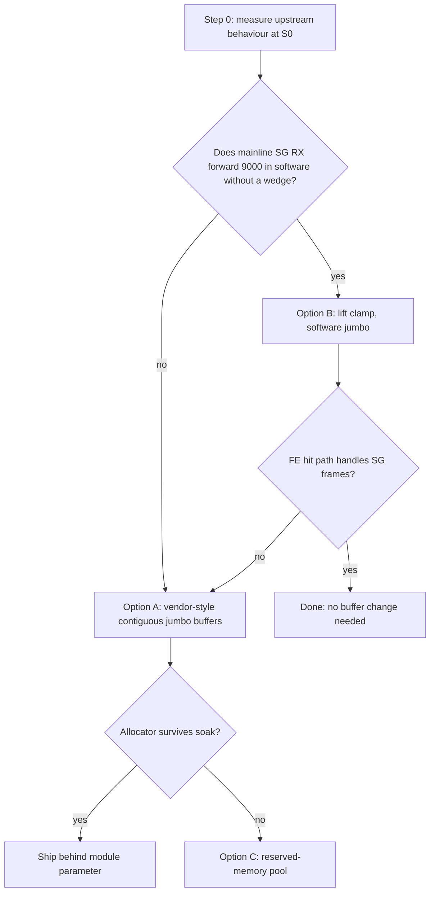

# ASK2 jumbo MTU plan: reach vendor parity (9000+)

Status: **Step 0 passed 2026-10-31; Option B adopted (staged, not committed).** Option A/C are no longer needed.

### Step 0 result (HW, `.185`, image 2026.10.31-0245, offload engaged, cold-ish boot)

With the 0177 buffer clamp neutralised (mEMAC MAXFRM written live to 9026 after `ip link set mtu 9000`), DF pings at 3000, 3600, 4500, 6000 and 8972 passed through the DUT, and `iperf3 -P4` at MTU 9000 with hardware offload engaged ran 9.86 Gbit/s (127 retransmits), `fe_ehash_stats` hits growing (about 650k per 3 s), `rx dma error` and `rx frame physical error` 0, no kernel warnings, no wedge. Mainline RX scatter-gather (`sg_fd_to_skb()`) and the FE hit path both handle multi-buffer frames, so the vendor-style contiguous 10 KB buffers are unnecessary.

Change staged: `0177` no longer caps the MAC max frame by `dpaa_bp->size`; `data/vyos-1x-036/037/043` guard ceilings raised 3600 to 9000. Still to do: A3 at 9000 on the new image, 30 min soak at MTU 9000 (log `MemFree`, buddyinfo), MTU 1500 regression (A1, B1, C1), and VLAN/PPPoE at jumbo.

## 1. Goal and gap

| DUT | Largest working MTU (DF ping, 2026-10-30 battery) | Basis |
|---|---|---|
| OpenWrt + NXP ASK (.70, SDK `fsl_dpa` driver) | at least 9578 | DF pings pass at 3562, 3600, 4000, 6000, 9000, 9578; A3 at 9000: 84.9 % line rate, 0 % loss, 100 % hardware |
| vyos/ASK2 (.185, mainline `dpaa_eth` + our patches) | 3562 (3568 fails) | A3 at 3562: 88.8 % line rate, 100 % hardware |

Target: ASK2 passes A3 at MTU 9000 with offload engaged (100 % hardware share, 0 % loss, no port wedge), with the 1500 MTU baseline unchanged (A1 3.70 Mpps, B1, C1, C2) and the default memory footprint unchanged.

## 2. Root cause (corrected)

The limit is not in kernel.org. Upstream v6.18 `dpaa_eth.c` sets `max_mtu = fsl_fm_max_frm - 22` (9578 with `fsl_fm_max_frm=9600`), has no MTU clamp against the buffer size, and has an RX scatter-gather path (`sg_fd_to_skb()`), so FMan can spread a jumbo frame over several 4 KiB buffers. The 2026-08-16 qdrant note ("no RX SG in mainline", "frames above about 3700 B cannot be received") is wrong about RX scatter-gather and needs a correcting entry.

Our limit comes from two things in our tree:

1. **`0177-dpaa-memac-max-frame-from-mtu.patch`** adds `dpaa_apply_max_frame()`, which clamps the MAC maximum frame length to `dpaa_bp->size`.
2. **`dpaa_bp->size` is 3584.** `DPAA_BP_RAW_SIZE` is 4096 (F-222 reverted F-203's order-1 buffers to order 0). With `CONFIG_DPAA_ERRATUM_A050385=y`, `dpaa_bp_size()` is `(4096 − 320) & ~255 = 3584` (320 is the assumed arm64 `skb_shared_info` size). The largest frame is then 3584 B including FCS, which is MTU 3566. That matches 3562 passing and 3568 failing. The DT on both boards has no `fsl,erratum-a050385` property, so the 256-byte rounding appears to buy nothing here.

The clamp was added because earlier oversized frames wedged the port (2026-08-16, 2026-10-22 notes). Whether the cause was scatter-gather frames reaching the offload (FE) path or the since-fixed ENQUEUE-MTU bug (F-270) is not established.

## 3. How the vendor does it

Source: OpenWrt `target/linux/layerscape/files/.../sdk_dpaa/` (`dpaa_eth.h`, `dpaa_eth_sg.c`, `dpaa_eth_common.c`); build config `target/linux/layerscape/armv8_64b/config-6.12`; live `.70`.

| Item | Vendor (SDK `fsl_dpa`) | Ours |
|---|---|---|
| Kconfig | `CONFIG_FSL_DPAA_ETH_JUMBO_FRAME=y`, `CONFIG_FSL_FM_MAX_FRAME_SIZE=9600` (Kconfig says the option requires 9600) | stock mainline, `fsl_fm_max_frm=9600` module parameter |
| RX buffer raw size | `(9600 + DPA_MAX_FD_OFFSET + sizeof(skb_shared_info) + 128) & ~(SMP_CACHE_BYTES-1)`, about 10 KB, one buffer per frame | 4096 (`DPAA_BP_ORDER 0`) |
| Allocation | `netdev_alloc_frag(SMP_CACHE_BYTES + DPA_BP_RAW_SIZE)`: page-fragment cache, normally 32 KiB order-3 blocks, about 3 buffers per block | `dev_alloc_pages(0)` |
| Usable buffer size | `dpa_bp_size() = SKB_WITH_OVERHEAD(raw) − SMP_CACHE_BYTES` | 3584 |
| MAC clamp to buffer | none; MTU limit is `dpa_max_frm − 22` | `dpaa_apply_max_frame()` clamps to `dpaa_bp->size` |
| A050385 | `fm_has_errata_a050385()` reads DT `fsl,erratum-a050385`; if set the buffer drops to 2048 and the alloc is a plain page. `.70` FMan DT has no such property, so the jumbo path is active | compile-time rounding only; DT property absent |
| Offload of jumbo flows | A3 at 9000 is 100 % hardware, so jumbo frames pass the FE hit path in one contiguous buffer | n/a |
| Caveat in ASK source | `ask_flowtable_core.c` (`ft_detours`, A394): a jumbo frame through the offline-port detour arrives in several buffers and a flood of them timed out FMan's host-command channel, so ports with a jumbo MTU are excluded from that detour | n/a |

So the vendor reaches 9000 with large contiguous RX buffers on the same silicon and FMan microcode (210.10.1). It does not use scatter-gather on the main RX path. The same family of risk we hit with F-203/F-222 (large-order page allocation under fragmentation) exists in the vendor, but it refills 32 KiB blocks (one order-3 allocation per three buffers) instead of one order-1 allocation per buffer.

## 4. Options

- **Option A (recommended): vendor-style jumbo buffers.** Add a module parameter (for example `fsl_dpa.jumbo_rx=1`, default 0, settable from the kernel command line like `fsl_dpaa_fman.fsl_fm_max_frm`). When set, the RX bpool uses a raw size computed like the vendor (`9600 + headroom + shinfo + 128`, cache-line aligned) allocated with a page-fragment cache (`page_frag_alloc`) rather than one `dev_alloc_pages()` call per buffer; DMA map/unmap and `free_pages()` sites become fragment-aware. Default behaviour (4 KiB order-0) is unchanged, so the F-222 regression cannot reach existing users. Mode is fixed at boot, which avoids re-seeding a live pool. The `dpaa_apply_max_frame()` clamp then follows the new `dpaa_bp->size` automatically.
- **Option B: lift the clamp and use upstream scatter-gather.** Cheapest experiment (one boot with the clamp neutralised, offload disengaged). If it works and the FE hit path also handles scatter-gather frames, no buffer change is needed. The vendor's A394 note suggests scatter-gather frames are hostile to FMan's offline-port path, so expect this to be software-only or to need the engaged path to punt scatter-gather frames. It is still worth measuring because it is quick and decides whether Option A is needed.
- **Option C: a reserved-memory (`shared-dma-pool`/CMA) region for the jumbo buffers.** Deterministic against fragmentation, at the cost of boot-time reserved memory and a DTS change. Use only if Option A fails the soak test.

## 5. Work plan

| Step | Work | Exit criterion |
|---|---|---|
| 0 | Experiment B on a cold-booted `.185`, offload disengaged: temporarily neutralise the clamp (local build or live patch) and try MTU 3562, 4000, 6000, 9000 with `bin/testrig-mtu-steps.sh` and `bin/testrig-udp-sweep.sh`. Then engage offload and repeat | Table of pass/fail per MTU and per mode; port wedge yes/no |
| 1 | Qdrant gate (AGENTS.md S0/S1): at least three focused queries on BMI buffer size and `FMBM_*` fields, SG FD layout, F-203/F-222 history; cross-check `arch/fman-microcode-210-programming-reference.md`. Store a corrected note that mainline has RX scatter-gather and the real cause (0177 clamp plus `dpaa_bp->size` 3584) | Gate recorded; qdrant agrees; correction stored |
| 2 | Check how the pool's buffer size reaches FMan (`fman_port` ext buffer size, `FMBM_EBMPI`) and what per-interface bpool count (`config_count`) is, to size memory: roughly count × raw size per port | Memory budget on the 4 GB board written down |
| 3 | Implement Option A as a Layer-1 kernel patch (no bare `sed` on kernel C), retiring or reusing F-203/F-222 consistently, with the parameter default 0 | Builds; `bin/test-fixups.sh` passes; default build byte-identical in behaviour |
| 4 | Raise the MTU guards: `data/vyos-1x-036` and `037` currently reject MTU outside 1280–2500. Allow up to the proven range, and document that jumbo needs `fsl_dpa.jumbo_rx=1` | Guard bounds match the proven range |
| 5 | Board validation after cold boot, one variable per run: MTU 3600, 4500, 6000, 9000 engaged; then a 30 min soak at 800 Mbit/s routed (the F-222 failure case) logging `MemFree` and `/proc/buddyinfo` | No wedge, no allocation failures, A3 at 9000 passes |
| 6 | Regression at MTU 1500 with the parameter off and on: A1, A2, B1 (16k flows), C1, C2 | Within run-to-run noise of the 2026-10-30 results |
| 7 | Re-run A3 against the vendor DUT and update `plans/ASK2-VENDOR-PERF-BATTERY.md` | Comparison row updated |

## 6. Risks

- Port wedge (RX-deaf, cold boot required) on an oversized or scatter-gather frame. Always cold-boot before each experiment; never test on eth0.
- Memory: about 10 KB buffers cost 2.5 times the RAM of 4 KiB buffers (and 16 KiB blocks four times, if page-per-buffer is kept). Jumbo mode is therefore opt-in.
- Large-order page allocation under fragmentation (the F-222 failure). Soak test with fragmentation logging is a required exit criterion.
- XDP/AF_XDP (`xdp_validate_mtu()`, the 3290 cap) must keep working; the jumbo pool must not be selected for XDP-attached ports, or the XDP path must refuse jumbo mode.
- `ask.ko` FE records and the F-262/F-270 MTU fields (ENQUEUE MTU 0xffff) must stay correct for frames above 1500.
- Memory-footprint trade-off: the vendor notes small-frame throughput may drop with jumbo buffers; measure.

## 7. Out of scope

AF_XDP/VPP MTU (3290), IPv6 egress MTU handling in `ask.ko`, the F-262 PPPoE MTU-shrink case, and the DPAA2 driver.
