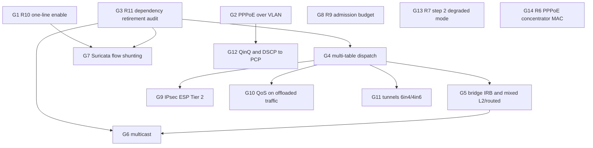

# ASK2 Master Plan

**Version 2.35.0 · 2026-10-29**

This is the single ASK2 task list and execution order. Feature plans own
detailed designs and runbooks; `ASK2-VENDOR-PARITY.md` owns current measurement
scope, method and verdicts. The rewrite plan has been absorbed here.
Completed work, experiments, rejected approaches and dated results live in
[`archive/`](archive/README.md), not in the active backlog.

**Full vendor feature parity is not reached.** Throughput parity for existing
routed/NAT/VLAN paths cannot close IPsec, multicast, tunnels, QoS or the
remaining bridge/encapsulation gaps.

## 1. Current state

### 1.1 Working baseline

Boards and images (2026-10-23):

| Board | Image | Role |
|---|---|---|
| `.185` | `2026.10.22-2044-rolling`, `6.18.57-vyos` (production; `latest.iso`; F-270 + lockless `ask_vlan_cc_agg_stats`) | Primary rig DUT on the generators' root-namespace ports; eth1/eth2 have no peer cabling |
| `.164` (was `.158`, DHCP) | `2026.10.22-2044-rolling` | Runs the 10k PPPoE session-churn gate (dell2 `~/testrig/launch-churn-158.sh`, log `out/pppoe-churn-164-10k-*.log`, ~34 s/cycle); prior run failed at cycle 3482 on lockdep, fixed |
| `.149` | `2026.10.19-1845-rolling`, `6.18.57-vyos` (`kunit=true`, ASK debugfs) | KUnit/debugfs DUT on the generators' `n106` ports; same rig addresses as `.185` (`10.99.1.185`, `10.99.2.185`, …), management on eth2 DHCP |
| `.145` | `2026.10.16-2149-rolling` | Former NXP vendor board (`.106`), now VyOS; no vendor ASK board exists until one is restored |

Dell1 `.112` and dell2 `.113` drive eth3/eth4. Both DUTs carry the same rig
addresses, so run a test against one DUT at a time; `pppoe10` works only on
`.185` (the PPPoE server listens on the root-namespace port).

Routed IPv4/IPv6, NAT44/NAT66/PAT, single-tag IPv4/IPv6 VLAN, PPPoE
encap/decap and MTU-shrink fragmentation exist. Bridge learned/static unicast
and B7a same-tagging have silicon acceptance and a current-image repeat. The
production YNL family serves per-record silicon counters and `get-flow`.

F-266 TCP control punt is implemented but default-off; its transit gate and
the A14 TTL/neighbour gate both FAILED on 2026-10-18 (§4.1). Closed TCP
flows can linger in conntrack. Do not claim scale acceptance.

The Dell-controlled paired 10×10 routed/NAT/VLAN campaign on `0551` is
`COMPLETE_WITH_ISSUES`: 17 of 24 cells PASS under the strict-mean rule. Six
failing cells are one-way deficits of 0.002–0.140%; the largest is VLAN↔port
IPv6 at −0.366% with an interval including zero. VLAN-translate IPv4 3→4 and
bidirectional VLAN↔port IPv6 are the two material deficits. Verdicts and raw
data: `ASK2-VENDOR-PARITY.md`. A same-session A/B (2026-10-19) showed no
image effect between `0551` and `2149`.

Gates closed since the 2026-10-15 snapshot. The evidence is in
`archive/ASK2-MASTER-PLAN-2026-10-19.md`:

| Gate | Closed | Residual caveat |
|---|---|---|
| Per-port disable/re-enable (no flowtable rearm after the last family is deleted) | `1941`/`2012`, 2026-10-16 | — |
| Factory default (`offload ipv4 ipv6` on eth1–eth4, flowtable `FT`) | fresh USB install of `2149` on `.145`, 2026-10-19 | Live (non-installed) boot and 1G forwarding through eth1 untested |
| Offload regression battery, 23 cells (20 base + 3 combo) | `2012`, 2026-10-16 | Smoke, not parity or soak |
| T-PARITY-10 bidirectional delta | Same-session A/B, 2026-10-19: rig/day drift, not image | Vendor comparison needs a restored NXP board |
| Bridge harness verdicts (nonzero exit on any failure) | 2026-10-16 | — |
| Bridge B6/B7a current-image repeat and 100-cycle soak | `2012` cold boot, 2026-10-17 | B2 and capacity need the debugfs image (`.149`) |
| PPPoE ASK2-side fragmentation | `2012`, 2026-10-17 | Vendor half, 10,000-cycle, exhaustion, soak open |
| IPsec Tier 1 (CAAM-backed host-terminated ESP, SW baseline, rekey) | 2026-10-17 | Reboot-clean open |
| P4 per-port loop, eth3 and eth4 (idempotent engage, MTU 1280/2500/3600/1500, link flap ×3, 100-cycle disengage/engage churn, CLI remove/reapply ×10) | `.185`/`2044`, 2026-10-21..23 | MURAM 52922, `pcd-snapshot diff` clean, 0 kernel errors; module unload refused by design (patch 0145 pins `ask.ko`) |
| P4 MTU > 1500 with offload engaged (F-270) | `.185`/`2044`, 2026-10-23: MTU 1280-3600 steps, UDP sweep 1472-2400 incl. 1473, routed MTU-shrink | 9.2-9.7 Gbit/s; PPPoE-specific shrink case not rerun |
| P4 neighbour change under load, eth3 and eth4 sides, IPv4 and IPv6 | `.185`/`2044`, 2026-10-22/23 | IPv6 needs a link-local on the port (see §5 ND finding, resolved); `fe80::185/64` now persistent in config on eth3/eth4. Re-run 2026-10-23 after fix: IPv6 plain and VLAN (eth3.10→eth4.20) IPv4+IPv6 all PASS: hw-hit before/after, MURAM 52922, 0 kernel errors, ask-check 36/36 |
| P4 concurrent eth3↔eth4 `--bidir`, cold boot with offload engaged | `.185`/`1955`, 2026-10-22 | >= 0.97x single direction |
| T-M8-3 per-flow counters, YNL `get-flow` fix, KUnit all-green | Counters on `.145`/`2149`; `get-flow` fix on `1504`/`.185`; KUnit (`ask_genl` 16/16) on `1845`/`.149`; 2026-10-19 | Per-op genl policies (§4.7) |

### 1.2 Feature-parity blockers

These rows describe missing hardware outcomes, not features the kernel
cannot forward in software. Vendor source support is not a live benchmark.

| Area | Remaining gap | Owner / gate |
|---|---|---|
| IPsec ESP | Full FMan→CAAM→FMan path absent; SA lifecycle, v4/v6 tunnel mode, supported suites, NAT-T, ESN/anti-replay, rekey/expiry, encrypted fragmentation and SEC rate control | T-M6-4 / IP1 / IP2; IPsec plan |
| Multicast | IPv4/IPv6 routed multicast and MDB-owned replication absent | T-M6-MC |
| Bridge | B7b access↔trunk pop/push, IRB, routed+bridged on one port, PPPoE-session bridging; QinQ remains unsupported | T-M6-2; bridge plan |
| Multi-table dispatch | One key profile/table per port prevents simultaneous L2/routed/ESP classes | T-M6-DISPATCH; bridge plan |
| VLAN | QinQ/802.1ad/stacked tags and DSCP→PCP absent; routed PCP≠0 fallback needs board proof | T-M6-VLAN2 |
| PPPoE | PPPoE-over-VLAN hardware path implemented 2026-10-29 (G2, HW gate pending); relay absent; current-image validation, churn and exhaustion still open | T-M6-SP4; PPPoE plan |
| Tunnels | 6in4 and 4in6 absent; other modes require vendor datapath proof before scope expansion | T-M6-SP5 / TN |
| QoS | Rate limit on ASK-forwarded traffic, CEETM shaping/scheduling, DSCP→queue and exception-path rate limit absent; ingress policer bypassed on ASK-engaged ports | T-M6-QOS |
| Parser safety | F-266 transit gate, TTL/hop-limit expiry punts, IKE/NAT-T control separation | T-M6-SP1 / SP2 / SP3 |
| Fragments | Generic fragment-flow acceleration absent; MTU-shrink fragmentation does not implement reassembly | T-M6-FR; software policy gate, not an assumed vendor gap |

IPsec suite breadth is not a promise to enable unsafe algorithms. Preserve
the CAAM A24a GCM refusal until independently resolved. IPsec transport mode,
IP reassembly, NAT46/64 and GRE-over-IPv6 are not established vendor hardware
parity requirements on this board. Wi-Fi, RTP/VoIP/socket 3-tuple acceleration
are excluded. MACVLAN/ICC/packet capture have no vendor cdx handler and are not
parity blockers. Optional coarse-flow work is separate (§4.6).

## 2. Binding architecture

The maintained silicon/API authorities are
`arch/fman-microcode-210-programming-reference.md`, `arch/fman-fe-ehash.md`,
`arch/fman-pcd-api-reference.md`, `specs/fman-keygen-flow-key-spec.md` and
`DUAL-DATAPLANE.md`. Historical register dumps in the archive are not current
programming recipes. Resolve contradictions before touching code.

- Single image; S0 kernel/RSS at boot, S1 ASK per interface and IP family,
  S2 VPP overlay. ASK↔VPP transitions pass through S0 with a per-interface
  mutex. No build-time dataplane selection.
- The only engage leaves are `set interfaces ethernet ethN offload ipv4|ipv6`.
  VLAN/NAT/PPPoE/bridge are automatic parts of an eligible engaged port;
  PPPoE engages its source-interface port. Global kill switches include
  `vlan_offload`, `pppoe_offload`, `nat44_offload`, `nat66_offload`,
  `ipv6_hw_frag` and `bridge_offload`; bridge defaults on. No per-feature CLI.
- Kernel flowtable/tc, XFRM, switchdev FDB/MDB and route/neighbour state own
  objects. ASK is a hardware cache/translation layer, never a second
  CMM/FCI/askd control plane. Debugfs is diagnostic, not production control.
- Ehash is the production flow-scale mechanism. Preserve direct RCCB
  dispatch, per-egress no-confirm TX FQs, owned FE workspace
  (`FmPortSetFESupport`, `contextOffsetInWS=0`) and resource budgets.
  CC-tree is not a proven replacement classifier.
- Keep the shipped routed 50-byte dual-lane GEC key unless measured evidence
  justifies change. The historical EKFC-only 14-byte model is not today's
  routed recipe. Bridge B7a uses its distinct 16-byte L2 key. Raw CRC-64 uses
  reflected polynomial `0xC96C5795D7870F42`, seed `~0ULL`, no final complement.
- Normalize ingest into typed intent and use one action compiler: validate
  ordering, offsets, record size and resources before publishing. Keep owner
  cookie/generation, atomic publication and idempotent delete/flush under the
  shared lifecycle lock. Stale DESTROY cannot delete a newer record.
- Unsupported actions, unresolved neighbours, exhausted resources and failed
  readback return framework-appropriate fallback errors before `in_hw`.
  Never accept a rewrite as a no-op or call fallback successful after hardware
  has already modified/consumed a frame.
- RX is order-0/4 KiB; ASK MTU range is 1280–3600. Change MTU only disengaged,
  match endpoints, restore 1500 on exit/abort. Do not revive order-1 pools.
- MTU-shrink fragmentation retains F-262's owned frag-info and RX triple:
  params misc `|=0x40000000`, RCMNE `0x0e`, RFENE `0x22`, readback and reverse
  restoration. IPv6 HW fragmentation defaults on by operator decision;
  `ask.ipv6_hw_frag=0` is the RFC 8200/software-PMTUD opt-out. Concurrent
  oversize IPv6 flows can reuse fragment IDs; this limitation remains open.
- Per-flow MURAM allocation is zero in the production ehash path. Do not
  revive archived allocators or CC-tree scale-out without a measured need.
- IPsec starts AES-CBC-SHA256; AES-CTR-SHA256 is a later suite. GCM remains
  refused for CAAM A24a. XFRM owns keys/lifetimes; no secrets in diagnostics.

## 3. Execution order

| Priority | Work | Dependency / exit |
|---|---|---|
| 1 | **B7b access↔trunk pop/push** (silicon gate and regression smoke checks PASS 2026-10-20 on cold-booted `.155`, image 0326, commit `1e845e2d`) | IPv4/IPv6 pop/push wire/hit/fallback/churn gates passed. On a second cold boot: B6/B7a zero failures; routed/NAT/VLAN/PPPoE quick matrix 23/23 HW. Teardown PCD state exact, MURAM unchanged. Separate F-266/A14 correctness, capacity/soak and vendor-parity gates remain open. Runbook: `ASK2-BRIDGE-OFFLOAD-PLAN.md` §6.1 |
| 2 | F-266 FIN/RST transit and NAT correctness; A14 IPv6 TTL and stale-neighbour safety | FAILED 2026-10-18; **PASS 2026-10-29** on `.185` (A14 IPv4/IPv6 10/10; F-266 N=300 IPv4/IPv6 with and without reuse). NAT44 FIN still unmeasured on the rig |
| 3 | Existing-feature acceptance: PPPoE cycles/exhaustion/soak, bridge B2/capacity (debugfs on `.149`), resource failure, five-port breadth | Use owning runbooks; do not reimplement shipped paths |
| 4 | IPsec Tier 1 reboot-clean, then Tier 2 design/bring-up | Full path required for parity |
| 5 | Multi-table dispatch; PPPoE-over-VLAN; multicast | Dispatch must prove coexistence before IRB/mixed classes/ESP coexistence |
| 6 | QinQ, relay, tunnels, QoS | Feature-specific kernel ownership and forward/inverse/fallback gates |
| Unblocked 2026-10-28 | Refreshed vendor comparisons | Vendor board `.70` (Mono OpenWrt 25.12.6, kernel 6.12.112, `cdx` + `ask_flowtable` loaded). Run after the correctness gates; same-rig A/B only (`bin/testrig-pppoe-vendor.sh`, `RIG_NS`) |
| Parallel, not on the active rig | Phase 2 code/patch consolidation | No behavior change; preserve regression evidence |
| After correctness gates | Current pps, scale, latency and soak; final per-feature vendor comparisons | No historical figures substituted for current acceptance |
| Separate track | WireGuard, VPP ZC, upstream preparation, genl per-op policies | Not missing vendor hardware features |

### 3.1 Vendor-gap implementation order (2026-10-29)

This sequence implements the remaining vendor-ASK gaps from §1.2 and
`ASK2-VENDOR-ASK-REVIEW.md` (R6–R13). It runs after the acceptance work in
priorities 1–3 above and replaces the coarse ordering of priorities 4–6. Status on
2026-10-29: unicast, NAT, routed VLAN, PPPoE and HW fragmentation are at
parity (paired `.185`/`.70` runs, review §13). Everything below is open.

The ordering rules:
- Operator-visible feature gaps that block common deployments come first:
  PPPoE over VLAN (ISP access), IRB and multicast (LAN/IPTV).
- Work that fits the current single-table key comes before the classifier
  change that needs it. PPPoE over VLAN fits the existing 50-byte key: VID
  at bytes 46–47 and SID at 48–49 are both already extracted.
- Multi-table dispatch comes before any feature that needs two traffic classes
  on one port (IRB, ESP alongside routed traffic).
- Retirement correctness (R11) comes before IRB and multicast, because a stale
  L2 or replication entry forwards silently.
- Each step ships in its own CI image and passes its gate on a cold-booted DUT
  before the next silicon step starts.

| Step | Work | Why here | Gate / exit | Owner |
|---|---|---|---|---|
| G1 | **R10 one-line enable.** `offload ipv4\|ipv6` generates a hidden flowtable and an early offload rule for the armed ports. Excludes the FTP, SIP and PPTP control ports by default. **HW-verified 2026-10-30 (image 2026.10.30-0153): 20/20 HW with the auto flowtable only, no user `FT`.** | vyos-1x only, small, no silicon. Today an armed port offloads nothing without a hand-written rule. G7 needs the generated rule as its hook. | Fresh config with only `offload ipv4 ipv6` passes the quick matrix as HW. `delete … offload` removes the rule and flowtable. The exclusions are verified with an FTP control session (SW). | **Implemented 2026-10-29** in `data/vyos-1x-058-offload-auto-flowtable.patch` (generated `VYOS_FLOWTABLE_ASK_AUTO` + `VYOS_ASK_AUTO_FORWARD` at `filter + 10`; patch-rot probe 44/44 ok; nft syntax validated in a netns on `.185`). HW gate pending the next image. **Fix 2026-10-30:** the first board test (image `2026.10.30-0005`) was 10/10 SW with the `flow add` counter at 0. VyOS conntrack is opt-in: `system_conntrack.py` sets `FW_CONNTRACK` to `return` unless a firewall rule uses state, so PREROUTING ends in `notrack` and the generated rule never sees an established flow. Patch 058 now computes `ask_auto_families` (families with an engaged, enabled port outside a user flowtable) and sets `{family}_firewall_action='accept'`. Hot-patched on `.185`: **10/10 HW at 9.1–9.4 Gbit/s** (`quick-20261030-0141.csv`). `ASK2-VENDOR-ASK-REVIEW.md` R10 |
| G2 | **PPPoE over VLAN** (T-M6-SP4). Decap and encap of PPPoE inside an 802.1Q tag on the WAN port. **Implemented 2026-10-29** (`ask_flow_cookie_pppoe()` VID, POP/PUSH cross-check, kernel fixup F-272 for the 0x42 inner EtherType); HW gate pending. **HW gate PASSED 2026-10-30 (`.185`, image 0153, PPPoE on `eth3.30`, gen1 `pppoe-server` on `enp1s0f0np0.30`):** quick cells pppoe-down/up v4/v6 all HW at 9.20-9.34 Gbit/s (`hw_ratio` 1.06-1.13). Wire capture shows `vlan 30, p 0, PPPoE S [ses 0x1] IP`. Still open: paired parity cell against `.70` and a churn/exhaustion pass. Rig and DUT config reverted afterwards. | Common ISP access topology. The existing key already holds VID and SID, so the work is in the AD/encap path, not the classifier layout. | Wire capture of tag+PPPoE headers. HW hit both directions. Paired parity cell against `.70`. A churn and exhaustion pass. | PPPoE plan |
| G3 | **R11 dependency retirement audit.** **Audit done 2026-10-29 (§3.2); route/rule and MTU/MAC retirement added to ask.ko, HW gate pending.** Builds an event table against the vendor's (neighbour, route prefix, MTU/carrier/MAC, upper-device, FDB move/age, bridge VLAN, rule add/delete) and fixes each missing notifier. **2026-10-30:** eth3 MTU toggle mid-flow inconclusive (stayed HW, only REPLACE dedup lines); **Route retirement HW-verified 2026-10-30 (0153):** a blackhole /32 added mid-flow took `hardware-backed` flows 8→0 (log `route change, removed 4 HW flow(s)`) and they were not re-offloaded. The stock SW flowtable (xmit DIRECT skips the dst check) keeps forwarding the flow, so traffic does not follow the new route; that is kernel behaviour, not ask.ko. Rule add/del HW-verified (`route change, removed 8 HW flow(s)`). **MTU/MAC retirement FAILED on 0153 and root-caused 2026-10-30:** `ask_devchg_collect()` skipped records with `!key.l3_proto`, but `ASK_FLOW_L3_IPV4 == 0`, so every IPv4 record was skipped (no log, flows stayed HW; ifindex fields in the dump were correct). Fixed by testing only `l4_proto`, like the other collectors; HW re-test pending the next image. | A stale HW entry forwards silently. IRB (FDB moves), multicast (MDB changes) and Suricata revocation all depend on it. | Each event is tested with a live HW flow: the flow leaves HW within 1 s and traffic follows the new path. | `ask_neigh.c`, `ask_flow_offload.c`, R11 |
| G4 | **Multi-table dispatch (T-M6-DISPATCH).** More than one key profile and table per port, so L2, routed and ESP classes can coexist. **Status 2026-10-29: not started in silicon.** The design is in §4 T-M6-DISPATCH (soft-parser LCV → one KG scheme per class → one RCCB row per scheme). The first step is a rig experiment, not shippable code: two schemes (routed plus L2_DA) on a cold-booted sacrificial `.185` eth3, tested against the `next_engine=3` RX wedge first. | Prerequisite for IRB (G5) and ESP alongside routed traffic (G9). The largest classifier change, so the S0 qdrant gate applies. | The routed, VLAN, PPPoE and bridge quick matrix stays 100 % HW on one port with two classes engaged. `pcd-snapshot` S1→S0 is byte-exact. MURAM is at baseline after disengage. | Bridge plan, §4.6 |
| G5 | **Bridge IRB, routed plus bridged on one port, PPPoE-session bridging** (T-M6-2). **Split 2026-10-29.** G5a (no dispatch needed): routed port → `br0` → member port. The ingress is a ROUTED port, so only the egress side changes. Resolve the neighbour on the L3 device (`br0`) and the egress port from the forward path (`out.hw_ifidx`), then enqueue to the member's TX FQ. The reverse direction stays SW until G4. G5b: the full IRB after G4. **G5a result 2026-10-30 (`.185`, eth4 in `br0`):** no egress code was needed. The kernel's `nf_flow_table_path` already resolves `br0` to the member (`DEV_PATH_BRIDGE`, `xmit DIRECT`, `h_dest` from the FDB), and ask.ko enqueues to the member. unicast-v4 and unicast-v6 eth3 → br0/eth4 are **HW at ~9.4 Gbit/s**; the reverse stays SW (G5b). Added FDB retirement: `ask_bridge_fdb_notifier` calls `ask_flow_fdb_change()`, which retires every routed record whose next-hop MAC moved to another port or was deleted ("bridge FDB change" log). Compiles clean; HW test needs a signed image. **G5a HW-verified 2026-10-30 (0153):** unicast v4/v6 into `br0` HW; FDB delete mid-flow logs `bridge FDB change, removed 8 HW flow(s)` and re-offloads. | The main LAN topology on a VyOS gateway (bridge with a routed `br` address). Needs G4. | Bridge plan gates. Routed↔bridged HW hit through `br0`. B7b paired parity. | Bridge plan |
| G6 | **Multicast** (T-M6-MC): IPv4/IPv6 routed multicast and MDB-owned replication. **Design note 2026-10-29:** the nft flowtable never carries multicast; ipmr forwards it. The control source is therefore the FIB notifier's `RTNL_FAMILY_IPMR`/`IP6MR` MFC and VIF events, which the G3 notifier already receives and ignores. G6a: a single-OIF (S,G) record using the routed key and no replication. G6b: N-OIF replication, which needs an FMan replicator or a fan-out FQ primitive, proven on the rig first. **G6a scoping 2026-10-30: deferred, not a same-day item.** The ehash key is an exact 5-tuple, but an MFC entry is only (S,G) plus an OIF list, so one MFC event cannot become one record. G6a needs (1) per-stream learning from the datapath (a forwarded-multicast hook that sees the ports), (2) its own record table and ageing, since there is no conntrack or flowtable cookie, (3) retirement on MFC delete, OIF change and IGMP/MLD leave, (4) the mapped multicast MAC (`01:00:5e`/`33:33`) as the rewrite destination, and (5) a rig with a PIM or IGMP-proxy config and a multicast source and receiver. | IPTV use case. Routed (S,G) uses the existing routed key; replication into a bridge needs G5's IRB path. | Join/leave/retire tests with a live stream. Replication count matches the MDB/MFC. | T-M6-MC |
| G7 | **Suricata flow shunting.** Suricata inspects the start of each flow inline (NFQUEUE). At stream depth, or on a `bypass` verdict, it sets a bypass mark. nftables copies the mark to the conntrack mark, and only flows with that mark reach the flowtable. ASK2 then offloads them. Unmarked, alerted or revoked flows stay in SW. | No silicon or key change; it uses G1's generated rule and G3's revocation. Can run in parallel with G4–G6 because it needs no rig silicon time until its stage 6. | `ASK2-SURICATA-OFFLOAD-PLAN.md` stages 1–6, plus the shunting acceptance there. No unmarked flow appears in `fe_ehash_stats`. A Suricata reload or stop revokes all flows to SW. `ask-check` shows the approved, revoked and HW counts. | `ASK2-SURICATA-OFFLOAD-PLAN.md` |
| G8 | **R9 admission budget.** A tested ceiling (start at 32,768 directions, as the vendor does), enforced in `ask.ko` and reported in `max-flows`. Overflow stays in SW, is counted as a reject, and never evicts. | Small `ask.ko` change. Should land before G9 adds per-SA tables and before capacity claims. | The harness fills the table, overflows by 10 % and checks that overflow flows are SW with 0 HW. No DESTROY of the other direction. MURAM and DDR return to baseline. | `ask.ko`, R9 |
| G9 | **IPsec ESP Tier 2.** The FMan→CAAM→FMan path, starting with AES-CBC-SHA256, IPv4/IPv6 tunnel mode, SA lifecycle, ESN/anti-replay, rekey and NAT-T. GCM stays refused (CAAM A24a). | Largest remaining parity item. ESP coexisting with routed traffic needs G4. | IPsec plan Tier 2 gates. Paired throughput against `.70`. Reboot-clean. | IPsec plan, T-M6-4 |
| G10 | **QoS on offloaded traffic** (T-M6-QOS): rate limits on ASK-forwarded traffic, the ingress policer honoured on engaged ports, DSCP→queue, and an exception-path rate limit. CEETM shaping comes last. | Needs dispatch to coexist with the policer and RSS schemes. | Wire-level rate cap within 5 %. The policer is not bypassed. Disengage is reversible. | T-M6-QOS |
| G11 | **Tunnels 6in4 and 4in6** (T-M6-SP5). Other modes only with vendor datapath proof. | Separate key class, so it needs G4. | Forward, inverse and fallback gates. Paired parity if the vendor offloads them on `.70`. | T-M6-SP5 |
| G12 | **QinQ / 802.1ad and DSCP→PCP** (T-M6-VLAN2). | Extends the VLAN key after G2 settles the VLAN plus encapsulation path. | Stacked-tag wire capture plus a HW hit. Routed PCP≠0 fallback proven. | T-M6-VLAN2 |
| G13 | **R7 step 2: degraded mode** (disengage to RSS, settle, re-engage with a rate limit). | Only after F-271 counters show a recoverable sync-timeout class in the field. Step 1 shipped in image 2026.10.29-2253. | Model test, then a live sync timeout recovered without a cold boot. | R7 |
| G14 | **R6: PPPoE concentrator MAC in the key.** | Deferred: residual risk accepted unless the WAN-segment threat is taken into scope. Uses the last 6 key bytes (56 = KeyGen maximum). | R6 plan in the review §10. S0 qdrant gate. | R6 |

### 3.2 G3 retirement audit (2026-10-29)

Each row is an event that can make a published HW record wrong, and what
retires the record. The vendor CMM listens for all of these. "Kernel" means
the flowtable itself sends `FLOW_CLS_DESTROY`. "ask.ko" means a notifier in
the module removes the silicon record. After an ask.ko removal the kernel
flow stays `[HW_OFFLOAD]`, forwards in software, and `flow_offload_refresh()`
reoffloads it with current state.

| Event | Stale state in the record | Retired by | Status |
|---|---|---|---|
| Route add, replace or delete | Egress port, next hop | ask.ko FIB notifier (`ask_fib_event`): removes routed records whose destination or DNAT destination is inside the changed prefix, coalesced over 50 ms. The kernel checks `dst_check()` only on the software fast path (`nf_flow_dst_check()`), which an offloaded flow never reaches, and 6.18 GC has no stale-dst check. | **Added 2026-10-29** |
| Policy-rule add or delete | Any routing decision | ask.ko FIB notifier `FIB_EVENT_RULE_*`: removes every routed record | **Added 2026-10-29** |
| Neighbour MAC change or failure | `next_hop_mac` | ask.ko netevent `NETEVENT_NEIGH_UPDATE` (A14 rebuild) | Covered |
| Device down or unregister (port, VLAN vif) | Everything | Kernel `nf_flow_table_cleanup()` → DESTROY | Covered |
| PPPoE session down | SID, concentrator MAC | ask.ko `ask_pppoe_netdev_event` (ppp DOWN/UNREGISTER) | Covered |
| ppp MTU change | F-262 egress MTU | ask.ko, same notifier, `NETDEV_CHANGEMTU` on ppp | **Added 2026-10-29** |
| Port or VLAN vif MTU change | F-262 egress MTU | ask.ko `NETDEV_CHANGEMTU`: removes routed records whose ingress, egress or next-hop device is the device or its real device | **Added 2026-10-29** |
| Port or VLAN vif MAC change | `egress_mac` in `INSERT_L2_HDR` | ask.ko `NETDEV_CHANGEADDR`, same flush | **Added 2026-10-29** |
| Carrier loss without admin down | Nothing wrong; frames to a dead port drop, same as software | None needed | Parity |
| Bridge join or leave, upper change | Port role, VLAN records | ask.ko `ask_bridge_netdev_notifier` (CHANGEUPPER) | Covered |
| FDB add, move, age-out | Bridge egress port | ask.ko switchdev FDB notifier | Covered |
| Bridge VLAN, STP, flags | Bridge records | ask.ko switchdev blocking notifier | Covered |
| Firewall rule add or delete | Already-accepted flow keeps forwarding | Nothing, same as the kernel software flowtable; flows retire on timeout or FIN/RST | Parity (documented) |
| `pppoe_offload`, `ipv6_hw_frag` kill switches, port disengage | Records of that class | ask.ko flushers | Covered |

The new rows still need a HW gate. On `.185`, change the eth3 MTU and then the
eth4 MAC under a running routed flow. Each change must log `device MTU/MAC
change, removed N HW flow(s)`. The flow must reoffload with the new MTU or
source MAC on the wire, with no stale-MAC frames in a capture. For routes,
add a more-specific static route to the flow's destination via a different
next hop under a running flow. It must log `route change, removed N HW
flow(s)`, and traffic must move to the new next hop within 1 s.

R8 (statistics cost at 8k/16k flows) and R13 (parser reach, `FMBM_RIM`) are
measurements, not features. Run them on the rig between steps whenever the
DUT is otherwise idle.

## 4. Open work program

### 4.1 Measurement and correctness

- **Vendor comparison:** the strict-mean FAIL cells (§1.1) stay open against
  historical OpenWrt/vendor data. Restore NXP ASK on a board before a
  refreshed comparison. Preserve raw data; no jitter or outlier trimming.
- **T-M6-SP3 / F-266:** establish and offload transit TCP; FIN and RST must
  reach conntrack while established data stays HW; test NAT44/NAT66 mapping
  survival and clean disarm snapshot.
  The dormant feature is verified to make no PCD writes while off; the live
  arm path and TCP parser attachment were readback-verified. Use real transit
  endpoints on `10.99.1.0/24` and `10.99.2.0/24`; an earlier attempted test
  had no transit traffic, empty ARP and zero flowtable counters, so it did not
  exercise the feature. Do not use a flood for this gate. Keep the parameter
  off unless all checks pass. No software idle reaper: it cannot distinguish
  closed and quiet flows.
  **2026-10-18 cold-boot transit test (FAIL, `.185`, `2012`, `6.18.55-vyos`):**
  after the approved hard power-cycle, root `ask-check` passed 36/36 and both
  routed directions passed. With `tcp_ctl_punt=N`, 300/300 sequential 20-KB
  TCP flows completed; at 125 s all 300 conntrack entries remained
  `ESTABLISHED`, confirming the baseline linger. With `tcp_ctl_punt=Y`, both
  RX ports logged the expected HXS slot-10 soft-parser attach/readback
  (`0x80000000 -> 0x80000420`), and 300/300 flows still delivered data, but
  all 300 entries remained `[HW_OFFLOAD]` with 600 ehash records after close.
  Thus the FIN-close gate did not pass; NAT44/NAT66 mapping tests were not run.
  The parameter was returned to `N`, test conntrack entries were deleted, and
  the final `pcd-snapshot diff` was clean with MURAM `used=52922` at baseline.
  **2026-10-20 root cause and silicon proof (`.156`, `0326`, cold boot).** The
  routine ran but set only HPNIA; the parser hands the frame on by NIA (parse
  result bytes 93-95), so it still went to KeyGen. With `$nia` added and the
  words loaded live, 50/50 transit flows closed, with no conntrack or ehash
  residue, and data stayed in the FE (spec
  `ask2-soft-parser-lcv-scheme-select.md` §6s). F-266 is rewritten as
  `fman_pcd_ctl_punt_set()` with the combined TCP + TTL program, and ask.ko
  `tcp_ctl_punt` now **defaults to 1**. The gate closes after the CI image
  repeats `f266.sh` N=300 on a cold boot. NAT44 FIN (the rig has no IPv4 NAT)
  and the CPS cost of SYN going to one CPU are still to measure.
- **A14:** TTL/hop-limit 0/1 must produce kernel ICMP time-exceeded;
  neighbour/route changes must not forward stale; no MURAM/DDR leak. Run the
  TTL/hop-limit boundary cases separately from F-266: test 0 and 1 for routed
  IPv4 and IPv6, verify ICMP time-exceeded reaches the source, and check that
  no stale hardware record remains after route/neighbour replacement.
  **2026-10-18 cold-boot A14 test (FAIL, `.185`, `2012`, `6.18.55-vyos`):**
  from dell1 `.112` to dell2 `.113`, IPv4 TTL 0/1 probes matching a live
  `[HW_OFFLOAD]` TCP tuple returned ICMP type 11/code 0 from `10.99.1.185`.
  Ordinary IPv6 ping hop-limit 1 and an unmatched IPv6 TCP probe returned
  ICMPv6 time-exceeded, but matching TTL 0/1 TCP probes on a live offloaded
  IPv6 tuple returned no ICMPv6 response. During a paced IPv4 flow, replacing
  the `eth4` neighbour for `10.99.2.113` with a test MAC left 2 conntrack
  entries `[HW_OFFLOAD]` and 4 ehash records in place; dell2 RX advanced by
  5754 packets over 3 s, showing the old hardware forwarding continued.
  The real neighbour MAC was restored and ping passed. Test flows were removed;
  `tcp_ctl_punt=N`, MURAM `used=52922`, the ehash table empty, root
  `ask-check` 36/36 and `pcd-snapshot diff` clean at final verification. The
  kernel-path baseline passes, but IPv6 TTL and stale-neighbour safety remain
  open A14 failures.
  **2026-10-20 A14 re-measurement (`.156`, image `0326`, `6.18.57-vyos`,
  warm boot).** Each probe was 5 scapy TCP ACKs on the same 5-tuple as a live
  `[HW_OFFLOAD]` 5 Mbit/s iperf3 flow, dell1 to dell2.
  - IPv4 TTL 2 is forwarded with TTL 1. TTL 1 and TTL 0 are dropped silently:
    the DUT's `IcmpOutTimeExcds` stays 0. The 10-18 run on `.185` saw ICMP
    instead; that discrepancy is unexplained.
  - IPv6 hlim 2 is forwarded as 1, hlim 1 is **forwarded as hlim 0**, and
    hlim 0 is **forwarded as hlim 255**. Microcode `UPDATE_HOPLIMIT` (0x29)
    decrements without checking and wraps, so an IPv6 routing loop between
    offloading routers never expires.
  - The vendor never relies on microcode for this check. In
    `dpa_app/files/etc/cdx_sp.xml`, the soft parser tests
    `ipv4.ttl`/`ipv6.hop` == 0 or 1 and sends those frames to the host
    (`nia=0x500002`) before the FE lookup. The TTL fix therefore depends on
    the same soft-parser load path that blocks F-266.
  **2026-10-20 `.185` acceptance (image `1310`, `6.18.57-vyos`).** F-266
  transit PASS (300 flows, peak 25 `HW_OFFLOAD`/50 ehash, 0 after close,
  MURAM 52922, `pcd-snapshot diff` clean). A14 TTL/hop-limit PASS (v4 TTL 1/0
  and v6 hlim 1/0 return ICMP; TTL 2 forwarded). A14 stale-neighbour FAIL:
  after `ip neigh replace … lladdr 02:00:00:aa:bb:cc`, ~465 pkt/s kept going to
  the old MAC although the journal logged `stale-MAC rebuild … rc=0`. Root
  cause: `ask_flow_neigh_mac_changed()` rebuilt only the SW table and HW
  cookie; the ehash FE record carrying the L2 rewrite was never rewritten.
  Fix (uncommitted, not yet silicon-tested): the rebuild deletes the old FE
  record and `ask_neigh_republish()` re-inserts it with the new MAC, with
  rollback to the kernel path on failure. Re-run the stale-neighbour recipe
  on a build containing it. Deferred-insert paths (`PR14y`/`PR14z10`) call
  `ask_flow_insert_owned` without an FE insert; not yet audited.

  Stale neighbour: reproduced with `neigh replace` to a test MAC. 0 frames
  carried the new MAC; the journal logged `skip stale-MAC rebuild ...
  (destroyed/superseded)`. There were two root causes, both fixed in ask.ko
  and awaiting a CI build:
  1. `ask_flow_offload_replace()` claimed the generation before the
     egress-echo and dedup no-op returns. Each REPLACE reaches every bound
     block, so those callbacks pushed the generation past the installed
     flow's stamp, and the rebuild and pending replay skipped live flows.
     The claim now happens after dedup.
  2. The rebuild matched the 5-tuple dst on the physical oif instead of the
     resolved next hop on its neighbour netdev, so gateway-routed, NAT-reply
     and VLAN-push flows never matched. `ask_flow_key` now carries
     `nh_ip`/`nh_ifindex`; PPPoE-encap flows are excluded. The predicate
     `ask_flow_key_follows_neigh()` is pinned by KUnit
     `ask_flow_test_neigh_follow_nexthop`.

  **2026-10-20 TTL/hop-limit fix proven on silicon (`.156`, `0326`, cold
  boot).** The vendor's IPv4/IPv6 soft-parser checks, loaded live together
  with the F-266 TCP routine, punt TTL/hop limit 0 and 1 before KeyGen. IPv4
  TTL 1/0 and IPv6 hop limit 1/0 on a live `[HW_OFFLOAD]` tuple each produced
  10 ICMP/ICMPv6 time exceeded, TTL/hop 2 was forwarded as 1, nothing left
  with hop limit 0 or 255, and 715 MB of bulk traffic stayed in the FE. The fix
  ships in F-266 (IPv4/IPv6 HXS slots 5/6) behind ask.ko `ttl_punt`, default 1.
  It still needs the CI image and a cold-boot retest (`ttl0.sh` FAM=4/6).

  Harness: `ttl.sh`, `ttl0.sh`, `f266.sh`, `probe.py`, `neigh.sh`, `prsw.py` and
  `pmda.py`, kept in the session evidence folder.
  **2026-10-23 `.185` re-run on image `2044` (`6.18.57-vyos`, `bin/testrig-a14.sh`
  ttl|neigh|f266, FAM=4|6).** A14 TTL/hop-limit PASS v4+v6 (10/10 ICMP; v4 showed
  9 once = kernel `icmp_ratelimit`; TTL/hlim 2 forwarded as 1; nothing with
  ttl 0 or hlim 0/255 reaches gen2). A14 stale-neighbour PASS v4+v6 (0 frames to
  the real MAC from +1 s to +3 s after `neigh replace` to a bogus MAC). F-266
  transit PASS with distinct tuples (100 flows, 0 `HW_OFFLOAD`, 0 ehash, MURAM
  52922). **NEW OPEN BUG, ASK-specific (disengaged 6/6 pass): 5-tuple reuse race.**
  When the client reuses the same source port within milliseconds
  (`REUSE=2`: v6 3/3 runs fail, v4 1/3; unforced v6 ~6/8, v4 0/8), the new SYN is
  punted and conntrack replaces the old entry, but the old ehash FE record is
  still installed, so the handshake ACK and data are hardware-forwarded; the new
  ct entry stays SYN_RECV, the server FIN is not de-NATed and the DUT answers
  with RST. Root cause: ct DESTROY to ehash removal is asynchronous. Fix
  direction: delete the live FE record synchronously on SYN/FIN/RST punt. Needs
  a kernel change, qdrant gate and CI; gates connection-scale claims alongside §4.1.
  **2026-10-28 RESOLVED:** patch fixes/140 (commit 562c0f59, ct LAST_ACK to TIME_WAIT on
  HW delete) on image `0209`: `REUSE=2 bin/testrig-a14.sh f266` FAM=4 and FAM=6, N=100
  both PASS (0 HW_OFFLOAD, 0 ehash, MURAM baseline, 0 kernel errors).
- **A2 / A13 / scale:** repeat 64-byte loss/rate and IMIX; connection rate
  with held sessions, 8,000-session bidirectional PDR, install rate and first
  insert latency; measure latency beside HW traffic. External 20k CPS and
  8k-session vendor benchmarks are targets, not same-rig evidence.
  Install target ≥2,370/s; first insert <2.6 s, per-flow engage target <100 ms.
- **A6 / exceed-vendor:** investigate any lower ASK2 mean. Separately track
  residual bidirectional retransmits and VLAN↔port MAC RX FIFO loss;
  stretch target ≥16.0 Gbit/s VLAN↔port bidirectional, not the shared cap.
- **A15:** 30-minute mixed-feature soak, zero kernel errors, flat resources.
  This is new-feature/current-image acceptance, not reopening the closed
  Phase 1 RX-stall gate.

### 4.2 Five-port and plain-forward hardening

- **T-M7-2 S2:** emit `PREEMPTIVE_CHECKS_ON_PKT(0x05)` on every plain routed
  record, not only MTU-shrink records, only with owned frag-info and a measured
  regression gate.
- **T-M7-P5 (remaining):** eth1 routed TCP/UDP HIT/load (needs a peer on
  eth1; eth1/eth2 are unwired on `.185`), then eth0 with serial recovery;
  all-five simultaneous trafficked churn; identical-tuple cross-ingress
  isolation (new harness). eth0 is LAST and remains opt-in/high-risk.
- Per-port acceptance for eth3 and eth4 is DONE (§1.1 closed gates). Left
  for eth0/eth1/eth2: own RX PCD range and distinct TX FQ/channel, correct
  TTL/L2/checksums/flow owner and HW counters, both directions, MTU
  1280/1500/2500/3600, neighbour change, down/up, remove/reapply, cold boot,
  100-cycle churn restoring S0 PCD/MURAM/FQ baseline. 1G ports need wire rate
  without one-core saturation; concurrent 1G traffic must not regress
  eth3↔eth4.
- Port map (RX/TX/channel): eth2 `0x09/0x29/0x803`, eth0
  `0x0c/0x2c/0x806`, eth1 `0x0d/0x2d/0x807`, eth3 `0x10/0x30/0x800`,
  eth4 `0x11/0x31/0x801`. Never engage eth0 with SSH as the only recovery.

### 4.3 Phase 2 consolidation

Verify each candidate against today's tree before deleting/folding; old
fixup ranges are not blanket removal instructions.

**2026-10-18 source audit — STOP on `ask_vlan_cc.c` deletion.** The current
tree still builds this file (`kernel/ask/oot-modules/ask/Kbuild`), routes
VLAN-edit REPLACE events to `ask_vlan_cc_flow_add()` before
`ask_fe_flow_insert()` (`ask_flow_offload.c`), reports its aggregate stats
from generic netlink (`ask_genl.c`), and tears down its CC state from
`ask_hw.c`. It is therefore an active path in this checkout, not dead code.
This conflicts with the later inline-FE VLAN silicon notes and the Phase 2
deletion item. Do not remove or fold it until the code path, deployed image,
and silicon evidence are reconciled; the former `.106` vendor board now runs VyOS (`.145`), so the
vendor-ASK live cross-check is unavailable.

- Physically remove dead `ask_vlan_cc.c` and Kbuild/genl/debugfs/stat proxies,
  commented frees, duplicate `fe_buffer_setup`, legacy `offload_engage` and
  netdev-TX proxy counters that cannot distinguish HW/SW.
- Fold production F_199/F_201/F_222/F_224/F_227/F_242 into owning canonical
  commits; verify round trip before exporting. Never hand-edit generated
  kernel patch hunks or export a fixup-mutated derived tree.
- Audit F_236/F_238/F_239–F_251 individually for diagnostic-only removal or
  one debug Kconfig. Preserve active parser/selftest dependencies.
- Remove the duplicate 100 ms neighbour poller and cookie-pointer spelunking
  only after replacement tests prove route/session/NAT behavior.
- Replace disengage's global `conntrack -F` with port-owned teardown only
  after proving flowtable cannot immediately re-arm and unrelated NAT
  sessions survive. Preserve CR-003 fail-closed commit behavior.
- Add the missing boot key selftest/refusal gate: `-EPROTO` until
  `fman_pcd_key_selftest()` passes; experimental override only
  `fman_pcd.force_unverified=1`.
- CI budgets: ask.ko ≤9.5k LOC excluding tests, kernel PCD ≤15k LOC.
  Counts/patch membership come from the current tree, `series`, manifest.

### 4.4 Deferred classifier work

**T-M6-5** CC-tree scale-out is deferred, not a parity prerequisite. `cc_test`
is retired and no CC-tree HIT is proven; increasing static-key constants
alone does nothing after CR-007. If a bounded coarse-policy requirement
justifies reopening, first build a new silicon classifier oracle and restore
the deleted ingest path behind it. Do not displace ehash.

### 4.5 VPP zero-copy follow-up

Separate from ASK2 vendor parity; owner `VPP-AFXDP-ZC-FULLSPEED.md`.
Preserve task IDs: **T-M4-5a** operator install/cold boot of a current libxdp
image (do not install an old cited ISO blindly); **T-M4-4d** verify DRV mode,
`xsks_map[0]` and `xsk_zc_rx_redirect>0`; **4e** throughput ≥3.0 Gbit/s;
**4f** reversibility; **4g** completion only after steered ZC RX.
Investigate frozen `refill_batches`/pool drain under flood after the path
works. Image installation is never the agent's task.

### 4.6 Feature implementation and acceptance

#### 4.6.1 Kernel authority and fail-closed ownership

Flowtable/tc owns routed/NAT/VLAN objects; XFRM owns SAs; switchdev/bridge
owns FDB/MDB; route/neighbour callbacks own nexthops. Ingest adapters
normalize owner, cookie, generation, typed match/actions, ingress/egress and
resolved TX FQ before allocation. Resource/preflight failure must leave no
cookie, record, MURAM change or `in_hw`. No CMM/FCI/XML runtime control.

#### 4.6.2 Shared action compiler

Use one compiler for TTL/hop-limit, address/port/checksum, VLAN/L2,
enqueue/policer/replicate/CAAM actions. Compute typed offsets, validate
256/320-byte format limits, reserve bounded DDR/MURAM/FQ resources, read back
unreporting writes, then publish atomically. Preserve generations and exact
reverse teardown across every feature.

#### 4.6.3 Remaining capability owners

Feature gaps are enumerated once in §1.2. Detailed bridge, PPPoE and IPsec
runbooks below are subordinate to this plan, not independent task priorities.

#### 4.6.4 Program tasks and gates

- **T-M6-A1:** current MTU/performance/lifecycle battery plus FE record-byte
  identity for canonical-intent lowering. Historical pre-A1 performance is
  not current acceptance.
- **T-M6-A4:** force resource failures before allocation/publication; no
  partial cookie/record, no `in_hw`, flat MURAM and correct SW forwarding.
  **2026-10-17 preflight:** the current production DUT reports `failslab=false`;
  imported `flowtable_failslab.py` is CDX-only and is not ASK2 evidence. Run
  this gate only with ASK2-specific fault injection or a suitable instrumented
  image.
- **T-M6-SP1/SP2:** reusable parser compiler/artifact and typed owned
  load/readback/attach/detach/free API. Capture instructions, entry points,
  lengths and relocations against live vendor readback. Reuse F-266's
  minimal loader where applicable; do not implement it twice.
  Full arena budget 1984 bytes; bounds/refcounts and byte-exact restoration
  required. Vendor `$ccbase+0x30`, `0x4C0000`/`0x500002` and port binding
  must resolve ASK-owned objects, never be copied as runtime literals.
- **T-M6-SP3:** F-266 and TTL gates in §4.1; IKE/NAT-T control packets remain
  visible to the kernel before ESP offload.
- **T-M6-SP4 / A8:** PPPoE vendor comparison, 10,000 session cycles, pool
  exhaustion and soak; then implement the missing over-VLAN and relay
  outcomes. Owner `ASK2-PPPOE-OFFLOAD-PLAN.md`. The 23-cell smoke and the
  ASK2-side fragmentation run passed (§1.1). No 10,000-cycle runner exists
  yet, and no vendor board is available.
- **T-M6-4 / IP1 / IP2 / A9:** build XFRM-owned ESP ehash→OH/SEC→TX with
  AES-CBC-SHA256 first. Tier 1 alone is not full vendor parity. The Tier 1
  substrate and host-terminated tunnel run passed (§1.1): CAAM wins
  encrypt 1.4–1.9× but loses decrypt to ARMv8-CE software, which strengthens
  the Tier 2 case. Remaining Tier 1 gap: reboot-clean.
  Add/delete/update/lifetime/rekey, tunnel v4/v6, inbound/outbound, ESN,
  anti-replay, NAT-T, PMTU/fragments, peer interoperability, bad-auth/replay,
  reboot and disable fallback all gate `NETIF_F_HW_ESP`, advertised LAST.
  Transport mode is optional breadth, not a vendor requirement.
  Owner `ASK2-IPSEC-OFFLOAD-PLAN.md`.
- **T-M6-2 / A7:** B7b access↔trunk pop/push is the active bridge task
  (F-268 + ask.ko code complete 2026-10-19; silicon gate pending);
  retain learned-MAC, filtering, ageing, move/STP/isolation and clean
  teardown. Do not reopen B0–B6 implementation. B2 and capacity repeats need
  the debugfs image, now on `.149`. Owner `ASK2-BRIDGE-OFFLOAD-PLAN.md`.
- **T-M6-DISPATCH:** design/test multi-table per-port classification before
  IRB, routed+bridge coexistence or routed+ESP; protocol precedence, miss
  delivery, owner/generation isolation and reversibility are mandatory.
  **Design direction (2026-10-27, from the vendor `.106` readback in
  `arch/fman-microcode-210-programming-reference.md` §7.11a and the proven
  soft parser in `specs/ask2-soft-parser-lcv-scheme-select.md` §6s):** the
  vendor does not use one table per port. `FMBM_RCCB` points at a shared
  table of one 16-byte CONT_LOOKUP row per KeyGen scheme, selected by the
  scheme's CCOBASE, and a soft-parser routine picks the scheme per protocol
  (LCV). ASK2 already has the loader (F-266: PEN cycle, `$nia`, per-HXS
  `pmda[].ssa` attach; TCP slot 10, IPv4 slot 5, IPv6 slot 6 proven on
  silicon). Dispatch is therefore: (1) an ESP HXS routine that sets the LCV
  for ESP; (2) one KG scheme per class (routed, L2_DA, ESP) with its own
  EKFC and CCOBASE; (3) one RCCB row per scheme pointing at that class's
  FE_ENTER/ehash; (4) miss-AD to the port's PCD FQ per §7.11. First gate on
  a sacrificial port: two classes (routed plus ESP) on `.185` eth3 with
  unchanged routed hit rates, then `pcd-snapshot diff` clean after disarm.
  Open risk: AC_CC dispatch with `next_engine=3` wedged RX in August and
  October (§5.1) and `next_engine=2` dual-delivers; test the multi-scheme
  design against that first. Qdrant-gate every change.
- **Vendor review fixes (`ASK2-VENDOR-ASK-REVIEW.md`, 2026-10-28):** R3 done in
  source (board patch `0176`, count `rx_packets` before `netif_receive_skb()`;
  board gate: 100,000 software-flowtable frames raise `rx_packets` by 100,000
  with `rx_dropped` flat). R2 done in source (board patch `0177`: new `mac_dev->set_max_frame`,
  applied on open and in `dpaa_change_mtu()` as `max(mtu,1500)+14+4+2*VLAN`,
  capped by `fsl_fm_max_frm` and the RX buffer; Qdrant-gated, consistent with
  the 2026-08-16 4K-buffer wedge record). Board gate: MTU 1500/3000/3600 pass
  (`testrig-mtu-steps.sh`), and a 4000-byte frame from a generator at a larger
  MTU is dropped at the MAC (rerr/rdrp rises) without RX wedge. R4 open: UDP same-tuple
  reopen churn test for the teardown `IPS_OFFLOAD` clear. R5-R7 follow.
- **T-M6-MC / A10:** MDB/mroute-owned v4/v6 group objects with bounded
  REPLICATE/egress resources; join/leave, source-specific groups where
  supported, TTL/hop-limit, port down, churn, exhaustion and no duplicates.
  Not a fan-out of unrelated unicast records.
- **T-M6-VLAN2:** QinQ/802.1ad/stacked tag semantics and DSCP→PCP;
  validate PCP≠0 fallback first. Bridge PCP is already in B7a's key and is
  distinct from routed PCP rewriting.
- **T-M6-SP5 / TN / A11:** 6in4 and 4in6 via kernel tunnel netdev/intent;
  prove encap/decap wire bytes, TTL/hop-limit, route/neighbour changes and
  unsupported nesting fallback. No generic vendor command compatibility.
- **T-M6-QOS / A12:** ASK-path rate limit and policer coexistence; CEETM
  shaping/scheduling/weighted/class queues, DSCP→FQ, `QM_FF_RATE` and
  `QM_EXPT_RATE`. Wire-level rate accuracy target ±15%, plus mixed
  offload/SW load, queue lifecycle/exhaustion, no routing regression.
- **T-M6-FR / A11:** validate software handling of first/non-first,
  out-of-order, overlap/tiny fragments, IPv6 extensions, timeout/exhaustion
  and firewall/NAT safety. No vendor reassembly gap is established; hardware
  fragment-flow work requires an explicit supported scope and ownership.
- **T-M6-T3 / MV (conditional, not parity blockers):** only a concrete kernel
  wildcard-flow or MACVLAN requirement can activate these. 3-tuple packing
  exists, dispatch does not; never truncate an extracted key or infer
  wildcard semantics from nf_flowtable. Historical scheme-7 discrepancy and
  proposed wiring are preserved in the 2026-10-15 master snapshot.

#### 4.6.5 Per-feature acceptance contract

No feature is complete until wire capture proves semantics and HW bypass,
kernel ownership/counters/lifetime are coherent, unsupported cases forward
correctly in software, and all of these pass:

1. Create/replace/delete/flush, neighbour/route change, down/up, config
   removal, unload and reboot.
2. Concurrent REPLACE/DESTROY/clear/disengage under DEBUG_LIST/lockdep;
   no stale generation, double free, poison or deadlock.
3. Forced DDR/MURAM/FQ/SA/replication exhaustion; no partial publication and
   snapshot/resource return to baseline.
4. Same-rig vendor comparison, SW control, per-core CPU/errors/MTU and no
   existing-path regression; required kernel control packets stay visible.
5. Firewall/NAT/XFRM/STP/VLAN safety and malformed-packet fallback.
6. `ask-check`, flow/counter/support-bundle visibility without secrets or
   production debugfs control. Advertise capabilities only after these pass.

#### 4.6.6 Global requirements

Keep separate match types and appropriate tables; one key-length constant
per type, checked against live extraction. Reserve before publication,
teardown in reverse, fail closed, read back every unreporting write and
preserve per-port/family isolation. No unbounded resources or speculative
changes to known-good encodings. TCP control, expiry, IKE/control,
unsupported fragments/extensions/actions and unresolved neighbours must not
be silently consumed.

### 4.7 Productization and beyond-vendor work

- **genl per-op policies:** the `get-flow` `-EINVAL` defect (fixed 2026-10-19)
  came from one family policy shared by every command, where
  `ASK_FLOW_ATTR_ID` and `ASK_ATTR_INFO` both use type 1. The structural fix
  is full `genl_ops` with `.policy`/`.maxattr`, ideally generated from
  `ask.yaml` by ynl-gen-c. Counter semantics to preserve: YNL serves a polled
  snapshot (up to ~2.3 s behind silicon), `last-seen-ns` is the poll time
  that saw growth, counters reset when a record is re-created, and
  `max-flows=0` means no fixed limit.
- **Preview:** release notes/package plus an external operator validation
  cycle using `ASK-ISO-BUILD-AND-INSTALL.md`. Do not describe the historical
  M8 release as full feature-parity completion.
- **T-M8-5:** upstream-format series packaging, remaining structural
  reindent preserving required initializers, and reviewed dpaa1→main
  integration of test/policy fixes. Audit current branch state before
  cherry-picking the historical `136fc794`/`fad54f15`/`23bb53ce`/`8813a3a7`
  references. KUnit remains opt-in through `kunit`, never a production default.
- **WireGuard:** current-image eth4 bidirectional RPS A/B, eth3 10 reps,
  then operator decision on shipping steering; neither stack HW-offloads WG.
  Owner `ASK2-WIREGUARD-FASTPATH-PLAN.md` (history in `archive/`).
- **Beyond parity:** sub-100 ms per-flow engage, port-scoped conntrack
  teardown, non-proxy HW observability, ≥16 Gbit/s VLAN↔port bidirectional.
- **Suricata:** scheduled as flow shunting, step G7 in §3.1
  (`ASK2-SURICATA-OFFLOAD-PLAN.md`, "Flow shunting"). The native
  VyOS service is AF_PACKET IDS, not inline, so it cannot approve flows.
  With the factory-default offload it sees only each flow's slow-path prefix.
  Before any code, complete the plan's
  [decisions and safety contract](ASK2-SURICATA-OFFLOAD-PLAN.md#decisions-and-safety-contract):
  define explicit per-flow approval, tuple/NAT identity, revocation, failure
  behavior, configuration interaction, and observability.
- **Memory:** consider DMA pools before increasing bridge caps: historical
  coherent record/context allocations cost ~9 KiB per record due to page
  rounding. Preserve memory/resource accounting and collision-chain gates.

## 5. Open defects and limitations

| Item | Remaining issue / next gate |
|---|---|
| IPv6 ND under forwarded traffic (2026-10-23, `.185`/`2044`) | RESOLVED, not an ASK2 bug. eth3/eth4 have no fe80 link-local address (`addrgenmode none`), so for forwarded packets `ndisc_send_ns` cannot pick a source for the multicast NS (`ipv6_dev_get_saddr` fails) and no NS is sent; identical with offload disengaged; `ping -I eth3` works because its source is explicit. Adding `fe80::185/64` to eth3 made forwarded ping and the neighbour resolve. Fix applied: `set interfaces ethernet eth3|eth4 address fe80::185/64` committed+saved on `.185`. | Rig config only: give test ports a link-local when testing forwarded IPv6. No kernel change. |
| P4 MTU>1500 wedge (2026-10-22) | **FIXED** F-270 (ehash ENQUEUE mtu 0xffff on plain routed records), HW-verified 2026-10-23; widen vyos-1x MTU guard (patches 036/037, now [1280, 2500]) to 3600 is optional follow-up |
| PPPoE 10k churn gate (2026-10-20) | Stopped at cycle 3482 on `BUG: Invalid wait context` (`ask_vlan_cc_agg_stats` took a mutex under `rcu_read_lock`); fixed lockless in `be246329`; relaunched 2026-10-23 on `.164`, must pass cycle 3482 and reach 10,000 with no kernel BUG | **2026-10-28 `.185`/`0209` (6.18.59-vyos):** `CYCLES=30 MODE=mix` PASS: 30 session changes incl. server kills at 5/10/15/20/25/30 (old stop points), hardware hits after every reconnect, drains 0, MURAM 58764 baseline, pcd-snapshot clean, 0 kernel errors. The earlier session-flap stops (deferred-replay) are fixed by `55f26a73`; 10k run still to complete.
| Ehash collision chain (2026-10-20) | Hardware never hits a non-head chained record: routed `.156`/0326 shows heads 472/472 hit and entries behind them 472/472 miss; bridge capacity fails the same way. These flows silently stay in software. Root cause: the 210.10.1 walker follows links only through vendor cumulative nodes (byte0 0x80), never from a regular record. Fix F-269 rebuilds each bucket of two or more flows as cumulative nodes (copy-on-write: switch the head, SYNC, then free). **FIXED** in image `2026.10.20-1310` (commit `73b8189d`): on cold-booted `.158`, chain A/B gave 944/944 shared-bucket records hit with 0 misses, and bridge capacity N=8192 hit on 3/3 probes. B2, F-266, A14 v4/v6 and a 10-cycle PPPoE churn all pass on the same boot (bridge plan §6.2). Chains spanning several nodes are also proven: L2_DA 16-byte keys at depth 25 (3 nodes), and routed IPv4/IPv6 50-byte keys at depth 13 (5 nodes). All hit, including after deletes at node edges. Key sizes 14 and 38 are dormant (no producer). Bridge soak PASS 100/100 (2026-10-20) |
| F-266 / conntrack close | Default-off; parser arm/readback proven, transit and NAT closure untested; §4.1 blocks scale acceptance |
| IPv6 fragment-ID reuse | Concurrent oversize flows can corrupt reassembly; keep limitation and `ipv6_hw_frag=0` opt-out visible; PPPoE plan |
| Short non-IP bridge frames | Historical FE hit-path freeze; restrict bridge to v4/v6 until a new cold-boot de-risk gate passes |
| 10G link-down invalidation | Bridge remote-carrier test is limited by the known carrier gap; do not claim it passed |
| F-076 / eth4 debugfs direct arm | Unsupported `hit-engage`/`hit-disengage` can leave RX deaf; production YNL did not reproduce; diagnostic-only investigation, no reopened M3 gate |
| CR-007 | Remove dead Fork-A bookkeeping in consolidation; no requirement to restore CC-tree routing |
| F-122 | Idempotence code exists; confirm repeat engage in current-image lifecycle acceptance |
| VPP ZC refill | Flood can freeze refill and drain pool; separate VPP track |
| A6 residuals | Current paired verdicts/retransmits and VLAN↔port loss investigation, not the closed F-263 RX-stall gate |

Closed CR-003, F-120 and A6-LOSS/Phase 1 are archived. No repeated completed
checklists are required to keep their closure.

## 6. Experiment and gate rules

- Qdrant/register/spec/live-vendor cross-check before FMan/PCD/kernel-fixup
  changes. Cold boot before silicon experiments; record boot type, image SHA,
  kernel, rig and exact conditions. One variable/key/flow/packet class.
- Begin new paths with pings, not floods. Never mutate eth0 experiments;
  management testing requires serial capture and tested rollback.
- Forward and inverse land together. `pcd-snapshot capture/diff` must match
  warm S0 byte-exactly after teardown; MURAM/FQ/DDR return to baseline.
- MURAM is iomem: `memset_io`/`memcpy_toio`/`writel`/`readl`, zero after
  allocation; never write outside an owned allocation. Ehash buckets are DDR.
- Verify key length/layout and every unreporting write before engage or
  publication; preserve compile-time, KUnit and arm-time readback tripwires.
- Keep UAPI/`ask.yaml` and decoding synchronized; `ask-check` is the
  read-only production health contract, not a debug-milestone scoreboard.
- Any `fman_pcd.c`/`dpaa_eth.c` change retains the pass-through regression
  monitor as well as current HW-forwarding gates.
- IPv6 software/pre-HIT tests are capped at ≤100 Mbit/s; use VyOS-configured
  DUT ULAs, not temporary raw addresses lost on commit.
- Operator installs images. Agents publish URL only, never run `add system
  image`/`install image`. Refresh both `latest.iso` and `latest.iso.minisig`;
  operator URL `http://192.168.1.137:8080/iso/latest.iso`.

## 7. Environment and evidence

Current rig: dell1 `.112` → DUT eth3/eth4 → dell2 `.113`;
`bin/testrig-combo-matrix.sh` and `bin/testrig-offload-quick.sh`.
Use `ASK2-VENDOR-PARITY.md` for the current paired method and
`ASK2-PERFORMANCE-TEST-HARNESS.md` for operational detail. Do not mix the
archived 40-second dual-client baseline with the current 30-second
`--bidir` campaign. Old HELGA/heidi/LXC topology is historical only.

## 8. Document ownership and archive

| Document | Owns |
|---|---|
| `ASK2-VENDOR-PARITY.md` | Current comparison scope, evidence and acceptance method |
| `ASK2-BRIDGE-OFFLOAD-PLAN.md` | Remaining bridge design and runbook |
| `ASK2-PPPOE-OFFLOAD-PLAN.md` | Remaining PPPoE acceptance and feature gaps |
| `ASK2-IPSEC-OFFLOAD-PLAN.md` | Tier 1/2 runbook (Tier 1 substrate verified 2026-10-16); must satisfy this plan's current scope/architecture |
| `ASK2-SURICATA-OFFLOAD-PLAN.md` | Suricata inspection-driven offload design and safety contract (no code) |
| `archive/ASK2-BRIDGE-OFFLOAD-ARCHITECTURE-ANALYSIS.md` | Completed vendor topology/reference analysis |
| `OFFLOAD-CAPABILITY-PLAN.md` | Vendor vs ASK2 mechanism for each remaining capability |
| `CC-ACL-OFFLOAD-PLAN.md` | Static ACL backend (open Phase 2 drop ACL; not a parity blocker) |
| `DUAL-DATAPLANE.md`, `specs/ask2-vlan-cli-grammar.md` §9 | Runtime/CLI contract |
| `specs/reference/nxp-ask-fmc/` | Vendor source oracle, never runtime config |
| `arch/fman-function-inventory.md` | Function/stub inventory |
| `TA-2026-07-18-002-patch-architecture.md` | Canonical patch process |
| `archive/README.md` | Historical documents and relocation map |

The full pre-cleanup master text of 2026-10-19 is preserved as
`archive/ASK2-MASTER-PLAN-2026-10-19.md`: closed-gate narratives (per-port
disable, factory default, regression battery, T-PARITY-10 A/B, T-M8-3
counters and `get-flow`, bridge/PPPoE/IPsec runs). The exact pre-cleanup
master, bridge, PPPoE, IPsec, parity, WireGuard fast-path,
offload-capability, CC-ACL and dual-dataplane texts of 2026-10-15 are
`archive/<original-stem>-2026-10-15.md`; the completed WireGuard software plan
and matrix moved to `archive/` under their original names; the full rewrite
plan is `archive/ASK2-REWRITE-PLAN.md`. Earlier 2026-10-09 snapshots remain
intact. Register layouts, offsets, commands, dates and rejected hypotheses
remain there verbatim; they have not been silently discarded.

When a gate closes, move its detailed evidence to the archive, remove the
completed task from this plan, update the owner/index and reconcile Qdrant.
Retain only the minimum current baseline needed to interpret unfinished work.
