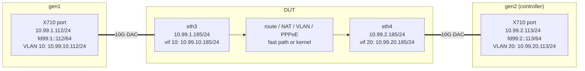

# ASK2 Performance Test Harness

**Version 2.0.0 · 2026-10-16**

This document describes how to repeat the throughput, packet-rate, PPPoE and
WireGuard measurements published in `plans/ASK2-VENDOR-PARITY.md` for a Mono
Gateway (NXP LS1046A) router. It covers three device-under-test (DUT) stacks:

| Label | Stack | Fast path |
|---|---|---|
| **VyOS** | VyOS with ASK2 (this repository) | nftables hardware flowtable → FMan external-hash forwarding |
| **OWRT** | OpenWrt with NXP ASK (vendor SDK) | CMM + CDX, conntrack-driven |
| **OPNS** | OPNsense / FreeBSD with the NXP ASK port | CMM + CDX, pf-state-driven |

Everything here can be rebuilt with commodity hardware and the scripts in
`bin/`. No step needs access to a particular lab: every host name, login,
key and path comes from one settings file (§2.4), and the scripts have no
lab-specific defaults.

---

## 1. What is measured

- **TCP throughput** of routed, NAT, VLAN, NAT-over-VLAN and PPPoE paths,
  IPv4 and IPv6, one-way in each direction and bidirectional.
- **WireGuard throughput** with the tunnel terminated on the DUT. WireGuard
  is software crypto on every stack and is never offloaded.
- **64-byte packet rate** on one primed UDP flow: highest rate at ≤0.001%
  loss, loss at a fixed offered rate, and delivered rate under an unpaced
  flood.
- Optional: latency, new-connections/s and multi-flow packet rate (§5.7).

Every throughput result carries an **offload proof**: a measurement of how
much of the traffic bypassed the DUT's kernel. A run that silently falls
back to software forwarding must never be reported as a hardware result.

---

## 2. Rig

### 2.1 Hardware

| Role | Reference rig | Requirements |
|---|---|---|
| Generator 1 (`gen1`; older script comments say `dell1`) | x86 PC, Intel X710 dual 10G SFP+ | Linux, iperf3 ≥ 3.16 (zero-copy `-Z`), kernel `pktgen`, ethtool |
| Generator 2 (`gen2`; older script comments say `dell2`) | Same as gen1 | Same; also runs the test controller |
| DUT | Mono Gateway DK (LS1046A, 4× A72) | eth3 and eth4 are the two 10G SFP+ cages |
| Cabling | 10G DAC | gen1 ↔ DUT eth3, gen2 ↔ DUT eth4; optional direct gen1 ↔ gen2 link for WireGuard ceiling checks |
| Management | Separate 1G network | DUT eth0 and both generators; never in the measured path |

Each generator is a single 10G sender. The bidirectional ceiling is therefore
about 2 × 9.4 Gbit/s of TCP payload at MTU 1500. Use generators with
headroom: 64-byte line rate is 14.88 Mpps per direction.

### 2.2 Topology



The data-plane addresses are fixed by the scripts:

| Segment | gen side | DUT side |
|---|---|---|
| eth3, untagged | `10.99.1.112/24`, `fd99:1::112/64` | `10.99.1.185/24`, `fd99:1::185/64` |
| eth3, VLAN 10 | `10.99.10.112/24`, `fd99:10::112/64` | `10.99.10.185/24`, `fd99:10::185/64` |
| eth4, untagged | `10.99.2.113/24`, `fd99:2::113/64` | `10.99.2.185/24`, `fd99:2::185/64` |
| eth4, VLAN 20 | `10.99.20.113/24`, `fd99:20::113/64` | `10.99.20.185/24`, `fd99:20::185/64` |
| PPPoE session (on eth3) | server `10.99.50.1`, `fd99:50::1` | client `10.99.50.10`, `fd99:50::10` |
| WireGuard inner | `10.99.200.0/24`, `fd99:200::/64` | — |

Every DUT presents the same `.185` data-plane addresses. Switching DUTs is
then a cable move, not a generator reconfiguration. A second DUT can be wired
to a second X710 port on each generator. That port lives in a network
namespace (`VENDOR_NS`, default `n106`; the name is only a label) with identical addresses, so the two DUT
paths never share a routing table.

### 2.3 Generator setup

`sudo bin/testrig-dell-net.sh gen1` on generator 1 and `... gen2` on generator 2
creates the persistent configuration:

- NetworkManager profiles for the untagged port and its VLAN, with routes to
  the far subnets via the DUT.
- Source-based policy routes (tables 110/120) so VLAN-sourced traffic returns
  via the VLAN.
- The optional second-DUT namespace and `iperf3`/`iperf2` servers as systemd
  units.
- X710 tuning: 4096-entry rings, firmware LLDP agent disabled (it consumes
  LLDP and can reset links), and `iommu=pt` on the kernel command line. With
  DMA translation enabled, kernel pktgen on the X710 is capped at about
  3–4 Mpps.

Also set, before a campaign and never during one:

```bash
cpupower frequency-set -g performance
sysctl -w net.core.rmem_max=67108864 net.core.wmem_max=67108864 \
          net.ipv4.tcp_rmem='4096 131072 67108864' \
          net.ipv4.tcp_wmem='4096 65536 67108864' \
          net.core.netdev_max_backlog=250000
```

For other NICs, set `GEN_IF` (port to the first DUT), `GEN_IF_NS` (port to
the second DUT, moved into the namespace) and `GEN_DIRECT_IF` (optional
direct generator link) in the environment of that command. The addresses and
VLAN IDs are fixed (§2.2). The script always names the namespace `n106`, so
keep `VENDOR_NS=n106` when you use it.

### 2.4 Rig settings file

The drivers read all rig-specific values from one file, so no script needs
editing. Copy the template to the controller (gen2) and fill it in:

```bash
mkdir -p ~/.config
cp bin/testrig.env.example ~/.config/testrig.env
$EDITOR ~/.config/testrig.env
```

The file is plain `KEY=value` lines. A leading `~/` or `$HOME` is expanded,
and a variable set in the environment overrides the file. `TESTRIG_ENV=<path>`
selects another file, for example one per rig. The bash drivers load it via
`bin/testrig-env.sh` and the Python drivers via `bin/testrig_env.py`, with the
same rules.

| Setting | Default | Meaning |
|---|---|---|
| `GEN1`, `GEN2` | none (required) | SSH targets (`user@host`) of gen1 (DUT eth3 side) and gen2 (DUT eth4 side) |
| `ASK2_DUT` | none | SSH target of the VyOS/ASK2 DUT, used when `DUT_KIND=ask2` |
| `VENDOR_DUT` | none | SSH target of the OpenWrt or OPNsense DUT, used when `DUT_KIND=vendor` or `opnsense` |
| `RIG_KEY` | empty | SSH private key for all four hosts; empty uses your ssh config or agent |
| `RIG_OUT` | `~/testrig/out` | Result directory (CSV files, iperf3 JSON, logs) |
| `GEN_IF`, `GEN_IF_NS` | `enp1s0f0np0`, `enp1s0f1np1` | Generator ports facing the first DUT (root namespace) and the second DUT (namespace) |
| `VENDOR_NS` | `n106` | Namespace holding `GEN_IF_NS`; must match §2.3 |
| `PPPOE_USER` | `pppoe-test` | PPPoE test account; its password is read from gen1's `/etc/ppp/chap-secrets` and never stored in the settings file |
| `PPPOE_PLUGIN` | `/usr/lib/pppd/2.5.2/rp-pppoe.so` | rp-pppoe plugin used by `pppoe-server` on gen1 |

Per-run variables stay in the environment:

| Variable | Meaning |
|---|---|
| `DUT_KIND` | `ask2` (VyOS), `vendor` (OpenWrt NXP ASK) or `opnsense`; selects the DUT target and the offload proof |
| `DUT` | Overrides the DUT target for one run |
| `RIG_NS` | Run the generator side inside this namespace (set it to `$VENDOR_NS` for the second DUT) |
| `RUN_ON=gen2` | The driver runs on gen2: gen2 commands run locally, gen1 and the DUT over SSH (`dell2` is accepted as an alias) |
| `OUT`, `J`, `OUTDIR` | Result CSV, JSON directory and output directory for one run; default under `RIG_OUT` |

A driver that needs a setting you have not set stops before sending traffic,
for example `ERROR: set ASK2_DUT in the environment or in
~/.config/testrig.env`. Use key-based SSH only: the controller must reach
both generators and the DUT without prompts (`BatchMode=yes`), and the
generator login needs password-less `sudo`.

---

## 3. DUT configuration

Each DUT needs only the data-plane addresses in §2.2, forwarding enabled and
its fast path switched on. Keep management on eth0. Disable DHCP clients on
eth3/eth4: a DHCP lease adds a second default route and changes the measured
path.

### 3.1 VyOS / ASK2

```text
set interfaces ethernet eth3 address '10.99.1.185/24'
set interfaces ethernet eth3 address 'fd99:1::185/64'
set interfaces ethernet eth3 vif 10 address '10.99.10.185/24'
set interfaces ethernet eth3 vif 10 address 'fd99:10::185/64'
set interfaces ethernet eth4 address '10.99.2.185/24'
set interfaces ethernet eth4 address 'fd99:2::185/64'
set interfaces ethernet eth4 vif 20 address '10.99.20.185/24'
set interfaces ethernet eth4 vif 20 address 'fd99:20::185/64'
set interfaces ethernet eth3 offload ipv4
set interfaces ethernet eth3 offload ipv6
set interfaces ethernet eth4 offload ipv4
set interfaces ethernet eth4 offload ipv6
set firewall flowtable FT interface 'eth3'
set firewall flowtable FT interface 'eth4'
set firewall flowtable FT interface 'eth3.10'
set firewall flowtable FT interface 'eth4.20'
set firewall flowtable FT offload 'hardware'
set firewall ipv4 forward filter rule 900 action 'offload'
set firewall ipv4 forward filter rule 900 offload-target 'FT'
set firewall ipv4 forward filter rule 900 protocol 'tcp_udp'
set firewall ipv6 forward filter rule 900 action 'offload'
set firewall ipv6 forward filter rule 900 offload-target 'FT'
set firewall ipv6 forward filter rule 900 protocol 'tcp_udp'
```

`offload ipv4|ipv6` engages ASK2 per port and per IP family. VLAN, NAT and
PPPoE on an engaged port are offloaded automatically. Apply configuration
non-interactively with a `#!/bin/vbash` script that sources
`/opt/vyatta/etc/functions/script-template`. Do not use `vbash -c`, which can
hang over SSH.

NAT cells need no permanent NAT rules. The harness creates a temporary
nftables table `ask2q` with one masquerade rule per cell and removes it on
exit. It also temporarily removes an existing VyOS NAT66 rule (comment
`SRC-NAT66-100`) and restores it afterwards.

PPPoE cells use a VyOS client on eth3 (§5.4):

```text
set interfaces pppoe pppoe10 source-interface 'eth3'
set interfaces pppoe pppoe10 authentication username '<test-user>'
set interfaces pppoe pppoe10 authentication password '<test-password>'
set interfaces pppoe pppoe10 mtu '1492'
set interfaces pppoe pppoe10 no-default-route
set interfaces pppoe pppoe10 no-peer-dns
set interfaces pppoe pppoe10 ipv6 address autoconf
set protocols static route6 fd99:50::/64 interface pppoe10
```

### 3.2 OpenWrt with NXP ASK

Configure the same addresses and VLANs, enable forwarding and keep CMM
running. The harness logs in as `root`, does not use `sudo`, and needs only
POSIX `sh`. NAT is supplied by the harness at runtime. The PPPoE session is
created at runtime by `bin/testrig-pppoe-vendor.sh up|down|status`. It runs a
`pppd` client named `pppoe10` on the DUT's eth3 and changes no persistent
configuration.

### 3.3 OPNsense with the NXP ASK port

In the reference DUT, FreeBSD names the cages `dtsec3` (eth3) and `dtsec4`
(eth4). Configure through the web UI:

| OPNsense interface | Device | IPv4 / IPv6 |
|---|---|---|
| opt1 | `dtsec3` | `10.99.1.106/24` (native) + alias `10.99.1.185/24`; `fd99:1::106/64` + alias `fd99:1::185/64` |
| opt2 | `dtsec4` | `10.99.2.106/24` + alias `10.99.2.185/24`; matching IPv6 |
| opt3 | `vlan01` = VLAN 10 on `dtsec3` | `10.99.10.106/24` + alias `.185`; matching IPv6 |
| opt4 | `vlan02` = VLAN 20 on `dtsec4` | `10.99.20.106/24` + alias `.185`; matching IPv6 |

- Leave **pf enabled**. CMM offloads pf states, so with pf disabled nothing is
  offloaded.
- Add an inbound pass rule (IPv4 and IPv6) on each of the four test
  interfaces. The harness refuses to run unless
  `pass in quick on dtsec3 inet6` is present.
- Leave Outbound NAT in Automatic mode. Test NAT rules are loaded at runtime
  into a pf anchor called `testrig`, registered by this plugin file:

```php
<?php
// /usr/local/etc/inc/plugins.inc.d/testrig.inc
function testrig_firewall(\OPNsense\Firewall\Plugin $fw)
{
    $fw->registerAnchor("testrig", "nat", 0, "head");
}
```

Reload the filter after adding the file. For example, the NAT-across-VLANs
IPv4 cell loads `nat on vlan02 inet from 10.99.10.0/24 to any ->
10.99.20.185` and flushes the anchor afterwards.

- Enable CMM (`cmm_enable="YES"` in `/etc/rc.conf.local`). If you restart it
  from an SSH session, detach its descriptors, or the SSH session will not
  close:
  `service cmm restart </dev/null >/tmp/cmm-restart.log 2>&1`.

To add temporary filter rules for tunnel or PPPoE tests without disturbing
NAT or state, edit the filter ruleset only:

```sh
pfctl -sr > /tmp/filter.orig                      # save the exact original
# insert the new pass rules after the leading "scrub" lines, then:
pfctl -n -o none -R -f /tmp/filter.new            # validate
pfctl    -o none -R -f /tmp/filter.new            # load filter rules only
# ... test ...
pfctl    -o none -R -f /tmp/filter.orig           # restore; verify with pfctl -sr | diff
```

`-R` without `-o none` fails with “Must enable table loading for
optimizations”.

---

## 4. Offload proof

The quick harness (§5.1) measures the DUT's kernel packet counters over the
steady window. It compares them with the number of data frames that iperf3
reports for the same window:

| `DUT_KIND` | Counter | Hardware share |
|---|---|---|
| `ask2` | Per-record `pkt_count` growth in `/sys/kernel/debug/fman_pcd/0/fe_ehash_stats` | Hardware-forwarded packets ÷ estimated data frames |
| `vendor` | `ethtool -S ethN` `rx packets [TOTAL]` (frames handed to the kernel) | 1 − kernel RX ÷ estimated data frames |
| `opnsense` | `netstat -s -p ip` and `-p ip6`, “total packets received” | 1 − IP-stack RX ÷ estimated data frames |

Classification: ratio ≥ 0.9 **HW**, 0.1–0.9 **PARTIAL**, < 0.1 **SW**.
Offloaded ACKs can push the ASK2 ratio to about 1.2. Use per-record growth for
ASK2: summing deltas across records lets records that age out cancel growth
elsewhere.

Do not use interface `rx_packets` or the FreeBSD ifnet counters as a
kernel-path indicator. On these drivers they also count fast-path frames.

A non-HW run is **not** a slower hardware result. Report it separately as a
fallback and investigate (§6). Never average it into a hardware mean.

### 4.1 Forcing software mode on ASK2 (for SW vs HW comparisons)

Remove `firewall flowtable FT offload hardware`, commit, flush conntrack, and
disengage both ports. Then sample the armed-port state **every second for the
whole run**:

```bash
for i in $(seq 1 30); do
  sudo cat /sys/kernel/debug/fman_pcd/0/fe_arm | grep -oE "0x1[01]" | tr "\n" " "
  echo; sleep 1
done
```

A software run is valid only if every sample is empty. A hardware run is
valid only if every sample shows both ports. Offloadable traffic can re-arm
the fast path mid-run. A “software” cell at about 9 Gbit/s with near-idle CPU
was really hardware-forwarded and must be discarded.

---

## 5. Test suites

Run every suite from gen2 (`RUN_ON=gen2`) as a systemd user unit, so a
dropped SSH session from your workstation cannot kill a campaign:

```bash
systemd-run --user --unit=parity-run bash -c 'cd ~/repo && <command>'
journalctl --user -fu parity-run
```

Never overlap two suites. `bin/testrig-parity-bidir.sh` takes an `flock` on
`$RIG_OUT/parity-bidir.lock` and refuses to start while
`testrig-offload-quick.sh` is running. The other drivers do not check, so
run them one at a time.

### 5.1 Throughput cells

`bin/testrig-offload-quick.sh [cell ...]` runs one 30-second iperf3 test per
cell: `iperf3 -Z -P 8`, TCP, MSS 1448 (1514-byte frames at MTU 1500).
Throughput is the mean of receiver intervals from 10 s onward. For
bidirectional cells (`BIDIR=1`, iperf3 `--bidir`) both directions are summed.
DUT CPU is sampled over the same window.

| Cell | Client → server | Path through the DUT |
|---|---|---|
| `unicast-v4`, `unicast-v6` | gen1 → gen2 | routed eth3 → eth4 |
| `unicast-v4-rev`, `-v6-rev` | gen2 → gen1 | routed eth4 → eth3 |
| `nat-v4`, `nat-v6` (`-rev`) | gen1 → gen2 (reverse) | NAT44 / NAT66 masquerade on the egress port |
| `vlan-v4`, `vlan-v6` (`-rev`) | VLAN 10 → VLAN 20 | VLAN ID translation |
| `vlanport-v4`, `-v6` | VLAN 10 → untagged eth4 | tag strip |
| `portvlan-v4`, `-v6` | untagged eth4 → VLAN 10 | tag add |
| `pppoe-down-v4`, `-v6` | PPPoE server → gen2 | PPPoE decapsulation, eth3 → eth4 |
| `pppoe-up-v4`, `-v6` | gen2 → PPPoE server | PPPoE encapsulation, eth4 → eth3 |
| `nat-vlan-v4`, `nat-vlan-v6` | VLAN 10 → VLAN 20 | NAT across VLANs (opt-in combo cell) |
| `nat-pppoe-up-v4` | gen2 → PPPoE server | NAT44 on the PPPoE interface (opt-in combo cell) |

Example:

```bash
RUN_ON=gen2 DUT_KIND=ask2 DUR=30 STEADY_FROM=10 STREAMS=8 \
  OUT=~/testrig/out/run.csv bin/testrig-offload-quick.sh unicast-v4 nat-v4
# second DUT, wired to the namespace ports:
BIDIR=1 RUN_ON=gen2 DUT_KIND=opnsense RIG_NS=n106 \
  bin/testrig-offload-quick.sh unicast-v4
```

Each result row is:
`ts,cell,gbps,dut_busy,dut_softirq,gen_cpu,retrans,hw_pkts,data_pkts_est,hw_ratio,verdict`.
Per-run iperf3 JSON is stored under `J=`.

### 5.2 Paired campaign protocol

Single runs vary by about one MSS step (~1.3%). Compare stacks only with a
paired, repeated campaign:

- 10 rounds per cell. In each round, run both DUTs back-to-back on the same
  cell, and alternate which DUT goes first in successive rounds.
  `bin/testrig-parity-bidir.sh <cell> ...` implements this on gen2 for
  `ASK2_DUT` (root-namespace ports) and `VENDOR_DUT` (namespace ports);
  `VENDOR_KIND=opnsense` selects the OPNsense proof. Results are labelled
  `ask2-*` and `vendor-*`.
- Identical settings on both DUTs: duration, streams, MTU/MSS, direction,
  warm-up, topology and offload proof.
- Keep every raw CSV and JSON, including failed and non-HW runs. Summarise
  only complete HW-proven pairs: mean, median, sample SD, the count of
  missing or non-HW pairs, and a paired bootstrap interval.
- Verdict rule used in the published tables: a lower mean is a FAIL, however
  small the gap. Report uncertainty separately and do not trim slow runs.
- Rerun a cell that fell back to software only after recording the
  fallback. Report the rerun and the fallback together.

### 5.3 NAT and VLAN combinations

NAT, VLAN and NAT-across-VLAN cells need no extra configuration. The harness
installs the NAT rule for each cell (nftables on Linux DUTs, the pf `testrig`
anchor on OPNsense) and removes it on exit.

### 5.4 PPPoE

- The PPPoE access concentrator runs on gen1: `rp-pppoe` `pppoe-server` in
  kernel mode on the eth3-facing port, local `10.99.50.1`, pool
  `10.99.50.10`. Create a test account in `/etc/ppp/chap-secrets`.
- gen1's `ip-up`/`ipv6-up` hooks must add a policy route that sends the
  session addresses back over `ppp0`. gen2 already routes `10.99.50.0/24`
  and `fd99:50::/64` via the DUT's eth4.
- **gen1 receive RPS is required.** NICs that cannot RSS-hash PPPoE frames
  deliver every returning ACK to one RX queue. That caps the generator at
  about 6 Gbit/s and makes the generator, not the DUT, the bottleneck. The
  harness enables RPS on gen1 for `pppoe-*` cells and restores it on exit.
- DUT client:
  - VyOS: the `pppoe10` interface in §3.1.
  - OpenWrt: `bin/testrig-pppoe-vendor.sh up` (server in gen1's
    `VENDOR_NS`, account `PPPOE_USER`).
  - OPNsense: create a PPPoE device under **Interfaces → Point-to-Point →
    Devices**, parent `dtsec3`, test account `PPPOE_USER`, MTU/MRU 1492.
    Assign the resulting device (for example `pppoe0`) to an enabled test
    interface under **Interfaces → Assignments**, select PPPoE IPv4 and
    enable IPv6 over the PPP link. Do not select it as the management/default
    route. Apply through OPNsense so it generates the mpd configuration,
    runs its link hooks and names the Netgraph nodes. **Do not hand-start
    mpd5:** that forwarded in software in the original test, whereas the
    assigned native interface offloaded all four v4/v6 encap/decap cells.

For OPNsense, add `fd99:50::10/64` to the established PPP device for this
fixed test subnet, plus filter pass rules on that device for the session
sources (§3.3). The harness addresses the session by IP, not device name.

PPPoE fragmentation correctness (oversize datagrams into a 1492-byte
session) is tested separately with `bin/testrig-pppoe-frag.py ask2|vendor`.
That script counts intact delivered datagrams, not TCP throughput.

### 5.5 WireGuard

`bin/wg-parity.sh ask2|vendor` (table: `bin/wg-parity-table.py`) drives
`bin/testrig-wireguard.sh`. The tunnel is terminated on the DUT; the peer is
the generator on the encrypted-leg port:

- One tunnel, IPv4 outer transport, UDP 51820, MTU 1420, four TCP streams,
  30 s runs with steady state from 10 s.
- **A fresh tunnel for every repetition.** The CPU that services the single
  WireGuard transmit worker changes with each new interface, so results from
  one tunnel are bimodal.
- Matrix: encrypted leg on eth3 and on eth4 × inner IPv4/IPv6 × `up` (DUT
  encrypts), `down` (DUT decrypts), `bidir` (both directions summed). Report
  the median of at least 3 repetitions.
- `ceiling-v4` runs WireGuard between the two generators over a direct link.
  It proves the generators are not the limit.
- On VyOS, conntrack is bypassed for the outer UDP ports during the run, as
  for VyOS-configured WireGuard. On OPNsense, the native `if_wg` tunnel
  stays under pf/CMM. Treat those results as as-configured throughput,
  including control-plane overhead, not as a pure crypto benchmark.

### 5.6 64-byte packet rate

`bin/testrig-pktgen.sh` uses kernel `pktgen` on gen1 (4 TX threads) and counts
at the X710 MAC counters: `port.tx_unicast` on gen1 and `port.rx_unicast` on
gen2. Neither host's socket path limits the result. Frame size includes FCS.
Each trial first primes the flow in both directions, so the DUT sees an
established connection and offloads it.

```bash
DUT_KIND=ask2 LOSS=0.001 TRIAL=10 STEPS=10 CONFIRM=3 \
  bin/testrig-pktgen.sh a2 port-v4 64                 # search + 3 confirmations
DUT_KIND=ask2 bin/testrig-pktgen.sh trial port-v4 64 3140000 10   # fixed rate
DUT_KIND=ask2 bin/testrig-pktgen.sh trial port-v4 64 0 10         # unpaced flood
```

Reporting rules:

- **Highest rate at ≤0.001% loss** is the highest search candidate confirmed
  by three consecutive trials. If any confirmation fails, lower the rate.
  It is not an exact physical ceiling.
- **Fixed-rate loss** is reported at the rate actually offered (TX counter),
  not the requested rate. pktgen pacing undershoots by a few percent, so
  calibrate the request until the offered rate is within tolerance.
- MAC counters are read separately on two hosts and include stray unicast.
  An RX count one frame above TX is counter skew; treat it as zero loss and
  keep the raw signed value. Reject anything larger.
- Before a packet-rate batch, run a plain TCP routed cell and confirm it is
  HW. A kernel-bypass share of 1.0 shows the DUT kernel did not see the
  frames. It does not show where lost frames were dropped.
- Calibrate the generator first. Sending to a MAC address the DUT discards
  (`DST_MAC=02:00:00:00:00:99`) measures the generator alone. Reference
  generators managed about 14.0 Mpps unpaced and paced to about ±2.5% up to
  12 Mpps.
- The DUT comes from `ASK2_DUT` or `VENDOR_DUT` by `DUT_KIND`; `vendor` runs
  the generator side in `VENDOR_NS` on `GEN_IF_NS`. `pktgen` proof is built
  in for `ask2` and `vendor`. For a FreeBSD DUT, replace the proof function
  with the `netstat -s -p ip` counters from §4.

### 5.7 Optional: latency, connection rate and multi-flow PDR

`bin/testrig-compare.sh` runs four sections (`pdr`, `cps`, `lat`, `kpath`)
with `bin/testrig-cps.py` and `bin/testrig-latprobe.py`:

- 8k-flow bidirectional PDR at ≤0.5% loss.
- 5k/10k/20k new connections/s with and without NAT.
- Hardware-timestamped PTP-framed latency at idle and at 10/50/90% of PDR.
- Kernel-path (miss-path) packet rate.

Run each PDR cell three times and record the spread and the per-run MAC
receive-drop delta. The drop delta needs an FMan register reader on the
DUT: set `FMREG=<path>` to a Python script that takes `r <offset>` (run with
`sudo python3` on the DUT) and prints the register value as its third
space-separated field; without it the
`rdrp_*` columns read 0. A spread above about 10% points to port-FIFO or burst
sensitivity, not measurement noise. Self-tests that need no rig:
`bin/testrig-cps.py selftest`, `bin/testrig-latprobe.py selftest`, and
`DRY=1 BIDIR=1 bin/testrig-pktgen.sh trial ...`.

---

## 6. Health and error monitoring

Capture these before and after every cell, and report **deltas**. All the
counters are cumulative.

| Stack | Command | Watch |
|---|---|---|
| VyOS | `ethtool -S eth3`, `ethtool -S eth4` | `rx frame physical error`, `rx frame size error`, `rx dma error`; per-CPU RX |
| VyOS | mEMAC registers at FMan + `0xF0000` / `0xF2000`: `rdrp` (+0x158), `rerr` (+0x138) | MAC receive drops and errors |
| OpenWrt | `ethtool -S eth3`, `ethtool -S eth4` | SDK RX error and drop counters |
| OPNsense | `netstat -I dtsec3 -nd -b`, `netstat -I dtsec4 -nd -b` | `Ierrs`, `Idrop`, `Oerrs`, `Drop` |
| OPNsense | `sysctl net.pfnotify dev.cdx.stats` | `events_dropped`, `ring_used` vs `ring_size`, `active_connections` |
| OPNsense | `grep cmm /var/log/system/latest.log` | CMM messages; frame errors are logged by the kernel as `dtsecN: RX error … fd_status=…` |
| all | `dmesg` / system log | `BUG`, `Oops`, `panic`, `list_del`, poison, repeated frame-descriptor errors |

On OPNsense, `sysctl dev.dtsec.N` exposes only SFP data, BMan buffer counts
and a `diag` trigger, not traffic counters. Use `netstat -I`.

`fd_status=0x00080000` / `rx frame physical error` is a MAC/SerDes-class
receive error: an aborted, CRC-bad or misaligned frame. A small burst at
link-up that then stays flat is benign. A count that climbs with load is a
real loss source. Report it with the throughput number, because TCP
retransmits around it and the only visible symptom is lower throughput.

Stop the session if any of these occur:

- frame errors climb continuously;
- a port keeps link but stops receiving (ARP fails, RX counters flat). Cold
  power-cycle the DUT; a warm reboot does not clear the condition;
- a kernel `BUG`, `Oops`, `panic` or list corruption appears;
- management becomes unreachable;
- endpoint MTUs differ (§7).

---

## 7. MTU safety

All transit endpoints must use the same MTU: gen1 port, DUT eth3, DUT eth4
and gen2 port. A mismatch breaks bulk TCP on the whole segment, while ping
and small requests keep working, which hides the fault. Change MTU only with
no traffic running. On VyOS, change it only with the fast path disengaged.
Any MTU automation must use an exit trap that restores every endpoint to
1500. VyOS rejects MTUs below 1280 while IPv6 link-local is enabled.

---

## 8. Validity checklist

- Cold-boot the DUT before a campaign and record the image and kernel.
- Confirm link at 10G on both ports and a clean routed HW reference cell.
- Disable DHCP on the test ports. Confirm no other traffic on the rig.
- Verify generator tuning before the campaign. Never change it mid-campaign.
- Every reported value must have HW proof on every included run (§4).
- Compare CPU and throughput against the expected signature. On ASK2,
  hardware forwarding runs at line rate with the DUT near idle, while
  software forwarding is CPU-bound at about 6 Gbit/s with all cores busy.
  A result that disagrees with its mode's signature is suspect until
  explained.
- Use iperf3 `-Z` for zero-copy. In iperf2, `-Z` selects the TCP congestion
  algorithm instead.
- After the run, remove every temporary interface, NAT rule, filter rule,
  route and tunnel, and verify the DUT's original configuration.

---

## 9. Result record template

```text
Date/UTC:
DUT stack / image / kernel:
Cold boot before campaign: yes/no
Generators: NIC, driver, iperf3 version, tuning verified: yes/no
Controller command and environment:
Protocol: duration, steady-from, streams, MTU/MSS, repetitions, pairing order

cell | family | direction | runs | HW runs | mean Gbit/s | median | SD | DUT busy % | retrans | error deltas

Fallbacks / excluded runs (with reason):
Post-test cleanup verified:
Raw artifact location:
```

---

## 10. Reference results

The full tables, raw-data inventory and verdicts are in
`plans/ASK2-VENDOR-PARITY.md`. These are the headline numbers measured with
this harness at MTU 1500. Values are means of 10 runs (routed, NAT, VLAN),
means of 3 runs (OPNS NAT across VLANs), one native-interface retest per
cell (OPNS PPPoE), or medians of 3 fresh-tunnel runs (WireGuard):

```text
Gbit/s unless noted               OPNS           OWRT           VyOS
                                  v4     v6      v4     v6      v4     v6
ROUTED
 3->4                            9.28   9.23    9.28   9.15    9.28   9.15
 4->3                            9.31   9.18    9.28   9.15    9.32   9.17
 bidir                          15.94  15.67   17.99  17.61   18.13  17.90
NAT44 / NAT66 (PAT included)
 3->4                            9.30   9.24    9.28   9.15    9.28   9.15
 4->3                            9.10   9.25    9.28   9.16    9.32   9.17
 bidir                          16.17  16.00   17.88  17.29   18.17  17.91
VLAN
 strip tag 3->4                  9.27   9.14    9.26   9.14    9.26   9.13
 add tag 4->3                    9.27   9.15    9.26   9.13    9.29   9.19
 strip+add bidir                11.43  11.39   12.93  12.80   13.00  12.75
 xlate VID 3->4                  9.28   9.14    9.27   9.13    9.26   9.13
 xlate VID 4->3                  9.27   9.20    9.26   9.13    9.28   9.15
 xlate VID bidir                13.32  14.11   17.99  17.79   18.15  17.90
 NAT across VLANs 3->4           9.26   9.10    9.26   9.13    9.38   9.25
PPPoE (session on eth3; OPNS native interface, one run)
 decap 3->4                      9.34   9.11    9.28   9.11    9.32   9.23
 encap 4->3                      9.23   9.10    9.23   9.14    9.37   9.15
WIREGUARD (software crypto)
 eth3 up                         0.83   0.43    1.39   1.27    1.69   1.63
 eth3 down                       0.96   0.93    1.21   1.22    1.54   1.42
 eth3 bidir                      0.95   0.76    1.42   1.42    1.42   1.47
 eth4 up                         0.84   0.77    1.34   1.30    1.57   1.62
 eth4 down                       0.95   0.75    1.31   1.29    1.48   1.50
 eth4 bidir                      0.93   0.74    1.57   1.44    1.41   1.37

64 B ONE WAY (Mpps)               OPNS             OWRT                   VyOS
 highest rate at <= 0.001 % loss  0.85             1.84 (2.79 unstable)   2.64
 3.14 Mpps offered, loss          62.867-62.930 %  0.011-0.053 %          0.00001-0.046 %
 unpaced flood delivered          1.16             3.40                   4.12
```

Notes for interpreting the table:

- OWRT and VyOS routed/NAT/VLAN values come from one paired campaign. The
  other OWRT/VyOS rows and all OPNS values come from separate sessions:
  they are context, not paired comparisons.
- OPNS PPPoE uses its native device/assignment and ran in hardware
  (`hw_ratio=1.00` in all four retest cells). The superseded hand-started-mpd
  results were software-only; keep configuration provenance with results.
- OPNS bidirectional cells were hardware-forwarded. In a diagnostic routed
  IPv4 bidirectional rerun, each OPNS port logged about 1.9 M receive errors
  (`fd_status=0x00080000`, about 8% of received frames). The run had about
  5 M TCP retransmits, and `Idrop`/`Oerrs` stayed at 0. One-way cells showed
  almost no errors. This likely explains the lower OPNS bidirectional
  throughput, but the root cause is not established.
- ASK2 software vs hardware forwarding on an earlier single-generator rig
  (iperf2, MTU 1500): about 6.6 Gbit/s at about 69% DUT CPU in software,
  against about 10.4 Gbit/s at about 3% CPU with hardware offload.

---

## 11. Known limitations

- TCP throughput is bounded by the 10G generators. It shows the fast path
  reaches line rate, not the FMan's absolute ceiling.
- kernel `pktgen` sends UDP flows, not stateful TCP sessions with an
  application mix.
- Single-generator TCP with `-P 8` can hash several flows onto one DUT core
  in software mode. That number is representative but below the software
  ceiling. Balanced per-core flows measured about 12.7 Gbit/s bidirectional
  in software on ASK2.
- WireGuard, IPsec, bridging, multicast and QoS are either software on every
  stack or outside this harness.
- Results from different images, MTUs, stream counts or durations must not
  be mixed into one baseline.

---

## 12. Changelog

- **2.0.0 — 2026-10-16** — Rewritten for public reproduction:
  - Covers the two-generator 10G rig, all three DUT stacks (VyOS/ASK2,
    OpenWrt NXP ASK, OPNsense NXP ASK) and per-stack offload proof.
  - Adds the paired campaign protocol and PPPoE, WireGuard and 64-byte
    procedures.
  - Adds OPNsense configuration, including the pf anchor, filter-only rule
    loading and native OPNsense PPPoE device/assignment setup; the native
    retest replaces the hand-started-mpd software values in the reference table.
  - Adds health counters per stack and the reference results table.
  - Removes the retired single-generator rig, host-specific credentials and
    internal hostnames.
  - Moves all rig-specific values into one settings file
    (`bin/testrig.env.example`, loaded by `bin/testrig-env.sh` and
    `bin/testrig_env.py`); the drivers no longer carry lab addresses, keys
    or paths.
- **1.3.1 — 2026-10-10** — External-benchmark variance cause (10G RX FIFO), per-run drop/spread rule.
- **1.3.0 — 2026-10-10** — Comparison suite (`testrig-compare.sh`, `testrig-cps.py`, `testrig-latprobe.py`).
- **1.2.0 — 2026-08-17** — Saturation mode and the measured software ceiling.
- **1.1.0 — 2026-08-17** — Continuous fast-path mode gate and SW/HW validity discriminator.
- **1.0.0 — 2026-08-17** — Initial harness specification.
