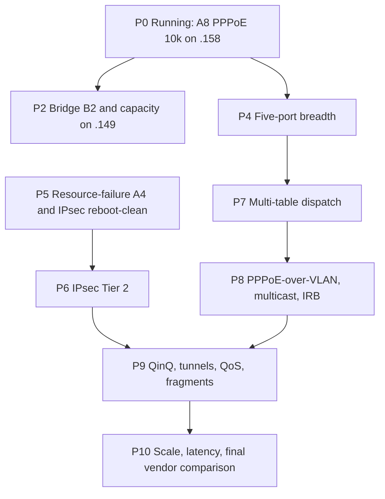

# ASK2 prioritized task order

Snapshot: 2026-10-21. This is a derived, ordered view of
[`ASK2-MASTER-PLAN.md`](ASK2-MASTER-PLAN.md) (§3 execution order, §4 work
program, §5 defects). The master plan stays authoritative; if the two
disagree, the master plan wins and this file is stale. Counts, run IDs and
image names are state: re-derive them before acting. Completed items (P1 B7b
repeat, P3 A15 soak, F-122, NAT44 FIN closure, SYN-punt CPS, F-266 transit,
A14) are removed; their results live in qdrant and the master plan. Numbering
is kept, so P1 and P3 are intentionally absent.

## Where things stand

| Item | State |
|---|---|
| Image under test | `2026.10.21-0729-rolling`, `6.18.57-vyos`, commit `465e8ae8` (CI run 39562267413), deployed to lxc200 `latest.iso` and installed on `.185` |
| P5 hardening | Open: forced-failure A4, deferred-insert replay test (IPsec Tier 1 closed 2026-10-21); see P5 |
| PPPoE 10,000-cycle gate (A8) | RUNNING on `.158`, image `1310`, launched 2026-10-20 15:15 UTC, cycle 2125/10000 with 0 fails at 2026-10-21 19:38 UTC (about 485 cycles/h, so ETA about 2026-10-22 12:00 UTC at the current rate, earlier than the original 2026-10-26 estimate); log `dell2:~/testrig/out/pppoe-churn-158-10k-1020-1515.log` |
| Vendor comparison | BLOCKED: no board is running NXP ASK |

Rig constraint: `.158` is occupied by the A8 run until it finishes. Do not
touch `.158`, the dells' `n106` namespace or the dell1 concentrator meanwhile.
`.185` uses the root-namespace generator ports; `.149` is the debugfs/KUnit
DUT. Both DUTs share rig addresses, so test one DUT at a time.

## Ordered list

### P0. Running now (no action, monitor)

- **A8 PPPoE 10,000-cycle lifecycle** on `.158` (`MODE=mix CYCLES=10000`).
  Pass criteria: zero fails and zero deaf ports, hits on every flow before and
  after each flap, every drain returns records to 0 and MURAM `used` to 52922,
  final `pcd-snapshot diff` clean. Stop only with `pgrep` plus `kill <pid>`,
  never `pkill -f`.

### P2. Bridge B2 and capacity on the debugfs image

- Run on `.149` (`kunit=true` image, debugfs). B2 and capacity need debugfs,
  which the production image lacks.
- Not-yet-claimable: 10G link-down invalidation (known carrier gap) and short
  non-IP bridge frames (restrict to v4/v6 until a cold-boot de-risk passes).

### P4. Five-port and plain-forward hardening

- **Done 2026-10-21 (`.185`, image 0729, eth3 and eth4):**
  `bin/testrig-port-loop.sh` (idempotent engage ×3, MTU 1280/2500/3600/1500,
  link down/up ×3, 100-cycle disengage/engage churn with a ping running).
  Both ports 0 failures: MURAM `used` 52922 throughout, `pcd-snapshot diff`
  clean, 0 kernel errors, `ask-check` 36/36.
- **Done 2026-10-21 (eth4 only):** CLI remove/reapply ×10
  (`delete`/`set interfaces ethernet eth4 offload ipv4|ipv6`, commit each)
  with a ping through the DUT: MURAM 52922 after every cycle, `pcd-snapshot
  diff` clean, `ask-check` 36/36, 0 kernel errors. eth3 not yet run.
- **Done 2026-10-22 (`.185`, image 1955, eth3→eth4 routed iperf3 4 streams,
  `bin/testrig-neigh-change.sh`):** neighbour flush under load costs one
  ~7.9 Gbit/s second and recovers; a 1.5 s wrong-MAC blackhole then restore
  returns the same flow to 9.4 Gbit/s with hardware hits (+3.3 M pkts/3 s) in
  about 6 s, MURAM 52922, 0 kernel errors, `ask-check` 36/36. A 10 s
  blackhole leaves the TCP flow stalled by RTO backoff, but a fresh flow runs
  at 9.41 Gbit/s, so this is not a hardware fault. IPv6 and the eth3 side not run.
- **Done 2026-10-22 (`.185`, image 1955, `bin/testrig-concurrent.sh`):** concurrent
  eth3↔eth4 `--bidir` 4 streams: 8.95 / 9.02 Gbit/s per direction against 9.26
  single-direction (>= 0.97x), hardware hits +7.1 M pkts/3 s, MURAM 52922,
  0 kernel errors, `ask-check` 36/36.
- **Module unload: refused by design 2026-10-22 (`.185`).** `rmmod ask` returns
  "in use" (refcnt 1) with ports engaged, after disengaging both ports, and
  after `nft flush ruleset`: board patch `0145` `dpaa_register_flow_offload_handler()`
  takes `try_module_get(ops->owner)` on registration, so a loaded `ask.ko` pins
  itself and `ask_exit()` is unreachable. No unload-state hazard; disengage left
  MURAM at 35280 and ping worked; ruleset restored and ports re-engaged, 36/36.
  A real unload test would need an explicit handler-unregister path (not planned).
- **Cold boot with offload engaged: PASS 2026-10-22 (`.185`, image 1955).**
  Auto-engage, `ask-check` 36/36, MURAM 52922, both ports ping.
- **OPEN DEFECT 2026-10-22: MTU > 1500 with offload engaged wedges eth3 RX.**
  With DUT eth3/eth4 and both generators at the same MTU (1800 and 2500
  tested, three cold-boot repeats), pings pass but the first TCP burst freezes
  eth3 `rx_packets` after ~15-20 frames (link up, eth4 fine, down/up and
  disengage do not recover; cold boot only). With eth3 disengaged at MTU 2500
  the same iperf3 runs 8.6 Gbit/s, so the fault is in the engaged FE path.
  Not the 4 KB RX buffer limit (~3712 B). The 2026-10-21 MTU loop passed only
  because the generators stayed at 1500. Next: bisect the threshold between
  1500 and 1800, inspect FE-VM/BMI state on a wedged port, then qdrant-gate any
  fix. `bin/testrig-mtu-steps.sh` reproduces it. Cold boot afterwards.
  Update 2026-10-22: the F-262 RX-port triple (RFENE 0x22, RCMNE 0x0e, params
  misc bit 30) is RULED OUT: reverting it live on port 0x10 changed nothing at
  MTU 2500. It is a regression, because the 2026-08-17 battery passed 1280-2500
  engaged. On a wedged port (MTU 1800, BMI stats on) the mEMAC kept counting
  received frames (~+40k) while BMI RX `rfrc` was 0x20 and the stack saw 80
  packets: the stall is inside FMan after ~32 frames, not at the MAC or in
  BMan. DMA/FPM/QMI/BMI-common blocks show no error flag versus a healthy
  idle dump (only activity counters differ). (The "+40k MAC frames" figure
  was a mislabelled mEMAC register; MAC `rfrm` rose only ~43 frames.)
  RIM/RPSO (patch 0217) also ruled out by live revert.
  ROOT CAUSE 2026-10-22: a UDP size sweep at MTU 2500 passes payload 1472 and
  wedges on payload 1473, so the threshold is exactly IP length > 1500. The
  ehash emitter wrote ENQUEUE mtu 1500 with bpid 0 and no frag-info block on
  plain routed records; with the F-262 RX-port triple the microcode takes its
  fragmentation path with no pool and the port goes deaf. The 08-17 battery
  predates the triple. FIX (unverified on board): `F_270.py` writes ENQUEUE
  mtu 0xffff (EN_EHASH_DISABLE_FRAG, as F-261/F-268); F-262 still overwrites
  it where it seals a real MTU check. Verify on a new image with
  `bin/testrig-mtu-steps.sh` at 1280/1500/1800/2500, the payload sweep and
  the F-262 PPPoE MTU-shrink case.

- **T-M7-P5:** eth1 routed TCP/UDP HIT and load, then all-five simultaneous
  trafficked churn, identical-tuple cross-ingress isolation, and eth0 LAST with
  serial recovery in place (opt-in, high risk; never engage eth0 with SSH as
  the only recovery).
- Per port: idempotent CLI and mutex, MTU 1280/1500/2500/3600, neighbour
  change, down/up, remove/reapply, unload, cold boot; 100-cycle churn returns
  to the S0 PCD/MURAM/FQ baseline; concurrent 1G traffic must not regress
  eth3↔eth4.
- **T-M7-2 S2:** `PREEMPTIVE_CHECKS_ON_PKT(0x05)` on every plain routed record,
  only with owned frag-info and a measured regression gate.

### P5. Correctness hardening before new default-on paths

- **T-M6-A4:** forced DDR/MURAM/FQ allocation failures, no partial cookie or
  record, no `in_hw`, flat MURAM. Needs ASK2-specific fault injection; the
  production image reports `failslab=false`.
- **IPsec Tier 1 reboot-clean: PASS 2026-10-21** (`.185`, image 0729, runtime
  IKEv2 PSK tunnel with dell2, AES-CBC-256/SHA2-256). 20 s × 4 streams with a
  rekey at 8 s: CAAM `rq_dequeued` 809 → 1,030,444, `ib_bytes_decrypted`
  ~997 MB, 0 xfrm leftovers after teardown. After a cold boot: `/proc/crypto`
  CAAM priorities identical to pre-boot (129 lines), 167 self-tests all
  `passed`, `caam-check` healthy, `ask-check` 36/36, MURAM 52922, no xfrm
  state or policy, RNG registered (`rng-caam`, `prng-caam`; Era 8, 3 JRs). A
  tunnel re-established after the boot moved the CAAM counters again (533,699
  dequeued). Tier 1 is now closed; the IPv6, routed-forwarding and SEC QoS
  decode items remain open and do not block Tier 2.
- **Deferred-insert paths (`PR14y`/`PR14z10`): audited and fixed in source,
  commit `465e8ae8`.** They called `ask_flow_insert_owned` without an FE
  insert, so a deferred flow was hardware-backed in the SW table with no
  ehash record. Replay now goes through `ask_neigh_republish()`. Still open:
  a board test that parks a flow on an unresolved neighbour (a neighbour flush
  during flow start still resolved synchronously, so the replay did not run) and
  a KUnit case; both need a `kunit=true` image or a debug hook. Deferred VLAN-edit
  flows are unverified because the republish call passes no egress device.

### P6. IPsec Tier 2 (T-M6-4 / IP1 / IP2 / A9)

- XFRM-owned ESP ehash → OH/SEC → TX, AES-CBC-SHA256 first, AES-CTR-SHA256
  later. Keep the CAAM A24a GCM refusal.
- Gates: add/delete/update/lifetime/rekey, tunnel v4/v6, in/out, ESN,
  anti-replay, NAT-T, PMTU/fragments, interop, bad-auth/replay, reboot,
  disable fallback. `NETIF_F_HW_ESP` is advertised LAST.
- Owner: `ASK2-IPSEC-OFFLOAD-PLAN.md`. Tier 1 reboot-clean is closed (2026-10-21); the next gate is the standalone `0134-caam-qi-share.patch` de-risk.

### P7. Multi-table dispatch (T-M6-DISPATCH)

- Design and test per-port multi-table classification: protocol precedence,
  miss delivery, owner/generation isolation, reversibility.
- Prerequisite for IRB, routed+bridge coexistence and routed+ESP coexistence.

### P8. Features that need dispatch or new tables

- PPPoE-over-VLAN hardware path and relay (T-M6-SP4); first reconcile the
  `ask_vlan_cc.c` STOP in master plan §4.3.
- Multicast (T-M6-MC / A10): MDB/mroute-owned v4/v6 groups with bounded
  replication; join/leave, TTL/hop-limit, port down, churn, exhaustion.
- Bridge IRB, routed+bridged on one port, PPPoE-session bridging (T-M6-2).

### P9. Remaining parity features

- QinQ/802.1ad/stacked tags and DSCP→PCP (T-M6-VLAN2); validate the routed
  PCP≠0 fallback first.
- 6in4 and 4in6 tunnels (T-M6-SP5 / TN / A11).
- QoS (T-M6-QOS / A12): ASK-path rate limit, policer coexistence, CEETM,
  DSCP→queue; wire-level rate accuracy within ±15%.
- Fragments (T-M6-FR): software handling first (first/non-first, overlap, tiny,
  IPv6 extensions, exhaustion); hardware fragment-flow work only with an
  explicit scope.

### P10. After correctness gates: scale and comparison

- A2/A13: 64-byte loss/rate and IMIX, connection rate with held sessions, 8,000
  session bidirectional PDR, install rate (target ≥2,370/s), first insert
  <2.6 s, per-flow engage <100 ms, latency beside HW traffic.
- A6: investigate residual VLAN↔port loss and retransmits; stretch target
  ≥16.0 Gbit/s bidirectional.
- Refreshed vendor comparisons: blocked until a board is restored to NXP ASK.
  Do not substitute historical figures.

## Parallel, not on the active rig

- **Phase 2 consolidation** (no behaviour change; preserve regression
  evidence): remove dead code only after verifying each candidate against
  today's tree; fold F_199/F_201/F_222/F_224/F_227/F_242 into canonical
  commits; add the boot key selftest refusal (`-EPROTO` until
  `fman_pcd_key_selftest()` passes); CI budgets ask.ko ≤9.5k LOC, kernel PCD
  ≤15k LOC.
- **genl per-op policies:** full `genl_ops` with `.policy`/`.maxattr`,
  ideally generated from `ask.yaml` by ynl-gen-c.
- **T-M8-5:** upstream-format series packaging and reviewed dpaa1→main
  integration (`git merge --no-ff --log=200` with a descriptive subject).
- **WireGuard fast path** (`ASK2-WIREGUARD-FASTPATH-PLAN.md`), **VPP zero-copy**
  (`VPP-AFXDP-ZC-FULLSPEED.md`, T-M4-5a through 4g, operator installs images),
  **Suricata bypass** (design only, approval contract first).

## Known open defects (do not claim as passing)

| Defect | Note |
|---|---|
| IPv6 fragment-ID reuse | Concurrent oversize flows can corrupt reassembly; keep `ipv6_hw_frag=0` opt-out visible |
| Short non-IP bridge frames | Historical FE hit-path freeze; bridge restricted to v4/v6 |
| 10G link-down invalidation | Bridge remote-carrier test limited by the known carrier gap |
| F-076 eth4 debugfs direct arm | Diagnostic only; can leave RX deaf |
| VPP ZC refill | Flood can freeze refill and drain the pool; separate VPP track |
| Deferred-insert replay (PR14y/PR14z10) | Fixed in source (`465e8ae8`), not exercised on silicon or in KUnit |
| Closed flows lingering in conntrack | Entries stay until the flowtable timeout; the F-266 punt fix reduces but the 30 s timeout still applies |

## Standing gate rules for every item

- Qdrant, register, spec and live cross-check before any FMan/PCD or
  kernel-fixup change; qdrant wins on contradiction.
- Cold boot before silicon experiments; record boot type, image SHA, kernel,
  rig and exact conditions. One variable, one key, one flow, one packet class.
- Begin new paths with pings, not floods. Never mutate eth0 experiments
  without serial capture and tested rollback.
- Forward and inverse land together: `pcd-snapshot capture/diff` must match
  warm S0 byte-exactly after teardown, and MURAM/FQ/DDR return to baseline.
- Operator installs images. Agents publish the URL only and never run
  `add system image` or `install image`. Refresh both `latest.iso` and
  `latest.iso.minisig`; operator URL `http://192.168.1.137:8080/iso/latest.iso`.
- No auto-commit or push without an explicit request.
