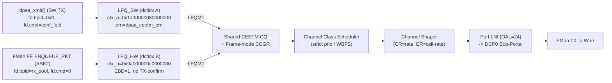

# ASK2 QoS, CEETM Egress Shaping, and Policer Coexistence Plan (G10 / T-M6-QOS)

**Status:** Scoping complete (2026-11-25, `dpaa1` @ `ba131d12`). No implementation code changed yet. All findings cross-checked against shipped kernel source (`qman_ceetm.c`, `dpaa_ceetm.{c,h}`, `0104`, `0111`, `0112`, `F-199`, `F-316`, `F-319`, `F-322`), `ask.ko`, `arch/qman-ceetm.md`, `arch/fman-microcode-210-programming-reference.md`, vendor `/mnt/builds/ASK/cdx/`, and live DUT1 (`.185`) + live vendor reference board DUT2 (`.106`).

## 1. Executive summary

G10 closes the remaining half of Priority 5 (`plans/ASK2-MASTER-PLAN.md` §3, §3.1, §3.1.1 #6, §4.6.4 `T-M6-QOS`).

The scoping audit established five decisive facts:

1. **Zero G4 dispatch dependency for egress shaping or port/flow/exception policing.**
   - CEETM operates in **QMan DCP0**, downstream of both FMan FE `ENQUEUE_PKT` and kernel `dpaa_xmit()`. It requires no FMan KeyGen or multi-table dispatch changes.
   - Port-wide ingress policing (`BMI -> PLCR -> PRS`), per-flow policing (FE opcode `0x05` `PREEMPT_POLICE_PKT`), and exception-path policing (ehash MISS -> `PLCR` -> RX FQ) likewise require no G4 dispatch (and G4 `F-323` is already shipped).
2. **Existing kernel CEETM (`0111` + `0112`) is already built in (`CONFIG_FSL_QMAN_CEETM=y`, `CONFIG_DPAA_HW_CEETM=y`), but has four critical coexistence defects with ASK2 today:**
   - **Defect 1 — Silent egress blackhole on CEETM attach:** `dpaa_ceetm_htb_create()` switches the port's DCP0 sub-portal into CEETM mode (`qman_ceetm_sp_set_lni()`), stopping FMan TX from dequeuing conventional WQ6 FQs. It deactivates WGFP (`dpaa_wgfp_egress_deactivate()`), but does **not** notify or quiesce `ask.ko`, whose ehash records continue enqueueing into `h->noconf_tx[]` WQ6 FQs -> **100% silent egress blackhole**.
   - **Defect 2 — Silent bypass of software qdiscs and VyOS shapers:** VyOS `set qos policy shaper` (`vyos/qos/trafficshaper.py`) emits non-offload 2-level `tc ... htb`, and AQM qdiscs (`cake`, `fq_codel`, `tbf`, `netem`) are software-only. `ask.ko` never inspects egress qdiscs, so offloaded flows bypass every VyOS shaper/AQM at 10G line rate.
   - **Defect 3 — RX BMan pool exhaustion via byte-mode 1 MiB CCGR:** `dpaa_ceetm.c` programs `DPAA_CEETM_TD_THRESHOLD = 1 MiB` in byte mode (`ccgp.mode = 0`). Under HW-offloaded small-frame shaping (64 B), one backlogged CQ holds up to 16,384 frames — 3.2× the 5,120-buffer RX pool (`eth3`/`eth4`) and 16× the 1,024-XSFDR budget — starving the ingress port (`rodc`, matching vendor bug A337).
   - **Defect 4 — `qman_ceetm_drain_cq()` buffer/skb leak & unquarantined release:** `qman_ceetm_drain_cq()` pops leftover FDs with `QM_CEETM_VERB_CQ_PEEK_POP_XFDRREAD` (`ct = 1`) and discards `ppxr.fd` without releasing BMan buffers or `skb`s, and `dpaa_ceetm_destroy_class()` releases channels without waiting for ASK2 FE `SYNC` retirement.
3. **Clean SW + HW shaper sharing via Two-LFQ-per-CQ (no double shaping, no bypass, no `F-227` confirm/ERN hazard):**
   - QMan CEETM supports multiple LFQIDs mapped onto the **same** Class Queue (`LFQMT[lfqid] -> (cqid, dctidx)`), each with its own DCT (`context_a`, `context_b`).
   - Binding `lfq_sw` (`context_a = 0x1a00000080000000`, `ern = dpaa_ceetm_ern`) for `dpaa_xmit()` and `lfq_hw` (`context_a = 0x9a000000c0000000`, F-199/F-316 no-confirm BMan-dealloc) for ASK2 FE `ENQUEUE_PKT` onto the **same** `qm_ceetm_cq` / `qm_ceetm_ccg` / `qm_ceetm_channel` / `qm_ceetm_lni` feeds both paths into one hardware shaper and one frame-mode CCGR with zero SW-confirm overhead and zero `skb`/BMan confusion.
4. **Live silicon discrepancy to resolve in Phase 0 before sizing channels:**
   - Live vendor DUT2 (`/proc/device-tree/soc/qman-portals-bus@500000000/qman-ceetm@0/`) advertises `32` channels (`0x00..0x1f`) and `4096` LFQIDs (`0xf00000..0xf00fff`), whereas our `qman_ceetm.c` (`0111`) and `arch/qman-ceetm.md` hardcode `8` channels (`CEETM_NR_CHANNELS = 8`, 6 usable after skipping `0..1` for DEFECT B) and `1024` LFQIDs. Resolve with a non-destructive silicon query before choosing flat-channel vs 2-level CQ caps.
5. **Honesty boundary on AQM / fairness:**
   - CEETM provides hierarchical rate/ceil shaping, strict priority (8 levels), WBFS weighted sharing (8 queues), and CCGR tail-drop / WRED. It does **not** provide per-flow fairness (`cake`) or CoDel AQM (`fq_codel`). Ports configured with `cake` or explicit software AQM must stay in software via the software-qdisc bypass guard and be reported as such — never silently bypassed or mislabelled as hardware AQM.

---

## 2. Inventory of current state (verified 2026-11-25)

### 2.1 Shipped kernel & driver components (DUT1 `6.18.65-1-vyos`, `ba131d12`)

| Component | Files | Current state | Notes / gaps |
|---|---|---|---|
| QMan CEETM core | `kernel/common/files/drivers/soc/fsl/qbman/qman_ceetm.c` (`0111`), `F-319` | `CONFIG_FSL_QMAN_CEETM=y`, symbols live in `/proc/kallsyms`; `qman_ceetm_mc_exec()` protected by `F-319` MC lock + timeout fence | Hardcodes `CEETM_NR_CHANNELS=8`, `CEETM_LFQID_COUNT=0x400`, skips idx `0..1` (leaving 6 channels SoC-wide); no WBFS/WRED helpers wired yet; `qman_ceetm_drain_cq()` drops popped FDs without freeing buffers |
| DPAA HTB-offload consumer | `kernel/common/files/drivers/net/ethernet/freescale/dpaa/dpaa_ceetm.{c,h}` (`0112`) | `CONFIG_DPAA_HW_CEETM=y`; flat `root -> leaf` only (`TC_SETUP_QDISC_HTB`); `DEFECT A` fixed (`ER = ceil - rate`), `DEFECT B` documented (raw `default 0` blackhole; real default leaf works) | 1 CEETM channel per leaf (1 CQ `prio 0`); 1 MiB **byte-mode** CCGR; single `lfq` (`context_a = 0x1a00000080000000`); deactivates WGFP on create, **blind to `ask.ko`** |
| ASK2 offload TX FQs | `ask_hw.c` (`h->noconf_tx[]`), `F-199`, `F-316` | Up to 16 conventional WQ6 no-confirm TX FQs per egress port (`context_a = 0x9a000000c0000000`, `ICS_CRED = 0x4000`, shared frame-mode `priv->offload_cgr`) | Zero awareness of `priv->ceetm` or `dev->qdisc`; no CEETM attach/detach notifier; no `ct->mark` / classid / DSCP egress selection |
| WGFP TX FQs | `dpaa_wgfp.c`, `F-322` | Refuses allocation when `priv->ceetm != NULL`; `dpaa_ceetm_htb_create()` calls `dpaa_wgfp_egress_deactivate()` | Safe fallback to SW (then shaped by `dpaa_xmit()` -> CEETM) |
| Ingress policer | `0104-dpaa-ingress-policer-tc-matchall-bridge.patch`, `F-231`, `vyos-1x-025` | `tc matchall police` -> FMPL profile 0 on RSS KeyGen scheme (`KG(RSS) -> PLCR`) | Works on non-ASK ports; **bypassed on ASK-engaged ports** because `F-162` sets `FMBM_RFPNE` to `AC_CC` scheme. Never flood-test (`AGENTS.md` boundary) |
| VyOS QoS CLI | `/usr/lib/python3/dist-packages/vyos/qos/trafficshaper.py` (stock `vyos-1x`) | `set qos policy shaper` renders `tc qdisc replace dev <if> root handle 1: htb r2q ... default ...` (no `offload` flag) + 2-level hierarchy (`1:` -> `1:1` -> `1:<cls>`) | Neither engages CEETM nor triggers ASK2 SW fallback -> **silently bypassed by ASK2 today** |

### 2.2 Live vendor reference board (DUT2, `6.12.118` + Mono `cdx`)

Verified read-only on the vendor reference board and `/mnt/builds/ASK/cdx/`:
- **DT CEETM node** (`/proc/device-tree/soc/qman-portals-bus@500000000/qman-ceetm@0/`):
  - `fsl,ceetm-channel-range = <0x00000000 0x00000020>` (32 channels)
  - `fsl,ceetm-lfqid-range = <0x00f00000 0x00001000>` (4096 LFQIDs)
  - `fsl,ceetm-sp-range = <0x00000000 0x00000010>` (16 sub-portals)
  - `fsl,ceetm-lni-range = <0x00000000 0x00000008>` (8 LNIs)
- **Vendor HTB-to-CEETM mapping (`cdx_htb.c`):** 3-level mapping matching CEETM hardware:
  - `root` = port LNI (coupled shaper, OAL=24, CR=infinite, ER=0)
  - `class under root` = CEETM channel (CR=`rate`, ER=`ceil - rate`)
  - `class under channel` = CQ on that channel (`prio 0..7` -> strict-priority CQ; `quantum` -> WBFS weighted group CQ 8..15); optional `RED` leaf -> CCGR WRED curve
- **Vendor frame-mode CCGR budgeting (`cdx_htb.c`):** every CQ counts **frames** (default 128), bounded per-tree to `<= half of port RX pool` (and global cap across trees) with active occupancy charging + parked 1-frame depth during flowtable retirement + quarantine until flowtable confirms zero references.
- **Vendor SW+HW sharing (`cdx_ceetm_app.c`):** single LFQ per CQ with `VQA_DPAA_VAL_TO_RELEASE_BUFFER = 0x9e00000080000000ULL` (`OVFQ=1, OVOM=1, A2V=1, EBD=1`) and mixed `ceetm_release_fd()` ERN handler branching on `fd->bpid`.
- **Vendor software-qdisc bypass guard (`ask_flowtable_tc.c`):** 1-Hz RTNL worker snapshots non-offloaded egress/ingress `tc` qdiscs/filters (`cake`, `fq_codel`, non-offload `htb`, tcx, XDP) into an RCU table; flows touching a software-`tc` device stay in software and existing HW records are retired within 1 s.
- **Vendor DSCP→CQ map (`cdx_dscp.c`, `cdx_ehash.c`):** `tc filter add dev ethX egress protocol ip flower ip_dscp <d> action skbedit priority <M:N>` programs a 64-entry `uint32_t fqid[64]` table in MURAM (`cdx_muram_memory_cmn_db_t`, shared with `frag_info` via `en_ehash_enqueue_param.word2[23:0]` + `word2[31:24] |= DSCP_FQ_MAP_ENABLE (0x01)`). **Microcode 210.10.1 singleton:** only **one** port per FMan may hold the DSCP map at a time; handoff drains all entries carrying `DSCP_FQ_MAP_ENABLE` before reassigning.
- **Vendor ingress policing (`cdx_qos.c`, `cdx_police.c`):**
  - Port-wide (`QM_FF_RATE` / `tc matchall police`): port-private FMPL profile sitting **before** the Parser (`BMI -> PLCR -> PRS`, `nextEngineOnGreen = e_FM_PCD_PRS`), metering both offloaded and slow-path traffic uniformly.
  - Per-flow (`tc flower police`): shared FMPL profile pool invoked inline by FE opcode `0x05` `PREEMPTIVE_CHECKS_ON_PKT` (`OpMask |= PREEMPT_POLICE_PKT`, `param->pp_no`).
  - Exception-path (`QM_EXPT_RATE`): shared FMPL profile on the ehash **MISS** chain before kernel RX FQ enqueue, bounding CPU punt rate without capping offloaded flows.

---

## 3. Architecture: how ASK2 and software TX share one CEETM shaper

### 3.1 Datapath: Two-LFQ-per-CQ model

**Why Two-LFQ-per-CQ is preferred over Vendor Single-LFQ (`0x9e00000080000000`) for ASK2:**

| Property | Two-LFQ-per-CQ (`lfq_sw` + `lfq_hw`) | Single-LFQ (`0x9e00000080000000`) |
|---|---|---|
| Shared CQ / CCGR / shaper / LNI | **Exact same** hardware CQ, CCGR, channel shaper, LNI | Exact same |
| TX-confirm isolation (`F-227` invariant) | `lfq_hw` uses proven F-199/F-316 `0x9a000000c0000000` (never emits TX-confirm FD); `lfq_sw` only ever carries `skb`/XDP FDs | Relies on `OVFQ=1` + `fd->cmd==0` suppression for HW frames on a confirm-capable LFQ |
| ERN safety | `dpaa_ceetm_ern` only ever sees SW `skb`/XDP FDs; HW CCGR rejections stay in FMan BMI (`rfdc`), matching `F-316` | ERN handler must demux `bpid==0xff` vs real RX BPID |
| LFQID cost | 2 LFQIDs per CQ (even 64 active CQs = 128 / 1024 LFQIDs = 12.5%) | 1 LFQID per CQ |
| `qman_ceetm.c` support | **Already supported:** `qm_ceetm_cq.bound_lfqids` is a list and each `qman_ceetm_lfq_claim()` allocates its own `lfqid` + `dctidx` | Already supported |

**Note on `dpaa_ceetm_egress_fq()` vs ASK2 TX FQ resolution:**
- When `priv->ceetm == NULL`: ASK2 uses `h->noconf_tx[]` (`FQ_TYPE_TX_NO_CONFIRM` on `priv->offload_cgr`, unchanged).
- When `priv->ceetm != NULL`: `dpaa_ceetm_get_offload_fqid(dev, classid, &fqid)` (new `fsl_dpa` export, RCU/acquire-safe for hot path or cached under `h->lock`) resolves the target class's `lfq_hw->idx` (24-bit `0xF00xxx`, falling back to `defcls` leaf — never the broken raw-default 0 channel). If the port is in a transition/teardown window or class does not exist, it returns `-EAGAIN`/`-ENOENT` and ASK2 fails closed to software.

### 3.2 Safe lifecycle & transition ordering (T1–T4 / F-291 compliant)

Because switching a DCP0 sub-portal between conventional WQ mode and CEETM mode immediately stops dequeuing the inactive mode's FQs, every state transition MUST fence and drain ASK2 **before** flipping hardware:

1. **Installing CEETM (`TC_HTB_CREATE` on `dev`, under RTNL):**
   - Notify ASK2 egress callback (`dpaa_ceetm_notify_egress_change(dev, CEETM_PRE_ENABLE)`):
     - ASK2 marks `dev`'s `noconf_tx` slot transitioning (blocking new HW flow admission egressing `dev` via `nf_flow_table_fence_begin()` + `synchronize_rcu()`).
     - ASK2 revokes SW + retires all ehash records egressing `dev` and waits for `FMFP_EXTC` `SYNC` completion (`ask_flow_port_egress_quiesce(dev)`).
     - If any record fails to settle (retained owner / `F-291`), **abort `TC_HTB_CREATE` with `-EBUSY`** — never switch the sub-portal while live FE records still point at WQ6 FQs!
   - Deactivate WGFP (`dpaa_wgfp_egress_deactivate(dev)`).
   - Claim SP + LNI, enable CEETM mode (`qman_ceetm_sp_set_lni()`), build default channel (`lfq_sw` + `lfq_hw`), publish `priv->ceetm`.
   - Notify ASK2 (`CEETM_POST_ENABLE`): re-open admission egressing `dev`; new flows resolve `lfq_hw` LFQIDs and automatically enter CEETM.
2. **Deleting a leaf (`TC_HTB_LEAF_DEL`) or tearing down CEETM (`TC_HTB_DESTROY` / `dpaa_ceetm_teardown`):**
   - Notify ASK2 (`CEETM_PRE_CHANGE` / `CEETM_PRE_DISABLE`): fence admission, retire all ehash records referencing the departing leaf LFQID (or any CEETM LFQID on `dev`), wait for FE `SYNC`.
   - If any FE record fails to settle: **quarantine** that channel/CQ (park CCGR at 1 frame, do not release channel/LFQID to another port or disable SP CEETM mode until drained — matching `F-295`/`F-320` retain-on-fault discipline).
   - Unpublish `used` / `priv->ceetm`, `synchronize_net()`, drain CQ **with proper FD release** (`bpid == 0xff` -> `dpaa_cleanup_tx_fd` + `dev_kfree_skb_any`; valid `bpid` -> `dpaa_fd_release`), then release LFQs, CQ, CCG, channel, LNI, SP.
   - Notify ASK2 (`CEETM_POST_DISABLE`): re-open admission on conventional `h->noconf_tx[]` WQ6 FQs.
3. **Modifying rates (`TC_HTB_NODE_MODIFY`):**
   - Reprograms CR/ER token rates in-place via QMan MC; LFQIDs do not change -> **zero flow retirement needed**, zero packet drop!

### 3.3 Frame-mode CCGR budgeting (closing Defect 3)

Replace `DPAA_CEETM_TD_THRESHOLD = 1 MiB` byte-mode (`ccgp.mode = 0`) with **frame-mode** CCGR (`ccgp.mode = 1`):
- Per-port CEETM total frame budget: `<= min(port_rx_pool_bufs / 2 / bufs_per_frame_at_mtu, XSFDR_BUDGET_SHARE)`, reusing the exact `dpaa_offload_cgr_frames()` math from `F-316` (e.g., at 10G/1500 MTU: `<= 1,624` frames; at 10G/9000 MTU: `<= 276` frames; globally across all active CEETM CQs: bounded well below the 1,024-XSFDR ceiling so QMan never stalls PFDRs or starves BMan).
- Rebalance per-CQ frame limits whenever leaves are added/removed or MTU/link speed changes (`dpaa_change_mtu` / `dpaa_eth_cgr_set_speed`).

### 3.4 Software-qdisc bypass guard (closing Defect 2)

A port with a non-offloaded software egress qdisc (`cake`, non-offload `htb`, `tbf`, `netem`, `prio`, explicit `fq_codel` root, or egress `tc` filters) MUST NOT have its flows silently offloaded past the qdisc:
- Detect whether `dev`'s root qdisc is stock pass-through (`mq` with default children, `noqueue`, `pfifo_fast`, or active offloaded `htb` with `priv->ceetm != NULL`) vs an operator-installed software shaper/AQM/filter.
- Maintain a per-netdev RCU/atomic flag updated on `qdisc` change (or 1-Hz RTNL worker, mirroring `ask_flowtable_tc.c` so `ask_flow_offload_replace()` never takes RTNL).
- When a port enters software-qdisc mode: retire existing HW records egressing that port, decline new admissions egressing it, and increment a dedicated `ASK_FALLBACK_QDISC` (or `policy-gate`) counter so `show offload config` and IPFIX Options explicitly show why those flows are in software.

### 3.5 Classification hierarchy (how offloaded flows pick a CEETM class)

| Stage | Classifier mechanism | Scope | Effort |
|---|---|---|---|
| **Stage 1 (MVP)** | **Default / port-level HTB leaf** (`htb offload default <minor>`) + SW-qdisc bypass guard | Single port-wide hardware shaper (or aggregate WAN egress cap) covering BOTH HW-offloaded and SW traffic; `TC_HTB_NODE_MODIFY` live rate updates | Small–medium |
| **Stage 2 (Multi-class)** | **2-level CEETM hierarchy** (LNI -> channel -> 8 strict + 8 WBFS CQs, optionally WRED) + **per-flow `ct->mark` / `skb->priority` -> HTB classid** at `ask_flow_offload_replace()` time | Multi-class HQoS (e.g., VoIP strict prio, bulk shaped, default class) + VyOS `set qos policy shaper` offload integration | Medium |
| **Stage 3 (Per-packet DSCP)** | **FMan 210.10.1 MURAM `dscp_fqid_map`** (`word2 |= DSCP_FQ_MAP_ENABLE`, 64-entry `fqid[64]` table sharing MURAM with `F-262` `frag_info`) | Dynamic per-packet DSCP -> CEETM CQ on **one** port per FMan (silicon singleton), driven by `tc filter ... egress flower ip_dscp ... action skbedit priority` | Medium |
| **Stage 4 (Ingress & Exception Policing)** | **Port-wide `BMI -> PLCR -> PRS`**, optional per-flow `0x05 PREEMPT_POLICE_PKT`, and **ehash MISS `QM_EXPT_RATE`** | Fixes `0104` bypass on ASK-engaged ports and bounds CPU punt flood rate without capping offloaded flows | Medium |

---

## 4. Phased execution roadmap & pre-declared acceptance gates

Every phase requires failing-first host checks, independent review before silicon code lands, a CI image, and cold-boot verification on `.185` (never flood-test the ingress policer).

### Phase 0 — Silicon facts & non-destructive baseline probe (1 day, no datapath changes)
1. **Resolve channel/LFQID discrepancy (`8` vs `32` channels, `1024` vs `4096` LFQIDs):**
   - Inspect QMan IP revision (`QMAN_IP_REV`) and non-destructively query CEETM channel 8..31 (`QM_CEETM_VERB_CLASS_SCHEDULER_QUERY`) on cold-booted DUT1 and compare with DUT2 (`fsl,ceetm-channel-range = <0 0x20>`).
   - Record the verified hardware limit in `arch/qman-ceetm.md`, `qman_ceetm.c`, and Qdrant.
2. **Baseline CEETM-only check on DUT1 (ASK disengaged on `eth4`):**
   - Confirm `0111`+`0112` `tc qdisc add dev eth4 root handle 1: htb offload default 10` still shapes software traffic cleanly on `6.18.65-1-vyos` (establishing the un-offloaded control before changing any code).

### Phase 1 — Safety fixes + Shared SW/HW Single-Class CEETM Shaper + SW-qdisc Guard
**Deliverables:**
- Fix `qman_ceetm_drain_cq()` to release popped FDs (`bpid == 0xff` vs real BMan pool) and fail-closed/quarantine on drain error.
- Switch `dpaa_ceetm.c` CCGR from 1 MiB byte-mode to **frame-mode** bounded by `F-316` RX-pool + XSFDR budget.
- Add Two-LFQ-per-CQ (`lfq_sw` + `lfq_hw` with `0x9a000000c0000000`) in `dpaa_ceetm.c` and export `dpaa_ceetm_get_offload_fqid()` + egress-change notifier hooks.
- Wire `ask.ko` to:
  1. Quiesce/retire/re-admit egressing flows synchronously around CEETM create/modify/del/destroy (zero silent blackhole; abort `-EBUSY` on retained owner).
  2. Resolve `lfq_hw` when `priv->ceetm != NULL` so HW-offloaded flows pass through the **same** CEETM CQ + channel shaper as SW traffic.
  3. Enforce the **software-qdisc bypass guard** (keep flows in SW and bump fallback counter when egress port has `cake`, non-offload `htb`, `tbf`, `netem`, etc.).
- **Host tests (failing-first, ASan/UBSan):** CEETM lifecycle/quarantine ordering, frame-mode CCGR budget math, Two-LFQ context_a & FD-release drain model, SW-qdisc bypass guard state machine.

**Phase 1 Cold-Boot Acceptance Gate (pre-declared tolerance: `±5%` wire rate):**
- Measurement method: wire-level byte rate measured at receiver NIC + DUT `ethtool -S` / `qman_ceetm_cq_get_dequeue_statistics()` over 30 s steady-state intervals (accounting for L2+IFG overhead `OAL=24` vs L4 payload, matching `F-231` methodology).
- **Controls & matrix (both IPv4 and IPv6, both directions `eth3->eth4` and `eth4->eth3`):**
  1. Unshaped baseline (`htb offload` absent): line rate (~9.4 Gbit/s unidir, ~17 Gbit/s bidir), unchanged vs pre-G10 baseline.
  2. Single HW-offloaded bulk flow shaped to `100M`, `500M`, `1G`, `2.5G`, `5G`: wire rate within **±5%** of target, CPU idle (`[HW_OFFLOAD]` active, `tx_confirm` delta ≈ 0), zero BMan pool starvation (`rodc == 0`), small-frame (64 B UDP) stress does not exhaust RX pool.
  3. **Mixed HW + SW load on same shaper:** 1 HW-offloaded bulk flow + 1 SW-forced flow (e.g., port 21 excluded or ping/SSH control) sharing a `1G` class -> combined wire rate within **±5%** of `1G`, zero double-shaping, SW ping RTT bounded (no starvation).
  4. **Dynamic rate change (`TC_HTB_NODE_MODIFY`):** `500M -> 2G -> 500M` mid-flow without dropping the TCP session or retiring the HW record.
  5. **Software-qdisc honesty check:** install `tc qdisc replace dev eth4 root cake bandwidth 500mbit` -> existing HW flows retire cleanly to SW, traffic shapes to ~500 Mbit/s, `show offload config` increments SW-qdisc fallback counter; removing `cake` restores HW offload at line rate.
  6. **Reversible teardown & churn:** 20× create/destroy + leaf add/del cycles under live traffic -> `pcd-snapshot diff` byte-exact, MURAM flat (`58764`), BMan pool counts exact, `CEETM_XSFDR_IN_USE` back to baseline (1), `ask-check` `47/49 OK, 0 FAIL`, 0 kernel warnings/BUGs.

### Phase 2 — Multi-Class HQoS (2-level Channel→CQ + `ct->mark` Class Steering + VyOS CLI)
- Extend `qman_ceetm.c` + `dpaa_ceetm.c` to support 2-level `LNI -> Channel (rate/ceil) -> CQ (8 strict prio + 8 WBFS weighted)` and optional CCGR WRED curves (`tc qdisc add ... red`).
- Map `ct->mark` / `skb->priority` -> HTB classid consistently in both `dpaa_ceetm_select_queue()` (SW) and `ask_flow_offload_replace()` (HW -> class `lfq_hw`).
- Wire VyOS `set qos policy shaper` offload option (or compatible 2-level HTB rendering with `offload`) in `vyos-1x`.
- **Gate:** multi-class isolation (strict-priority class preempts saturated bulk class with bounded latency; two shaped classes sum to parent ceil within ±5%; exhaustion returns `-ENOSPC` cleanly with no partial state).

### Phase 3 — Optional Single-Port Per-Packet DSCP→CQ (`DSCP_FQ_MAP_ENABLE`)
- Implement FMan 210.10.1 MURAM `dscp_fqid_map` singleton (extending `F-262`'s owned FE MURAM block) driven by `tc filter add dev ethX egress protocol ip flower ip_dscp <d> action skbedit priority <M:N>`, with strict single-port ownership and retirement drain before port handoff.
- **Gate:** live DSCP-marked packets within one flow steer to distinct CEETM CQs at wire rate without flowtable re-install; second port refused `-EBUSY`; teardown drains cleanly.

### Phase 4 — Ingress & Exception Policing Coexistence (`QM_FF_RATE`, `QM_EXPT_RATE`)
- Relocate port-wide `tc matchall police` (`0104`) from `KG(RSS) -> PLCR` to `BMI -> PLCR -> PRS` (`FMBM_RFNE`) so ASK-engaged ports are metered identically to unengaged ports (bounded ping/low-rate verification first — never flood-test the ingress policer without an approved recovery plan).
- Add ehash MISS-path shared FMPL exception policer (`QM_EXPT_RATE`) to protect the A72 CPUs from new-flow/miss floods while leaving established HW flows unaffected.
- Optional: per-flow `tc flower police` via FE opcode `0x05` `PREEMPT_POLICE_PKT`.

---

## 5. Open decisions requiring operator sign-off before coding

1. **Phase 0 silicon probe first?** Confirm whether to run the quick read-only `QMAN_IP_REV` / CEETM channel-range check (resolving `8` vs `32` channels) and baseline `htb offload` check on DUT1 before authoring Phase 1.
2. **Phase 1 scope:** Confirm shipping **Phase 1** (safety fixes + frame-mode CCGR + Two-LFQ-per-CQ shared SW/HW shaper + SW-qdisc bypass guard) as the first PR/CI cycle before multi-class Phase 2 and VyOS CLI wiring.
3. **VyOS QoS CLI behavior:** When an operator configures `set qos policy shaper` on an ASK-engaged port, should VyOS:
   - *(a, recommended)* Keep existing `set qos policy shaper` in software (honestly enforced by the Phase 1 SW-qdisc guard) and add an explicit opt-in `offload` flag for CEETM-compatible shapers, or
   - *(b)* Auto-attempt `htb offload` for compatible shapers and fall back to software (with SW-qdisc guard) when incompatible?
