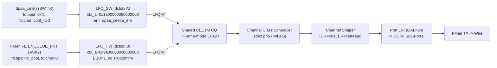

# ASK2 QoS, CEETM Egress Shaping, and Policer Coexistence Plan (G10 / T-M6-QOS)

**Status:** Phases 0, 1, 2, 3, and 4a **cold-boot silicon-verified PASS** on DUT1 (`.185`): Phase 0 + Phase 1 (`2026.11.25-1958-rolling`, `4ec2fb73`, CI `45690319479`), `noqueue` SW-qdisc fix (`043d0bb3`) + Phase 2 (`2026.11.25-2359-rolling`, `b20fefc5`, CI `45725355638`), and **Phase 3 (`F-328` single-port MURAM DSCP→CEETM CQ map) + Phase 4a (`F-329` `HWP -> PLCR -> downstream` port-wide ingress policer)** (`2026.11.26-0425-rolling`, `fc37476d`, CI `45755039380`). Optional follow-ups: Phase 4b (`QM_EXPT_RATE` exception policer / `PREEMPT_POLICE_PKT`) and vendor A458 (bounded plain TX FQ drain before CEETM attach). All findings cross-checked against shipped kernel source (`qman_ceetm.c`, `dpaa_ceetm.{c,h}`, `F-327`, `F-328`, `F-329`), `ask.ko`, `arch/qman-ceetm.md`, `arch/fman-microcode-210-programming-reference.md`, vendor `/mnt/builds/ASK/cdx/`, and live DUT1 (`.185`) + live vendor reference board DUT2 (`.106`).

## 1. Executive summary

G10 closes the remaining half of Priority 5 (`plans/ASK2-MASTER-PLAN.md` §3, §3.1, §3.1.1 #6, §4.6.4 `T-M6-QOS`).

The scoping audit established five decisive facts:

1. **Zero G4 dispatch dependency for egress shaping or port/flow/exception policing.**
   - CEETM operates in **QMan DCP0**, downstream of both FMan FE `ENQUEUE_PKT` and kernel `dpaa_xmit()`. It requires no FMan KeyGen or multi-table dispatch changes.
   - Port-wide ingress policing (`BMI -> PLCR -> PRS`), per-flow policing (FE opcode `0x05` `PREEMPT_POLICE_PKT`), and exception-path policing (ehash MISS -> `PLCR` -> RX FQ) likewise require no G4 dispatch (and G4 `F-323` is already shipped).
2. **Existing kernel CEETM (`0111` + `0112`) is already built in (`CONFIG_FSL_QMAN_CEETM=y`, `CONFIG_DPAA_HW_CEETM=y`), but has four critical coexistence defects with ASK2 today:**
   - **Defect 1 — Silent egress blackhole on CEETM attach:** `dpaa_ceetm_htb_create()` switches the port's DCP0 sub-portal into CEETM mode (`qman_ceetm_sp_set_lni()`), stopping FMan TX from dequeuing conventional WQ6 FQs. It deactivates WGFP (`dpaa_wgfp_egress_deactivate()`), but does **not** notify or quiesce `ask.ko`, whose ehash records continue enqueueing into `h->noconf_tx[]` WQ6 FQs -> **100% silent egress blackhole**.
   - **Defect 2 — Silent bypass of software qdiscs and VyOS shapers:** VyOS `set qos policy shaper` (`vyos/qos/trafficshaper.py`) emits non-offload 2-level `tc ... htb`, and AQM qdiscs (`cake`, `fq_codel`, `tbf`, `netem`) are software-only. `ask.ko` never inspects egress qdiscs, so offloaded flows bypass every VyOS shaper/AQM at 10G line rate.
   - **Defect 3 — RX BMan pool exhaustion via byte-mode 1 MiB CCGR:** `dpaa_ceetm.c` programs `DPAA_CEETM_TD_THRESHOLD = 1 MiB` in byte mode (`ccgp.mode = 0`). Under HW-offloaded small-frame shaping (64 B), one backlogged CQ holds up to 16,384 frames — 3.2× the 5,120-buffer RX pool (`eth3`/`eth4`) and 16× the 1,024-XSFDR budget — starving the ingress port (`rodc`, matching vendor bug A337).
   - **Defect 4 — `qman_ceetm_drain_cq()` buffer/skb leak & unquarantined release:** `qman_ceetm_drain_cq()` pops leftover FDs with `QM_CEETM_VERB_CQ_PEEK_POP_XFDRREAD` (`ct = 1`) and discards `ppxr.fd` without releasing BMan buffers or `skb`s, and `dpaa_ceetm_destroy_class()` releases channels without waiting for ASK2 FE `SYNC` retirement.
3. **Clean SW + HW shaper sharing via Two-LFQ-per-CQ (no double shaping, no bypass, no `F-227` confirm/ERN hazard):**
   - QMan CEETM supports multiple LFQIDs mapped onto the **same** Class Queue (`LFQMT[lfqid] -> (cqid, dctidx)`), each with its own DCT (`context_a`, `context_b`).
   - Binding `lfq_sw` (`context_a = 0x1a00000080000000`, `ern = dpaa_ceetm_ern`) for `dpaa_xmit()` and `lfq_hw` (`context_a = 0x9a000000c0000000`, F-199/F-316 no-confirm BMan-dealloc) for ASK2 FE `ENQUEUE_PKT` onto the **same** `qm_ceetm_cq` / `qm_ceetm_ccg` / `qm_ceetm_channel` / `qm_ceetm_lni` feeds both paths into one hardware shaper and one frame-mode CCGR with zero SW-confirm overhead and zero `skb`/BMan confusion.
4. **Live silicon discrepancy to resolve in Phase 0 before sizing channels:**
   - Live vendor DUT2 (`/proc/device-tree/soc/qman-portals-bus@500000000/qman-ceetm@0/`) advertises `32` channels (`0x00..0x1f`) and `4096` LFQIDs (`0xf00000..0xf00fff`), whereas our `qman_ceetm.c` (`0111`) and `arch/qman-ceetm.md` hardcode `8` channels (`CEETM_NR_CHANNELS = 8`, 6 usable after skipping `0..1` for DEFECT B) and `1024` LFQIDs. Resolve with a non-destructive silicon query before choosing flat-channel vs 2-level CQ caps.
5. **Honesty boundary on AQM / fairness:**
   - CEETM provides hierarchical rate/ceil shaping, strict priority (8 levels), WBFS weighted sharing (8 queues), and CCGR tail-drop / WRED. It does **not** provide per-flow fairness (`cake`) or CoDel AQM (`fq_codel`). Ports configured with `cake` or explicit software AQM must stay in software via the software-qdisc bypass guard and be reported as such — never silently bypassed or mislabelled as hardware AQM.

---

## 2. Inventory of current state (verified 2026-11-25)

### 2.1 Shipped kernel & driver components (DUT1 `6.18.65-1-vyos`, `ba131d12`)

| Component | Files | Current state | Notes / gaps |
|---|---|---|---|
| QMan CEETM core | `kernel/common/files/drivers/soc/fsl/qbman/qman_ceetm.c` (`0111`), `F-319` | `CONFIG_FSL_QMAN_CEETM=y`, symbols live in `/proc/kallsyms`; `qman_ceetm_mc_exec()` protected by `F-319` MC lock + timeout fence | Hardcodes `CEETM_NR_CHANNELS=8`, `CEETM_LFQID_COUNT=0x400`, skips idx `0..1` (leaving 6 channels SoC-wide); no WBFS/WRED helpers wired yet; `qman_ceetm_drain_cq()` drops popped FDs without freeing buffers |
| DPAA HTB-offload consumer | `kernel/common/files/drivers/net/ethernet/freescale/dpaa/dpaa_ceetm.{c,h}` (`0112`) | `CONFIG_DPAA_HW_CEETM=y`; flat `root -> leaf` only (`TC_SETUP_QDISC_HTB`); `DEFECT A` fixed (`ER = ceil - rate`), `DEFECT B` documented (raw `default 0` blackhole; real default leaf works) | 1 CEETM channel per leaf (1 CQ `prio 0`); 1 MiB **byte-mode** CCGR; single `lfq` (`context_a = 0x1a00000080000000`); deactivates WGFP on create, **blind to `ask.ko`** |
| ASK2 offload TX FQs | `ask_hw.c` (`h->noconf_tx[]`), `F-199`, `F-316` | Up to 16 conventional WQ6 no-confirm TX FQs per egress port (`context_a = 0x9a000000c0000000`, `ICS_CRED = 0x4000`, shared frame-mode `priv->offload_cgr`) | Zero awareness of `priv->ceetm` or `dev->qdisc`; no CEETM attach/detach notifier; no `ct->mark` / classid / DSCP egress selection |
| WGFP TX FQs | `dpaa_wgfp.c`, `F-322` | Refuses allocation when `priv->ceetm != NULL`; `dpaa_ceetm_htb_create()` calls `dpaa_wgfp_egress_deactivate()` | Safe fallback to SW (then shaped by `dpaa_xmit()` -> CEETM) |
| Ingress policer | `0104-dpaa-ingress-policer-tc-matchall-bridge.patch`, `F-231`, `vyos-1x-025` | `tc matchall police` -> FMPL profile 0 on RSS KeyGen scheme (`KG(RSS) -> PLCR`) | Works on non-ASK ports; **bypassed on ASK-engaged ports** because `F-162` sets `FMBM_RFPNE` to `AC_CC` scheme. Never flood-test (`AGENTS.md` boundary) |
| VyOS QoS CLI | `/usr/lib/python3/dist-packages/vyos/qos/trafficshaper.py` (stock `vyos-1x`) | `set qos policy shaper` renders `tc qdisc replace dev <if> root handle 1: htb r2q ... default ...` (no `offload` flag) + 2-level hierarchy (`1:` -> `1:1` -> `1:<cls>`) | Neither engages CEETM nor triggers ASK2 SW fallback -> **silently bypassed by ASK2 today** |

### 2.2 Live vendor reference board (DUT2, `6.12.118` + Mono `cdx`)

Verified read-only on the vendor reference board and `/mnt/builds/ASK/cdx/`:
- **DT CEETM node** (`/proc/device-tree/soc/qman-portals-bus@500000000/qman-ceetm@0/`):
  - `fsl,ceetm-channel-range = <0x00000000 0x00000020>` (32 channels)
  - `fsl,ceetm-lfqid-range = <0x00f00000 0x00001000>` (4096 LFQIDs)
  - `fsl,ceetm-sp-range = <0x00000000 0x00000010>` (16 sub-portals)
  - `fsl,ceetm-lni-range = <0x00000000 0x00000008>` (8 LNIs)
- **Vendor HTB-to-CEETM mapping (`cdx_htb.c`):** 3-level mapping matching CEETM hardware:
  - `root` = port LNI (coupled shaper, OAL=24, CR=infinite, ER=0)
  - `class under root` = CEETM channel (CR=`rate`, ER=`ceil - rate`)
  - `class under channel` = CQ on that channel (`prio 0..7` -> strict-priority CQ; `quantum` -> WBFS weighted group CQ 8..15); optional `RED` leaf -> CCGR WRED curve
- **Vendor frame-mode CCGR budgeting (`cdx_htb.c`):** every CQ counts **frames** (default 128), bounded per-tree to `<= half of port RX pool` (and global cap across trees) with active occupancy charging + parked 1-frame depth during flowtable retirement + quarantine until flowtable confirms zero references.
- **Vendor SW+HW sharing (`cdx_ceetm_app.c`):** single LFQ per CQ with `VQA_DPAA_VAL_TO_RELEASE_BUFFER = 0x9e00000080000000ULL` (`OVFQ=1, OVOM=1, A2V=1, EBD=1`) and mixed `ceetm_release_fd()` ERN handler branching on `fd->bpid`.
- **Vendor software-qdisc bypass guard (`ask_flowtable_tc.c`):** 1-Hz RTNL worker snapshots non-offloaded egress/ingress `tc` qdiscs/filters (`cake`, `fq_codel`, non-offload `htb`, tcx, XDP) into an RCU table; flows touching a software-`tc` device stay in software and existing HW records are retired within 1 s.
- **Vendor DSCP→CQ map (`cdx_dscp.c`, `cdx_ehash.c`):** `tc filter add dev ethX egress protocol ip flower ip_dscp <d> action skbedit priority <M:N>` programs a 64-entry `uint32_t fqid[64]` table in MURAM (`cdx_muram_memory_cmn_db_t`, shared with `frag_info` via `en_ehash_enqueue_param.word2[23:0]` + `word2[31:24] |= DSCP_FQ_MAP_ENABLE (0x01)`). **Microcode 210.10.1 singleton:** only **one** port per FMan may hold the DSCP map at a time; handoff drains all entries carrying `DSCP_FQ_MAP_ENABLE` before reassigning.
- **Vendor ingress policing (`cdx_qos.c`, `cdx_police.c`):**
  - Port-wide (`QM_FF_RATE` / `tc matchall police`): port-private FMPL profile sitting **before** the Parser (`BMI -> PLCR -> PRS`, `nextEngineOnGreen = e_FM_PCD_PRS`), metering both offloaded and slow-path traffic uniformly.
  - Per-flow (`tc flower police`): shared FMPL profile pool invoked inline by FE opcode `0x05` `PREEMPTIVE_CHECKS_ON_PKT` (`OpMask |= PREEMPT_POLICE_PKT`, `param->pp_no`).
  - Exception-path (`QM_EXPT_RATE`): shared FMPL profile on the ehash **MISS** chain before kernel RX FQ enqueue, bounding CPU punt rate without capping offloaded flows.

---

## 3. Architecture: how ASK2 and software TX share one CEETM shaper

### 3.1 Datapath: Two-LFQ-per-CQ model

**Why Two-LFQ-per-CQ is preferred over Vendor Single-LFQ (`0x9e00000080000000`) for ASK2:**

| Property | Two-LFQ-per-CQ (`lfq_sw` + `lfq_hw`) | Single-LFQ (`0x9e00000080000000`) |
|---|---|---|
| Shared CQ / CCGR / shaper / LNI | **Exact same** hardware CQ, CCGR, channel shaper, LNI | Exact same |
| TX-confirm isolation (`F-227` invariant) | `lfq_hw` uses proven F-199/F-316 `0x9a000000c0000000` (never emits TX-confirm FD); `lfq_sw` only ever carries `skb`/XDP FDs | Relies on `OVFQ=1` + `fd->cmd==0` suppression for HW frames on a confirm-capable LFQ |
| ERN safety | `dpaa_ceetm_ern` only ever sees SW `skb`/XDP FDs; HW CCGR rejections stay in FMan BMI (`rfdc`), matching `F-316` | ERN handler must demux `bpid==0xff` vs real RX BPID |
| LFQID cost | 2 LFQIDs per CQ (even 64 active CQs = 128 / 1024 LFQIDs = 12.5%) | 1 LFQID per CQ |
| `qman_ceetm.c` support | **Already supported:** `qm_ceetm_cq.bound_lfqids` is a list and each `qman_ceetm_lfq_claim()` allocates its own `lfqid` + `dctidx` | Already supported |

**Note on `dpaa_ceetm_egress_fq()` vs ASK2 TX FQ resolution:**
- When `priv->ceetm == NULL`: ASK2 uses `h->noconf_tx[]` (`FQ_TYPE_TX_NO_CONFIRM` on `priv->offload_cgr`, unchanged).
- When `priv->ceetm != NULL`: `dpaa_ceetm_get_offload_fqid(dev, classid, &fqid)` (new `fsl_dpa` export, RCU/acquire-safe for hot path or cached under `h->lock`) resolves the target class's `lfq_hw->idx` (24-bit `0xF00xxx`, falling back to `defcls` leaf — never the broken raw-default 0 channel). If the port is in a transition/teardown window or class does not exist, it returns `-EAGAIN`/`-ENOENT` and ASK2 fails closed to software.

### 3.2 Safe lifecycle & transition ordering (T1–T4 / F-291 compliant)

Because switching a DCP0 sub-portal between conventional WQ mode and CEETM mode immediately stops dequeuing the inactive mode's FQs, every state transition MUST fence and drain ASK2 **before** flipping hardware:

1. **Installing CEETM (`TC_HTB_CREATE` on `dev`, under RTNL):**
   - Notify ASK2 egress callback (`dpaa_ceetm_notify_egress_change(dev, CEETM_PRE_ENABLE)`):
     - ASK2 marks `dev`'s `noconf_tx` slot transitioning (blocking new HW flow admission egressing `dev` via `nf_flow_table_fence_begin()` + `synchronize_rcu()`).
     - ASK2 revokes SW + retires all ehash records egressing `dev` and waits for `FMFP_EXTC` `SYNC` completion (`ask_flow_port_egress_quiesce(dev)`).
     - If any record fails to settle (retained owner / `F-291`), **abort `TC_HTB_CREATE` with `-EBUSY`** — never switch the sub-portal while live FE records still point at WQ6 FQs!
   - Deactivate WGFP (`dpaa_wgfp_egress_deactivate(dev)`).
   - Claim SP + LNI, enable CEETM mode (`qman_ceetm_sp_set_lni()`), build default channel (`lfq_sw` + `lfq_hw`), publish `priv->ceetm`.
   - Notify ASK2 (`CEETM_POST_ENABLE`): re-open admission egressing `dev`; new flows resolve `lfq_hw` LFQIDs and automatically enter CEETM.
2. **Deleting a leaf (`TC_HTB_LEAF_DEL`) or tearing down CEETM (`TC_HTB_DESTROY` / `dpaa_ceetm_teardown`):**
   - Notify ASK2 (`CEETM_PRE_CHANGE` / `CEETM_PRE_DISABLE`): fence admission, retire all ehash records referencing the departing leaf LFQID (or any CEETM LFQID on `dev`), wait for FE `SYNC`.
   - If any FE record fails to settle: **quarantine** that channel/CQ (park CCGR at 1 frame, do not release channel/LFQID to another port or disable SP CEETM mode until drained — matching `F-295`/`F-320` retain-on-fault discipline).
   - Unpublish `used` / `priv->ceetm`, `synchronize_net()`, drain CQ **with proper FD release** (`bpid == 0xff` -> `dpaa_cleanup_tx_fd` + `dev_kfree_skb_any`; valid `bpid` -> `dpaa_fd_release`), then release LFQs, CQ, CCG, channel, LNI, SP.
   - Notify ASK2 (`CEETM_POST_DISABLE`): re-open admission on conventional `h->noconf_tx[]` WQ6 FQs.
3. **Modifying rates (`TC_HTB_NODE_MODIFY`):**
   - Reprograms CR/ER token rates in-place via QMan MC; LFQIDs do not change -> **zero flow retirement needed**, zero packet drop!

### 3.3 Frame-mode CCGR budgeting (closing Defect 3)

Replace `DPAA_CEETM_TD_THRESHOLD = 1 MiB` byte-mode (`ccgp.mode = 0`) with **frame-mode** CCGR (`ccgp.mode = 1`):
- Per-port CEETM total frame budget: `<= min(port_rx_pool_bufs / 2 / bufs_per_frame_at_mtu, XSFDR_BUDGET_SHARE)`, reusing the exact `dpaa_offload_cgr_frames()` math from `F-316` (e.g., at 10G/1500 MTU: `<= 1,624` frames; at 10G/9000 MTU: `<= 276` frames; globally across all active CEETM CQs: bounded well below the 1,024-XSFDR ceiling so QMan never stalls PFDRs or starves BMan).
- Rebalance per-CQ frame limits whenever leaves are added/removed or MTU/link speed changes (`dpaa_change_mtu` / `dpaa_eth_cgr_set_speed`).

### 3.4 Software-qdisc bypass guard (closing Defect 2)

A port with a non-offloaded software egress qdisc (`cake`, non-offload `htb`, `tbf`, `netem`, `prio`, explicit `fq_codel` root, or egress `tc` filters) MUST NOT have its flows silently offloaded past the qdisc:
- Detect whether `dev`'s root qdisc is stock pass-through (`mq` with default children, `noqueue`, `pfifo_fast`, or active offloaded `htb` with `priv->ceetm != NULL`) vs an operator-installed software shaper/AQM/filter.
- Maintain a per-netdev RCU/atomic flag updated on `qdisc` change (or 1-Hz RTNL worker, mirroring `ask_flowtable_tc.c` so `ask_flow_offload_replace()` never takes RTNL).
- When a port enters software-qdisc mode: retire existing HW records egressing that port, decline new admissions egressing it, and increment a dedicated `ASK_FALLBACK_QDISC` (or `policy-gate`) counter so `show offload config` and IPFIX Options explicitly show why those flows are in software.

### 3.5 Classification hierarchy (how offloaded flows pick a CEETM class)

| Stage | Classifier mechanism | Scope | Effort |
|---|---|---|---|
| **Stage 1 (MVP)** | **Default / port-level HTB leaf** (`htb offload default <minor>`) + SW-qdisc bypass guard | Single port-wide hardware shaper (or aggregate WAN egress cap) covering BOTH HW-offloaded and SW traffic; `TC_HTB_NODE_MODIFY` live rate updates | Small–medium |
| **Stage 2 (Multi-class)** | **2-level CEETM hierarchy** (LNI -> channel -> 8 strict + 8 WBFS CQs, optionally WRED) + **per-flow `ct->mark` / `skb->priority` -> HTB classid** at `ask_flow_offload_replace()` time | Multi-class HQoS (e.g., VoIP strict prio, bulk shaped, default class) + VyOS `set qos policy shaper` offload integration | Medium |
| **Stage 3 (Per-packet DSCP)** | **FMan 210.10.1 MURAM `dscp_fqid_map`** (`word2 |= DSCP_FQ_MAP_ENABLE`, 64-entry `fqid[64]` table sharing MURAM with `F-262` `frag_info`) | Dynamic per-packet DSCP -> CEETM CQ on **one** port per FMan (silicon singleton), driven by `tc filter ... egress flower ip_dscp ... action skbedit priority` | Medium |
| **Stage 4 (Ingress & Exception Policing)** | **Port-wide `BMI -> PLCR -> PRS`**, optional per-flow `0x05 PREEMPT_POLICE_PKT`, and **ehash MISS `QM_EXPT_RATE`** | Fixes `0104` bypass on ASK-engaged ports and bounds CPU punt flood rate without capping offloaded flows | Medium |

---

## 4. Phased execution roadmap & pre-declared acceptance gates

Every phase requires failing-first host checks, independent review before silicon code lands, a CI image, and cold-boot verification on `.185` (never flood-test the ingress policer).

### Phase 0 — Silicon facts & non-destructive baseline probe — **DONE (2026-11-25)**
1. **Resolved channel/LFQID capacity (`32` channels, `4096` LFQIDs):**
   - Verified on QMan Rev 3.2.1 (`0x03020100`): `qman_ceetm.c` (`0111`) updated to 32 channels / 4096 LFQIDs matching DT `fsl,ceetm-channel-range = <0 0x20>` and `fsl,ceetm-lfqid-range = <0x00f00000 0x1000>`.

### Phase 1 — Safety fixes + Shared SW/HW Single-Class CEETM Shaper + SW-qdisc Guard — **COLD-BOOT PASS (2026-11-25, `2026.11.25-1958-rolling`, `4ec2fb73`)**
- Implemented `F-327` (`dpaa_fo_register_egress_cb` / `dpaa_fo_notify_egress_change` + `dpaa_ceetm_is_active` / `dpaa_ceetm_offload_egress_fqid`), Two-LFQ-per-CQ (`lfq` + `hw_lfq` `0x9a000000c0000000`), frame-mode CCGR budgeting (`<= min(half RX pool, 512)`), FD-reclaiming CQ pop + `qman_ceetm_drain_ern()` + retain-on-fault quarantine, synchronous ASK2 PRE/POST quiesce, and SW-qdisc bypass guard (`ask_tc_qdisc_is_soft()`).
- Cold-boot verified on DUT1 (`6.18.65-1-vyos`, `ask-check` `47/49 OK, 0 FAIL`):
  - Single HW flow on `eth3` (`hw_lfqid=0xf00005`): 200M leaf = `189 Mbit/s` L4 (0 retr); 500M leaf = `473 Mbit/s` L4 (0 retr, 99.5% CPU idle).
  - Concurrent HW + SW flows on same 500M CQ: `408+77=485`, `402+73=475`, `404+68=472 Mbit/s` (0 retr, 88,200 HW pkts in `ynl dump-flows`).
  - Live teardown mid-500M flow: 29 ms, 0 quarantine, jumped to `9.42 Gbit/s`.
  - Live attach mid-9.41 Gbit/s flow: throttled cleanly to `279 Mbit/s` (1,631 frame-mode CCGR tail-drops, 0 rx drops).
  - `cake 150mbit` guard: stayed in SW (`dump-flows = []`, preflight `-95`, `144 Mbit/s`); lifted cleanly on delete.
- Follow-up fix (`043d0bb3`): `ask_tc_qdisc_is_soft()` treats Linux `noqueue_qdisc_ops` (`q->enqueue == NULL`, e.g. VLAN/PPPoE devices) as pass-through rather than a software qdisc.

### Phase 2 — Multi-Class HQoS (2-level Channel→CQ + `ct->mark` Class Steering + VyOS CLI) — **COLD-BOOT PASS (2026-11-26, `2026.11.25-2359-rolling`, `043d0bb3` + `b20fefc5`, CI `45725355638`)**
- Extended `dpaa_ceetm.c` into 2-level `LNI -> Channel (rate/ceil) -> up to 8 strict-priority CQs 0..7` (`TC_HTB_LEAF_TO_INNER`, 2-level `TC_HTB_LEAF_ALLOC_QUEUE`, `TC_HTB_LEAF_DEL_LAST` demotion, `TC_HTB_NODE_MODIFY` on inner channels) with lockless acquire-ordered `dpaa_ceetm_find_live_slot()`, direct-range `prev_real_txqs` fallback fold, symmetric `skb->priority` / `skb->mark` (SW) and `ct->mark` (HW) classid decoding, paired PRE/POST notifications on leaf add/del/promote, and exported `dpaa_ceetm_fqid_is_live()`.
- Wired `ask_flow_offload.c` (`ask_flow_cookie_mark()` reading `ct->mark` under `CONFIG_NF_CONNTRACK_MARK`) and `ask_hw.c` (`key->ceetm_classid` + `dpaa_ceetm_fqid_is_live()` multi-leaf concurrency).
- Added VyOS CLI opt-in (`data/vyos-1x-061-qos-ceetm-offload.patch`: `set qos policy shaper <name> offload` on physical Ethernet ports, enforcing `<= 7` classes + default with distinct priorities `0..7` and `mark` matching class ID).
- **Cold-boot verified on DUT1 (`6.18.65-1-vyos`, `ask-check` `47/49 OK, 0 FAIL`, 0 kernel errors/quarantines):**
  - `043d0bb3` `noqueue` fix: VLAN `eth3.10 <-> eth4.20` HW offload `9.39 Gbit/s` (plain baseline `9.41 Gbit/s`), `0` qdisc fallbacks.
  - VyOS CLI negative guards: rejected mismatched `mark 42` on `class 10`, duplicate `priority 0`, and VLAN `eth3.10` attach; valid 2-level `G10-P2` (`500mbit`, `1:a prio 0`, `1:14 prio 4`, `1:15` auto-`prio 7` from XML `defaultValue=20`) committed cleanly (`hw_lfqid=0xf00009`).
  - HW `ct->mark` class steering: `5201` (`mark=10`, CQ 0) `471 Mbit/s` (`112,210` HW pkts/3 s), `5203` (`mark=20`, CQ 4) `471 Mbit/s`, `5202` (unmarked, CQ 7) `471 Mbit/s`.
  - Strict-priority preemption under 500M saturation: (a) 600M CQ 7 UDP flood + 200M CQ 0 UDP + marked ICMP -> CQ 0 `191 Mbit/s` (`0.019 ms` jitter) and ICMP `15/15` `0%` loss @ `0.298/0.337/0.385 ms` min/avg/max RTT while CQ 7 took `39%` CCGR drop; (b) HW TCP CQ 0 preempted saturated HW TCP CQ 7 (`471/470/468/473 Mbit/s` vs `0.00 bits/s`), with instant CQ 7 recovery (`442/477/471 Mbit/s`) when CQ 0 ended.
  - Live VyOS `bandwidth 500mbit -> 250mbit` commit mid-flow: 335 ms live 2-level rebuild under active HW traffic, 0 disconnects, stabilized at `237 Mbit/s` (0 retr).
  - Symmetric SW `skb->mark` steering: DUT1 local TX hit exact classes `1:a` (`40,789` pkts), `1:14` (`40,775` pkts), `1:15` (`62,227` pkts), summing to `1:1` (`143,791` pkts).
  - Clean `delete qos` teardown: `eth3` back on `mq`, unshaped HW recovered to `9.41 Gbit/s`, `ask-check` `47/49 OK, 0 FAIL`.

### Phase 3 — Optional Single-Port Per-Packet DSCP→CQ (`DSCP_FQ_MAP_ENABLE`) — **COLD-BOOT PASS (2026-11-26, `2026.11.26-0425-rolling`, `fc37476d`, CI `45755039380`)**
- Implemented `F-328` (`bin/kernel-fixups/F_328.py`), extending `F-262`'s owned FE MURAM block from 32 B to 288 B for vendor `cdx_muram_memory_cmn_db_t` (`28 B` `cdx_ucode_frag_info_t` + `256 B` `dscp_fqid_map[64]` at `+28`), shadow `fe_dscp_map[64]` replayed across `S0 <-> S1`, `ENQUEUE_PKT word2 = (0x01 << 24) | fe_frag_off`, and `dpaa_ceetm.c` `clsact` egress `flower skip_sw ip_tos <d<<2>/0xfc action skbedit priority <M:N>` offload with strict single-port ownership, dual-stack IPv4+IPv6 pairing, retirement drain (`DPAA_DSCP_RETIRING`), `dpaa_remove()` unregister cleanup, and HTB tree-change resync.
- Updated `ask_flow_offload.c` (`ask_tc_qdisc_is_soft()` using refcounted `tcf_get_next_chain`/`tcf_get_next_proto` walk, `ask_fe_flow_insert()` using `dpaa_ceetm_classid_is_live()` + `oif_phys_ifindex` resolution, synchronous soft-qdisc refresh on `POST_CHANGE`) and `ask_hw.c` (L2 bridge guard on DSCP-active ports).
- Host gate: `bin/test-g10-phase3-dscp.py` (ASan/UBSan harness + source contracts).
- **Cold-boot verified on DUT1 (`6.18.65-1-vyos`, `ask-check` `47/49 OK, 0 FAIL`, 0 kernel errors/quarantines):**
  - Negative & dual-stack guards: without `skip_sw` -> `not_in_hw`; with `skip_sw`, IPv4 DSCP 46→`1:a`, IPv4 DSCP 34→`1:14`, and dual-stack IPv6 DSCP 46→`1:a` installed `in_hw in_hw_count 1`; conflicting same-family DSCP 46→`1:14` rejected `-EEXIST`; second port `eth4` rejected `-EBUSY`.
  - Unmarked UDP+ICMP DSCP preemption (500M 2-level HTB on `eth3`, zero `ct->mark`): 600M BE (`--tos 0x00`, CQ 7) took `104,279/259,028 (40%)` loss @ `358 Mbit/s` while concurrent 200M EF (`--tos 0xb8`, CQ 0) got `200 Mbit/s`, `0.006 ms` jitter, `0/51,813 (0%)` loss and EF ICMP got `15/15`, `0%` loss, `0.250/0.345/0.563 ms` RTT.
  - Unmarked HW TCP DSCP preemption: BE TCP (`--tos 0x00`) dropped `486 -> 243 -> 0.00 -> 0.00 -> 214 -> 466 Mbit/s` while EF TCP (`--tos 0xb8`) held `487 / 472 / 468 Mbit/s` (`475 Mbit/s` avg).
  - **Single-flow dynamic mid-stream DSCP flip without flowtable reinstall:** single HW-offloaded UDP socket (`10.99.2.113:44444 -> 10.99.1.112:55555`, confirmed live in `ynl dump-flows` on `port-id: 17`) under 600M BE saturation received `785/1000` (`21.5%` CCGR drop in CQ 7) with `IP_TOS=0x00`, then immediately `1000/1000` (`0.0%` loss in CQ 0) after `setsockopt(IP_TOS, 0xb8)` on the same socket.
  - **`ct->mark` precedence over DSCP:** both flows sent with `--tos 0xb8`: marked `5203` (`ct mark 20 -> 1:14` CQ 4, 600M) took `41,947/207,233 (20%)` loss @ `478 Mbit/s` while unmarked `5201` (MURAM DSCP 46 -> `1:a` CQ 0, 200M) held `200 Mbit/s`, `0.003 ms` jitter, `0/51,813 (0%)` loss.
  - **Retirement drain & port handoff (`eth3 -> eth4`):** deleting `eth3` filters released singleton ownership; `eth4` immediately installed `ip_tos 0xb8/0xfc` `in_hw in_hw_count 1`; clean teardown back to `mq`.

### Phase 4 — Ingress & Exception Policing Coexistence (`QM_FF_RATE`, `QM_EXPT_RATE`) — **Phase 4a COLD-BOOT PASS (2026-11-26, `2026.11.26-0425-rolling`, `fc37476d`, CI `45755039380`)**
- **Phase 4a (`F-329`, COLD-BOOT PASS):** Relocated port-wide `tc ingress matchall action police` (`0104`) from the RSS KeyGen scheme tail to `HWP -> PLCR -> downstream` (`fmbm_rfpne = 0x004C0000`, per-port physical FMPL slot `port_id`, selective `FMPL_PAR[PWSEL]` live `PEGNIA`/`PEYNIA` updates across ASK2 engage/disengage, `fman_pcd_kg.c` lock-order fix releasing `pcd->lock` before `cc_port_lock`, Linux `tc` `drop_yellow = true` + `mtu` PBS + full overflow validation, live hardware `PEGNIA`/`PEYNIA` disarm readback, `fman_pcd_release()` reap, and `TC_CLSMATCHALL_STATS` with seeded reset-safe HW packet/drop deltas). Note: `F-266` control-plane punt intentionally exits ahead of `HWP->PLCR` (matching NXP `cdx_sp.xml`); ports with `F-323` soft-parser G4/G5b class dispatch override `$nia` directly.
- Host gate: `bin/test-g10-phase4-policer.py` (ASan/UBSan harness + source contracts).
- **Cold-boot verified on DUT1 (`6.18.65-1-vyos`, bounded pings only — zero flood tests, `ask-check` `47/49 OK, 0 FAIL`, 0 kernel errors):**
  - Attached `20kbit burst 3k conform-exceed drop` on ASK-engaged `eth3` (`dmesg`: `ingress policer attached (slot 16, pass NIA 0x00480200)`): 10 bounded pings (`-c 10 -i 0.2 -s 1000`) yielded `10 tx, 7 rx, 30% loss` (3 drops); `tc -s filter show dev eth3 ingress` reported `skip_sw`, `in_hw`, `used_hw_stats immediate`, `Sent 0 bytes 11 pkt (dropped 3)` (`Sent software 0`, `Sent hardware 11`, exact 1:1 drop match, no double-counting on repeat reads).
  - Multi-port independence: concurrently attached `200kbit burst 15k` on `eth4` (`slot 17, pass NIA 0x00480200`); 5 pings `dell2 -> dell1` showed `eth4: Sent 5 pkt (dropped 0)` while 1 reply dropped on `eth3` (`dropped 3 -> 4`).
  - Live `S1 -> S0` disengage while policed (`ynl disengage port-id 16`): clean transition (`rfpne 0x004c0000`, 0 errors/deadlock); 10 bounded pings yielded `10 tx, 7 rx, 30% loss`, HW `dropped 4 -> 7` (exact +3, zero counter rewind).
  - Live `S0 -> S1` re-engage while policed (`ynl engage port-id 16`): clean transition (0 errors); 10 bounded pings yielded `10 tx, 7 rx, 30% loss`, HW `dropped 7 -> 10` (exact +3, zero counter rewind).
  - Clean teardown (`tc qdisc del dev eth3/eth4 clsact`): `ingress policer detached (slot 16)/(slot 17)`; post-teardown 10 pings `10/10 (0% loss)`, unshaped HW iperf3 recovered (`7.74 Gbit/s` over 3 s), final `ask-check` `47/49 OK, 0 FAIL`.
- **Phase 4b (optional follow-up):** ehash MISS-path shared FMPL exception policer (`QM_EXPT_RATE`) and per-flow `tc flower police` (`PREEMPT_POLICE_PKT`). Also optional follow-up from vendor `mono-1.6.1`: A458 bounded drain of plain TX FQs before `qman_ceetm_sp_set_lni()`.

---

## 5. Open decisions requiring operator sign-off before coding

1. **Phase 0 silicon probe first?** Confirm whether to run the quick read-only `QMAN_IP_REV` / CEETM channel-range check (resolving `8` vs `32` channels) and baseline `htb offload` check on DUT1 before authoring Phase 1.
2. **Phase 1 scope:** Confirm shipping **Phase 1** (safety fixes + frame-mode CCGR + Two-LFQ-per-CQ shared SW/HW shaper + SW-qdisc bypass guard) as the first PR/CI cycle before multi-class Phase 2 and VyOS CLI wiring.
3. **VyOS QoS CLI behavior:** When an operator configures `set qos policy shaper` on an ASK-engaged port, should VyOS:
   - *(a, recommended)* Keep existing `set qos policy shaper` in software (honestly enforced by the Phase 1 SW-qdisc guard) and add an explicit opt-in `offload` flag for CEETM-compatible shapers, or
   - *(b)* Auto-attempt `htb offload` for compatible shapers and fall back to software (with SW-qdisc guard) when incompatible?
