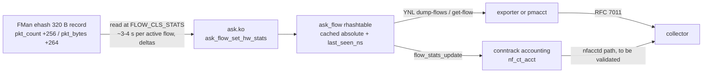

# ASK2 silicon-native telemetry plan (IPFIX flow accounting and sFlow sampling)

**Status:** Analysis and design only (2026-11-07). No code, patch, or image change is proposed here as already implemented. The IPFIX half is feasible and mostly pre-built. Silicon sFlow *packet* sampling is **blocked**: microcode 210.10.1 has a per-flow frame replicator (`REPLICATE_PKT`, opcode 0x02, used by the vendor ASK for multicast), but nothing in FMan selects one packet in N. What the silicon can do is per-flow mirroring, where every packet of a chosen flow is copied (§3, §5). Corrected 2026-11-07; earlier text, and `ASK2-MASTER-PLAN.md` until the same date, said no replicator exists. Nothing in this plan authorises datapath changes without the gates in §7.

## Goal

Close the telemetry blind spot created by hardware offload: once a flow is installed in the FMan ehash, its packets bypass the Linux kernel, so software NetFlow/sFlow exporters, packet capture, and nft counters report little or nothing for the largest flows on the link.

Two deliverables were proposed, and this plan treats them separately because their feasibility differs sharply:

1. **IPFIX flow accounting** derived from the per-flow hardware counters that ASK2 already reads (`packets`, `bytes`, `last-seen-ns`), exported by a userspace daemon or by the existing pmacct stack.
2. **sFlow packet sampling** implemented in FMan silicon (deterministic 1-in-N), with sampled frames delivered to an `hsflowd` agent.

Deliverable 1 is read-only with respect to silicon and can reuse the shipped YNL surface. Deliverable 2 needs both a copy primitive and per-packet selection. The FE microcode provides the first (`REPLICATE_PKT` on a flow record) but not the second, so silicon can mirror whole flows, not sample packets.

## Non-goals

- No replacement of the nftables flowtable learning path, the ASK YNL contract, or conntrack accounting.
- No per-packet inspection of offloaded traffic. Per-flow mirroring with `REPLICATE_PKT` is an optional Phase 2 (§5), not part of Phase 1.
- No change to the F-291 owner/teardown contract, which remains release blocked.
- No claim that exported counters are real-time: the YNL dump returns a cached snapshot refreshed by the nft `FLOW_CLS_STATS` poll. In 6.18.60, `nf_flow_offload_stats()` (`nf_flow_table_offload.c:1209`) skips a flow only while more than 90 % of its 30 s timeout remains, and the flowtable GC runs every second (`nf_flow_table_core.c:616`). An active flow is therefore polled about every 3–4 s, and an idle flow that has not yet expired is polled on every GC pass (about once a second) for up to about 27 s.

## 1. Corrections to the original proposal

The proposal text contains assumptions that do not hold on this platform. They are recorded here so the design is not built on them.

1. **Counters live on regular records, not cumulative nodes.** Silicon writes `packet_count@record+256` and `packet_bytes@record+264` (both BE) into every 320-byte flow record (`FMAN_EHASH_FLOW_REC_SIZE=320`, F-176) unconditionally, even though production inserts pass `stats=false` (STATS_EN bit 12 = 0). Cumulative collision nodes (F-269, stride 56 for `keysz=50`) are walker structures and carry no per-flow counters. Proven live on board `.185` (image `2026.08.22-0031-rolling`), reconciled 2026-08-22.
2. **The hardware timestamp is not available.** `timestamp@record+272` is always 0 because `SET_TIMESTAMP_ENABLE` and a MURAM timestamp pool are not implemented. `last-seen-ns` is host-observed, not silicon time.
3. **A policer cannot replicate a frame, but an ehash record can.** The policer only meters and colours. The FE record opcodes (vendor `fm_ehash.h`) include `ENQUEUE_PKT` (0x01), `REPLICATE_PKT` (0x02), `ENQUEUE_ONLY` (0x03), `UPDATE_ETH_RX_STATS` (0x04), TTL/address/port updates and `INSERT_L2_HDR` (0x41). `ENQUEUE_PKT` *moves* the frame. `REPLICATE_PKT` takes an 8-byte `en_ehash_replicate_param` (`first_member_flow_addr_hi/lo`, `first_listener_entry`) and sends the frame to every listener on a DDR chain of member flow records. The vendor ASK uses it for multicast group roots (`/mnt/builds/ASK/cdx/cdx_ehash.c:1792`, `create_replicate_hm()` at `:2875`, mono-1.2.2 `edb9184`). An earlier draft listed 0x04 as `DEALLOCATE`; that is the FE `EXIT` descriptor type (`0x03800000`), not a record opcode. ASK2 has never emitted `REPLICATE_PKT`, so its behaviour on this board, including the cost per listener, is unverified. The statements in `ASK2-MASTER-PLAN.md:660` (corrected 2026-11-07) and `ASK2-SURICATA-OFFLOAD-PLAN.md:138` that the microcode has no frame replicator are wrong for the same reason.
4. **FMPL RFC 4115 "packet-count mode" is rate metering, not modulo counting.** It maintains committed/peak token buckets (CIR/PIR or CIR/EIR) and assigns colour; it cannot emit "every Nth packet". KeyGen bucket slicing selects *flows* by CRC-64 hash, not packets, and would fork flow dispatch.

"Zero-polling" is also inaccurate: nft polls the silicon counters every few seconds per flow (see Non-goals) and any exporter polls the genl family. CPU cost is small and bounded, not zero.

## 2. What already exists (verified 2026-11-07)

| Component | Evidence |
|---|---|
| Silicon per-flow counters | `packet_count@+256`, `packet_bytes@+264` written unconditionally into 320 B records (T-M8-3, board `.185`, 2026-08-22) |
| Kernel getter | `fman_pcd_fe_flow_get_stats_identified()` (F-228, owner + `fe_token` identified, `pcd->fe_lock`, per-key bucket walk F-264) |
| Delta plumbing | `ask_fe_flow_refresh_hw_stats()` → `ask_flow_set_hw_stats()` → `flow_stats_update()` (patch `0145` made this load-bearing for `nf_ct_acct`) |
| Accounting into netdev stats | Patch `0171` `dpaa_netdev_offload_stats` hook; known to under-report on the lab DUT during a 2026-10-07 soak |
| YNL surface | `kernel/ask/uapi/ask.yaml:84-127`: `id`, `l3-proto`, `l4-proto`, `src-ip`, `dst-ip`, `sport`, `dport`, `iif`, `oif`, `packets`, `bytes`, `last-seen-ns`, `hw-flow-id`, `offloaded`, `port-id`, VLAN `agg-*` |
| `get-flow` | Flat `ASK_FLOW_ATTR_ID` accepted since commit `056b1d64`; unknown id → `-ENOENT` |
| NAT tuple on the stored flow | `include/ask_internal.h:590-605`: `nat_flags`, `nat_src_ip`, `nat_dst_ip`, `nat_sport`, `nat_dport`; deliberately **not** in the FE comparison key and **not** in YNL |
| Downstream accounting tool | VyOS `system flow-accounting` uses pmacct (`nfacctd`/`sfacctd`); pmacct exists in the VyOS apt repo (`bin/ci-setup-vyos-build.sh:277`) |

### Known defects in the current stats path

- **Lock and scan cost.** The getter takes the global `pcd->fe_lock` and walks the bucket for one key. nf_flowtable's gc queues a stats item per hardware flow each pass, so the historical behaviour was O(N²) per pass. Measured on `.185` (image `2026.10.10-1723-rolling`, kernel `6.18.55-vyos`): at 2048 bidirectional flows the DUT showed 61 D-state tasks, ~626 kworkers, load 46 in a minute; at 8192 flows inserts collapsed from ~1500/10 s to 0, only 1177 of 8192 flows offloaded, load ~700. F-264's per-key bucket walk reduced the scan but the poll cost at 10k+ flows is still unmeasured (`ASK2-MASTER-PLAN.md` §4.8 item 7).
- **Snapshot, not live.** The genl dump runs under RCU and cannot take `fe_lock`; it returns the last cached absolute totals, so two samples taken within one stats interval (about 3–4 s for an active flow) can read identical.
- **No flow-end signal.** Flow retirement is not published on genl; an exporter must infer end-of-flow from disappearance between polls.
- **Counter resets.** A silicon/boot reset makes the absolute counters smaller than the stored baseline; `ask_flow_set_hw_stats()` reports this as a delta equal to the new value, but an exporter must segment records accordingly.

## 3. Phase 0 — sFlow capability gate (decision, 1–2 days)

Before any sFlow design work, answer two questions with evidence.

> Q1. Does any FMan facility copy a frame to a second destination without
> removing it from the normal path?

Answered from source: **yes, per flow.** `REPLICATE_PKT` on an ehash record sends the frame to every listener on a DDR chain (§1 item 3). One listener can be the normal egress and another a sampling FQ. What remains open is silicon behaviour under ASK2: frame order and buffer ownership across listeners, the per-listener cost, and whether the replicated copy passes through the same HM/egress opcodes as the original. The E26/WGFP evidence that one frame reaches exactly one FQ applies to `ENQUEUE_PKT`, not to this opcode.

> Q2. Can FMan select one packet in N of a flow (or of a port) for copying?

Checklist, in this order:

1. `arch/fman-microcode-210-programming-reference.md` and the LS1046A DPAA reference manual: any packet counter or modulo condition in the FE opcode set, and any Controller/FPM/BMI mirroring or duplication register. Record chapter and register names verbatim.
2. Vendor board `.70` (root@192.168.1.70, latest vendor ASK): `ask-check`, `/proc/fqid_stats/pcd`, `cdx` capabilities. Vendor CDX samples on the CPU (`ASK2-VENDOR-PARITY.md:47`); check whether it ever replicates for sampling.
3. Vendor source: `cdx_ehash.c`, `cdx_flows.c`, any `mirror` or `sample` symbol under `specs/reference/nxp-ask-fmc/`.

**Gate result:** if Q2 is no (the expected outcome; the policer only meters, §1 item 4), silicon sFlow packet sampling is **out of scope** for this platform. Per-flow mirroring (§5) is still possible, but it copies every packet of each mirrored flow, so it is a flow-sampling or debug tool with CPU cost proportional to the mirrored traffic, not an sFlow agent. If Q2 is yes, design packet sampling on top of it.

## 4. Phase 1 — IPFIX flow accounting (feasible, read-only)

### 4.1 Design

Two data-source options, in cost order:

- **Option A (preferred first test, ~3 days).** Because the F-228 deltas are fed into conntrack accounting, upstream `nfacctd` (VyOS `system flow-accounting` netflow/ipfix) may already export usable totals for offloaded flows. Validate by comparing exported bytes for one long-lived flow against `ynl --family ask --dump dump-flows` absolute totals. If parity holds, Phase 1 collapses to configuration, documentation, and gate tests — no new daemon.
- **Option B (new `vyos-ask-ipfixd`, 2–4 weeks).** A privileged userspace daemon polls `dump-flows` on a fixed interval (10–30 s; the cache itself refreshes about every 3–4 s per active flow, so polling faster than that only rereads the cache), keeps per-`id` state, and emits RFC 7011 records with template refresh, option records, sampling rate 0, and explicit counter-reset/HA re-baseline segments. Transport UDP or TCP; SCTP only if required by a collector.

### 4.2 Work items

| # | Item | Files | Effort | Risk |
|---|---|---|---|---|
| 1.1 | Extend YNL flow attrs: `nat-flags`, `nat-src-ip`, `nat-dst-ip`, `nat-sport`, `nat-dport`, `first-seen-ns`, `fallback-reason` (never-offloaded cause) | `kernel/ask/uapi/ask.yaml`, `ask_genl.c`, `ask_genl_attr.c` | 2–4 d | Low (schema only, no datapath) |
| 1.2 | Validate the pmacct/nfacctd path against `dump-flows` (Option A decision) | test rig, no code | 2–3 d | Low |
| 1.3 | Stats-path scaling: cache the record DMA address/handle at insert for an O(1) read, batch all flows per epoch under one lock acquisition or lock-free reads, and add a per-poll budget | `ask_flow_offload.c`, `ask_flow.c`, `ask_internal.h` | 1–2 w | **Medium** — touches the shipped stats path and the F-291 owner model |
| 1.4 | Exporter MVP (Option B) incl. template lifecycle, restart-safe collector behaviour, HA failover re-baseline | new `ask-ipfixd` source tree | 2–4 w (6–10 w hardened) | Medium |
| 1.5 | Packaging, service unit, CLI (`set system flow-accounting` extension or dedicated node), arm64 CI, docs | `data/vyos-1x-NNN`, build scripts | 1–2 w | Low–medium (vyos-1x pinned to `91bf0ef51`, T3871) |
| 1.6 | Board validation matrix (§7) | lab DUT | 1–2 w | Medium |

**Total:** 5–8 engineer-weeks for a production-grade exporter; 2–3 weeks if Option A holds.

### 4.3 Correctness rules

- Export **absolute** totals for the record lifetime plus `last-seen-ns`; do not publish per-poll deltas as flow bytes.
- On counter decrease (silicon reset, re-insert, HA takeover), close the current record and open a new one; never emit negative bytes.
- NAT: export the original 5-tuple as the flow key and the stored `nat_*` fields as translated values. Do not derive NAT from the reply tuple for export.
- `iif`/`oif` are Linux ifindexes; map them to interface names at export time and label the direction explicitly.
- Timing fields are host-observed. Document that `last-seen` is ≤ refresh interval stale and `first-seen` is host-observed flow insertion, not silicon.
- Software-fallback traffic is invisible to these counters by construction; export the per-cause fallback counters from §4.2 item 1.1 as option records so collectors can compute coverage (this is `ASK2-MASTER-PLAN.md` §4.8 item 6).

### 4.4 Security and privilege

The `ask` genl ops currently use `GENL_UNS_ADMIN_PERM` with `.netnsok=true` (2026-10-16 review). The exporter therefore needs `CAP_NET_ADMIN` in the initial netns. Either the planned genl hardening (`GENL_ADMIN_PERM` and `netnsok=false`) lands first, or the daemon runs as a root-owned service with no user-namespace access. Do not add a world-readable debugfs/sysfs counter dump as a shortcut.

## 5. Phase 2 — per-flow mirroring with `REPLICATE_PKT` (optional)

Phase 2 exists only if an operator need for silicon-side copies is named; it is not needed for IPFIX. The design reuses the vendor multicast shape:

1. **Prove the opcode first.** On the sacrificial port (eth3, never eth0), cold boot, install one hand-built record whose `REPLICATE_PKT` chain has two listeners: the normal egress and a counting sink (a WGFP sink FQ counts and releases frames). Check that the egress frame count is unchanged, the sink count equals the record's `packet_count`, BMan drift is zero and `pcd-snapshot` is clean after removal. Requires the S0 qdrant gate, a vendor record capture from `.70`, and the F-286 owner/token model for both the root and member records.
2. **Choose which flows to mirror.** Since Q2 is expected to be no, selection is per flow: at insert time, mirror a flow when its CRC-64 (already computed for the bucket index) falls in 1/N of the hash space, or when an operator rule names it. Every packet of a mirrored flow is copied, so CPU cost is proportional to the mirrored traffic; N must be sized against the drain budget.
3. **Drain path.** A sink FQ plus drain, reusing the `dpaa_steer` substrate proposed in `ASK2-MASTER-PLAN.md` §4.8 item 1 (per-CPU sink, FQ-local tail drop, zero-skb drain, netdevice teardown). Budget 3–5 weeks; this substrate is not yet built. The CPU can subsample the mirrored stream 1-in-M before handing frames to an exporter.
4. **Export.** `hsflowd` can carry the result only with a documented caveat: these are flow samples of selected flows, not uniform packet samples, so sFlow's statistical estimates do not hold. Label them accordingly (1–2 weeks).

Estimated **6–10 weeks, high risk**: no vendor reference implementation of replication for monitoring (vendor CDX samples on the CPU), the listener-chain lifetime adds a second owned record per mirrored flow, and replication has not been exercised under ASK2.

For true packet sampling the options remain:

- **Upstream mirroring:** a switch port mirror or ERSPAN session outside the DUT covers line-rate sampling without touching silicon.
- **Documented software-only sampling:** an sFlow agent that samples only non-offloaded traffic, with the coverage gap exported as an option record (same counters as §4.3). Honest, but it does not sample the elephant flows.
- **Deferral:** revisit only if a future microcode or SoC exposes per-packet selection.

## 6. Risk register

| Risk | Likelihood | Impact | Mitigation |
|---|---|---|---|
| Stats refresh convoy returns at scale (historical O(N²): 61 D-state tasks at 2048 flows; one stats work item per active flow every 3–4 s, per idle flow every second) | Medium | High | 1.3 batching and an explicit 10k-flow gate before the exporter ships |
| YNL dumps at high flow counts add CPU | Medium | Medium | fixed 10–30 s poll, cached snapshot only, per-poll budget and rate limit |
| Exporter requires CAP_NET_ADMIN; genl hardening not yet landed | Medium | Medium | root service + planned hardening; no debugfs shortcut |
| NAT/interface attribution wrong in export | Low | Medium | golden tests on NAT44/NAT66 flows, VLAN and PPPoE flows |
| Counter reset or HA takeover corrupts accounting | Medium | Medium | segment on decrease; final record before reset; re-baseline after boot/failover |
| No hardware timestamps | High | Low | document host-observed semantics; do not claim accuracy below the stats interval (about 3–4 s for active flows) |
| sFlow proposal assumes per-packet selection that FMan lacks | High (expected) | High | Phase 0 Q2 before any code; per-flow mirroring is labelled as flow samples |
| `REPLICATE_PKT` misbehaves under ASK2 (order, buffer ownership, listener lifetime) | Medium | High | §5 step 1 single-record proof on eth3, cold boot, vendor capture from `.70`, F-286 ownership for root and members |
| F-291 owner/teardown contract unresolved | Medium | High | stats work stays read-only and adds no ownership assumptions; release gate unchanged |
| vyos-1x pinned to `91bf0ef51` (T3871) | Medium | Medium | write CLI patches against the pinned tree; re-port with 027/047 |

## 7. Acceptance gates

**Phase 1-A (schema, no datapath):** new YNL attributes present; golden tests for NAT/interface mapping; KUnit for genl parsing; no change in datapath behaviour or `ask-check` output.

**Phase 1-B (stats scaling):** with 10,000 offloaded flows, one stats pass must complete within a documented budget (p99 < 100 ms per pass is the starting target), no stats kworker convoy (worker count returns to baseline between passes), and insert rate stays ≥ 1000/10 s. Compare against the 2026-10-10 baseline explicitly.

**Phase 1-C (export parity):** over a 10-minute window, exported bytes for a long-lived single flow differ from the `dump-flows` absolute delta by < 0.1 %; flow-end record appears within one poll interval of teardown; NAT fields match the conntrack tuple; two consecutive polls ≥ 30 s apart show growth.

**Phase 1-D (production soak):** 24 h at ≥ 1 Gbit/s with 1k+ flows, no CPU regression beyond an agreed envelope, counters monotonic, no new FMan sync timeouts, no `ask-check` failures.

**Phase 2-0:** Q1 and Q2 answered with RM chapter, register names and vendor evidence; Q1 already has source evidence (`REPLICATE_PKT`), Q2 needs a yes/no.

**Phase 2-x (if pursued):** for per-flow mirroring, the mirrored fraction of flows within ±5 % of 1/N over ≥ 10k flows; mirrored packet count equal to each record's `packet_count`; zero forwarding impact on the original path (throughput and loss unchanged in an A/B); no BMan drift, no MURAM drift, clean `pcd-snapshot`; cold-boot verified.

## 8. Sequencing

1. Phase 0 capability gate (1–2 days): Q2 decides whether packet sampling is possible; Q1 is answered and makes §5 an optional per-flow mirroring track.
2. Phase 1.2 pmacct validation (2–3 days) — may eliminate the new daemon.
3. Phase 1.1 YNL attributes, then 1.3 stats scaling; 1.4 exporter; 1.5 packaging; 1.6 validation. Run 1.3 and 1.4 in parallel only after the 1-B gate is defined, because the exporter must not be the thing that discovers the convoy.
4. Phase 2 only for a named mirroring need, after the §5 step 1 opcode proof, and after F-291 and the WireGuard close-out free the shared substrate work.

## 9. Open questions

- Which collector transport and template policy is required in production (UDP + periodic template refresh, or TCP with persistent sessions)?
- Is per-flow export acceptable, or is per-interface aggregation required for scale (10k flows at a 30 s export interval is a modest rate, but collector sizing is unknown)?
- Does HA failover need duplicate suppression or explicit session IDs so the collector does not double count during a mastership change?
- Should `nft` conntrack accounting (already fed by F-228) be the single export source to avoid two independent counter paths?

## 10. References

- `plans/ASK2-MASTER-PLAN.md` §4.7 (YNL observability, per-op genl policies), §4.8 item 6 (fallback counters) and item 7 (stats cost at scale), §8.
- `plans/ASK2-MASTER-PLAN.md:660` (corrected 2026-11-07), `plans/ASK2-SURICATA-OFFLOAD-PLAN.md:138` (still says no frame replicator).
- `/mnt/builds/opnsense-src/sys/contrib/ncsw/inc/Peripherals/fm_ehash.h:92-95` (record opcodes, `REPLICATE_PKT` 0x02); `/mnt/builds/ASK/cdx/cdx_ehash.c:1792, 2862-2878` (vendor multicast replication).
- `kernel/common/work/linux-6.18.60/net/netfilter/nf_flow_table_offload.c:1203-1218` and `nf_flow_table_core.c:601, 616` (stats cadence).
- `plans/ASK2-VENDOR-PARITY.md:47` (vendor CDX CPU sampling).
- `kernel/ask/uapi/ask.yaml:84-127` (flow attributes).
- `kernel/ask/oot-modules/ask/ask_flow_offload.c:4997-5085` (refresh path, RCU snapshot, `fe_lock`, generation/`fe_token` identity).
- `kernel/ask/oot-modules/ask/include/ask_internal.h:590-605` (stored NAT tuple).
- Evidence: T-M8-3 (2026-08-22) counters and YNL parity; F-228 getter; F-264 bucket walk; 2026-10-10 O(N²) convoy; patch `0145` conntrack accounting; patch `0171` netdev fold-in and its 2026-10-07 under-report.
