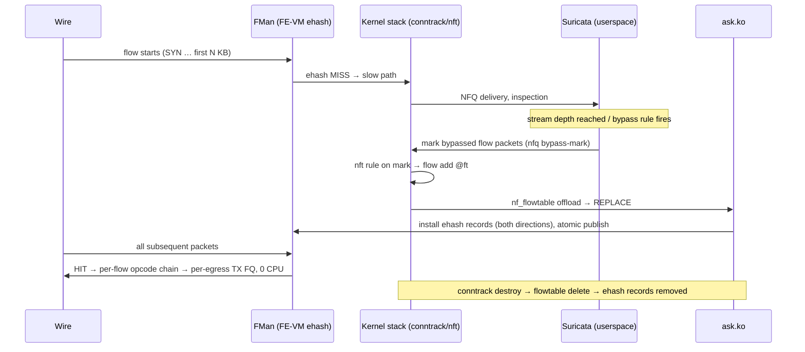

# ASK2 Suricata bypass plan: hardware offload of IDS-bypassed flows

**2026-10-15 · dpaa1 · Status: open (design only, no code).** Suricata is not a
vendor-parity item; relative priority is set in `plans/ASK2-MASTER-PLAN.md`.
Task IDs are assigned there if this plan is adopted.

## 1. Summary

Suricata's flow-bypass model — inspect the first N KB of a flow, decide, then
stop inspecting — is exactly the slow-path-learns / hardware-record contract
ASK2 is built on. A bypassed flow is semantically "route this flow without
touching the CPU", which is what the production FE-VM ehash path already does
(9.38 / 9.27 Gbit/s IPv4/IPv6 at ~3% DUT CPU, 2026-10-09 gates). No new
silicon mechanisms are required; the ehash record, opcode chain
(`PREEMPTIVE_CHECKS_ON_PKT → STRIP_ALL_VLAN_HDRS → UPDATE_TTL → INSERT_L2_HDR →
ENQUEUE_PKT`) and per-egress no-confirm TX FQ are reused unchanged.

This makes 10G inline IDS viable on 4× A72 for elephant-heavy traffic mixes:
Suricata burns CPU only on the inspection prefix of each flow plus the mice,
while bypassed bulk traffic stays in silicon. The scaling axis becomes flow
rate, not byte rate — the right direction for backup/CDN/streaming mixes.

Precedent: the WireGuard fast path uses the same split ("the per-peer
fast-path state lives inside the `wireguard` module, and `ask.ko` supplies
only record insert/delete and FQ ids; records are installed by the slow path,
so a MISS stays safe") — see `plans/ASK2-WIREGUARD-FASTPATH-PLAN.md` §2.

## 2. Suricata bypass semantics (what we must honor)

- Triggers: the `bypass` rule keyword, and `stream.bypass: yes` (automatic
  bypass once stream reassembly depth is reached and no rule needs more).
- Decision point: userspace, mid-stream, after an arbitrary number of bytes.
- Scope: the whole flow, **both directions** (Suricata's eBPF bypass inserts
  both tuples into `flow_table_v4`/`flow_table_v6`).
- Stock backends: eBPF/XDP bypass for AF_PACKET (pinned maps, per-flow
  packet/byte counters read back for stats); `nfq.bypass-mark`/`bypass-mask`
  for inline NFQ (marked packets skip the queue via nftables).
- Bypass is final per flow; teardown happens on flow timeout/close, which
  also feeds Suricata's flow records with final counters.
- Suricata keeps working set state (flow table, app-layer context) for
  bypassed flows until timeout — hardware offload must not break its
  accounting expectations, only its packet visibility.

## 3. Architecture

Integration path (chosen): **conntrack/nft flow-offload bridge.** The only
new code is Suricata-side marking plus an nft template; everything from
`flow add @ft` onward is the production insert path
(`ask_flow_offload.c` REPLACE → ehash insert). This keeps `ask.ko` a pure
hardware cache/translation layer — no new YNL insert verb, no second control
plane (binding rule, `plans/ASK2-MASTER-PLAN.md` §2). The existing `ask` YNL
family (`dump-flows`, `get-flow`, `flush-flows`) already covers observability
and fail-closed flush.

Rejected alternative: a direct userspace insert API into `ask.ko`. It adds
control-plane surface for no capability gain and bypasses conntrack-owned
lifecycle (teardown, NAT state) that the flowtable path gets for free.

AF_PACKET variant (if NFQ inline is not used): a small daemon watches the
pinned `flow_table_v4/v6` eBPF maps and programs the same ct marks for
bypassed tuples; from there the path is identical. NFQ inline is preferred
because `bypass-mark` is native Suricata config, not an eBPF-map scraper.

## 4. Deployment modes

| Mode | Fit | Notes |
|---|---|---|
| Inline routed (Suricata NFQ on this router's forwarding path) | Works on the shipped path | The target case: "10G inline IDS". NAT/VLAN/PPPoE compositions already HW. |
| Inline bridge (bump-on-the-wire AF_PACKET bridge) | Blocked on T-M6-2 | Needs bridge offload completeness; B7a same-tagging has dated silicon acceptance, B7b access↔trunk open. |
| Passive tap/SPAN | Marginal extra value | Software-copied taps stop seeing the flow once it is HW-forwarded (copy starves automatically — desired). If mirroring later moves to hardware (replicator), per-flow "do-not-mirror" exclusion is not in the current FE-VM opcode vocabulary; open question, not a blocker for inline. |

## 5. Dependencies and gaps

- **F-266 TCP FIN/RST control punt** (implemented, default-off): without it,
  closed bypassed TCP flows linger in ehash until timeout. For IDS mixes with
  many short flows this is a capacity/churn issue. Soft dependency; already
  priority 2 in the master plan. Enable `tcp_ctl_punt` only after the F-266
  transit gates pass.
- **Per-flow stats:** Suricata expects packet/byte counters for bypassed
  flows (today read from the eBPF maps). YNL flow attributes expose
  HW-forwarded packet/byte deltas per port for VLAN CC flows; per-record
  counters on the routed ehash path must be verified or extended. Fallback:
  bypassed flows lose per-flow stats (usually acceptable; note in docs).
- **Insert-rate budget:** master plan targets ≥2,370 inserts/s, first insert
  <2.6 s, per-flow engage <100 ms. Only flows that reach a bypass decision
  need records; mice finish inside the inspection window and never insert.
  Bypass-decision rate ≪ new-flow rate, so this is comfortable.
- **Fail-open vs fail-close:** if Suricata dies, already-bypassed flows keep
  forwarding in silicon. Policy choice per deployment; a watchdog that calls
  YNL `flush-flows` on Suricata exit gives fail-close.
- **Packaging:** VyOS ships no Suricata; run as a container or custom
  package. Kernel-side plumbing is unaffected either way. Pin Suricata
  workers away from the cores serving QMan portals.
- **MTU:** HW path clamp 1280–3600 applies to bypassed flows; inline
  deployments must keep MTU inside it or those flows stay in software.
- **Ordering:** one TX FQ per flow, same in-order guarantee as the shipping
  routed records.

## 6. Performance model

| Bypass backend | Cost per bypassed packet | 10G inline verdict |
|---|---|---|
| None (full inspection) | full Suricata pipeline | No — ~1–3 Gbps box ceiling on 4× A72, ruleset-dependent |
| Stock eBPF/XDP bypass | ~250–400 ns XDP/softirq | Marginal — ~0.3–0.5 core per 10 Gbit/s spent on the bypass itself, plus the inspected share |
| ASK2 ehash | 0 ns (silicon) | Yes for elephant-heavy mixes; CPU scales with flow rate, not byte rate |

Residual CPU consumers after offload: the per-flow inspection prefix
(N KB × new-flow rate through NFQ/AF_PACKET) and Suricata flow-table
management. Both are flow-rate driven.

## 7. Complementary silicon uses (cheap extras, same box)

- **Static inspection policy via CC-tree's reserved role:** "never inspect
  CIDR X" / "only inspect port Y" as coarse LPM-capable entries (255 per
  table). This is the bounded coarse dispatch/policy role the master plan
  reserves CC-tree for (T-M6-5); it does not compete with ehash.
- **Symmetric RSS for capture workers:** KeyGen symmetric-hash mode pins both
  directions of a flow to one queue → AF_PACKET `cluster_flow` across
  Suricata threads without software RPS. ASK2 runs `symmetric=false` for
  conntrack-friendliness; a dedicated capture-port profile would flip it.
  Trade-off to evaluate at design time.
- **Flood shield in front of inspection:** FMan ingress policer profiles
  (shipping mechanism, `set interfaces ethernet ethN ingress-policer`) cap
  pps toward the inspection path — silicon drop before any CPU.

## 8. Phases and gates (proposal; IDs assigned by the master plan)

AGENTS.md S0 applies to every phase that touches FMan: ≥3 qdrant queries,
cross-check against `arch/fman-microcode-210-programming-reference.md` and
`specs/fman-keygen-flow-key-spec.md`, read back every silicon write, cold boot
before each experiment. Never experiment on eth0.

### P1. Mark-to-offload bridge (no Suricata changes)

nft template: match `nfq bypass-mark` → `flow add @ft` on ASK-engaged routed
interfaces. Drive bypass decisions with stock Suricata (`stream.bypass`,
`bypass` keyword, `nfq.bypass-mark`).

Gate: a bypassed TCP flow transitions mid-stream to `in_hw` with zero packet
loss at 9+ Gbit/s; `dump-flows` shows both directions; conntrack destroy
removes both records; `pcd-snapshot diff` clean after Suricata stop +
disengage.

### P2. Lifecycle and stats hardening

Enable and validate F-266 `tcp_ctl_punt` for bypassed flows (after its master
plan gates); verify or extend per-record packet/byte counters; wire the
fail-close watchdog (`flush-flows` on Suricata exit) behind a config flag.

Gate: 10k mixed short/long flows with 30% bypassed: no ehash leak
(pre/post flow counts equal), closed flows removed within F-266 bounds,
bypassed-flow stats match wire counts within measurement error.

### P3. Soak and mix acceptance

30-minute elephant+mouse mixed soak at line rate through Suricata inline;
zero kernel errors; Suricata CPU bounded and flat; HW forwarding share
matches the bypass mark rate.

Gate: ≥9 Gbit/s bypassed share at ≤20% total DUT CPU on a recorded elephant-
heavy mix; new-flow rate varied up to the Suricata CPU ceiling without
insert-queue backlog growth.

## 9. Open questions

- Per-record counters on routed ehash records: present and readable, or an
  `ask.yaml`/driver extension? (P2 blocker for stats parity with eBPF bypass.)
- AF_PACKET passive/bridge deployments: is the eBPF-map scraper bridge
  acceptable, or do we declare NFQ-inline the only supported Suricata mode?
- Symmetric-hash capture profile vs conntrack-friendly `symmetric=false`:
  one scheme per role, or runtime switch per port?
- If hardware SPAN (replicator) is ever built, what is the per-flow
  do-not-mirror mechanism? Not in the current FE-VM opcode set.
