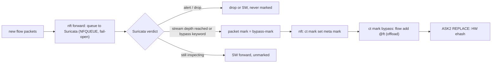

# ASK2 Suricata flow-offload plan

**Status:** Design only, scheduled as step G7 (flow shunting) in
`ASK2-MASTER-PLAN.md` §3.1. No Suricata approval or offload integration is
implemented. Do not treat the target behavior below as available in the current
image.

## Goal

Keep Suricata as the inspection and logging authority while allowing ASK2 to
offload eligible flows after an explicit, positive approval. Suricata should
continue to use VyOS's native `service suricata` configuration. This plan does
not propose replacing Suricata or making it a hardware packet processor.

The intended benefit is to inspect a flow in software first, then move approved
traffic to the LS1046A hardware fast path. It is not a promise that every packet
will remain visible to Suricata after offload.

## What happens today

### Suricata is passive IDS in the native VyOS service

Verified against upstream `vyos-1x` on 2026-10-16:
`src/conf_mode/service_suricata.py` and `data/templates/ids/suricata.j2` render
AF_PACKET and PCAP capture configuration. They do not configure Suricata's
inline IPS mode, NFQUEUE, or nftables queue rules.

As a result, the native service receives traffic copies. It cannot hold or drop
forwarded packets, and Suricata `drop` or `reject` rule actions do not enforce
forwarding policy in this mode.

### Offload reduces Suricata visibility

The factory configuration, added in commit `c84499e5` on 2026-10-16, enables
`offload ipv4 ipv6` on eth1–eth4 and uses a hardware flowtable with
`hardware-offload-delay 500`. A flow can therefore leave the software
inspection path after the delay and enter hardware forwarding. Suricata then
sees only the packets that passed through software before handoff.

Neither conntrack `established` state, the absence of an alert, nor elapsed time
is evidence that Suricata approved a flow. Until an approval gate exists,
operators who need full-flow visibility must disable offload on monitored
interfaces or exclude that traffic from the flowtable.

## Target behavior

1. A new flow follows the normal routed software path.
2. An inline inspection mechanism produces a positive per-flow approval.
3. The approval is represented in a form the flow-offload path can check.
4. Only flows with valid approval are eligible for ASK2 hardware installation.
5. Unapproved, suspicious, and unsupported flows remain on the software path.
6. Revocation removes the flow from hardware and returns it to software
   forwarding.

The preferred direction is to use a per-flow conntrack mark as the approval
signal and require the mark in the nftables flowtable rule. This could reuse
the existing flowtable learning path without changing `ask.ko`, but that
integration is not yet proven. The exact relation between Suricata's verdict,
the mark, flowtable learning, and ASK2 hardware installation must be validated
before implementation.

Suricata's `bypass` keyword or NFQ `bypass-mark` may be useful inputs to that
design. They must not be treated as approval by themselves: the implementation
must demonstrate that they produce a positive, correctly scoped authorization
for the same flow ASK2 will install. An EVE-driven agent is a less desirable
fallback because it adds another control plane and can race packet forwarding.

## Flow shunting

Scheduled as step G7 in `ASK2-MASTER-PLAN.md` §3.1. It depends on G1 (R10
generated flowtable rule) and G3 (R11 dependency retirement). Shunting is the
concrete form of the approval gate above. Suricata inspects the first part of
each flow inline, then hands the rest to the ASK2 hardware path.

Mechanism:
1. **Inline inspection.** nftables queues unmarked forward traffic on the
   offloaded ports to Suricata with `queue num N bypass`. This needs inline
   NFQ mode, which the native VyOS service does not render today, so it needs
   a vyos-1x template change under `service suricata`.
2. **Shunt signal.** Suricata's NFQ `bypass-mark`/`bypass-mask` marks packets
   of flows that it bypasses locally. The triggers are stream reassembly depth
   (`stream.bypass: yes` with `stream.reassembly.depth`) and the rule keyword
   `bypass` (for example, for known-good bulk TLS/video). Alerted or dropped
   flows are never marked.
3. **Persist to conntrack.** `ct mark set meta mark and <mask>` on the first
   marked packet. Queue rules skip flows whose `ct mark` already carries the
   bit, so they no longer reach Suricata.
4. **Gate the flowtable.** The G1-generated `flow add @ft` rule carries
   `ct mark and <mask> == <mask>` when Suricata shunting is enabled. `ask.ko`
   needs no change, because flowtable learning is the only path into REPLACE.
5. **Revocation.** On a Suricata reload, restart or stop, or an operator
   flush, clear the mark bit on all conntrack entries (`conntrack -U --mark
   0/<mask>`) and flush the flowtable. The flows then take DESTROY back to SW,
   and later packets are queued again. A later alert on an already-shunted
   flow is impossible by design, because Suricata no longer sees it. Document
   that as the trade-off.
6. **Failure.** NFQUEUE `bypass` (fail-open) forwards in SW when Suricata is
   down, but those packets carry no mark, so nothing new reaches HW. Already
   shunted flows stay in HW until they are revoked; the initial policy revokes
   all of them on Suricata stop.

Shunting acceptance, in addition to the validation stages below:
- A flow shorter than the stream depth never appears in `fe_ehash_stats`.
- A long flow reaches HW only after the depth, measured in bytes seen by Suricata.
- A flow matching an alert rule is never offloaded.
- With Suricata stopped, new flows are 0 % HW and old flows are revoked.
- `ask-check` reports the shunted, revoked and HW counts.
- Throughput of a long shunted flow matches the unicast HW cell.
- Short-flow CPS with inspection is recorded as the new SW-bound limit.

## Decisions and safety contract

The design is not ready for implementation until the following questions are
answered and tested.

| Area | Required behavior |
|---|---|
| **Approval** | Hardware installation requires an explicit positive verdict for each flow. A timeout, no alert, or `established` state must never imply approval. |
| **Flow identity** | Approval and offload must refer to the same original and reply tuples, including DNAT/SNAT effects and ingress interface. |
| **Revocation** | A later alert, Suricata rule reload/restart, or operator flush must remove the hardware entry and restore software forwarding. Decide whether every reload revokes all approved flows; revoking all is the simpler initial policy. |
| **Suricata failure** | If Suricata stops, crashes, or its inspection queue overflows, new unapproved flows must not be hardware-learned. Define whether previously approved flows remain offloaded and for how long. |
| **NFQUEUE failure mode** | Document the `fail-open` policy. Forwarding traffic in software during a queue failure must not grant approval or allow hardware installation. |
| **Configuration behavior** | Decide whether enabling native Suricata on an offloaded interface is rejected, automatically gated by the approval mark, or warned about. It must not silently offload unapproved traffic when the operator expects IPS enforcement. |
| **Visibility** | Expose approved, revoked, and hardware-installed flow counts through `ask-check` or an equivalent diagnostic so the operator can verify the gate. |
| **Fast-path constraints** | Preserve flow teardown and reversibility, NAT/VLAN/PPPoE behavior, MTU and fragmentation limits, and fail-safe software forwarding when hardware offload is unavailable. |

## Validation plan

Complete these stages in order. Do not add production CLI or kernel
integration until the approval and revocation behavior is demonstrated.

1. **Establish the IDS baseline.** Configure native Suricata and verify
   `update suricata` and `restart suricata`. Disable offload on monitored ports
   so the full flow remains visible.
2. **Measure current visibility.** Re-enable offload and compare early- and
   late-flow alerts on a controlled long-lived test flow. Record exactly when
   packets stop reaching Suricata.
3. **Prototype approval.** Test an inline NFQUEUE/IPS path and the proposed
   Suricata-verdict-to-conntrack-mark-to-flowtable gate outside the VyOS CLI.
   Verify that no unmarked flow reaches hardware using `fe_ehash_stats`,
   `ask-check`, and flowtable state.
4. **Test revocation and failures.** Verify behavior after a rule reload, a
   later alert, an operator flush, Suricata shutdown, and queue overflow. In
   every case, confirm the documented policy and that revoked flows return to
   software forwarding.
5. **Design the VyOS integration.** Only after the previous stages pass, define
   the CLI and `vyos-1x` changes. Keep service and rule configuration in the
   native `service suricata` tree.
6. **Measure performance.** Compare mixed short-flow and long-flow traffic
   with inspection and hardware offload enabled. Report throughput, CPU load,
   packet loss, and visibility.

## Scope and acceptance

This is a proposed inspection-driven offload design, not a claim that the
current native VyOS Suricata service provides inline IPS. Acceptance requires
evidence that only explicitly approved flows reach hardware, revocation
reliably restores software forwarding, failures do not approve new flows, and
operators can observe those outcomes.

Until that evidence exists, treat native Suricata plus hardware offload as IDS
with reduced visibility after flow handoff—not as IPS enforcement.
