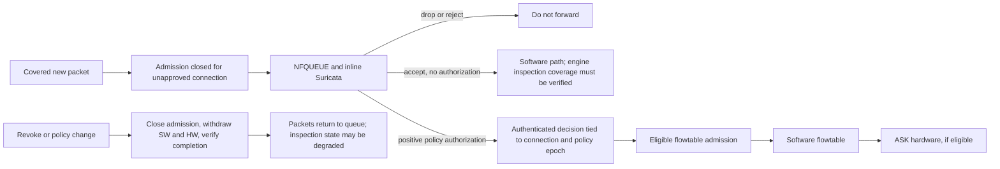

# ASK2 Suricata inspection and flow-offload plan

## Status and review request

This is a design for review, not an implemented production feature. G7 in
`ASK2-MASTER-PLAN.md` schedules inspection-driven flow shunting; a limited
runtime NFQUEUE prototype exists, but neither positive authorization nor a
Suricata-aware flowtable gate is integrated into VyOS or ASK2. The shared
`dpaa_steer` consumer substrate and Suricata mirroring are proposals. No
production throughput or security guarantee follows from this plan.

Reviewers should decide the desired security contract and workload first, then
assess the competing architectures and the independent release gates below.
The existing master-plan G7 row describes depth-triggered shunting and alerted
flow exclusion more definitively than the prototype supports; read it as an
intent, not evidence. Update that row after this review selects a design.

## 1. Problem, scope and terminology

The operator wants Suricata inspection while retaining ASK2 hardware forwarding
where an explicit policy permits it. These are different products:

- **Passive IDS** observes copies and can alert, but cannot prevent an already
  forwarded packet. Full-flow visibility requires all relevant packets to
  reach the inspector; an asynchronous alert-to-block response has a leak
  window.
- **Inline IPS** holds each covered packet until a verdict; a drop or reject
  can prevent that packet from being forwarded. Full-flow inline delivery means
  this continues throughout the connection; it does not guarantee that every
  payload byte is detectable, because encryption, rules, stream depth and
  exception policies can limit inspection.
- **Inline prefix inspection with shunting** enforces verdicts only while a
  flow is inspected. Once explicitly authorized for bypass, subsequent packets
  are not examined and may be forwarded by the software or hardware fast path.
  A later malicious payload can therefore pass undetected. This is not full-flow
  IPS and must be named and disclosed separately.

The current native VyOS `service suricata` was verified against upstream
`vyos-1x` on 2026-10-16: `src/conf_mode/service_suricata.py` and
`data/templates/ids/suricata.j2` render AF_PACKET/PCAP capture, not inline
NFQUEUE or nftables queue rules. In this passive mode, Suricata `drop` and
`reject` rules do not enforce forwarding decisions.

The factory configuration, recorded in `054bb3af`, enables IPv4 and IPv6 offload
on eth1 through eth4 and a hardware flowtable with `hardware-offload-delay
500`. Software flowtable hits and ASK hardware hits can both bypass subsequent
forward-hook inspection; hardware offload delay alone does not ensure
inspection. Operators requiring full-flow visibility must disable or exclude
all applicable acceleration for monitored traffic and verify the rendered
rules and actual packet path. Native passive capture plus offload is not an IPS.

This plan concerns forwarded IPv4 and IPv6 TCP/UDP first. INPUT, OUTPUT,
bridging, local services, multicast, helpers, tunnels, other protocols and
non-IP traffic are outside the initial implementation unless explicitly
admitted after their own path and policy gates. Out of scope does **not** mean
implicitly approved: configuration must define whether such traffic stays on a
fully inspected path, is blocked, or is explicitly excluded from the service's
coverage and reported to the operator.

## 2. Decision record: alternatives

No alternative is selected for production. The review question is whether an
inline-prefix service with a documented coverage gap meets the operator's need,
which failure policy is acceptable, and whether the measured CPU budget can
support the intended workload.

| Property | A: native software IDS, no monitored offload | B: NFQUEUE inline prefix then flowtable shunt | C: FMan steer to an inline software sink | D: FMan per-flow mirror |
|---|---|---|---|---|
| Enforcement | Passive IDS only | IPS on inspected prefix; bypassed remainder is not inspected | Candidate inline IPS while held in the sink; optional later shunt has the same prefix limitation | Passive IDS plus optional reactive block; no prevention of the original forwarded packet |
| Packet path | Kernel capture of monitored software traffic | Routing/netfilter, queue, Suricata verdict; approved flow may use SW/HW flowtable | Ehash directs matching frames to a software FQ; a new consumer must inspect and forward/drop | Candidate ehash replication to egress and an inspector listener |
| CPU load | Every monitored packet; software forwarding | Every prefix packet uses kernel plus queue; short flows may never amortize | Every inspected packet uses a sink and inspector; savings versus B are unmeasured | Every packet of each selected flow reaches the inspector; line-rate copies may overwhelm it |
| State of evidence | Native capture configuration exists; coverage with offload disabled requires test | One limited IPv4/TCP prototype, section 4 | WG-specific steer and sink exist; general consumer, Suricata handoff and policy equivalence do not | Vendor multicast source uses `REPLICATE_PKT`; ASK2 has not exercised a mirror listener |
| Main risks | Throughput and visibility gaps if another bypass remains | Approval/alert semantics, SW/HW admission, identity, NAT-safe revocation, capacity | Same inspection/identity issues plus userspace ABI, forwarding semantics, buffer lifetime, order and overload | Listener ownership, header view, ordering, loss and visibility; no synchronous drop |

A fourth deployment option is an external network tap or switch mirror feeding a
separate sensor. This isolates the router's inspection CPU, but it is still
passive IDS and needs an independently verified mirror coverage and loss budget.

### 2.1 FMan steer and mirror are different operations

`ENQUEUE_PKT` steers a frame to one destination; it is not a copy. The existing
WireGuard-specific `dpaa_wgfp.c` path provides FMan-to-kernel sink delivery,
a zero-skb drain and an egress helper. It is not a general Suricata consumer,
userspace packet ring, or demonstrated zero-copy transfer to Suricata. A sink
consumer must own each buffer, apply the verdict, and forward, release or drop
it exactly once. Avoiding the Linux stack would also bypass its routing,
firewall, NAT, accounting, fragmentation and other policy hooks unless
individually reproduced or deliberately excluded.

Vendor source defines ehash `REPLICATE_PKT` as opcode `0x02`, with an 8-byte
listener-chain parameter, and uses it for multicast. This is evidence that the
microcode supports a replication primitive, not proof that an ASK2 Suricata
mirror works. `ASK2-SILICON-TELEMETRY-PLAN.md` section 5 proposes the shared
one-record, two-listener proof. Before making any mirroring claim, determine
which packet view each listener receives, ordering and header modification,
reference and DMA ownership, buffer release, record and listener lifetime,
error handling, overload, and whether normal forwarding continues when the
inspection listener fails. FD cloning or shared buffers must not be described as
safe zero-copy userspace access without an explicit ownership and mapping proof.
A mirrored flow produces a copy of every selected packet; the project has not
proved a per-packet one-in-N selector. Mirroring is not an IPS verdict path.

## Decisions and safety contract

The following are proposed invariants, not implemented behavior. Approval,
identity, bypass coverage, alert policy, capacity and reversible withdrawal are
all independent gates. Proving tuple equality alone is insufficient.

1. **Coverage is explicit.** The operator chooses monitored interfaces,
   directions, protocol families and exclusions. Configuration cannot imply
   full coverage if any matching path bypasses inspection; unavailable coverage
   must be rejected or clearly identified as an exception.
2. **No implicit approval.** No alert, an established conntrack state,
   elapsed time, byte threshold, generic `pass`, generic Suricata `bypass`, or
   Suricata failure is positive authorization by itself. Define the specific
   rule, policy and signal that authorize a particular flow and both of its
   directions.
3. **Admission precedes both fast paths.** An unapproved covered flow must
   not enter a software flowtable or an ASK hardware record. Guard every
   applicable automatic and explicit flowtable and audit bridge, direct-steer,
   feature-specific and other installation paths within the claimed scope.
   A hardware-only check is too late because a software flowtable hit also
   skips ordinary forward inspection.
4. **Approval is bound to the current connection and policy.** Preserve
   conntrack/NAT identity, direction, namespace and zone, logical ingress and
   encapsulation, flow incarnation and policy generation. Reusing a tuple,
   packet mark or old generation must not confer authorization on a new flow.
5. **Revocation is a barrier, not just a mark clear.** Close admission, retire
   both directions from the software and hardware fast paths, drain or cancel
   queued installation and replay, and positively establish completion before
   claiming packets reach the queue again. Requeued packets are not proof of
   restored stateful inspection: bytes missed during bypass cannot be recovered,
   and Suricata may still have bypass state or insufficient stream context.
   Do not destroy NAT state as a shortcut. An uncertain hardware delete is not
   proof that forwarding stopped.
6. **Failure behavior is named.** Decide separately whether an inspector or
   queue failure drops traffic, permits uninspected software forwarding, or
   retains existing approved hardware flows for a bounded period. Fail-open
   forwarding is an explicit availability-over-enforcement policy, not IPS
   protection. No failure path may silently create a new approval.
7. **Observe the actual state.** Expose inspection, approval, SW flowtable,
   hardware-install, revoking and unresolved-withdrawal state and failure
   counters. A mark, `[HW_OFFLOAD]` flag, or an `ask-check` summary alone is
   not proof that packets are being inspected or that both hardware directions
   have stopped.

### 3.1 Policy decisions required before implementation

| Decision | Review question and consequence |
|---|---|
| Service mode | Is the product passive IDS, full-flow inline IPS, or explicitly prefix-only IPS with bypass? May operators enable more than one mode on the same interface? |
| Approval | Which policy-controlled signatures or external authority may authorize bypass, and does one direction authorize both? What happens when rules conflict or a flow has previously alerted? |
| Protection gap | Which classes may bypass, after how much inspection, and is the remainder's inability to trigger new alerts acceptable? Default unclassified, encrypted or ambiguous traffic to a named policy, not an assumed approval. |
| Failure | For no listener, queue full, inspection memcap, crash, restart, reload and state exhaustion, select fail-open or fail-closed per case; specify existing versus new flows. |
| Revocation | Which events revoke approval, what completion latency is required, and what traffic policy applies while SW/HW withdrawal is uncertain? |
| Configuration | Reject, automatically gate, or prominently warn when passive Suricata and offload share an interface. Define transactions, rollback and operator visibility. |
| Performance | Define an offered traffic mix, bidirectional goodput, connection rate, packet sizes, expected elephant share, latency/loss budgets and CPU headroom before claiming viability. |
| Persistence/HA | Define policy and mark lifetime across reboot, service restart, config commits, namespace changes and HA failover. Default stale or unauthenticated state to unapproved. |

Newly fast-pathed packets no longer reach Suricata. Previously queued packets
or delayed output can still produce an alert after shunting starts, but that
alert does not establish visibility of the unobserved remainder. An independent
source may request revocation, with its own identity, delay and failure
contract. Deleting conntrack to revoke a live NAT flow is not an acceptable
general solution because it discards the mapping.

## 4. Historical prototype and what it actually proved

On 2026-11-02, a runtime-only experiment on DUT1 used image
`2026.10.31-0511-rolling` and Suricata 7.0.10 with NFQ. Boot type was not
recorded. `bin/testrig-suricata-g7-proto.sh` is the recorded harness, not a
production configuration or a safe generic operational procedure. The original
report is in commit `8054ad7f`; retained project notes do not include complete
raw packet captures, repeated runs or CPU/loss measurements. The following are
reported historical observations, not results reproduced for this review.

| Experiment | Observed result | Scope and consequence |
|---|---|---|
| `stream.bypass` with 1 MB `stream.reassembly.depth` on a one-way bulk flow | 15 s, 396 Mbit/s, 644k packets, zero marked | The test did not produce a mark. Its recorded explanation that both directions need to reach depth is a hypothesis from this case, not a general Suricata guarantee. |
| Test TCP `stream_size` rule plus `bypass` | Around 1.7 MB reportedly passed through Suricata before a long flow became `[HW_OFFLOAD]`, then 8.8–9.4 Gbit/s; a 300 KB flow stayed in software | Consistent with one test-rule mark-to-ct-to-flowtable-to-ASK chain, but neither the exact inspected bytes nor packet-level HW forwarding were independently captured in the retained record. Not evidence for UDP, IPv6, NAT, all rules or inspection capacity. |
| Prior alert then bypass | The alerted flow was still bypassed and offloaded. Adding a test flowbit to the test alert and a condition to the bypass rule kept it in SW at 210 Mbit/s; another unalerted port offloaded | Generic bypass does not prove alert exclusion. Arbitrary third-party rules do not necessarily set the test flowbit; no production alert authorization scheme is demonstrated. |
| Inspector stopped | Existing HW flows remained offloaded; new flows reportedly passed unmarked in fail-open SW at 1.1 Gbit/s | No automatic revocation or queue-overflow/crash guarantee was demonstrated. |
| `conntrack -D` by test mark | A routed flow survived, obtained a fresh unmarked conntrack entry and returned to SW | Not suitable for a live NAT mapping; this is not production revocation. |
| Teardown | MURAM `used` 58764, no records, `ask-check` READY, no kernel errors | Recorded end-state only; not proof of all in-flight or failure-case ownership. |

The harness queued only IPv4-source TCP/UDP matching a rig subnet at forward
priority `-20`, copied packet mark `0x100000` into the ct mark in a later
chain at `-19`, and replaced one particular IPv4 flowtable rule by handle. It
ran a separate Suricata daemon with `nfq.mode=accept`, `nfq.fail-open=yes`,
`nfq.bypass-mark=0x100000` and `nfq.bypass-mask=0x100000`. Those values were
experimental, not reserved product ABI. The harness does not cover every
forward direction, IPv6 or every flowtable. Its `down` path restores an
unconditional rule, does not restore a saved transaction or revoke existing
flows, and must not be used as a production cleanup design. Its single rule
handle is not a stable integration interface.

## Flow shunting

Candidate B is inline prefix inspection followed by flowtable shunting.

### 5.1 Intended packet and control flow

The diagram is conceptual, not an executable nftables configuration. It must be
checked against the actual rendered rules, hook priorities and installed
kernel, including existing flowtable and non-flowtable accelerators.

The candidate uses a reserved packet-mark bit from an appropriate Suricata NFQ
signal, then persists a scoped approval on the corresponding conntrack entry;
flow-add rules would require that approval. This is a hypothesis to prove, not
an assurance that the Suricata bypass mark is inherently authoritative. A
packet mark is not a connection mark. Preserve unrelated mark bits, reserve and
mask a documented bit range, and prevent a pre-existing mark or another
component from forging approval. The prototype's bit must not be assumed free.
If the mark cannot authenticate the intended decision, use another
connection-bound authorization mechanism or do not ship. In Suricata 7.0.10,
the NFQ bypass callback uses one configured mark/mask and does not encode the
triggering rule or reason. A reserved bit alone therefore cannot distinguish an
authorized bypass rule from a different producer. Either prove every other
producer is disabled and conflicting rule outcomes cannot authorize, or supply
a separately authenticated connection-bound signal.

Authorization must also fence earlier packets and simultaneous verdicts in
both directions. Do not allow a later accepted packet to enter a fast path while
an earlier packet's verdict, including a drop, remains unresolved. Prove the
ordering with sequence-numbered packets, delayed verdicts and approval/drop
races; an implementation that cannot enforce the chosen ordering is not safe
to promote.

The prototype's success shows that one particular packet's mark can be
associated with the conntrack entry used by its tested flowtable path; it does
not establish equivalence for all traffic. One ct mark is shared across
connection directions while a flowtable entry can accelerate both directions.
The reviewer must choose and test whether prefix approval in one direction may
authorize both, including server-first or asymmetric traffic.

### 5.2 Netfilter ordering and existing flows

Enumerate actual nftables base chains, priorities, policy routing, NAT,
conntrack zones and flow-add expressions for the exact built image. The
prototype used separate queue and mark-copy chains because accepting a queued
packet resumes at the next applicable hook, not at the next rule in the same
nftables chain. Do not assume order between base chains with equal priority or
that one chain's accept overrides later chains. Validate the installed kernel,
nftables and Suricata versions; the historic 7.0.10 prototype is not an API
contract for later versions.

Gate the G1 auto-flowtable (`data/vyos-1x-058-offload-auto-flowtable.patch`)
and explicit user flowtables, IPv4 and IPv6, before any covered software
flowtable entry is created. Check coexistence and rule regeneration during a
VyOS commit, including the precedence of explicit rules. Audit all other paths
that can install or steer matching traffic. A single patched rule, callback or
hardware delay is not a global boundary.

At service enable or policy change, pre-existing SW/HW flow entries may
already bypass the queue. Establish a transactional transition: block new
admission first, withdraw and verify existing covered entries, start and verify
the inspector and rule hooks, and only then declare coverage active. Existing
connections may already have exchanged unobserved bytes even if never
accelerated; classify them as midstream/degraded until they end or a tested
recovery establishes the claimed coverage. Block or terminate them when the
selected policy requires continuous inspection. Handle rollback at every step
without an interval of falsely advertised protection. Atomicity of nftables
ruleset updates alone does not settle asynchronous HW work.

### 5.3 Identity, translations and encapsulation

Define the authoritative identity at each stage: Suricata's observed packet
and flow, packet-mark source, conntrack namespace/zone and incarnation,
original and reply tuples, pre- and post-DNAT/SNAT/PAT views, physical and
logical ingress, VLAN and PPPoE session context, and ASK's directional record
and cookie. The present per-port routed key and its VLAN/PPPoE fields must be
checked against the current code and live packet view; a historical key format
is not sufficient evidence. Preserve the direction-specific action and NAT
mapping rather than deriving both actions from a single assumed tuple.

Explicitly test tuple reuse and collision, both directions, multiple ingress
ports, duplicate tuples in different zones/namespaces, VID/SID churn, policy
routing, NAT mapping changes and equal tuples at different lifecycle epochs.
For tunnels, prove whether Suricata authorizes the inner flow or the outer flow
that ASK would accelerate. Never allow approval for one inner flow to authorize
all traffic sharing an outer tunnel without an explicit policy. Likewise decide
fragment reassembly, non-initial fragments, ICMP related traffic, helpers and
unsupported encapsulations. If identity or packet coverage is ambiguous, the
flow must remain outside the accelerated-inspection claim until resolved.

### 5.4 Alert, pass and bypass semantics

Suricata `alert`, `drop`, `reject`, `pass` and the post-match `bypass` keyword
are different actions. A bypass rule can match after an earlier alert, as the
prototype demonstrated; a test flowbit is not a universal third-party ruleset
contract. `noalert` suppresses logging, not necessarily rule action. Rules may
be evaluated according to action ordering and engine processing stages rather
than simple file order. Review the actual enabled rules, included rulesets,
reload behavior, and whether an allow or bypass can coexist with a drop or
alert. Decide how an authoritative positive decision is produced without
requiring every third-party signature to cooperate. If this cannot be proved,
restrict bypass to explicitly isolated traffic classes or keep flows inspected.

`stream.bypass`, stream depth, the `bypass` rule keyword, NFQ `bypass-mark`,
nftables queue `bypass`, and NFQ queue fail-open are distinct mechanisms. The
prototype's one-way depth result cannot establish general stream semantics.
Suricata's documented behavior and implementation differ by version and
capture mode; pin and test the installed version and both flow directions.
Sending a flow to the queue or keeping it out of the flowtable does not prove
that detection still runs: local or capture bypass, pass rules, stream depth,
reassembly gaps, checksums and encrypted traffic may limit visibility or
inspection independently. Disable those mechanisms for flows that require
continued detection, or report the applicable limitation; verify known early,
late and boundary-spanning signatures against actual engine output.

### 5.5 Revocation, races and degraded states

A candidate protocol must prove the following ordering for reload, stop,
crash, queue overflow, explicit revoke, interface/policy changes and teardown:

1. Invalidate the approval generation and close every admission/replay path.
2. Withdraw both directions from all applicable SW flowtables while retaining
   the conntrack entry and its NAT mapping.
3. Cancel or fence in-flight asynchronous REPLACE, neighbour replay, delayed
   work and stale callbacks; withdraw both hardware directions and wait for a
   positively identified completion and any required hardware synchronization.
4. Verify that no covered accelerated entry can continue or reappear under the
   old authorization. Only then report that packets are queued again, not that
   stateful inspection has been restored. Suricata may retain bypass state or
   start midstream, and it cannot recover bytes missed during the shunt. Define
   a proven state-reset/recovery policy, or block/terminate the connection;
   otherwise report degraded inspection until a new inspectable flow begins.
5. If a delete, timeout or completion is uncertain, report `UNRESOLVED` and
   use the explicitly selected containment policy. Strict enforcement cannot
   be promised while a stale hardware entry may still forward; it requires a
   proven way to quarantine that traffic or port, or the service must refuse
   to claim protection. Preserve resource ownership; do not free memory that
   FMan may still access.

The proposed clear-mark-and-flush mechanism is not yet shown to preserve NAT
or establish this barrier. Existing flowtable/ASK teardown and failure
containment gaps in `ASK2-MASTER-PLAN.md` section 4.9 are dependencies, not
proof that G7 can revoke safely. A service stop hook alone cannot cover a crash,
missed event, reboot or queued work. Re-approval after a policy epoch change
requires a new decision and must not race the old withdrawal. If a packet
passes without inspection during fail-open, that flow's later packets must not
automatically authorize it: mark the flow or coverage epoch as tainted until a
proven safe recovery. If affected flows cannot be identified, conservatively
invalidate the affected scope. Taint or the admission fence must be synchronous
and race-free with the fail-open event: an asynchronous monitor can learn too
late, after a later packet has authorized the flow. If this cannot be enforced,
disable fail-open for any policy requiring a clean inspected prefix. Test
failure between prefix packets and approval concurrent with queue saturation
and netlink delivery failure.

### 5.6 Failure matrix

| Event | Required investigation and decision |
|---|---|
| No queue listener | nftables queue `bypass` permits forwarding without the listener; without it the default is drop. Choose and expose this policy. |
| Queue full | Separate from no-listener bypass. Verify the installed NFQ fail-open flag and actual saturation behavior; count forwarded-uninspected versus dropped packets. Test netlink delivery failure, flag setup failure and queue destruction with packets already pending; do not assume standard drop counters count fail-open accepts. |
| Inspector crash or hang | Detect loss of verdict service, invalidate authorization as policy requires, and apply the SW/HW withdrawal barrier. A live PID alone is not readiness. |
| Restart or rule reload | Define when the new ruleset is authoritative, whether prior approvals expire, how existing fast paths are retired, and how traffic behaves during the transition. A reload does not itself prove bypassed flows are inspected again. |
| Suricata reassembly/flow/defrag memcap | Measure actual configured memcap policy and per-event behavior; fail-open inspection gaps must be observable and must not grant approval. |
| Hardware add failure or capacity exhaustion | Unapproved flows never get a SW entry; approved flows may remain SW only if the chosen coverage contract permits bypass after approval. Count reason and outcome. |
| HW delete timeout, interface removal, reset or deferred replay | Treat forwarding and ownership as uncertain until positively settled; no premature freeing, false success or stale reinstallation. |
| Inspector output/log failure | Decide whether an alert-log failure changes approval or enforcement; an asynchronous EVE event is not an in-band verdict. Test buffering, loss and race. |

## 6. Candidate C: inline sink feasibility

The existing `dpaa_wgfp` mechanism demonstrates delivery to a kernel sink,
not Suricata integration. The proposed `dpaa_steer` substrate in the master
plan would have to support independent consumers with separate ownership,
per-port provenance, bounded queues and teardown. Determine how Suricata
receives packets, supplies synchronous verdicts, and returns an authorized
frame for forwarding without reordering, double transmit or double release.
A userspace mapping/ring, copy policy, privilege boundary and failure cleanup
are design work; neither zero-copy nor lower CPU cost is established.

Audit equivalence to the intended Linux path: firewall policy and state,
conntrack/NAT, route and neighbour updates, TTL/hop-limit, checksums, MTU and
fragmentation, VLAN/PPPoE, protocol parsing, accounting and local/forwarded
classification. Either reproduce required behavior or restrict the mode to a
precisely documented subset and prove safe fallback. WGFP's handling of
non-contiguous descriptors and the existing sink ownership and ordering gates
cannot be assumed adequate for Suricata. If promoting a sink-inspected flow to
normal hardware forwarding, solve authorization identity, transactional
record replacement, in-flight packet order and revocation; the same security
gates as candidate B still apply.

## 7. Candidate D: passive per-flow mirroring feasibility

Treat the telemetry plan's two-listener `REPLICATE_PKT` proof as a shared
prerequisite, not as an instruction to change silicon now. First compare vendor
records and the microcode reference, resolve root/member ownership and conduct
the mandated qdrant gate and independent review. Any board test uses a
cold-booted sacrificial port, one flow and bounded packets; never use eth0.

Measure original and replica counts at independent ingress/egress/sink
oracles, both directions, order, pre/post-NAT and VLAN header views, payload
integrity, clone lifetime, pool accounting and teardown. Test one listener
stalling, queue saturation, restart and deletion failure while the other still
forwards. Identify when each listener's modification can affect another and
whether an inspector can hold its view safely. Only after the single-flow
ownership proof may a multi-flow throughput or long-duration test be designed.

A mirror must expose loss and coverage. If the sink drops a copy but egress
continues, IDS cannot claim full visibility; if backpressure stops egress, the
availability impact must be explicit. A passive alert cannot retroactively drop
the triggering packet, and the alert-to-block delay and bytes forwarded during
it must be measured. No in-hardware packet subsampling or user-space zero-copy
is assumed.

## 8. Capacity and workload gate

The reviewer is right that software-first inspection can be CPU-bound for
short-flow browser traffic even if elephant downloads benefit from shunting.
Measure before selecting the architecture or promising 10 Gbit/s inspection.
The historical 396 Mbit/s and 644k packets over 15 s correspond to about
42.9k observed packets/s in that one prototype. A hypothetical fourfold
linear multiplication is only arithmetic, not a capacity measurement, scaling
bound or throughput forecast; rule cost, packet sizes, directions, queue
placement and bottlenecks differ.

Benchmark A and B on the same image with offload disabled, inspection-only,
and inspection plus authorized shunting. R1 measures native IDS and
inspection-only first; the provisional-shunt benchmark follows a viable test
authorization in R3, not the other way around. Include the same-image,
no-inspection unicast hardware baseline for long shunted flows and quantify
any regression against it. If C or D is later implemented, compare them under
the identical ruleset and workload. Record actual offered
and delivered packets/s and bytes/s in each direction, wire packet sizes, TCP
retransmits, UDP loss, latency percentiles, connection setup rate, flow length
distribution, active flows, time and bytes to authorization, SW/HW shares,
queue depth/drops and uninspected packets, Suricata thread/queue statistics,
BMan/FMan errors, memory, temperature and per-core CPU. Verify CPU accounting
for softirq workloads rather than relying solely on aggregate idle percentages.

Required workload matrix:

- Minimum-sized, medium and MTU-sized packets; IPv4/IPv6 and both directions.
- Many short TCP and UDP flows and realistic browser-like CPS, DNS, TLS/QUIC
  and mixed transactions, with a named reproducible distribution.
- Long bulk flows at several authorization thresholds; heavy-tailed mixtures
  with measured elephant byte share. Record first-packet, approval and
  installation latency, not just post-shunt line rate.
- Actual representative Suricata rulesets and logging, plus an intentionally
  costly ruleset and alerts/drops; do not extrapolate from two test rules.
- Queue counts and affinity, concurrency, NAT/VLAN/PPPoE where included,
  bidirectional load, bursts, saturation and overload recovery.
- Soak and churn, rule reload and process restart under traffic. Include queue
  full, missing listener, memcap, failed withdrawal and telemetry loss.

Set acceptance thresholds before runs: offered load/CPS, minimum delivered
rate, maximum p99 latency, loss, uninspected exposure, CPU headroom and
allowed recovery time. Include a no-go outcome if the target mix cannot be
inspected within those limits. Do not equate 10 Gbit/s of bulk payload with
10 Gbit/s of small packets or with a proof of full-flow IPS.

## 9. Review and execution gates

Gates are ordered by dependencies; independent research may run in parallel.
No new production CLI, kernel, FMan record or rule changes should be merged
until the applicable security contract has an agreed implementation and tests.

| Gate | Work and observable exit |
|---|---|
| R0: contract | Reviewers select IDS versus prefix/full-flow IPS, monitored scope, approval authority, fail-open/closed behavior, revocation and benchmark budgets. Document excluded traffic and the protection gap. |
| R1: baseline and capacity | Validate native IDS visibility with all monitored acceleration disabled; then quantify what the current SW/HW paths hide. Run the section 8 queue/ruleset/mixed-flow baseline and decide whether B is viable. |
| R2: identity and hook audit | Inventory actual auto and explicit flowtables, other accelerated paths, nft chain priorities, NAT and zones. Produce packet/ct/ASK identity traces in both directions for all supported combinations; ambiguous flows remain unapproved. |
| R3: approval and alerts | Prove an unforgeable, explicit decision for the intended ruleset. Prior/later alerts, pass, drop, bypass, queue return, arbitrary third-party rules and simultaneous decisions must not create unauthorized SW or HW fast-path entries. |
| R4: withdrawal and failure | Prove NAT-preserving, two-direction SW/HW retirement with no stale REPLACE/replay, generation fencing and completion. Inject queue full, no listener, crash/reload, HW failure and interface teardown. Unsettled removal must be visible and handled per the chosen policy. |
| R5: integration | Design native `service suricata` config and transactional ruleset generation only after R0–R4. Test upgrades, rollback, manual flowtables, coexistence, reboot/HA and operator-visible coverage. No unguarded rule during commits. |
| R6: performance and observability | Run section 8's mixed workload and failure matrix with independent wire/counter evidence, and show approval, SW and HW states, coverage gaps, drops and unresolved withdrawals. Pass the predeclared budgets. |
| R7: optional steer/mirror | Separately review ownership and policy equivalence. For `REPLICATE_PKT`, reuse telemetry section 5's single-record proof, then test saturation and lifecycle before any integration. No result here substitutes for B's approval or revocation gates. |

For acceptance, a short unapproved flow must remain visible to the selected
inline inspector and absent from **both** SW and HW flowtable fast paths; a
policy-authorized long flow may enter only after the exact tested approval; a
revoke must return both directions to the selected policy without losing a NAT
mapping; and all failure tests must match the declared fail-open/closed policy.
A bypassed flow must be reported as not fully inspected. Requeued traffic after revocation
must be identified as degraded unless stream state and detection are proven
recovered. For each test, correlate sequence-numbered ingress, inspector and
egress observations over a stated interval; require zero unauthorized SW/HW
admissions and predeclare the maximum permissible packets and bytes forwarded
after revoke or failure for the selected policy. These are proposed acceptance
conditions, not current behavior.

## 10. Evidence and references

- `bin/testrig-suricata-g7-proto.sh` and commit `8054ad7f`: historical runtime
  prototype; use the limitations in section 4, not the script as production.
- `ASK2-MASTER-PLAN.md` sections 3.1, 4.8 and 4.9: G1/G3/G7, proposed shared
  steer substrate and outstanding ownership/withdrawal limitations.
- `ASK2-SILICON-TELEMETRY-PLAN.md` sections 1 and 5: vendor replication
  evidence and planned ASK2 proof. Its statement that this Suricata plan denies
  the existence of a replicator is stale; this plan recognizes the candidate
  but does not claim ASK2 validation.
- `data/vyos-1x-058-offload-auto-flowtable.patch`: generated flowtable path;
  explicit user flowtables and other consumers require separate audit.
- `kernel/ask/oot-modules/ask/ask_flow_offload.c` and
  `kernel/common/files/drivers/net/ethernet/freescale/dpaa/dpaa_wgfp.c`:
  current admission/teardown and WG-specific sink implementation. Inspect the
  exact built revision before relying on behavior.
- Suricata 7.0.10 [configuration](https://docs.suricata.io/en/suricata-7.0.10/configuration/suricata-yaml.html)
  and [bypass keyword](https://docs.suricata.io/en/suricata-7.0.10/rules/bypass-keyword.html):
  version-specific configuration and rule semantics. Recheck against the
  version actually shipped in the test image.
- [nftables queueing](https://wiki.nftables.org/wiki-nftables/index.php/Queueing_to_userspace)
  and [libnetfilter_queue queue flags](https://netfilter.org/projects/libnetfilter_queue/doxygen/html/group__Queue.html):
  listener bypass and queue-full fail-open are distinct controls.
