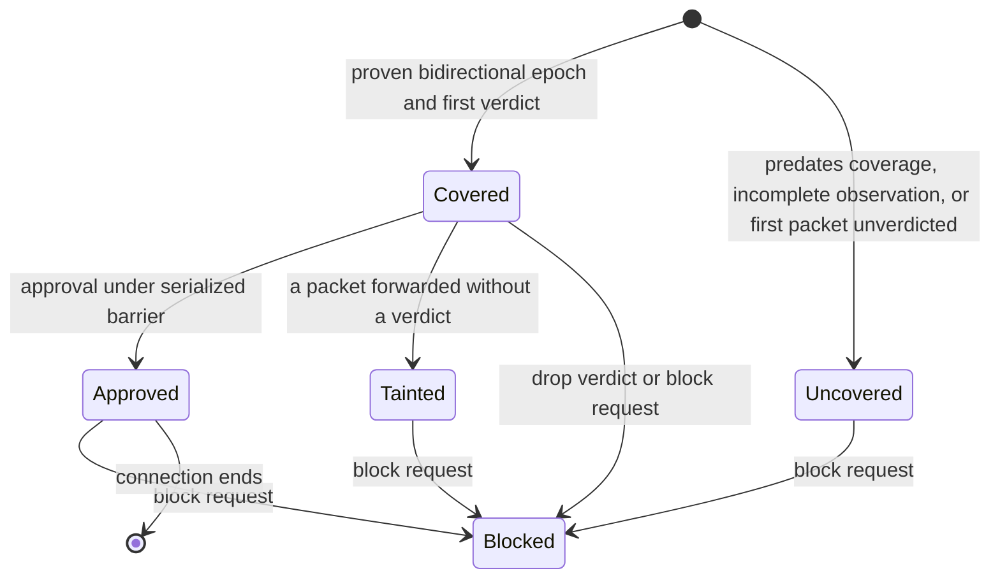
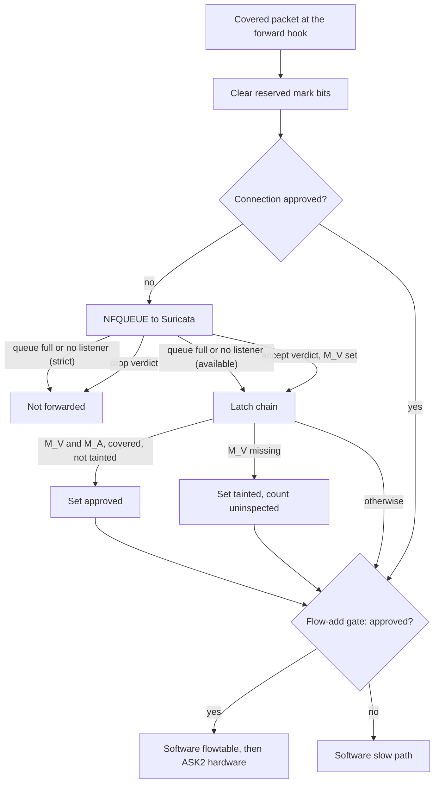

# ASK2 Suricata inspection and flow-offload plan

## 0. Status

This document defines a proposed design for Suricata inspection with hardware flow offload. **Track 0 (D8 commit-time bypass guard + `show offload config` override visibility) is implemented in source and host-gated** (`data/vyos-1x-062-suricata-offload-bypass-guard.patch`, `data/vyos-1x-files/python/vyos/ask_inspection_guard.py`, `data/vyos-1x-files/src/op_mode/show_offload.py`, `bin/test-g7-track0-guard.py`; pending CI ISO live commit test on DUT1). A limited runtime NFQUEUE prototype demonstrates part of the IPv4/TCP path, but production authorization, a Suricata-aware flowtable gate, a shared steering consumer and Suricata mirroring are not implemented. No production throughput or security guarantee is implied.

The design separates passive inspection, inline inspection and explicit flow shunting because they have different coverage and failure properties. Passive capture may remain visible with a software flowtable, depending on the receive path and configuration; hardware offload can bypass capture. With default settings, an inline inspector does not resume inspection of a flow after releasing it: it accepts packets while the bypass entry exists and may drop the connection after that entry expires.

Evidence labels used throughout:

| Label | Meaning |
|---|---|
| [experiment] | Observed once in a test environment; not reproduced |
| [upstream] | Described by upstream source or documentation; verify against deployed versions |
| [proposal] | A design choice, not implemented behaviour |
| [open] | Not known |

## 1. Problem, scope and terms

### 1.1 Four products, not one

The operator wants Suricata inspection while keeping ASK2 hardware forwarding where policy allows. Four different products hide behind that sentence. Each must be named in configuration and documentation.

| Product | What it does | What it cannot do |
|---|---|---|
| Passive IDS | Inspects copies of packets and alerts | Cannot stop a packet that was already forwarded; a reactive block has a leak window |
| Passive prefix IDS | Passive capture subject to an operator-defined forwarding cutoff | Neither a guaranteed observed prefix nor enforcement; hardware hand-off hides the remainder, and capture can lose earlier packets |
| Inline IPS, full flow | Holds every covered packet until a verdict; a drop or reject prevents forwarding | Cannot detect what it cannot read: encrypted payload, data beyond reassembly depth, traffic excluded by an exception policy |
| Inline prefix IPS with shunt | Inline IPS until a flow is explicitly approved; the remainder is forwarded by the software or hardware fast path without inspection | A later malicious payload in an approved flow passes unseen. This is not full-flow IPS and must be disclosed as such |

### 1.2 Where things stand

- Native VyOS `service suricata` configures capture only. Its AF_PACKET/PCAP path does not install NFQUEUE or nftables queue rules. In this mode Suricata `drop` and `reject` rules do not enforce forwarding decisions. [upstream]
- The VyOS documentation introduces Suricata as an engine that performs inline intrusion prevention, while the service exposes capture settings only. An operator can reasonably read that as enforcement. [upstream]
- The native VyOS firewall already offers `action queue` with `queue-options bypass` and `fanout`. An operator can hand-build an inline path today, and the auto-flowtable would bypass it silently. [upstream]
- A reference configuration enables IPv4 and IPv6 offload on the data interfaces and a hardware flowtable with `hardware-offload-delay 500`.
- Target deployments are Linux routers with hardware flow offload. Pin the kernel, driver and Suricata versions for each deployment; the examples below are not version-independent guarantees.

### 1.3 What each acceleration layer hides

Monitored traffic does not require every acceleration layer to be disabled in every mode. Inline inspection at the forward hook requires both software and hardware fast paths to be gated; passive capture may have a broader path, subject to E1 and the actual receive path.

| Inspection method | Software flowtable | ASK2 hardware offload | Driver paths that build no skb (WireGuard fast path, AF_XDP redirect) |
|---|---|---|---|
| AF_PACKET capture (native `service suricata`) | Potentially visible on receive where packet taps precede the netfilter ingress flowtable hook [upstream]; not a universal guarantee. Confirm both directions and actual paths in the target environment (E1) | Hidden: frames never reach the CPU | Hidden |
| NFQUEUE at the forward hook | Hidden: a flowtable hit never reaches the forward hook | Hidden | Hidden |

Consequences. Passive IDS must gate hardware offload and any other paths that bypass capture; allowing software flowtable forwarding for monitored traffic is conditional on E1 and the verified configuration. Inline inspection needs both the software and the hardware fast path gated. The existing `hardware-offload-delay` does not ensure inspection on its own, because a software flowtable hit already bypasses the forward hook.

### 1.4 Scope

This plan covers forwarded IPv4 and IPv6 TCP and UDP first. INPUT, OUTPUT, bridging, local services, multicast, helpers, tunnels, other protocols and non-IP traffic are outside the first implementation unless explicitly admitted after their own path and policy gates. Out of scope does **not** mean implicitly approved: for each excluded class the configuration must say whether it stays on a fully inspected path, is blocked, or is excluded from coverage and reported to the operator.

## 2. Threat model

The threat model makes explicit which attacks each inspection mode can and cannot address [proposal]:

| Adversary | Example | Passive modes | Inline prefix IPS |
|---|---|---|---|
| T1 Untargeted, early in the flow | Commodity malware check-in, exploit kit, scanner; the signature matches in the first kilobytes | Detected, not prevented | Prevented when the rule is `drop` |
| T2 Remote endpoint that knows the shunt policy | Pads a connection past the approval point, then sends the payload; or reuses an approved UDP tuple | Missed after hand-off | Missed after approval. Prefix inspection is evadable by design |
| T3 Load inducer | Floods small packets or short flows to saturate the inspector | Capture loss, so a visibility gap | Under fail-open the attacker decides when inspection is skipped; under fail-closed the attacker causes loss |
| T4 Ruleset supply chain | A third-party or mistaken rule containing `bypass`, `pass` or `nfq_set_mark` | Reduced visibility | Could authorize hardware forwarding unless bypass producers are closed (section 7.4) |
| T5 Local privileged component | Another nftables table, a container or a tool that sets packet marks or connection state | Not applicable | Could forge approval unless reserved bits are sanitised and state is owned (sections 7.2 and 7.3) |

Claims the product may make: prevention against T1 on covered traffic when the relevant detection and enforcement conditions hold. Detection parity with an unshunted Suricata for any proposed approval class is an unproven hypothesis, not a product guarantee. Claims it may not make: full-flow inspection, protection against T2, or any enforcement during a declared fail-open interval.

## 3. Alternatives

No alternative is selected for production.

| Candidate | Enforcement | Packet path | CPU cost | New work | Evidence | Proposed disposition |
|---|---|---|---|---|---|---|
| A1 Passive IDS, hardware offload off for monitored traffic | None | Software forwarding (software flowtable allowed if E1 confirms); AF_PACKET capture | Every monitored byte is forwarded in software | Commit-time guard | Capture configuration exists; visibility with the software flowtable on needs E1 | Ship the guard now (Track 0) |
| A2 Passive prefix IDS (new) | None | As A1 until an operator-defined byte cutoff and eventual hardware installation | Capture before hand-off subject to loss, not a guaranteed prefix | Guard plus a threshold on flowtable admission | None yet; uses existing parts | Build first (Track 1) |
| B Inline prefix IPS with shunt | On the inspected prefix | Forward hook, NFQUEUE, Suricata verdict; approved flows enter the software flowtable, then hardware | The prefix goes through the queue, the costliest path; short flows never amortise | Section 7: approval, admission gate, failure policy, withdrawal | One IPv4/TCP prototype, section 6 | Build only if the capacity pre-screen passes and prevention is required (Track 2) |
| B-full Inline IPS, no shunt | On every covered packet | Forward hook, NFQUEUE, always | Everything through the queue | Queue rules and failure policy only | The same prototype without the shunt | A configuration of B, not a separate design |
| C FMan steer to an inline software sink | Candidate, while a frame is held in the sink | ehash directs matching frames to a software frame queue; a new consumer inspects, then forwards or drops | Unmeasured; savings against B are unproven | General consumer, hand-off to Suricata, policy equivalence | WireGuard-specific steer and sink only | Defer (Appendix A) |
| D FMan per-flow mirror | None; optional reactive block | ehash replicates to egress and to an inspector listener | Every packet of each mirrored flow reaches the inspector | Listener ownership proof, then integration | Vendor multicast use of `REPLICATE_PKT`; a target mirror listener has not been validated | Defer pending the ownership proof in Appendix A |
| E External tap or switch mirror to a separate sensor | None | Outside the router | None on the router | Mirror port and sensor; an independently verified mirror coverage and loss budget | Standard practice | Document as the option when inspection must not share the router's CPU |

Rejected: Suricata's own inline shunt, AF_PACKET bridge mode with XDP bypass. It is the upstream-supported form of "inspect the prefix, then bypass", but it bridges two interfaces and sends bypassed packets from one card to the other without the kernel network stack [upstream]. It therefore skips routing, conntrack and NAT and never reaches ASK2 hardware.

### 3.1 Recommendation [proposal]

1. Guard the named, validated silent-bypass combinations first (Track 0); other paths remain outside that claim.
2. Build A2 next. It answers "can I have IDS and 10 Gbit/s elephants" honestly, with parts that exist, subject to E1 and the other gates.
3. Decide on B after two cheap measurements: the inspector's capacity with the real ruleset, and the share of bytes that falls inside the prefix for a real traffic sample (section 8.1).
4. Keep C and D as research. Neither substitutes for B's approval or withdrawal gates.

### 3.2 Steer and mirror are different operations

`ENQUEUE_PKT` steers a frame to one destination; it is not a copy. `REPLICATE_PKT` is a candidate copy primitive that the target has not validated. Appendix A keeps the full feasibility notes for both.

## 4. Design decisions

Each row is a proposal. The last column says what evidence would change it.

| ID | Decision | Proposed answer | Reason | What would change it |
|---|---|---|---|---|
| D1 | Service modes | Offer `ids` (A1 or A2) and `ips-prefix` (B). `ips-full` is `ips-prefix` with no approval class enabled. One mode per interface and direction; passive and inline are mutually exclusive on an interface | Mixed modes multiply the paths to audit | A concrete deployment that needs both on one interface |
| D2 | Inspector baseline | Choose the Suricata branch before pinning any semantics. Target the branch the image will ship at release and pin tests to its exact version | Upstream ended support for 7.0 on 2026-07-07 (last release 7.0.17). Behaviour this plan depends on differs between 7.0 and current upstream, for example whether the TLS bypass depends on `stream.bypass` | Distribution constraints that force 7.0; then record the risk |
| D3 | Approval classes | Default: no bypass. Class 1, optional: TLS and QUIC after the handshake. Class 2, opt-in: cleartext TCP once a direction passes the engine's reassembly depth. Everything else stays inspected. Approval is one explicit owned rule per class; `stream.bypass` stays off. Enabling class 1 by default is an alternative only with explicit operator risk acceptance | Both classes surrender subsequent inspection and can lose detections, including metadata and later protocol events; encrypted content alone does not establish detection parity. Class 2 also gives up per-packet matching and stream inspection of the opposite direction, for example later requests on a keep-alive HTTP connection after a large response | Evidence about detection loss and a measured elephant share, together with an explicit operator risk decision |
| D4 | Alerts and approval | Goal: never approve when an already evaluated and settled pre-boundary event alerted. An owned ruleset transformation adding a veto flowbit to every enabled alerting rule, plus lint, is a hypothesis to test, not a guaranteed veto. An asynchronous EVE consumer is a secondary source only. Approve only under a proven serialized barrier that resolves alert, verdict, taint and admission ordering. Later fast-path content is invisible, so no claim covers alerts that would have occurred after the boundary | Ruleset transformations and lint alone cannot guarantee engine ordering or veto across packets, directions and concurrent workers | If operators treat alerts as informational, drop the requirement and the transformation; otherwise require proof or keep shunting disabled |
| D5 | Failure policy | Two named profiles. `strict`: no listener, queue full and inspector failure drop covered unapproved traffic; zero failure-induced uninspected prefix packets, while the approved remainder intentionally runs uninspected and is reported. `available`: those events forward in software uninspected, every such packet is counted, and the connection is tainted and can never be approved. This profile is viable only with a proven synchronous admission fence that prevents fail-open forwarding racing approval; otherwise disable shunting or fail closed | An edge router that goes dark when a daemon restarts gets the feature switched off, but asynchronous taint alone cannot enforce the safety claim | A deployment that needs enforcement over availability selects `strict`; evidence may establish or rule out the `available` fence |
| D6 | Withdrawal | Three separate operations (section 7.7). Stop admitting: required. Block a flow: required, with hardware containment and per-direction completion confirmed. Ingress or forward drop rules cannot stop packets already forwarded in hardware. Demote a live flow to software while keeping its NAT mapping: not required by this feature; use a proven generic retirement mechanism if one becomes available. A global NAT-preserving flush is unresolved, not an established primitive. "Return to inspection" is not offered | With default settings the inspector does not resume a released flow; NAT preservation only matters for a flow that continues. Hardware withdrawal and containment require proof | A tested configuration in which the engine demonstrably resumes detection, for example midstream pickup, with its weaker TCP validation accepted; proven retirement and flush primitives |
| D7 | Connections that did not start under inspection | At enable, policy change and inspector restart they are grandfathered, never newly approved, and reported as uncovered. They may remain in hardware; software forwarding is not promised without verified retirement. The operator must explicitly choose retention, proven quarantine, or intentional termination; `strict` may drop them only with proven hardware containment. Policy changes apply to new connections. Old approvals become stale across policy changes or inspector restart; do not grandfather them as valid. Define an explicit expiry and invalidation policy, including how existing fast-path entries are withdrawn or quarantined, before enabling approval | The alternatives are a false coverage claim or killing every session; stale approvals cannot establish coverage under a new policy or inspector epoch | Operator demand for continuous-inspection-or-nothing, which is `strict`; a proven epoch and expiry policy may support other choices |
| D8 | Configuration guard | A commit fails when passive Suricata, or a firewall `action queue` rule, shares an interface with hardware offload and the matching gate is not active. An explicit override exists and is shown in `show` output. The guard addresses identified bypasses only: it must not promise full capture or enforcement; E1, exclusions, capture loss and other unverified paths remain explicit | Removes the present silent hole without overstating coverage | Evidence of additional paths that require validation or guarding |
| D9 | Performance budgets | Fill the table in section 8.4 before any benchmark run. Starting point for discussion: 1 Gbit/s offered mixed traffic with 20% CPU headroom, at most 5 ms added p99 latency on the prefix, zero failure-induced uninspected prefix packets in `strict`; approved remainder is intentionally uninspected and separately observed | A run cannot pass or fail without a target | The operator's actual link speed and traffic mix |
| D10 | Persistence and high availability | Approval does not survive reboot, loss of conntrack, or failover; stale or unauthenticated approval is invalid. Separately persist unresolved hardware ownership, fences and quarantine outside conntrack across relevant restarts and failures. Assign an owner for reset and recovery, and reconcile hardware and in-flight work before reopening admission or claiming containment | Loss of approval state does not prove hardware records or quarantine disappeared | A proven reset, persistence and stateful failover design |

## 5. Safety contract

### Decisions and safety contract

These are proposed invariants, not implemented behaviour. Each names where it is enforced and how a test observes it. Proving tuple equality alone is insufficient for any of them. Approval is permitted only under a proven serialized barrier covering verdict, veto, taint and admission; atomic label updates alone do not establish that barrier.

`strict` forbids failure-induced uninspected forwarding in the covered prefix; it does not inspect the intentionally shunted approved remainder. The approval boundary is established only after all earlier packets and queued verdicts in both directions, including pending vetoes and taint, are settled under the serialized fence. Taint before that boundary forbids approval. After the boundary, forwarding without inspection is an explicit policy choice, separately measured and reported, not a failure-induced prefix exception. The boundary must be correlated to packet order in both directions, not inferred from a mark.

| ID | Invariant | Enforced by | Observed by | Gate |
|---|---|---|---|---|
| INV-1 | Coverage is explicit. The operator chooses interfaces, directions, families and exclusions; configuration never implies full coverage while a matching path bypasses inspection | Commit validation (D8); coverage selector | Rendered ruleset review; status output lists exclusions | R5 |
| INV-2 | No implicit approval. No alert, established state, elapsed time, byte count, generic `pass`, generic `bypass` or inspector failure is approval by itself. Only the owned rule of an enabled class is | Closed producers and owned rules (7.4); proven serialized barrier and latch chain (7.3) | Per-flow record of the approving rule; negative tests for every other producer | R3 |
| INV-3 | Admission precedes both fast paths. An unapproved covered connection has neither a software flowtable entry nor an ASK2 record | Flow-add gate, optionally a kernel choke point (7.5); audit of other installers | Sequence-numbered packets correlated at ingress, inspector and egress; conntrack and ASK2 record listings | R2, R3 |
| INV-4 | Approval is bound to one conntrack entry: its namespace, zone, NAT mapping and incarnation. A reused tuple does not inherit it, except UDP inside the conntrack timeout, which is disclosed | State lives on the conntrack entry (7.2); approval expiry and policy epoch (D7) | Identity tests (7.9) and stale-approval tests | R2 |
| INV-5 | Connection state is monotonic. Covered, tainted and approved are set once and never cleared while the entry lives; nothing re-approves. Taint and approval must not race into an unsafe admission | A proven serialized admission barrier; conntrack labels alone, even if atomic, are insufficient to enforce cross-state ordering (7.2) | Race tests with delayed verdicts, concurrent fail-open and admission | R3 |
| INV-6 | Withdrawal closes admission first, then removes software and hardware entries in both directions. Both directions must be settled and confirmed absent, or the flow or port remains quarantined; conntrack flags are not proof | Ordering in 7.7; ASK2 per-direction record state and quarantine | ASK2 per-direction record state; packets and bytes forwarded after the request | R4 |
| INV-7 | Failure behaviour is named and counted. No failure path creates an approval; fail-open is an availability choice, not IPS protection | Profiles (D5); synchronous admission fence and latch chain taint | Failure matrix tests (7.6); uninspected counters | R4 |
| INV-8 | Reported state is observed state. Inspected, uninspected, software-shunted and hardware-shunted bytes reconcile with forwarded bytes | Coverage ledger (7.10) | Reconciliation within a stated tolerance | R6 |

## 6. Prototype observations and limitations

A runtime-only NFQUEUE experiment with Suricata 7.0.10 was run on a development router. Boot conditions were not recorded. The experiment was not a production configuration or operational procedure. Retained notes do not include raw packet captures, repeated runs, the effective Suricata configuration, engine counters or CPU and loss measurements. The results below are single observations and should not be treated as validated performance or coverage claims.

| Experiment | Observed [experiment] | What it supports | What it does not show |
|---|---|---|---|
| `stream.bypass` with 1 MB `stream.reassembly.depth`, one-way bulk flow | 15 s, 396 Mbit/s, 644k packets, zero marked | Nothing yet; see anomaly 1 | Any stream-depth semantics |
| Test TCP `stream_size` rule plus `bypass` | About 1.7 MB reportedly passed through Suricata before a long flow became `[HW_OFFLOAD]`, then 8.8 to 9.4 Gbit/s; a 300 KB flow stayed in software | One observed chain: rule, packet mark, conntrack mark, flowtable, ASK | That the 1.7 MB was inspected; exact inspected bytes; independent raw capture proof of hardware forwarding; UDP, IPv6, NAT, other rules, capacity |
| Prior alert, then bypass | The alerted flow was still bypassed and offloaded. A test flowbit on the alert and a condition on the bypass rule kept it in software at 210 Mbit/s; an unalerted port offloaded | The `bypass` keyword acts when its rule matches, whatever other rules did. This is expected engine behaviour [upstream] | Any alert exclusion that works with third-party rules |
| Inspector stopped | Existing hardware flows stayed offloaded; new flows passed unmarked in software at 1.1 Gbit/s | Traffic keeps flowing when the inspector stops, by one of two fail-open controls | Which control was exercised (anomaly 3); any revocation |
| `conntrack -D` by test mark | A routed flow survived, got a fresh unmarked conntrack entry and returned to software | One observed software return; mainline collects flows whose conntrack entry is dying [upstream] | Hardware deletion or absence, per-direction settlement, or anything usable for a live NAT mapping |
| Teardown | Hardware memory use 58,764, no records, consistency check passed, no kernel errors | A clean end state for this run | Ownership in flight or under failure |

The experimental setup queued only source-selected IPv4 TCP/UDP at forward priority `-20`, copied packet mark `0x100000` into the conntrack mark in a later chain at `-19`, and replaced one IPv4 flowtable rule by handle. It ran a separate Suricata daemon with `nfq.mode=accept`, `nfq.fail-open=yes`, `nfq.bypass-mark=0x100000` and `nfq.bypass-mask=0x100000`. Those values were experimental, not reserved product ABI. The setup does not cover every forward direction, IPv6 or every flowtable. Its teardown restores an unconditional rule, does not restore a saved transaction or revoke existing flows, and must not be used as a cleanup design. Its single rule handle is not a stable integration interface.

Anomalies and gaps to resolve before reusing these results:

1. The `stream.bypass` result contradicts the documentation. The 7.0-branch manual says bypass activates when either side of the session reaches its depth; the shipped configuration file says the first side to reach it triggers; current upstream code tests either side [upstream]. A one-way flow past 1 MB should therefore have been marked. The observed result is unexplained: either 7.0.10 differs from its manual or the setting did not take effect. Read the condition in the pinned source and rerun with the engine's stream-depth and bypass counters (E3).
2. The packet count may span both directions, but this is an unverified hypothesis without raw evidence. 396 Mbit/s for 15 s over 644k packets is about 1,153 bytes per packet on average; full-size data packets alone would have carried about 515 Mbit/s. If the 42.9k packets per second is a bidirectional figure, it could represent roughly 33k to 34k data packets per second plus acknowledgements.
3. The record does not say which fail-open control was exercised. A killed inspector exercises the no-listener path (the nftables `bypass` flag); a suspended one exercises the queue-full path (`nfq.fail-open`). They are different controls, and the queue-full one is the case an attacker can induce (T3). Test both, separately.
4. A source-subnet selector is unsafe as a product design. It queues one direction only for any connection whose peer is outside the subnet. A user of 7.0.8 reports that the stream engine blocks sessions of which it sees one direction [upstream]. Selectors must match connections, not packet sources.
5. Missing from the record: boot type, effective configuration, ruleset, engine counters, captures and a repeat count.

Rerun protocol (part of E2): record the cold-boot state, hardware, kernel and Suricata versions, and effective Suricata configuration; use sequence-stamped test traffic with captures on both wire sides; collect engine statistics, nftables counters, the kernel queue statistics file, a conntrack listing and a hardware-flow record dump before and after; run each row three times and write down the expected result before each run.

## 7. Candidate B: proposed mechanism

Everything in this section is [proposal] unless labelled otherwise. The sketches are illustrative and were not run on the image. They do not establish a safe admission mechanism.

### 7.1 Behaviour the design relies on

1. A queued packet that is accepted resumes at the next base chain on the same hook. A packet returned with the repeat verdict re-enters the chain that queued it. (B3)
2. In repeat mode the inspector puts its mark on every packet it verdicts. In accept mode it marks only packets whose mark a rule changed. (B10)
3. A packet let through because the queue was full, or had no listener, carries no such mark, and the kernel counts nothing for it. (B4, B5)
4. A bypass decision marks one packet: the one being processed when the rule fires. Afterwards the engine accepts the flow's packets without inspecting them. (B12, B13)
5. The flow-offload expression in the forward hook is the only way nftables admits a connection to a flowtable. (B19) Other installers still require independent control.
6. A conntrack label OR is an atomic bit-set, not an atomic conditional transition across labels or an admission barrier. A conntrack mark written by a rule is a plain store and can lose a concurrent update. Other netlink clients can clear labels; their ownership must be reserved and validated. Label storage may be absent. (B21)
7. In inline mode with default settings the inspector drops TCP connections it first sees midstream. (B17)

### 7.2 State

Per packet, two proposed reserved packet-mark bits. Their provenance must be controlled end-to-end: reserve or sanitise them before every routing, QoS and other consumer, prevent untrusted later writers from forging them, and scrub at all relevant exits. A forward-hook clear alone is too late for earlier consumers and does not constrain later writers. Audit and test every hook, ingress source, writer and consumer on the target; the sample below proves none of this.

| Bit | Meaning | Set by |
|---|---|---|
| `M_V` | A verdict was issued for this packet | The inspector, on every packet it verdicts (NFQ repeat mode) |
| `M_A` | Approval signal | Only the owned approval rule of an enabled class |

Per connection, three proposed conntrack labels:

| Label | Set when | Effect |
|---|---|---|
| `covered` | A proven bidirectional coverage epoch starts with the first packet verdicted | Necessary, but not sufficient, precondition for approval; absence marks an uncovered connection |
| `tainted` | A packet of the connection was forwarded without a verdict | The connection must never be approved in that epoch |
| `approved` | An owned approval signal is accepted under the serialized barrier for a covered, untainted connection | Only a fenced admission may open the flow-add gate; later packets skip the inspector |

A block is a set of tuples or hosts matched by a drop rule, not a label.

Why labels rather than the conntrack mark:

- Setting a label with an OR is an atomic bit-set. In the 6.18.62 `nft_ct.c` path, the same data is passed as mask and data; `nf_conntrack_labels.c` applies `(old & ~mask) ^ data`, preserving unrelated bits while setting those data bits. Verify the actual nft encoding and all concurrent netlink writers on the target; full atomic safety across writers and state transitions remains unresolved. A mark update is read, modify, write, and two packets of one connection on different CPUs can lose a bit. Neither operation serializes a check followed by a set.
- VyOS exposes the 32-bit conntrack mark to operators (`connection-mark`, `set connection-mark`), so its bits are not ours to reserve.
- Label storage may be missing on existing connections or when the extension is unavailable. Reserve and validate label ownership, availability and integrity, including writes by other netlink clients; otherwise deny approval. Existing or incompletely observed conntrack entries cannot automatically be covered.

Costs: the kernel needs conntrack label support, nftables needs a label name file, and the VyOS CLI does not expose labels, so these rules live in a table owned by the feature. [open: kernel configuration and label naming on the image]



**Race:** CPU 1 lets a fail-open packet pass and pauses before the latch. CPU 2 sees the connection is not tainted and sets `approved`. CPU 1 then sees `approved` and skips taint, so an uninspected packet has passed and the flow can be installed. Even if every fail-open packet always sets taint, the approval check and set can race with it and permit a brief promotion; testing `approved && !tainted` alone is not enough.

A safe design requires a proven per-connection, bidirectional serialized coverage epoch and pending-packet and verdict fencing before any software or hardware add, including a synchronous barrier for fail-open forwarding and admission. It also requires durable attribution of the approving rule, policy and inspector epoch to the conntrack incarnation. Without these guarantees, do not shunt; disable fail-open or use a proven synchronous barrier if shunting is to coexist with it. R3 must test these races with sequence-numbered packets and delayed verdicts.

### 7.3 Packet path



**UNSAFE, NON-EXECUTABLE sketch: do not deploy.** The diagram and rules below illustrate a proposal, not the required serialized barrier; they admit the race in 7.2. The `available` profile is not safe for shunting without a synchronous fail-open barrier. Bit values and label names are placeholders; the coverage selector is omitted.

```nft
table inet suricata_inspect {
    chain sanitise {                # nothing upstream may pre-set the reserved bits
        type filter hook forward priority -22; policy accept;
        meta mark set meta mark & 0xffcfffff
    }
    chain inspect {                 # a repeated packet re-enters here with M_V set
        type filter hook forward priority -21; policy accept;
        ct label ips_approved accept
        meta l4proto != { tcp, udp } accept
        meta mark & 0x00100000 == 0 queue flags bypass to 0-3
    }
    chain latch {                   # per-packet facts become per-connection latches
        type filter hook forward priority -20; policy accept;
        ct label ips_approved accept
        meta l4proto != { tcp, udp } accept
        meta mark & 0x00100000 == 0 counter ct label set ips_tainted accept
        ct state new ct label set ips_covered
        ct label ips_tainted accept
        meta mark & 0x00200000 == 0 accept
        ct label ips_covered counter ct label set ips_approved
    }
    chain scrub {
        type filter hook forward priority -19; policy accept;
        meta mark set meta mark & 0xffcfffff
    }
}
```

`ct state new` is not proof that this is the first packet or that its first verdict was obtained. The sketch cannot establish coverage for existing or incompletely observed conntrack entries. A possible generated VyOS offload rule adds `ct label ips_approved` on covered interfaces, but that condition, even with `!tainted`, is not a safe admission gate. `strict` would remove the `bypass` flag, turn NFQ fail-open off and replace the taint rule with a drop; it still needs the serialized coverage and verdict fence.

Matching illustrative inspector settings, also not deployment configuration:

```yaml
nfq:
  mode: repeat
  repeat-mark: 0x00100000     # M_V
  repeat-mask: 0x00100000
  bypass-mark: 0x00200000     # M_A, only while every other producer is closed
  bypass-mask: 0x00200000
  fail-open: yes              # available profile; no for strict
  # batchcount stays unset: batched verdicts omit the repeat mark
stream:
  bypass: no                  # depth must not be an implicit producer
  midstream: false
exception-policy: auto        # set per item for the profile; never "bypass"
```

Notes on the sketch:

- The sanitise chain is security-critical in repeat mode. A packet that arrives with `M_V` already set would skip the inspector. Its forward-hook placement is insufficient for earlier routing or QoS consumers or subsequent writers; the pre-consumer reservation, provenance and end-to-end audit in 7.2 are mandatory.
- Without `fanout`, target 6.18.62 IPv4 hashes sorted addresses and protocol; IPv6 hashes selected address words without protocol (B9). Neither uses ports. Reversed unchanged addresses are symmetric, but NAT can present different pairs and queues. CPU execution can also be concurrent. Do not assume one worker, arrival ordering or verdict ordering; verify both directions and the actual configuration. `fanout` maps by CPU, not as a serialization guarantee.
- Approved connections skip the inspector in the kernel. Relying on the inspector's own bypass state would fail for any packet that returns to the slow path after the inspector has expired the flow: the packet would be a midstream pickup and, with default settings, dropped.
- Hook priorities, coexistence with VyOS chains, NAT and zones must be taken from the rendered ruleset of the built image (R2). Do not assume an order between base chains of equal priority.

### 7.4 Approval: classes, producers and veto

Classes (D3). Default is no bypass; each optional class is a feasibility hypothesis, not proof of detection parity or safe approval:

| Class | Predicate | Status |
|---|---|---|
| 1. TLS and QUIC after the handshake | Protocol identified, handshake complete, no veto | The exact rule is an R3 deliverable [open]. On the 7.0 branch the built-in TLS option cannot do this: it bypasses only when `stream.bypass` is on, which also bypasses every TCP flow at depth [upstream] |
| 2. Cleartext TCP at reassembly depth (opt-in) | `stream_size:either,>,<depth>` or the engine's depth-reached stream event; no veto | `stream_size` counts sequence-number progress, not inspected bytes [upstream]; a taint label alone cannot prove a fully inspected prefix |
| Other UDP | None in the first release | A byte-count predicate for UDP on the 7.0 branch is [open] |

Class 2 makes the direction question concrete. With `either`, the shunt also blinds the opposite direction, which the engine could still have inspected. With `both`, a one-way bulk transfer is never shunted. There is no setting that gives both parity and performance; the operator chooses.

Every way the engine can emit the bypass signal must be closed except the owned rules:

| Producer [upstream] | Proposed control |
|---|---|
| `bypass` keyword in any rule | Lint: only owned rule IDs may contain `bypass` or `nfq_set_mark`; enabling fails otherwise |
| Stream depth (`stream.bypass`) | Setting must be off |
| TLS `encryption-handling: bypass` | Setting must not be used |
| An exception policy set to `bypass` | Rejected at commit |

Newer branches add further producers, for example an SSH encryption-handling option. Regenerate this list for the chosen version by finding every caller of the engine's bypass callback. Closing the listed producers is a feasibility requirement, not proof of exhaustive closure or durable attribution.

If closure is proven, the generic bypass mark could come only from the owned rules. A stronger variant gives the approval rule its own bit with the `nfq_set_mark` keyword. One field report describes a rule on 6.0.1 that alerted without marking, so this needs a test before it is relied on. [open] A packet mark alone does not durably record which rule approved the connection.

Treat the signal as one-shot. If the marked packet's approval is not latched, the engine regards the flow as bypassed while the kernel does not: every later packet is queued and accepted without inspection, and the design must not count on a second mark. An alarm on unmatched local-bypass counters is only telemetry, not containment. Before deployment, either prove a synchronous fail-closed mechanism that prevents forwarding from the rejected decision onward in both directions, including queued and concurrent packets, or prohibit use of the engine bypass signal and keep shunting disabled for it. Test rejected, tainted, vetoed and racing one-shot decisions, delayed verdicts, counter loss and both directions against independent wire observations.

Veto (D4). An owned transformation could add a veto flowbit to every enabled alerting rule, and each approval rule could require the flowbit to be absent. This and lint are feasibility work, not proof of a reliable veto. Rule evaluation follows action order and engine stages, not file order, and `noalert` suppresses logging, not the rule's action, so tests use the real enabled ruleset. R3 must test the conflicts: drop and approve on the same packet, a `pass` rule with approve, an alert on a packet queued behind the approving packet, and a rule reload between the two. An asynchronous EVE consumer is secondary only.

Ordering. Do not assume both directions share a queue, that one worker serves a connection, or that verdicts follow arrival order. Verdict batching must stay off, but that alone does not serialize packets or verdicts. Packets already queued around the approving packet must be settled in both directions before the boundary, not assumed inspected merely because they were queued. Any post-boundary remainder is intentionally uninspected and must be measured and reported; no claim is made for content the fast path never exposes.

### 7.5 Admission gate

Layer 1, rules. The generated IPv4 and IPv6 auto-flowtable rule, and any operator-written offload rule on a covered interface, requires `approved`. Commit validation rejects an offload rule on a covered interface that lacks the condition. This condition alone is not a safe admission barrier: verdict, veto, pending packets, fail-open taint and both directions must be serialized against admission as described in 7.2.

Layer 2, kernel choke point (optional). All nftables admissions pass through one function [upstream]. A check there refusing a connection that is `covered` and not `approved` could make part of INV-3 structural instead of depending on rule audits and regeneration. Its scope, label availability and interaction with the serialized barrier remain to be proven; it does not itself establish safe admission.

Hardware admission follows software admission in the proposed flowtable path, but hardware adds, replacements and deferred replay must also respect the same incarnation, generation and withdrawal fence. `hardware-offload-delay` plays no part in inspection.

Other installers. Bridge offload, direct steering, the WireGuard fast path and any feature-specific path must each honour the gate and fence or be excluded from covered interfaces at commit (R2).

### 7.6 Failure matrix

These are proposed outcomes, not implemented guarantees. In particular, `available` with shunting is provisional: fail-open forwarding, taint and admission require a proven atomic per-connection, bidirectional barrier. A latch after forwarding is not that barrier. If it cannot be proven, disable fail-open or disable shunting; do not claim that uninspected connections cannot be approved.

| Event | What the kernel or engine does | `strict` | `available` | Test |
|---|---|---|---|---|
| No queue listener | With the nftables `bypass` flag the packet continues at the next hook; without it the packet is dropped [upstream] | No flag: drop | Flag: forward in software, tainted and counted only with the proven barrier; otherwise disable fail-open or shunting | Absent at boot, after a crash, during a restart; race admission |
| Queue full, or netlink buffer full | With the NFQ fail-open flag the packet is accepted and no kernel counter changes; without it the packet is dropped and a queue counter increments [upstream] | Flag off: drop, visible in the queue counters | Flag on only with the proven barrier: accept, taint and count; otherwise disable fail-open or shunting | Saturation with small packets; buffer exhaustion; approval concurrent with saturation |
| Fail-open flag cannot be set | Suricata logs a warning and carries on [upstream] | Not applicable | Treat as a failed start | Force the failure |
| Inspector exits or crashes | Packets already queued are dropped when the queue is destroyed, in either profile [upstream]; then the first row applies | Drop until restart | Loss of up to one queue length, then uninspected forwarding only if the barrier is proven | Kill under load; count the loss |
| Inspector hangs | The queue fills and the second row applies. A live PID is not readiness | Drop | Uninspected forwarding only if the barrier is proven | Suspend the process; watchdog on verdict progress |
| Inspector restart | The engine has no flow state. In inline mode with default settings it drops TCP connections first seen midstream [upstream] | Accept and document the drops; old approvals are stale | Set the midstream policy explicitly (candidate: `pass-flow`) so they continue uninspected; stale or untracked sessions cannot gain approval without a new proven coverage epoch. Verify on the pinned version | Restart under load; count dropped, stale and uninspected connections |
| Rule reload | A live reload keeps flow state. `update suricata` restarts the service today [upstream] | Decide the policy for existing approvals; retained approvals are stale and their remainder uninspected, not protected by the new rules | Same; report retained stale traffic | Reload under load; exercise withdrawal and retention without an unguarded interval |
| Engine memcap, defragmentation or parser exception | Governed by exception policies. The inline default is drop-flow; the value `bypass` is a bypass producer [upstream] | Keep drop-flow | Explicit pass or ignore per item, counted; never `bypass`; no approval without the barrier | Force each exception; no approval may result |
| Hardware add fails or the table is full | The approved flow stays in the software flowtable if software admission succeeded | Allowed; count the reason | Same | Fill the table; verify both directions |
| Hardware delete uncertain, interface removal, reset, deferred replay | Upstream mainline ignores the driver's delete result; target patch 150 instead retains unsettled ownership and quarantines the flow object (B19), which does not prove forwarding stopped | `UNRESOLVED`: proven upstream or hardware quarantine, fenced against replacement and replay; otherwise stop claiming containment and protection | Same containment requirement; report uncertainty and any exposure | Inject delete failure, timeout, reset and replay; verify containment on both directions |
| Alert or EVE output failure | Verdicts are unaffected; an asynchronous consumer loses events | Report; approvals unchanged unless policy requires withdrawal | Same | Fill the disk; drop the socket |

### 7.7 Withdrawal

Withdrawal comprises three operations of very different difficulty (D6). These proposed operations and their completion states require implementation and testing against the relevant retirement and containment mechanisms.

**Stop admitting.** Disable a class or the latch rule and fence new flow-add, hardware REPLACE and deferred replay for the affected scope. New approvals stop; existing approved connections are unaffected unless separately withdrawn.

**Block a connection or host.**

1. Close admission and fence new adds, REPLACE and deferred replay for the affected connection incarnation and generation. Install a proven upstream or hardware quarantine covering both directions before relying on containment. Forward-hook and pre-flowtable ingress drop rules can block slow-path and software-fast-path packets, but cannot stop a live hardware FE hit that never reaches those hooks. They are supplementary, not hardware containment.
2. Install a persistent bidirectional software policy block for the actual packet views before releasing hardware quarantine, whether or not the connection is terminated. For intentional termination, also delete its conntrack entry. The flowtable collector asynchronously tears down flows whose conntrack entry is dying and requests hardware deletion [upstream]. Conntrack deletion is not a hardware acknowledgement.
3. Wait for ASK2 to acknowledge deletion or otherwise prove absence for both directional records of the same incarnation and generation, including any in-flight add, REPLACE or replay. A stale completion for an earlier incarnation or generation cannot settle the current request.
4. Keep quarantine and the admission/replay fence until that proof and all relevant asynchronous work settle. On failure, timeout, reset, lost state or missing acknowledgement, persist and report `UNRESOLVED`; do not automatically expire quarantine. Release requires explicit reconciliation and verified absence, or an independently proven containment/reset procedure.

Deleting conntrack loses the NAT mapping and is acceptable only when termination is intentional; deletion alone is not proof that the terminated flow stopped in hardware. Ordinary software block-set timeouts must not release an unresolved hardware quarantine. A block may come from the operator or an independent source such as an alert consumer; each source has its own identity, delay and failure contract. Measure packets and bytes forwarded after the request, per direction, for software and hardware, including the interval before quarantine takes effect. If no proven quarantine is available, explicitly report exposure and do not claim that the block or strict protection has taken effect. Predeclare the maximum request-to-containment leaked packets, bytes and time per direction before tests. `CONTAINED` means independently proven effective quarantine with fences in place; it does not mean records are gone. `RETIRED` requires confirmed absence and settlement for both directions and all in-flight work. A contained but unsettled record remains `UNRESOLVED`; quarantine stays until retirement is verified or an independently proven reset procedure establishes equivalent settlement.

**Demote a live flow to software and keep its NAT mapping.** This feature does not require per-flow demotion as a standalone operation. Mainline has no such per-flow primitive: an entry is torn down on expiry, a dying conntrack entry, a stale route, a type-specific collector predicate or device cleanup [upstream]. Use a generic retirement mechanism only if it is available and proven. A demoted flow would be forwarded uninspected; it would not be "returned to inspection".

**Global flush.** A NAT-preserving operation that tears down every flowtable entry on covered interfaces while keeping conntrack is needed for disable or a kill switch when live sessions must continue. It is not an established primitive or a small kernel addition: software and hardware retirement, synchronization, containment and completion remain unresolved. Define and prove the iteration, fencing, per-direction acknowledgement and failure handling before offering this operation. Until then choose explicitly between retaining stale uninspected flows, proven quarantine, or intentional session termination; do not imply that deleting conntrack preserves NAT or that a flush has completed.

**Hardware uncertainty.** Upstream mainline clears the `[HW_OFFLOAD]` flag before it calls the driver, ignores the driver's result and then treats the entry as gone. A hardware add counts as successful if either direction succeeded [upstream]. A downstream implementation may instead retain hardware-live state for unsettled deletes and quarantine the flow object (B19); that is not evidence that hardware forwarding stopped. Neither flag proves that both directions are, or are no longer, in hardware. The target must track per-direction record state, incarnation and generation, expose `UNRESOLVED`, and never free memory the hardware may still access. Both profiles require proven upstream or hardware quarantine while uncertainty remains, with REPLACE and replay fenced; absent that, report the exposure and stop claiming containment or protection. Persist the unresolved state and fence across relevant service restarts and failures, and reconcile before reopening admission or releasing quarantine. Hardware teardown and containment gaps are dependencies, not proof.

### 7.8 Transitions

Enable, as one VyOS commit in stages:

1. Reconcile externally persisted quarantine, unresolved ownership and fences with both hardware directions and in-flight work before reopening admission or claiming containment. The designated recovery owner must verify the applicable reset semantics; loss of conntrack approval alone does not release quarantine. Validate: guard, producer lint, reserved bits unused, kernel prerequisites, label ownership and availability, and the admission and fail-open barriers.
2. Close admission: flow-add rules on covered interfaces now require `approved` and the proven serialized fence.
3. Start the inspector. Ready means every queue is bound, the start-up log has no fail-open warning and a probe packet was verdicted.
4. Load the sanitise, inspect, latch and scrub chains in one nftables transaction, subject to the barrier rather than the unsafe sketch in 7.3.
5. Existing fast-path entries: retain as grandfathered only when explicitly selected, reporting them as uncovered even if still in hardware, or request a NAT-preserving global flush if such a primitive is available and proven. Otherwise quarantine or intentionally terminate according to policy; do not claim software forwarding or a flush without verified retirement.
6. Report coverage active only for the proven scope, with the number of grandfathered connections and any stale or unresolved records.

A failure at any stage returns to the previous stage only where rollback is safe. Persist pending withdrawal, fences and quarantine across failure or restart; do not reopen admission or release quarantine on an uncertain rollback. Coverage is never reported active before stage 6. Atomic ruleset replacement does not settle asynchronous hardware work: a flush waits for confirmed absence in both directions for the correct incarnation and generation, or remains `UNRESOLVED` under proven quarantine.

Rule update. Use a live reload where possible. A restart drops whatever is queued, opens a no-listener interval and turns every TCP connection in progress into a midstream pickup. Keep restarts for upgrades. Both reload and restart require the policy decision below; retaining engine flow state does not make an old approval valid under changed rules.

Policy change or reload. The new policy applies to new connections. Existing approvals become stale on policy change or inspector restart; retained approvals and their remaining traffic are explicitly uninspected under the new policy and must be counted and reported as such, not represented as valid coverage. Decide per policy whether to retain them as stale, withdraw them with proven NAT-preserving retirement, quarantine them, or intentionally terminate them. A flush is not yet established. If withdrawn to software, TCP connections are dropped by the inspector's midstream policy or continue uninspected, according to profile; with default settings there is no third outcome. Specify expiry and invalidation, epoch ownership and persisted failure handling before enabling approval. `strict` may instead drop grandfathered or stale connections, subject to proven hardware containment.

Disable. Close admission and fence adds, REPLACE and replay first. Decide per policy whether existing flows remain stale and uninspected, are quarantined, are retired with a proven NAT-preserving flush, or are intentionally terminated. Wait for confirmed hardware completion or preserve `UNRESOLVED` quarantine and report exposure. Remove the inspect and latch chains and report coverage off; remove the gate only when doing so cannot defeat a remaining fence or quarantine.

### 7.9 Identity, translation and encapsulation

- Approval eligibility is bound to the conntrack entry. External durable quarantine, unresolved hardware ownership and recovery fences are separate and must outlive that entry when needed. Approval is scoped to that entry's namespace, zone, NAT mapping and incarnation, and it ends with the entry. A new TCP connection on a reused tuple gets a new entry. A UDP exchange that reuses a tuple inside the conntrack timeout is the same entry and inherits approval: test it and disclose it (T2). Policy and inspector epochs and the expiration decision must also be bound to that incarnation.
- Labels are mutable by other netlink clients and their storage may be absent; reserve and validate ownership and integrity or deny approval. Atomic label bit updates do not provide the required cross-state barrier. `ct state new` does not prove the first packet or a fully observed bidirectional epoch.
- Coverage selectors match connections, not packet sources (section 6, anomaly 4).
- At the forward hook, after destination NAT and before source NAT, target 6.18.62 IPv4 hashes sorted addresses and protocol; IPv6 hashes selected address words without protocol (B9). Symmetry requires unchanged reversed addresses; NAT may present different pairs. Do not rely on shared queues or worker ordering for bidirectional serialization. Verify NAT, policy routing and several ingress ports.
- The inspector's flow key and conntrack's differ: one may include VLAN, the other includes zone. Record both for every test flow.
- ASK2 records are directional. Check the per-port routed key and its VLAN and PPPoE fields against current code and a live packet view; a historical key format is not evidence. Preserve the direction-specific action and NAT mapping rather than deriving both from one tuple. Bind deletion completion and replay fencing to both directions and the correct incarnation and generation, not tuple equality alone.
- Tunnels. The inspector does not apply bypass to tunnelled packets other than reassembled fragments [upstream]. Decide inner versus outer explicitly. Approval for one inner flow never authorizes the outer tunnel.
- Fragments. Conntrack reassembles before the forward hook, so the queue sees whole datagrams and non-first fragments never match a fast path. Test it.
- Related ICMP, helpers and unsupported encapsulations are not approved. If identity or coverage is ambiguous, the flow stays outside the claim.

Tests: tuple reuse and collision, both directions, several ingress ports, duplicate tuples in different zones and namespaces, VLAN and PPPoE session churn, policy routing, NAT mapping changes, equal tuples at different epochs, label mutation and unavailable storage, `ct state new` with prior packets, and late completion or replay from an earlier incarnation or generation.

### 7.10 Observability: the coverage ledger

| Bucket | Meaning | Candidate source and limitation |
|---|---|---|
| Inspected | Verdicted and processed by detection | Inspector counters less its bypass counters, only if their units, scope and overlap are validated; a verdict alone is not proof of detection or uniquely inspected bytes |
| Verdicted, not inspected | Reached the inspector but skipped detection | `flow_bypassed.local_*` and `local_capture_*` [upstream]; exception counters of the shipped version; validate overlap and units |
| Unverdicted | Forwarded without reaching the inspector | Latch-chain counter where the path reaches it; kernel queue counters do not include these [upstream]. Hardware and other bypasses need independent accounting |
| Shunted, software | Forwarded by the software flowtable | Conntrack accounting with the flowtable `counter` flag [upstream]; verify scope and overlap |
| Shunted, hardware | Forwarded by ASK2 | ASK2 per-direction record counters; flowtable statistics feed into conntrack accounting [upstream], so these may overlap conntrack totals |
| Uncovered | Grandfathered, stale retained or excluded traffic | Counters on exclusion paths and explicit stale-state accounting; identify unmeasured paths |

The reconciliation target (INV-8, R6) is provisional: these candidate sources are not assumed additive, mutually exclusive, complete or measured at the same layer. Conntrack counters measure traffic volume, not uniquely inspected bytes, and hardware statistics may already be included in them. Define disjoint categories, packet/byte units, sampling interval, direction and accounting layer; measure counter overlap, resets, delayed updates and loss against independent ingress and egress observations. Reconcile only after those properties are validated, within a stated tolerance and interval. Otherwise report ranges or unknowns and do not claim a closed ledger.

Per connection, a `show` command lists labels, approving rule, policy and inspector epoch, incarnation and generation, and software and per-direction hardware state from the hardware records. Show stale, grandfathered, quarantined and `UNRESOLVED` states and persisted failure/reconciliation status. The conntrack `[OFFLOAD]` flag is cleared when teardown starts, before hardware deletion is even requested [upstream], so it cannot show that forwarding has stopped. A mark, a flag or a consistency-check summary alone is not proof.

Alarms: verdicted-not-inspected bytes growing without matching shunted bytes only where the compared counters and timing are validated; any failure-induced uninspected covered prefix packet in `strict`; intentional approved remainder counts separately; any `UNRESOLVED` record or lost quarantine; queue drop counters; stale retained approvals and failed or pending withdrawal.

Inspector flow logs under-count shunted flows because the inspector never sees the remainder. Use conntrack accounting for traffic volume, subject to its scope and overlap, not as proof of unique inspected volume.

Being queued does not prove that detection ran. Pass rules, stream depth, reassembly gaps, checksum handling and encryption each limit inspection independently. R3 verifies known early, late and boundary-spanning signatures against engine output.

## 8. Capacity and workload gate

Software-first inspection can be CPU-bound for short-flow browser traffic even when elephant downloads benefit from shunting. Measure before selecting B or promising 10 Gbit/s inspection.

### 8.1 Pre-screen

Two independently measured quantities inform whether B is worth pursuing:

- **C**, the rate the inspector sustains through the queue with the real ruleset, matching packet and flow mix, and latency and loss budget.
- **f**, the share of offered bytes inside the inspected prefix: for each flow the smaller of its size and its approval point, summed, divided by total bytes. A flow whose class is never approved counts in full. Define the accounting layer and directions consistently with C.

For a fixed matching packet and flow mix, C / f is a first-order offered-load estimate, not a capacity guarantee. It is also bounded by packet rate, connection setup rate, per-core and queue capacity, offload eligibility and installation delay, link capacity, latency and loss. Measure both C and f independently; a passing estimate alone cannot establish that the budgets are met.

Worked example with the only figure available, 396 Mbit/s from one flow, two test rules and one queue. This is an optimistic stand-in, not a capacity.

| Share of bytes in the prefix (f) | Estimated offered load (C / f) |
|---|---|
| 4% | 9.90 Gbit/s |
| 10% | 3.96 Gbit/s |
| 25% | 1.58 Gbit/s |
| 50% | 0.79 Gbit/s |
| 100% (no shunt) | 0.40 Gbit/s |

Read the other way, 10 Gbit/s offered needs f at or below 3.96%, 2.5 Gbit/s needs 15.84% and 1 Gbit/s needs 39.6% in this illustrative estimate. Derive f from representative completed flow cohorts, including short and expired flows, not only a conntrack snapshot. Account for retransmissions, headers and both directions at the chosen accounting layer, and measure approval and installation delays (E6). A snapshot can miss short or expired flows and does not by itself establish those costs. If measured C and f cannot meet the D9 target even in this estimate, B is not built; meeting it still requires the full workload and budget gates.

### 8.2 What distorts the measurement

- Without `fanout`, target 6.18.62 IPv4 hashes sorted addresses and protocol; IPv6 hashes selected address words without protocol; neither uses ports (B9). With fixed presented addresses, protocol and CPU mapping, many flows may still exercise only one queue; NAT and `fanout` can alter distribution. Use many address pairs and verify actual queue and worker distribution in both directions.
- The kernel segments aggregated packets before queueing unless the queue asks otherwise, which Suricata does not [upstream]. The prefix pays a per-packet cost and leaves without aggregation.
- Hand-over reordering. Packets queued when a flow is approved may be forwarded after later packets that took the fast path. Measure retransmissions and out-of-order arrivals at the approval instant.
- Taint and overload feed each other in `available`. Flows tainted during overload never shunt and keep loading the queue. Decide whether tainted flows skip the queue or stay queued for best-effort alerts, and test recovery.
- Recent kernels drop a queued packet whose conntrack entry is unconfirmed and shared, such as later segments of an aggregated first packet [upstream]. Include new UDP flows with aggregation in the tests.
- CPU accounting. Verify softirq time rather than relying on aggregate idle percentages.
- One prototype figure multiplied by four is arithmetic, not a forecast. Rule cost, packet sizes, directions, queue placement and bottlenecks all differ.

### 8.3 Workload matrix

Benchmark A1, A2 and B on the same image: offload disabled, inspection only, and inspection with approved shunting. R1 measures the passive and inspection-only cases; the shunting benchmark follows a working approval from R3, not the other way round. Include the same-image, no-inspection unicast hardware baseline for long shunted flows and quantify any regression. If C or D is later implemented, compare under the identical ruleset and load.

Record offered and delivered packets and bytes per second in each direction, wire packet sizes, TCP retransmissions, UDP loss, latency percentiles, connection setup rate, flow length distribution, active flows, time and bytes to approval, software and hardware shares, queue depth and drops, uninspected packets, inspector thread and queue statistics, BMan and FMan errors, memory, temperature and per-core CPU.

- Minimum-size, medium and MTU-size packets; IPv4 and IPv6; both directions.
- Many short TCP and UDP flows; browser-like connection rates; DNS, TLS, QUIC and mixed transactions from a named, reproducible distribution.
- Long bulk flows at several approval thresholds; heavy-tailed mixtures with a measured elephant byte share. Record first-packet, approval and installation latency, not just post-shunt line rate.
- Representative rulesets and logging, plus a deliberately costly ruleset with alerts and drops. Do not extrapolate from two test rules.
- Queue counts and affinity, concurrency, NAT, VLAN and PPPoE where included, bidirectional load, bursts, saturation and recovery.
- Soak and churn; rule reload and inspector restart under traffic; queue full, missing listener, memcap, failed withdrawal and loss of telemetry.

### 8.4 Budgets

Set before any run (D9).

| Budget | Value | Note |
|---|---|---|
| Offered load and mix | to set | A named, reproducible distribution |
| Connection rate | to set | New connections per second |
| Minimum delivered rate | to set | Both directions |
| Added latency at p99 | to set | On the prefix and after the shunt |
| Loss | to set | TCP retransmission rate, UDP loss |
| Uninspected exposure | to set | Zero failure-induced covered prefix packets in `strict`; count intentional approved remainder separately |
| Request-to-containment leak | to set | Maximum packets, bytes and time per direction before proven containment |
| CPU headroom | to set | Per core, softirq included |
| Time and bytes to approval | to set | Per class |
| Block completion | to set | Software and hardware, per direction |
| Recovery after overload | to set | Time to return within budget |
| Soak duration | to set | With churn |

### 8.5 No-go

If the target mix cannot be inspected within these limits, B is not built and the plan recommends A2 or E. Do not equate 10 Gbit/s of bulk payload with 10 Gbit/s of small packets, or with proof of full-flow IPS.

## 9. Tracks, experiments and gates

### 9.1 Tracks

| Track | Deliverable | Depends on | Value on its own |
|---|---|---|---|
| 0 Guard | **Implemented in source + host gate (`vyos-1x-062`, `bin/test-g7-track0-guard.py`; pending CI ISO DUT1 commit verification):** commit-time validation (D8: `service suricata allow-offload-bypass` and `firewall global-options allow-queue-offload-bypass` overrides) and `show offload config` status output | E1 baseline for refining SW-flowtable passive rules | Detects and rejects the named passive (`service suricata` vs HW offload) and hand-built inline (`action queue` vs flowtable/HW offload) bypass combinations; other paths remain outside the claim |
| 1 Passive prefix IDS (A2) | Flowtable admission on monitored interfaces waits for an operator-defined conntrack byte threshold; documented coverage | E1 baseline; D1 and D3 wording; passive-specific configuration and post-prototype E1 threshold validation | Passive capture before hardware forwarding, subject to measured capture coverage and loss |
| 2 Inline prefix IPS (B) | Section 7 | R0, R1 baseline (E1/E2/E3/E6/E7), R2, R3 prototype, then E4/E5 and remaining R3–R6 gates | Prevention on the prefix |
| 3 Research | C, D, live demotion | R7 and the retirement requirements in sections 7.7–7.8 | None until proven |

Track 1 has two variants. In the first, the threshold delays admission to both fast paths; it needs a rule change and conntrack accounting. In the second, used only if E1 confirms that capture sees software-flowtable traffic, a flow enters the software flowtable at once and only hardware installation waits for the byte count. That generalises `hardware-offload-delay` and needs the flowtable `counter` flag and an ASK2 change. AF_PACKET visibility of the software flowtable is plausible, not proof of zero capture loss; E1 must measure both directions and loss against the wire.

The threshold is an operator-defined forwarding cutoff, not a guaranteed Suricata reassembly depth or inspected prefix. Test packet captures against engine progress and loss, including both directions and threshold crossings. Missing or preexisting conntrack counters, asymmetric accounting, late hardware installation and capture loss can make observed bytes differ from the threshold; measure each and report unknown coverage where counters are unavailable. Default conservatively to no bypass until validation. Either variant must report that passive capture ends at hardware installation, may lose packets beforehand, and provides no enforcement.

### 9.2 Experiments and prerequisites

E1, E2, E3, E6 and E7 provide the R1 baseline. E4 and E5 require a working R3 approval and barrier prototype and are R3 validation, not R1 prerequisites; independent preparatory research may proceed earlier.

| ID | Experiment | Decides |
|---|---|---|
| E1 | First compare AF_PACKET capture with wire counts on the existing no-acceleration, software-flowtable-only, and software-plus-hardware paths in both directions. After an A2 threshold prototype exists, separately compare pcaps, engine progress and loss at threshold crossings | The baseline determines whether passive modes may keep the software flowtable and informs the guard; the later test determines A2 coverage |
| E2 | Rerun the six prototype rows under the section 6 protocol | Turns single observations into evidence |
| E3 | `stream.bypass` anomaly: read the condition in the pinned source; one-way and two-way flows with engine counters | Whether any engine setting may be reused, and what an inspector upgrade would change |
| E4 | An approved flow that outlives the inspector's bypassed-flow timeout and then closes; one that idles past the flowtable timeout and resumes | That approved connections skip the inspector cleanly, with no midstream drops |
| E5 | Repeat-mode attestation: saturate the queue; compare the latch-chain uninspected count with wire count less inspector verdicts; batching off. Exercise concurrent workers, queues, both directions, delayed verdicts and pending packets without assuming single-worker or verdict ordering | Whether synchronous taint and the admission fence work under the actual concurrency model |
| E6 | Measure completed flow cohorts from a representative traffic sample, including short and expired flows, retransmissions, headers and both directions; compute f for each class and threshold, including approval and installation delay | The pre-screen (8.1), independently of C |
| E7 | Inspector capacity C with the real ruleset on one, two and three queues and at least 64 address pairs; share of inspector-core time spent in the queue path | The pre-screen, independently of f; whether candidate C is worth revisiting |

### 9.3 Gates for Track 2

Gates are ordered by dependency. Independent research may run in parallel. No new production CLI, kernel, FMan record or rule change is merged until the applicable contract has an agreed implementation and tests.

| Gate | Work | Exit evidence | Stop condition |
|---|---|---|---|
| R0 Contract | Ratify D1 to D10; fill the budgets; document excluded traffic and the protection gap | Agreed decision table | No agreement on D3 or D5 |
| R1 Baseline and capacity | E1 baseline, E2, E3, E6 and E7; the section 8 baseline with offload disabled and inspection only | Independently measured C and f, the first-order comparison with D9 and the other applicable limits | C divided by f is below target or other required budgets cannot be met: stop, recommend A2 or E |
| R2 Identity and hook audit | Inventory automatic and explicit flowtables, other installers, chain priorities, NAT and zones on the built image; packet, conntrack and ASK2 identity traces in both directions for every supported combination | Audit document and traces; ambiguous flows stay unapproved | An installer that can neither honour the gate nor be excluded |
| R3 Approval and alerts | Owned rules per class, producer lint, veto and latch chain; implement an atomic admission fence across taint, approval and pending packets, then run E4 and E5 | For the intended ruleset, prior and later alerts visible and settled before the boundary, pass, drop, bypass, queue return, third-party rules and simultaneous decisions create zero unauthorized software or hardware entries. Race delayed verdicts and fail-open against approval and admission across workers and directions; prove pending packets are settled before admission. Test rejected one-shot bypass and prove synchronous fail-closed containment or prohibit its use | A producer cannot be closed, a rejected one-shot bypass cannot be contained or prohibited, or the fence cannot prevent taint/approval and pending-packet races on the chosen inspector version |
| R4 Failure and withdrawal | The failure matrix (7.6) under injection; block; global flush; `UNRESOLVED` handling | Every row matches its profile; request-to-containment leakage is within the predeclared budget; unsettled removal is visible. `CONTAINED` requires proven effective quarantine; `RETIRED` requires per-direction deletion or verified absence and settlement. Keep quarantine for unresolved records | ASK2 cannot confirm hardware deletion and no effective hardware containment exists |
| R5 Integration | Native configuration and transactional ruleset generation; live rule reload; upgrades, rollback, manual flowtables, coexistence, reboot, high availability, operator-visible coverage | No unguarded rule during any commit | A commit path that cannot be made transactional |
| R6 Performance and observability | The section 8 matrix and the failure matrix with independent wire and counter evidence; the coverage ledger | Budgets met; ledger reconciles only after its categories and sources are validated | Budgets missed |
| R7 Optional steer and mirror | Appendix A | Independent safety assessment | Never substitutes for R3 or R4 |

## 10. Acceptance

These are proposed acceptance conditions, not current behaviour. Each test correlates sequence-numbered ingress, inspector and egress observations over a stated interval.

| # | Condition | Observed by | Budget |
|---|---|---|---|
| 1 | A short unapproved flow stays visible to the inline inspector and absent from both fast paths | Packet correlation; ASK2 record listing | Zero unauthorized admissions |
| 2 | An approved flow enters a fast path only after the exact tested approval and atomic admission fence, including pending packets | Approval state before flow entry creation; approving rule recorded; race traces | Zero early admissions |
| 3 | A tainted or vetoed flow is never approved | Fail-open and alert injection, including concurrent approval and pending packets | Zero |
| 4 | A block contains both directions in software and hardware; retirement is claimed only after both directions and in-flight work settle | Packets and bytes from request to containment; ASK2 per-direction confirmation and independent containment evidence | Predeclared leak and time budget in R0 |
| 5 | Every failure test matches the declared profile; approved remainder is intentionally uninspected and separately observed | Prefix failure-induced uninspected-forwarded and dropped counts; post-boundary remainder counts | Zero failure-induced uninspected prefix packets in `strict` |
| 6 | The coverage ledger reconciles after its categories and counter sources are validated | Bucket sum against forwarded bytes, with independently measured overlap and scope | Tolerance set in R0 |
| 7 | Shunted flows are reported as not fully inspected; grandfathered connections as uncovered | Status output | All reported |
| 8 | Transitions never report coverage active while a path is ungated; rollback works at every stage | Staged commit tests | No false claim |
| 9 | Performance budgets pass, and the regression against the no-inspection hardware baseline is quantified | Section 8 measurements | Section 8.4 |
| 10 | After soak there are no orphaned hardware records, MURAM returns to baseline and the kernel log is clean | ASK2 dump; kernel log | Baseline |

## 11. Open questions

1. Why did `stream.bypass` not fire in the prototype (section 6, anomaly 1)?
2. Does `nfq_set_mark` mark reliably on the chosen version?
3. Which rule expresses "handshake complete" for TLS and for QUIC on the chosen version, and what is the UDP byte-count predicate?
4. Does AF_PACKET see software-flowtable traffic in both directions on the DPAA driver (E1)?
5. Can ASK2 positively confirm hardware deletion in both directions, and what containment exists while it cannot?
6. Which packet-mark bits are free given VyOS policy routing, load balancing, VRF and QoS? Is conntrack label support built into the kernel, and how are label names provisioned on VyOS?
7. Do tainted flows skip the queue under overload or stay queued?
8. Which Suricata branch ships (D2), what exact version is deployed, and is that version supported upstream and by the distribution?
9. What proven bidirectional serialized admission and taint fence prevents fail-open forwarding, pending verdicts and alerts from racing approval?
10. How can indirect hardware quarantine and per-direction deletion ACKs be proven and correlated to the correct incarnation and generation, including in-flight adds, replacement and replay?
11. How can passive prefix accounting reconcile the threshold with actual captured and inspected bytes, including capture loss and software-flowtable accounting mismatches?

## 12. Evidence and references

Implementation-specific claims depend on the target kernel, driver, ruleset and hardware revision. Validate them against the exact deployed build before relying on them. Section 6 records the limitations of the available prototype evidence.

External source references:

- Linux, current mainline: [dev.c](https://github.com/torvalds/linux/blob/master/net/core/dev.c), [nfnetlink_queue.c](https://github.com/torvalds/linux/blob/master/net/netfilter/nfnetlink_queue.c), [nf_queue.c](https://github.com/torvalds/linux/blob/master/net/netfilter/nf_queue.c), [nf_queue.h](https://github.com/torvalds/linux/blob/master/include/net/netfilter/nf_queue.h), [nf_flow_table_core.c](https://github.com/torvalds/linux/blob/master/net/netfilter/nf_flow_table_core.c), [nf_flow_table_offload.c](https://github.com/torvalds/linux/blob/master/net/netfilter/nf_flow_table_offload.c), [nf_flow_table_ip.c](https://github.com/torvalds/linux/blob/master/net/netfilter/nf_flow_table_ip.c), [nft_flow_offload.c](https://github.com/torvalds/linux/blob/master/net/netfilter/nft_flow_offload.c), [nft_ct.c](https://github.com/torvalds/linux/blob/master/net/netfilter/nft_ct.c), [nf_conntrack_labels.c](https://github.com/torvalds/linux/blob/master/net/netfilter/nf_conntrack_labels.c), [nf_conntrack_labels.h](https://github.com/torvalds/linux/blob/master/include/net/netfilter/nf_conntrack_labels.h), [nf_conntrack_netlink.c](https://github.com/torvalds/linux/blob/master/net/netfilter/nf_conntrack_netlink.c).
- [Kernel flowtable documentation](https://docs.kernel.org/networking/nf_flowtable.html) and [nftables: queueing to userspace](https://wiki.nftables.org/wiki-nftables/index.php/Queueing_to_userspace).
- Suricata, current upstream: [source-nfq.c](https://doxygen.openinfosecfoundation.org/source-nfq_8c_source.html), [flow-worker.c](https://doxygen.openinfosecfoundation.org/flow-worker_8c_source.html), [detect-mark.c](https://doxygen.openinfosecfoundation.org/detect-mark_8c_source.html), [detect-bypass.c](https://doxygen.openinfosecfoundation.org/detect-bypass_8c_source.html), [stream-tcp.c](https://github.com/OISF/suricata/blob/master/src/stream-tcp.c), [decode.c](https://github.com/OISF/suricata/blob/master/src/decode.c), [flow.c](https://github.com/OISF/suricata/blob/main/src/flow.c), [configure.ac](https://github.com/OISF/suricata/blob/main/configure.ac), [suricata.yaml.in](https://github.com/OISF/suricata/blob/master/suricata.yaml.in).
- Suricata 7.0.15 manual: [exception policies](https://docs.suricata.io/en/suricata-7.0.15/configuration/exception-policies.html), [suricata.yaml](https://docs.suricata.io/en/suricata-7.0.15/configuration/suricata-yaml.html), [bypass keyword](https://docs.suricata.io/en/suricata-7.0.15/rules/bypass-keyword.html), [flow keywords](https://docs.suricata.io/en/suricata-7.0.15/rules/flow-keywords.html), [eBPF and XDP](https://docs.suricata.io/en/suricata-7.0.15/capture-hardware/ebpf-xdp.html). Recheck against the version actually shipped.
- Suricata project: [EOL policy](https://suricata.io/our-story/eol-policy/), [8.0.6 and 7.0.17 release announcement](https://forum.suricata.io/t/suricata-8-0-6-and-7-0-17-released/6391).
- Suricata forum reports: [TLS bypass and stream.bypass](https://forum.suricata.io/t/encrypted-tls-bypass-dependency-on-stream-bypass/3528), [bypass mark in NFQ mode](https://forum.suricata.io/t/bypass-mark-bypass-mask-not-working-in-nfq-mode/3508/2), [repeat mark and batching](https://forum.suricata.io/t/possible-nfqueue-bug-repeat-mark-omitted-with-batchcount-1-in-workers-mode/6478), [7.0.8 and half-seen sessions](https://forum.suricata.io/t/7-0-8-problems-reinjecting-traffic-back-to-iptables/5499).
- VyOS rolling documentation: [Suricata service](https://docs.vyos.io/en/rolling/configuration/service/suricata.html), [IPv4 firewall](https://docs.vyos.io/en/rolling/configuration/firewall/ipv4.html), [flowtables](https://docs.vyos.io/en/rolling/configuration/firewall/flowtables.html).

## Appendix A. Candidates C and D: feasibility notes

### A.1 Steer and mirror

`ENQUEUE_PKT` steers a frame to one destination; it is not a copy. An existing WireGuard-specific fast path provides FMan-to-kernel sink delivery, a zero-skb drain and an egress helper. It is not a general Suricata consumer, a userspace packet ring or a demonstrated zero-copy transfer to Suricata. A sink consumer must own each buffer, apply the verdict, and forward, release or drop it exactly once. Avoiding the Linux stack also bypasses its routing, firewall, NAT, accounting, fragmentation and other policy hooks unless each is reproduced or deliberately excluded.

Vendor source defines ehash `REPLICATE_PKT` as opcode `0x02` with an 8-byte listener-chain parameter and uses it for multicast. That shows the microcode has a replication primitive; it does not show that a mirror works on the target. Before any mirroring claim, determine which packet view each listener receives, ordering and header modification, reference and DMA ownership, buffer release, record and listener lifetime, error handling, overload, and whether normal forwarding continues when the inspection listener fails. Frame-descriptor cloning or shared buffers must not be described as safe zero-copy userspace access without an explicit ownership and mapping proof. A mirrored flow produces a copy of every selected packet; no per-packet one-in-N selector has been proved. Mirroring is not a verdict path.

### A.2 Candidate C: inline sink

The existing WireGuard-specific mechanism demonstrates delivery to a kernel sink, not Suricata integration. A shared steering substrate would have to support independent consumers with separate ownership, per-port provenance, bounded queues and teardown. Determine how Suricata receives packets, supplies synchronous verdicts and returns an approved frame for forwarding without reordering, double transmit or double release. A userspace mapping or ring, the copy policy, the privilege boundary and failure cleanup are design work. Neither zero-copy nor a lower CPU cost is established.

How Suricata would attach is itself open. The inline setup guide for Linux covers NFQUEUE and the AF_PACKET two-interface bridge mode, and the AF_XDP capture chapter documents IDS use on the 7.0 branch [upstream]. Other capture integrations would need their own evaluation. A sink needs either a new capture integration or presentation as an existing one.

Audit equivalence with the intended Linux path: firewall policy and state, conntrack and NAT, route and neighbour updates, TTL and hop limit, checksums, MTU and fragmentation, VLAN and PPPoE, protocol parsing, accounting and local versus forwarded classification. Reproduce what is required or restrict the mode to a precisely documented subset with a proven safe fallback. The WireGuard path's handling of non-contiguous descriptors and the existing sink ownership and ordering gates cannot be assumed adequate. Promoting a sink-inspected flow to hardware forwarding needs approval identity, transactional record replacement, in-flight packet order and withdrawal: the same gates as B.

Revisit trigger [proposal]: E7 shows that the queue path, rather than detection, takes most of the inspector cores' time, and B's contract is otherwise accepted.

### A.3 Candidate D: passive per-flow mirror

Treat a two-listener `REPLICATE_PKT` ownership proof as a prerequisite, not as an instruction to change silicon. First compare vendor records with the microcode reference, resolve root and member ownership, and obtain an independent review. Any hardware test uses a cold-booted test port, one flow and bounded packets, while preserving the management path.

Measure original and replica counts at independent ingress, egress and sink oracles, in both directions; order; header views before and after NAT and with VLAN; payload integrity; clone lifetime; pool accounting; teardown. Test one listener stalling, queue saturation, restart and deletion failure while the other still forwards. Identify when one listener's modification can affect another and whether an inspector can hold its view safely. Only after the single-flow ownership proof may a multi-flow throughput or long-duration test be designed.

A mirror must expose loss and coverage. If the sink drops a copy while egress continues, the IDS cannot claim full visibility; if backpressure stops egress, the availability impact must be explicit. A passive alert cannot retroactively drop the packet that triggered it, and the alert-to-block delay and the bytes forwarded during it must be measured. No in-hardware subsampling or userspace zero-copy is assumed.

D competes with A2, not with B: both are passive. D's possible advantage is visibility after hardware hand-off; its cost is every packet of each mirrored flow reaching the inspector, which line-rate flows may overwhelm.

## Appendix B. Upstream behaviour and implementation notes

The sources listed in section 12 describe Linux mainline and current Suricata upstream unless a specific version is named. Each item must be confirmed against the deployed build before the design relies on it. B9 describes the target Linux 6.18.62 implementation; B19 distinguishes mainline behaviour from downstream implementations.

| # | Behaviour | Where |
|---|---|---|
| B1 | On an skb receive path that reaches the relevant packet tap and pre-hook delivery, taps receive the packet before traffic-control and netfilter ingress hooks; generic XDP may run earlier and redirect or drop it. This is conditional, not a capture guarantee | Linux `dev.c`, `__netif_receive_skb_core` |
| B2 | A flowtable hit is not seen by netfilter hooks after ingress | Kernel and VyOS flowtable documentation |
| B3 | An accepted packet resumes at the next hook entry; a repeated packet re-runs the entry that queued it | Linux queue reinjection code |
| B4 | With no listener, the bypass flag lets traversal continue; otherwise the packet is dropped | Linux `nf_queue()`; nftables wiki |
| B5 | On a full queue or failed netlink delivery with fail-open, the packet is accepted and no drop counter increments; the queue statistics file has no fail-open column | Linux `nfnetlink_queue.c` |
| B6 | Destroying a queue drops its pending packets | Linux `nfnetlink_queue.c` |
| B7 | Aggregated packets are segmented before queueing unless the queue sets the GSO flag; current upstream Suricata sets only the fail-open flag. Verify the compiled Suricata version and its flags on the image; the prototype's 7.0 branch is EOL (B24) | Linux `nfnetlink_queue.c`; Suricata `source-nfq.c` |
| B8 | A queued packet whose conntrack entry is unconfirmed and shared is dropped | Linux `nfnetlink_queue.c` |
| B9 | In target Linux 6.18.62, IPv4 hashes the sorted addresses and protocol and is symmetric only when the same addresses and protocol are presented in reverse. IPv6 hashes selected address words without protocol and is symmetric for reversed unchanged addresses. NAT may present different address pairs, so neither queue/worker identity nor packet or verdict ordering is guaranteed; `fanout` maps by CPU | Linux `nf_queue.h`; nftables wiki |
| B10 | Accept mode sends a mark only when a rule changed it; repeat mode marks every verdict; the batched path omits the repeat mark | Suricata `source-nfq.c`; forum report on 8.0.7 |
| B11 | Failure to set the fail-open flag is logged as a warning | Suricata `source-nfq.c` |
| B12 | The bypass callback does nothing for an already bypassed flow; the NFQ callback marks the packet in hand; tunnelled packets are excluded except reassembled fragments; capture-bypass code is compiled into NFQ builds | Suricata `decode.c`, `source-nfq.c`, `configure.ac` |
| B13 | Packets of a bypassed flow skip stream, application-layer and detection processing and are counted under `flow_bypassed` | Suricata `flow-worker.c`; 7.0.15 manual |
| B14 | A flow-level drop is applied before the bypass short-circuit | Suricata `flow.c` |
| B15 | Bypass producers are the `bypass` keyword, stream depth, TLS encryption handling and the exception-policy value `bypass`; `nfq_set_mark` sets a rule-specified mark | Suricata `detect-bypass.c`, `stream-tcp.c`, `detect-mark.c`; manual; forum |
| B16 | `stream.bypass`: the 7.0.15 manual says either side, the shipped YAML says first side, current code tests either side | Manual; `suricata.yaml.in`; `stream-tcp.c` |
| B17 | The inline default exception policy is drop-flow; a midstream session with pickups disabled is dropped | 7.0.15 manual |
| B18 | `stream_size` matches on sequence-number progress, which is not equivalent to bytes captured or inspected | 7.0.15 manual |
| B19 | Upstream mainline: nftables admits flows only through the flow-offload expression in the forward hook; TCP must be established; teardown clears the offload flag first; the hardware flag is cleared before the driver call and the driver's result is ignored; a hardware add succeeds if either direction did; collection is periodic. A downstream owner-settled delete design may retain hardware-live state for retry and quarantine the flow object; this is not proof that forwarding has stopped | Linux `nft_flow_offload.c`, `nf_flow_table_core.c`, `nf_flow_table_offload.c` |
| B20 | With the `counter` flag, the software path and hardware statistics update conntrack accounting | Linux `nf_flow_table_ip.c`, `nf_flow_table_offload.c` |
| B21 | A rule's conntrack mark write is a plain store; a label write uses compare-and-swap. The 6.18.62 nft data-as-mask path preserves unrelated label bits and sets data bits (7.2); verify target encoding and concurrent netlink writers. Label storage is allocated only when a label user exists; atomic bit updates do not make a conditional check-and-set or admission atomic | Linux `nft_ct.c`, `nf_conntrack_labels.c`, `nf_conntrack_netlink.c` |
| B22 | VyOS `service suricata` exposes capture settings; `update suricata` restarts the service; the firewall has `action queue`, `queue-options` and `action offload` | VyOS rolling documentation |
| B23 | AF_PACKET bridge mode with XDP bypass sends bypassed packets card to card without the kernel stack | 7.0.15 manual |
| B24 | Suricata 7.0 has been end of life since 2026-07-07; 7.0.17 is its last release | Suricata EOL policy and release announcement |
| B25 | A 7.0.8 user reports the stream engine blocking a session seen in one direction only | Suricata forum |

- A passive byte cutoff is a forwarding threshold, not a guaranteed captured or inspected prefix. Account for threshold crossings, accounting differences, both directions and capture loss against independent wire and engine evidence.
- The questions in section 11 remain unanswered. Subsequent checks are source-only; no image syntax check, execution, board validation or hardware test is implied.
