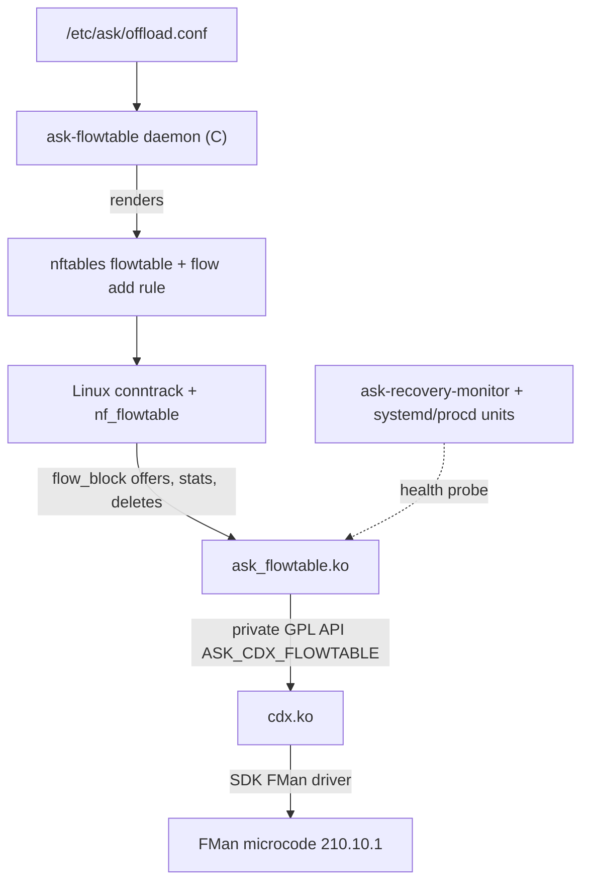
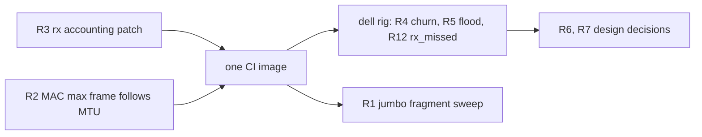

# Vendor ASK mono-1.2.2 review: recommendations for ASK2

Review date 2026-10-27/28. Vendor source: `we-are-mono/ASK`, local `/mnt/builds/ASK` at `edb9184` (tag `mono-1.2.2`, 2026-10-24), compared against `mono-1.0.7` (`38e212f`, 2026-09-13). Live reference: DUT2 `root@192.168.1.70` running Mono OpenWrt 25.12.6 with ASK `mono-1.2.1` (`c229b43`). ASK2 state: branch `dpaa1` at `20b841e9`, kernel tree `work/linux-6.18.57`, `kernel/ask/oot-modules/ask/`, `bin/kernel-fixups/`. The qdrant record of this review is the entry dated 2026-10-27 tagged `vendor-ask`, `lessons-for-ask2`.

This document is a review with recommendations. It does not replace [`ASK2-MASTER-PLAN.md`](ASK2-MASTER-PLAN.md) as the task queue; recommendations accepted here should be absorbed there as task IDs.

## 1. Summary

CMM is gone from the vendor stack. The vendor deleted dpa_app, fmc and fmlib on 2026-09-15 (`70f7085`, "cdx: build the classifier at module init, drop dpa_app"), the QoS conntrack mark (QOSMARK) on 2026-09-17 (`9c5b16c`), and CMM, FCI and auto_bridge on 2026-10-01 (`b1dd928`). `mono-1.1.0` is the first tag without them. Their sources survive only in the `mono-1.0.x` tags.

The vendor stack now has the same shape as ASK2. Linux conntrack and the nftables flowtable choose the flows, a kernel adapter (`ask_flowtable.ko`) receives the flowtable offload requests, and `cdx.ko` programs the FMan. The difference is the substrate: the vendor stays on kernel 6.12.112 with NXP's SDK FMan/DPAA driver (patch `010`, 25,038 lines), while ASK2 runs on mainline 6.18 with its own `fman_pcd` subsystem. Their kernel code does not port to ASK2. Their hardware findings and their fixes to shared Linux code do, and several point at likely defects in ASK2 today.

The highest-value recommendations, in order:

| ID | Priority | Recommendation | Why |
|---|---|---|---|
| R2 | P0 | Bound arrivals by the MAC's max frame length, not by the netdev MTU | Mainline never reprograms the MAC on an MTU change, and we boot with `fsl_fm_max_frm=9600`, so every port accepts 9600-byte frames. F-262's decision uses `bind_dev->mtu` |
| R3 | P0 | Fix mainline DPAA receive accounting for frames the software flowtable consumes | `dpaa_eth.c` counts them as `rx_dropped` and never as `rx_packets` (vendor patch 104) |
| R4 | P0 | Run a reopen-the-same-UDP-tuple churn test for the conntrack teardown "fuse" | 6.18.57 still clears `IPS_OFFLOAD` on every GC pass of a retiring flow; the vendor measured 82 live UDP flows killed at 16,384 connections (patch 142) |
| R5 | P1 | Test and, if confirmed, bound the receive congestion group by buffer count | Mainline's 256 MB ingress congestion threshold lets a CPU-bound flood hold the port's whole buffer pool, which also stops hardware forwarding on that port (vendor patch 111) |
| R6 | P1 | Add the PPPoE concentrator MAC to the PPPoE key | ASK2's 50-byte key carries the session ID only |
| R7 | P1 | Replace F-256's "leak and cold-boot" with a recover-to-software path | The vendor recovers from an unproven delete without a reboot |

One vendor claim does not apply to ASK2. The vendor says hardware IP fragments built on an Ethernet receive port carry an all-zero payload (A202, A385) and routes around it. ASK2's receive-port fragments were delivered intact in a same-rig A/B on 2026-10-15, while the vendor build of that time corrupted them (R1). That result is the most useful thing ASK2 can give back to the vendor (section 9).

## 2. What the vendor stack is now

### 2.1 Timeline

| Date | Commit / tag | Change |
|---|---|---|
| 2026-08-24 | `mono-1.0.0` | Last major line with cmm, fci, auto_bridge, dpa_app, iptables-extensions |
| 2026-09-13 | `mono-1.0.7` | Last tag with the CMM tree |
| 2026-09-15 | `70f7085` | Classifier built in `cdx` module init; dpa_app, fmc and fmlib retired |
| 2026-09-17 | `9c5b16c` | QoS conntrack mark retired |
| 2026-09-20 | `a893235` | `ask-flowtable` policy daemon rewritten in C, on by default |
| 2026-10-01 | `b1dd928` | CMM, FCI and auto_bridge sources removed |
| 2026-10-12 | `mono-1.1.0` | First tag without CMM |
| 2026-10-23 | `4777a6b` (`mono-1.2.0`) | `/proc/cdx_flowtable` split into `/proc/ask_flowtable` |
| 2026-10-24 | `edb9184` (`mono-1.2.2`) | 10G receive FIFO raised to 80 KB |

About 600 commits separate `mono-1.0.7` from `mono-1.1.0`. `ISSUES.md` now runs to A411.

### 2.2 Components

On `.70` the running processes are `ask-flowtable daemon --config /etc/ask/offload.conf` and `ask-recovery-monitor`. Loaded modules are `cdx` and `ask_flowtable`; there is no cmm, fci, auto_bridge or dpa_app. The shipped policy is four lines: `enabled yes`, `devices auto`, `scope any`, and exclusions for TCP 21, UDP 5060 and TCP 1723. Status lives in `/proc/ask_flowtable/{status,stats,flows,devices,l2,mcast,mroute}`; `status` reports `max_entries 32768` and `detour 1`.

### 2.3 Where each CMM subsystem went

From `docs/flowtable/cmm-porting-roadmap.md`:

| CMM subsystem | Lines | Replaced by |
|---|---:|---|
| `conntrack.c` | 3,661 | Linux conntrack and `nft_flow_offload` admission |
| `route_cache.c`, `module_route.c` | 2,257 | Linux FIB with selective route invalidation |
| `forward_engine.c`, `module_rx.c`, `module_tx.c` | 2,437 | `nf_flow_table_ip` and the cdx backend |
| `neighbor_resolution.c` | 1,063 | Linux neighbour table with selective invalidation |
| `keytrack.c` | 1,021 | Adapter cookie and tuple hash indexes |
| `module_qm` (QoS, CEETM) | 1,907 | Conntrack mark classification plus `ndo_setup_tc` HTB offload |
| `module_ipsec` | 618 | Mainline `xfrmdev_ops` packet offload |
| `module_mcast` | 1,785 | Bridge MDB snooping and `ipmr`/`ip6mr` MFC |
| `module_tunnel` | 1,223 | `ndo_fill_forward_path` on sit and ip6_tnl (patch 143) |
| `module_stat` | 985 | Folding hardware counters into `dev_get_stats()` |
| `module_wifi` | 345 | Netdev events plus the Wi-Fi offline port |
| `module_rtp`, `module_socket` | 2,490 | Retired, not ported |
| `module_macvlan` | 202 | Out of scope; CMM never offloaded it either |

### 2.4 Kernel patch delta

Removed since `mono-1.0.7`: `020` bridge hooks, `030` IPv4/IPv6 forwarding hooks, `050` conntrack offload, `060` netfilter QOSMARK, `093` L2FLOW netlink mutex, `097` xfrm trans-queue refcount.

Added, grouped:

| Patches | Purpose |
|---|---|
| `139`, `140`, `141`, `142`, `144`, `147`, `148`, `149`, `151`, `152`, `173`, `174`, `175` | Netfilter flowtable: per-flow context and shared invalidation handle (140, 2,242 lines, touches xfrm, bonding, FIB), teardown attribution and hand-back, conntrack timeout extension, transit ESP and IP-in-IP, IPS_SEEN_REPLY for carried replies, PPPoE peer check |
| `143`, `146` | Tunnel forward-path walk; xfrm mixed-family child route |
| `160`–`163`, `172` | Bridge: switchdev MDB, multicast snapshot, forwarding-state check, FDB lookup and refresh exports |
| `104`, `105`, `107`, `109`, `111`, `150` | SDK DPAA: receive counters, buffer seed failure, RCU around offload hooks, MAC max frame follows MTU, CPU queues bounded by pool share, hardware qdisc |
| `030`, `170` | IPv6 prefix route expiry; hop-limit checksum |

### 2.5 Classifier built in the kernel

`cdx` builds the FMan PCD in `module_init` from C descriptors (`cdx/cdx_pcd_desc.c`, `cdx/cdx_pcd.c`, `cdx/cdx_pcd_ports.c`). The XML in `config/pcd/` is a build-time input only, used to regenerate the soft-parser bytecode (`cdx/cdx_softparse.h`, 670 bytes, eight labels) and a reference model (`tools/host_tests/golden/cdx_pcd_model.json`). A host test compiles the builder unmodified, stubs the FMan entry points and compares every scheme, extract, table shape, FQID base and priority against the reference, including rollback of every failure point.

| Object | Count on gateway-dk |
|---|---|
| Ports | 7 (3×1G, 2×10G, 2 offline) |
| KeyGen schemes | 25 (18 shared-policy, 7 SEC) |
| Hash tables | 91 (14 groups × 6 ports, plus 7 SEC groups) |
| CC root trees | 7, one per port |

The unicast TCP/UDP tables use a 55-byte key (`CDX_UNICAST_KEY_SIZE`) with hash mask `0x7fff`, one table per protocol and family. The known fields (source and destination address, ports) come first; generic extracts follow with zero defaults (`cdx_pcd_tunnel_key()`): the inner/outer protocol bytes, the other family's addresses, and either 8 PPPoE header bytes (native scheme) or concentrator MAC plus session ID (PPPoE scheme). A native frame, a tunnelled frame and a PPPoE frame with the same inner tuple therefore never share a key. The logical port id is OR'd into FQID bits 16–19 and written to `prsResultPrivateInfo` for the soft parser.

## 3. Side-by-side with ASK2

| Area | Vendor mono-1.2.2 | ASK2 (`dpaa1` `20b841e9`) |
|---|---|---|
| Kernel / FMan driver | 6.12.112, NXP SDK FMan + `010` | Mainline 6.18.57 + `fman_pcd` patches and fixups |
| Flow source | nf_flowtable, patch 140 context | nf_flowtable, stock flow_block API |
| Unicast key | 55 bytes, per-protocol tables, tunnel and PPPoE identity fields | 50 bytes dual-lane (`ASK_FE_KEY_SIZE_DUAL`), PPPoE session ID at byte 48 |
| Collision chains | Vendor cumulative nodes | Cumulative nodes (F-269) |
| Delete safety | Unlink, one host-command barrier per ≤1,024 unlinks, then free | Unlink, FMFP_EXTC[INV0] sync per delete, then free (F-254); bucket index (F-264) |
| Unproven delete | Latch, bypass the classifier, settle, restore; no reboot | F-256 keeps the record (leak) and needs a cold boot |
| TCP SYN/FIN/RST on hit | Soft parser sends to CPU | `tcp_ctl_punt` default on (F-266), plus `ttl_punt` |
| Offload timing | At first offer | `offload_delay_ms` default 0 |
| Oversize non-TCP into smaller path | Software, or IPv4 UDP via offline-port detour, because their receive-port fragments were corrupt | Receive-port microcode fragmenter (F-262), intact in the 2026-10-15 A/B, IPv6 included by default (`ipv6_hw_frag=1`) |
| Interface counters | Folded into `dev_get_stats()` | Folded via `ask_stats.c` and patch `0171` |
| Flow statistics | One adapter pass per second through the context handle | Per-flow `FLOW_CLS_STATS` from nf_flowtable |
| Admission budget | 32,768 directions, explicit | No fixed ceiling, `max-flows 0` |
| Configuration | Policy daemon generates flowtable and rule | VyOS CLI: `offload ipv4\|ipv6` arms the port, a separate flowtable and `action offload` rule are needed |
| 10G receive FIFO | 80 KB | Mainline default 24 KB |

## 4. Recommendations

Each recommendation states the vendor finding, the ASK2 state with source location, what to do, and how to verify it. Priorities: P0 is a possible correctness defect in the shipping image; P1 is robustness or security; P2 is scale, operability or process.

### R1 (P2): Extend the fragmentation evidence to larger frames

Vendor finding. The microcode fragments a packet that exceeds the entry's MTU (IPv4 without DF, and any IPv6). For a frame received on an Ethernet port, "those fragments leave with correct headers and an all-zero payload, so the receiver discards them" (`docs/flowtable/architecture.md`, "Native context and admission"; `ISSUES.md` A202 and A385; `docs/flowtable/ipv6.md`). Only an offline port fetches the whole frame before its PCD runs, which is why the vendor carries IPv4 UDP into a smaller path through offline port `dpa-fman0-oh@4` (`cdx/cdx_detour.c`) and keeps every other such non-TCP direction in software.

ASK2 state. F-262 (`bin/kernel-fixups/F_262.py`) configures the fragmenter with `frag_options` `0x000c`, a dedicated 2048 × 2048-byte BMan pool, ENQUEUE MTU and pool, `05 PREEMPTIVE_CHECKS`, and the receive-port register triple (params page misc `|= 0x40000000`, `FMBM_RCMNE = 0x0e`, `FMBM_RFENE = 0x22`). `ask_flow_offload.c:2265-2278` installs the MTU check for IPv4 and, unless `ipv6_hw_frag=0`, for IPv6.

The vendor's claim does not hold for ASK2. On 2026-10-15 `bin/testrig-pppoe-frag.py` sent 6,000 UDP datagrams of 1500-byte IP into the 1492 PPPoE session through each DUT and counted datagrams the receiving socket accepted, which requires a valid UDP checksum over the whole payload (qdrant 2026-10-15; the raw result files are not in the repository). ASK2 (.185, image 2026.10.14-0217) fragmented in hardware and delivered 6,000/6,000 for IPv4 DF-clear and 6,000/6,000 for IPv6, with the FMan frag-info counters showing two fragments per datagram. The vendor build on .106 at the time also fragmented in hardware, but the first fragment's UDP header was all zeros: IP reassembly succeeded and UDP rejected 5,999–6,000 of 6,000 (IPv4) and all 6,000 (IPv6). The current vendor `cdx_init_frag_module()` (`cdx/cdx_ehash.c:3315`) seeds a 512-buffer pool of `dpa_bp_size(NULL)` bytes with the same `frag_options`, so the pool, the buffer layout or the SDK receive path are the likely differences. None is proven.

Two limits remain on the ASK2 side. The evidence covers only 1500-byte packets into a 1492 path. And IPv6 fragments reuse identification values under concurrency (qdrant 2026-10-09, [`ASK2-PPPOE-OFFLOAD-PLAN.md`](ASK2-PPPOE-OFFLOAD-PLAN.md) §3.7): one flow is fine, but two unthrottled oversize flows between the same address pair delivered 1.7%.

Recommendation. Extend the same probe to 2,000, 4,000 and 8,000-byte packets from a jumbo ingress (after R2) and to two concurrent IPv4 flows. Keep the receive-port fragmenter; do not copy the vendor's offline-port detour. Revisit the `ipv6_hw_frag=1` default on the fragment-ID race and RFC 8200 grounds, as that plan already notes.

**Result (2026-10-28, 0209, MTU 3600 on DUT eth4 and gen2):** IPv4 jumbo 2000/3000/3500-byte datagrams into the 1492 PPPoE session: 2000/2000 delivered intact for each size (reassembled by the receiver, hardware plus kernel fragmentation). IPv6 returns ICMPv6 Packet Too Big from the host path and delivers nothing, which is correct router behaviour. No kernel errors; MTU restored to 1500.

### R2 (P0): Bound arrivals by the MAC's max frame length

Vendor finding. Patch `109-sdk_dpaa-rx-max-frame-follows-mtu` programs each port's mEMAC max frame from its MTU: `max(mtu, 1500)` plus Ethernet header and FCS, plus one VLAN tag while the port has any upper device and two when a VLAN on it is 802.1ad or stacked. Without it, a port at MTU 1500 accepted about 9.6K frames. The vendor's admission bound for a direction is `max(port MTU, 1500)` less what the direction strips, never the logical device's MTU (A346).

ASK2 state. `work/linux-6.18.57/drivers/net/ethernet/freescale/dpaa/dpaa_eth.c:3015` (`dpaa_change_mtu()`) only stores the new MTU; `fman_memac.c` writes `maxfrm` once at init from `fman_get_max_frm()`. `board/scripts/vyos-postinstall:67` boots with `fsl_dpaa_fman.fsl_fm_max_frm=9600`, so every port accepts 9600-byte frames whatever its MTU. `ask_flow_offload.c:3549-3558` installs the hardware MTU check only when the route MTU is below `bind_dev->mtu` (less 8 bytes for PPPoE). A 1500-byte port therefore installs no check for a 1500-byte egress, and an oversized frame from a host with a larger MTU is forwarded in hardware as received.

Recommendation. Either add a board patch that makes `dpaa_change_mtu()` reprogram the MAC like vendor patch 109, or make `ask.ko` use the MAC's real limit as the ingress bound. The patch is preferred: it also makes the software path drop what the configured MTU forbids. Keep the 9600 module parameter as the ceiling.

Verification. With eth3 at MTU 1500 and a 9000-byte MTU on the dell side, send 2000-byte frames: the MAC must count them as oversize and no hardware forwarding may occur. Repeat with a VLAN upper on the port.

### R3 (P0): Fix DPAA receive accounting for software-flowtable frames

Vendor finding. Patch `104-sdk_dpaa-rx-stats-before-stack-verdict`: `netif_receive_skb()` returns `NET_RX_DROP` for a frame consumed by the `NF_NETDEV_INGRESS` hook, which is how the software flowtable forwards. The SDK driver counted only non-drop returns, so every software-forwarded frame vanished from `rx_packets`.

ASK2 state. Mainline has the same pattern at `dpaa_eth.c:2826-2834`: a `NET_RX_DROP` return increments `rx_dropped`, and only other returns increment `rx_packets` and `rx_bytes`. Every frame the software flowtable forwards on ASK2 (flows not yet offloaded, software fallback, ports without `offload`) is counted as a drop. This is from code reading; it was not measured on .185 during this review because no software-flowtable traffic was flowing.

Recommendation. Board patch: count `rx_packets` and `rx_bytes` before `netif_receive_skb()` and stop treating its return value as a drop report. The `ask_stats.c` hardware fold is disjoint from this path and needs no change.

Verification. On a port without `offload`, with a software flowtable, forward 100,000 frames: `ip -s link` receive packets must rise by 100,000 and dropped must not.

### R4 (P0): Test for the conntrack teardown fuse under UDP churn

Vendor finding. `docs/flowtable/retirement-investigation.md` and patch `142-ask-flowtable-teardown-handback`. A tuple reopened while its predecessor flow is still waiting for hardware retirement leaves two flows on one conntrack. The old flow's `flow_offload_teardown()` runs on every GC pass and clears `IPS_OFFLOAD` from the conntrack the new, hardware-forwarded flow now uses. The timeout refresh then stops, the conntrack expires, and the live flow is retired. At 16,384 connections the vendor saw 82 conntracks reaped, 78 matching that pattern, UDP only (established TCP's fixed-up timeout is 431,880 s against UDP's 90 s). Their fix clears the bit once per flow and takes the flowtable timeout off only for a flow that actually expired. The patch notes say upstream `d2d31ea8cd80` (6.15) fixes the reworked code shape.

ASK2 state. `work/linux-6.18.57/net/netfilter/nf_flow_table_core.c:392-397` still calls `clear_bit(IPS_OFFLOAD_BIT, ...)` unconditionally on every `flow_offload_teardown()`; only the fixup is guarded by `NF_FLOW_TEARDOWN`. `nf_flow_offload_gc_step()` (line 568) calls teardown on every pass while the flow is expired or its conntrack is dying, and `nf_flow_table_extend_ct_timeout()` (line 510) refreshes only conntracks that carry `IPS_OFFLOAD`. Whether 6.18 can still create the second flow on the same conntrack is not established by reading.

Recommendation. Reproduce before patching. Add a churn case to the dell harness: many UDP flows offloaded, each closed and reopened on the same 5-tuple within one GC interval, sustained for several minutes. Count conntrack destroy events for tuples whose flow is still forwarding. If it reproduces, carry a backport of the vendor guard as a Tier C netfilter patch.

Verification. Zero conntracks reaped while their flow is live over the run, compared against an unpatched control.

Result 2026-10-28 (`.185`, image `2026.10.28-0209`, `bin/testrig-udp-churn.sh`, IPv4, 500 tuples x 5 delete/reopen cycles with 1,000 ehash records offloaded, 150 s live hold): 0 conntracks destroyed while live, ehash 0 and MURAM 58764 (baseline) after teardown, 0 kernel errors. Not reproduced under forced `conntrack -D` reopen. The vendor's expiry-driven race (old flow awaiting hardware retirement) is not exercised by this variant; IPv6 and a long-timeout/16,384-tuple run remain open. Smoke rerun 2026-10-28 (N=200, CYCLES=3, HOLD=30): 0 live DESTROYs of 501, 0 kernel errors, same result.

### R5 (P1): Bound the ingress congestion group by buffers

Vendor finding. Patch `111-sdk_dpaa-cpu-queues-bounded-by-pool-share`. Frames waiting on a port's queues to the CPU hold receive buffers, and the congestion group counted bytes up to 256 MB, so a flood the CPU could not keep up with held the whole pool and every port missed frames, hardware forwarding included. The fix counts frames, at half of what the port seeds the pool with.

ASK2 state. Mainline uses `DPAA_INGRESS_CS_THRESHOLD 0x10000000` (`dpaa_eth.c:69`, applied in `dpaa_ingress_cgr_init()` at line 3231). Mainline gives each interface its own buffer pool, so the blast radius is one port rather than all of them, but an offloaded flow entering that port shares its pool with the CPU-bound traffic.

Recommendation. Test first: run an offloaded flow through eth3 while flooding eth3 with traffic that cannot be offloaded (for example a UDP flood to an unrouted address, or ICMP), at a rate the CPU cannot sustain. If the offloaded flow loses frames or the port's buffer pool empties, add a board patch that sets the ingress threshold in frames relative to the pool size.

**Result (2026-10-28, 0209):** reproduced. Kernel pktgen from gen1 (2 threads, 64 B UDP, about 2 Mpps to the DUT eth3 IP) drove one core to 96% softirq. A concurrent offloaded iperf flow fell from 9.4 Gbit/s to 0 after about 6 s and stayed at 0 for the flood (ehash pkt_count frozen). `qman cg_tdrop`, `entered congestion` and `rx dropped` did not move; `softnet_dropped` did. Throughput recovered afterwards (8.86 Gbit/s), no kernel errors. `DPAA_INGRESS_CS_THRESHOLD` is byte-based at 256 MB so it never trips; likely cause is port buffer-pool exhaustion (unproven). Needs a kernel patch and a CI run (Qdrant gate first).

**Fix result (2026-10-28, image 1555, board patch `0178`, frame-mode ingress group at 1280 frames):** the same flood (2 threads, 64 B UDP, 2 Mpps total, 12 s) with a concurrent offloaded iperf flow no longer stalls it. Throughput stayed 8.1 Gbit/s typical (minimum 6.55) against 9.4 Gbit/s unloaded, and returned to 9.4 Gbit/s after the flood; before the patch it fell to 0 after about 6 s. No kernel errors beyond the existing F-148 and tc-callback messages. The remaining 14% dip is the flood sharing the port's wire and queue with the flow.

**R4 IPv6 follow-up (2026-10-28, image 1555):** `FAM=6 N=200 CYCLES=3 HOLD=30 bin/testrig-udp-churn.sh` PASS: 0 live-window DESTROYs of 501, 400 ehash records at hold, 0 after delete, MURAM 58764 baseline, 0 kernel errors. **16,384 tuples (IPv4, `N=16384 CYCLES=2 HOLD=60`) PASS:** 32768 ehash records live during the hold (2 per tuple), 0 DESTROYs inside the live window, ehash empty after delete, MURAM 58764 baseline, 0 kernel errors. The first attempt was void (generator hit the 1024 open-file limit); the harness now raises `ulimit -n 65536`. R4 is closed.

### R6 (P1): Key PPPoE flows on the concentrator MAC

Vendor finding. The vendor's PPPoE schemes extract the concentrator MAC (Ethernet source, 6 bytes) and the session ID into the key. Patch `151-netfilter-flowtable-pppoe-peer` adds the same check to the software flowtable: "a matching session ID and inner tuple do not authenticate the Ethernet sender".

ASK2 state. `ask_flow_offload.c:2193` writes `pppoe_sid` at byte 48 of the 50-byte dual-lane key; the concentrator MAC is not part of the key. Any station on the PPPoE segment that sends a frame with the session ID and an offloaded inner tuple is forwarded in hardware.

Recommendation. Decide the threat model. If the WAN segment can carry other stations, add the 6-byte Ethernet source to the PPPoE decap key. This changes the key size and the KeyGen scheme, so it falls under the AGENTS.md S0 qdrant gate and the §10.3 single-constant rule.

### R7 (P1): Recover from an unproven delete without a reboot

Vendor finding. `docs/flowtable/architecture.md`, "Hardware deletion and shutdown" and "Datapath restart". When a delete's barrier cannot be proven, cdx latches a failure, stops the classifier ports only until the registers report them idle, switches them past the classifier (`FM_PORT_BypassPCD()`) so everything forwards in software, settles the possibly linked records with a fresh barrier, and then restores the PCD. Restarts are rate-limited (`flowtable_restart_limit`, three per ten minutes) and reported in `/proc/ask_flowtable/status` and `/sys/module/cdx/parameters/flowtable_degraded_reason`.

ASK2 state. F-256 (`bin/kernel-fixups/F_256.py`) keeps a record whose FMFP_EXTC[INV0] sync timed out (leaked) and logs it, on the basis that "the FMan is already wedged and needs a cold boot".

Recommendation. Design a degraded mode in the same spirit: on a sync timeout, disengage every armed port back to the boot-default RSS path (our reversible S1→S0 transition, checked by `pcd-snapshot`), retry the sync, free the parked records only after a sync succeeds, and re-engage with a rate limit. Whether the FMan can be brought back without a cold boot depends on the wedge class (F-256 recorded a DMA bus error that froze 14 tasks), so the first step is to classify which sync timeouts are recoverable.

### R8 (P2): Statistics cost at scale

Vendor finding. Asked flow by flow, a full table cost 47% of the four CPUs (14,500 requests per second); one adapter pass per second pushing deltas through the patch-140 handle cost 23%, against 16% for the traffic alone (`docs/flowtable/architecture.md`, "Statistics, diagnostics and verification").

ASK2 state. Each hardware flow is answered through `FLOW_CLS_STATS` (`ask_flow_offload.c:4067`). F-264 removed the O(N²) table scan, but the per-flow request rate is Linux's.

Recommendation. Measure ASK2's CPU at 8,192 and 16,384 bidirectional flows with no traffic and with line-rate traffic. Only if the stats path is a material share, consider a batched pass; it needs a netfilter patch similar to 140, which is a Tier C maintenance cost.

### R9 (P2): Explicit admission budget

Vendor finding. A fixed budget of 32,768 directions with clean overflow to software and no eviction (`docs/flowtable/capacity.md`). Capacity refusal is counted as a reject, never as busy, and does not retire the other direction.

ASK2 state. `get-info` reports `max-flows 0` by design (DDR chains have no fixed ceiling). Behaviour at very large flow counts is bounded only by memory and lock hold times.

Recommendation. Pick a tested ceiling, enforce it in `ask.ko`, report it in `max-flows`, and add a capacity case to the harness that fills the table, overflows it and verifies the overflow stays in software.

### R10 (P2): One-line enable for the operator

Vendor finding. The policy daemon renders the flowtable and the `flow add` rule from `devices auto` and `scope any`, with default exclusions for the FTP, SIP and PPTP control ports.

ASK2 state. The 2026-10-10 contract analysis (qdrant) found that `offload ipv4|ipv6` only arms the port; without a separate flowtable and `action offload` rule nothing is offloaded, and nothing warns about it.

Recommendation. Make `offload ipv4|ipv6` generate a hidden flowtable and an early offload rule for the armed ports, with the same three default exclusions, as already proposed in that analysis.

### R11 (P2): Audit dependency retirement against the vendor's event table

Vendor finding. Every installed direction is retired selectively on: neighbour MAC or state change; committed IPv4/IPv6 route prefix change; MTU, down, carrier or MAC change on any device the path names or crosses; upper-device changes (port joining a bridge, VLAN created); bridge FDB move, age-out or delete for the destination MAC; bridge VLAN membership changes; routing-rule add/delete (retire all). Nexthop-object mutation stops admission globally (`docs/flowtable/architecture.md`, "Dependency retirement and recovery").

ASK2 state. Not audited in this review. `ask_neigh.c` handles neighbours; PPPoE and IPv6 fragmentation have targeted flushes.

Recommendation. Build a table of the same events against ASK2's notifiers and test each missing one with a live flow on the rig. Route changes and FDB moves are the most likely gaps, because a stale hardware entry keeps forwarding without any packet reaching Linux.

### R12 (P2): Receive FIFO for the 10G ports

Vendor finding. NXP's 24 KB 10G receive FIFO let the MAC's own FIFO overflow under 128 KB TCP bursts with IPsec (A352, fixed at 48 KB), and again whenever a core streams memory beside line rate, because memory bandwidth tops out near 5 GB/s (A399). 80 KB (`fifo-size = <0x14000 0x00>`, `total-fifo-size = <0x4cc00>`) cut those misses about 40%; FMan priority elevation, DMA emergency, bus priority, 16 open DMAs and a CCI-400 QoS override did not help.

ASK2 state. Mainline `get_dflt_num_of_fifo_bufs()` (`fman_port.c:1164`) gives a 10G receive port 96 units of 256 bytes, 24 KB. ASK2's MURAM use was 52,922 bytes in the 2026-10-09 measurements.

Recommendation. Add `rx_missed` on eth3/eth4 to the harness's per-cell counters. If it moves under load, raise the 10G receive FIFO after checking the MURAM budget with `pcd-snapshot`. This is a MURAM change, so it falls under the S0 qdrant gate.

**Result (2026-10-28, image 2026.10.28-0209, bidirectional 10G, 4 streams each way, 40 s):** 8.18 and 7.63 Gbit/s with about 500k and 408k retransmits; unidirectional 4 streams reach 9.13 Gbit/s with about 900 retransmits. Offload confirmed (HW_OFFLOAD conntrack and ehash pkt_count rise, kernel rx flat). No software counter moves, and ethtool exposes no MAC RX FIFO overrun counter, so FIFO loss cannot be measured on this image; retransmits are the only proxy.

**Measurable after all (2026-10-28, image 1555):** the mEMAC `RDRP` counter (CCSR `0x1AF0158` eth3, `0x1AF2158` eth4, read via `/dev/mem`) does count the loss. `iperf3 -P 4 --bidir -t 30` (8.90 and 8.88 Gbit/s, 4463 and 4873 retransmits) moved RDRP by +3734 (eth3) and +3756 (eth4), about the retransmit count. Fix: board patch `0179` makes the 10G RX BMI FIFO a module parameter `fsl_dpaa_fman.fsl_fm_rx10g_fifo_kb` (default 64 KB, was 24 KB; total BMI FIFO 295 KB). Retest = same run, expect RDRP delta and retransmits well below baseline.

**R12 retest (2026-10-28, image 2258, FIFO 64 KB, `fsl_dpaa_fman_port.fsl_fm_rx10g_fifo_kb`=64, no probe errors):** 8 bidir runs after a cold first run (165k/77k retransmits, RDRP +87/+135, flows not yet warm). Runs 2-8: RDRP delta per run 75 to 1060 with 326 to 904 retransmits per direction in 20 s, except one 30 s run at +3340/+2979 (about the 24 KB baseline of +3.7k). Throughput 8.1 to 9.0 Gbit/s each way. Mostly better than the 24 KB sample, but not eliminated and bimodal, so an A/B at 24 KB on the same image (boot arg `fsl_dpaa_fman_port.fsl_fm_rx10g_fifo_kb=24`) is still needed before calling 64 KB the fix; 80 KB is the next step to try.

### R13 (P2): Know the parser's reach

Vendor finding. The parser reads only the first 256-byte internal buffer, and the frame starts at the `FMBM_RIM[FOF]` offset, 96 bytes on every vendor port, so the parser reaches byte 160. A header that ends past it is marked block-limit-exceeded and the microcode's hash entry discards most such frames (`CLS_DISCARD`): long IPv6 extension chains, SRv6, deep encapsulation stacks. The vendor folds the BMI filter counter into `rx_dropped` so the drops are visible (`docs/in-kernel-pcd.md`, "The parser's reach").

ASK2 state. Not measured. Mainline sets `int_buf_start_margin` from `internal_buf_offset` (`fman_port.c:978-982`).

Recommendation. Read the live `FMBM_RIM` on an engaged port, record the resulting reach in `arch/fman-microcode-210-programming-reference.md`, and test an IPv6 UDP flow with 96 bytes of destination options on an engaged port.

### R14 (P2): Test-process habits worth copying

1. KASAN builds for board test runs. The vendor requires it for every DUT run, and it has found real use-after-free and race bugs there. Our `kunit:true` CI image is the natural place to add a KASAN variant.
2. A host-side test of the classifier builder against a saved reference model. ASK2's §17 tripwires (static asserts, KUnit, `fe_verify` readback) cover encodings; a reference model of the whole engaged PCD would also catch scheme order and FQID base mistakes.
3. Check CRC and error counters at both ends of each link before blaming forwarding. The vendor's long "UDP loss investigation" closed as a cable: 2,865 CRC errors on the endpoint, none on the DUT (`docs/flowtable/udp-loss-investigation.md`).

## 5. Silicon and microcode facts to adopt as rules

These are stated by the vendor with hardware evidence. They are recorded in qdrant and should be added to `arch/fman-microcode-210-programming-reference.md` when that document is next edited.

1. Do not extract the FQID (`nonheader source="fqid"`) into a KeyGen key on an offline port. A frame that misses after such an extraction leaves the offline-port task unfinished; it holds its task number, the shared pool (124 on this SoC) runs out, the QMI stops issuing dequeues, and host commands time out with a fail-stop (A276; fixed by reverting `11aa150`). This is the same class as the earlier `fman_pcd` task-number stall.
2. The microcode fragments IPv6 with its own sequential identification and never sends Packet Too Big. `PREEMPT_DFBIT_HONOR` and the fragmenter's DF action act on IPv4 only. This matches our 2026-10-09 measurements.
3. A line-rate flood of jumbo frames through an offline port timed out the FMan host-command channel (A394). Keep jumbo-port traffic out of any future offline-port path.
4. The insert opcode names no PPP protocol ID; the microcode picks it and picks correctly for IPv6 (vendor `docs/flowtable/pppoe.md`).
5. Hardware packet and byte counters include Ethernet header and minimum padding and exclude FCS: a 256-byte UDP payload counts 298 bytes, an 8-byte payload 60 bytes. Later punts (TTL, MTU) may already have been counted.

## 6. Already at parity, no action

- TCP SYN/FIN/RST punt to the CPU on a hit (`ask_hw.c` `tcp_ctl_punt`, default on), and TTL/hop-limit ≤ 1 punt (`ttl_punt`, default on).
- Offload at the first offer (`offload_delay_ms` default 0 since 2026-10-15).
- Sync before freeing a deleted record, with a single 64-bit pointer store (F-254).
- Bucket index for lookups and deletes (F-264).
- Cumulative nodes for collision chains (F-269).
- Hardware counters folded into the interface statistics (`ask_stats.c`, patch `0171`).
- Neighbour resolution kick for unresolved next hops (`neigh_event_send()` in `ask_flow_offload.c`).

## 7. What not to copy

- The SDK FMan/DPAA driver and patch `010`: tied to 6.12, 25,038 lines, and the reason the vendor cannot move kernels easily.
- Patch 140 wholesale: 2,242 lines across netfilter, xfrm, bonding and the FIB. Take individual mechanisms only where a measurement justifies them (R4, R8).
- Per-SA IPsec tables keyed on the FQID: the vendor reverted them (section 5, item 1).
- The offline-port detour (`cdx/cdx_detour.c`). It exists because the vendor's receive-port fragments were corrupt; ASK2's are intact (R1), and the detour costs a 6.4 Gbit/s cap, an offline port and the jumbo host-command stall (A394).

## 8. Suggested order

R2 and R3 are small board patches that can share one CI build. R4, R5, R12 and the R1 sweep are harness additions that run on that image. R6 and R7 need design decisions before code.

## 9. Findings to share with the vendor

ASK2 runs the same microcode on the same board through a different driver stack, and several of its findings would help the vendor directly. Each item names its evidence.

| # | Finding | Value to the vendor | Evidence |
|---|---|---|---|
| V1 | Receive-port fragmentation can produce intact fragments. ASK2 delivered 6,000/6,000 IPv4 DF-clear and IPv6 datagrams through hardware fragmentation where the vendor build zeroed the first fragment's UDP header. ASK2's configuration: `frag_options 0x000c`, dedicated pool of 2048 × 2048-byte buffers (vendor: 512 × `dpa_bp_size(NULL)`), ENQUEUE MTU and pool ID, `05 PREEMPTIVE_CHECKS` with param `38 03`, receive-port triple | Could retire the offline-port detour and its limits: 6.4 Gbit/s cap, no PPPoE download (A393), no jumbo LAN (A394), IPv6 kept in software | qdrant 2026-10-15 PPPoE fragmentation parity; `bin/testrig-pppoe-frag.py`; `bin/kernel-fixups/F_262.py` |
| V2 | The microcode reuses IPv6 fragment identification values under concurrency (shared `v6_identification` counter at frag-info `+24`). Two unthrottled oversize flows between one address pair: 1.7% delivered; four flows: 5,860 of 16.46M | Applies wherever their microcode fragments IPv6, including decrypted IPv6 leaving the SEC offline port | qdrant 2026-10-09 fragment-ID race; [`ASK2-PPPOE-OFFLOAD-PLAN.md`](ASK2-PPPOE-OFFLOAD-PLAN.md) §3.7 |
| V3 | With the receive-port triple set, an ENQUEUE MTU of 1500 on a record with no fragmentation info sends any larger packet into the fragmenter and the port goes permanently deaf. Records that must never fragment need MTU `0xffff` (`EN_EHASH_DISABLE_FRAG`) | Worth checking against their jumbo support (`b957f82`) for every record type they create | qdrant 2026-10-22 F-270; `bin/kernel-fixups/F_270.py` |
| V4 | Measurement traps in fragmentation probes. After a DF-set case the sender caches PMTU 1492 and pre-fragments every later datagram, so the DUT only sees fragments and looks like the software path. Flush route caches between cases and use `IP_MTU_DISCOVER=DONT` / `IPV6_PMTUDISC_PROBE`. Warm an IPv6 flow with small datagrams first, or the oversize first packet gets Packet Too Big and the flow never offloads | Avoids false results in their fragmentation tests | qdrant 2026-10-15 |
| V5 | The whole PCD (KeyGen, external hash, cumulative nodes, FE opcodes, policer, fragmentation) works on mainline 6.18 without the SDK. ASK2 documents it register by register, including the raw CRC-64 hash model (no final complement), PORT_ID `0x00` in the key, the KeyGen generic-extract encodings and the rule that only validated header codes zero-fill an absent lane | A route off the 25,038-line SDK patch and the 6.12 pin | `arch/fman-microcode-210-programming-reference.md`; `specs/fman-keygen-flow-key-spec.md`; `kernel/common/patches/board/` |
| V6 | Mainline traps they will meet if they move: the policer block boots disabled (`FMPL_GCR` EN and STEN clear, fixed by writing `0xC0500002`); offline-port nodes have no `fsl,qman-channel-id`; `fman_bus_error()` logs DMA bus errors only at debug level; without the receive-port triple a `BPID_ENABLE` fragmenter emits one fragment and the port goes deaf after exactly 11 fragmented frames | Saves the bring-up time we spent | AGENTS.md S5 and S10; F-256; F-262 |
| V7 | Per-port engage and disengage at runtime, returning the FMan to the boot RSS state byte for byte (`board/scripts/pcd-snapshot`). The vendor needs a reboot after a cdx load/unload cycle (`docs/in-kernel-pcd.md`, "Startup rollback") | Module reload and live reconfiguration without a reboot | [`DUAL-DATAPLANE.md`](DUAL-DATAPLANE.md); `pcd-snapshot` |
| V8 | Standard control surfaces: the hardware ingress policer through `tc` matchall police offload, exact-match steering through ethtool ntuple (`0194`), flow dump through a YNL genetlink spec (`kernel/ask/uapi/ask.yaml`) | Their QoS plan lists the ingress-policer rate as having no consumer control surface yet | `vyos-1x-025`; patches `0100`, `0104`, `0194` |
| V9 | Line-rate routed, NAT, VLAN and PPPoE forwarding with the stock nf_flowtable flow_block API and no netfilter core patch | A data point for what the 2,242-line patch 140 is needed for and what it is not | [`ASK2-VENDOR-PARITY.md`](ASK2-VENDOR-PARITY.md) |
| V10 | Same-rig benchmarks of their OPNsense build (26.7.7_8) against their earlier OpenWrt build: bidirectional routed 16.08 vs 17.99 Gbit/s; 64-byte capacity 0.85–1.12 vs 1.84 Mpps at ≤0.001% loss; 62.75–63.01% loss at 3.14 Mpps offered | Feedback on their FreeBSD port's forwarding path | [`ASK2-VENDOR-PARITY.md`](ASK2-VENDOR-PARITY.md), three-way summary 2026-10-18 |

V1 and V2 are the two worth sending first. V1 needs a caveat: the vendor build tested on 2026-10-15 predates `mono-1.2.x`, whose policy now keeps such flows out of the receive-port fragmenter, so the comparison should be repeated on `.70` with the detour turned off (`cdx` parameter `detour=0`) before it is presented as a current defect.

## 10. Sources

Vendor documents, all under `/mnt/builds/ASK`: `README.md`; `ISSUES.md` (A202, A276, A346, A352, A385, A393, A394, A399); `docs/in-kernel-pcd.md`; `docs/flowtable/README.md`, `architecture.md`, `capacity.md`, `cmm-porting-roadmap.md`, `fman-hc-wedge-research.md`, `ipv6.md`, `policy.md`, `retirement-investigation.md`, `udp-loss-investigation.md`; `cdx/cdx_pcd.c`, `cdx/cdx_pcd_desc.c`; `patches/kernel/104`, `109`, `111`, `140`, `142`, `151`; `dts/mono-gateway-dk.dts` at `edb9184`.

ASK2: `kernel/ask/oot-modules/ask/ask_flow_offload.c`, `ask_hw.c`, `ask_stats.c`, `include/ask_internal.h`; `bin/kernel-fixups/F_254.py`, `F_256.py`, `F_262.py`, `F_264.py`, `F_269.py`; `board/scripts/vyos-postinstall`; mainline `work/linux-6.18.57` (`drivers/net/ethernet/freescale/dpaa/dpaa_eth.c`, `drivers/net/ethernet/freescale/fman/fman_port.c`, `net/netfilter/nf_flow_table_core.c`).

qdrant: 2026-10-09 F-262 entries (fragmentation root cause, IPv6 fragment-ID race, vendor IPv6 handling), 2026-10-10 ASK2 CLI contract analysis, 2026-10-15 PPPoE fragmentation parity (ASK2 vs vendor), 2026-10-22 F-270 MTU wedge, 2026-10-27 vendor review.

### Same-rig vendor comparison, quick pktgen trial (2026-10-28)

`bin/testrig-pktgen.sh trial port-v4 64`, 10 s, both DUTs on the same generators, HW share 1.000 on both:

| Offered | Vendor `.70` loss | ASK2 `.185` loss |
|---|---|---|
| 1.0 Mpps | 0.00000 % | 0.00003 % |
| 1.5 Mpps | 0.00000 % | 0.00001 % |

Both sustain 1.5 Mpps 64 B fully offloaded with effectively no loss (ASK2 lost 2 of 15 M). A full PDR search (`bin/testrig-compare.sh`) is still needed for the ceiling.

R1 concurrent two-flow IPv4 oversize: not run. `bin/testrig-pppoe-frag.py` binds a fixed receiver port and a fixed warm source port (5990), so two parallel instances collide (`EADDRINUSE`). The harness needs per-instance ports before this case can be tested.

**R12 A/B (2026-10-28, image 2258, same rig, U-Boot one-shot boot arg `fsl_dpaa_fman_port.fsl_fm_rx10g_fifo_kb=N`, 8 x `iperf3 -P 4 --bidir -t 20`, cold first run, RDRP summed over both 10G ports):** 24 KB: first run RDRP +22.9k, runs 2-8 +1.5k to +5.1k per run (about 49k total), 2.5k to 7.2k retransmits per run, 8.3-8.8 Gbit/s TX / 8.8-8.95 RX. 80 KB: first run +389, runs 2-8 +0 to +1.1k (about 3.3k total for all 8 runs, about 15x fewer), 0.6k to 2.3k retransmits per run, same throughput, all five ports probe cleanly. 80 KB is the clear improvement, so patch `0179` default is raised from 64 to 80 KB (matches the vendor value); needs a CI build to ship. The 64 KB sample earlier (RDRP 75-1060 per run) sits between the two.

**R12 shipped-image check (2026-10-29, image 2026.10.29-0010, kernel 6.18.59-vyos, default FIFO 80 KB, no boot arg):** `fsl_fm_rx10g_fifo_kb` reads 80, all five ports up. 8 x `iperf3 -P 4 --bidir -t 20` straight after boot: RDRP total +4.9k (eth3) and +4.5k (eth4) over the 8 runs, of which one run (+3.2k/+3.0k) is a burst; the other seven add 0 to 0.5k each. Retransmits 0.6k to 7.4k per run, throughput 7.9-8.85 Gbit/s TX, 8.8-8.95 RX. About 5x below the 24 KB total (about 49k), a little worse than the one-shot 80 KB A/B (about 3.3k); loss is greatly reduced but not eliminated, and bursty.

**R1 concurrent two-flow IPv4 oversize (2026-10-29, image 2026.10.29-0010):** `bin/testrig-pppoe-frag.py` gained `INSTANCE=n` (shifts receiver and warm source ports). Two instances in parallel, each 3000 x 1500-byte IP datagrams at 2000 pps on its own warm, offloaded 5-tuple into the PPPoE session: both delivered 3000/3000 intact, dell1 reassembled 6000 in total, DUT kernel saw 20 frames (0 %), no ICMP. Hardware fragmentation holds with two concurrent flows. R1 closed.

### R6 and R7 design decisions (2026-10-29)

Qdrant gate (3 queries: PPPoE 50-byte key layout, F-256/INV0 sync timeout, ehash key-size limits) found no contradiction. Facts that bound the design: the routed ehash key is 50 bytes (46-byte dual-lane + VID `[46..47]` via `gec[6]`, PPPoE SID `[48..49]` via `gec[7]`, F-259); all eight GEC slots are in use; KeyGen's hard key limit is 56 bytes (RM §5.10); ehash tables and KG schemes are per port. Only one live wedge has ever been recorded (stall #3, a DMA bus error at `0x2e_000008f7` that is not DDR on the LS1046A, i.e. a stale or corrupt reference, not a plain delete timeout).

**R6, decision: do not change the key now; keep as a documented residual risk, implement only if the WAN-segment threat is accepted into scope.** Reasons: the fix needs six more key bytes (50 + 6 = 56, exactly KeyGen's maximum, no headroom for a later field), every GEC slot is taken so the source MAC has to come from `EKFC` (known-field Ethernet source) or by re-packing GEC, and that changes the key order and CRC of every routed flow (all families, VLAN and non-PPPoE too) unless the wider key is confined to the PPPoE-engaged port's table. Plan if accepted: (1) per-port key size (56 B only on a port with a PPPoE source interface; `FMAN_PCD_FE_ROUTED_KEY_SIZE` stays the default, new per-port constant read from one place, §10.3); (2) source MAC taken from the flowtable's ingress neighbour for the decap lane; (3) acceptance by `crc64_raw` of the 56-byte key via probe, plain/tagged/PPPoE isolation MISS, a foreign-source-MAC frame with the right SID and tuple must MISS, A8 churn regression. Needs the S0 gate again and a silicon session; no code until then.

**R7, decision: instrument first, no recovery yet.** One wedge in the project's lifetime, and it was a task frozen on a bus error, which a classifier bypass cannot fix. Step 1 (small, count-gated fixup on top of F-256): retry the `FMFP_EXTC[INV0]` sync a bounded number of times before declaring it timed out; on final timeout also log `FMDM_SR`, the per-port BMI status and the stuck task count; export counters `sync_timeouts`, `sync_recovered_by_retry`, `sync_wedged` in debugfs and `ask-check`. Step 2, only once a second sample exists and the counters show a recoverable class (timeout without a bus error): the degraded mode in the review, disengage armed ports to RSS (reversible S1 to S0, checked by `pcd-snapshot`), retry the sync, free parked records only after a sync succeeds, re-engage rate-limited (three per ten minutes as the vendor). Silicon injection of a sync timeout is not available (the existing injection is a C-model test), so step 1 is verified by the model test plus a no-regression churn pass.

## 11. PDR comparison on `.185`, 2026-10-29 (image 2026.10.29-0010-rolling, cold boot)

Run dir `/mnt/builds/ask2-review/oracle/compare-20261029-0541`. Firewall offloaded, 8k sessions, bidirectional, PDR ≤ 0.5 %, mean of 3. **Correction:** the MAC RDRP columns of this run (all 0) are invalid, because `bin/testrig-fmreg.py` bus-faulted on some offsets; the reader is fixed (native 32-bit load) and the PDR/latency figures are unaffected.

| Size | ASK2 | ASK master tuned |
|---|---|---|
| 64 B | 3.74 Mpps / 2.51 Gbit/s | 3.18 Mpps |
| 570 B | 3.19 Mpps / 15.04 Gbit/s | 2.70 Mpps |
| 1518 B | 1.54 Mpps / 18.93 Gbit/s | 1.37 Mpps |
| IMIX | 3.99 Mpps / 11.92 Gbit/s | 3.04 Mpps |

- Offloaded latency: p50 about 7.2 µs round trip at every load level, with 0 probes lost. Kernel-path routing: 0.72 Mpps at 64 B with ASK disengaged, 0.99 Mpps on the engaged miss path.
- CPS (no NAT / NAT, 20000 held): 5k/s and 10k/s clean (about 9.7k / 9.4k achieved). 20k/s collapses (1365 / 530 cps, mostly late or failed), so the sustained limit is between 10k and 20k cps.
- Harness bug fixed: the `bin/testrig-compare.sh` re-engage check required exactly `Armed ports: 0x10 0x11`, but `.185` also arms 0x09 and 0x0d. It now matches both ports in any set. The cps stage was re-run after the fix.
- Vendor `.70` comparison still pending (ssh access denied).

## 12. 2026-10-29 follow-ups on `.185` (cold boot, image 2026.10.29-0010)

- **A14 TTL/hop-limit, IPv4 and IPv6:** pass (ICMP time-exceeded 10/10, no wrapped TTL at gen2, MURAM at baseline, no kernel errors). The earlier IPv4 9/10 was the per-host ICMP error rate limit (burst 6, 1/s); `bin/testrig-a14.sh` now spaces the hop-limit batches by 7 s.
- **F-266 `f266.sh` N=300, IPv4 and IPv6, with and without `REUSE=7`:** all pass (300/300 complete, 0 ehash, 0 HW_OFFLOAD, MURAM baseline, no kernel errors); `tcp_ctl_punt`=Y. Gate closed for IPv4/IPv6 routed flows. NAT44 FIN still unmeasured (the rig has no IPv4 NAT for `f266.sh`; CPS with NAT was clean to 10k/s).
- **R12 FIFO size (kexec with `fsl_dpaa_fman.fsl_fm_rx10g_fifo_kb=N`, 8 x `iperf3 -P 4 --bidir -t 20`, RDRP summed over eth3/eth4):** 128 KB does not probe (eth4 fails, "set_size_of_fifo: Requested fifo size and extra size exceed total FIFO size"); 96 and 112 KB probe. 112 KB: about 7.5k / 7.8k RDRP over 8 runs; 80 KB (same session, after warm-up): about 1.7k / 2.4k. A larger FIFO does not help, so 80 KB stays. Patch 0179 clamp lowered to 24-112 (needs a CI build to ship).
- **Reader fix:** `bin/testrig-fmreg.py` used a sliced mmap copy that bus-faults at some MMIO offsets (0x158 among them); it now uses a native 32-bit load. kexec wipes `/tmp/fmreg.py` on the DUT, so copy it again after each kexec.

**PDR re-run with the fixed RDRP reader (2026-10-29 15:29, cold boot, `compare-20261029-1529`):** PDR reproduces (64 B 3.74, 570 B 3.19, 1518 B 1.54, IMIX 3.98 Mpps; HW share 0.994-1.000). MAC RDRP summed over all trials of a search (including the above-PDR overload trials, which is why they are large): 64 B 362.6M / 400.7M, 570 B 24.7k / 1.88M, 1518 B 49.0k / 49.3k, IMIX 18.8M / 19.8M (eth3 / eth4). So the PDR is bounded by MAC FIFO overflow (loss happens at the MAC, before the FE), and the "+0" values in §11 above were a reader failure, not a measurement. Per-trial RDRP at the PDR rate itself is not separated in `summary.csv`.
