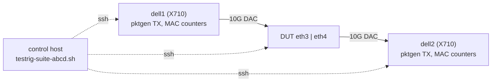

# ASK2 vs vendor ASK: frame, flow, latency and feature battery (suites A–D)

Head-to-head comparison of the two LS1046A DUTs under the same generators, using `bin/testrig-suite-abcd.sh`. It complements the throughput cells and campaigns in `ASK2-PERFORMANCE-TEST-HARNESS.md` (§5); rig, generator setup and the validity checklist are defined there and are not repeated here.

| | DUT1 | DUT2 |
|---|---|---|
| Role | ASK2 (`DUT_KIND=ask2`) | vendor reference (`DUT_KIND=vendor`) |
| Host | `vyos@192.168.1.185`, VyOS, kernel 6.18.60-vyos | `root@192.168.1.70`, Mono OpenWrt 25.12.6 (kernel 6.12.112), ASK mono-1.2.1 |
| Offload | `set interfaces ethernet eth3\|eth4 offload ipv4\|ipv6`, flowtable `FT` hardware | `ask_flowtable` + `cdx` modules, flowtable on eth0/eth3/eth4 |
| Flow capacity | `ask.max_flows` = 32768 (module parameter, fixed at load) | `nf_conntrack_max` 262144 |
| Generator ports | dell1/dell2 `enp1s0f0np0`, root namespace | dell1/dell2 `enp1s0f1np1`, namespace `n106` |

Both DUTs carry the same lab addressing (eth3 `10.99.1.185/24`, eth4 `10.99.2.185/24`, VLAN 10 on eth3 `10.99.10.185/24`, VLAN 20 on eth4 `10.99.20.185/24`), so the generators use identical tuples for either one. Only one DUT is measured at a time.



## 1. Generator

The specification names TRex/MoonGen. The rig uses kernel pktgen on the two Intel X710 hosts instead (`bin/testrig-pktgen.sh`): no DPDK is possible because both X710 functions share one IOMMU group. Rates and loss come from the X710 MAC counters, so neither host's socket path limits the result. Every offloaded run is bidirectional: both generators transmit the mirrored tuples, and loads and rates are totals over both directions. Each flow is warmed first so conntrack is ESTABLISHED and the DUT offloads it. Every trial reports the hardware share (flows handled in hardware), so a software fallback is visible instead of silently inflating the result.

Latency uses `bin/testrig-latprobe.py` (hardware-timestamped probe, 1000 probes/s, reflected by dell2) and connection rate uses `bin/testrig-cps.py`.

## 2. Tests

Targets are reference values from the test specification. The runner records measurements only; it does not assign pass or fail.

| Test | What is run | Frames / flows | Reference target |
|---|---|---|---|
| A1 | Full-duplex NDR search | 64 B, 64 flows | NDR ≥ 4.80 Mpps total at ≤ 0.001 % loss (2 × 2.64 Mpps is the ideal) |
| A2 | IMIX 7:4:1 (64/570/1518), line rate | 512 flows | ≥ 9.2 Gbit/s L2 per direction, 0 loss |
| A3 | 9000 B frames, MTU 9000 on DUT and generators | 64 flows | ≥ 99 % of line rate (0.139 Mpps per direction), ≤ 0.001 % loss |
| B1 | Flow-table scaling at 2.5 Mpps | 1k, 16k, 64k, 128k, 256k | ≤ 0.005 % loss at 65,536 flows; other steps recorded with hardware share |
| B2 | New TCP connections per second, ramped, over a 1.5 Mpps background | dynamic | ≥ 25,000 CPS, 0 failed connects, background ≤ 0.005 % loss |
| B3 | 32k held TCP flows torn down (FIN burst) over 2.0 Mpps | 32k held + 1k background | background ≤ 0.005 % loss, held flows alive, one-way P99.9 ≤ 2× the quiet run |
| C1 | One-way latency at 50/80/90/99 % of NDR (1.32, 2.11, 2.37, 2.61 Mpps) | 256 flows | P99 ≤ 12.5 µs and jitter P99.9 ≤ 2.0 µs at 90 % |
| C2 | Jitter profile, 10 min at 2.0 Mpps | 256 flows | recorded; loss ≤ 0.005 % |
| D1 | VLAN (and QinQ) penalty against untagged, NDR | 64 flows | VLAN NDR ≥ 95 % of untagged |
| D2 | Unpaced flood plus 100 pps ICMP and SSH connects to the router | 1000 flows + 1 host | zero lost ICMP, zero failed SSH connects |
| D3 | IPsec ESP AES-256-GCM through CAAM | tunnel | recorded (throughput) |

### 2.1 Where the runner differs from a literal reading of the test text

- **Latency and jitter.** Latency is the one-way estimate (RTT/2) of a probe that crosses the DUT twice, and the probe flow is offloaded too. "Jitter" is the spread of successive round-trip differences (packet delay variation), because the probe has no clock common to the generator. Nanosecond arrival-time deltas are not available with this setup.
- **Offered rates.** C1 uses the fixed rates above for both DUTs; override with `RATES_C1="r1 r2 r3 r4"`. Re-run C1 at the measured NDR of each DUT (from A1) to get true 50/80/90/99 % points; the fixed rates are the specification's.
- **Flow counts above ASK2 capacity.** ASK2 admits at most `ask.max_flows` = 32768 flows, so B1 steps at 65,536 and above run partly on the kernel path (`WARM_PARTIAL=1`). The hardware-share column shows the split. The vendor's own capacity is separate; a lower hardware share is a finding, not a harness fault.
- **QinQ (D1).** Needs 802.1ad subinterfaces on the DUT and both generators; ASK2 does not implement it (plan G17). Skipped unless `QINQ_READY=1`, and the `qinq-v4` path is not wired into pktgen yet.
- **D3.** Needs an established AES-256-GCM tunnel: set `IPSEC_DST` to an address behind it. ASK2 ESP offload is plan G9 (not implemented), and the vendor needs its CDX/CAAM IPsec configuration. Skipped without it.
- **D2 and the SSH probe.** The control-plane traffic targets the DUT's VLAN address (`10.99.10.185`, `10.99.20.185`), through the same ports as the flood.

## 3. DUT preparation checklist

Do these before the first run and record the answers in the result directory.

1. Cold-boot the DUT (ASK2: also capture `pcd-snapshot`) and confirm `ask-check` reports READY (ASK2) or `lsmod` shows `cdx` and `ask_flowtable` (vendor).
2. Confirm eth3 and eth4 are up at 10G and both have the lab addresses above, plus VLAN 10/20 subinterfaces.
3. ASK2: `show configuration commands | grep -E 'eth[34] offload'` must show `ipv4` and `ipv6` on both ports. Ensure `ask.max_flows` is understood for B1 (32768 default).
4. `nf_conntrack_max` must hold both directions of the largest test; the runner raises it at run time and restores it on exit (DUT 262144 already covers B1).
5. Never touch eth0 (SSH lifeline). Both DUTs manage over eth0.
6. Close other users of the generators (dell1/dell2, namespace `n106`); leave the DUT idle for 2 minutes before starting so thermal state matches.
7. Quick health gate: `DUT_KIND=<kind> BIDIR=1 FLOWS=64 bin/testrig-pktgen.sh trial port-v4 64 1000000 8` must report `loss ≈ 0` and `hw=1.000` (see §6).

## 4. Running

Run the same list on each DUT, alternating, from the control host:

```bash
bin/testrig-suite-abcd.sh A1 A2 A3 B1 B2 B3 C1 C2 D1 D2 D3        # no names = all

TAG=r1 DUT_KIND=ask2   bin/testrig-suite-abcd.sh
TAG=r1 DUT_KIND=vendor bin/testrig-suite-abcd.sh
bin/testrig-suite-compare.py $RIG_OUT/suite-vendor-r1 $RIG_OUT/suite-ask2-r1
```

Results go to `$RIG_OUT/suite-$DUT_KIND-$TAG/` as `results.csv` (`test,metric,value`) plus raw logs and per-trial CSVs. The comparison tool prints a markdown table of OWRT/ask against vyos/ASK2 with the ASK2 delta in percent. Wall time for the full battery is roughly 50 minutes per DUT, dominated by C2 (10 min) and the NDR searches. Useful environment variables: `TRIAL` (pktgen seconds, default 10), `LOSS` (NDR loss limit, 0.001 %), `STEPS_B1`, `RATES_B2`, `RATES_C1`, `C2_SECS`, `IPSEC_DST`, `QINQ_READY`.

Repeat each test three times, alternating DUTs, with a fresh `TAG` per round. A1 already confirms its NDR with three runs and records the spread (`run_to_run_dev_pct`); a spread above about 10 % points to port-FIFO or burst sensitivity.

## 5. Safety

- **Flood tests (A1, A2, D2).** The runner stops if the DUT stops answering SSH (`dut_ok`) and restores MTU and conntrack settings on exit. Do not run a flood while another operator depends on the DUT.
- **A3 (jumbo).** Changes MTU to 9000 on the DUT and generator ports and restores 1500 on exit, including on failure. Aim at the SFP ports only. XDP-bound ports are not part of this rig.
- **B1 on ASK2.** A line-rate flood racing flow inserts has wedged the FE before (2026-10-10, `FMFP_EXTC INV0`); the warm-up therefore waits for conntrack to show every flow offloaded before the measured window opens. Keep `WARM_MAX_B1` at its default.
- Cold-boot the DUT before a campaign and after any run that ends abnormally.

## 6. Preparation record (2026-10-30)

- **DUT1 (.185):** up 24 min, `ask-check` 45/47 OK (the two warnings are eth1/eth2 with no carrier, unrelated), offload `ipv4`/`ipv6` on eth3 and eth4, `ask.max_flows` 32768, `nf_conntrack_max` 262144.
- **DUT2 (.70):** `cdx`, `ask_flowtable`, `nf_flow_table` loaded; flowtable on eth0/eth3/eth4; lab addresses and VLAN 10/20 present; `nf_conntrack_max` 262144; `ip_forward` 1.
- **Generator off-by-one fixed.** pktgen's sequential port sweep treats `udp_*_max` as exclusive, so N flows had been N−1 flows. On ASK2 this left 63 of 64 flows offloaded and made the warm-up refuse to flood A1, A2 and D1. `pg_run` in `bin/testrig-pktgen.sh` now widens a sweep by one. After the fix, a 1 Mpps bidirectional 64-flow trial offloads 64 of 64 on ASK2 (loss 0.00002 %, hw 1.000) and runs clean on the vendor (loss 0, hw 1.000). Earlier multi-flow results from this harness covered one flow fewer than reported; the effect is small but is not zero for small N.
- **Suite smoke test (D2, D3).** Both DUTs complete the full wiring (generators, latency/CPS helpers, ICMP and SSH probes, result CSV). D2 smoke values, one run each, unpaced flood: ASK2 delivered 7.4 Mpps with 51 % flood loss, 48 % and 42 % ICMP loss and 8 failed SSH connects; vendor delivered 13.1 Mpps with 91 % flood loss, 49 % and 65 % ICMP loss and 0 failed SSH connects. These are single smoke runs, not campaign results.
- **An older vendor run** (`$RIG_OUT/suite-vendor-v1`, A1 only, 2.977 Mpps at 0 % loss, hw 1.000) predates the current runner and the generator fix; discard it.

Not yet done: the full battery on either DUT, a cold boot of each DUT, QinQ rig setup, and the IPsec tunnel for D3.
