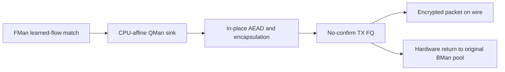
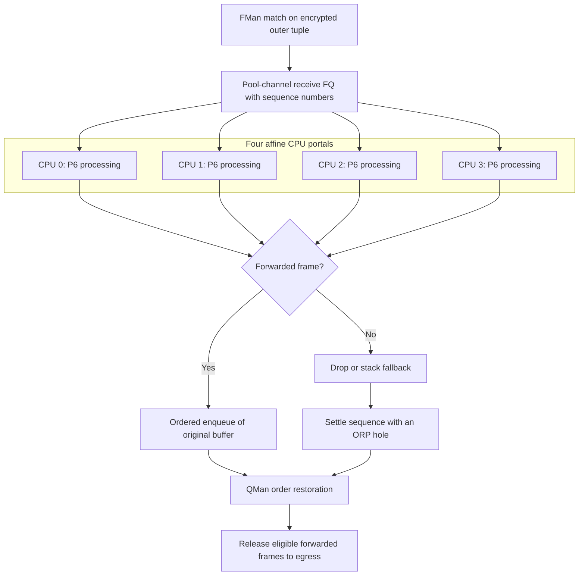
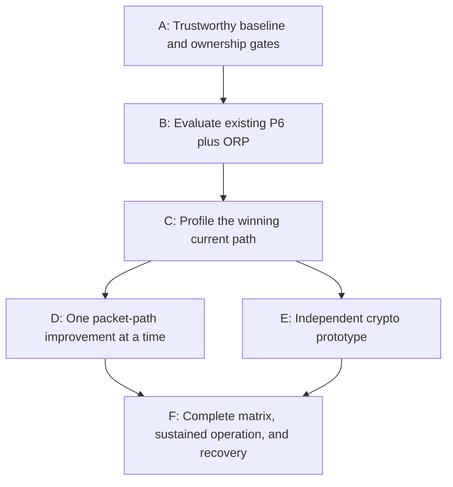

# ASK2 WireGuard: the credible path beyond the vendor

Research dated 2026-11-09, examining `dpaa1` at `0d399cc7242bbf8eba71368b33fb6d02660afab1`.

## 1. Main findings and research scope

The strongest near-term opportunity is to make P6 zero-skb receive run efficiently across all four CPUs using QMan order restoration. That machinery is already in our tree, but its throughput and failure behavior still need board validation. The strongest longer-term opportunity beyond vendor parity is A72-specific ChaCha20-Poly1305 optimization. CAAM is not a viable WireGuard bulk-crypto accelerator on this chip.

The investigation examined our current datapaths, dated Qdrant findings, the vendor's `exp/wireguard` branch, upstream Linux crypto, and relevant external implementations and research. The research itself made no repository or board-configuration changes and ran no throughput loads. Important findings and corrections were reconciled into Qdrant. This document preserves the resulting report; recommendations and hypotheses are not measured improvements.

## 2. What the comparison actually establishes

The supplied numbers suggest two different problems, not one. Rates are Gbit/s.

| Cell | Ours | Vendor | Interpretation | Most relevant lever |
|---|---:|---:|---|---|
| 1T down | 3.75 | 4.66 | Remaining scheduling, ordering, or packet-cost gap | P6 plus hardware spread, then profile |
| 1T up | 3.97 | 4.86 | Remaining encryption and packet-processing cost | ACK path, balanced execution, faster AEAD |
| 2T down | 2.20, without spread | 4.47 | Not yet a comparable spread configuration | Measure existing ORP implementation first |
| 2T up | 4.29 | 4.31 | Essentially parity | Preserve it while improving receive |
| 4T down | 3.83, without spread | 4.7-6.7 | Spread and total CPU efficiency both matter | ORP, peer isolation, crypto efficiency |
| 4T up | 4.37 | 4.35 | Essentially parity | Avoid regressing aggregate encryption |
| Bidir | Generally favorable; configuration-sensitive | See per-tunnel-count correction below | Not a universal win under every configuration | Balanced CPU/portal use and ACK cost |

There is one correction to the simplified vendor comparison: the vendor's latest experimental commit reports bidirectional results of 1T 2.6, 2T 2.4-3.6, and 4T 2.9 Gbit/s, not uniformly 2.6-2.9 Gbit/s. Its 4T download result is a 4.7-6.7 Gbit/s range, not a demonstrated repeatable 6.7 Gbit/s median. Those results are documented directly in [vendor commit `f8881de`](https://github.com/we-are-mono/ASK/commit/f8881de17fb77eb14ff88a50587c40404ab3c69c).

Three goals should therefore be distinguished:

1. Beat the vendor's repeatable, matched-condition results.
2. Sustain approximately 5 Gbit/s rather than occasionally reach it.
3. Exceed the reported 6.7 Gbit/s peak under the same packet sizes and accounting.

The first two look like plausible engineering objectives. The third may require materially faster crypto, not just better queueing. None is established by the research alone.

## 3. Current code and remaining work

The checkout examined was `dpaa1` at `0d399cc7`. Read-only inspection of `.185` showed image `2026.11.09-2108-rolling`, kernel `6.18.62-1-vyos`, performance governor, and 1.6 GHz. WGFP was dormant during inspection, with `spread=0`; this was not a throughput observation. Vendor `.70` was unreachable over SSH, so vendor source could be verified but not its current installed configuration.

### Transmit is already fundamentally efficient

Transmit is already a fundamentally efficient design. Our accelerated encryption path is FMan learned-flow match, then CPU-affine QMan sink, then in-place AEAD, then no-confirm TX FQ, then hardware buffer recycling. It avoids normal skb allocation, WireGuard worker handoffs, UDP socket transmission, and most general network-stack processing. This is not a vanilla WireGuard datapath waiting for a generic tuning guide.

`wgfp_peer_frame()` already performs key checks, shared nonce allocation, TTL/hop-limit decrement, padding, in-place encryption, and template-based encapsulation. See `kernel/common/files/drivers/net/wireguard/fastpath.c:1358`.

### Receive has materially different implementations

| Path | Processing | Remaining major costs or constraints |
|---|---|---|
| P3 | Copy outer frame into skb and feed upstream WireGuard | Copy, BMan return, validation, worker handoffs, ordered receive |
| P3 + P7 | Upstream decrypt, then bypass normal forwarding for admitted inner flows | P3 costs and upstream decrypt/order pipeline remain |
| P6 | Decrypt in original buffer, share upstream replay state, directly forward learned inner flows | AEAD, replay/state access, queueing, small header work |
| P6 + spread | Run P6 across affine portals and restore completion order in QMan | Work is distributed across cores; ordering and backpressure become critical |

P7 hooks after upstream AllowedIPs validation. P6's raw forwarding uses learned forwarding state and a short-lived policy cache; unsupported or unlearned packets fall back to the stack. The most important distinction is that P6 has already removed several costs that dominate P3 profiles. Those savings cannot be counted again when predicting improvements to P6.

### Hardware receive spreading is already imported

Our `447e894e` import and patch `4021-qman-enqueue-orp.patch` implement the vendor's central architectural advance:

- A receive queue on the port's pool channel serviced by multiple CPU portals.
- `AVOIDBLOCK` scheduling rather than retaining the active queue on one portal.
- QMan sequence-based order restoration.
- A forwarded frame or explicit hole for each dequeued sequence.
- Latest per-CPU sink accounting and single-owner receive-timer pacing.

The feature is default-off. Implementing another software fanout mechanism before evaluating this one would be the wrong priority. See `kernel/common/files/drivers/net/ethernet/freescale/dpaa/dpaa_wgfp.c:504` and `:1228`.

## 4. What Qdrant history changes about the diagnosis

Several earlier findings remain useful, but only with their dates and datapaths attached. The November 8 regression was a mode difference: P3 had changed from default-on to default-off. Matched-mode comparisons largely removed the apparent regression. That is not evidence that the safety fixes caused a throughput loss.

P7 produced a substantial measured improvement. Interleaved testing on image `0540` showed:

| Direction | P3 | P3 + P7 |
|---|---:|---:|
| Down | 1.94-1.96 Gbit/s | 2.65 Gbit/s |
| Up | 2.75-2.78 Gbit/s | 3.49-3.50 Gbit/s |

The upload improvement plausibly comes from cheaper processing of returning TCP ACKs, but that causal explanation was not directly proven.

One poor single-stream result was generator-limited. Dell2 WireGuard drops closely matched iperf retransmissions while DUT packet accounting largely conserved traffic. That result cannot establish a DUT throughput ceiling.

The older shared decrypt-ring contention measurement was small. It does not exclude uncontended locking/cache costs or different workloads, but it does not support a lock-free queue rewrite as the first intervention.

Naive fanout helped parallelism but damaged order. The software distributor increased decrypt throughput while producing substantial retransmissions and additional enqueue pressure. Larger batches and weighted home-worker variants were not uniformly improvements; some measured worse. These are failed or conditional experiments, not ready-made optimizations.

Recent lifecycle fixes supersede some older blockers. F-292/F-293 corrected first-port accounting and fail-closed SYNC handling; F-310/F-311 corrected detach/engage ordering. The documented port-loop pass is meaningful, but it does not prove P6 memory safety, ORP overload behavior, or disengage under bulk load.

## 5. Ranked opportunities

The ranking is an implementation priority, not a forecast of additive percentage gains.

| Priority | Opportunity | Status and likely value |
|---|---|---|
| Gate | Establish buffer ownership and close reproducible lifecycle failures | Required before expanding risky zero-copy behavior |
| 1 | Validate and tune existing P6 + QMan ORP spread | Highest-confidence architectural route toward download parity |
| 2 | Measure ORP peer isolation and congestion behavior | Especially relevant to 2T/4T consistency and bidirectional fairness |
| 3 | Add appropriate frame/annotation stashing to WGFP queues | Concrete vendor/mainline difference; benefit unmeasured |
| 4 | Reuse hardware checksum results; investigate outer-IPv6 TX checksum offload | Removes real software work, especially fallback and IPv6 paths |
| 5 | Reduce small-packet/ACK overhead | Important to upload and bidirectional performance; P6 already handles much inline |
| 6 | Batch BMan returns and eliminate fallback copies safely | Valuable mainly for P3/fallback-heavy traffic |
| 7 | Profile and reduce shared-state/cache-line costs | More important once one peer runs on every CPU |
| 8 | Develop an A72-tuned, possibly stitched AEAD path | Strongest longer-term opportunity beyond vendor architecture |
| 9 | Extend fastpath coverage to more encapsulations/policies | Improves real deployments, not necessarily this plain benchmark |
| Low | Offline-port reinjection, CAAM emulation, userspace rewrite | Poor next investment for this specific bottleneck |

## 6. QMan: the most important near-term work

### Hardware distribution without a software distributor

A fixed CPU can bottleneck one encrypted outer tuple even when four cores are available. Conversely, distributing packets without restoring order can reduce TCP goodput despite doing more decryptions per second. The vendor's latest change addresses both: all-core dequeue followed by ordered completion. That is exactly the right architectural experiment for us.

Crucially, the useful combination is P6 raw decrypt/forward plus spread. Spreading P3 ingress still leaves copied packets going through upstream queues; it is not equivalent to distributing the complete run-to-completion fastpath.

The diagram shows each frame's settlement obligation, not a guarantee of unlimited ordering or a prescribed timing for stack fallback.

### Per-port versus per-peer ordering

Our ORP topology differs from the vendor's. Our implementation has a per-ingress-port ORP sink. The vendor creates ordering state per steer/tunnel. A shared ORP can couple otherwise independent peers: one delayed packet from peer A may delay completed packets from peer B. That could hurt multi-tunnel consistency and latency.

A per-peer or suitably partitioned ORP is therefore a serious candidate, but not an automatic improvement. It consumes queue and restoration resources and increases lifecycle complexity. Measure shared-queue head-of-line delay before changing topology, and budget ORL/PFDR/FQD resources explicitly.

### Bounded ordering and exactly-once settlement

Current settings include a 1,024-frame restoration window, 14-bit sequence numbers, automatic advancement, and late-arrival handling. These do not promise unlimited strict ordering under arbitrary CPU stalls or overload.

Every dequeued sequence must be settled exactly once by an ordered frame or hole. Authentication failures, replay drops, stack fallbacks, invalid egress handles, and enqueue failures all matter. The current five-millisecond enqueue retry is understandable: abandoning a hole can strand later traffic, especially when traffic becomes idle. But five milliseconds is enormous compared with a normal packet's processing budget. Repeated retries could harm latency and management responsiveness.

The acceptance criteria should cover:

- Sequence wrap and a deliberately delayed worker.
- Authentication failures, replay drops, and fallback traffic.
- Full enqueue rings, asynchronous ERNs, and tail drops.
- Idle-after-loss and teardown.

A clean throughput run alone does not establish this contract.

### Congestion control, not just queue depth

Congestion control deserves the same attention as queue depth. The vendor uses a congestion group; our ORP sink uses a two-megabyte per-FQ tail-drop limit without equivalent CGR configuration. A bigger queue absorbs bursts but does not increase steady-state crypto capacity. It can also hide overload while consuming buffers and increasing latency. The question is whether congestion is controlled before pool depletion, restoration pressure, or long portal stalls, not whether the queue can be made larger.

## 7. FMan: useful acceleration, but not WireGuard crypto

### Frame and annotation stashing

Frame and annotation stashing is a concrete missing optimization. Our WGFP queue configuration uses `PREFERINCACHE`, but that is not the same as configuring Context-A frame/annotation stashing. Both vendor code and the mainline DPAA receive path provide prior art for warming the cache with frame data and parsing annotation. Mainline `dpaa_eth.c` uses `qm_fqd_set_stashing()` and exclusive hints.

Stashing could reduce initial header/metadata misses before authentication and forwarding. It is particularly attractive because it improves locality without changing the protocol. However, the stash layout must match our actual buffer offsets and annotation ownership. Excessive stashing can pollute caches or create coherency traffic. Start with a small, justified cache-line footprint and measure it; do not copy vendor Context-A values blindly.

### Validated RX checksum metadata

Trust validated RX checksum metadata instead of recomputing it. P3 currently performs software UDP validation on its copied frame. Hardware RX checksum support being enabled on the netdev does not automatically make a private sink consume its verdict.

The vendor explicitly combines FD checksum-valid status with parser results before avoiding software checksum work. We should expose and validate the corresponding verdict in WGFP, retaining software fallback when the result is unavailable or inapplicable. This is also a correctness requirement for P6: its fast receive body does not perform P3's full UDP checksum calculation. We need to demonstrate that FD error routing and parser metadata enforce the intended IPv4/IPv6 rules. AEAD authentication does not justify silently discarding outer UDP semantics.

### Outer IPv6 transmit checksum offload

Outer IPv6 transmit checksum offload is a worthwhile target. Our encryption path computes an outer IPv6 UDP checksum with `csum_partial()` over the encrypted datagram. IPv4 uses a zero UDP checksum and does not have this cost.

Mainline `dpaa_enable_tx_csum()` already demonstrates the mechanism: prepare parsing results and request checksum generation through FD commands. The research question is whether the same mechanism can be used correctly with our raw, no-confirm, recycled-buffer TX path. This could eliminate another full payload pass for IPv6. It requires correct offsets for the new outer packet, valid annotation storage, and verification of the no-confirm path, not merely enabling an ethtool flag. See `fastpath.c:1457` and the generated kernel's `dpaa_enable_tx_csum()`.

### Offline-port reinjection

Offline-port reinjection is not the next large win. An offline port could potentially reparse decrypted traffic or apply hardware forwarding/manipulation. That becomes interesting when it replaces substantial CPU routing/NAT work. Our P6 learned-flow path already does very little after decryption: tuple lookup, checks, header adjustment, and direct transmission. An extra QMan/FMan pass may cost more than the small amount of CPU work it replaces.

Furthermore, earlier offline-port diagnostics are not proof of a production post-decrypt path. Host-command SYNC working does not establish arbitrary packet reinjection correctness. Offline ports should be revisited for broader fastpath coverage, not before ORP and crypto efficiency.

### Limits of pre-decrypt classification

FMan cannot see the encrypted inner five-tuple. Before decryption, hardware sees the outer tunnel headers, not the inner TCP/UDP flow. Ordinary RSS over one outer tuple cannot spread its inner flows independently. Changing the flow key to include the changing WireGuard counter is not a simple fix: it changes matching semantics and does not restore completion order. The current QMan approach is much more direct.

## 8. BMan and buffer handling

### Existing hardware recycling

The main P6 path already gets the biggest recycling benefit. P6 forwards the original buffer through a no-confirm TX path and lets hardware return it to its original pool. That already avoids a software allocate/copy/free cycle. Consequently, a BMan release optimization should not be advertised as a large saving for every successfully raw-forwarded packet. It primarily affects P3 copies, stack fallbacks, and drops.

### Batched software returns

Batch software returns in groups supported by BMan. The BMan release API accepts one to eight buffers per command. Our sink release helper returns one at a time. Per-CPU, per-pool batching could amortize portal operations for copy/fallback-heavy workloads. It needs bounded flushing at poll completion, low traffic, shutdown, and failure paths. A partially filled batch cannot retain buffers indefinitely, and batches must not mix incompatible pool ownership. The old P3/P7 profile makes this a justified experiment. It does not prove a large gain for P6 direct forwarding.

### Zero-copy skb fallback

Zero-copy skb fallback is possible, but ownership must be transferred. The vendor builds an skb over the original buffer on fallback, rather than copying the packet. Mainline DPAA also has `build_skb()` prior art. For us, the important operation is not calling `build_skb()`: it is transferring ownership correctly. The buffer must no longer be simultaneously available to BMan; DMA mapping, supply accounting, skb shared-info space, replenishment, and all error paths must agree.

Given the existing stale-buffer investigation, zero-copy skb fallback should not be introduced until the ownership model is demonstrated. Keeping a bounded copy fallback is preferable to a faster path that occasionally returns a live page to two owners.

### Pool topology and sizing

Do not transplant the SDK shared-pool fix literally. The vendor unified SDK pool accounting to avoid needless allocation/release across ports. Our pool arrangement differs. We should verify cross-port accounting and recycling, but converting everything to a shared pool solely because the vendor did so could add contention and introduce ownership errors. Port identity must remain explicit rather than inferred from BPID.

Queue larger is not compute faster. Larger pools or rings can prevent transient drops. They cannot make four A72 cores perform more AEAD per second. Occupancy, depletion events, and latency must justify sizing changes. Likewise, idle hardware/software pool counts agreeing does not exclude duplicate ownership or transient depletion.

## 9. Crypto: the most credible way to exceed the vendor architecture

### Rule out unavailable hardware

LS1046A's SEC/CAAM is Era 8. The relevant Linux driver explicitly treats ChaCha and Poly1305 engines as unavailable before Era 10. Our Qdrant hardware findings agree.

| Idea | Assessment |
|---|---|
| Native CAAM ChaCha20-Poly1305 | Not available on this chip |
| Emulate ChaCha in DECO descriptor arithmetic | Extremely poor prospective efficiency; no competitive result demonstrated |
| Use PKHA for Poly1305 | Serial arithmetic and transfer overhead make it unattractive |
| Substitute AES-GCM | Changes the WireGuard protocol; not interoperable acceleration |
| Accelerate X25519 handshakes | Separate handshakes/second problem, not sustained transport Gbit/s |
| Use ARM AES/SHA instructions directly for ChaCha | They do not implement ChaCha's ARX computation |
| Use PMULL as ordinary Poly1305 multiplication | Carryless multiplication is not a drop-in replacement for integer arithmetic modulo 2^130-5 |

See the [Linux CAAM implementation](https://github.com/torvalds/linux/blob/v6.18/drivers/crypto/caam/caamalg.c) and [WireGuard's fixed primitives](https://www.wireguard.com/protocol/).

### Existing Linux ARM64 acceleration

Linux is already using optimized ARM64 assembly. The relevant v6.18 code lives under `lib/crypto/arm64/`. An important correction is that Linux's `chacha_4block_xor_neon` already computes four NEON blocks plus a fifth scalar block in parallel. Adding 4+1 mixed execution is not a new improvement for our baseline. Poly1305 also already has architecture-specific acceleration. We are not starting from portable C. The remaining opportunity is better composition and scheduling for this CPU and packet size.

Primary sources are the [ARM64 ChaCha assembly](https://github.com/torvalds/linux/blob/v6.18/lib/crypto/arm64/chacha-neon-core.S), [ARM64 ChaCha dispatch](https://github.com/torvalds/linux/blob/v6.18/lib/crypto/arm64/chacha.h), and [AEAD composition](https://github.com/torvalds/linux/blob/v6.18/lib/crypto/chacha20poly1305.c).

### Stitched AEAD

Stitched AEAD is the strongest research candidate. The current library composes ChaCha and Poly1305 as separate stages. A stitched implementation interleaves their work, using NEON for ChaCha while integer multiply resources process Poly1305. That can improve execution-unit utilization and avoid a separate full payload pass. The opportunity is more than merely replacing a checksum loop.

| Reference | Relevant idea | Limitation |
|---|---|---|
| [BoringSSL ARMv8 AEAD](https://github.com/google/boringssl/blob/main/crypto/cipher/asm/chacha20_poly1305_armv8.pl) | NEON ChaCha interleaved with scalar Poly1305 | Userspace ABI and Apache-2.0 licensing; not a drop-in kernel import |
| [pyca/verified-garbage#641](https://github.com/pyca/verified-garbage/pull/641) | Six NEON plus two scalar blocks and stitched authentication | Published measurements are not Cortex-A72 results |

The latter reports these NEON-only N2 results:

| Operation | Previous | Stitched |
|---|---:|---:|
| AEAD seal, 1 KiB | 1.33 microseconds | 1.07 microseconds |
| AEAD open, 1 KiB | 1.34 microseconds | 0.979 microseconds |

These demonstrate that the optimization class is real. They do not establish those gains against Linux's implementation on A72. Its small-packet results were slightly worse, which matters for ACK-heavy traffic.

A72 also lacks SVE/SVE2 and the newer instruction paths used by some published benchmarks. Only the relevant NEON/scalar designs are candidates.

### Packet-sized crypto experiments

Specialize for WireGuard-sized packets, not bulk benchmarks. A useful experiment should cover complete authenticated seal/open with:

- Small ACK/control-sized payloads.
- Boundaries around 64-byte ChaCha blocks and 16-byte padding.
- Typical tunnel MTUs around 1,280-1,420 bytes.
- Aligned and unaligned buffers.
- One through four concurrent workers.
- Both isolated crypto and the complete kernel datapath.

Potential improvements include reducing repeated setup/dispatch, combining block-zero derivation with payload generation where buffer layout permits, improving tail handling, and choosing different small/large-packet schedules. The [WireGuard crypto-ceiling harness](https://github.com/jamilbk/wireguard-upper-bound) illustrates packet-sized measurement and combined-stream experiments. Its Apple-specific results and scratch-buffer layout are not directly portable to our kernel buffers. Do not precompute Poly1305's one-time key per peer: it changes with the packet nonce.

### Authentication-failure and kernel integration contracts

Preserve authentication-failure behavior. Our current receive path relies on the library leaving ciphertext untouched when authentication fails. Some stitched implementations produce plaintext before comparing the final tag. That difference is acceptable only with a deliberate ownership contract: unauthenticated output must never be delivered, and modified data must not be sent to a fallback expecting ciphertext. Matching successful output is insufficient validation.

Kernel integration also needs constant-time behavior, proper SIMD entry/exit, bounded stack usage, key lifetime handling, and compatible licensing. Known-answer, differential, malformed-tag, boundary-length, and unaligned tests are mandatory. Adding an asynchronous CryptoAPI implementation alone would not accelerate these direct library calls; the actual WGFP AEAD call path must use the improved implementation.

### Amdahl's law

The old P3+P7 profile attributed approximately 43% of samples to crypto. Making that portion 1.3 times faster yields `1 / (0.57 + 0.43 / 1.3)`, approximately 1.11 times overall, not 30% more tunnel throughput. P6 removes non-crypto work, so its crypto fraction may be substantially larger. That makes a new P6+ORP profile essential before forecasting benefits.

## 10. CPU scheduling, shared state, and packet batching

### Placement and execution locality

Optimize where a packet executes, not just how many workers exist. The [Netdev 0x18 multi-tunnel research](https://netdevconf.info/0x18/sessions/talk/achieving-linear-cpu-scaling-in-wireguard-with-an-efficient-multi-tunnel-architecture.html) identifies serial stages and cache/task handoffs as scaling limitations. Its run-to-completion direction supports P6's architecture. But its reported multipliers are against different machines and baselines. We have already implemented much of the architectural shortcut; those multipliers are not additional ASK2 gains.

Our sink selection balances record counts, not measured traffic. Several idle flows and one elephant flow can therefore produce an apparently balanced but overloaded placement. RX and TX placement also need to be considered together for bidirectional traffic. Measure per-CPU work first. Any active-flow migration needs an ordering barrier; blindly moving busy flows can recreate the fanout retransmission problem.

### Shared-state contention

Shared state may become the next limit after spread. Candidates include the replay-window lock, transmit nonce atomic, peer statistics, timer state, and frequently touched cache lines. The RX timer already uses compare-and-exchange ownership. TX pacing remains worth checking for unnecessary multi-core timer work. Frequently updated noncritical counters can be per-CPU, but changing statistics mechanisms should follow measured cost.

Do not shard replay windows or create independent per-CPU nonce counters. Nonce-range reservation is a possible advanced experiment, but it introduces rekey, ordering, and replay-window complications and is not an attractive first optimization.

### Small-packet inline decrypt

Small-packet inline decrypt is path-specific. The vendor's small-packet optimization avoids worker handoffs for eligible short packets while preserving upstream ordering. That may help P3/P7 and fallback traffic, particularly ACKs. P6 already decrypts inline, so applying the same idea there would not create another saving. Thresholds should be measured on A72 rather than copied as a universal 256-byte rule.

### Bounded batching

Batch useful work without inventing unlimited portal capacity. BMan has an existing multi-buffer release API. The examined QMan path submits individual enqueue commands; bulk enqueue is not simply an unused equivalent API switch. Potential experiments include bounded descriptor prefetch, amortized per-poll work, and a carefully designed enqueue helper. Preserve portal ownership, valid-bit ordering, FD lifetime, ERN handling, and ORP settlement.

Large batches can also increase head-of-line delay and exhaust queue budgets. The failed large-batch fanout measurements are a warning against assuming larger is better.

### Where UDP GSO/GRO applies

UDP GSO/GRO is not another P6 multiplier. [Tailscale's throughput work](https://tailscale.com/blog/more-throughput) convincingly demonstrates batching and UDP segmentation/coalescing benefits for userspace socket/TUN paths. Our raw P6 path already bypasses those layers. Each WireGuard packet still needs its own nonce and authentication tag, and DPAA1 does not gain nonexistent TSO by enabling flags. GRO/GSO remains relevant to generators, local termination, and software fallback. It should not be counted as a universal gain on top of zero-skb forwarding.

## 11. Correctness gates that directly affect performance work

### Unresolved bad-page/P6 freeze

The bad-page/P6 freeze is not explained yet. The recorded packet bytes in page-table entries strongly suggest DMA reached memory that had returned to an incompatible owner. The precise root cause remains unproven.

The stale-buffer checks in patch `4022` are useful diagnostics, not a complete ownership proof. Likewise, the recent engage-order correction is plausible containment, but its port-loop pass does not establish that it caused or fixed the rare P6 freezes.

Before expanding zero-copy behavior, establish ownership through receive, CPU modification, ordered enqueue, TX recycling, fallback, rejection, and teardown. Mapping a buffer for receive and later modifying/transmitting it also requires a coherent DMA-direction contract; coherency alone does not establish ownership.

### Source-derived release-then-read recurrence

The source investigation found this sequence in `wgfp_rx_fast_stack()`:

1. `fastpath.c:1057` copies plaintext into an skb.
2. `:1058` returns the original frame to BMan.
3. `:1064` reads `pt[0]` from that returned buffer to select IPv4 versus IPv6.

FMan can reuse the original buffer between those operations. The function should use the owned skb copy or metadata captured before release.

This repeats the class of a P3 lifetime mistake already recorded in Qdrant, but occurs in the newer P6 handoff. Its host harness currently does not simulate immediate buffer reuse on release. This is a source-derived correctness issue, not a demonstrated explanation for page-table corruption or a quantified throughput loss. It was recorded separately rather than conflating the diagnoses.

**Status (2026-11-09, working tree after `0d399cc7`, not in an image):** fixed. `wgfp_rx_fast_stack()` now reads the IP version from the owned skb copy (`skb->data[0]`), not from the released buffer. The host harness `tests/dut/wgfp_p6.c` now overwrites the frame with `0x6b` in its `dpaa_wgfp_drop()` stub, which models FMan refilling the buffer at once. The unfixed code fails `test_stack_handoffs` on the IPv4 protocol check, and the fixed code passes. The bad-tag test switches the overwrite off, because it checks the released buffer itself. `fastpath.o` builds cleanly with `W=1` on the derived 6.18.62 tree.

### Raw forwarding admission contract

Raw forwarding must keep its admission contract. Our learned route/peer cache differs from the vendor's per-packet raw AllowedIPs lookup and flowtable validation. That can affect both cost and response to policy changes. Optimizing away checks is not equivalent to accelerating the same behavior. Roaming, AllowedIPs changes, route/neighbor changes, family policy, MTU, ECN, rekey, and unsupported encapsulation must still fall back or withdraw correctly. Using the standard flowtable's raw forwarding machinery may improve semantic consistency and coverage, but it is not automatically faster than our narrow cache.

## 12. What not to prioritize

| Proposal | Why not next |
|---|---|
| Increase rings/pools until drops disappear | Can mask overload; does not increase AEAD capacity |
| Rewrite upstream queues as lock-free | Current evidence does not establish them as the main bottleneck |
| Add more software fanout workers | Hardware spread exists; uncorrected reordering already hurt TCP |
| Force a different RPS mask globally | Slow-path lessons do not transfer unchanged to raw sink queues |
| Switch ASK2 to DPDK/VPP | Different architecture; known DPAA coexistence problems and no demonstrated advantage here |
| Emulate WireGuard crypto on CAAM | Wrong hardware capabilities and prospective efficiency |
| Increase MTU and call it a speedup | Changes the workload; contiguous-buffer and deployed-path limits still apply |
| Drop/filter ACKs | Changes transport behavior and can harm SACK/ECN/recovery |
| Reduce ChaCha rounds or authentication length | Changes WireGuard's cryptographic contract |
| Disable diagnostics indiscriminately | Production already lacks several major debug options; no demonstrated windfall |
| Compile with build-host-native ISA flags | Risks instructions newer than the A72 target supports |

VLAN, NAT, PPPoE, and other fastpath extensions can deliver large practical improvements where traffic currently falls back. They should be evaluated as coverage improvements, separately from faster plain-tunnel processing.

## 13. Performance targets need a CPU budget

Four cores at 1.6 GHz provide an ideal aggregate budget of 6.4 billion cycles per second. For illustration, assume approximately 1,368 bytes of useful TCP payload per data packet.

| Goodput | Approximate data packets/s | Total available cycles per data packet |
|---|---:|---:|
| 3.75 Gbit/s | 343,000 | 18,700 |
| 4.66 Gbit/s | 426,000 | 15,000 |
| 5.0 Gbit/s | 457,000 | 14,000 |
| 6.7 Gbit/s | 612,000 | 10,500 |

That budget must pay for encryption/decryption, ACKs, replay/state work, queueing, and other CPU activity. Actual MSS, padding, and CPU utilization must replace these assumptions in measurements. Reaching 4.66 from 3.75 Gbit/s requires about 19.5% less total cost per useful byte at fixed CPU capacity. Reaching 4.86 from 3.97 Gbit/s requires about 18.3% less.

If a fresh P6 profile confirms roughly 13,000 cycles of AEAD work per full-sized packet, then a 10,500-cycle total budget for 6.7 Gbit/s cannot be achieved merely by tuning queues. Crypto must get faster, the workload must differ, or that cycle estimate must be revised. This is why stable vendor parity and exceeding its highest reported peak are different engineering stages.

## 14. Recommended execution sequence

### Stage A: establish the trustworthy baseline

Keep the current safety defaults while resolving the release-then-read issue and investigating buffer ownership. Record:

- Exact image and source revision.
- Boot type and kdump state.
- Governor, frequency, and temperature.
- MTU/MSS and inner/outer families.
- Every WGFP mode.

Separate true cold boot from cold power-on followed by kexec. Do not mix those results silently.

### Stage B: evaluate the existing architectural improvement

Compare P3, P3+P7, P6 without spread, and P6 with ORP under otherwise identical conditions. Prove the intended path through counters rather than module settings alone. Start with low-rate order/failure checks, then controlled throughput. This should answer the largest current uncertainty before adding another optimization.

### Stage C: profile the winning current path

Use hardware cycles/instructions, per-CPU work, cache behavior, enqueue/rejection counters, and buffer occupancy. The running kernel lacks `CONFIG_IRQ_TIME_ACCOUNTING`, so `/proc/stat` busy percentages alone are not a reliable denominator. Attribute time separately to AEAD, replay/state, sink dispatch, packet parsing, enqueue/retry, copy/release, and fallback. Keep whole-system percentages separate from one CPU's self-time.

### Stage D: apply one measured packet-path improvement at a time

The first candidates are stashing, checksum metadata, outer-IPv6 TX checksum generation, and any demonstrated peer/CPU imbalance. BMan batching and zero-copy skb fallback follow if copied/fallback traffic remains material. Each change needs an interleaved A/B comparison, not a comparison with yesterday's best run.

### Stage E: prototype crypto improvements independently

Benchmark the current kernel AEAD against legally usable A72-oriented scheduling/composition experiments. Keep the packet path unchanged initially. Only integrate a crypto candidate that wins at relevant packet sizes and preserves the required failure contract.

### Stage F: require a complete performance result

Run the nine cells: 1T/2T/4T times up/down/bidirectional. Include:

- Per-direction and summed bidirectional receiver goodput.
- Per-tunnel fairness.
- Retransmissions, drops, and latency.
- All fastpath/rejection counters.

Use matched packet sizes and several interleaved repetitions. Check both IP families and distinguish a single TCP stream from a multi-stream tunnel. Establish the generators' ceiling independently; prior generator drops have already produced a false DUT ceiling.

Finally, require sustained operation, ordering/failure recovery, and lifecycle churn, not just a peak sample. The first milestone should be repeatable vendor-beating goodput with no new correctness failures; chasing the 6.7 Gbit/s peak comes after the measured CPU budget supports it.

## 15. Actions from the fast-path plan not covered above

The fast-path plan (`plans/ASK2-WIREGUARD-FASTPATH-PLAN.md`) carries open actions that this research does not mention. They belong in the same execution sequence, because several of them gate or confound the performance stages above.

| Action | Source in the fast-path plan | Where it fits |
|---|---|---|
| Hunt the rare two-tunnel P6 freeze: long overnight batches on `.106` with kdump armed (`DUT=vyos@<ip> bin/kdump-arm.sh` after every boot: capture DTB with DPAA nodes disabled, `RuntimeWatchdogSec` 120 s, `softlockup_panic`, `hardlockup_panic`, `watchdog_thresh=5`, `panic_on_rcu_stall`), so that the next freeze leaves a dump under `/var/crash/` | §3 item 4, two-tunnel P6 hang | Stage A; blocks any default-on P6 |
| F-311 A/B: eth4 engage/disengage churn under traffic (`bin/testrig-port-loop.sh`) on an image without F-311, to test whether the engage window (AC_CC scheme live while RCCB is 0) can release or enqueue a garbage buffer | §3 item 4, memory corruption | Stage A, with the bad-page hunt |
| Quantify the kdump/kexec boot penalty: plain `fanout 32` fell from 3.26–3.49 to 2.4–2.8 Gbit/s on kexec-booted boards. Cold-boot without `system option kdump`, repeat, and record boot type with every result. `.106` currently boots through kexec (`crashkernel=` on the command line), so its 2026-11-09 evening numbers (§16) carry this caveat | §3 item 4 | Stage A |
| Ship gate for spread default-on: `spread 0` against `spread 1`, ship only if throughput rises, `orp_wait_fail` and `orp_hole_ern` stay 0, and nothing stalls at idle after loss | §7a gate | Stage B |
| Gates G6 for P6: 4T download at least 4.0 Gbit/s, 1T at least 3.0, IPv4 and IPv6 inner; with P6 on: the P2b-3 suite (rekey, rekey at 120 s, roam, AllowedIPs, PMTU, wg0 delete), upstream `netns.sh`, replayed/duplicated packets dropped by the shared window (`bin/testrig-wgfp-p6.sh`, netem duplicate), reordering within the window accepted once, a forward drop rule mid-flow stops the flow within one refresh | §3 item 4b | Stage F, before any default change |
| Receive-only peers get no RX record: peer state (and the outer P3/P6 record) is created only by TX learning, so a peer that only sends to us stays on the software path. Needs bounded peer-state activation with authenticated, current-tuple firewall provenance | §3 close-out leftovers | Coverage, after Stage F |
| Inner IPv6 needs a family-aware control path: the VyOS CLI offers only `offload ipv4`, so WGFP learns IPv4 inner flows only and punts and withdraws IPv6 sink flows. G6's IPv6 cells depend on this | §5 P3 withdrawal notes, closing step C | Before G6 IPv6 cells |
| Overload and multi-peer close-out: sink tail drop under overload (side-flow loss at most 1%, balanced pool), the O(N²) flow-stats refresh, the FE wedge history before multi-peer deployment, the reservation and CLI lifecycle gates; binding is limited to 8 devices and any binding change rebuilds everything | §3 item 5, close-out leftovers | After Stage B, before multi-peer claims |
| Stage 2 safety leftovers: F-269 natural-timeout recovery (never fired on silicon), FE teardown ownership and disengage error propagation (`__fman_pcd_fe_arm_disengage()` ignores lower-layer errors), and the pending decision to treat the QMan portal protocol as platform hardening that does not gate P3 | Handoff status, §5 | Parallel to Stage A |
| DMA direction contract: pool pages are mapped `DMA_FROM_DEVICE`, WGFP writes them on the CPU and syncs `DMA_TO_DEVICE` for transmit, and treats a DMA address as a physical address across ingress and egress | §3 DMA contract gap, §6 risks | Stage A ownership work |
| Memory-bandwidth ceiling: the plan's risk register lists "near 4 Gbit/s" as unmeasured. Measure DDR read/write bandwidth under a P6+spread load before quoting 5–6.7 Gbit/s targets | §6 risks | Stage C |
| Matched matrices against the vendor: repeat the software-only and WGFP nine-cell matrices against `.70` and `.185` with matched governor, firewall and boot type | §5 software path | Stage F |
| Product decision on a persistent `noqueue` for an unshaped WireGuard WAN port (+7.9% on 1T `up` in the software path) | §5 software path | Independent |
| Deferred §7a imports, each needing a board measurement first: inline small-packet decrypt as a `wgfp_rx_fast` policy (relevant to P3/P7 fallback only, §10), raw-buffer flowtable forward (vendor patch 186) as an alternative to the learned `wgfp_rflow` cache (§11 admission contract), opt-in GRO from `dpaa_eth_poll` for locally terminated flows | §7a | Stage D |
| P5 (single inner flow across CPUs) is subsumed by spread: with ORP every CPU decrypts one outer flow and QMan restores order, which is what G5 asked for. Measure a single TCP stream with spread instead of building P5 | §3 item 6 | Stage B |
| Fix the multi-tunnel harness: `bin/testrig-wireguard-multi.sh` reports `dut_busy` 0.3–3% while the DUT carries 3.7 Gbit/s of WireGuard (load average 8). Use perf cycle samples or `/proc/softirqs` deltas, since the kernel lacks `CONFIG_IRQ_TIME_ACCOUNTING` | new, 2026-11-09 | Stage A |
| A/B the ORP queue settings on one image, with no rebuild between settings: `echo "orp_td <bytes>"` (tail drop, 64 KiB to 16 MiB, default 2 MiB) and `echo "orp_stash 1"` (mainline-style annotation, data and context stashing) to `/sys/kernel/debug/dpaa_wgfp/ctl`, both before the first spread record of the boot. Measured target: the 11–14% eth4 `rfdc` discards and 2–4M retransmits per 4T download run on image 2108. The pool holds about 2,560 buffers per port, so watch `rodc` when raising `orp_td` | new, 2026-11-09 | Stage D, first experiment |

## 16. Results, 2026-11-09/10 (Stages A to D, first pass)

All cells: P6 mode 2 (`wgfp_rx_fast=2`) with ORP spread (`spread 1`, `fanout 0`), inner IPv4, MTU 1420, 4 TCP streams per tunnel, performance governor, kdump-armed boards (kexec boot). Busy and cycles come from DUT-side `perf stat -a -x, -I 1000` with A72 PMU events, normalised by each counter's enabled time (`/mnt/builds/wgfp/plan/cell2.sh` and `sum3.py`). Cycles per packet use a 1368-byte TCP payload.

**Measurement correction.** `perf record` cycle-sample counts undercount softirq-saturated time badly, and `/proc/stat` lacks IRQ time accounting. An early reading of "1T is only 54% busy" was wrong: exact counting shows the 1T and 4T downloads are both CPU-bound at 96–100%, at about 18–19k cycles per packet. Under saturation even the perf process is starved and its 1-second intervals stretch to about 10 s, which is why the enabled-time normalisation is required.

**Stage C finding.** Hot-cache ChaCha20-Poly1305 (OpenSSL 3.0.20 on one A72) costs about 9.1k cycles per 1424-byte packet. In the datapath, crypto took about 13.7k of 18k cycles at IPC 1.06, with 26 L2 refills per packet: the whole DMA'd frame, roughly 1.7 KB, is fetched from DDR, and the in-place AEAD stalled on each miss in turn.

**Stage D, frame prefetch (`echo "prefetch 2"`, default since `28b7f6c9`), `.106` image 0011, interleaved on one boot:**

| Cell | prefetch 0 | prefetch 2 | Cycles/packet | Vendor `f8881de` |
|---|---:|---:|---|---:|
| 1T download | 3.735 / 3.767 | 4.589 / 4.605 | 18.0k → 14.6k, IPC 1.06 → 1.31 | 4.66 |
| 4T download | 3.629 | 4.594 | | 4.7 (4.7–6.7) |
| 1T upload | 3.941 / 3.945 | 4.249 / 4.252 | 17.0k → 15.8k | 4.86 |
| 4T upload | 4.182 | 4.520 | | 4.35 |

L2 refills stay at 26 per packet with prefetch; the misses overlap instead of serialising, and L1D refills per packet halve.

**Other findings.**

- 4T download and upload saturate the CPUs. FMan then discards 11–14% of eth4 frames because QMan refuses the ORP queue enqueue (`rfdc` with `rodc` = 0), which gives 1.4–2.2M retransmits per 30 s run. The `orp_td` and `orp_stash` A/B addresses this.
- `orp_stash 1` failed on images 2345 and 0011. `qman_init_fq()` DMA-maps the `qman_fq` for context stashing, and the ORP sink sat in static `.bss`, which on arm64 is vmalloc space. The result was a WARN and `pool_failed=1`. It is fixed in `87e9b28c` (image 0030) by allocating the ORP sink with `kzalloc`.
- Management is starved during 4T spread download: SSH and userspace get nothing for the whole run. This is a gate failure for spread default-on.
- One P6+spread freeze happened on `.185` (image 2108, 1T download, 2 s after a bind). No dump was saved, because the kernel has no pseudo-NMI and only the buddy lockup detector, so a total freeze never panics.
- The `bin/testrig-wireguard-multi.sh` `dut_busy` column is wrong (0.3–3% while saturated).

**Remaining gaps to the vendor.** 1T download is within about 1.5% and 4T download is level; 4T upload is ahead. 1T upload is still about 13% behind (4.25 against 4.86): profile the seal path with prefetch on. Next candidates: the 4T queue loss (`orp_td`, `orp_stash`), batched BMan release, and the stitched AEAD from §9 (hot crypto is now about 60% of each packet).

**IPv4-inner matrix, 2026-11-10.** Board `.106`, image 0011. Runtime configuration: P6 mode 2, spread, `prefetch 2`, `orp_td 8 MiB` set before the ORP queue is created. Median of 3 reps, Gbit/s, range in brackets; vendor `f8881de` in the last column (up / down / bidir).

| Tunnels | Up | Down | Bidir | Vendor |
|---:|---|---|---|---|
| 1 | 4.36 (4.35–4.36) | 4.63 (4.62–4.63) | 4.52 (4.51–4.53) | 4.86 / 4.66 / 2.6 |
| 2 | 4.59 (4.58–4.60) | 4.62 (4.62–4.63) | 4.54 (4.53–4.55), 1 of 3 black-holed | 4.31 / 4.47 / 2.4–3.6 |
| 4 | 4.62 (4.61–4.64) | 4.62 (4.60–4.62) | 4.52 (4.51–4.55) | 4.35 / 4.7–6.7 / 2.9 |

- **CPU-bound everywhere:** every cell ran at 96–100% busy and 14.6–15.9k cycles per packet. The DUT CPU is the ceiling throughout.
- **Black hole, open bug:** one stream in each direction of tunnel 2 was dead from the start of one 2T bidir run.
- **4T upload retransmits:** about 1.7M per run in every rep, from the 512 KiB worker-sink tail drop on eth3 ingress.
- **4T download and the 8 MiB queue:** `rfdc` disappears, but `rodc` (pool empty) appears in 4T cells, because about 5,700 queued frames exceed the roughly 2,560 pool buffers. 8 MiB is therefore not the default; a 3/4/8 MiB A/B follows.

**Queue and pool sizing, verified on image 0403 (`ad489d2e`, `.185`, 2026-11-10).** The image ships with `prefetch 2`, a 6 MiB ORP queue, 1 MiB worker sinks and 1280 buffers per CPU (`bpool [TOTAL]` 5120 per port). Spread was turned on per cell. Every eth4 (download) and eth3 (upload) BMI window that saw traffic read `rfdc` 0 and `rodc` 0.

| Cell (IPv4 inner) | Gbit/s | Retransmits per 30 s | Before sizing |
|---|---|---|---|
| 4T down | 4.570 / 4.558 | 12k / 3.6k | about 2.1M |
| 4T up | 4.544 / 4.541 | 710 / 654 | about 1.7M |
| 4T bidir | 4.465 | 18k | 0.1–0.56M |
| 1T up, tunnel on eth4 / eth3 | 4.279 / 4.275 | 172 / 58 | |
| 1T down, tunnel on eth4 / eth3 | 4.584 / 4.559 | 8.2k / 0.8k | |
| 1T bidir, tunnel on eth4 / eth3 | 4.427 / 4.438 | 73k / 66k | |

Throughput is unchanged within noise; the gain is loss, and the 4T cells are now essentially lossless at CPU saturation. The orientation with the tunnel on eth3 behaves the same as with the tunnel on eth4.

**Second pass, 2026-11-10 (`.106` and `.185`).**

- **`prefetch_max` (`0a7a3bec`):** capping the per-frame prefetch below the whole frame never helped; prefetching the whole frame is best, so the cap defaults to 0 (no cap).
- **`prefetch 3` (`66e6b64e`, reverted in `a6f1daad`):** also prefetching the next DQRR entry's frame lost 4–6% in every cell tried. Mode 2 stays the default.
- **Stitched AEAD (§9), negative on this CPU:** OpenSSL on the A72 measures ChaCha20 at 5.09 cycles/byte and ChaCha20-Poly1305 at 6.36 cycles/byte. A C prototype interleaving the ChaCha20 and Poly1305 passes was 3.6% slower on the A72 (and 12.5% faster on the Neoverse build host), so the A72 has no spare issue width to stitch into. BoringSSL's stitched code is Apache-2.0 and cannot be imported anyway. Not pursued for this board.
- **FMan-global wedge (open, default-on blocker):** across two soaks (30 + 40 runs of saturated spread + P6 cells) one run wedged FMan: INV0 stuck at `fmfp_extc=0x80000000` with `ehash_sync_wedged`, all ports dead, recoverable only by a cold power-cycle. About 1 in 57 runs. Evidence in `/mnt/builds/wgfp/plan/wedge-106/`. Separately, about 1 run in 56 had a black-holed stream (the 2T bidir symptom above).
- **Management starvation:** with `threaded 0`, SSH to the DUT fails about 5 times per saturated 4T run. `threaded 1` (`51f77866`, pinned NAPI threads) brought SSH failures to 0 (worst login 2.6 s) but cost 12% down (4.59/4.54 → 4.05/3.99 Gbit/s) and 6% up (4.59/4.45 → 4.23/4.22), with about 10k plain-path `xmit_fail` per run. Cause: every sink had its own NAPI, so threaded mode ran 12 threads (3 per CPU) sharing four portals. `34467019` moves all sinks onto one NAPI per CPU and gives the plain TX enqueue a 100 µs bounded wait; the A/B is being re-measured. A control-plane policer (CoPP) would not fix this, because it protects packet delivery to the CPU, not CPU time for the SSH process.
