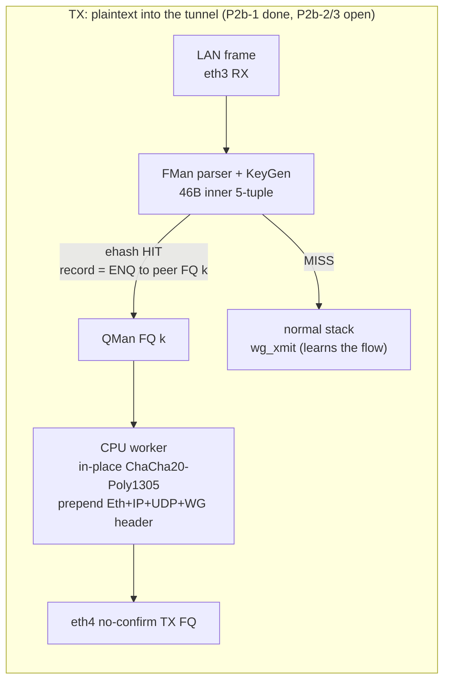
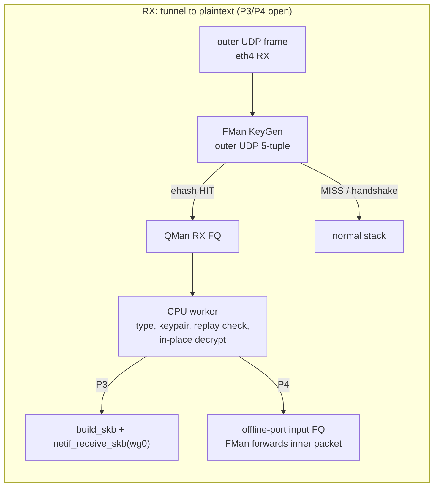

# ASK2 WireGuard plan: remaining work (software path and zero-skb fast path)

**2026-10-15 · dpaa1 · Status: open.** This is the single active WireGuard plan. The completed work, which covers the measurements, profiles, the P0/P1/P2a/P2b-1 builds and the gate results, has moved to the archive:

- `plans/archive/ask2-wireguard-plan.md`: software throughput. It covers the stage 0 baseline, stage -1 (lockdep debug kernel), patches 4011/056/057/4016, the retired GRO patch 4012, E1 `noqueue`, E2 `tx_lanes=3`, P2b-1 results and the conntrack-hook analysis.
- `plans/archive/ask2-wireguard-matrix-106-vs-185.md`: the 2026-10-12/13 nine-cell matrix (image 2243, before `tx_lanes`).
- `plans/archive/ASK2-WIREGUARD-FASTPATH-PLAN-2026-10-15.md`: the full fast-path design history. It includes P0 feasibility, P1 (gate G1 PASS, image 1943), P2a lab seal (about 465k packets/s, image 2243), the alternatives considered and the closed open items.

WireGuard is not a vendor-parity item: neither the vendor ASK nor ASK2 hardware-offloads it, and CAAM Era 8 has no ChaCha20-Poly1305. Its priority relative to ASK2 parity work is set in `plans/ASK2-MASTER-PLAN.md`.

## 1. Where things stand

| Item | State |
|---|---|
| Software path (patches 4011, 056, 057, 4016; `serial_cpus=14 tx_lanes=3` in `96-enable-services.chroot`) | Shipped. Lanes=3 matrix (image 0051): `.185` leads `.106` in 8 of 9 cells; 1T `up` 1.65 vs 1.38. |
| 1T `bidir` (1.44 vs `.106` 1.55) | The only losing cell. Root cause is the presence of the conntrack hooks: a flushed ruleset gives 1.61. There is no safe VyOS-semantics-preserving fix, so this is a configuration trade-off. |
| Fast path TX, P2b-1 (patch 4017, `wgfp_peer`) | Gate G2 PASS on image 0347: 2.62 Gbit/s on 4 flows, survives the 120 s rekey, no Invalid MAC. Superseded by P2b-2/P2b-3. |
| Fast path TX, P2b-2 automatic flow install (patch 4018) | Gate PASS 2026-11-02 (image `2026.11.02-1519-rolling`): 2.94 / 3.12 Gbit/s on 4 flows, no hand steering. |
| Fast path TX, P2b-3 punt, roaming, AllowedIPs, wg0 delete | Gate PASS 2026-11-02 (image `2026.11.02-1632-rolling`): every test plus upstream `netns.sh` (553 steps). |
| Fast path TX, P2c multi-peer, CLI, sink tail drop (closing step A) | Implemented 2026-11-02, compiled and linked locally; not yet built in CI or board-tested. |
| Fast path RX (P3), offline-port reinjection (P4), order restoration (P5) | Not started. |

## 2. Architecture (unchanged, kept for the remaining phases)

The design rules still apply:

- The per-peer fast-path state lives inside the `wireguard` module, and `ask.ko` supplies only record insert/delete and FQ ids.
- Records are installed by the slow path, so a MISS stays safe.
- Each peer gets N FQs (start at 4) with flows assigned round-robin, which keeps per-flow order through QMan.
- Frames are processed in place on the BMan buffer.
- Any unexpected state punts to the stack.

## 3. Remaining phases, gates and kill criteria

AGENTS.md S0 applies to every phase that touches FMan: run at least three qdrant queries, cross-check against `arch/fman-microcode-210-programming-reference.md` and `specs/fman-keygen-flow-key-spec.md`, read back every silicon write, and cold boot before each experiment. Arm `softlockup_panic` and `panic_on_rcu_stall`, and never experiment on `eth0`.

### P2b-2. Automatic flow install

On the first `wg_xmit` for an inner flow whose peer, endpoint and keypair are valid and whose ingress port is ASK-engaged, the module asks `ask.ko` to insert the record. The record is removed on flow teardown, peer removal or disengage. This needs the registration API in section 4.

**Gate:** no debugfs steering. Four inner TCP flows reach at least 2.6 Gbit/s `up`, and `pcd-snapshot diff` is clean after disengage.

### P2b-3. Slow-path punt and AllowedIPs

The worker must hand these cases back to the stack by building an skb and calling the `wg_xmit` slow path, then withdraw the record:

- AllowedIPs mismatch;
- keypair near `REKEY_AFTER_*`;
- no neighbour;
- oversize frame;
- keepalive due;
- peer removed.

**Gate:** the upstream `tools/testing/selftests/wireguard/netns.sh` passes, endpoint roaming and a forced rekey keep the tunnel up, and there is no Invalid MAC on stock dell2.

### P2b-3 implementation (2026-11-02, commit `1d6f64bd`, board-tested on `.185`)

All of it is in `fastpath.c`; no DPAA or `ask.ko` change.

- **Punt (`wgfp_punt()`):** a frame the seal path declines is copied into a fresh skb and received again with `netif_receive_skb()` on the ingress port of its learned flow (`fl->ifindex`). The stack then forwards it (the software flowtable or the classic path) into `wg_xmit()`, or elsewhere if routing changed, with TTL, ICMP, PMTU, firewall, AllowedIPs and handshake queueing intact. The DPAA buffer goes back to its pool. Punts are the exception (handshake gaps, roaming, oversize), so the copy is acceptable. A frame of no known flow (manual debugfs records) is still dropped. The `wgfp_peer` read-out adds `punted` and `aip_withdraws`.
- **Which declines withdraw the record:** oversize (`ip_len > wg0 MTU`) and a dead peer punt and withdraw. No keypair, an expired keypair, `REJECT_AFTER_MESSAGES`, no template, TTL ≤ 1 and a roamed endpoint only punt. Rekey at `REKEY_AFTER_*` was already triggered from the seal path (P2b-1), and keepalives stay with the stack's timers, which the seal path feeds.
- **Roaming:** each frame compares the template's outer destination with `peer->endpoint.addr4` unlocked (the same unlocked test `wg_socket_set_peer_endpoint()` uses). A mismatch punts and runs the template refresh at once (`mod_delayed_work`). A refresh that finds no IPv4 endpoint, no route via the egress port or no valid neighbour now clears the template, so frames punt instead of leaving with stale headers.
- **AllowedIPs:** the 2 s aging pass looks up each installed record's inner destination with `wg_allowedips_lookup_dst()` (an skb holding one IPv4 header as the probe) and withdraws records that no longer map to the bound peer.
- **Re-learning without a ct:** `wgfp_ct_admitted()` takes the conntrack proof from the skb when present, else looks the entry up by tuple (`nf_conntrack_find_get`, default zone) and requires `IPS_SEEN_REPLY`, no NAT, no master, no helper. This fixes two board-observed gaps. A UDP flow was never learned, because the flowtable takes it on the first reply, so every later packet from the plain side arrives without a ct (`[HW_OFFLOAD]` in conntrack, `flows=0` after 1500 packets). And a withdrawn flow could never come back.
- **wg0 or egress deletion:** a netdevice notifier (registered while peer mode is on) schedules a stop on `NETDEV_UNREGISTER` of either device, so `ip link del wg0` no longer waits on the references peer mode holds.

Harness: `bin/testrig-wgfp-p2b3.sh [rekey rekey120 roam aip pmtu del netns]`, `STOCK=1` for the stock reference. Baseline on `.185` (image `2026.11.02-1519-rolling`, P2b-2 code), one TCP flow ~1.3 Gbit/s, dell2 with `persistent-keepalive 1`:

- `rekey` (dell2 removes and re-adds the DUT peer): stock one dip second (0.96 Gbit/s); P2b-2 one dip second (1.11). Without a keepalive on dell2 both stock and fast path stall, since a pure TCP receiver sends nothing and the DUT's 15 s no-reply timer is the only recovery.
- `roam` (dell2 listen port 51820 → 51830): stock one dip second (0.96); P2b-2 two seconds (0.11, 0.59), from the up to 1 s template lag. Without a keepalive stock never learns the new port either.
- `aip` and `pmtu`: the UDP flows are never learned on P2b-2 (the ct gap above), so they only validate the harness.

**Board result** on `.185` (image `2026.11.02-1632-rolling`, CI run 41482411379, commit `1d6f64bd`, first boot after install; boot type not recorded), tunnel from `KEEP=1 bin/testrig-wireguard.sh setup wg-v4`:

- `rekey`: PASS, one dip second (1.08 Gbit/s), no Invalid MAC, nonce or source errors on dell2 (wireguard dyndbg on).
- `roam`: PASS, 300 frames punted while the template caught up, one dip second (1.11) instead of two on P2b-2, DUT endpoint `10.99.2.113:51830`.
- `aip`: PASS. The UDP flow was learned and installed, the AllowedIPs change withdrew its record (`aip_withdraws` 1), `sealed` did not move in the 2 s window (8946 / 8946), and after the restore the flow was learned again and sealed (`installs` +1, `sealed` 9797). iperf3 `-u` does not get through this tunnel on the rig even with the fast path off, so the UDP tests use python endpoints (an echo on dell2 `10.99.200.113:9100`).
- `pmtu`: PASS. The UDP flow was learned (the tuple ct lookup), the 1488-byte DF frame was punted (`punted` 1) and its record withdrawn (`decline_withdraws` +1), and dell1 learned PMTU 1420 from the ICMP the stack sent.
- `rekey120`: PASS. One 140 s TCP flow at about 1.1 Gbit/s crossed the 120 s rekey (dell2 initiated it; latest handshake +120 s) with no second below 0.05 Gbit/s. There is a small dip (0.88–0.99) about every 10 s, also before the rekey; not yet explained.
- P2b-2 regression: `AUTO=1 DUR=20 bin/testrig-wgfp-p2b.sh` 3.006 Gbit/s, `punted=0`, `fe_flow` empty after `off`.
- `netns`: PASS. The upstream `netns.sh` (v6.18 tag, peer mode off) ran 553 steps to `rc=0` with "Objects that were created were also destroyed". Two userspace gaps on VyOS needed harness work, neither a kernel issue. There is no `ncat`, so the harness installs a python stand-in named `ncat`; it must be called `ncat`, because `waitncatudp` matches the process name in `ss`. wireguard-tools v1.0.20210914 cannot parse `allowed-ips -prefix` removal, so the harness drops that one 16-line block (the removal and its 388-entry check).
- `del`: PASS. `ip link del wg0` with peer mode bound returned in 1 s, the notifier stopped peer mode ("fastpath peer mode off: wg0 or eth4 unregistered"), and no `unregister_netdevice: waiting` messages were logged.

**P2b-3 gate passed** (2026-11-02): netns.sh passes, roaming and a forced rekey keep the tunnel up, there is no Invalid MAC on stock dell2, and P2b-2 throughput is unchanged.

### P2c. Multi-peer binding

`wgfp_peer` binds only the first peer. Bind per peer so that the 2T and 4T matrix cells can run on the fast path.

**Gate:** 2T and 4T `up` are at least the software lanes=3 results (1.72 and 1.91 Gbit/s), with no cross-peer seal.

### Closing step A implementation (2026-11-02, compiled and linked, not yet built in CI or board-tested)

**Multi-peer and multi-device (P2c).** `wgfp_peer` takes a list of wg devices (`echo "wg0 wg1" > /sys/module/wireguard/parameters/wgfp_peer`; `off` unbinds). Writing a list rebinds the whole set (full teardown and rebuild; flows relearn within a second). Every peer of a bound device is eligible. Per-peer state (`struct wgfp_pst`: peer reference, template, timer pacing) is created by the peer's first learned flow and freed by the aging pass once it has none. The sink path finds the flow lock-free (RCU hash; entries unhashed with `hash_del_rcu()` and freed with `kfree_rcu()`) and the peer through it, so the four sinks stay shared and no per-peer FQs are needed. The egress port now comes from each peer's own route: `dpaa_wgfp_egress(dev)` returns a handle to a no-confirm TX FQ allocated once per DPAA port (each `dpaa_alloc_offload_tx_fq()` call creates a new FQ, so it must not be called per refresh), and `dpaa_wgfp_xmit()` takes it. A peer whose route leaves through a non-DPAA port gets no template and stays on the stack. The read-out adds `peers` and `dev`. Up to 8 devices.

**Use-after-free fixed.** The aging pass dropped the lock to read the silicon counters and then wrote to `job[i].fl`. A FIN or a withdraw in that window let the flow worker free the entry. It now re-finds the flow by tuple and only touches it if the table still holds that same entry.

**CLI (patch `data/vyos-1x-059-wireguard-offload-cli.patch`).** `set interfaces wireguard wgN offload ipv4`. `interfaces_wireguard.py` computes the full list of opted-in, non-disabled wg interfaces on every commit and writes it to `wgfp_peer` only when it differs from the bound set (`dev=` in the read-out), because a write rebinds. A kernel without the parameter only warns. Flows are installed only for traffic arriving on a port with `set interfaces ethernet ethN offload ipv4`; everything else stays on the software path.

**vyos-1x pinned.** Writing 059 showed that patches 027 (FMan DT port order) and 047 no longer apply to upstream `rolling`. Upstream T3871 (`c73faac7f`, 2026-10-31) removed the `vyos_net_name` udev helper in favour of a slot-anchored naming store. The CI cache key held the literal word `rolling`, and every shipping image so far used a deb cached from upstream `91bf0ef51` (2026-10-30), so the drift stayed hidden. Any patch change would have forced a fresh build against `rolling` and failed. `bin/ci-setup-vyos1x.sh` now pins `VYOS1X_COMMIT=91bf0ef51026b82f5714c809d6d651a8b9c7aacb`; on that commit all 45 patches apply. `patch-rot-check.yml` gates on the pin and probes `rolling` as advisory; the probe now also copies `data/vyos-1x-files` first, as the build does. On `rolling`, 027 and 031 fail today. Moving the pin requires porting 027/047 to the T3871 store, verified on the board (eth0 must remain the management port).

**Sink tail drop (A3).** The sink FQs had no tail drop. Baseline 2026-11-02 (image `2026.11.02-1632-rolling`): during an unpaced P2a run (sinks saturated), an unrelated forwarded ping from dell1 through the same ingress port lost 34% (plus 10 errors), because the sink backlog drained eth3's buffer pool. `dpaa_wgfp.c` now sets FQ-local tail drop (`QM_FQCTRL_TDE`, 512 KiB per sink, about 350 MTU frames, so four sinks stay inside the ~2,270-buffer pool). FQ-local tail drop is the mechanism F-199 proved works for FE-fed FQs; the CGR path does not see FE enqueues. Harness: `bin/testrig-wgfp-soak.sh overload` (gate: side-flow loss ≤ 1%, eth3 `bpool` recovers) and `bin/testrig-wgfp-soak.sh soak` (10 min, 4 flows; gate: eth3/eth4 `bpool` back within 64, `xmit_fail` 0, no kernel errors, `fe_flow` empty, `pcd-snapshot diff` clean).

**Security review (A4), `fastpath.c` against upstream `send.c`/`noise.c`.**

- Key material: peer mode never logs or exposes keys. The P2a lab key is written through a root-only (0600) parameter and is not readable back.
- Keypair and counter handling match `wg_packet_encrypt`/`encrypt_packet`. The seal path checks `sending.is_valid` and `REJECT_AFTER_TIME`, takes the nonce with `atomic64_inc_return() - 1`, rejects `>= REJECT_AFTER_MESSAGES`, and never reuses a consumed nonce (a declined frame burns its counter like an upstream drop). Keypairs are freed through `call_rcu()`, so the sink's RCU read section covers the use without a keypair reference.
- Padding is the same rule as `calculate_skb_padding()` (16-byte multiple, capped at the MTU, and `ip_len <= MTU` is checked first).
- Buffer bounds are checked before every write: headroom `>= WGFP_ADDED`, `off + 14 + plain + 16 <= buf_size` (3584), so the outer `tot_len` cannot overflow.
- Rekey and timers run as upstream: the timers are fed every 10 ms per peer, and a handshake is triggered on `REKEY_AFTER_MESSAGES` or `REKEY_AFTER_TIME` as the initiator. Handshake and cookie messages never use the fast path.
- Semantic deltas, all shared with nf flowtable offload and documented: after admission a flow skips the firewall and conntrack TCP window checks until its record is withdrawn; an AllowedIPs change takes effect within one aging period (2 s); a non-first IP fragment of an offloaded flow is not matched (no ports) and takes the stack. A first fragment is sealed as a normal packet, which WireGuard permits.
- Carry cost: every upstream WireGuard security fix in `send.c`, `noise.c`, `timers.c` or `allowedips.c` must be checked against `fastpath.c`.

### P3 implementation (2026-11-02, compiled and linked, not yet built in CI or board-tested)

**Measurement first.** Software `down` on `.185` (image `2026.11.02-1632-rolling`, 4 TCP flows, `wgfp_peer off`): 1.61 Gbit/s. CPU2, the RX CPU of the single outer UDP flow, sits at 100% softirq, while the other three are 84–88% busy with the decrypt/encrypt workers. `perf` on CPU2: `__netif_receive_skb` 82%, of which netfilter `nf_hook_slow` 40% (`nft_do_chain` 12.6%, `nf_conntrack_in` 8%), IP input and routing ~10%, UDP socket delivery ~5%, `wg_receive`/`wg_packet_receive` 16%, DPAA RX 15%. The serial cost is the outer packet's trip through IP input and the INPUT firewall, not decryption, which upstream already spreads over all cores.

**Silicon check.** The plan assumed an ehash record could steer the inbound outer flow, but qdrant (2026-09-06) held that to-self traffic bypasses the ehash (`pr_word & 0x0044`). Re-tested: a record for UDP `10.99.2.113:40001 -> 10.99.2.185:51999` (the DUT's own eth4 address) steered 200 of 200 packets to a sink (`tbl[2]` = eth4). To-self UDP does hit records; qdrant corrected.

**Design.** One ehash record per peer for its inbound outer flow (endpoint -> local source address, UDP, endpoint port -> listen port, on the port the peer's route uses), kept in step with the template by the refresh work (`wgfp_pst_rx_sync()`). It is installed once the outer conntrack entry is established, not NAT'ed and without a helper, and withdrawn on a template or endpoint change, peer removal, unbind or `wgfp_rx=0`. It does not age (it lives with the peer state). The sink hands such frames to `wgfp_rx_frame()`, which copies the frame into an skb, checks for plain IPv4 with a valid header checksum (anything else goes to `netif_receive_skb()`), and calls upstream `wg_packet_receive()` exactly as `wg_receive()` would. Decryption, the replay window, the inner AllowedIPs source check, ordering, handshakes and cookies stay upstream code; only IP input, netfilter, conntrack and the UDP socket lookup are skipped, for the one admitted endpoint 5-tuple (flowtable-like semantics: firewall changes apply when the record is withdrawn). Read-out adds `rx` and `rx_stack`. Limits: the peer state that carries the record is created by TX learning, so a receive-only peer (no inner flow sent through the fast path) gets no RX record; one outer flow is still one sink and one CPU, but that CPU now does far less per packet.

**Gate G3** unchanged: `down` >= 2.6 Gbit/s on four flows, kill below 2.2; plus the P2b-3 suite with `wgfp_rx=1`.

### Closing step C implementation: IPv6 (2026-11-02, compiled, not yet built in CI or board-tested)

**C1, IPv6 inner flows.** The flow tuple carries a family and 16-byte addresses (`struct dpaa_wgfp_tuple`, compared and hashed whole, always built zero-initialised). `wgfp_key()` emits the silicon-verified dual-lane layout for IPv6 (family 0x60, zero 8-byte v4 lane, src6 @9, dst6 @25, then proto/ports/VID/SID as for IPv4; qdrant 2026-08-21 and 2026-09-06), in the same 50-byte per-port table, so no FMan change is needed. One parser (`wgfp_parse()`) serves the sink path and learning: plain IPv4 (no options, no fragments) or IPv6 without extension headers, TCP or UDP; learning reads the headers through `skb_header_pointer()`. The seal path decrements the hop limit for IPv6 (no checksum). The conntrack lookup and the AllowedIPs probe handle both families.

**C2, IPv6 outer (endpoint).** The template is built per family (`wgfp_tmpl4()`/`wgfp_tmpl6()`): IPv6 uses `ip6_route_output()`, `ipv6_dev_get_saddr()` when the endpoint has no source, the ND table and `ip6_dst_hoplimit()`. Both builders now pass `wg->fwmark`, as upstream `send4()`/`send6()` do (the IPv4 lookup previously ignored it). The outer header length is per template (Ethernet + 20 or 40 + 8); the headroom test and the transmit offset follow it. The IPv6 UDP checksum is mandatory, so it is summed in software over the datagram after encryption (`csum_partial` + `csum_ipv6_magic`, about 3% of the per-packet cost). The endpoint compare checks the address family first (an IPv4 compare against an IPv6 endpoint would read `sin6_flowinfo`). The P3 RX record and `wgfp_rx_frame()` handle an IPv6 outer flow (no extension headers; anything else goes to the stack). Unknown: whether the DPAA RX headroom (`f->off`) is at least 64 bytes; if not, every IPv6-outer frame declines and is punted (correct, but no fast path). The `punted` counter will show it.

**Harness.** `FAM=6 AUTO=1 bin/testrig-wgfp-p2b.sh` drives inner IPv6 flows; the IPv6 outer case is `OUTER=6 KEEP=1 bin/testrig-wireguard.sh setup wg-v4`. The P2b harness now picks a fresh source port per run (`CPORT0`).

### Close-out status and leftovers (2026-11-02)

Image `vyos-2026.11.02-1818-rolling` (CI run 41499179221, commits `526d1ef7` A and `c93c9c7b` P3) carries closing step A and P3; C (IPv6) is written and compiled but not yet committed; D waits on the P3 measurement. Board gates still to run on 1818: P2b-2 throughput and the P2b-3 suite (regression after the multi-peer rewrite), `bin/testrig-wgfp-soak.sh overload` (sink tail drop; baseline 34% side-flow loss) and `soak` (10 min, `pcd-snapshot` clean), the CLI (`set interfaces wireguard wg0 offload ipv4` binds without the module parameter, survives reboot and `wg0` re-creation), two tunnels bound at once (P2c gate: 2T and 4T `up` at least 1.72 and 1.91 Gbit/s), and G3 (`AUTO=1 FLOWS=0 REV=4`: `down` at least 2.6 Gbit/s, A/B with `wgfp_rx=0`).

Leftovers after those gates, in order of value:

- **Receive-only peers get no RX record.** Peer state (and with it the P3 outer record) is created by TX learning, so a peer that only sends to us (a one-way UDP download, a peer whose inner flows enter on a non-DPAA port) stays on the software receive path. Create peer state for every peer of a bound device at bind time and on peer add.
- **Zero-copy RX and punt** (master plan §4.8 item 3): every P3 frame is copied into a fresh skb today.
- **Per-flow cap** (P5, master §4.8 item 4): one inner flow is one sink and one core, about 1.0–1.3 Gbit/s.
- **DPAA RX headroom for an IPv6 outer header**: the seal needs 64 bytes in front of the frame for IPv6 (44 for IPv4); if `f->off` is smaller every IPv6-outer frame is punted. Read `f->off` on the board with C, and raise the headroom if needed.
- **The ~10 s dip** seen in the 140 s `rekey120` run (0.88–0.99 Gbit/s once every ~10 s, before the rekey too): check whether the software path shows it, then correlate with the 2 s aging pass and the 1 s template refresh.
- **Placement by load** (master §4.8 item 5) instead of round-robin.
- **Binding limits**: up to 8 devices; any binding change rebuilds everything (fine for config commits, not for frequent changes).
- **P4 (offline-port reinjection)** only if, after P3, inner forwarding through the stack is the measured bottleneck of `down`; decided jointly with IPsec tier 2. **P5** only for a named single-flow need.
- Generalize `dpaa_wgfp` into the shared steer-to-consumer substrate (master §4.8 item 1) once WireGuard is closed.

### Before P2b-2: explain the P2a plateau (resolved 2026-11-02)

P2a plateaued at about 465k packets/s while every core showed 43% busy. **Resolved on `.185` (image `2026.10.31-0511-rolling`): the plateau is CPU-bound and the "43%/60% busy" figure is a harness artifact.** A 1 s `/proc/stat` time series on the DUT during an unpaced run (`PPS_LIST=0 SECS=20 TBLS=3 bin/testrig-wgfp-p2a.sh`) shows all four cores at 98–100% softirq for the whole sealing window. `bin/testrig-wgfp-p2a.sh` takes its CPU snapshot around the entire pktgen trial, including several seconds of setup with no traffic, which dilutes the figure. This run sealed 499–501k packets/s, all delivered, and the captured packets decrypt. That is about 12.8k cycles per packet at 4 × 1.6 GHz, matching the 13k model. A `perf record -a -g` profile of the window (static perf `/mnt/builds/wgfp/linux/tools/perf/perf` copied to `/tmp/perf` on the DUT) gives ChaCha20-Poly1305 about 60% (`chacha_4block_xor_neon` 43.5%, `poly1305_blocks_neon` 10.2%, `chacha_permute` 3.1%, the rest of the library about 3%), NEON begin/end and `fpsimd_flush_cpu_state` about 2.6%, `wgfp_lab_frame` (header build and pad) 4.9%, and DPAA RX/TX (`qman_enqueue` 2.3%, `__poll_portal_fast` 1.9%, `dpaa_wgfp_xmit` 1.4%, `wgfp_dqrr` 1.0%) about 7%. **The TX fast path is crypto-bound at about 500k packets/s (about 5.7 Gbit/s inner at 1420 bytes); later phases cannot add much per-packet cost.**

The same runs showed a second problem: with all four sinks saturated, SSH to the DUT timed out for the whole window. The sink FQs were on work queue 3 (medium tier), above the kernel RX FQs on work queue 6 (`dpaa_assign_wq`), so QMan starved eth0. `dpaa_wgfp.c` now puts the sinks on WQ6 (`WGFP_WQ`). **Verified 2026-11-02** on `.185` (image `2026.11.02-0440-rolling`, warm boot after install): an unpaced P2a run (`PPS_LIST=0 SECS=20 TBLS=3`) sealed 502,933 packets/s with 100% delivered and load average 8.4, and SSH to eth0 answered in about 1 s (idle: 1.3 s). Ping RTT stayed at the 34 ms baseline of the Tailscale path.

### P2b-2 implementation (2026-11-02, gate passed on `.185`)

- `dpaa_wgfp.c` (fsl_dpa): `dpaa_wgfp_flow_add/del/packets()` and `dpaa_wgfp_port_ok()`. They build the F-269 routed key (`0x40|SIP|DIP|..|proto@41|sport@42|dport@44|VID 0|SID 0`, 50 bytes) and call `fman_pcd_fe_flow_add()` with `rx_fqid` = a sink FQID (the same record shape as the ethtool-ntuple steering, F-241) on the ingress port's per-port table. The sink is `hash % sinks`. `dpaa_wgfp_register()` creates the sinks when there are none. There is no `ask.ko` dependency; `ask.ko` already fails closed for flows whose egress is `wg0`, so it never installs a conflicting record.
- `fastpath.c`: `wg_fastpath_learn()`, called from `wg_xmit()` (patch `4018`) for the bound peer. It learns inner IPv4 TCP/UDP flows from a physical DPAA ingress whose conntrack entry is `ESTABLISHED`/`ESTABLISHED_REPLY`, not NAT'ed, without a master and without a helper. It never learns from a SYN. Records are installed by a workqueue, because the record API sleeps. FIN/RST (punted by `tcp_ctl_punt`) withdraws the record, five 2 s aging periods without silicon hits withdraw it, and `wgfp_peer off` withdraws all of them. Failed installs are held for 30 s to avoid retry storms. The `wgfp_peer` read-out adds `flows`, `installs`, `install_fail`, `withdraws` and `decline_withdraws`.
- Seal path fixes: the inner TTL is now decremented (`ip_decrease_ttl`; the lab and P2b-1 forwarded with the TTL unchanged), and TTL ≤ 1 or a dead peer declines. **Any decline of a learned flow withdraws its record** (`wgfp_withdraw_frame()`). Declined frames are dropped by the sink, so an oversized DF flow would otherwise black-hole after install. With the withdraw it falls back to the stack, which handles PMTU. A real punt is still P2b-3.
- Known limits: only flows learned from a packet that still carries a conntrack entry. A flow already in the software flowtable has none; it is tracked from its first established packet, and later packets only count toward admission. A fast-pathed flow skips firewall changes until withdrawn, as an offloaded flowtable flow does. The flow table takes one global spinlock per slow-path packet of the bound peer. The `wgdev` reference held by peer mode blocks deleting `wg0` while bound (P2b-3).
- Harness: `AUTO=1 bin/testrig-wgfp-p2b.sh` skips the debugfs steering and checks that `wgfp_peer off` leaves no records in `fe_flow`.
- **Board result 2026-11-02** (`.185`, image `2026.11.02-0440-rolling`, warm boot after install, tunnel from `KEEP=1 bin/testrig-wireguard.sh setup wg-v4`): `AUTO=1 DUR=20` gave 2.465 Gbit/s up (flows 0.29 / 0.26 / 0.99 / 0.93), 4,491,662 sealed, `install_fail=0`, `decline_withdraws=0`, and `fe_flow` empty after `off`. Install, aging and teardown work. The flow table learns, installs and withdraws on its own. The record's silicon counter (`fe_ehash_stats pkt_count`) tracks `sealed` packet for packet, so aging keeps a busy flow installed for its whole life (0.5 s on-board poll). The 8 installs / 4 withdraws were iperf3's 4 control connections (5 packets each), which got records and aged out after 10 s. **Gate miss cause:** sink choice. The 4 control connections took sinks 0 and 1 (5 frames each), and all 4 data flows hashed onto sinks 2 and 3 (`hash % sinks`), so two cores sealed everything.
- **Fix (not yet built):** `fastpath.c` now tracks a flow from its first conntrack-proven packet but installs a record only after `WGFP_ADMIT` = 32 slow-path packets. Later packets need no ct, because once the software flowtable has the flow its packets reach `wg_xmit()` without one (seen: conntrack `[OFFLOAD]` for the inner flow). A tracked flow that does not reach the threshold within 10 s is forgotten, so mice never take a record or a sink. Sinks are assigned round-robin per install instead of by tuple hash. This replaces the "learned only at the packet that triggers `flow add`" limit below.
- **Gate PASSED 2026-11-02** on `.185` (image `2026.11.02-1519-rolling`, CI run 41470453447, commit `d072765a`, first boot after install; boot type not recorded): `AUTO=1 DUR=20 bin/testrig-wgfp-p2b.sh` gave 2.942 Gbit/s up (flows 0.64 / 0.66 / 0.65 / 0.99), repeat 3.122 Gbit/s. Exactly 4 installs per run, one per sink (sink frames 1.16M / 1.21M / 1.19M / 1.80M), none for the iperf3 control connections. `install_fail=0`, `decline_withdraws=0`, FIN withdrew every record at flow end, `fe_flow` empty after `off`, MURAM `used` 58764 before and after, no new kernel errors. The remaining imbalance (one flow near 1 Gbit/s, three near 0.6) is per-flow TCP behaviour, not sink placement.

### P3. RX fast path with skb reinjection (gate G3)

Install an outer-UDP record per peer endpoint that ENQs to a set of peer RX FQs. The worker:

1. validates the message type;
2. finds the keypair by receiver index;
3. checks the replay counter;
4. decrypts in place and strips the outer headers;
5. calls `build_skb` on the same buffer and `netif_receive_skb` on `wg0`.

Handshake and cookie messages pass to the stack unchanged.

**Gate G3:** `down` reaches at least 2.6 Gbit/s on four flows (software today: about 1.58), and the replay-window and out-of-order netns tests pass. **Kill:** below 2.2 Gbit/s. **Effort:** 2 to 3 weeks; it shares the keypair and replay code with P2b.

### P4. Offline-port reinjection (shared with IPsec Tier 2) (gate G4)

Enqueue the decrypted frame to the offline port's input FQ so FMan forwards the inner packet. The work starts by board-validating inject/capture patches 0183/0184, which are untested.

**Gate G4:** injected frames reach the LAN egress with correct L2 rewrite and TTL, with no FE leak and a clean `pcd-snapshot`. **Kill/defer:** if the offline-port FE path wedges or leaks, stop at P3. Decide on P4 jointly with `plans/ASK2-IPSEC-OFFLOAD-PLAN.md`, because both need this substrate. **Effort:** 4 to 8 weeks; this is the highest-risk phase.

### P5. Order restoration for a single inner flow (gate G5)

Do this only if a named workload needs more than about 1.5 Gbit/s per inner flow. Add `qman_enqueue_orp()` (about 40 lines in `qman.c`/`qman.h`; mainline 6.18.55 already has the `seqnum`, `orpc` and `AVOIDBLOCK` fields). Use an input FQ with ORP window 256 (less than the 8128 replay window), and count `ORPWINDOW_LATE/EARLY` rejects as drops.

**Gate G5:** one inner TCP flow reaches at least 2.2 Gbit/s with no extra reorder retransmits. **Kill:** a reject rate above 0.1% or any stall.

## 4. Cross-cutting work

- **Registration API between `wireguard` and `ask.ko`:** record insert/delete by key, FQ allocation and port lookup. It follows the ASK2 reversibility contract: every insert has an inverse, and `pcd-snapshot diff` is clean after disengage. P2b-2 and P3 both need it.
- **Security review of `fastpath.c`:**
  - no key material in debugfs or logs;
  - counter handling identical to `send.c`;
  - every upstream WireGuard security fix reviewed against the module patch, which is a permanent carry cost.
- **Harness:**
  - add a single-flow cell to `bin/testrig-wgfp-p2b.sh` and `bin/testrig-wireguard-multi.sh`;
  - add per-run FQ and record counters to the CSV;
  - make `bin/testrig-wireguard.sh`, and the other `testrig-*` scripts, refuse or loudly flag a DUT kernel with `PROVE_LOCKING`.
- **Release hygiene:** keep `latest.iso` on a production image, and name KUnit builds so they cannot be mistaken for releases.

## 5. Open items

Software path:

- [ ] Re-run the nine-cell matrix (`bin/wg-matrix.sh 185`) on the current shipping image (`tx_lanes=3`, 0551), and include the 5-rep vs 12-rep `.106` reference question for 1T `bidir`.
- [ ] Decide on a persistent form of `noqueue` for an unshaped WireGuard WAN port (E1 gave +7.9% on 1T `up`, +4% on `bidir`). Candidates: a udev rule or boot hook, or `IFF_NO_QUEUE` handling in `fsl_dpa`. This is a product decision.
- [ ] Run the upstream `netns.sh` selftest against `tx_lanes=3`; only a two-namespace veth smoke test has been done.
- [x] eth4 bidirectional RPS A/B on the current image (2026-11-02, `.185` image `2026.10.31-0511-rolling`, `bin/wg-rps-ab.sh` run on dell2, `PORTS=eth4 CELLS=wg-v4 DIRS="up down bidir" REPS=3`, masks eth3:eth4, RFS off in every non-default variant; csv `~/testrig/out/wgrps-*-185-eth4.csv` on dell2). Means in Gbit/s, up / down / bidir: default `e:e` 1.79 / 1.58 / 1.52 (repeat at the end: 1.79 / 1.61 / 1.53); vendorlike `2:1` 1.92 / 1.54 / 1.83; `2:4` 1.86 / 1.59 / 1.52; `4:2` 1.79 / 1.61 / 1.53; `e:1` 1.88 / 1.54 / 1.75 (bidir n=2, one rep returned 0 from a harness glitch). **The bidir gain comes only from steering the encrypted-leg port (eth4 here) to CPU0.** Per-port single-CPU masks that spare CPU0 gain nothing. `down` loses 2–3% with that steering and roughly triples retransmits (one core at 99.5%). Not shipped as a default: it is specific to whichever port carries the tunnel, it puts that port's software-fallback RX on CPU0 (the management-starvation case from 2026-08-19 that the `0xe` mask exists to prevent), and it caps that port's software forwarding at one core. If wanted, it belongs behind a per-interface knob, not a global default.
- [ ] eth3 at 10 reps (optional; the eth4 result above already decides the default question).
- [ ] Determine whether the 287k to 383k retransmits per run on `.106` come from WireGuard reordering or from dell-side loss.

Fast path:

- [ ] Explain the P2a plateau (see section 3).
- [ ] Determine the behaviour of a full sink FQ (no tail-drop configured; risk of an invisible A6-LOSS-style backlog) and localise the 5% loss at line rate (RX buffer pool of about 2,270 buffers; BMI discard counters are disabled on this image).
- [ ] Confirm the RX buffer headroom and tailroom on a live FD dump from `.185` (the F-203/F-222 order-0 buffer patches change buffer sizing).
- [ ] Find how pool-channel FQs are created in `dpaa_eth` (`dpaa_fq_setup`) so the per-peer FQ sets can reuse the helpers, and whether the portal count limits K.
- [ ] Fix the O(N^2) flow-stats refresh and check FE wedge history before multi-peer deployment.
- [ ] Check the `qman_enqueue_orp` verb and ORP-field encoding against LS1046A RM Chapter 3 (qdrant) before writing the P5 helper.
- [ ] Choose IPv6 outer UDP checksum handling: the FMan TX checksum command or a software sum.
- [ ] Decide whether to share the neighbour/route cache with `ask_neigh.c`.

## 6. Risks still open

| Risk | Phase | Containment |
|---|---|---|
| FE wedge or FE-index leak on new record shapes | P2b-2, P3, P4 | Existing record shape; one port at a time; cold boot; panic-on-lockup; `pcd-snapshot` diff |
| Full sink FQ backs up into the FE | P2b-2, P3 | Size the FQ and congestion group before enabling; explicit overload test |
| BMan depletion or double release | P2b to P4 | Release only through `dpaa_fd_release`; 10-minute soak with depletion counters |
| Divergence from upstream WireGuard semantics (rekey, roaming, timers, cookies) | P2b-3, P3 | Punt to the stack on any doubt; netns selftest on every change; slow path stays authoritative |
| Memory-bandwidth ceiling near 4 Gbit/s | P2c to P4 | Measure before quoting targets |
| No fast path for a peer behind a non-engaged port; ASK and VPP mutually exclusive per port | product | Documented; the fast path is an add-on for ASK-engaged ports |

## 7. Decision points

1. **Before P2b-2:** resolve the P2a plateau question.
2. **Before P3:** P2b-2 and P2b-3 must pass their gates, because P3 reuses the keypair, replay and registration code.
3. **Before P4:** decide jointly with the IPsec plan whether to build the offline-port reinjection substrate.
4. **Before P5:** go ahead only for a named single-flow workload.
5. **At any kill criterion:** stop that phase, keep everything already shipped and re-plan.

## 8. References

- Archived history: `plans/archive/ask2-wireguard-plan.md`, `plans/archive/ask2-wireguard-matrix-106-vs-185.md`, `plans/archive/ASK2-WIREGUARD-FASTPATH-PLAN-2026-10-15.md`.
- Related plans: `plans/ASK2-MASTER-PLAN.md`, `plans/ASK2-IPSEC-OFFLOAD-PLAN.md`, `plans/ASK2-PERFORMANCE-TEST-HARNESS.md`.
- Harnesses: `bin/testrig-wireguard.sh`, `bin/testrig-wireguard-multi.sh`, `bin/wg-matrix.sh`, `bin/testrig-wgfp-p1.sh`, `bin/testrig-wgfp-p2a.sh`, `bin/testrig-wgfp-p2b.sh`.
- Patches: board series 4011, 4013 to 4017; vyos-1x 056, 057; offline-port substrate 0175 to 0184; `0153-fman-pcd-fe-engage-api.patch`.
- Architecture references: `arch/fman-fe-ehash.md`, `arch/fman-microcode-210-programming-reference.md`, `specs/fman-keygen-flow-key-spec.md`, `specs/ask2-ipv6-dual-lane-key-design.md`.
