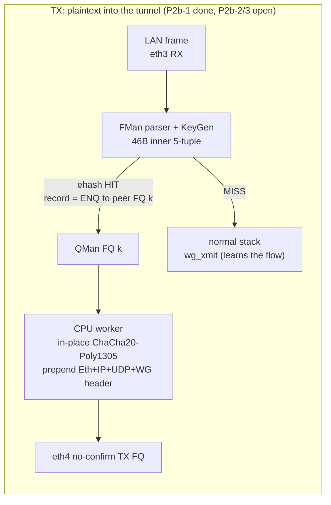
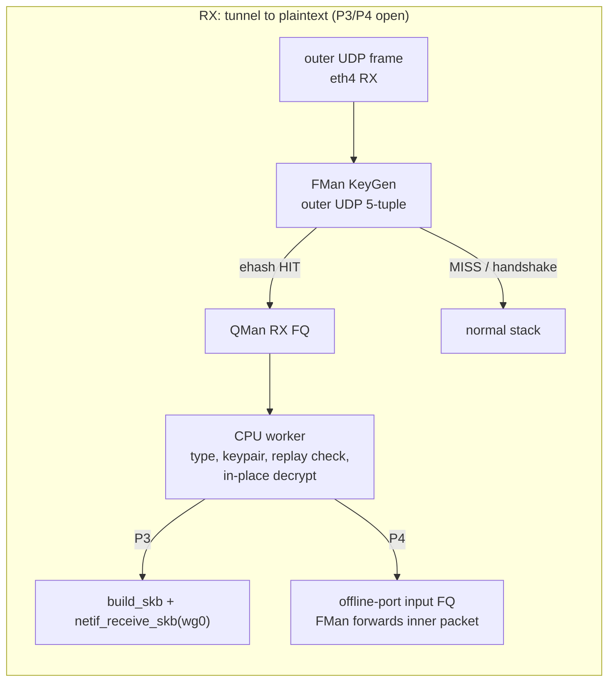

# ASK2 WireGuard plan: remaining work (software path and zero-skb fast path)

**2026-10-15 · dpaa1 · Status: open.** This is the single active WireGuard plan. The completed work, which covers the measurements, profiles, the P0/P1/P2a/P2b-1 builds and the gate results, has moved to the archive:

- `plans/archive/ask2-wireguard-plan.md`: software throughput. It covers the stage 0 baseline, stage -1 (lockdep debug kernel), patches 4011/056/057/4016, the retired GRO patch 4012, E1 `noqueue`, E2 `tx_lanes=3`, P2b-1 results and the conntrack-hook analysis.
- `plans/archive/ask2-wireguard-matrix-106-vs-185.md`: the 2026-10-12/13 nine-cell matrix (image 2243, before `tx_lanes`).
- `plans/archive/ASK2-WIREGUARD-FASTPATH-PLAN-2026-10-15.md`: the full fast-path design history. It includes P0 feasibility, P1 (gate G1 PASS, image 1943), P2a lab seal (about 465k packets/s, image 2243), the alternatives considered and the closed open items.

WireGuard is not a vendor-parity item: neither the vendor ASK nor ASK2 hardware-offloads it, and CAAM Era 8 has no ChaCha20-Poly1305. Its priority relative to ASK2 parity work is set in `plans/ASK2-MASTER-PLAN.md`.

## 1. Where things stand

| Item | State |
|---|---|
| Software path (patches 4011, 056, 057, 4016; `serial_cpus=14 tx_lanes=3` in `96-enable-services.chroot`) | Shipped. Lanes=3 matrix (image 0051): `.185` leads `.106` in 8 of 9 cells; 1T `up` 1.65 vs 1.38. |
| 1T `bidir` (1.44 vs `.106` 1.55) | The only losing cell. Root cause is the presence of the conntrack hooks: a flushed ruleset gives 1.61. There is no safe VyOS-semantics-preserving fix, so this is a configuration trade-off. |
| Fast path TX, P2b-1 (patch 4017, `wgfp_peer`) | Gate G2 PASS on image 0347: 2.62 Gbit/s on 4 flows, survives the 120 s rekey, no Invalid MAC. Limits: one peer only, flows steered by hand through debugfs `fe_flow`, TX only. |
| Fast path RX, offline-port reinjection, order restoration | Not started. |

## 2. Architecture (unchanged, kept for the remaining phases)

The design rules still apply:

- The per-peer fast-path state lives inside the `wireguard` module, and `ask.ko` supplies only record insert/delete and FQ ids.
- Records are installed by the slow path, so a MISS stays safe.
- Each peer gets N FQs (start at 4) with flows assigned round-robin, which keeps per-flow order through QMan.
- Frames are processed in place on the BMan buffer.
- Any unexpected state punts to the stack.

## 3. Remaining phases, gates and kill criteria

AGENTS.md S0 applies to every phase that touches FMan: run at least three qdrant queries, cross-check against `arch/fman-microcode-210-programming-reference.md` and `specs/fman-keygen-flow-key-spec.md`, read back every silicon write, and cold boot before each experiment. Arm `softlockup_panic` and `panic_on_rcu_stall`, and never experiment on `eth0`.

### P2b-2. Automatic flow install

On the first `wg_xmit` for an inner flow whose peer, endpoint and keypair are valid and whose ingress port is ASK-engaged, the module asks `ask.ko` to insert the record. The record is removed on flow teardown, peer removal or disengage. This needs the registration API in section 4.

**Gate:** no debugfs steering. Four inner TCP flows reach at least 2.6 Gbit/s `up`, and `pcd-snapshot diff` is clean after disengage.

### P2b-3. Slow-path punt and AllowedIPs

The worker must hand these cases back to the stack by building an skb and calling the `wg_xmit` slow path, then withdraw the record:

- AllowedIPs mismatch;
- keypair near `REKEY_AFTER_*`;
- no neighbour;
- oversize frame;
- keepalive due;
- peer removed.

**Gate:** the upstream `tools/testing/selftests/wireguard/netns.sh` passes, endpoint roaming and a forced rekey keep the tunnel up, and there is no Invalid MAC on stock dell2.

### P2c. Multi-peer binding

`wgfp_peer` binds only the first peer. Bind per peer so that the 2T and 4T matrix cells can run on the fast path.

**Gate:** 2T and 4T `up` are at least the software lanes=3 results (1.72 and 1.91 Gbit/s), with no cross-peer seal.

### Before P2b-2: explain the P2a plateau

P2a plateaued at about 465k packets/s while every core showed 43% busy. Run `perf stat -a -e cycles` during an unpaced run to determine whether `/proc/stat` under-reports NAPI time spent in NEON or whether a hardware or queue limit sits there. The answer sets the ceiling for every later phase.

### P3. RX fast path with skb reinjection (gate G3)

Install an outer-UDP record per peer endpoint that ENQs to a set of peer RX FQs. The worker:

1. validates the message type;
2. finds the keypair by receiver index;
3. checks the replay counter;
4. decrypts in place and strips the outer headers;
5. calls `build_skb` on the same buffer and `netif_receive_skb` on `wg0`.

Handshake and cookie messages pass to the stack unchanged.

**Gate G3:** `down` reaches at least 2.6 Gbit/s on four flows (software today: about 1.58), and the replay-window and out-of-order netns tests pass. **Kill:** below 2.2 Gbit/s. **Effort:** 2 to 3 weeks; it shares the keypair and replay code with P2b.

### P4. Offline-port reinjection (shared with IPsec Tier 2) (gate G4)

Enqueue the decrypted frame to the offline port's input FQ so FMan forwards the inner packet. The work starts by board-validating inject/capture patches 0183/0184, which are untested.

**Gate G4:** injected frames reach the LAN egress with correct L2 rewrite and TTL, with no FE leak and a clean `pcd-snapshot`. **Kill/defer:** if the offline-port FE path wedges or leaks, stop at P3. Decide on P4 jointly with `plans/ASK2-IPSEC-OFFLOAD-PLAN.md`, because both need this substrate. **Effort:** 4 to 8 weeks; this is the highest-risk phase.

### P5. Order restoration for a single inner flow (gate G5)

Do this only if a named workload needs more than about 1.5 Gbit/s per inner flow. Add `qman_enqueue_orp()` (about 40 lines in `qman.c`/`qman.h`; mainline 6.18.55 already has the `seqnum`, `orpc` and `AVOIDBLOCK` fields). Use an input FQ with ORP window 256 (less than the 8128 replay window), and count `ORPWINDOW_LATE/EARLY` rejects as drops.

**Gate G5:** one inner TCP flow reaches at least 2.2 Gbit/s with no extra reorder retransmits. **Kill:** a reject rate above 0.1% or any stall.

## 4. Cross-cutting work

- **Registration API between `wireguard` and `ask.ko`:** record insert/delete by key, FQ allocation and port lookup. It follows the ASK2 reversibility contract: every insert has an inverse, and `pcd-snapshot diff` is clean after disengage. P2b-2 and P3 both need it.
- **Security review of `fastpath.c`:**
  - no key material in debugfs or logs;
  - counter handling identical to `send.c`;
  - every upstream WireGuard security fix reviewed against the module patch, which is a permanent carry cost.
- **Harness:**
  - add a single-flow cell to `bin/testrig-wgfp-p2b.sh` and `bin/testrig-wireguard-multi.sh`;
  - add per-run FQ and record counters to the CSV;
  - make `bin/testrig-wireguard.sh`, and the other `testrig-*` scripts, refuse or loudly flag a DUT kernel with `PROVE_LOCKING`.
- **Release hygiene:** keep `latest.iso` on a production image, and name KUnit builds so they cannot be mistaken for releases.

## 5. Open items

Software path:

- [ ] Re-run the nine-cell matrix (`bin/wg-matrix.sh 185`) on the current shipping image (`tx_lanes=3`, 0551), and include the 5-rep vs 12-rep `.106` reference question for 1T `bidir`.
- [ ] Decide on a persistent form of `noqueue` for an unshaped WireGuard WAN port (E1 gave +7.9% on 1T `up`, +4% on `bidir`). Candidates: a udev rule or boot hook, or `IFF_NO_QUEUE` handling in `fsl_dpa`. This is a product decision.
- [ ] Run the upstream `netns.sh` selftest against `tx_lanes=3`; only a two-namespace veth smoke test has been done.
- [ ] eth4 bidirectional RPS A/B on the current image, eth3 at 10 reps, then an operator decision on shipping the steering (master plan WireGuard row).
- [ ] Determine whether the 287k to 383k retransmits per run on `.106` come from WireGuard reordering or from dell-side loss.

Fast path:

- [ ] Explain the P2a plateau (see section 3).
- [ ] Determine the behaviour of a full sink FQ (no tail-drop configured; risk of an invisible A6-LOSS-style backlog) and localise the 5% loss at line rate (RX buffer pool of about 2,270 buffers; BMI discard counters are disabled on this image).
- [ ] Confirm the RX buffer headroom and tailroom on a live FD dump from `.185` (the F-203/F-222 order-0 buffer patches change buffer sizing).
- [ ] Find how pool-channel FQs are created in `dpaa_eth` (`dpaa_fq_setup`) so the per-peer FQ sets can reuse the helpers, and whether the portal count limits K.
- [ ] Fix the O(N^2) flow-stats refresh and check FE wedge history before multi-peer deployment.
- [ ] Check the `qman_enqueue_orp` verb and ORP-field encoding against LS1046A RM Chapter 3 (qdrant) before writing the P5 helper.
- [ ] Choose IPv6 outer UDP checksum handling: the FMan TX checksum command or a software sum.
- [ ] Decide whether to share the neighbour/route cache with `ask_neigh.c`.

## 6. Risks still open

| Risk | Phase | Containment |
|---|---|---|
| FE wedge or FE-index leak on new record shapes | P2b-2, P3, P4 | Existing record shape; one port at a time; cold boot; panic-on-lockup; `pcd-snapshot` diff |
| Full sink FQ backs up into the FE | P2b-2, P3 | Size the FQ and congestion group before enabling; explicit overload test |
| BMan depletion or double release | P2b to P4 | Release only through `dpaa_fd_release`; 10-minute soak with depletion counters |
| Divergence from upstream WireGuard semantics (rekey, roaming, timers, cookies) | P2b-3, P3 | Punt to the stack on any doubt; netns selftest on every change; slow path stays authoritative |
| Memory-bandwidth ceiling near 4 Gbit/s | P2c to P4 | Measure before quoting targets |
| No fast path for a peer behind a non-engaged port; ASK and VPP mutually exclusive per port | product | Documented; the fast path is an add-on for ASK-engaged ports |

## 7. Decision points

1. **Before P2b-2:** resolve the P2a plateau question.
2. **Before P3:** P2b-2 and P2b-3 must pass their gates, because P3 reuses the keypair, replay and registration code.
3. **Before P4:** decide jointly with the IPsec plan whether to build the offline-port reinjection substrate.
4. **Before P5:** go ahead only for a named single-flow workload.
5. **At any kill criterion:** stop that phase, keep everything already shipped and re-plan.

## 8. References

- Archived history: `plans/archive/ask2-wireguard-plan.md`, `plans/archive/ask2-wireguard-matrix-106-vs-185.md`, `plans/archive/ASK2-WIREGUARD-FASTPATH-PLAN-2026-10-15.md`.
- Related plans: `plans/ASK2-MASTER-PLAN.md`, `plans/ASK2-IPSEC-OFFLOAD-PLAN.md`, `plans/ASK2-PERFORMANCE-TEST-HARNESS.md`.
- Harnesses: `bin/testrig-wireguard.sh`, `bin/testrig-wireguard-multi.sh`, `bin/wg-matrix.sh`, `bin/testrig-wgfp-p1.sh`, `bin/testrig-wgfp-p2a.sh`, `bin/testrig-wgfp-p2b.sh`.
- Patches: board series 4011, 4013 to 4017; vyos-1x 056, 057; offline-port substrate 0175 to 0184; `0153-fman-pcd-fe-engage-api.patch`.
- Architecture references: `arch/fman-fe-ehash.md`, `arch/fman-microcode-210-programming-reference.md`, `specs/fman-keygen-flow-key-spec.md`, `specs/ask2-ipv6-dual-lane-key-design.md`.
