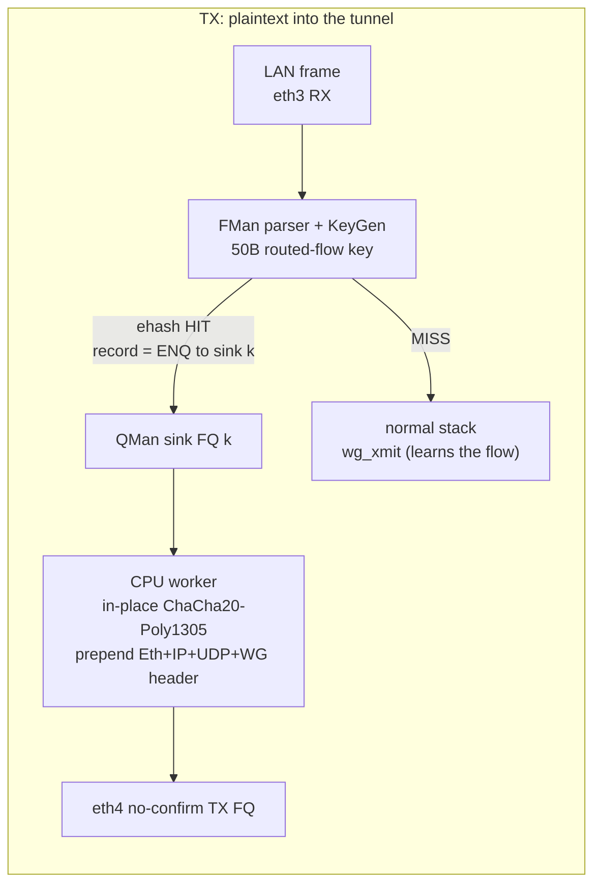
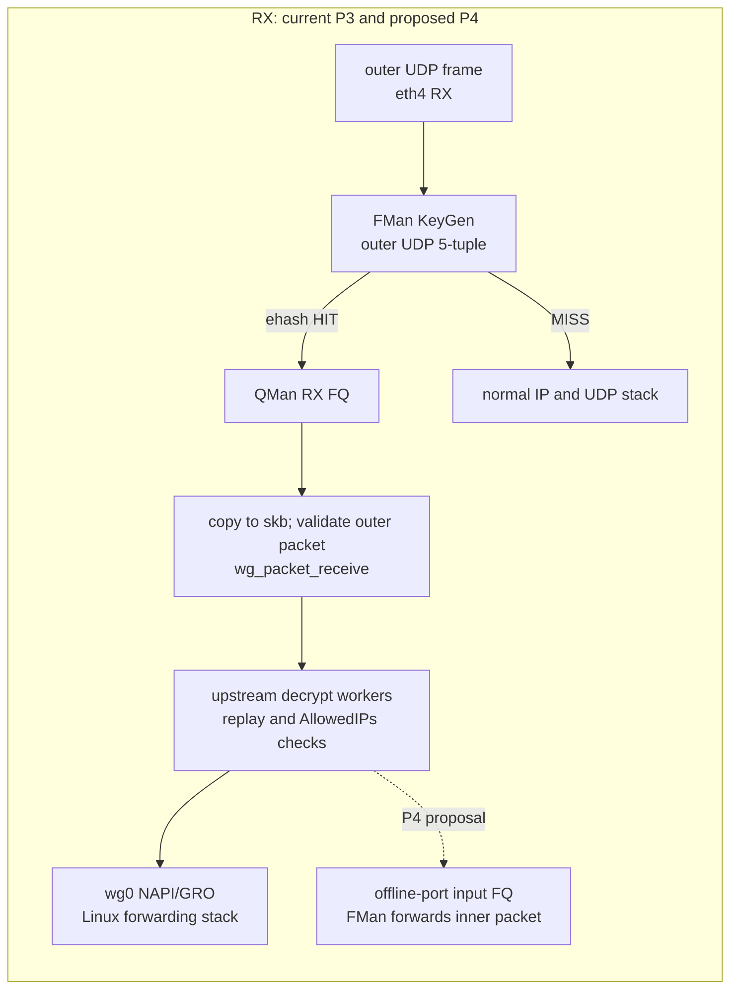

# ASK2 WireGuard plan: remaining work (software path and zero-skb fast path)

**2026-10-15 · dpaa1 · Status: open.** This is the single active WireGuard plan. The completed work, which covers the measurements, profiles, the P0/P1/P2a/P2b-1 builds and the gate results, has moved to the archive:

- `plans/archive/ask2-wireguard-plan.md`: software throughput. It covers the stage 0 baseline, stage -1 (lockdep debug kernel), patches 4011/056/057/4016, the retired GRO patch 4012, E1 `noqueue`, E2 `tx_lanes=3`, P2b-1 results and the conntrack-hook analysis.
- `plans/archive/ask2-wireguard-matrix-106-vs-185.md`: the 2026-10-12/13 nine-cell matrix (image 2243, before `tx_lanes`).
- `plans/archive/ASK2-WIREGUARD-FASTPATH-PLAN-2026-10-15.md`: the full fast-path design history. It includes P0 feasibility, P1 (gate G1 PASS, image 1943), P2a lab seal (about 465k packets/s, image 2243), the alternatives considered and the closed open items.

WireGuard is not a vendor-parity item: neither the vendor ASK nor ASK2 hardware-offloads it, and CAAM Era 8 has no ChaCha20-Poly1305. Its priority relative to ASK2 parity work is set in `plans/ASK2-MASTER-PLAN.md`.

## 1. Where things stand

| Item | State |
|---|---|
| Software path (patches 4011, 056, 057, 4016; `serial_cpus=14 tx_lanes=3` in `96-enable-services.chroot`) | Shipped. Lanes=3 matrix (image 0051): `.185` leads `.106` in 8 of 9 cells; 1T `up` 1.65 vs 1.38. |
| 1T `bidir` (1.44 vs `.106` 1.55) | The only losing cell. Root cause is the presence of the conntrack hooks: a flushed ruleset gives 1.61. There is no safe VyOS-semantics-preserving fix, so this is a configuration trade-off. |
| Fast path TX, P2b-1 (patch 4017, `wgfp_peer`) | Gate G2 PASS on image 0347: 2.62 Gbit/s on 4 flows, survives the 120 s rekey, no Invalid MAC. Superseded by P2b-2/P2b-3. |
| Fast path TX, P2b-2 automatic flow install (patch 4018) | Gate PASS 2026-11-02 (image `2026.11.02-1519-rolling`): 2.94 / 3.12 Gbit/s on 4 flows, no hand steering. |
| Fast path TX, P2b-3 punt, roaming, AllowedIPs, wg0 delete | Gate PASS 2026-11-02 (image `2026.11.02-1632-rolling`): every test plus upstream `netns.sh` (553 steps). |
| Fast path TX, P2c multi-peer, CLI, sink tail drop (closing step A) | Multi-tunnel TX measured on images 1818 and 2011. The CLI and overload gates remain open. |
| Fast path RX (P3) | Active on image 0629, but G3 has not passed. Exact-tuple firewall provenance, ingress identity and failed-record deletion remain unresolved. |
| TX backpressure and telemetry | The WGFP-only QMan full-ring and asynchronous-rejection path plus per-CPU hot counters shipped in image 0629. Controlled hardware rejection and throughput gains remain unverified. |
| Offline-port reinjection (P4), per-flow order restoration (P5) | Not implemented. |

## 2. Architecture

The UDP-checksum and buffer-lifetime fixes shown in the P3 receive path shipped in image 0629. The design rules still apply:

- The per-peer fast-path state lives inside the `wireguard` module; `dpaa_wgfp` supplies the sink FQs and record operations. The relevant ingress port must already have an armed PCD table.
- Records are installed by the slow path; a MISS uses the normal stack. Failed record deletion and admission provenance still need the handling described below.
- Distinct TX flows are assigned round-robin to shared sink FQs, preserving each flow's sink order; a peer's outer RX flow currently uses one sink.
- TX seals in place in the BMan buffer; P3 RX currently copies to an skb.
- Known TX declines and invalid P3 headers are punted; an unparseable or unmatched sink frame is dropped.

## 3. Remaining phases, gates and kill criteria

AGENTS.md S0 applies to every phase that touches FMan: run at least three qdrant queries, cross-check against `arch/fman-microcode-210-programming-reference.md` and `specs/fman-keygen-flow-key-spec.md`, read back every silicon write, and cold boot before each experiment. Arm `softlockup_panic` and `panic_on_rcu_stall`, and never experiment on `eth0`.

### P2b-2. Automatic flow install

On the first `wg_xmit` for an inner flow whose peer, endpoint and keypair are valid and whose ingress port is ASK-engaged, the module asks `ask.ko` to insert the record. The record is removed on flow teardown, peer removal or disengage. This needs the registration API in section 4.

**Gate:** no debugfs steering. Four inner TCP flows reach at least 2.6 Gbit/s `up`, and `pcd-snapshot diff` is clean after disengage.

### P2b-3. Slow-path punt and AllowedIPs

The worker must hand these cases back to the stack by building an skb and calling the `wg_xmit` slow path, then withdraw the record:

- AllowedIPs mismatch;
- keypair near `REKEY_AFTER_*`;
- no neighbour;
- oversize frame;
- keepalive due;
- peer removed.

**Gate:** the upstream `tools/testing/selftests/wireguard/netns.sh` passes, endpoint roaming and a forced rekey keep the tunnel up, and there is no Invalid MAC on stock dell2.

### P2b-3 implementation (2026-11-02, commit `1d6f64bd`, board-tested on `.185`)

All of it is in `fastpath.c`; no DPAA or `ask.ko` change.

- **Punt (`wgfp_punt()`):** a frame the seal path declines is copied into a fresh skb and received again with `netif_receive_skb()` on the ingress port of its learned flow (`fl->ifindex`). The stack then forwards it (the software flowtable or the classic path) into `wg_xmit()`, or elsewhere if routing changed, with TTL, ICMP, PMTU, firewall, AllowedIPs and handshake queueing intact. The DPAA buffer goes back to its pool. Punts are the exception (handshake gaps, roaming, oversize), so the copy is acceptable. A frame of no known flow (manual debugfs records) is still dropped. The `wgfp_peer` read-out adds `punted` and `aip_withdraws`.
- **Which declines withdraw the record:** oversize (`ip_len > wg0 MTU`) and a dead peer punt and withdraw. No keypair, an expired keypair, `REJECT_AFTER_MESSAGES`, no template, TTL ≤ 1 and a roamed endpoint only punt. Rekey at `REKEY_AFTER_*` was already triggered from the seal path (P2b-1), and keepalives stay with the stack's timers, which the seal path feeds.
- **Roaming:** each frame compares the template's outer destination with `peer->endpoint.addr4` unlocked (the same unlocked test `wg_socket_set_peer_endpoint()` uses). A mismatch punts and runs the template refresh at once (`mod_delayed_work`). A refresh that finds no IPv4 endpoint, no route via the egress port or no valid neighbour now clears the template, so frames punt instead of leaving with stale headers.
- **AllowedIPs:** the 2 s aging pass looks up each installed record's inner destination with `wg_allowedips_lookup_dst()` (an skb holding one IPv4 header as the probe) and withdraws records that no longer map to the bound peer.
- **Re-learning without a ct:** `wgfp_ct_admitted()` takes the conntrack proof from the skb when present, else looks the entry up by tuple (`nf_conntrack_find_get`, default zone) and requires `IPS_SEEN_REPLY`, no NAT, no master, no helper. This fixes two board-observed gaps. A UDP flow was never learned, because the flowtable takes it on the first reply, so every later packet from the plain side arrives without a ct (`[HW_OFFLOAD]` in conntrack, `flows=0` after 1500 packets). And a withdrawn flow could never come back.
- **wg0 deletion:** a netdevice notifier schedules a stop on `NETDEV_UNREGISTER` of a bound WireGuard device, so `ip link del wg0` no longer waits on the references peer mode holds. The notifier does not cover physical egress removal.

Harness: `bin/testrig-wgfp-p2b3.sh [rekey rekey120 roam aip pmtu del netns]`, `STOCK=1` for the stock reference. Baseline on `.185` (image `2026.11.02-1519-rolling`, P2b-2 code), one TCP flow ~1.3 Gbit/s, dell2 with `persistent-keepalive 1`:

- `rekey` (dell2 removes and re-adds the DUT peer): stock one dip second (0.96 Gbit/s); P2b-2 one dip second (1.11). Without a keepalive on dell2 both stock and fast path stall, since a pure TCP receiver sends nothing and the DUT's 15 s no-reply timer is the only recovery.
- `roam` (dell2 listen port 51820 → 51830): stock one dip second (0.96); P2b-2 two seconds (0.11, 0.59), from the up to 1 s template lag. Without a keepalive stock never learns the new port either.
- `aip` and `pmtu`: the UDP flows are never learned on P2b-2 (the ct gap above), so they only validate the harness.

**Board result** on `.185` (image `2026.11.02-1632-rolling`, CI run 41482411379, commit `1d6f64bd`, first boot after install; boot type not recorded), tunnel from `KEEP=1 bin/testrig-wireguard.sh setup wg-v4`:

- `rekey`: PASS, one dip second (1.08 Gbit/s), no Invalid MAC, nonce or source errors on dell2 (wireguard dyndbg on).
- `roam`: PASS, 300 frames punted while the template caught up, one dip second (1.11) instead of two on P2b-2, DUT endpoint `10.99.2.113:51830`.
- `aip`: PASS. The UDP flow was learned and installed, the AllowedIPs change withdrew its record (`aip_withdraws` 1), `sealed` did not move in the 2 s window (8946 / 8946), and after the restore the flow was learned again and sealed (`installs` +1, `sealed` 9797). iperf3 `-u` does not get through this tunnel on the rig even with the fast path off, so the UDP tests use python endpoints (an echo on dell2 `10.99.200.113:9100`).
- `pmtu`: PASS. The UDP flow was learned (the tuple ct lookup), the 1488-byte DF frame was punted (`punted` 1) and its record withdrawn (`decline_withdraws` +1), and dell1 learned PMTU 1420 from the ICMP the stack sent.
- `rekey120`: PASS. One 140 s TCP flow at about 1.1 Gbit/s crossed the 120 s rekey (dell2 initiated it; latest handshake +120 s) with no second below 0.05 Gbit/s. There is a small dip (0.88–0.99) about every 10 s, also before the rekey; not yet explained.
- P2b-2 regression: `AUTO=1 DUR=20 bin/testrig-wgfp-p2b.sh` 3.006 Gbit/s, `punted=0`, `fe_flow` empty after `off`.
- `netns`: PASS. The upstream `netns.sh` (v6.18 tag, peer mode off) ran 553 steps to `rc=0` with "Objects that were created were also destroyed". Two userspace gaps on VyOS needed harness work, neither a kernel issue. There is no `ncat`, so the harness installs a python stand-in named `ncat`; it must be called `ncat`, because `waitncatudp` matches the process name in `ss`. wireguard-tools v1.0.20210914 cannot parse `allowed-ips -prefix` removal, so the harness drops that one 16-line block (the removal and its 388-entry check).
- `del`: PASS. `ip link del wg0` with peer mode bound returned in 1 s, the notifier stopped peer mode ("fastpath peer mode off: wg0 or eth4 unregistered"), and no `unregister_netdevice: waiting` messages were logged.

**P2b-3 gate passed** (2026-11-02): netns.sh passes, roaming and a forced rekey keep the tunnel up, there is no Invalid MAC on stock dell2, and P2b-2 throughput is unchanged.

**Three-lane software selftest (2026-11-03).** On cold-booted `.185`, image `2026.11.03-0629-rolling`, the 6.18.60 upstream `netns.sh` completed with `tx_lanes=3`, WGFP peer and lab modes off, and exit status 0. A newer temporary `wg` (v1.0.20260223) allowed the previously omitted AllowedIPs-removal block to run; a Python `ncat` stand-in supplied the missing utility. The test ran in private PID, mount and network namespaces with a private `/run/netns`; its temporary copy removed only the host-global `message_cost` change and pre-existing namespace deletion, and preserved the test's exit status. Twenty thermal samples peaked at 60°C. The only new kernel warning was an ASK neighbour callback rate-limit notice; `ask-check` remained 45 OK, 2 WARN, 0 FAIL, host WireGuard links were absent and the owned temporary files were removed. The object-lifecycle check observed **zero** `/dev/kmsg` object pairs, so its success message does not prove object teardown. This is software-path evidence, not WGFP, P3 or G5 validation. Artifacts: session `files/wg-netns-selftest/netns.log` and `kernel-{before,after}.log`.

### P2c. Multi-peer binding

`wgfp_peer` binds only the first peer. Bind per peer so that the 2T and 4T matrix cells can run on the fast path.

**Gate:** 2T and 4T `up` are at least the software lanes=3 results (1.72 and 1.91 Gbit/s), with no cross-peer seal.

### Closing step A implementation (2026-11-02; deployed on 1818 and 2011)

**Multi-peer and multi-device (P2c).** `wgfp_peer` takes a list of wg devices (`echo "wg0 wg1" > /sys/module/wireguard/parameters/wgfp_peer`; `off` unbinds). Writing a list rebinds the whole set (full teardown and rebuild; flows relearn within a second). Every peer of a bound device is eligible. Per-peer state (`struct wgfp_pst`: peer reference, template, timer pacing) is created by the peer's first learned flow and freed by the aging pass once it has none. The sink path finds the flow lock-free (RCU hash; entries unhashed with `hash_del_rcu()` and freed with `kfree_rcu()`) and the peer through it, so the four sinks stay shared and no per-peer FQs are needed. The egress port now comes from each peer's own route: `dpaa_wgfp_egress(dev)` returns a handle to a no-confirm TX FQ allocated once per DPAA port (each `dpaa_alloc_offload_tx_fq()` call creates a new FQ, so it must not be called per refresh), and `dpaa_wgfp_xmit()` takes it. A peer whose route leaves through a non-DPAA port gets no template and stays on the stack. The read-out adds `peers` and `dev`. Up to 8 devices.

**Use-after-free fixed.** The aging pass dropped the lock to read the silicon counters and then wrote to `job[i].fl`. A FIN or a withdraw in that window let the flow worker free the entry. It now re-finds the flow by tuple and only touches it if the table still holds that same entry.

**CLI (patch `data/vyos-1x-059-wireguard-offload-cli.patch`).** `set interfaces wireguard wgN offload ipv4`. `interfaces_wireguard.py` computes the full list of opted-in, non-disabled wg interfaces on every commit and writes it to `wgfp_peer` only when it differs from the bound set (`dev=` in the read-out), because a write rebinds. A kernel without the parameter only warns. Flows are installed only for traffic arriving on a port with `set interfaces ethernet ethN offload ipv4`; everything else stays on the software path.

**vyos-1x pinned.** Writing 059 showed that patches 027 (FMan DT port order) and 047 no longer apply to upstream `rolling`. Upstream T3871 (`c73faac7f`, 2026-10-31) removed the `vyos_net_name` udev helper in favour of a slot-anchored naming store. The CI cache key held the literal word `rolling`, and every shipping image so far used a deb cached from upstream `91bf0ef51` (2026-10-30), so the drift stayed hidden. Any patch change would have forced a fresh build against `rolling` and failed. `bin/ci-setup-vyos1x.sh` now pins `VYOS1X_COMMIT=91bf0ef51026b82f5714c809d6d651a8b9c7aacb`; on that commit all 45 patches apply. `patch-rot-check.yml` gates on the pin and probes `rolling` as advisory; the probe now also copies `data/vyos-1x-files` first, as the build does. On `rolling`, 027 and 031 fail today. Moving the pin requires porting 027/047 to the T3871 store, verified on the board (eth0 must remain the management port).

**Sink tail drop (A3).** The sink FQs had no tail drop. Baseline 2026-11-02 (image `2026.11.02-1632-rolling`): during an unpaced P2a run, an unrelated forwarded ping from dell1 through the same ingress port lost 34% (plus 10 errors). Exhaustion by sink backlog was suspected, but the historical software pool accounting and unvalidated sink counts do not establish that cause. `dpaa_wgfp.c` now sets FQ-local tail drop (`QM_FQCTRL_TDE`, 512 KiB per sink, nominally about 350 MTU frames); whether this bounds real buffer use and protects side traffic still needs the overload gate. FQ-local tail drop is the mechanism F-199 proved works for FE-fed FQs; the CGR path does not see FE enqueues. Harness: `bin/testrig-wgfp-soak.sh overload` (gate: side-flow loss ≤ 1%, balanced eth3 pool) and `bin/testrig-wgfp-soak.sh soak` (10 min, 4 flows; gate: balanced eth3/eth4 pools, `xmit_fail` 0, no kernel errors, `fe_flow` empty, `pcd-snapshot diff` clean).

**Pool-gate correction (2026-11-02).** The completed 1818 soak reported no transmit failures and zero sink queue counts, with empty flow tables and a clean PCD snapshot, but its pool-health and sink-emptiness gates are unverified. `ethtool`'s `bpool [TOTAL]` is software per-CPU accounting, not the number of free BMan buffers. The harness now reads the hardware pool-content register for each interface's BPID with `bin/bman-pool-count.py`. The 1818 pre-soak hardware baseline was not recorded, so it cannot retroactively establish that gate.

A 20-second smoke on image 2011 showed why comparing the hardware free count directly to its starting value is also insufficient: eth3 fell from 1782 to 1558, while its software-accounted supply fell by exactly the same 224 buffers. The DPAA driver refills each CPU's allocation only below its 80-buffer threshold, so ordinary software RX can lower the hardware count without a fast-path leak. At idle, the revised gate compares the change in hardware free buffers with the change in software-accounted supply, allowing a 64-buffer tolerance and rejecting changed BPIDs or missing readings. This detects a growing unexplained discrepancy; it does not prove that every possible memory leak is absent or capture transient depletion between samples. The smoke passed the pool-drift check with 3.275 Gbit/s, no reported transmit failures, no remaining flows, and a clean PCD snapshot; sink emptiness is unverified. The soak runner uses owned process IDs and non-destructive kernel logs; the overload runner's generator still needs safe process control before it can be run.

The pool reader now uses an aligned native 32-bit MMIO load followed by big-endian conversion, avoiding a byte-copy from the register mapping. A further isolated 20-second smoke on image 2011 measured 3.909 Gbit/s, with pool/accounting changes matching, no reported TX failures, zero reported sink counts, an empty flow table, and a clean PCD diff; sink emptiness is unverified. The temporary tunnel and servers were removed without disturbing existing listeners. This measured image 2011, not the later kernel changes shipped in image 0629. The soak's iperf-result check also rejects missing, discontinuous, non-finite, excessively coarse or stalled intervals instead of relying only on a positive aggregate rate; a short final interval below 0.5 s may be empty.

**Image 2011 600-second TX soak:** all four iperf clients ran for 600.001–600.003 s with no zero-throughput one-second intervals, averaging 2.813 Gbit/s in aggregate. Hardware free counts and software accounting changed identically: eth3 BPID 3, 1543 → 1885; eth4 BPID 4, 2345 → 2318. The differential pool gate passed; the reported `xmit_fail` and sink counts stayed zero, flow records were empty after unbind, and the kernel-warning and PCD-snapshot checks passed. Sink emptiness is unverified. The QMan defect below means zero reported failures does not exclude silent full-ring failures on this image. The DUT and isolated servers were cleaned up. This TX soak does not validate the P3 fixes subsequently shipped in image 0629 or the G3 receive gate. The original sample labels counted only sleep time, not telemetry overhead, so the apparent flat sealing counter at nominal `t=480–600` was after the actual 600-second traffic finished; the runner now uses elapsed time and requires full-duration client results.

**Sink-depth gate suspended (2026-11-03).** `dpaa_wgfp` prints `qm_mcr_np_get(&np, frm_cnt)`, which masks the raw management-response word without byte-order conversion. If the count is big-endian, as other portal fields are, this little-endian host can report zero for a nonempty queue. A zero printed count therefore does not establish empty sinks or make the preceding soak's differential pool result a full leak verdict. The soak runner now refuses to run unless the kernel advertises `frm_cnt_encoding=host`; no current image or staged kernel code advertises it. Add that marker only after correcting and validating the count against a known queued frame, then rerun the gate.

**Sink retirement hazard, source review (2026-11-03).** In image 0629, `wgfp_sink_free()` calls `qman_oos_fq()` immediately after `qman_retire_fq()`, including when retirement returns `1` for asynchronous completion, and continues to `qman_destroy_fq()` after errors. In the available 6.18.60 QMan source, OOS requires a retired, empty FQ with outstanding ORL notifications consumed; destroying an unquiesced FQ can return without removing its callback-table entry. The shipped code nevertheless disables and deletes NAPI, clears `created`, and resets `wgfp_nsinks`, allowing a later create to reuse the sink object. The debugfs `destroy` command also does not reject an active consumer. This is a source-derived risk, not an observed board failure; the exact deployed QMan tree has not been independently checked.

Do not use the sink `destroy` command for experiments until producers and FE records can be quiesced, asynchronous retirement and FQRN completion handled, queued FDs drained and released correctly, and OOS/destroy failures propagated without reusing live objects. Unbinding alone does not establish those conditions while failed FE deletions and sink-depth decoding remain unresolved.

The local, uncommitted containment rejects debugfs `destroy` with `-EOPNOTSUPP`. If sink creation fails, including an ambiguous QMan initialization timeout, it retains every allocated FQ and its NAPI and refuses a new pool until reboot; `pool_failed=1` reports this state. The legacy P1/P2a `RECREATE=1` and P2b manual mode also refuse to destroy sinks, including on older images. This trades recoverability for object lifetime safety; it is not a drain implementation and does not make unbinding or stale FE records safe. Host mocks and an ARM64 object build cover the guard, but it is not in image 0629 and has not been tested on hardware.

The soak gate also compares both synchronous `xmit_fail` and asynchronous `xmit_ern` against their starting counters and fails if either rises or is unavailable. Its process cleanup checks PID start time and command identity through a pidfd, and it refuses to unbind a different WGFP device. The device check and sysfs write are not atomic, so they do not prevent every concurrent binding race.

**QMan TX ownership correction (implemented 2026-11-02, shipped in image 0629).** The original 6.18.60 `qman_enqueue()` returns zero even if `qm_eqcr_start_stash()` or `qm_eqcr_start_no_stash()` returns NULL, contrary to its documented full-ring error contract. Read-only disassembly of image 2011 confirms the NULL branch reaches a zero return; ring saturation was not induced or observed. Consequently `dpaa_wgfp_xmit()` could count an unsubmitted FD as successful, skip its retries and strand its BMan buffer. Patch `4019` supplies a separate `qman_enqueue_fqid()` that returns `-EBUSY` on a full ring, so WGFP's existing eight retries and final release execute.

The existing WGFP egress object also contains only an FQID, so its QMan software-ERN tag is zero rather than a registered callback. On this image, a rejection with that tag would encounter the F-102 NULL guard; source and live disassembly show that guard loops without consuming the MR entry. No such rejection was reproduced. Patch `4019` also permits a destination FQID to use a separately registered callback tag. `dpaa_wgfp` reserves one tag FQID for its built-in lifetime, counts asynchronous ERNs in `xmit_ern` and `xmit_fail`, and returns their BMan buffers; the tag is independent of the port-owned egress FQs. `xmit_ok` counts EQCR submissions, not confirmed wire delivery, and an asynchronous rejection can increment both `xmit_ok` and `xmit_fail`. The F-102 NULL-MR handling for other callers remains a separate unresolved defect.

The new function deliberately duplicates the portal enqueue sequence rather than changing the legacy API: a global `-EBUSY` change makes unhandled failure paths reachable in other clients. In particular CAAM QI does not unmap its request descriptor on synchronous enqueue failure, and the DPAA AF_XDP path releases and reserves completions for an entire descriptor batch before enqueueing, then abandons the remainder on error. Completions are ordered, so immediately completing the tail could release earlier in-flight buffers. These are source-derived concerns, not reproduced failures; the generic `qman_enqueue()` defect remains open pending a cross-client ownership fix. Patch `4019` was generated from an isolated clean canonical preimage, but its canonical-branch integration and round-trip remain pending; do not run the round-trip script against the dirty shared kernel checkout, because it performs a checkout. Its `verify` command can also return success with missing or new patches, and can print `VERIFIED` despite missing patches; inspect the full result and confirm `4019` is included rather than relying on its exit status.

The `sealed`, `xmit_ok`, `rx` and `rx_stack` hot telemetry counters are also per-CPU locally, summed across all possible CPUs on read; the cryptographic nonce remains the shared atomic counter. Sharding the RX counters can avoid contention between peer sinks, but cannot distribute a single tunnel across sinks. On an idle `.185`, a synthetic four-thread atomic microbenchmark measured roughly 34 ns per operation for one shared cache line versus 3.7 ns for separate per-thread cache lines. That does not measure the kernel change or prove a throughput gain. The scoped QMan path and counters have host regressions and ARM64 object builds, but need a new operator-installed image, controlled TX/RX A/B, and safe full-ring/ERN tests before production claims. Physical-port unregister and ifindex reuse remain unsupported: the cached egress FQIDs belong to the port, and tag lifetime alone does not keep those FQs or ingress buffer pools alive.

**Local regression rerun (2026-11-03).** The focused WGFP RX/lifetime, per-CPU stats, QMan enqueue/ownership, BMan pool reader, soak-gate, and external WireGuard rig host tests passed (60 tests). Shell syntax and Python byte-compilation also passed. These are host/source checks only: they do not validate patch 4019 in a built image, hardware EQCR saturation/ERN delivery, live sink depth, DMA ownership, or P3 throughput.

**Image 0629 bring-up (2026-11-03).** The operator-installed `2026.11.03-0629-rolling` image on `.185` runs kernel `6.18.60-vyos` and includes commit `856be145`. An isolated IPv4 smoke with untracked outer UDP used four TCP streams for 12 seconds per direction, excluding the first two seconds. It measured 2.788 Gbit/s up and 1.846 Gbit/s down; these single short runs are not an A/B or a G3 pass. Sampled `sealed` advanced by 3,053,063 during upload and direct `rx` by 2,043,554 during download; `rx_stack`, the fallback counter, stayed at zero. `xmit_ok` advanced by 3,146,900, with no reported `xmit_fail` or `xmit_ern`. Sender retransmits were 935 up and 29,544 down. The hardware free-buffer and software-accounting changes matched at idle (eth3 BPID 3, 2492 → 2483; eth4 BPID 4, 2560 → 2539). WGFP was unbound, FE flows were empty and the PCD snapshot matched afterward; existing listeners were preserved. Sink depth, controlled EQCR-full/ERN behavior and the general DMA contract remain unverified. The boot type was not established.

**IPv4 UDP checksum controls on image 0629.** An isolated peer was warmed up and then stopped to eliminate unrelated inbound traffic. With WGFP bound, 100 crafted outer frames with bad UDP checksums produced 100 eth4 RX header errors, no direct `rx` or `rx_stack` increments, and no UDP `InCsumErrors`; 100 otherwise identical frames with valid checksums advanced direct `rx` by 100. Another 100 bad-checksum frames with WGFP unbound produced another 100 RX header errors. These malformed frames therefore went through an ingress RX-error path before P3, not the new `wgfp_rx_frame()` checksum fallback; that fallback remains unverified on hardware. The test used valid IPv4 header checksums, restored its temporary interfaces, routes and nft table, left WGFP off and FE flows empty, and matched the PCD baseline.

The vendor ASK source is at `/mnt/builds/ASK`. A fresh fetch found `origin/master` and `origin/mt-6.12.y` both at `5dc4976f8852`; the local `master` checkout is 19 commits behind, so use the remote ref when checking the latest source. The reachable `.70` board runs OpenWrt 25.12.6, Linux 6.12.112, and ASK package `1.2.1~849e1a9112e0`. That identifier is the annotated tag `mono-1.2.1`, which points to commit `c229b43096e6`, an ancestor of the latest branches. Use that tag when comparing the exact installed version; further component-specific SDK and live-oracle checks are still required before FMan changes.

**DMA contract gap, source-derived.** Mainline `dpaa_eth.c` maps pool pages `DMA_FROM_DEVICE`, but WGFP modifies those pages on the CPU and `dpaa_wgfp_xmit()` syncs the transmit range as `DMA_TO_DEVICE`. Linux's DMA API requires a bidirectional mapping when the CPU writes a device-receive buffer; the fast path also treats a DMA address as a physical address and reuses it across ingress and egress devices. These assumptions need an ownership and mapping audit, including bounce buffers and device domains, before non-coherent or translated DMA can be supported. On the tested `.185`, the FMan device-tree node is `dma-coherent`, there are no per-port non-coherent overrides or IOMMU groups, and the SWIOTLB `used` and high-water counters were both zero after the smoke. This reduces concern for that run but does not establish a general DMA contract or prove a hardware fault; no DMA mapping change was made.

**Security review (A4), `fastpath.c` against upstream `send.c`/`noise.c`.**

- Key material: peer mode never logs or exposes keys. The P2a lab key is written through a root-only (0600) parameter and is not readable back.
- Keypair and counter handling match `wg_packet_encrypt`/`encrypt_packet`. The seal path checks `sending.is_valid` and `REJECT_AFTER_TIME`, takes the nonce with `atomic64_inc_return() - 1`, rejects `>= REJECT_AFTER_MESSAGES`, and never reuses a consumed nonce (a declined frame burns its counter like an upstream drop). Keypairs are freed through `call_rcu()`, so the sink's RCU read section covers the use without a keypair reference.
- Padding is the same rule as `calculate_skb_padding()` (16-byte multiple, capped at the MTU, and `ip_len <= MTU` is checked first).
- Buffer bounds are checked before every write: headroom `>= WGFP_ADDED`, `off + 14 + plain + 16 <= buf_size` (3584), so the outer `tot_len` cannot overflow.
- Rekey and timers run as upstream: the timers are fed every 10 ms per peer, and a handshake is triggered on `REKEY_AFTER_MESSAGES` or `REKEY_AFTER_TIME` as the initiator. Handshake and cookie messages never use the fast path.
- Semantic deltas, all shared with nf flowtable offload and documented: after admission a flow skips the firewall and conntrack TCP window checks until its record is withdrawn; an AllowedIPs change takes effect within one aging period (2 s); a non-first IP fragment of an offloaded flow is not matched (no ports) and takes the stack. A first fragment is sealed as a normal packet, which WireGuard permits.
- Carry cost: every upstream WireGuard security fix in `send.c`, `noise.c`, `timers.c` or `allowedips.c` must be checked against `fastpath.c`.

### P3 implementation (2026-11-02; deployed on 1818 and 2011)

**Measurement first.** Software `down` on `.185` (image `2026.11.02-1632-rolling`, 4 TCP flows, `wgfp_peer off`): 1.61 Gbit/s. CPU2, the RX CPU of the single outer UDP flow, sits at 100% softirq, while the other three are 84–88% busy with the decrypt/encrypt workers. `perf` on CPU2: `__netif_receive_skb` 82%, of which netfilter `nf_hook_slow` 40% (`nft_do_chain` 12.6%, `nf_conntrack_in` 8%), IP input and routing ~10%, UDP socket delivery ~5%, `wg_receive`/`wg_packet_receive` 16%, DPAA RX 15%. The serial cost is the outer packet's trip through IP input and the INPUT firewall, not decryption, which upstream already spreads over all cores.

**Silicon check.** The plan assumed an ehash record could steer the inbound outer flow, but qdrant (2026-09-06) held that to-self traffic bypasses the ehash (`pr_word & 0x0044`). Re-tested: a record for UDP `10.99.2.113:40001 -> 10.99.2.185:51999` (the DUT's own eth4 address) steered 200 of 200 packets to a sink (`tbl[2]` = eth4). To-self UDP does hit records; qdrant corrected.

**Design.** One ehash record per peer for its inbound outer flow (endpoint -> local source address, UDP, endpoint port -> listen port, on the port the peer's route uses), kept in step with the template by the refresh work (`wgfp_pst_rx_sync()`). Image 2011 installs it based on the conntrack or untracked-keypair checks described below, and withdraws it on a template or endpoint change, peer removal, unbind or `wgfp_rx=0`. It does not age (it lives with the peer state). The sink copies the frame into an skb and calls upstream `wg_packet_receive()`; the version shipped in image 0629 validates the IPv4 header and the IPv4/IPv6 UDP length and checksum before doing so, and punts invalid packets to `netif_receive_skb()`. Decryption, the replay window, the inner AllowedIPs source check, ordering, handshakes and cookies stay upstream code; IP input, netfilter, conntrack and the UDP socket lookup are skipped. Read-out adds `rx` and `rx_stack`. Peer state is created by TX learning, so a receive-only peer gets no RX record; one outer flow is still one sink and one CPU.

**Gate G3** unchanged: `down` >= 2.6 Gbit/s on four flows, kill below 2.2; plus the P2b-3 suite with `wgfp_rx=1`.

**Untracked outer flows and admission gap.** VyOS untracks the WireGuard UDP ports (`system conntrack ignore`, applied automatically by vyos-1x patch 057 and by `bin/wg-matrix.sh`). Image 2011 admits an untracked tuple when the peer has a current receiving keypair; image 1818 lacked that path, so its `down`/`bidir` cells used software RX. A current keypair proves an earlier handshake, not that a newly configured exact endpoint and ingress passed INPUT. Likewise `IPS_SEEN_REPLY` alone is not proof that the specific inbound packet passed INPUT: conntrack runs before the filter. These are source-derived concerns, not board reproductions; P3 is not production-hardened until exact-tuple, ingress-specific admission is proven and tested, including manual endpoint changes and roaming. Existing NAT/helper checks do not close this gap.

**CLI family gaps.** With C, `set interfaces wireguard wgN offload ipv4` also accelerates inner IPv6 flows, contrary to the per-family meaning of that leaf. Separately, `dpaa_wgfp_flow_add()` checks that the ingress FMan port has a routed ehash table, but does not check the per-port `offload ipv4|ipv6` mask that `ask_hw_flow_family_ok()` applies to normal ASK flows. The WGFP parser and record builder accept both families, including P3's outer tuple, so an IPv4-only Ethernet engagement does not itself enforce the IPv4-only admission promised in the CLI description. This is a source-derived gap, not a measured board result.

The fix must enforce the WireGuard interface's selected **inner** family and the ingress Ethernet port's selected family without silently removing IPv6 support from explicit experiments. P3 classifies an **outer** UDP tuple before decrypting, so its family policy must distinguish outer and inner addresses rather than assume they match. Family changes also need to prevent racing installs and withdraw existing disallowed records safely; the unresolved hardware-delete failures must not be hidden. Test IPv4-only, IPv6-only and dual-family ingress, mixed inner/outer families, and policy changes with active flows before claiming the CLI gate.

**Flow identity and deletion gaps.** The writer distinguishes tuple plus ingress ifindex, but `wgfp_flow_lookup()` at the sink compares only the tuple, and the frame does not carry an ingress identity. Equal tuples on two ports can select the wrong flow or peer. Do not use BPID as the identity: ports can share pools. Moreover, `wgfp_flow_work_fn()` frees an installed software flow after a failed hardware delete, potentially leaving a stale record; teardown also ignores deletion errors. Resolve record ownership and deletion failures before relying on duplicate-tuple guards or extending P3. These findings are source-derived and have not been reproduced on the board.

**Delete-result contract needed before fixing teardown.** The current F-269 delete path publishes a replacement bucket head, removes the software index entry, and, if its FMan SYNC times out, retains the old DMA record and cumulative nodes but returns success. Thus the WGFP caller cannot distinguish a synchronized deletion from an unlinked record that hardware may still be using. Earlier failures, including loss of the ingress netdevice before the delete call, can instead leave a record linked. If teardown unregisters the consumer while such a record still steers packets to a sink, the sink's no-consumer fallback releases those packets rather than forwarding them.

The `.70` vendor's `mono-1.2.1` source distinguishes three outcomes: deleted and synchronized; unlinked but awaiting a barrier; and not provably unlinked. It quarantines the first kind of uncertainty without repeating the destructive unlink, and retains possibly linked entries until ports are quiesced and the entry can be resolved. This is a useful ownership model, not a drop-in implementation for ASK2. ASK2 needs an explicit result and retained owner for each state, admission/reinsert exclusion while deletion is unresolved, and a barrier or proven port quiescence before reclamation. A PCD barrier alone does not drain already-enqueued sink frames; QMan completion and RCU/peer lifetime still need independent proof. Exercise each outcome and its races with fault injection in host tests before a controlled board test. The vendor and ASK2 findings are source-derived; no timeout or stale-record failure was induced on `.185`.

The contract must cover bucket generations, not just the record being deleted. After an insert-side SYNC timeout, a retained old cumulative node can still refer to other active records; those records cannot be reclaimed while an in-flight lookup may reach that generation. F-219's duplicate-key eviction ignores delete errors before reinserting, and the F-269 clear/drain path frees records without a new SYNC. Handle reinsertion, clear-all and table/port teardown under the same ownership and quiescence rules. Fault injection must include an insert timeout followed by deletion of another record in the old bucket, duplicate reinsertion, and drain with unresolved generations. The existing walker test models a completed SYNC as sufficient and assumes detached ports during drain; neither assumption proves the required silicon or caller behavior.

### Closing step C implementation: IPv6 (2026-11-02; in image 2011, IPv6 gates pending)

**C1, IPv6 inner flows.** The flow tuple carries a family and 16-byte addresses (`struct dpaa_wgfp_tuple`, compared and hashed whole, always built zero-initialised). `wgfp_key()` emits the silicon-verified dual-lane layout for IPv6 (family 0x60, zero 8-byte v4 lane, src6 @9, dst6 @25, then proto/ports/VID/SID as for IPv4; qdrant 2026-08-21 and 2026-09-06), in the same 50-byte per-port table, so no FMan change is needed. One parser (`wgfp_parse()`) serves the sink path and learning: plain IPv4 (no options, no fragments) or IPv6 without extension headers, TCP or UDP; learning reads the headers through `skb_header_pointer()`. The seal path decrements the hop limit for IPv6 (no checksum). The conntrack lookup and the AllowedIPs probe handle both families.

**C2, IPv6 outer (endpoint).** The template is built per family (`wgfp_tmpl4()`/`wgfp_tmpl6()`): IPv6 uses `ip6_route_output()`, `ipv6_dev_get_saddr()` when the endpoint has no source, the ND table and `ip6_dst_hoplimit()`. Both builders now pass `wg->fwmark`, as upstream `send4()`/`send6()` do (the IPv4 lookup previously ignored it). The outer header length is per template (Ethernet + 20 or 40 + 8); the headroom test and the transmit offset follow it. The IPv6 UDP checksum is mandatory, so it is summed in software over the datagram after encryption (`csum_partial` + `csum_ipv6_magic`, about 3% of the per-packet cost). The endpoint compare checks the address family first (an IPv4 compare against an IPv6 endpoint would read `sin6_flowinfo`). The P3 RX record and `wgfp_rx_frame()` handle an IPv6 outer flow (no extension headers; anything else goes to the stack). Unknown: whether the DPAA RX headroom (`f->off`) is at least 64 bytes; if not, every IPv6-outer frame declines and is punted (correct, but no fast path). The `punted` counter will show it.

**Harness.** `FAM=6 AUTO=1 bin/testrig-wgfp-p2b.sh` drives inner IPv6 flows; the IPv6 outer case is `OUTER=6 KEEP=1 bin/testrig-wireguard.sh setup wg-v4`. The P2b harness now picks a fresh source port per run (`CPORT0`).

### Close-out status and leftovers (2026-11-02)

**Build snapshot:** image `vyos-2026.11.02-1818-rolling` (CI run 41499179221, commits `526d1ef7` A and `c93c9c7b` P3) carried closing step A and the initial P3; IPv6 and untracked RX admission followed in image 2011. Since 1818, P2b-2 and P2b-3 have passed and multi-tunnel throughput has been measured. The overload test, CLI lifecycle, IPv6 and G3 gates remain open.

**Fast-path matrix, image 1818 (2026-11-02, `WGFP=1 TAG=wgfp bin/wg-matrix.sh 185`, same method as the software matrix: 1 tunnel 4 streams 5 fresh-tunnel reps, 2/4 tunnels 2 streams each 3 reps, 30 s with the first 10 s discarded, VyOS `system conntrack ignore` on the tunnel ports; csv `oracle/wgfp-185-t{1,2,4}.csv`). Medians in Gbit/s:**

| Tunnels | Dir | `.106` vendor | `.185` software (lanes=3) | `.185` fast path (1818) |
|---|---|---|---|---|
| 1 | up | 1.38 | 1.65 | **2.63** |
| 1 | down | 1.30 | 1.58 | **1.83** |
| 1 | bidir | 1.51 | 1.44 | **2.10** |
| 2 | up | 1.44 | 1.72 | **3.53** |
| 2 | down | 1.58 | 1.67 | **1.91** |
| 2 | bidir | 1.68 | 1.81 | **2.50** |
| 4 | up | 1.57 | 1.91 | **3.80** |
| 4 | down | 1.66 | 1.82 | **2.06** |
| 4 | bidir | 1.69 | 1.89 | **2.60** |

The fast path leads `.106` in all nine cells, including 1-tunnel `bidir`, the one cell the software path lost. P2c gate passed (2T `up` 3.53 >= 1.72, 4T `up` 3.80 >= 1.91; both peers bound, no install failures). `down` and `bidir` on this image are TX fast path plus software RX: with the ports untracked, the 1818 P3 cut never installs its RX record (fixed in `758b6014`), so G3 (`down` >= 2.6) is still open and is the next measurement. The 1-tunnel `up` figure (2.63) is lower than the P2b harness's 3.16 because the matrix uses 4 iperf3 streams with kernel-chosen ports rather than 4 pinned flows.

**Image 2011 matrix (2026-11-02).** The untracked-RX admission fix is present. IPv4-inner medians in Gbit/s, with the first 10 s of each 30 s run discarded:

| Tunnels | Up | Down | Bidir |
|---:|---:|---:|---:|
| 1 | 2.740 | 1.768 | 2.238 |
| 2 | 3.839 | 2.240 | 2.772 |
| 4 | 4.145 | 2.357 | 2.963 |

The one-tunnel cells use four streams and five repetitions; the two- and four-tunnel cells use two streams per tunnel and three repetitions. The single-tunnel runner prints means, not medians: its download and bidir means are 1.787 and 2.229. Privileged P3 counters increased in the two- and four-tunnel runs; the initial counter monitor lacked permission, so there is no corresponding per-run P3 evidence for the one-tunnel cells. A separate 2011 smoke did observe P3 activity. One-tunnel download is below G3's 2.2 kill criterion; G3 is not passed.

**Isolated repeat on image 2011 (2026-11-03).** The same IPv4/MTU 1420 matrix and repetition counts, with outer UDP untracked, produced these medians in Gbit/s:

| Tunnels | Up | Down | Bidir |
|---:|---:|---:|---:|
| 1 | 2.738 | 1.717 | 2.211 |
| 2 | 3.874 | 2.235 | 2.782 |
| 4 | 4.140 | 2.381 | 2.987 |

All 33 repetitions and 69 iperf JSONs passed duration and steady-interval checks. TX and RX counters increased across the two- and four-tunnel suites, but the one-tunnel runs have no separate per-cell RX counter proof. Afterward the fast path was unbound, flow tables were empty, the PCD snapshot matched, and shared listener inventory was unchanged; sink counts reported zero but do not establish queue emptiness. Image 2011 lacks the local RX and QMan corrections; its zero reported transmit failures cannot rule out the known silent full-ring failure. The one-tunnel download remains below G3's kill threshold. CSVs: `oracle/wgfp-matrix-1793680175-9916-185-t{1,2,4}.csv`.

**Image 0629 matrix (2026-11-03).** On `.185`, the image carrying the RX validation and WGFP-scoped QMan changes used the same IPv4/MTU 1420 matrix and repetition counts. One tunnel and the two-tunnel `up`/`down` cells came from the first run; the four-tunnel cells and two-tunnel `bidir` came from a separate supervised retry. Values are median Gbit/s, with both directions summed for `bidir`.

| Tunnels | Up | Down | Bidir |
|---:|---:|---:|---:|
| 1 | 2.705 | 1.902 | 2.196 |
| 2 | 3.811 | 2.180 | 2.763 |
| 4 | 4.085 | 2.284 | 2.847 |

Per-cell sealed and direct-RX counters advanced as appropriate, at least the expected number of peers were present, and no installs failed. Raw JSON, durations, intervals and both-direction retransmit totals were checked independently. The initial two-tunnel `bidir` repetition 2 was discarded: one iperf3 client remained stuck after its peer completed, and the cause is unknown. Its verified owned PID was terminated, cleanup was checked, and the entire cell was rerun. The one-tunnel `down` median is below G3's 2.2 Gbit/s kill threshold; replay/out-of-order validation is also still required.

The counters are aggregate and do not prove that each peer used the fast path or that peer isolation is correct. On the retry, `xmit_fail` and `xmit_ern` did not increase; `xmit_ok` counts enqueue submissions, not confirmed wire delivery. Eth3 and eth4 hardware free-buffer changes matched their software-accounting changes, with zero unexplained drift, but this is not a complete soak or leak gate. Sink depth, controlled full-ring and ERN behavior remain unverified. Shared listeners were preserved, FE flows were empty after unbind, and both PCD snapshots matched their baselines. Peak temperatures were 66°C and 65°C in the first run and retry. The retry's kernel-warning capture contained rate-limited `callbacks suppressed` notices. Retransmits varied substantially, including 27,075–100,334 aggregate in the four-tunnel `up` repetitions. Session artifacts: `files/wgfp-0629-matrix.jVCQY4/` and `files/wgfp-0629-retry.FiC428/`.

For future WGFP matrix runs, the local harness records the QMan `xmit_ok`, `xmit_fail` and `xmit_ern` counters and each sink's FQID, frame and error counters before and after each attempt. Validation requires TX submissions to advance in `up`/`bidir`, stable sink identities, at least one advancing sink frame counter, and no new sink errors, SG drops, failures or rejections. Sink activity is aggregate and does not prove that every peer was offloaded. The raw `frm_cnt` values are captured but are not used to infer queue depth or emptiness. These reads are not atomic with the WireGuard counters, may miss a later ERN, and do not prove wire delivery. The counter parser has host coverage and accepts the live image-0629 stats format with a simulated peer binding, but the revised matrix has not run end-to-end on the board.

The multi-tunnel rig's lease and owned-resource cleanup were committed in `cacce3c9`; its additional link-creation journaling is uncommitted. The uncommitted single-tunnel refactor uses the same lease and ownership helpers for links, policy routes, firewall/NOTRACK entries, listeners and WGFP binding. Its capability probe now has a separate lease and owned link; `probe-teardown` retries a known-owned cleanup, while an uncertain creation retains the journal for inspection. A failed link-ownership attachment also leaves the temporary name and lease for inspection instead of deleting a possibly replaced link by name. Host tests and an isolated three-host WireGuard test cover these changes, including IPv4 and IPv6 inner/outer traffic, collisions, recreation and preservation of foreign resources; the isolated test simulates WGFP as off and is not hardware validation.

**Atomic WGFP reservation, local implementation (2026-11-03).** The uncommitted `fastpath.c` adds the root-only `wgfp_peer_lease` parameter. `reserve <token>` refuses an existing peer or lab consumer, and blocks legacy peer writes and lab starts under the same mutex. `bind <token> <altnames>` resolves only the lease's `wgo-<token>-...` device altnames and rejects duplicate devices; `stop <token>` unbinds but retains the reservation, and `release <token>` requires an inactive binding. Binding registers the notifier before publishing the device set, then checks each device's registration, namespace and resolved name under RTNL. If a bound device unregisters or moves to another network namespace, the notifier marks the binding and schedules the entire leased binding to stop; the reservation remains held. This is deferred teardown, not synchronous datapath quiescence. The notifier records the event instead of relying only on `reg_state`, which remains `NETREG_REGISTERED` during a namespace move; stale work from an old binding cannot invalidate a new one. Module unload unregisters the notifier before cancelling pending stop work. On ASK2, both software-only and `WGFP=1` rigs reserve before creating resources, hold the reservation through link deletion and release it last; the single-tunnel capability probe has its own reservation. Software runs never bind or stop WGFP and refuse cleanup if their reservation has become active. The journal reconciles lost reserve, bind, stop and release responses without adopting another owner's binding. Vendor runs do not require this API. Both ASK2 modes now refuse older kernels without it, including image 0629, rather than falling back to a racy check. An older software lease with resource markers but no reservation journal is retained for manual inspection, not automatically deleted. The legacy control interface remains available when no reservation is held, but its namespace-move and unload handling also changed.

The token coordinates privileged control-plane writers; it is not an authorization boundary. A VyOS CLI change that tries to replace the binding during a reservation receives `EBUSY`: patch 059 prints a warning but the requested offload binding remains unapplied and must be retried after release. Host tests exercise concurrent reservation and legacy writes, software-run exclusion, duplicate aliases, device unregister, failed binds, probe ownership and lost SSH responses, and the WireGuard object compiles against the isolated 6.18.60 tree. The reservation does **not** make `wgfp_peer_stop()` safe after an FE deletion failure or drain a sink. It is not in image 0629 and has not been tested on the board; FMan and QMan gates still precede hardware lifecycle tests.

The local matrix wrapper no longer rejects unrelated legacy rules, route tables, key files or firewall comments. It still refuses conflicting connected-route prefixes, interface names and listening ports, since creating a tunnel installs connected routes. Its temporary NOTRACK table is journaled before creation and is deleted only after token and handle verification, including when a creation response is lost. Vendor forward rules now match each leased tunnel name rather than the `wgm*` wildcard; a disposable network-namespace test confirms they are removed without deleting a foreign rule. The revised rigs and matrix still require board validation, and QMan and P3 safety gates remain open before routine lifecycle or overload tests.

**Fresh OpenWrt comparison (2026-11-03).** Sequential runs on `.70` (the current replacement for the former `.106` vendor-ASK reference, running Mono OpenWrt 25.12.6, Linux 6.12.112, `ask-flowtable` 1.2.1 and `cdx`) and `.185` (VyOS image 2011, ASK2/WGFP enabled) used the same IPv4/MTU 1420 matrix. Each 30-second result discards the first 10 seconds; one tunnel has four streams and five repetitions, while two and four tunnels have two streams per tunnel and three repetitions. Values are median Gbit/s; bidirectional values sum both directions.

| Tunnels | `.70` up | `.70` down | `.70` bidir | `.185` up | `.185` down | `.185` bidir |
|---:|---:|---:|---:|---:|---:|---:|
| 1 | 1.105 | 1.252 | 1.554 | 2.738 | 1.717 | 2.211 |
| 2 | 1.146 | 1.512 | 1.619 | 3.874 | 2.235 | 2.782 |
| 4 | 1.179 | 1.608 | 1.649 | 4.140 | 2.381 | 2.987 |

`.70` is the current vendor-ASK reference in the role formerly served by `.106`; the measurements are sequential, not a simultaneous controlled comparison, and loaded modules do not prove each `.70` flow was hardware-offloaded. `.70` used its existing ACCEPT forwarding policy and `schedutil` governor; `.185` used the performance governor and untracked outer WireGuard UDP. On `.70`, temperature samples peaked at 51°C, and sampled CPU frequencies ranged from 0.7 to 1.6 GHz, including idle. The one- and two-tunnel results and the later four-tunnel retry together contain 33 independently checked CSV rows and 69 iperf JSONs. Six final intervals lasted 1.25–1.53 seconds; one four-tunnel `up` repetition had two one-second zero-throughput intervals on tunnel 2. That tunnel averaged only 10.6–14.7 Mbit/s across the three `up` repetitions, despite the other tunnels carrying hundreds of Mbit/s each; the cause is unproven. High retransmit counts and this imbalance qualify the aggregate comparison.

The original four-tunnel attempt stopped because the harness treated a nonzero 15.7 Mbit/s tunnel as no traffic. The single- and multi-tunnel harnesses now retain positive low-rate results and still reject zero traffic or failed clients; the four-tunnel cells were then rerun, not substituted with the aborted trial. Both DUTs and the generator tunnel resources were cleaned up, and the shared listener inventories were unchanged. `.70` CSVs: `oracle/wg-vendor-matrix-1793682079-26153-70-t{1,2}.csv` and `oracle/wg-vendor-matrix-1793683481-44963-70-t4.csv`. The `.185` result and P3/QMan qualifications are unchanged from the preceding paragraph.

**Single-tunnel RX profile, image 2011.** Four paired 4-stream IPv4 downloads used the same bound tunnel, with 35 measured seconds after 5 s omitted. Rates below are Gbit/s; retransmits are sender counts.

| Order | P3 on | P3 off | Retransmits on / off |
|---|---:|---:|---:|
| off → on | 1.665 | 1.726 | 23,258 / 74,847 |
| on → off | 1.724 | 1.643 | 4,299 / 130,586 |
| off → on | 1.818 | 1.704 | 17,195 / 21,666 |
| on → off | 1.690 | 1.663 | 22,892 / 19,437 |

P3 counters increased by 6.10, 6.42, 6.71 and 6.34 million respectively only in the on runs. Rates vary and none passes G3. In 15-second system-wide CPU-clock samples, P3's sink CPU was about 91% busy while the other CPUs were about 61–62% busy; overall idle samples rose from 17.83% to 31.11%. On the P3 run, ChaCha NEON accounted for 16.62% of all samples, Poly1305 for 5.13%, memcpy for 3.67%, BMan release for 1.63%, and `queue_work_on` for 0.98%. These are sample shares including idle, not proof of causation. The result supports investigating the single receive sink and copy cost before replacing upstream's already-parallel decrypt queue. The checksum/lifetime fixes were not in this image, so their cost is still unknown. Each PCD diff was clean; cleanup unbound the fast path and emptied the flow tables. Sink queue emptiness is unverified.

**DWARF-enabled RX profile (2026-11-03).** The build host has `libdw-dev`, `libelf-dev`, `libunwind-dev` and `libbz2-dev`; the static perf 6.18.60 used here has ELF, DWARF and libdw unwinding enabled. Its separate libunwind backend is disabled, but libdw supplies the unwinder. A supervised P3-off/on pair on image 2011 used four streams, 35 measured seconds after 5 s omitted, and `perf record -a -e cpu-clock -F 99 --call-graph dwarf` for 15 s per run. P3-off averaged 1.704 Gbit/s and P3-on 1.700 Gbit/s. Both perf logs were free of the earlier missing-unwinder warning and reported zero lost samples; P3-on installed the outer record and its receive traffic concentrated on one sink. The PCD snapshot matched after unbinding.

Aggregating the on-mode profile by leaf symbol across all commands gives 19.31% in `chacha_4block_xor_neon`, 5.10% in `poly1305_blocks_neon`, 3.80% in `memcpy`, 1.14% in `queue_work_on`, and 0.72% in `wg_prev_queue_dequeue`. These shares include idle time; sink-path copies appear in the call stacks. The earlier per-command report omitted groups below 0.3%, so its 0.59% `queue_work_on` group was not the total. Current WireGuard uses one shared decrypt `ptr_ring` with per-CPU workers; the profile does not establish that replacing it would improve throughput or that contention is absent. This single, non-randomized pair is not a definitive A/B result, and image 2011 does not contain the staged RX or QMan corrections.

Sorting that same P3-on recording by CPU and leaf symbol puts the ChaCha NEON shares at 5.91%, 5.44%, 6.80% and 1.16% on CPUs 0–3 respectively: decrypt work already reaches all four CPUs, with most of it on the first three. CPU 3 accounts for 3.16% in `memcpy`, 1.30% in `bman_release`, 1.30% in `wgfp_peer_frame`, 1.14% in `queue_work_on`, and 4.63% idle. These are shares of **all system-wide samples**, not percentages of one CPU's time. They identify where this one workload spent sampled time, but do not by themselves establish saturation, contention, or the benefit of counter steering.

**Decrypt-queue contention timing (2026-11-03).** A second static perf 6.18.60 build enabled both libdw unwinding and libtraceevent decoding. On image 2011, a supervised off→on P3 pair used four-stream downloads for 35 measured seconds after 5 s omitted; the averages were 1.698 and 1.662 Gbit/s, with 223,919 and 12,839 sender retransmits respectively. During 15 s of each run, `perf record -a -e lock:contention_begin,lock:contention_end -c 1 --call-graph dwarf,2048` recorded every reported contention event. The installed module disassembly and source identify the worker's directly contended `_raw_spin_lock_bh` as the shared decrypt `ptr_ring` consumer lock. Its begin/end timestamps paired by CPU, thread and lock yielded 67 waits for P3 off and 70 for P3 on: respective median waits were 11.56 and 11.52 µs, p95 16.28 and 16.48 µs, maxima 18.64 and 19.32 µs, and total observed wait across all workers 0.720 and 0.756 ms. No direct WireGuard producer-lock contention was captured in either window.

The recordings reported zero lost samples; two unrelated begin events in the off recording were unmatched, but all 137 consumer-lock waits paired. Interrupts while a WireGuard worker was running were not attributed to the worker's queue lock. The trace covers only contended slow paths, one workload and one non-randomized pair, adds tracing overhead, and does not measure occupancy, uncontended lock cost or all possible workloads. It shows real but small observed consumer-lock wait in this sample, not that queue contention can never matter. There is still no measured basis for replacing the queue here. P3-on receive counters advanced, the peak sampled temperature was 59°C, the fast path was unbound, and the PCD snapshot matched afterward; sink queue emptiness remains unverified. Artifacts: session `files/wgfp-lock-timing-1793684556-59561/`.

**Decrypt-worker scheduling (2026-11-03).** Two supervised 4-stream download pairs used 15 s per mode of per-CPU workqueue tracepoint counts, filtered to `wg_packet_decrypt_worker`. In the first pair (P3 on→off), throughput was 1.612/1.667 Gbit/s and the decrypt worker started 191,180/162,259 times. In the second (off→on), throughput was 1.635/1.698 Gbit/s with 177,760/186,684 starts. For the second pair, `wg0`'s successful RX packet counter was read immediately around each trace: it increased by 2,326,830/2,287,971 packets, or approximately 13.1/12.3 received packets per worker execution. These are aggregate ratios, not per-execution queue-depth or batch measurements; packet-count and trace windows differ slightly, and an execution can cross a window boundary.

All four CPUs executed decrypt workers in each run. In the second pair, starts by CPU 0–3 were 47,263/52,304/22,133/56,060 with P3 off and 51,258/52,584/30,999/51,843 with P3 on. Workqueue enqueue events came from CPU 2 in both cases; P3's RX traffic also concentrated on its CPU-2 sink. These counts measure queued work and worker starts, not scheduler wakeups, occupancy, or cost per execution. Tracepoint overhead and the short workload limit causal conclusions; the reversed test order is not a controlled throughput benchmark. P3 RX counters advanced only in the on runs. Peak sampled temperature was 60°C, tracing was disabled afterward, both PCD snapshots matched, and owned tunnel/server resources were removed. Session artifacts: `files/wgfp-workqueue-profile-1793685184-66036/` and `files/wgfp-workqueue-profile-1793685361-66644/`.

**Decrypt-ring cursor sampling, image 0629 (2026-11-03).** A supervised four-stream download sampled the target interface's decrypt `ptr_ring` at 500 Hz on CPU 0 for 15 s with P3 off and then on. The BPF probe identified the ring by interface index and network namespace; it was detached after discovering the queue. The ring size was 1,024. Of 7,500 samples per mode, 90/102 were unstable double-reads and 2,551/2,123 had equal producer and consumer indices. Stable distinct-index distances were at least eight slots in 3,212/3,202 samples (42.8%/42.7% of all samples), with maxima of 342/358 slots. No sampled read or range checks failed.

These are approximate cursor snapshots, not exact occupancy or queueing-latency measurements: reads are not atomic, consumed slots are invalidated in batches, and equal indices are ambiguous between empty and full. A fixed off→on pair averaged 1.640/1.872 Gbit/s over the last 25 s and had 42,679/32,238 sender retransmits; it is not a controlled performance comparison. The on-mode direct-RX counter advanced by 4,342,521 while the off-mode counter did not advance. This establishes backlog-like cursor lag under this workload, but not that replacing the ordered crypto queues would improve throughput. Previous lock-wait measurements were small; scheduler wakeups and causality remain unmeasured. Peak temperature was 60°C, no new kernel warnings other than rate-limit notices were observed, owned resources and shared listeners were preserved, and PCD state matched after unbinding. Session artifacts: `files/wgq-495488-1793720321/`.

**Enqueue-to-decrypt latency, image 0629 (2026-11-03).** A supervised four-stream download sampled approximately one in 64 receive skbs for 15 s per mode, P3 off then on. Temporary BPF probes identified the target interface by ifindex and network namespace, timestamped entry to the peer's `wg_prev_queue_enqueue()`, and matched that skb at entry to `decrypt_packet()`. This interval includes ordered-queue insertion, publication to the decrypt ring and scheduling until decryption starts; it does not include decryption or prove where the delay arose. Of 33,485/40,713 selected skbs, 33,475/40,697 matched, with no outstanding map entries or observed sampling errors; 10/16 selected skbs were unmatched, including possible probe-window boundaries or packets that did not reach decryption. Median delay fell in the 16–32 µs histogram bucket in both modes; p95 was 256–512/128–256 µs, p99 512–1,024/256–512 µs, and means 68.3/55.4 µs. The largest observed delays were 2.411/2.204 ms.

The fixed-order pair averaged 1.573/1.858 Gbit/s over the last 25 s; direct P3 RX advanced only in the on run. The measurement probes run on queue and decrypt calls even for unsampled skbs, so overhead is not quantified, and this one non-randomized pair cannot establish a P3 effect or predict a queue-replacement benefit. The independently read successful WireGuard RX counters bracketed a wider window than the BPF samples. Peak temperature was 59°C; kernel warnings contained only rate-limited `callbacks suppressed` notices. The fast path and RX setting were restored, owned resources were removed, and the PCD snapshot matched. Sink queue emptiness remains unverified. Session artifacts: `files/wgq-501505-1793721071/`.

**Crypto queue replacement contract.** In 6.18.60, `wg_queue_enqueue_per_device_and_peer()` puts a packet in the peer's ordered queue as `UNCRYPTED` before publishing it to the shared device crypto ring. If that ring is full, the `-EPIPE` path marks the already-queued packet `DEAD` so it cannot block later packets. Per-CPU decrypt workers drain the shared ring; release/acquire packet-state publication lets the peer's serial NAPI poll consume completed packets in order, validate replay counters, and release peer and keypair references. A replacement must retain those ordering, overflow, publication and lifetime guarantees; comparing CPU samples alone is not a contention measurement. Measure queue occupancy, lock contention and wakeups under the target workload before choosing a replacement.

**Requested optimization areas.** TX already spreads distinct inner flows over four sinks; it does not parallelize one inner flow. P3 skips the outer software stack but still copies into an skb, relies on upstream decrypt workers, and needs TX learning to create peer state. Counter-based RX distribution is not implemented: adding the changing WireGuard counter to the shared ehash key would break exact-tuple lookup, so a separate silicon-proven dispatch mechanism is required. The current kernel already uses `ptr_ring` and per-CPU crypto workers; replacing those queues requires a measured bottleneck and must retain replay, ordering, backpressure and teardown semantics. Offline-port reinjection is not implemented: the Qdrant phase 1h record reports that patch 0191's scheme setup still produced no capture; the earlier default/error-FQ test also saw no frames. Whether the input FQ drained is unverified because its count may be byte-swapped. The 0191 report lacks an exact image or raw log, and current-stack behavior remains unverified. Authentication, AllowedIPs, firewall/conntrack admission, NAT, routing, TTL, and buffer ownership must remain correct before any decrypted packet bypasses the stack.

The SDK's KeyGen `extractedOrs` can affect FQID bits without adding the extracted byte to the comparison key. It is an investigation candidate, not an implementation: ASK2's FE `ENQUEUE_PKT` uses a fixed record FQID, so whether a counter-derived FQID can survive that terminal is unproven. A historical non-FE exact-match CC graft using an FQID-override exit stalled the RX FIFO; bypassing the FE terminal is not a safe shortcut (`arch/fman-fe-ehash.md` §1). Header-relative extraction, short or fragmented packets, queue allocation, ordering and reversible teardown also need proof. The former live oracle at `.106` is unavailable; `.70` now serves as its vendor-ASK replacement, but hardware programming still requires the mandatory live-oracle and SDK cross-check. Do not program KeyGen or FE on this hypothesis.

**Pool-channel alternative, source review (2026-11-03).** Mainline `dpaa_eth.c` allocates an RX pool channel and adds it to each online affine portal's static-dequeue mask for default ingress queues; its PCD queues are instead assigned to dedicated portal channels in bands. `HOLDACTIVE` is set on ingress FQs and `AVOIDBLOCK` on TX confirmation FQs. WGFP currently creates one FQ per CPU on its dedicated channel, without either flag. NXP's QMan documentation permits multiple portals to service a pool channel, but does not establish that one WGFP FQ will distribute packets concurrently or preserve the ordering this path needs; pool scheduling is not counter-based steering.

Simply moving a WGFP sink to that pool is unsafe without a portal-aware redesign. A sink has one `napi` and one `portal` pointer: `wgfp_dqrr()` masks the reporting portal's interrupt, overwrites that pointer and schedules the sink's NAPI, and `wgfp_poll()` polls and re-enables whichever portal the pointer then names. Callbacks on different portals could overwrite this state or leave an interrupt masked; the sink's ordinary counters also assume its dedicated consumer. In addition, `qman_p_static_dequeue_add()` silently masks out pools a portal cannot access, and the current public QMan API exposes no matching static-dequeue removal function. A new pool needs checked portal access, per-portal NAPI/IRQ ownership, a reversible subscription and allocation lifecycle, and a measured ordering/replay test before any hardware trial. These are source-derived risks, not observed failures. The `.70` vendor's `cdx` and `ask_flowtable` modules are loaded, but no equivalent WireGuard pool-channel mechanism was established there.

Leftovers after those gates, in order of value:

- **Receive-only peers get no RX record.** Peer state (and with it the P3 outer record) is created by TX learning, so a peer that only sends to us (a one-way UDP download, a peer whose inner flows enter on a non-DPAA port) stays on the software receive path. Design bounded peer-state activation with authenticated, current-tuple firewall provenance, peer removal, reaping and re-engagement; a current keypair alone does not establish that a manually changed endpoint passed INPUT.
- **Zero-copy RX and punt** (master plan §4.8 item 3): every P3 frame is copied into a fresh skb today.
- **Per-flow cap** (P5, master §4.8 item 4): one inner flow is one sink and one core, about 1.0–1.3 Gbit/s.
- **DPAA RX headroom for an IPv6 outer header**: the seal needs 64 bytes in front of the frame for IPv6 (44 for IPv4); if `f->off` is smaller every IPv6-outer frame is punted. Read `f->off` on the board with C, and raise the headroom if needed.
- **The ~10 s dip** seen in the 140 s `rekey120` run (0.88–0.99 Gbit/s once every ~10 s, before the rekey too): check whether the software path shows it, then correlate with the 2 s aging pass and the 1 s template refresh.
- **Placement by load** (master §4.8 item 5) instead of round-robin.
- **Binding limits**: up to 8 devices; any binding change rebuilds everything (fine for config commits, not for frequent changes).
- **P4 (offline-port reinjection)** shares its unresolved O/H prerequisites with IPsec tier 2. **P5** addresses the requested single-flow multi-core TX scaling and must preserve ordering and replay behavior.
- Generalize `dpaa_wgfp` into the shared steer-to-consumer substrate (master §4.8 item 1) once WireGuard is closed.

### Before P2b-2: explain the P2a plateau (resolved 2026-11-02)

P2a plateaued at about 465k packets/s while every core showed 43% busy. **Resolved on `.185` (image `2026.10.31-0511-rolling`): the plateau is CPU-bound and the "43%/60% busy" figure is a harness artifact.** A 1 s `/proc/stat` time series on the DUT during an unpaced run (`PPS_LIST=0 SECS=20 TBLS=3 bin/testrig-wgfp-p2a.sh`) shows all four cores at 98–100% softirq for the whole sealing window. `bin/testrig-wgfp-p2a.sh` takes its CPU snapshot around the entire pktgen trial, including several seconds of setup with no traffic, which dilutes the figure. This run sealed 499–501k packets/s, all delivered, and the captured packets decrypt. That is about 12.8k cycles per packet at 4 × 1.6 GHz, matching the 13k model. A `perf record -a -g` profile of the window (static perf `/mnt/builds/wgfp/linux/tools/perf/perf` copied to `/tmp/perf` on the DUT) gives ChaCha20-Poly1305 about 60% (`chacha_4block_xor_neon` 43.5%, `poly1305_blocks_neon` 10.2%, `chacha_permute` 3.1%, the rest of the library about 3%), NEON begin/end and `fpsimd_flush_cpu_state` about 2.6%, `wgfp_lab_frame` (header build and pad) 4.9%, and DPAA RX/TX (`qman_enqueue` 2.3%, `__poll_portal_fast` 1.9%, `dpaa_wgfp_xmit` 1.4%, `wgfp_dqrr` 1.0%) about 7%. **The TX fast path is crypto-bound at about 500k packets/s (about 5.7 Gbit/s inner at 1420 bytes); later phases cannot add much per-packet cost.**

The same runs showed a second problem: with all four sinks saturated, SSH to the DUT timed out for the whole window. The sink FQs were on work queue 3 (medium tier), above the kernel RX FQs on work queue 6 (`dpaa_assign_wq`), so QMan starved eth0. `dpaa_wgfp.c` now puts the sinks on WQ6 (`WGFP_WQ`). **Verified 2026-11-02** on `.185` (image `2026.11.02-0440-rolling`, warm boot after install): an unpaced P2a run (`PPS_LIST=0 SECS=20 TBLS=3`) sealed 502,933 packets/s with 100% delivered and load average 8.4, and SSH to eth0 answered in about 1 s (idle: 1.3 s). Ping RTT stayed at the 34 ms baseline of the Tailscale path.

### P2b-2 implementation (2026-11-02, gate passed on `.185`)

- `dpaa_wgfp.c` (fsl_dpa): `dpaa_wgfp_flow_add/del/packets()` and `dpaa_wgfp_port_ok()`. They build the F-269 routed key (`0x40|SIP|DIP|..|proto@41|sport@42|dport@44|VID 0|SID 0`, 50 bytes) and call `fman_pcd_fe_flow_add()` with `rx_fqid` = a sink FQID (the same record shape as the ethtool-ntuple steering, F-241) on the ingress port's per-port table. The sink is `hash % sinks`. `dpaa_wgfp_register()` creates the sinks when there are none. There is no `ask.ko` dependency; `ask.ko` already fails closed for flows whose egress is `wg0`, so it never installs a conflicting record.
- `fastpath.c`: `wg_fastpath_learn()`, called from `wg_xmit()` (patch `4018`) for the bound peer. It learns inner IPv4 TCP/UDP flows from a physical DPAA ingress whose conntrack entry is `ESTABLISHED`/`ESTABLISHED_REPLY`, not NAT'ed, without a master and without a helper. It never learns from a SYN. Records are installed by a workqueue, because the record API sleeps. FIN/RST (punted by `tcp_ctl_punt`) withdraws the record, five 2 s aging periods without silicon hits withdraw it, and `wgfp_peer off` withdraws all of them. Failed installs are held for 30 s to avoid retry storms. The `wgfp_peer` read-out adds `flows`, `installs`, `install_fail`, `withdraws` and `decline_withdraws`.
- Seal path fixes: the inner TTL is now decremented (`ip_decrease_ttl`; the lab and P2b-1 forwarded with the TTL unchanged), and TTL ≤ 1 or a dead peer declines. **Any decline of a learned flow withdraws its record** (`wgfp_withdraw_frame()`). Declined frames are dropped by the sink, so an oversized DF flow would otherwise black-hole after install. With the withdraw it falls back to the stack, which handles PMTU. A real punt is still P2b-3.
- Known limits: only flows learned from a packet that still carries a conntrack entry. A flow already in the software flowtable has none; it is tracked from its first established packet, and later packets only count toward admission. A fast-pathed flow skips firewall changes until withdrawn, as an offloaded flowtable flow does. The flow table takes one global spinlock per slow-path packet of the bound peer. The `wgdev` reference held by peer mode blocks deleting `wg0` while bound (P2b-3).
- Harness: `AUTO=1 bin/testrig-wgfp-p2b.sh` skips the debugfs steering and checks that `wgfp_peer off` leaves no records in `fe_flow`.
- **Board result 2026-11-02** (`.185`, image `2026.11.02-0440-rolling`, warm boot after install, tunnel from `KEEP=1 bin/testrig-wireguard.sh setup wg-v4`): `AUTO=1 DUR=20` gave 2.465 Gbit/s up (flows 0.29 / 0.26 / 0.99 / 0.93), 4,491,662 sealed, `install_fail=0`, `decline_withdraws=0`, and `fe_flow` empty after `off`. Install, aging and teardown work. The flow table learns, installs and withdraws on its own. The record's silicon counter (`fe_ehash_stats pkt_count`) tracks `sealed` packet for packet, so aging keeps a busy flow installed for its whole life (0.5 s on-board poll). The 8 installs / 4 withdraws were iperf3's 4 control connections (5 packets each), which got records and aged out after 10 s. **Gate miss cause:** sink choice. The 4 control connections took sinks 0 and 1 (5 frames each), and all 4 data flows hashed onto sinks 2 and 3 (`hash % sinks`), so two cores sealed everything.
- **Fix:** `fastpath.c` now tracks a flow from its first conntrack-proven packet but installs a record only after `WGFP_ADMIT` = 32 slow-path packets. Later packets need no ct, because once the software flowtable has the flow its packets reach `wg_xmit()` without one (seen: conntrack `[OFFLOAD]` for the inner flow). A tracked flow that does not reach the threshold within 10 s is forgotten, so mice never take a record or a sink. Sinks are assigned round-robin per install instead of by tuple hash. This replaces the "learned only at the packet that triggers `flow add`" limit below.
- **Gate PASSED 2026-11-02** on `.185` (image `2026.11.02-1519-rolling`, CI run 41470453447, commit `d072765a`, first boot after install; boot type not recorded): `AUTO=1 DUR=20 bin/testrig-wgfp-p2b.sh` gave 2.942 Gbit/s up (flows 0.64 / 0.66 / 0.65 / 0.99), repeat 3.122 Gbit/s. Exactly 4 installs per run, one per sink (sink frames 1.16M / 1.21M / 1.19M / 1.80M), none for the iperf3 control connections. `install_fail=0`, `decline_withdraws=0`, FIN withdrew every record at flow end, `fe_flow` empty after `off`, MURAM `used` 58764 before and after, no new kernel errors. The remaining imbalance (one flow near 1 Gbit/s, three near 0.6) is per-flow TCP behaviour, not sink placement.

### P3. RX fast path with skb reinjection (gate G3)

The implemented path uses one outer-UDP record per learned peer endpoint and one sink FQ. It copies frames into an skb and hands them to upstream `wg_packet_receive()`, which owns message validation, key selection, decryption, replay and AllowedIPs checks. Decrypted traffic goes through wg0 NAPI/GRO and the normal Linux stack. The original zero-copy, multi-FQ proposal is not implemented; handshake and cookie messages matching the admitted outer tuple can also reach upstream WireGuard through the sink.

**Gate G3:** `down` reaches at least 2.6 Gbit/s on four flows (software today: about 1.58), and the replay-window and out-of-order netns tests pass. **Kill:** below 2.2 Gbit/s. **Effort:** 2 to 3 weeks; it shares the keypair and replay code with P2b.

### P4. Offline-port reinjection (shared with IPsec Tier 2) (gate G4)

Enqueue the authenticated and policy-admitted decrypted frame to the offline port's input FQ so FMan forwards the inner packet. Earlier O/H inject/capture experiments did not deliver a frame to the configured default/error capture sink; whether the input FQ drained is unverified because its count may be byte-swapped. Qdrant records a subsequent patch 0191 KeyGen test that still missed the CC capture sink; that test left the port default/error FQIDs zero. The offline path must be proven independently before integrating it with WireGuard.

**Vendor comparison (2026-11-03, read-only).** The installed `.70` ASK package is `1.2.1~849e1a9112e0`. Its boot log reports a detour on offline port 11, channel `0x80c`, input FQID `0x8057`, and its `detour` module parameter is enabled. The installed `mono-1.2.1` source assigns the detour to `dpa-fman0-oh@4`, which the live boot log maps to `port@85000`. Its `cdx_detour_queue()` uses a `QMAN_FQ_FLAG_TO_DCPORTAL` input FQ with 128 KiB tail drop, FQD context A `OVERRIDE_FQ`, and context B pointing to a separately created exception FQ; it first creates consumers for the configured PCD queues. The vendor sends a received Ethernet frame through two hardware flow records, not through a WireGuard post-decrypt CPU injector. Its software fallback validates the BMan pool, contiguous FD and bounds, and tracks ingress by tuple with duplicate rejection and a grace period.

The historical ASK2 `0175` diagnostic input FQ sets destination and control but not context A/B. It also used a different O/H port and a malformed IPv4 frame, whereas the vendor has configured FMC/PCD and uses received frames. These differences are candidates for a controlled investigation, not proof of the missing-capture cause or grounds to copy FQD settings. Validate management-response byte order and FQ ownership first, then compare the contexts, port configuration and valid-FD prerequisites with the SDK and the live oracle.

The current P3 path copies the received frame into an skb and releases the original BMan buffer before WireGuard decrypts it. The decrypted packet is therefore not automatically available in that original buffer for an in-place offline-port enqueue. A zero-copy design must explicitly transfer or reconstruct buffer ownership across authentication, replay and AllowedIPs checks, DMA mapping, enqueue rejection, and teardown; otherwise use a proven copy-based handoff.

**Gate G4:** injected frames reach the LAN egress with correct L2 rewrite and TTL, with no FE leak and a clean `pcd-snapshot`. **Kill/defer:** if the offline-port FE path wedges or leaks, stop at P3. Decide on P4 jointly with `plans/ASK2-IPSEC-OFFLOAD-PLAN.md`, because both need this substrate. **Effort:** 4 to 8 weeks; this is the highest-risk phase.

### P5. Order restoration for a single inner flow (gate G5)

Do this only if a named workload needs more than about 1.5 Gbit/s per inner flow. The SDK's `qman_enqueue_orp()` uses a 14-bit sequence, ORP FQID and the ORP verb, but the helper alone is not the design: dropped or skipped sequence numbers require a `HOLE` or another proven advance strategy, enqueue rejection can arrive asynchronously, and different input FQs do not automatically share an order-definition stream. Define allocation, sequencing, wraparound, backpressure, teardown and these failure paths before selecting an ORP window; do not assume that a 40-line helper is sufficient.

**Gate G5:** one inner TCP flow reaches at least 2.2 Gbit/s with no extra reorder retransmits. **Kill:** a reject rate above 0.1% or any stall.

**Single-flow TX baseline (2026-11-03).** On `.185` image 0629, one isolated IPv4 TCP stream ran for 25 s per trial, with the first 5 s excluded from the steady rate. Four trials used one tunnel and fixed order: software, WGFP, WGFP, software. The software trials measured 1.548 and 1.429 Gbit/s with zero sender retransmits; the WGFP trials measured 1.256 and 1.234 Gbit/s with 113,947 and 19,869 retransmits. Each fast-path trial had one active FE record and used one sink, sink 3 and then sink 0; `sealed` advanced 2,901,034 and 2,777,929 respectively, and `xmit_ok` advanced by the same amounts. Neither `xmit_fail` nor `xmit_ern` increased. P3 RX was disabled for the trials and restored afterward.

G5 is not passed, and the additional retransmits need investigation. This short, non-randomized sequence does not establish their cause or distinguish packet loss from reordering. `xmit_ok` counts submissions, not wire delivery; sink queue depth and tail-drop behavior remain unverified. Peak sampled temperature was 57°C; kernel warnings were rate-limited `callbacks suppressed` notices. The fast path was unbound, owned interfaces, routes and processes were removed, shared listener inventories were unchanged, FE flows were empty and the PCD snapshot matched. Artifacts: session `files/wgs-507610-1793721802/`.

**Single-flow pacing probe (2026-11-03).** A second isolated test on image 0629 used one IPv4 tunnel, P3 RX disabled and WGFP TX enabled. Each trial ran 25 s; rates exclude the first 5 s, while retransmits cover the full trial. The order was fixed as shown; `-b` sets the iperf application pacing target, not a wire-rate cap.

| Trial | Pacing target | Steady Gbit/s | Sender retransmits | Generator TX packets minus receiver RX packets |
|---|---:|---:|---:|---:|
| low 1 | 0.8 Gbit/s | 0.800 | 0 | 5 |
| high 1 | unlimited | 1.256 | 92,757 | 92,506 |
| mid | 1.1 Gbit/s | 1.100 | 5,688 | 5,590 |
| high 2 | unlimited | 1.142 | 10,354 | 10,359 |
| low 2 | 0.8 Gbit/s | 0.800 | 592 | 596 |

These are whole-interface generator counters, not per-flow wire captures: their collection windows are wider than the iperf window, other traffic may be counted, and TSO/GSO/GRO were enabled. The close correspondence between the counter gap and retransmits suggests a loss-related lead, but does not locate the loss or prove a tail drop rather than another cause. Receiver RX packet increments were within 52–230 packets of WGFP `sealed` increments; `xmit_ok` equalled `sealed`, with no increase in `xmit_fail` or `xmit_ern`. These comparisons also have different sampling boundaries. The two low trials used sink 1; the high and mid trials used sinks 2, 0 and 3. Fixed order, sink placement and small sample count prevent a causal rate comparison. One high trial's second FE-counter sample was taken after its record had disappeared, so it cannot locate the loss. Driver error/drop counters and receiver NIC missed counts did not increase. Peak sampled temperature was 56°C; warnings were rate-limited `callbacks suppressed` notices. WGFP and the RX toggle were restored, owned resources removed, shared listeners unchanged, FE flows empty and the PCD snapshot matched. Sink queue emptiness remains unverified. Artifacts: session `files/wgp-509168-1793722299/`.

**Paired TCP captures (2026-11-03).** A further image-0629 test captured the same inner TCP stream at the sender's physical interface and the receiver's decrypted WireGuard interface, with P3 RX disabled. Five fixed-order, 12-second trials excluded the first 2 seconds from the rate:

| Trial | Steady Gbit/s | Sender retransmits | TCP attempt bytes not seen at receiver |
|---|---:|---:|---:|
| software 1 | 1.417 | 0 | 0 |
| WGFP unpaced 1 | 1.266 | 67,722 | 92,368,728 |
| WGFP paced, 0.8 Gbit/s | 0.800 | 0 | 0 |
| WGFP unpaced 2 | 1.238 | 8,911 | 12,190,248 |
| software 2 | 1.390 | 0 | 0 |

Both captures reported zero kernel drops. The comparison counts TCP sequence-range multiplicities, so the final column includes repeated attempts, not just distinct application bytes; it accounts for sender GSO and receiver GRO segmentation differences. This establishes missing attempts between the two capture points in the unpaced samples, not their exact loss or rejection location. Whole-interface sender TX minus receiver RX was 67,523 and 8,914 packets in the unpaced trials; receiver RX was within 54 and 51 packets of `sealed`. Those counters have wider, different sampling windows and include other traffic. `xmit_ok` again equalled `sealed`, and `xmit_fail` and `xmit_ern` did not rise. Artifacts: session `files/wgc-520565-1793723190/`.

**FE-to-sink counter probe (2026-11-03).** Three additional 20-second fixed-order WGFP trials repeated the paired captures and sampled one active FE record, the four sink frame counters and `sealed` twice during each trial. The DUT read `sealed` immediately before and after each FE/sink snapshot; each bracket took less than 1 ms. The record's table, bucket, DMA address and key matched across the valid samples, and the FE samples were about 7.2 seconds apart:

| Trial | FE record packet increment | Active sink frame increment | Bracketed `sealed` increment |
|---|---:|---:|---:|
| paced, 0.8 Gbit/s | 529,344 | 529,389 | 529,337–529,440 |
| unpaced 2, 1.277 Gbit/s | 914,162 | 870,510 | 870,427–870,591 |

The paced increments agree within the sampling brackets. In unpaced 2, the FE increment exceeded the bracketed `sealed` increment by 43,571–43,735 packets; the sink increment tracked `sealed`. Its complete 20-second capture had 87,068 sender retransmits and 118,461,960 TCP attempt bytes absent from the decrypted receiver capture. This narrows the discrepancy to the FE-record-to-sealing portion of the path, subject to the counter semantics and possible queue growth; it does not prove tail drop or identify the exact stage. The first unpaced trial's FE record disappeared before the second snapshot, so no interval comparison is valid for it. Sink `frm_cnt` byte order remains unverified, including a nonzero raw reading. Peak sampled temperature was 55°C; kernel warnings were rate-limited `callbacks suppressed` notices. Both capture experiments restored WGFP and the RX toggle, removed their owned resources, preserved shared listeners, left FE flows empty and matched the PCD baseline. Boot type was not established. Artifacts: session `files/wgc-534295-1793723764/`.

## 4. Cross-cutting work

- **Registration API between `wireguard` and `ask.ko`:** record insert/delete by key, FQ allocation and port lookup. It follows the ASK2 reversibility contract: every insert has an inverse, and `pcd-snapshot diff` is clean after disengage. P2b-2 and P3 both need it.
- **Security review of `fastpath.c`:**
  - no key material in debugfs or logs;
  - counter handling identical to `send.c`;
  - every upstream WireGuard security fix reviewed against the module patch, which is a permanent carry cost.
- **Harness:**
  - add a single-flow cell to `bin/testrig-wgfp-p2b.sh` and `bin/testrig-wireguard-multi.sh`;
  - add per-run FQ and record counters to the CSV;
  - make `bin/testrig-wireguard.sh`, and the other `testrig-*` scripts, refuse or loudly flag a DUT kernel with `PROVE_LOCKING`.
- **Release hygiene:** keep `latest.iso` on a production image, and name KUnit builds so they cannot be mistaken for releases.

## 5. Open items

Software path:

- [ ] Repeat the software-only and WGFP nine-cell matrices against `.70` and `.185` with matched governor and firewall conditions after the lifecycle safety gates below are met.
- [ ] Decide on a persistent form of `noqueue` for an unshaped WireGuard WAN port (E1 gave +7.9% on 1T `up`, +4% on `bidir`). Candidates: a udev rule or boot hook, or `IFF_NO_QUEUE` handling in `fsl_dpa`. This is a product decision.
- [x] Run the upstream `netns.sh` selftest against `tx_lanes=3` (2026-11-03, software-only; lifecycle logging caveat above).
- [x] eth4 bidirectional RPS A/B on the current image (2026-11-02, `.185` image `2026.10.31-0511-rolling`, `bin/wg-rps-ab.sh` run on dell2, `PORTS=eth4 CELLS=wg-v4 DIRS="up down bidir" REPS=3`, masks eth3:eth4, RFS off in every non-default variant; csv `~/testrig/out/wgrps-*-185-eth4.csv` on dell2). Means in Gbit/s, up / down / bidir: default `e:e` 1.79 / 1.58 / 1.52 (repeat at the end: 1.79 / 1.61 / 1.53); vendorlike `2:1` 1.92 / 1.54 / 1.83; `2:4` 1.86 / 1.59 / 1.52; `4:2` 1.79 / 1.61 / 1.53; `e:1` 1.88 / 1.54 / 1.75 (bidir n=2, one rep returned 0 from a harness glitch). **The bidir gain comes only from steering the encrypted-leg port (eth4 here) to CPU0.** Per-port single-CPU masks that spare CPU0 gain nothing. `down` loses 2–3% with that steering and roughly triples retransmits (one core at 99.5%). Not shipped as a default: it is specific to whichever port carries the tunnel, it puts that port's software-fallback RX on CPU0 (the management-starvation case from 2026-08-19 that the `0xe` mask exists to prevent), and it caps that port's software forwarding at one core. If wanted, it belongs behind a per-interface knob, not a global default.
- [ ] eth3 at 10 reps (optional; the eth4 result above already decides the default question).
- [ ] Determine whether the 287k to 383k retransmits per run on `.106` come from WireGuard reordering or from dell-side loss.

Fast path:

- [x] Explain the P2a plateau (see section 3).
- [ ] Define and implement the three-outcome FMan deletion contract, including retained ownership, exclusion of duplicate inserts and fault-injected tests for linked, unlinked-but-unsynchronized and synchronized records. Do not retry an already-unlinked record.
- [ ] Implement producer quiescence, asynchronous QMan retirement/ORL handling, FD draining and failure-safe sink lifetime; validate queue-depth byte order against a known queued frame before using it as a gate.
- [ ] Close P3 exact-tuple INPUT provenance, ingress identity, receive-only peer admission and the WireGuard/ethernet family-policy transitions before relying on RX offload.
- [x] Implement the opt-in atomic WGFP reservation and owner-identified binding for the single- and multi-tunnel rigs (host-tested, not board-tested).
- [x] Close software-only cleanup's concurrent-writer race using the reservation (host-tested, not board-tested).
- [ ] Validate the revised rigs and reservation on the board after the FMan and QMan safety gates, before the new matrix.
- [ ] Prove a counter-based RX distribution mechanism independently of the exact-match ehash key and resolve per-portal NAPI/IRQ ownership before testing it on silicon.
- [ ] Profile the existing crypto queues under controlled load; replace them only if a measured bottleneck justifies preserving their ordering, replay, backpressure and lifetime guarantees in a new design.
- [ ] Establish offline-port ingress and completion with safe FQ ownership, then design the post-decrypt buffer and policy handoff before attempting reinjection.
- [ ] Validate sink tail drop under overload and localise line-rate loss. The harness must first avoid `eval`, global pktgen resets and unowned process cleanup; it also changes panic settings and leaves lab records requiring a reboot.
- [ ] Confirm the RX buffer headroom and tailroom on a live FD dump from `.185` (the F-203/F-222 order-0 buffer patches change buffer sizing).
- [ ] Resolve portal access, ownership, teardown and resource limits for any pool-channel FQ design; `dpaa_eth` creation and WGFP's current dedicated-channel constraints are described above. The usable per-peer FQ count K remains unproven.
- [ ] Fix the O(N^2) flow-stats refresh and check FE wedge history before multi-peer deployment.
- [ ] Check the `qman_enqueue_orp` verb and ORP-field encoding against LS1046A RM Chapter 3 (qdrant) before writing the P5 helper.
- [ ] Choose IPv6 outer UDP checksum handling: the FMan TX checksum command or a software sum.
- [ ] Decide whether to share the neighbour/route cache with `ask_neigh.c`.

## 6. Risks still open

| Risk | Phase | Containment |
|---|---|---|
| FE wedge or FE-index leak on new record shapes | P2b-2, P3, P4 | Existing record shape; one port at a time; cold boot; panic-on-lockup; `pcd-snapshot` diff |
| Full sink FQ backs up into the FE | P2b-2, P3 | Size the FQ and congestion group before enabling; explicit overload test |
| BMan depletion or double release | P2b to P4 | Release only through `dpaa_fd_release`; 10-minute soak with depletion counters |
| RX INPUT provenance, ingress ambiguity or stale hardware record | P2b-2, P3 | Fail-closed admission and deletion handling; exact-tuple/ingress and endpoint-change tests before production use |
| Full QMan ring or asynchronous TX rejection | P2a to P4 | Local WGFP-only `4019` path; validate retries, ERNs, buffer ownership and teardown on a new image. Legacy callers remain unaudited |
| RX-to-TX DMA direction, translation or bounce-buffer mismatch | P2a to P4 | Audit shared-pool mapping and device domains; do not assume non-coherent or translated DMA is safe |
| Divergence from upstream WireGuard semantics (rekey, roaming, timers, cookies) | P2b-3, P3 | Punt to the stack on any doubt; netns selftest on every change; slow path stays authoritative |
| Memory-bandwidth ceiling near 4 Gbit/s | P2c to P4 | Measure before quoting targets |
| No fast path for a peer behind a non-engaged port; ASK and VPP mutually exclusive per port | product | Documented; the fast path is an add-on for ASK-engaged ports |

## 7. Decision points

1. **Before P2b-2:** resolve the P2a plateau question.
2. **Before P3:** P2b-2 and P2b-3 must pass their gates, because P3 reuses the keypair, replay and registration code.
3. **Before P4:** decide jointly with the IPsec plan whether to build the offline-port reinjection substrate.
4. **Before P5:** go ahead only for a named single-flow workload.
5. **At any kill criterion:** stop that phase, keep everything already shipped and re-plan.

## 8. References

- Archived history: `plans/archive/ask2-wireguard-plan.md`, `plans/archive/ask2-wireguard-matrix-106-vs-185.md`, `plans/archive/ASK2-WIREGUARD-FASTPATH-PLAN-2026-10-15.md`.
- Related plans: `plans/ASK2-MASTER-PLAN.md`, `plans/ASK2-IPSEC-OFFLOAD-PLAN.md`, `plans/ASK2-PERFORMANCE-TEST-HARNESS.md`.
- Harnesses: `bin/testrig-wireguard.sh`, `bin/testrig-wireguard-multi.sh`, `bin/wg-matrix.sh`, `bin/testrig-wgfp-p1.sh`, `bin/testrig-wgfp-p2a.sh`, `bin/testrig-wgfp-p2b.sh`.
- Patches: board series 4011, 4013 to 4017; vyos-1x 056, 057; offline-port substrate 0175 to 0184; `0153-fman-pcd-fe-engage-api.patch`.
- Architecture references: `arch/fman-fe-ehash.md`, `arch/fman-microcode-210-programming-reference.md`, `specs/fman-keygen-flow-key-spec.md`, `specs/ask2-ipv6-dual-lane-key-design.md`.
