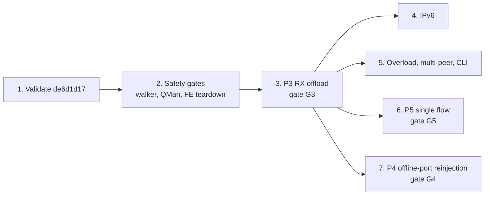
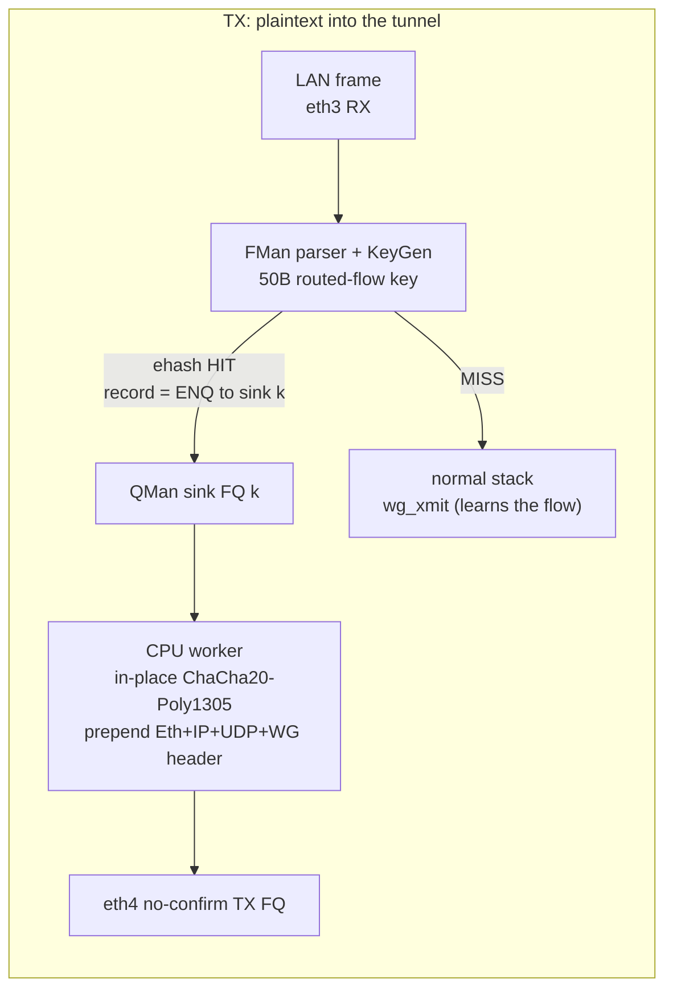
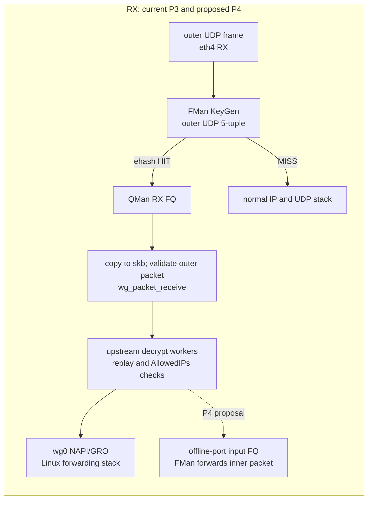

# ASK2 WireGuard plan: remaining work (software path and zero-skb fast path)

**2026-10-15, updated 2026-11-07 · dpaa1 · Status: open.** This is the single active WireGuard plan. The completed work, which covers the measurements, profiles, the P0/P1/P2a/P2b-1 builds and the gate results, has moved to the archive:

- `plans/archive/ask2-wireguard-plan.md`: software throughput. It covers the stage 0 baseline, stage -1 (lockdep debug kernel), patches 4011/056/057/4016, the retired GRO patch 4012, E1 `noqueue`, E2 `tx_lanes=3`, P2b-1 results and the conntrack-hook analysis.
- `plans/archive/ask2-wireguard-matrix-106-vs-185.md`: the 2026-10-12/13 nine-cell matrix (image 2243, before `tx_lanes`).
- `plans/archive/ASK2-WIREGUARD-FASTPATH-PLAN-2026-10-15.md`: the full fast-path design history. It includes P0 feasibility, P1 (gate G1 PASS, image 1943), P2a lab seal (about 465k packets/s, image 2243), the alternatives considered and the closed open items.

WireGuard is not a vendor-parity item: neither the vendor ASK nor ASK2 hardware-offloads it, and CAAM Era 8 has no ChaCha20-Poly1305. Its priority relative to ASK2 parity work is set in `plans/ASK2-MASTER-PLAN.md`.

## 1. Where things stand

| Item | State |
|---|---|
| Software path (patches 4011, 056, 057, 4016; `serial_cpus=14 tx_lanes=3` in `96-enable-services.chroot`) | Shipped. Lanes=3 matrix (image 0051): `.185` leads `.106` in 8 of 9 cells; 1T `up` 1.65 vs 1.38. |
| 1T `bidir` (1.44 vs `.106` 1.55) | The only losing cell. Root cause is the presence of the conntrack hooks: a flushed ruleset gives 1.61. There is no safe VyOS-semantics-preserving fix, so this is a configuration trade-off. |
| Fast path TX, P2b-1 (patch 4017, `wgfp_peer`) | Gate G2 PASS on image 0347: 2.62 Gbit/s on 4 flows, survives the 120 s rekey, no Invalid MAC. Superseded by P2b-2/P2b-3. |
| Fast path TX, P2b-2 automatic flow install (patch 4018) | Gate PASS 2026-11-02 (image `2026.11.02-1519-rolling`): 2.94 / 3.12 Gbit/s on 4 flows, no hand steering. |
| Fast path TX, P2b-3 punt, roaming, AllowedIPs, wg0 delete | Gate PASS 2026-11-02 (image `2026.11.02-1632-rolling`): every test plus upstream `netns.sh` (553 steps). |
| Fast path TX, P2c multi-peer, CLI, sink tail drop (closing step A) | Multi-tunnel TX measured on images 1818 and 2011. The CLI and overload gates remain open. |
| Fast path RX (P3) | Withdrawn: no runtime enable exists until INPUT provenance and ingress identity are proven. Images predating this containment must not enable P3; G3 is not passed. |
| TX backpressure and telemetry | The WGFP-only QMan full-ring and asynchronous-rejection path plus per-CPU hot counters shipped in image 0629. Controlled hardware rejection and throughput gains remain unverified. |
| Offline-port reinjection (P4), per-flow order restoration (P5) | Not implemented. |
| QMan/CAAM/DPAA lifetime containment F-294..F-306, WGFP CLI control safety | Commit `de6d1d17`, CI run 42404963840, image `2026.11.07-1911-rolling`. Stage 1 board checks passed on `.185` (see below); no acceleration change relative to image 0333. |

### Handoff status (2026-11-08)

**Board and image.** `.185` runs `2026.11.08-0228-rolling` (commit `6c9870a0`), deployed to lxc200 as `latest.iso`. It carries F-308 adaptive RX alignment, implicit WireGuard offload (patch `vyos-1x-059-wireguard-offload-auto`) and the IPv6 family policy. The F-307 walker probe retained 1000 records on this boot; power-cycle before the next silicon experiment.

**Fast-path numbers (Gbit/s, 1 tunnel, 4 streams, median of 3, eth4):** up-v4 2.63, up-v6 2.57, dn-v4 1.78, dn-v6 1.72, bi-v4 2.04, bi-v6 2.01 (`/mnt/builds/ask2-review/oracle/wg-line.txt`). 2 and 4 tunnels up: 3.56 and 3.8–3.9. Software path: 1.90 1.84 1.63 1.52 1.54 1.49.

| Stage | State |
|---|---|
| 1 Validate | done (image 1911) |
| 2 Safety gates | DDR-walker barrier closed: F-307 single record (inflight 465, late 0) and four-record chained bucket `0x507f` (inflight 733, late 0), plus the reclamation audit (every ehash free behind a completed SYNC). Open: F-269 natural-timeout path (never fired on silicon), first-port SYNC counter accounting, QMan portal protocol (strict model: 2 MC + 5 shutdown cases), FE teardown ownership |
| 3 P3 RX | in progress: provenance, admission and withdrawal pass on silicon (image 0436); G3 not met (down 1.93 with P3 vs 1.76 off, gate 2.6); fan-out measured slower (1.42) and defaults off |
| 4 IPv6 | TX done, all three board gates passed (see stage 4 below); RX follows stage 3 |
| 5 Overload, multi-peer, CLI | not started |
| 6 P5, 7 P4 | optional, not started |

**Pending decision (proposed 2026-11-08, not yet confirmed by the owner).** WGFP's whole QMan footprint is sink `qman_create_fq`/`qman_init_fq` once at first bind (a timeout marks the pool failed and keeps the queues), one ERN tag FQ and one no-confirm TX FQ per egress port, and `qman_query_fq_np` from the root-only stats file; it never shuts down, retires or destroys an FQ, and P3 reuses the same sinks with CPU decryption (no CAAM). The five QMan shutdown counterexamples are therefore unreachable from WireGuard and the MC cases reduce to stale diagnostics. Proposal: treat the QMan portal protocol as platform hardening that does not gate P3, move the WGFP-relevant parts of FE teardown ownership (withdrawal under traffic, ingress/egress netdev removal, disengage with live flows) into stage 3's acceptance tests, and start stage 3.

**Next tasks, in order.** (1) Stage 3 P3: per-flow ingress provenance in the sink frame (ingress ID) and outer RX records accepted only from the expected port; withdrawal under traffic with no stale sink flow; family policy for the outer RX record (`dpaa_wgfp_family_ok()` on the port the outer flow arrives on); RX distribution across CPUs (one outer flow saturates one CPU today); gate G3 down ≥ 2.6 Gbit/s on four flows, kill below 2.2, plus replay-window and out-of-order netns tests. (2) Stage 2 leftovers: first-port SYNC counter, F-269 timeout recovery. (3) Stage 5.

**Rig notes.** `bin/wg-line.sh` (`WGFP=1 REPS=3 PORT=eth4`) prints the six-number line; `bin/wg-parity.sh ask2` with `CELLS`, `DIRS`, `OUTER=4|6`, `WGFP_COUNTER_LOG=<file>` for `sealed`/`declined`/`punted` deltas; `bin/testrig-ask2-matrix.sh` for the full ASK2 table. `/sys/module/wireguard/parameters/wgfp_peer` is root-only. vbash config scripts exit 0 even when the commit fails ("temporarily locked"); check the output and retry. Never edit a `bin/*.sh` that a running rig job executes. The F-307 probe: `walker-probe2.sh`-style ntuple enqueue records (`action 0`, never `action -1`: drop records raise QMan `Invalid Enqueue State` per HIT), pktgen on dell1, bucket = `(crc64_raw(key50) >> 48) & 0x7FFF`.

### Path to full acceleration (2026-11-07)

Today only IPv4 TX is accelerated: about 2.8 to 3.1 Gbit/s on four flows, against about 1.7 to 1.9 Gbit/s in software. Decrypt, IPv6 and single-flow scaling stay on the software path, and encryption always runs on the CPUs because CAAM Era 8 has no ChaCha20-Poly1305. Reaching bidirectional, dual-family acceleration takes the stages below, in dependency order. Stages 1 and 2 are not WireGuard features, but P3 cannot be re-enabled without them; stages 6 and 7 are demand-driven.

1. **Validate the current build.** On the image from `de6d1d17`, check that moving a DPAA port to another namespace is refused (F-294), that QMan/BMan portals expose no `bind`/`unbind` (F-296), and that `ask-check` is no worse than on image 0333. Then rerun the WGFP soak and the nine-cell matrix for regressions.
   - **Result (2026-11-07, `.185`, image `2026.11.07-1911-rolling`, kernel `6.18.60-vyos`, operator install then first boot; boot type not recorded).** `ip link set eth3 netns` was refused with "The interface netns is immutable" and eth3 stayed in place (F-294). `qman_portal`, `bman_portal`, `qman_ccsr` and `bman_ccsr` expose no `bind`/`unbind` (F-296); `caam`, `caam_jr` and `fsl-fman_xmdio` still do. `ask-check` reported 47 OK, 2 WARN, 0 FAIL, the same as image 0333; the ehash SYNC timeout, wedge and insert-timeout counters stayed 0, taint was 4096 (out-of-tree only), and the only kernel error was the known OH-port probe message. The 120 s soak (`KEEP=1 bin/testrig-wireguard.sh setup wg-v4`, then `DUR=120 bin/testrig-wgfp-soak.sh soak`) passed all 8 gates at 2.700 Gbit/s, with 29.6M packets sealed, `punted=0`, no `xmit_fail` or `xmit_ern`, BMan drift equal to accounted consumption, every record withdrawn, empty sinks and a clean `pcd-snapshot` diff (0241: 2.79, 0318: 2.74). The nine-cell matrix was not rerun. None of this exercises the new fault paths, which remain host evidence.
2. **Close the safety gates.** These block every later stage:
   - DDR-walker quiescence: a discriminating test that holds or identifies a specific in-flight ehash lookup across a SYNC, plus proof that port disable (F-274/F-211) is a real barrier. The 2026-11-05 load-correlation run is not that test. **F-307 walker probe (2026-11-07, working tree, host-tested):** FMan 210.10.1 writes `packet_count` at record+256 on every HIT of a 320-byte record whatever STATS_EN says (T-M8-3, 2026-08-22), and the lookup copies the record with one `dma.read256` before comparing the key. With the root-only countdown `fsl_dpaa_fman.ehash_walker_probe=N`, each of the next N successful deletes reads that counter right after the unlink (c0) and after the SYNC (c1), then retains the record and the replaced cumulative nodes instead of freeing them; nothing is written to the record or to a register. `ehash_walker_probe_inflight` sums c1 − c0, the HITs by lookups that already held the old head while the SYNC ran: this is the positive control the earlier run lacked. `ehash_walker_probe_late` sums each retained record's current count minus c1 on every read; any nonzero value means a lookup reached an unlinked record after its SYNC completed, so INV0 is not a reclamation barrier and P3 stays blocked. Retained blocks are never freed (a busy `dma_pool_destroy()` leaks its pages), up to 4096 records, so reboot after an experiment. `bin/test-ehash-walker-probe.py` runs the generated helpers and the real `del_key()` against mocks (probe off, retention, in-flight and late accounting, SYNC failure, full array) under ASan/UBSan, and two mutants are caught; the fixup applies idempotently and `fman_pcd.o` compiles with `W=1` in the CI-order replay tree. Board procedure, on a cold boot: one ntuple rule on eth3 for a fixed UDP 5-tuple that dell1 sends at the highest single-flow rate the rig allows, `echo 1000 > /sys/module/fsl_dpaa_fman/parameters/ehash_walker_probe`, then 1000 delete and re-add cycles of that rule with the flow running; read `kept`, `inflight` and `late`, and `late` again after 60 s. Verdict: `inflight > 0` and `late = 0` is the discriminating pass; `inflight = 0` is inconclusive (raise the packet rate); any `late > 0` fails the gate. This does not cover port-disable quiescence or the F-269 timeout path. **Board result (2026-11-07, `.185`, image `2026.11.07-2039-rolling`, operator power-cycle, about 380 s up at the start): PASS.** pktgen on dell1 sent `10.99.1.112:40001 → 10.99.1.185:51999` at 1 Mpps (64 B) at an ntuple enqueue record (`action 0`); 1000 delete and re-add cycles took 5.0 s with no failures. `kept` = 1000, `inflight` = 465 and `late` = 0, still 0 after 60 s idle and after a further 60 s of 1 Mpps traffic at the re-added record. No BUG, stall or new QMan error with `softlockup_panic` and `panic_on_rcu_stall` armed, and the BMan pools stayed stable. A completed INV0 SYNC therefore acts as the reclamation barrier for single-record ehash lookups on 210.10.1. **Chained bucket (2026-11-08, image `2026.11.08-0228-rolling`, power-cycled): PASS.** Per-port tables use mask `0x7FFF`, shift 0, so the bucket is `(crc64_raw(key50) >> 48) & 0x7FFF`; UDP `10.99.1.112:{40001,44516,52296,65005} → 10.99.1.185:51999` all land in `0x507f`, which `fe_flow` confirmed on silicon (`tbl[3] flow[0..3] bucket=0x507f`). With the other three as static records, 1000 delete and re-add cycles of the 40001 record under 1 Mpps gave `kept` 1000, `inflight` 733, `late` 0, still 0 after 60 s more traffic; the chain stayed intact, with no stall or QMan error. The barrier therefore also holds across cumulative-node chain rewrites. **Reclamation audit (CI-order tree, 2026-11-08):** every ehash record and cumulative-node free sits behind a completed INV0 SYNC or frees memory the hardware never saw: `add_key` frees replaced nodes after its SYNC (quarantine on failure), `del_key` frees the record and replaced nodes after its SYNC (quarantine and poison on failure), `flow_drain` clears all heads, SYNCs, then frees, `recover` frees quarantined generations after a later SYNC, and the publish/add failure paths free unpublished allocations. Port disable is not an ehash reclamation barrier, so its quiescence matters only to the non-ehash users (AF_XDP detach, the unreachable F-211 IPv6 arm path, the disabled F-291 recover) and does not gate WGFP. **This gate item is closed** except the F-269 natural-timeout path, whose quarantine-and-recover code is host-modelled but has never fired on silicon. A drop record (`action -1`) could not be used: every HIT of the F-247/F-248 EXIT-FE terminal raises QMan `ErrInt: Invalid Enqueue State` with `ecir.fqid 0x0` from DCP 0 at any rate (no buffer leak). WGFP uses enqueue records only, so this does not block WireGuard, but it blocks shipping drop offload.
   - F-269 timeout quarantine and recovery on a natural pending SYNC, not only an injected one.
   - QMan portal protocol: the strict host model still reports 2 MC and 5 shutdown cases. This needs full-transaction command ownership, identity-aware FQRN/FQRL handling, MR/DQRR/SDQCR ownership during shutdown, and owner retention on busy or timeout results.
   - FE teardown ownership: an end-to-end contract for exported disengage, bridge/FDB, egress FQ and netdevice lifetime, PPP and VLAN withdrawal, and stale external DESTROY.
   - ~~The F-168/F-215 RX SYNC fold correction~~ shipped in `cd124b9b` (image 0333 onward). The `fman_pcd_port_recover()` pool-offset error is contained, not fixed: F-291 refuses `fe_recover` and `fe_disengage_full` with `-EOPNOTSUPP`, which is enough for WireGuard; the offset fix is needed only before recovery is re-enabled. The first-port SYNC counter still needs serialized per-port transition accounting and checked timeout handling.
3. **Re-enable P3 receive offload.** Prove exact-tuple INPUT provenance and ingress identity per flow (the sink frame needs an ingress ID), show that withdrawal under traffic leaves no stale sink flow, and enforce the family policy. Then pass G3: `down` at least 2.6 Gbit/s on four flows (about 1.6 today), with the replay-window and out-of-order netns tests; kill below 2.2. Alongside this, prove a counter-based RX distribution that does not depend on the exact-match key and resolve per-portal NAPI/IRQ ownership, because one outer flow currently saturates one CPU. Profile the crypto queues before replacing them, and confirm RX headroom and tailroom from a live FD dump on `.185`.
**Stage 3 implementation (2026-11-08, working tree; host-tested, board gates pending).** The sink queues are now per ingress port (`struct wgfp_port`: four workers on CPUs 0..3, created on the port's first record), and `struct dpaa_wgfp_frame` carries `ingress_ifindex`. Both the writer and the sink key a flow on tuple plus port, so equal tuples on two ports select their own flow instead of being ambiguous; the global `create n` sinks remain only for the old lab tests. Admission comes from `wg_receive()`: before `wg_packet_receive()` it records the exact outer tuple, `skb->skb_iif` and the wg device in a per-CPU observation ring. That hook runs after IP input and the INPUT hook, so an observation proves the tuple was delivered to the WireGuard socket; `wgfp_pst_rx_sync()` admits a record only for the peer's current endpoint observed this way, installs it on the **observed** ingress port (which may differ from the transmit route in an asymmetric setup), and re-checks the port's `offload` family every refresh. The old conntrack/keypair fallback is gone. `wgfp_rx` is a writable module parameter again (default off). One outer flow no longer pins one CPU: with `fanout <batch>` set, its record points at a per-port distributor FQ which re-enqueues the untouched buffer to that port's workers, switching worker every `batch` frames so a burst stays together and an inner flow is reordered only at batch boundaries. It uses a dedicated ERN tag queue and `rx_enq_fail`/`rx_ern` counters. `echo "fanout <batch>" > /sys/kernel/debug/dpaa_wgfp/ctl` applies to new records (toggle `wgfp_rx` 0→1 to reinstall existing ones); the default is 0, the record targeting one worker, because the board measurement below found fan-out slower. This is software counter-based distribution after a single exact-match record, so it needs no KeyGen or pool-channel change and keeps one NAPI per portal. Family removal, endpoint change, `wgfp_rx=0`, peer death and unbind all withdraw the RX record; frames already in a sink after the delete find no flow and are released (the deliberate unmatched-frame containment), so no stale record or peer is used; only frames in flight at withdrawal can be lost. Host tests: `tests/wireguard_fastpath_rx.py`, `tests/wgfp_sink_lifetime.py`, `tests/wgfp_flow_identity.py` updated and the WGFP host suite (85 tests) passes; `bin/testrig-wgfp-p3.sh` runs the admission, distributor-spread and withdrawal-under-traffic gates and prints download retransmits (reorder evidence; compare `fanout 0` and `fanout 32`), and G3 is measured with `echo 1 > .../wgfp_rx; WGFP=1 REPS=3 PORT=eth4 DIRS=down CELLS=wg-v4 bin/wg-line.sh`. `dpaa_wgfp.o` and `fastpath.o` compile warning-free with `W=1` against the 6.18.60 tree; patch 4018's new `socket.c` hunk applies to the pre-4018 tree. Not built into an image yet; the board still holds the F-307 walker probe's retained records (`kept` 1000), so power-cycle before the first P3 experiment. Board order: cold boot; tunnel; `bin/testrig-wgfp-p3.sh`; then `wg-line` down with `wgfp_rx=1` at `fanout 32` and `fanout 0`, plus `wgfp_rx=0` as the software baseline; then `bin/testrig-wgfp-p2b3.sh` with `wgfp_rx=1` (roam changes the outer tuple, so the record must move) and the upstream `netns.sh`.

**Stage 3 board results (2026-11-08, `.185`, image `2026.11.08-0436-rolling` from commit `7e9e0a53`, warm boot after install by operator choice; walker-probe retention cleared by that reboot, `kept` 0).**
- `bin/testrig-wgfp-p3.sh` **PASS** (run 5, single TCP download over `wg0`, eth4 outer). Admission: the RX record installed only after `wgfp_rx=1` and a stack observation, `rx` advanced 2.52 M frames with `rx_stack` 0, and the record (`tbl[2]`, key `10.99.2.113:51820 → 10.99.2.185:51820`, UDP) sat in eth4's table. Distribution with fanout 32: the distributor took every frame and the four eth4 workers got exactly equal shares. Withdrawal under traffic: `vyos-offload-ask --port 0x11 family 2` (drop IPv4 on eth4) removed the RX record within the 1 s refresh, `rx` stayed frozen across a 3 s window after settling, the download carried on in software (1.30 Gbit/s against 1.27 before), and the transmit record followed about 2 s later with `punted` rising. Restore (`family 3`, download still running): the record came back from a fresh stack observation within about 2 s and `rx` resumed. A 120 s WireGuard rekey happened during the run. `rx_enq_fail` and `rx_ern` stayed 0 throughout. `family 0` is a full disengage, which ask.ko refuses while WGFP owns live FE records (`disengage of 0x11 failed`), so the rig removes only the outer family.
- **G3 not met.** `wg-parity.sh ask2`, `wg-v4 down`, 4 streams, 3 × 30 s (10 s warm-up), eth4, median (min–max), Gbit/s: P3 off **1.76** (1.74–1.78; DUT 85.5% busy, busiest core 88.5%); P3 with fanout 0 **1.93** (1.93–1.94; 79.6%, 85%; retransmits 9k–96k); P3 with fanout 32 **1.42** (1.39–1.43; 69%, 73%; retransmits 314–525). Gate is ≥ 2.6, kill below 2.2: every mode is under the kill line. P3 alone is worth about +10%.
- **Why fan-out loses.** With fanout 32 the eth3 transmit sinks sealed 3.43 M frames against 0.72 M with fanout 0, about 4.8×, for less download. Those are the return ACKs: batch-boundary reordering makes the receivers ACK every segment instead of delaying, and sealing the extra ACKs costs more than the spread saves. The box was 69% busy, so fan-out also adds a serial delay of its own (distributor hop on CPU 0). Software counter distribution without order restoration is therefore not the lever; a reorder-free spread needs QMan order restoration (ORP) or must happen after WireGuard's in-order stage.
- **Where the limit is now.** With fanout 0 no core is saturated (busiest 85%) yet the rate stops at 1.93, so the cap is a serial stage, most likely the peer's single `wg_packet_rx_poll` NAPI (in-order dequeue, replay check, GRO, then IP forwarding and eth3 transmit, all on one CPU) or the sink CPU's copy and UDP checksum. Next: `perf record -a -g` on a fanout-0 download to name it before any further change.
- **Named (2026-11-08, same image and boot): silent drops inside WireGuard receive, not a CPU limit.** The profile (static `perf` 6.18.60, 15 s, 1.91 Gbit/s) put `napi/wg0-0` at 22 % of samples (about 0.9 of a core, 44.5 % of it IP forwarding with software GSO), but moving that work away did nothing: RPS on `wg0` 1.90, GRO off 1.94, both 1.92, neither 1.92. No DUT counter showed a drop (interface, MAC `rdrp`, qdisc, softnet, IP), the sender dell2 was idle (busiest core 19 %) and its 34,771 retransmits carried only 13 DSACKs, so the loss was real. Same-window conservation located it: eth4 received 2,748,044 frames and the P3 sinks 2,749,602 (no tail drop), but WireGuard accepted only 2,719,192, so **30,410 frames (1.1 %) were dropped inside WireGuard**; with P3 off the loss was 47,839 (1.9 %), so P3 reduces it. No `invalid nonce` messages with dynamic debug on (not replay); a kretprobe on `wg_prev_queue_enqueue()` saw the per-peer queue full about 1,000 times per 15 s. The remainder is the per-device decrypt ring overflowing in bursts: `-EPIPE`, the packet is queued DEAD and `wg_packet_rx_poll()` frees it without a statistic. **F-309** (`bin/kernel-fixups/F_309.py`) raises `MAX_QUEUED_PACKETS` from 1024 to 4096; it sizes the device encrypt/decrypt rings and the per-peer cap. Board gate: download loss inside WireGuard (eth4 frames minus `wg0` rx) near 0, retransmits down, and G3 re-measured with P3 off, fanout 0 and fanout 32.
- **F-309 board result (2026-11-08, `.185`, image `2026.11.08-1629-rolling`, commit `916c892b`, warm boot after operator install): the loss is gone, the rate is not higher.** `wg-parity.sh ask2`, `wg-v4`, eth4, 4 streams, 3 × 30 s, median (min–max) Gbit/s, retransmits per run: P3 off **1.74** (1.62–1.81; 92% busy, busiest core 97%; retr 1.2k–52k), P3 fanout 0 **1.91** (1.90–1.93; 80%, 85%; retr **46–2,698**, was 9k–96k), P3 fanout 32 **1.41** (1.38–1.43; 70%, 76%; retr 250–390), upload (P3 off) **2.66** (2.58–2.73, no regression from 2.63). Same-window conservation at fanout 32 (15 s per rep, `/dev/mem` eth4 mEMAC RFRM vs `wg0` rx_packets): lost inside WireGuard −76, −345, −143 frames (0.00%), mEMAC `rdrp` 0, against 30,410 (1.1%) on image 0436. The fanout 0 and P3-off windows were not captured (the sampler's `pkill` pattern matched its own ssh command line). `xmit_fail`/`xmit_ern`/`rx_enq_fail`/`rx_ern` 0, no new kernel warnings, peak 58 °C. **Conclusion:** the decrypt-ring drops were real and F-309 removes them, but they were not what caps the download: with near-zero loss and no core saturated, fanout 0 still stops at 1.91. G3 stays unmet. The remaining limit is a serial stage or a latency/window limit, not loss; next is the sender's `ss -ti` (cwnd, rtt, rwnd-limited) during a fanout-0 download and the per-thread CPU of `napi/wg0-0` at 100 Hz to see whether it saturates in bursts. Data: `/mnt/builds/ask2-review/oracle/wg-f309-1629/`.

- **4-tunnel regression explained, P3 shipped on (2026-11-08).** Image 1809 measured 4T up/down/bidir 3.83/2.07/2.64 Gbit/s against 4.14/2.38/2.99 on image 2011. Same-rig A/B with the 2011-era harness (`c454e3ea`): image 2011 today with P3 on 4.17/2.38/2.92, with P3 off 3.79/2.08/2.78; image 2011 defaults `wgfp_rx=Y`, so the old baseline was TX+RX. With P3 off the current code equals 2011, so nothing regressed. Image 1809 with `wgfp_rx=1` (`WGFP=1 WGFP_RX=1 bin/wg-matrix.sh 185`): 1T 2.79/1.91/2.21, 2T 3.96/2.19/2.73, 4T **4.21**/2.31/2.89. Correctness with P3 on: `bin/testrig-wgfp-p2b3.sh` rekey, roam and AllowedIPs PASS; upstream `netns.sh` PASS (553 steps). The pmtu case fails identically with P3 on and off (ICMP is learned, but neither `punted` nor `decline_withdraws` moves): open, not a P3 regression; first suspect is dell1's cached path-MTU exception. Hook 96 now writes `options wireguard serial_cpus=14 tx_lanes=3 wgfp_rx=1` (module default stays off). Harness: `bin/wg-matrix.sh` `WGFP_RX=1`; per-port sinks allowed in the counter checks; P2b-3 binds through `wgfp_peer_lease` and unbinds correctly at the end.

4. **IPv6.** **Control path done (2026-11-08, working tree, host-tested):** ask.ko registers its per-port family mask with `dpaa_wgfp` (`dpaa_wgfp_set_family_policy()`, called under RCU, unregistered with `synchronize_rcu()` before teardown); `dpaa_wgfp_family_ok(dev, family)` applies it with the same L2-port exclusion as `ask_hw_flow_family_ok()`. Learning admits an inner flow only if its ingress port has that family (`dpaa_wgfp_flow_add()` re-checks), each outer template only if the port under the tunnel has the endpoint's family (otherwise the peer's frames punt to the stack within the 1 s template refresh), and the aging pass withdraws installed flows whose port has dropped the family. `wgfp_tx_family_allowed()` now accepts both families. No provider (ask.ko absent) admits nothing. Tests: `tests/wgfp_family_policy.py` (ASan/UBSan model of both functions plus wiring checks), `tests/wgfp_flow_identity.py` updated. The outer IPv6 UDP checksum stays the C2 software sum (about 3 % per packet); the FMan TX checksum command is an optimisation for later. **Board gates PASSED (2026-11-08, `.185`, image `2026.11.08-0228-rolling`, commit `6c9870a0`).** `wg-line` (fast path, eth4, median of 3): up-v4 2.63, up-v6 **2.57** (was 1.88), dn-v4 1.78, dn-v6 1.72, bi-v4 2.04, bi-v6 **2.01** (was 1.50). Inner IPv6 over outer IPv4: 2.52 Gbit/s, `sealed` +7.04M, 0 declined, 0 punted; over an IPv6 outer endpoint (`OUTER=6`): 2.53 Gbit/s, `sealed` +7.10M, about 5 % more DUT CPU for the software checksum. Removing `offload ipv6` from eth3 mid-flow withdrew all flows by the first 2 s sample (flows 4 → 0, `sealed` frozen, traffic continued in software); restoring it relearned them and a fresh run ran 2.49 Gbit/s on the fast path. IPv6 download waits for P3 (stage 3).
4b. **P6, zero-skb decrypt (next, decided 2026-11-09).** Upload already passes 4 Gbit/s (4 tunnels 4.21) because sealing never builds an skb: the sink seals in place in the BMan buffer and `dpaa_wgfp_xmit()` enqueues it to the egress no-confirm TX FQ. Download still runs nearly the whole Linux path even with P3: skb copy, decrypt workers, the per-peer serial `wg_packet_rx_poll()`, GRO, `ip_forward`, qdisc, `dpaa_start_xmit` (1T 1.96, 4T 2.29 Gbit/s on image 2054; crypto is not the limit, the P2a lab seal reached 465k pps / 5.3 Gbit/s). P6 mirrors the TX fast path on receive. The P3 sink, for a type-4 data message of a peer with a current receiving keypair and a learned inner flow:
   1. `dma_sync` the frame and decrypt in place (`chacha20poly1305_decrypt`, the counter as nonce), never copying to an skb;
   2. validate the counter against the **same** replay window upstream uses (`keypair->receiving_counter`, under its lock, the logic of `counter_validate()` in `receive.c`), so packets that punt to the stack and packets decrypted here share one window; update the peer's rx timers and stats the way `wg_packet_rx_poll()` does, rate-limited like the TX path's 10 ms timer block;
   3. check the inner source against the peer's AllowedIPs (`wg_allowedips_lookup_src()`);
   4. rewrite in place: drop the outer Ethernet/IP/UDP/WG headers, write the inner flow's learned Ethernet header (egress MAC pair, optional VLAN), decrement TTL / hop limit and fix the IPv4 checksum, then `dpaa_wgfp_xmit()` to the egress port's no-confirm TX FQ.
   
   Inner-flow learning: a decrypted inner flow is admitted only after the stack has **forwarded** it (observed in the forward path after the firewall, the same rule as P3's stack-observed admission), so P6 never forwards what the firewall would drop; the egress device, next-hop MAC and MTU come from `ip_route_output` + neighbour lookup, refreshed once a second and RCU-swapped like the TX templates; the egress port must be an ASK2-engaged DPAA port with that family enabled. Anything else punts to the existing P3 path (skb, upstream receive): handshake, cookie and keepalive messages, decrypt or replay failure, an unknown inner flow, an oversize or non-IP inner packet, a frame that needs a second buffer, a TTL of 1. Ordering: one outer flow stays on one sink (`fanout 0`), so packets of an inner flow leave in order; the punt path can reorder only around a learning or withdrawal edge.
   
   Withdrawal: route, neighbour or MTU change, family-policy change, peer removal, rekey (records follow the current keypair), `wgfp_rx=0` and unbind withdraw the inner records, as P2b-3 does for TX. Telemetry: `rx_fast`, `rx_fast_punt` by reason, `rx_fast_replay`, `rx_fast_aip`.
   
   Gates: G6 download, 4 tunnels at least 4.0 Gbit/s and 1 tunnel at least 3.0, IPv4 and IPv6 inside, DUT CPU below the P3 figure; correctness, all with P6 on: the P2b-3 suite (rekey, rekey at 120 s, roam, AllowedIPs, PMTU, wg0 delete), upstream `netns.sh`, a replay/duplicate-injection test (a replayed captured packet must be dropped by the shared window), an out-of-order test (packets reordered within the window are accepted once), and a firewall test (a forward drop rule added mid-flow must stop the flow within one refresh). Risk: the replay window and nonce handling now run in our code beside upstream's; keep them on upstream's own state and functions, never a copy. Effort 1-2 weeks to a gate-quality prototype. Board teardown and lifecycle gates are the same as T1-T4 in `ASK2-MASTER-PLAN.md` §4.9.

   **Implementation (2026-11-09, host-tested, not yet in an image).** Module parameter `wireguard.wgfp_rx_fast` (default 0; needs `wgfp_rx=1`): 1 = decrypt in the sink, then copy the plaintext into an skb on the wg device and `netif_receive_skb()` it (no crypto queue, no per-peer serial poll); 2 = also forward learned inner flows directly. New patch `4020-wireguard-fastpath-rx-bookkeeping.patch` exports three wrappers from `receive.c` (`wg_fastpath_rx_validate()` = upstream `counter_validate()` on `keypair->receiving_counter`, `wg_fastpath_rx_timers()` = `keep_key_fresh()` + the three receive timers, `wg_fastpath_rx_stats()` = `update_rx_stats()`), so fast and stack packets share one window. In `fastpath.c`, `wgfp_rx_fast_frame()` runs at the top of the P3 `wgfp_rx_frame()`: untagged outer frame to the port's MAC, IPv4 without options/fragments with a valid header checksum or IPv6 with a nonzero UDP checksum, type-4 message longer than a keepalive, `key_idx` equal to the current keypair's local index with a valid unexpired receiving key; anything else returns 0 and P3 runs unchanged. Then in-place `chacha20poly1305_decrypt()` (a bad tag leaves the buffer untouched; dropped, `p6_auth`), the replay check after authentication (`p6_replay`), the rate-limited receive timers (`pst->last_rx_timer`, 10 ms), and inner length validation (`p6_err`, wg `rx_errors`). Direct forward (`wgfp_rx_forward()`) needs a learned `struct wgfp_rflow` for the inner 5-tuple and wg ifindex, unexpired, with the same `peer->internal_id`, inner length <= route MTU, TTL/hop limit > 1, a valid inner IPv4 header checksum, no SYN/FIN/RST, and an outer ECN field of not-ECT or ECT(0) (ECT(1)/CE need `INET_ECN_decapsulate()`, so they take the stack hand-off). It writes the learned Ethernet header in front of the inner packet, decrements TTL (`ip_decrease_ttl()`) or hop limit and calls `dpaa_wgfp_xmit()`. Learning is a netfilter `POST_ROUTING` hook at priority `INT_MAX` (IPv4+IPv6, registered on bind, unregistered on unbind before the sinks go): a packet whose `skb_iif` is a bound wg device (forwarded), non-xfrm route, egress a non-VLAN DPAA port with that family offloaded and an egress handle (`dpaa_wgfp_egress_find()`, new lockless lookup; a missing handle is allocated by a work item at most once a second), established non-NAT conntrack (`wgfp_ct_admitted()`), source owned by a peer of that device (`wg_allowedips_lookup_src()`), a valid neighbour (`wgfp_tmpl_l2()`). A record lives 1 s (`WGFP_RFLOW_LIFE`); the next packet then takes the stack and relearns it, so firewall, route, neighbour, MTU, family and AllowedIPs changes apply within a second. Records are reaped by the aging work and all freed on unbind. Also fixed: `wgfp_tmpl_l2()` leaked a neighbour reference on every miss (`__neigh_create(..., true)` result never released) and could pass an `ERR_PTR` to `neigh_event_send()`. Not handled in this stage: VLAN egress (stack hand-off), multi-buffer frames (dropped by the sink as before). Telemetry in `wgfp_peer`: `p6 p6_fwd p6_stack p6_punt p6_replay p6_auth p6_err p6_aip p6_nomem p6_learn rflows` (before `dev=`). Verification: ARM64 W=1 and sparse clean against the CI-derived 6.18.60 tree (patch loop applies 4020); host harness `tests/wgfp_p6.py` runs the real `wgfp_parse`/`wgfp_rx_fast_stack`/`wgfp_rx_forward`/`wgfp_rx_fast_frame` bodies with ASan/UBSan (forward offsets and length, TTL and checksum, replay, every stack hand-off and P3 fall-through, bad tag untouched, AllowedIPs) and catches TTL, offset, replay and keepalive mutations; the existing WGFP suites pass with stubs (13 `wireguard_rig_external` failures are pre-existing at HEAD). Board: `bin/testrig-wgfp-p6.sh` (correctness gates 1-7: forward, mode 1, netem duplicates refused, netem reordering accepted, forward drop rule mid-flow, mode toggles, unbind under traffic) and `WGFP=1 WGFP_RX=1 WGFP_RX_FAST=2 bin/wg-matrix.sh` for G6 (the matrix counts `p6_fwd + p6_stack` as received frames).

   **Board result, image `2026.11.09-0346` (2026-11-09).** `bin/testrig-wgfp-p6.sh` passes 7/7 on one tunnel. Matrix with `wgfp_rx_fast=2`: 1 tunnel up 3.71 (2.88 on 2054), down 1.28 (1.96 on 2054), bidir 2.96. Download got slower: P6 decrypts a tunnel on its one sink CPU (99.5% busy, DUT 26%), while upstream spreads decrypt over all CPUs. **Open bug: two bound wg devices hang the box** with `wgfp_rx_fast` 2 or 1 (not 0) within seconds of the receive records installing; the freeze is total and instant, watchdog reset about 20 s later, no oops reaches the streamed log. The image had no crash store: vyos-build's `00-filesystems.config` disables `PSTORE_RAM/CONSOLE/PMSG` after our `10-pstore-ramoops.config`; `bin/ci-setup-kernel.sh` now forces them (and `PSTORE_FTRACE`, with an `ftrace-size` zone added to the DTS ramoops node), so the next image keeps the console tail across the reset in `/sys/fs/pstore`. Records now take the least-used sink of their port and kind (`wgfp_flow_slot_locked()`) instead of a round-robin shared by RX and TX.

   **P7 tail (2026-11-09, host-tested).** For one tunnel the better lever is upstream's own parallel decrypt plus a cheap tail. `wireguard.wgfp_rx_tail` (default off; works with or without P3): `wg_packet_consume_data_done()` (patch 4020) offers each decrypted, AllowedIPs-checked packet to `wg_fastpath_rx_tail()` before `napi_gro_receive()`. A packet of a learned inner flow (the same `struct wgfp_rflow` records, learned at POST_ROUTING when P6 mode 2 or P7 is on) with TTL > 1, a valid IPv4 header, no SYN/FIN/RST, no trailing bytes and length within the route MTU gets its TTL / hop limit decremented and the learned Ethernet header pushed, and leaves through `dev_direct_xmit()` on a queue chosen from the flow hash (stable when the per-peer NAPI thread changes CPU). It skips GRO, `ip_forward`, the forward and postrouting hooks, the qdisc and GSO, which on image 0436 were 44.5% of the per-peer NAPI thread that capped download at 1.9 Gbit/s. Telemetry `p7 p7_fwd p7_drop`. Host harness in `tests/wgfp_p6.py` (real body; refusals leave the skb unchanged; catches TTL, trim, peer and SYN mutations). Board: `P7=1 bin/testrig-wgfp-p6.sh` and `WGFP=1 WGFP_RX=1 WGFP_RX_TAIL=1 bin/wg-matrix.sh`.

   **Board result, image `2026.11.09-0540` (2026-11-09), 1 tunnel, 4 streams, P3 on, A/B interleaved p3/p7/p3/p7, 3 reps each, fresh tunnel per rep.** Download (DUT decrypts) 1.94 / 1.96 Gbit/s with the tail off vs 2.65 / 2.65 Gbit/s with it on (+36%); DUT busy 81% → 93%, busiest core 85–89% → 94–97%, so the next ceiling is CPU. Upload (DUT encrypts) 2.75 / 2.78 vs 3.49 / 3.50 Gbit/s (+26%), reproduced in both tail-on rounds; the likely reason is that the returning TCP ACKs are decrypted traffic and take the tail too, freeing softirq time for encryption (not yet confirmed by a per-direction `p7_fwd` count). An earlier, interrupted run of the same A/B logged `p7_fwd=31533900 p7_drop=0`. No resets, lockups or warnings in dmesg. Raw output: `/mnt/builds/wgfp/p7ab/` on the agent host. Still to run: 2/4-tunnel runs.

   **P7 gate and a rig caveat (2026-11-09, same image).** `P7=1 bin/testrig-wgfp-p6.sh` passes (steps 1, 5, 6, 7; `p7_fwd` +2.43M, no auth/frame/AllowedIPs errors, the firewall drop rule stops the flow and it returns, no warnings on unbind). Its single-stream rate (1.34 Gbit/s, about 300k retransmits) is a generator figure, not a DUT one: with the tail off or on, a 1-stream download loses about 12% of segments, and dell2's own `wg0` `tx_dropped` (+196,613) matches iperf3's retransmits (196,767), while the DUT P3 sink (+1,784,651 frames), DUT `wg0` rx (+1,784,653) and dell1's NIC rx (+1,784,657) agree with each other and no DUT drop counter moves. Read single-flow download only against the ceiling cell; the 4-stream figures above have few retransmits and are DUT-limited.

   **Profile with the tail on (2026-11-09, image 0540, 4 streams, 2.63 Gbit/s, `perf record -a -g -F 499` 15 s; data `/tmp/p7-{1,0}.data` on `.185` until reboot).** All four CPUs are 91-96% busy. CPU0 is the P3 sink of the one outer flow (89% softirq, `ksoftirqd/0` taking overflow); CPUs 1-3 run the decrypt workers and `napi/wg0-0`. Crypto (ChaCha NEON 28.3%, Poly1305 8.3%, `chacha_permute` 3.8%, NEON begin/end 2.7%) is about 43% of all samples, so about half of the busy time is not crypto. CPU0 self time: `memcpy` 17.9% (P3 copies every frame into a new skb, `skb_put_data()` in `wgfp_rx_frame()`), `bman_release` 13.9% plus `dpaa_wgfp_fd_release` 4.7% (each buffer returned to BMan on its own), `do_csum` 10.1% (P3 validates the outer UDP checksum with `csum_partial()` over the whole datagram), `wgfp_peer_frame` 9.1%, `queue_work_on` 5.1%. CPUs 1-3, besides crypto: `qman_enqueue` 4.6%, `netif_skb_features` 3.5%, `__skb_flow_dissect` 1.7% (the tail's queue choice hashes every packet), `dpaa_cleanup_tx_fd` 1.6%. Cheap levers on the sink CPU, in order of risk: (1) take the outer UDP checksum verdict from the FMan parse result / FD status instead of `csum_partial()` (verify the L4CV bit and parse-result placement for sink FQs first); (2) batch BMan releases up to 8 per command per poll; (3) zero-copy: wrap the BMan buffer in the skb (`build_skb`, as `dpaa_eth` does) and refill the pool, instead of copying. Together about 10% of all samples; worth roughly +10% download on one tunnel, not a doubling. The larger lever stays P6's cost (about 14k cycles per packet against about 25k here) spread over more than one CPU.

   **P6 with the fan-out distributor (2026-11-09, image 0540, 1 tunnel, 4 streams, `fanout` set before the tunnel is created).** `wgfp_rx_fast=2` plus `echo fanout 32 > /sys/kernel/debug/dpaa_wgfp/ctl` runs 3.26-3.49 Gbit/s (5 runs, mean about 3.37) against 1.17-1.28 at `fanout 0` and 2.65 for P3 + P7, so it passes the G6 one-tunnel rate (3.0). `fanout 128` is the same (3.35); `fanout 512` is worse (1.63, its bursts exceed the 512 KiB `WGFP_SINK_TD`). It is not shippable as is: 0.8-1.5M retransmits per 15-20 s run. With the eth4 BMI statistics enabled (`fmbm_rstc` = `0x80000000` at `0x1A91200`, the A6-LOSS method), `rfrc` equals what dell2 sent, `rodc` (out of buffers) is 0, and `rfdc` is about 13% of frames: QMan refuses the enqueue into the distributor FQ because CPU0 is saturated, and FMan discards the frame. On top of that the batch boundaries reorder (`TCPSACKReorder` about 640k, 3.86M segments in the receiver's out-of-order queue per 20 s). The distributor is created on CPU0 (`wgfp_sink_create(&p->dist_sink, p, 0, true)`) next to worker 0; the four workers get exactly equal frame counts. **Measurement caveat:** the kernel has no `CONFIG_IRQ_TIME_ACCOUNTING`, so softirq work that interrupts an idle CPU is booked as idle in `/proc/stat`. Under P6 fan-out `/proc/stat` said CPU0 90%, CPUs 1-3 about 30%, but perf cycle samples per CPU were 30.4 / 24.2 / 22.7 / 22.6%. The rig's `dutbusy`/`maxcore` therefore understate sink-path (softirq) load, including the P6 "26% busy" above; P7's kworker load (93%) is counted correctly. Corrected cost: about 17.5k cycles per packet for P6 fan-out against about 25.5k for P7. Next for this path: (1) give the distributor's CPU a smaller worker share (moving worker 0 off CPU0 alone gains nothing, CPUs 1-3 would saturate; a weighted share of about 19% models to about +20%); **written 2026-11-09, not yet in an image:** `echo "fanout <b> <m>" > /sys/kernel/debug/dpaa_wgfp/ctl` sends one batch in m to the worker on the distributor's CPU and spreads the rest evenly over the others (`wgfp_fanout_pick()`, host test `tests/wgfp_fanout_pick.py`; m=0 keeps the even round-robin; `fanout_home=` in the stats header); try m=5 (20%) and m=6 (17%); (2) make the distributor cheaper (batch the re-enqueues); (3) limit reordering: the inner flow is unknown before decrypt, so the choices are larger batches (which need a larger sink tail-drop budget than 512 KiB) or order restoration on egress (P5/ORP); (4) the two-tunnel P6 hang, below.

   **Two-tunnel P6 hang: does not reproduce on image 0540 (2026-11-09).** Crash capture first: ramoops does not survive any reset on this board (a marker written to `/dev/pmsg0` was gone after a clean warm reboot, and every boot logs `ramoops: uncorrectable error in header`, consistent with firmware rewriting DDR, probably the ECC data init), and the serial console shows nothing at the freeze. kdump works instead: `set system option kdump` (VyOS native; reserves `crashkernel=1G-8G:512M,...`, applied by one kexec at boot) plus a capture device tree with `/soc/qman@1880000`, `/soc/bman@1890000`, both portal buses, `/soc/fman@1a00000` and `/soc/fsl,dpaa` set `status = "disabled"` (built from `/sys/firmware/fdt`, stored as `/var/lib/kdump/capture.dtb`, passed with `--dtb`). Without that DTB the capture kernel dies silently before root (DPAA probing the crashed hardware); with it, a `sysrq-c` test saved `dmesg.*` and a 215 MB dump under `/var/crash/`. VyOS re-renders `/etc/default/kdump-tools` at boot and drops `KDUMP_KEXEC_ARGS`, and the hardware watchdog (systemd `RuntimeWatchdogSec=10s`) must be raised to 120 s, so `DUT=vyos@<ip> bin/kdump-arm.sh` re-arms after each boot (it builds the capture DTB from the DUT's live tree) and also sets `softlockup_panic`, `hardlockup_panic`, `watchdog_thresh=5`, `panic_on_rcu_stall` with a 10 s stall timeout. With that armed, P6 (`wgfp_rx_fast=2`, `fanout 0`) ran without a hang, lockup or warning: 2 tunnels up 4.29 / down 2.22 / bidir 3.10 Gbit/s and 4 tunnels up 4.37 / down 3.83 / bidir 3.88 (3 reps each, plus a first 2-tunnel up 4.30 and down 2.20), 29 minutes of load on one boot. On image 0346 the 2-tunnel upload froze the box within seconds. The likely fix is 0540's sink choice (each record now takes the least-used sink of its port and kind instead of a round-robin shared by RX and TX records), but that is not proven; treat the hang as not reproducing, not as fixed. The 4-tunnel download (3.83) is the best download so far (P3 on image 2011: 2.38) and is close to G6's 4.0.
5. **Overload, multi-peer and CLI close-out.** Validate sink tail drop under overload (side-flow loss at most 1%, balanced pool) once the harness has safe process control. Fix the O(N²) flow-stats refresh and check the FE wedge history before multi-peer deployment. Validate the reservation and revised rigs on the board, then pass the CLI lifecycle gates.
6. **P5, single-flow order restoration.** Check the `qman_enqueue_orp` verb and ORP-field encoding against LS1046A RM chapter 3 in qdrant, then spread one inner flow across sinks. Gate G5: one TCP flow at least 2.2 Gbit/s (about 1.1 to 1.3 today) with no extra reorder retransmits. Build it only for a named single-flow workload.
7. **P4, offline-port reinjection: superseded for WireGuard by P6 (2026-11-09), kept only as IPsec Tier 2 substrate.** P6 mode 2 already removes the skb copy and stack forwarding in software; what is left on the CPU after decrypt is a 14-byte header copy, a TTL decrement and one QMan enqueue, against about 13k cycles of ChaCha20-Poly1305 per packet, so moving the forward into FMan would gain nothing for WireGuard download while carrying the 4-8 week O/H risk. O/H reinjection stays relevant for IPsec, where SEC does the crypto and an FMan -> SEC -> O/H loop can take the whole path off the CPU; the September 0175/0191 "failure" used an invalid IPv4 test frame with default/error FQIDs 0 and so never showed that a valid frame fails. Original text: Hand decrypted packets back to FMan through an offline port, removing the skb copy and stack forwarding. Decide jointly with the IPsec plan; it needs safe offline-port FQ ownership and a post-decrypt buffer and policy handoff. Gate G4: correct L2 rewrite and TTL, no FE leak, clean `pcd-snapshot`.

Ceilings that remain after all stages: encryption on the CPUs, the unmeasured memory-bandwidth ceiling near 4 Gbit/s, and no fast path for peers behind ports that are not ASK-engaged.

## 2. Architecture

The UDP-checksum and buffer-lifetime fixes shown in the P3 receive path shipped in image 0629. The design rules still apply:

- The per-peer fast-path state lives inside the `wireguard` module; `dpaa_wgfp` supplies the sink FQs and record operations. The relevant ingress port must already have an armed PCD table.
- Records are installed by the slow path; a MISS uses the normal stack. Failed record deletion and admission provenance still need the handling described below.
- Distinct TX flows are assigned round-robin to shared sink FQs, preserving each flow's sink order; a peer's outer RX flow currently uses one sink.
- TX seals in place in the BMan buffer; P3 RX currently copies to an skb.
- Known TX declines and invalid P3 headers are punted; an unparseable or unmatched sink frame is dropped.

## 3. Remaining phases, gates and kill criteria

AGENTS.md S0 applies to every phase that touches FMan: run at least three qdrant queries, cross-check against `arch/fman-microcode-210-programming-reference.md` and `specs/fman-keygen-flow-key-spec.md`, read back every silicon write, and cold boot before each experiment. Arm `softlockup_panic` and `panic_on_rcu_stall`, and never experiment on `eth0`.

### P2b-2. Automatic flow install

On the first `wg_xmit` for an inner flow whose peer, endpoint and keypair are valid and whose ingress port is ASK-engaged, the module asks `ask.ko` to insert the record. The record is removed on flow teardown, peer removal or disengage. This needs the registration API in section 4.

**Gate:** no debugfs steering. Four inner TCP flows reach at least 2.6 Gbit/s `up`, and `pcd-snapshot diff` is clean after disengage.

### P2b-3. Slow-path punt and AllowedIPs

The worker must hand these cases back to the stack by building an skb and calling the `wg_xmit` slow path, then withdraw the record:

- AllowedIPs mismatch;
- keypair near `REKEY_AFTER_*`;
- no neighbour;
- oversize frame;
- keepalive due;
- peer removed.

**Gate:** the upstream `tools/testing/selftests/wireguard/netns.sh` passes, endpoint roaming and a forced rekey keep the tunnel up, and there is no Invalid MAC on stock dell2.

### P2b-3 implementation (2026-11-02, commit `1d6f64bd`, board-tested on `.185`)

All of it is in `fastpath.c`; no DPAA or `ask.ko` change.

- **Punt (`wgfp_punt()`):** a frame the seal path declines is copied into a fresh skb and received again with `netif_receive_skb()` on the ingress port of its learned flow (`fl->ifindex`). The stack then forwards it (the software flowtable or the classic path) into `wg_xmit()`, or elsewhere if routing changed, with TTL, ICMP, PMTU, firewall, AllowedIPs and handshake queueing intact. The DPAA buffer goes back to its pool. Punts are the exception (handshake gaps, roaming, oversize), so the copy is acceptable. A frame of no known flow (manual debugfs records) is still dropped. The `wgfp_peer` read-out adds `punted` and `aip_withdraws`.
- **Which declines withdraw the record:** oversize (`ip_len > wg0 MTU`) and a dead peer punt and withdraw. No keypair, an expired keypair, `REJECT_AFTER_MESSAGES`, no template, TTL ≤ 1 and a roamed endpoint only punt. Rekey at `REKEY_AFTER_*` was already triggered from the seal path (P2b-1), and keepalives stay with the stack's timers, which the seal path feeds.
- **Roaming:** each frame compares the template's outer destination with `peer->endpoint.addr4` unlocked (the same unlocked test `wg_socket_set_peer_endpoint()` uses). A mismatch punts and runs the template refresh at once (`mod_delayed_work`). A refresh that finds no IPv4 endpoint, no route via the egress port or no valid neighbour now clears the template, so frames punt instead of leaving with stale headers.
- **AllowedIPs:** the 2 s aging pass looks up each installed record's inner destination with `wg_allowedips_lookup_dst()` (an skb holding one IPv4 header as the probe) and withdraws records that no longer map to the bound peer.
- **Re-learning without a ct:** `wgfp_ct_admitted()` takes the conntrack proof from the skb when present, else looks the entry up by tuple (`nf_conntrack_find_get`, default zone) and requires `IPS_SEEN_REPLY`, no NAT, no master, no helper. This fixes two board-observed gaps. A UDP flow was never learned, because the flowtable takes it on the first reply, so every later packet from the plain side arrives without a ct (`[HW_OFFLOAD]` in conntrack, `flows=0` after 1500 packets). And a withdrawn flow could never come back.
- **wg0 deletion:** a netdevice notifier schedules a stop on `NETDEV_UNREGISTER` of a bound WireGuard device, so `ip link del wg0` no longer waits on the references peer mode holds. The notifier does not cover physical egress removal.

Harness: `bin/testrig-wgfp-p2b3.sh [rekey rekey120 roam aip pmtu del netns]`, `STOCK=1` for the stock reference. Baseline on `.185` (image `2026.11.02-1519-rolling`, P2b-2 code), one TCP flow ~1.3 Gbit/s, dell2 with `persistent-keepalive 1`:

- `rekey` (dell2 removes and re-adds the DUT peer): stock one dip second (0.96 Gbit/s); P2b-2 one dip second (1.11). Without a keepalive on dell2 both stock and fast path stall, since a pure TCP receiver sends nothing and the DUT's 15 s no-reply timer is the only recovery.
- `roam` (dell2 listen port 51820 → 51830): stock one dip second (0.96); P2b-2 two seconds (0.11, 0.59), from the up to 1 s template lag. Without a keepalive stock never learns the new port either.
- `aip` and `pmtu`: the UDP flows are never learned on P2b-2 (the ct gap above), so they only validate the harness.

**Board result** on `.185` (image `2026.11.02-1632-rolling`, CI run 41482411379, commit `1d6f64bd`, first boot after install; boot type not recorded), tunnel from `KEEP=1 bin/testrig-wireguard.sh setup wg-v4`:

- `rekey`: PASS, one dip second (1.08 Gbit/s), no Invalid MAC, nonce or source errors on dell2 (wireguard dyndbg on).
- `roam`: PASS, 300 frames punted while the template caught up, one dip second (1.11) instead of two on P2b-2, DUT endpoint `10.99.2.113:51830`.
- `aip`: PASS. The UDP flow was learned and installed, the AllowedIPs change withdrew its record (`aip_withdraws` 1), `sealed` did not move in the 2 s window (8946 / 8946), and after the restore the flow was learned again and sealed (`installs` +1, `sealed` 9797). iperf3 `-u` does not get through this tunnel on the rig even with the fast path off, so the UDP tests use python endpoints (an echo on dell2 `10.99.200.113:9100`).
- `pmtu`: PASS. The UDP flow was learned (the tuple ct lookup), the 1488-byte DF frame was punted (`punted` 1) and its record withdrawn (`decline_withdraws` +1), and dell1 learned PMTU 1420 from the ICMP the stack sent.
- `rekey120`: PASS. One 140 s TCP flow at about 1.1 Gbit/s crossed the 120 s rekey (dell2 initiated it; latest handshake +120 s) with no second below 0.05 Gbit/s. There is a small dip (0.88–0.99) about every 10 s, also before the rekey; not yet explained.
- P2b-2 regression: `AUTO=1 DUR=20 bin/testrig-wgfp-p2b.sh` 3.006 Gbit/s, `punted=0`, `fe_flow` empty after `off`.
- `netns`: PASS. The upstream `netns.sh` (v6.18 tag, peer mode off) ran 553 steps to `rc=0` with "Objects that were created were also destroyed". Two userspace gaps on VyOS needed harness work, neither a kernel issue. There is no `ncat`, so the harness installs a python stand-in named `ncat`; it must be called `ncat`, because `waitncatudp` matches the process name in `ss`. wireguard-tools v1.0.20210914 cannot parse `allowed-ips -prefix` removal, so the harness drops that one 16-line block (the removal and its 388-entry check).
- `del`: PASS. `ip link del wg0` with peer mode bound returned in 1 s, the notifier stopped peer mode ("fastpath peer mode off: wg0 or eth4 unregistered"), and no `unregister_netdevice: waiting` messages were logged.

**P2b-3 gate passed** (2026-11-02): netns.sh passes, roaming and a forced rekey keep the tunnel up, there is no Invalid MAC on stock dell2, and P2b-2 throughput is unchanged.

**Three-lane software selftest (2026-11-03).** On cold-booted `.185`, image `2026.11.03-0629-rolling`, the 6.18.60 upstream `netns.sh` completed with `tx_lanes=3`, WGFP peer and lab modes off, and exit status 0. A newer temporary `wg` (v1.0.20260223) allowed the previously omitted AllowedIPs-removal block to run; a Python `ncat` stand-in supplied the missing utility. The test ran in private PID, mount and network namespaces with a private `/run/netns`; its temporary copy removed only the host-global `message_cost` change and pre-existing namespace deletion, and preserved the test's exit status. Twenty thermal samples peaked at 60°C. The only new kernel warning was an ASK neighbour callback rate-limit notice; `ask-check` remained 45 OK, 2 WARN, 0 FAIL, host WireGuard links were absent and the owned temporary files were removed. The object-lifecycle check observed **zero** `/dev/kmsg` object pairs, so its success message does not prove object teardown. This is software-path evidence, not WGFP, P3 or G5 validation. Artifacts: session `files/wg-netns-selftest/netns.log` and `kernel-{before,after}.log`.

### P2c. Multi-peer binding

`wgfp_peer` binds only the first peer. Bind per peer so that the 2T and 4T matrix cells can run on the fast path.

**Gate:** 2T and 4T `up` are at least the software lanes=3 results (1.72 and 1.91 Gbit/s), with no cross-peer seal.

### Closing step A implementation (2026-11-02; deployed on 1818 and 2011)

**Multi-peer and multi-device (P2c).** `wgfp_peer` takes a list of wg devices (`echo "wg0 wg1" > /sys/module/wireguard/parameters/wgfp_peer`; `off` unbinds). Writing a list rebinds the whole set (full teardown and rebuild; flows relearn within a second). Every peer of a bound device is eligible. Per-peer state (`struct wgfp_pst`: peer reference, template, timer pacing) is created by the peer's first learned flow and freed by the aging pass once it has none. The sink path finds the flow lock-free (RCU hash; entries unhashed with `hash_del_rcu()` and freed with `kfree_rcu()`) and the peer through it, so the four sinks stay shared and no per-peer FQs are needed. The egress port now comes from each peer's own route: `dpaa_wgfp_egress(dev)` returns a handle to a no-confirm TX FQ allocated once per DPAA port (each `dpaa_alloc_offload_tx_fq()` call creates a new FQ, so it must not be called per refresh), and `dpaa_wgfp_xmit()` takes it. A peer whose route leaves through a non-DPAA port gets no template and stays on the stack. The read-out adds `peers` and `dev`. Up to 8 devices.

**Use-after-free fixed.** The aging pass dropped the lock to read the silicon counters and then wrote to `job[i].fl`. A FIN or a withdraw in that window let the flow worker free the entry. It now re-finds the flow by tuple and only touches it if the table still holds that same entry.

**Configuration (patch `data/vyos-1x-059-wireguard-offload-auto.patch`, 2026-11-07).** WireGuard offload is implicit: if the port under the tunnel is offloaded, the tunnel is offloaded, with no WireGuard setting (the same rule as VLAN, NAT, PPPoE and bridge in AGENTS.md S3). The earlier `set interfaces wireguard wgN offload ipv4` leaf was removed before it reached `main`, so no migration is needed. `interfaces_wireguard.py` computes the full list of non-disabled wg interfaces on every commit, caps it at the kernel's `WGFP_MAX_BIND` (8) with a warning naming the interfaces left in software, and writes it to `wgfp_peer` only when it differs from the bound set (`dev=` in the read-out), because a write rebinds. A kernel without the parameter is silent. Flows are installed only for traffic arriving on a port with `set interfaces ethernet ethN offload ipv4`; everything else stays on the software path.

**CLI control safety (2026-11-07, host-tested).** Before changing an interface, patch 059 now rejects unreadable, malformed or `stopping=1` WGFP status. An active reservation blocks an offload-related change even when the current device names match, while an inactive reservation does not block software-only configuration. Binding errors are configuration errors instead of successful commits, and status is reread after `ENODEV` so a retained failed teardown cannot be mistaken for a missing interface. If an opted-in interface has not yet been created, binding is deferred without replacing the existing set; a later interface apply can retry it. If deferral would leave a no-longer-requested binding active, the change is rejected before the interface update instead; creating the new interface and replacing the binding requires separate commits. Deferral and an unsupported kernel still only warn, so the requested offload can remain unapplied if no later apply succeeds. The checks are not atomic with binding or netdevice removal, and an error after `wg.update()` does not roll back earlier runtime changes. These changes are not in image 0333 and do not close the lifecycle gates.

**vyos-1x pinned.** Writing 059 showed that patches 027 (FMan DT port order) and 047 no longer apply to upstream `rolling`. Upstream T3871 (`c73faac7f`, 2026-10-31) removed the `vyos_net_name` udev helper in favour of a slot-anchored naming store. The CI cache key held the literal word `rolling`, and every shipping image so far used a deb cached from upstream `91bf0ef51` (2026-10-30), so the drift stayed hidden. Any patch change would have forced a fresh build against `rolling` and failed. `bin/ci-setup-vyos1x.sh` now pins `VYOS1X_COMMIT=91bf0ef51026b82f5714c809d6d651a8b9c7aacb`; on that commit all 45 patches apply. `patch-rot-check.yml` gates on the pin and probes `rolling` as advisory; the probe now also copies `data/vyos-1x-files` first, as the build does. On `rolling`, 027 and 031 fail today. Moving the pin requires porting 027/047 to the T3871 store, verified on the board (eth0 must remain the management port).

**Sink tail drop (A3).** The sink FQs had no tail drop. Baseline 2026-11-02 (image `2026.11.02-1632-rolling`): during an unpaced P2a run, an unrelated forwarded ping from dell1 through the same ingress port lost 34% (plus 10 errors). Exhaustion by sink backlog was suspected, but the historical software pool accounting and unvalidated sink counts do not establish that cause. `dpaa_wgfp.c` now sets FQ-local tail drop (`QM_FQCTRL_TDE`, 512 KiB per sink, nominally about 350 MTU frames); whether this bounds real buffer use and protects side traffic still needs the overload gate. FQ-local tail drop is the mechanism F-199 proved works for FE-fed FQs; the CGR path does not see FE enqueues. Harness: `bin/testrig-wgfp-soak.sh overload` (gate: side-flow loss ≤ 1%, balanced eth3 pool) and `bin/testrig-wgfp-soak.sh soak` (10 min, 4 flows; gate: balanced eth3/eth4 pools, `xmit_fail` 0, no kernel errors, `fe_flow` empty, `pcd-snapshot diff` clean).

**Pool-gate correction (2026-11-02).** The completed 1818 soak reported no transmit failures and zero sink queue counts, with empty flow tables and a clean PCD snapshot, but its pool-health and sink-emptiness gates are unverified. `ethtool`'s `bpool [TOTAL]` is software per-CPU accounting, not the number of free BMan buffers. The harness now reads the hardware pool-content register for each interface's BPID with `bin/bman-pool-count.py`. The 1818 pre-soak hardware baseline was not recorded, so it cannot retroactively establish that gate.

A 20-second smoke on image 2011 showed why comparing the hardware free count directly to its starting value is also insufficient: eth3 fell from 1782 to 1558, while its software-accounted supply fell by exactly the same 224 buffers. The DPAA driver refills each CPU's allocation only below its 80-buffer threshold, so ordinary software RX can lower the hardware count without a fast-path leak. At idle, the revised gate compares the change in hardware free buffers with the change in software-accounted supply, allowing a 64-buffer tolerance and rejecting changed BPIDs or missing readings. This detects a growing unexplained discrepancy; it does not prove that every possible memory leak is absent or capture transient depletion between samples. The smoke passed the pool-drift check with 3.275 Gbit/s, no reported transmit failures, no remaining flows, and a clean PCD snapshot; sink emptiness is unverified. The soak runner uses owned process IDs and non-destructive kernel logs; the overload runner's generator still needs safe process control before it can be run.

The pool reader now uses an aligned native 32-bit MMIO load followed by big-endian conversion, avoiding a byte-copy from the register mapping. A further isolated 20-second smoke on image 2011 measured 3.909 Gbit/s, with pool/accounting changes matching, no reported TX failures, zero reported sink counts, an empty flow table, and a clean PCD diff; sink emptiness is unverified. The temporary tunnel and servers were removed without disturbing existing listeners. This measured image 2011, not the later kernel changes shipped in image 0629. The soak's iperf-result check also rejects missing, discontinuous, non-finite, excessively coarse or stalled intervals instead of relying only on a positive aggregate rate; a short final interval below 0.5 s may be empty.

**Image 2011 600-second TX soak:** all four iperf clients ran for 600.001–600.003 s with no zero-throughput one-second intervals, averaging 2.813 Gbit/s in aggregate. Hardware free counts and software accounting changed identically: eth3 BPID 3, 1543 → 1885; eth4 BPID 4, 2345 → 2318. The differential pool gate passed; the reported `xmit_fail` and sink counts stayed zero, flow records were empty after unbind, and the kernel-warning and PCD-snapshot checks passed. Sink emptiness is unverified. The QMan defect below means zero reported failures does not exclude silent full-ring failures on this image. The DUT and isolated servers were cleaned up. This TX soak does not validate the P3 fixes subsequently shipped in image 0629 or the G3 receive gate. The original sample labels counted only sleep time, not telemetry overhead, so the apparent flat sealing counter at nominal `t=480–600` was after the actual 600-second traffic finished; the runner now uses elapsed time and requires full-duration client results.

**Sink-depth gate suspended (2026-11-03).** `dpaa_wgfp` prints `qm_mcr_np_get(&np, frm_cnt)`, which masks the raw management-response word without byte-order conversion. If the count is big-endian, as other portal fields are, this little-endian host can report zero for a nonempty queue. A zero printed count therefore does not establish empty sinks or make the preceding soak's differential pool result a full leak verdict. The soak runner now refuses to run unless the kernel advertises `frm_cnt_encoding=host`; no current image or staged kernel code advertises it. Add that marker only after correcting and validating the count against a known queued frame, then rerun the gate.

The pending sink diagnostics retain the legacy `frm_cnt` display but mark its encoding `unknown` and expose the unmasked `frm_cnt_raw` and `byte_cnt_raw` words. A failed QMan query is reported as `query_err` instead of silently omitting the result. These raw words make a future controlled byte-order check possible; they do not prove queue emptiness. The soak gate still refuses them and also rejects missing, duplicate or contradictory encoding markers.

**Sink-count byte order verified on hardware (2026-11-04).** On `.185`, image `2026.11.04-0252-rolling`, a 20-second WGFP four-stream run (2.6 Gbit/s, 50 ms sampling) produced 313 non-zero sink samples out of 5172. In every one the masked `frm_cnt` read 0, while after a 32-bit byte swap `byte_cnt / frm_cnt` was exactly 1434 bytes in all samples inspected (frame counts 2 to 41). The QMan queue-status counters are therefore big-endian on this host, and the earlier zero sink depths did not show empty queues. The working tree now prints host-order `frm_cnt` and `byte_cnt` decoded with `be32_to_cpu()`, keeps the raw words, and advertises `frm_cnt_encoding=host`; the soak gate also requires `byte_cnt=0`. This is pending a build; no soak or lifecycle test has run with it, and the teardown, FE-deletion and ehash-quiescence gates below remain open.

**Sink retirement hazard, source review (2026-11-03).** In image 0629, `wgfp_sink_free()` calls `qman_oos_fq()` immediately after `qman_retire_fq()`, including when retirement returns `1` for asynchronous completion, and continues to `qman_destroy_fq()` after errors. In the available 6.18.60 QMan source, OOS requires a retired, empty FQ with outstanding ORL notifications consumed; destroying an unquiesced FQ can return without removing its callback-table entry. The shipped code nevertheless disables and deletes NAPI, clears `created`, and resets `wgfp_nsinks`, allowing a later create to reuse the sink object. The debugfs `destroy` command also does not reject an active consumer. This is a source-derived risk, not an observed board failure; the exact deployed QMan tree has not been independently checked.

Do not use the sink `destroy` command for experiments until producers and FE records can be quiesced, asynchronous retirement and FQRN completion handled, queued FDs drained and released correctly, and OOS/destroy failures propagated without reusing live objects. Unbinding alone does not establish those conditions while failed FE deletions and sink-depth decoding remain unresolved.

**QMan retirement contract (source review, 2026-11-04).** The API contract carried by `kernel/common/patches/board/4019-qman-enqueue-fqid.patch` is strict: `qman_retire_fq()` returns `0` for immediate completion, `+1` when retirement is asynchronous, and a negative error otherwise. In the asynchronous case, FQRN completion may reach the callback before `qman_retire_fq()` returns, so callback state must be initialized before the call and the FQ object must remain alive through completion. `qman_oos_fq()` requires a retired, empty FQ and all ORL notifications consumed. A sink teardown must also release any FDs delivered during drain and keep NAPI/callback ownership until QMan can no longer invoke them. The existing host lifetime test confirms that `destroy` remains refused and that uncertain sink creation retains its FQ/NAPI objects; it does not implement or validate retirement.

The local, uncommitted containment rejects debugfs `destroy` with `-EOPNOTSUPP`. If sink creation fails, including an ambiguous QMan initialization timeout, it retains every allocated FQ and its NAPI and refuses a new pool until reboot; `pool_failed=1` reports this state. The legacy P1/P2a `RECREATE=1` and P2b manual mode also refuse to destroy sinks, including on older images. This trades recoverability for object lifetime safety; it is not a drain implementation and does not make unbinding or stale FE records safe. Host mocks and an ARM64 object build cover the guard, but it is not in image 0629 and has not been tested on hardware.

The soak gate also compares both synchronous `xmit_fail` and asynchronous `xmit_ern` against their starting counters and fails if either rises or is unavailable. Its process cleanup checks PID start time and command identity through a pidfd, and it refuses to unbind a different WGFP device. The device check and sysfs write are not atomic, so they do not prevent every concurrent binding race.

**QMan TX ownership correction (implemented 2026-11-02, shipped in image 0629).** The original 6.18.60 `qman_enqueue()` returns zero even if `qm_eqcr_start_stash()` or `qm_eqcr_start_no_stash()` returns NULL, contrary to its documented full-ring error contract. Read-only disassembly of image 2011 confirms the NULL branch reaches a zero return; ring saturation was not induced or observed. Consequently `dpaa_wgfp_xmit()` could count an unsubmitted FD as successful, skip its retries and strand its BMan buffer. Patch `4019` supplies a separate `qman_enqueue_fqid()` that returns `-EBUSY` on a full ring, so WGFP's existing eight retries and final release execute.

The existing WGFP egress object also contains only an FQID, so its QMan software-ERN tag is zero rather than a registered callback. On this image, a rejection with that tag would encounter the F-102 NULL guard; source and live disassembly show that guard loops without consuming the MR entry. No such rejection was reproduced. Patch `4019` also permits a destination FQID to use a separately registered callback tag. `dpaa_wgfp` reserves one tag FQID for its built-in lifetime, counts asynchronous ERNs in `xmit_ern` and `xmit_fail`, and returns their BMan buffers; the tag is independent of the port-owned egress FQs. `xmit_ok` counts EQCR submissions, not confirmed wire delivery, and an asynchronous rejection can increment both `xmit_ok` and `xmit_fail`. The F-102 NULL-MR handling for other callers remains a separate unresolved defect.

The new function deliberately duplicates the portal enqueue sequence rather than changing the legacy API: a global `-EBUSY` change makes unhandled failure paths reachable in other clients. In particular CAAM QI does not unmap its request descriptor on synchronous enqueue failure, and the DPAA AF_XDP path releases and reserves completions for an entire descriptor batch before enqueueing, then abandons the remainder on error. Completions are ordered, so immediately completing the tail could release earlier in-flight buffers. These are source-derived concerns, not reproduced failures; the generic `qman_enqueue()` defect remains open pending a cross-client ownership fix. Patch `4019` was generated from an isolated clean canonical preimage, but its canonical-branch integration and round-trip remain pending; do not run the round-trip script against the dirty shared kernel checkout, because it performs a checkout. Its `verify` command can also return success with missing or new patches, and can print `VERIFIED` despite missing patches; inspect the full result and confirm `4019` is included rather than relying on its exit status.

The `sealed`, `xmit_ok`, `rx` and `rx_stack` hot telemetry counters are also per-CPU locally, summed across all possible CPUs on read; the cryptographic nonce remains the shared atomic counter. Sharding the RX counters can avoid contention between peer sinks, but cannot distribute a single tunnel across sinks. On an idle `.185`, a synthetic four-thread atomic microbenchmark measured roughly 34 ns per operation for one shared cache line versus 3.7 ns for separate per-thread cache lines. That does not measure the kernel change or prove a throughput gain. The scoped QMan path and counters have host regressions and ARM64 object builds, but need a new operator-installed image, controlled TX/RX A/B, and safe full-ring/ERN tests before production claims. Physical-port unregister and ifindex reuse remain unsupported: the cached egress FQIDs belong to the port, and tag lifetime alone does not keep those FQs or ingress buffer pools alive.

**Local regression rerun (2026-11-03).** The focused WGFP RX/lifetime, per-CPU stats, QMan enqueue/ownership, BMan pool reader, soak-gate, and external WireGuard rig host tests passed (60 tests). Shell syntax and Python byte-compilation also passed. These are host/source checks only: they do not validate patch 4019 in a built image, hardware EQCR saturation/ERN delivery, live sink depth, DMA ownership, or P3 throughput.

**Image 0629 bring-up (2026-11-03).** The operator-installed `2026.11.03-0629-rolling` image on `.185` runs kernel `6.18.60-vyos` and includes commit `856be145`. An isolated IPv4 smoke with untracked outer UDP used four TCP streams for 12 seconds per direction, excluding the first two seconds. It measured 2.788 Gbit/s up and 1.846 Gbit/s down; these single short runs are not an A/B or a G3 pass. Sampled `sealed` advanced by 3,053,063 during upload and direct `rx` by 2,043,554 during download; `rx_stack`, the fallback counter, stayed at zero. `xmit_ok` advanced by 3,146,900, with no reported `xmit_fail` or `xmit_ern`. Sender retransmits were 935 up and 29,544 down. The hardware free-buffer and software-accounting changes matched at idle (eth3 BPID 3, 2492 → 2483; eth4 BPID 4, 2560 → 2539). WGFP was unbound, FE flows were empty and the PCD snapshot matched afterward; existing listeners were preserved. Sink depth, controlled EQCR-full/ERN behavior and the general DMA contract remain unverified. The boot type was not established.

**IPv4 UDP checksum controls on image 0629.** An isolated peer was warmed up and then stopped to eliminate unrelated inbound traffic. With WGFP bound, 100 crafted outer frames with bad UDP checksums produced 100 eth4 RX header errors, no direct `rx` or `rx_stack` increments, and no UDP `InCsumErrors`; 100 otherwise identical frames with valid checksums advanced direct `rx` by 100. Another 100 bad-checksum frames with WGFP unbound produced another 100 RX header errors. These malformed frames therefore went through an ingress RX-error path before P3, not the new `wgfp_rx_frame()` checksum fallback; that fallback remains unverified on hardware. The test used valid IPv4 header checksums, restored its temporary interfaces, routes and nft table, left WGFP off and FE flows empty, and matched the PCD baseline.

The vendor ASK source is at `/mnt/builds/ASK`. A fresh fetch found `origin/master` and `origin/mt-6.12.y` both at `5dc4976f8852`; the local `master` checkout is 19 commits behind, so use the remote ref when checking the latest source. The reachable `.70` board runs OpenWrt 25.12.6, Linux 6.12.112, and ASK package `1.2.1~849e1a9112e0`. That identifier is the annotated tag `mono-1.2.1`, which points to commit `c229b43096e6`, an ancestor of the latest branches. Use that tag when comparing the exact installed version; further component-specific SDK and live-oracle checks are still required before FMan changes.

**DMA contract gap, source-derived.** Mainline `dpaa_eth.c` maps pool pages `DMA_FROM_DEVICE`, but WGFP modifies those pages on the CPU and `dpaa_wgfp_xmit()` syncs the transmit range as `DMA_TO_DEVICE`. Linux's DMA API requires a bidirectional mapping when the CPU writes a device-receive buffer; the fast path also treats a DMA address as a physical address and reuses it across ingress and egress devices. These assumptions need an ownership and mapping audit, including bounce buffers and device domains, before non-coherent or translated DMA can be supported. On the tested `.185`, the FMan device-tree node is `dma-coherent`, there are no per-port non-coherent overrides or IOMMU groups, and the SWIOTLB `used` and high-water counters were both zero after the smoke. This reduces concern for that run but does not establish a general DMA contract or prove a hardware fault; no DMA mapping change was made.

**Security review (A4), `fastpath.c` against upstream `send.c`/`noise.c`.**

- Key material: peer mode never logs or exposes keys. The P2a lab key is written through a root-only (0600) parameter and is not readable back.
- Keypair and counter handling match `wg_packet_encrypt`/`encrypt_packet`. The seal path checks `sending.is_valid` and `REJECT_AFTER_TIME`, takes the nonce with `atomic64_inc_return() - 1`, rejects `>= REJECT_AFTER_MESSAGES`, and never reuses a consumed nonce (a declined frame burns its counter like an upstream drop). Keypairs are freed through `call_rcu()`, so the sink's RCU read section covers the use without a keypair reference.
- Padding is the same rule as `calculate_skb_padding()` (16-byte multiple, capped at the MTU, and `ip_len <= MTU` is checked first).
- Buffer bounds are checked before every write: headroom `>= WGFP_ADDED`, `off + 14 + plain + 16 <= buf_size` (3584), so the outer `tot_len` cannot overflow.
- Rekey and timers run as upstream: the timers are fed every 10 ms per peer, and a handshake is triggered on `REKEY_AFTER_MESSAGES` or `REKEY_AFTER_TIME` as the initiator. Handshake and cookie messages never use the fast path.
- Semantic deltas, all shared with nf flowtable offload and documented: after admission a flow skips the firewall and conntrack TCP window checks until its record is withdrawn; an AllowedIPs change takes effect within one aging period (2 s); a non-first IP fragment of an offloaded flow is not matched (no ports) and takes the stack. A first fragment is sealed as a normal packet, which WireGuard permits.
- Carry cost: every upstream WireGuard security fix in `send.c`, `noise.c`, `timers.c` or `allowedips.c` must be checked against `fastpath.c`.

### P3 implementation (2026-11-02; deployed on 1818 and 2011)

**Measurement first.** Software `down` on `.185` (image `2026.11.02-1632-rolling`, 4 TCP flows, `wgfp_peer off`): 1.61 Gbit/s. CPU2, the RX CPU of the single outer UDP flow, sits at 100% softirq, while the other three are 84–88% busy with the decrypt/encrypt workers. `perf` on CPU2: `__netif_receive_skb` 82%, of which netfilter `nf_hook_slow` 40% (`nft_do_chain` 12.6%, `nf_conntrack_in` 8%), IP input and routing ~10%, UDP socket delivery ~5%, `wg_receive`/`wg_packet_receive` 16%, DPAA RX 15%. The serial cost is the outer packet's trip through IP input and the INPUT firewall, not decryption, which upstream already spreads over all cores.

**Silicon check.** The plan assumed an ehash record could steer the inbound outer flow, but qdrant (2026-09-06) held that to-self traffic bypasses the ehash (`pr_word & 0x0044`). Re-tested: a record for UDP `10.99.2.113:40001 -> 10.99.2.185:51999` (the DUT's own eth4 address) steered 200 of 200 packets to a sink (`tbl[2]` = eth4). To-self UDP does hit records; qdrant corrected.

**Design.** One ehash record per peer for its inbound outer flow (endpoint -> local source address, UDP, endpoint port -> listen port, on the port the peer's route uses), kept in step with the template by the refresh work (`wgfp_pst_rx_sync()`). Image 2011 installs it based on the conntrack or untracked-keypair checks described below, and withdraws it on a template or endpoint change, peer removal, unbind or `wgfp_rx=0`. It does not age (it lives with the peer state). The sink copies the frame into an skb and calls upstream `wg_packet_receive()`; the version shipped in image 0629 validates the IPv4 header and the IPv4/IPv6 UDP length and checksum before doing so, and punts invalid packets to `netif_receive_skb()`. Decryption, the replay window, the inner AllowedIPs source check, ordering, handshakes and cookies stay upstream code; IP input, netfilter, conntrack and the UDP socket lookup are skipped. Read-out adds `rx` and `rx_stack`. Peer state is created by TX learning, so a receive-only peer gets no RX record; one outer flow is still one sink and one CPU.

**Gate G3** unchanged: `down` >= 2.6 Gbit/s on four flows, kill below 2.2; plus the P2b-3 suite with `wgfp_rx=1`.

**Untracked outer flows and admission gap.** VyOS untracks the WireGuard UDP ports (`system conntrack ignore`, applied automatically by vyos-1x patch 057 and by `bin/wg-matrix.sh`). Image 2011 admits an untracked tuple when the peer has a current receiving keypair; image 1818 lacked that path, so its `down`/`bidir` cells used software RX. A current keypair proves an earlier handshake, not that a newly configured exact endpoint and ingress passed INPUT. Likewise `IPS_SEEN_REPLY` alone is not proof that the specific inbound packet passed INPUT: conntrack runs before the filter. These are source-derived concerns, not board reproductions; P3 is not production-hardened until exact-tuple, ingress-specific admission is proven and tested, including manual endpoint changes and roaming. Existing NAT/helper checks do not close this gap.

**Family gap.** With C, a bound tunnel also accelerates inner IPv6 flows. `dpaa_wgfp_flow_add()` checks that the ingress FMan port has a routed ehash table, but does not check the per-port `offload ipv4|ipv6` mask that `ask_hw_flow_family_ok()` applies to normal ASK flows. The WGFP parser and record builder accept both families, including P3's outer tuple, so an IPv4-only Ethernet engagement does not itself enforce IPv4-only admission. Since the port's family leaves are now the only policy, this check is required before IPv6 learning is enabled (stage 4). This is a source-derived gap, not a measured board result.

The fix must enforce the WireGuard interface's selected **inner** family and the ingress Ethernet port's selected family without silently removing IPv6 support from explicit experiments. P3 classifies an **outer** UDP tuple before decrypting, so its family policy must distinguish outer and inner addresses rather than assume they match. Family changes also need to prevent racing installs and withdraw existing disallowed records safely; the unresolved hardware-delete failures must not be hidden. Test IPv4-only, IPv6-only and dual-family ingress, mixed inner/outer families, and policy changes with active flows before claiming the CLI gate.

**Flow identity and deletion gaps.** The writer distinguishes tuple plus ingress ifindex, but `wgfp_flow_lookup()` at the sink compares only the tuple, and the frame does not carry an ingress identity. Equal tuples on two ports can select the wrong flow or peer. Do not use BPID as the identity: ports can share pools. The normal worker quarantines failed withdrawals as `WGFP_STUCK`; the teardown path is now being hardened to retain that owner rather than drop it. The distinct sink identity ambiguity remains open. These findings are source-derived and have not been reproduced on the board.

**Delete-result and owner contract (in progress).** The F-269 working-tree transform returns a failed delete SYNC to its caller, quarantines the removed flow and replaced cumulative nodes, poisons that table, and rejects mutations until a later SYNC succeeds. The opt-in F-285 barrier also preserves HC errors such as `-EIO` and `-ENODEV`, not only `-ETIMEDOUT`. F-219 duplicate eviction stops before reinsertion when deletion returns an error. A failure before the delete reaches FMan, including loss of the ingress netdevice, can still leave an entry linked. External ASK/TC callers must retain their software owner on that outcome; unregistering the sink consumer while a stale entry can steer packets to it causes the no-consumer fallback to release rather than forward those packets.

The `.70` vendor's `mono-1.2.1` source distinguishes three outcomes: deleted and synchronized; unlinked but awaiting a barrier; and not provably unlinked. It quarantines the first kind of uncertainty without repeating the destructive unlink, and retains possibly linked entries until ports are quiesced and the entry can be resolved. This is a useful ownership model, not a drop-in implementation for ASK2. ASK2 needs an explicit result and retained owner for each state, admission/reinsert exclusion while deletion is unresolved, and a barrier or proven port quiescence before reclamation. A PCD barrier alone does not drain already-enqueued sink frames; QMan completion and RCU/peer lifetime still need independent proof. Exercise each outcome and its races with fault injection in host tests before a controlled board test. The vendor and ASK2 findings are source-derived; no timeout or stale-record failure was induced on `.185`.

The contract must cover bucket generations, not just the record being deleted. After an insert-side SYNC timeout, a retained old cumulative node can still refer to other active records; those records cannot be reclaimed while an in-flight lookup may reach that generation. The working-tree transform now blocks mutations while poisoned, synchronizes clear/drain before reclaiming records and nodes, and moves per-port table teardown ahead of dependent MURAM frees. Its walker test models a completed SYNC as sufficient and assumes detached ports during drain; neither assumption proves the required silicon or caller behavior. Table/port teardown, parent-device release, and every external deletion caller still need a complete ownership contract and fault coverage.

**Pre-fix host timeout characterization (2026-11-04).** Before the quarantine transform, `bin/test-ehash-delete.py` reproduced an insert-side SYNC timeout followed by deletion, reinsertion, and clear/drain. It reported two blocks reclaimed from modeled uncertain generations and four DMA blocks leaked. This modeled a walker retaining an old generation; it did not establish that silicon retained that pointer or prove that the documented SYNC drains the DDR ehash walker.

**F-269 quarantine and internal teardown propagation (working tree, 2026-11-05).** The updated harness now passes timeout quarantine, mutation exclusion, successful-SYNC recovery, and fail-closed drain cases. `fman_pcd.o` compiles from an isolated transformed source copy. The transform propagates drain errors through table free and per-port cleanup and stops duplicate-key reinsertion after a delete error. It is not a clean gate: `fman_pcd_release()` is invoked through a void devres action, so its early return cannot veto parent-device teardown; exported disengage and external ASK/TC owners also need end-to-end failure propagation. No hardware timeout or lifecycle test was run, and the host model still assumes completed SYNC is a reclamation barrier.

**Withdraw-failure quarantine (F-273; built and soak-checked 2026-11-04).** `wgfp_flow_work_fn()` moves a flow to `WGFP_STUCK` after a failed hardware delete, so the worker and aging skip it and do not relearn/reinsert over a record that may still be linked. F-273 exports the F-271 `ehash_sync_wedged` counter; `dpaa_wgfp_flow_del()` compares it around deletion and reports `-ETIMEDOUT` if a SYNC wedge was observed. `withdraw_fail` counts quarantined flows. CI run 41776621065 built image `2026.11.04-0501`; `.185` passed a 120 s soak at 2.736 Gbit/s with all ehash SYNC counters at zero. Image `2026.11.04-0531` also passed a 120 s soak at 2.857 Gbit/s with no timeout or withdraw warnings. These are normal-operation checks, not fault injection. The three-outcome delete contract, bucket-generation ownership and port quiescence remain open.
**Failed-delete teardown containment (working tree, host fault-injected 2026-11-04).** `wgfp_flows_flush()` now returns the first withdrawal error, retains the failed flow as `WGFP_STUCK`, and never retries a potentially destructive unlink on a later stop attempt. `wgfp_peer_stop()` returns that error before clearing the binding, unregistering the DPAA consumer, dropping device/peer ownership, or releasing a module reference. Stop marks the binding and peer states as stopping, drains RCU learning readers, and cancels age/refresh/install work; `wgfp_flow_withdraw()` also refuses to queue new deletes once its peer is stopping, closing a sink-callback race with the flush. A failed teardown therefore disables new learning while leaving the consumer available to handle packets for any unresolved record. Peer-start pins the WireGuard module for the binding, so `rmmod` cannot unload the callback code while a failed teardown retains the consumer. Stop controls preserve their state and report the error; the peer status exposes `stopping=1`. `tests/wgfp_flow_teardown.py` fault-injects a failed delete and confirms flow retention, no duplicate delete on retry, and no new withdrawal work once stopping; `tests/wgfp_peer_lease.py` confirms the binding, consumer, device reference and module pin survive a failed flush, then release on a successful cleanup. The direct host C harnesses pass, and the changed fastpath object compiles against the generated Linux 6.18.60 tree. Existing rig cleanup already stops through `wgfp_peer_lease` and halts on a failed stop, so no rig changes are required for this containment gate. This is fail-closed containment, not a way to resolve an uncertain FMan record: persistent failure intentionally pins state until a future recovery contract or reboot. The hardware delete/quiescence and QMan drain gates remain open. Do not run hardware stop/unbind or matrix tests yet.

**WGFP/QMan fail-closed regression rerun (2026-11-05).** `pytest --noconftest -q tests/wgfp_flow_teardown.py tests/wgfp_peer_lease.py tests/wgfp_sink_lifetime.py tests/qman_wgfp_enqueue.py` passes 8/8. This revalidates the host containment paths only; it does not close FMan generation ownership, sink retirement, or hardware lifecycle gates.

**FMan delete-caller audit and required contract (source-only, 2026-11-04).** The WGFP wrapper compares the global `ehash_sync_wedged` counter around `fman_pcd_fe_flow_del()`; a concurrent wedge can therefore conservatively quarantine an unrelated WGFP delete. Other callers are not uniformly safe on errors: `ask_flow_offload.c:ask_fe_flow_remove()` discards the result, the `0198` tc-flower destroy path removes/frees its software rule even when deletion fails, `dpaa_cls_flush()` in `0194` ignores each result, and F-219 ignores duplicate-eviction errors before inserting. The normal `0194` classifier delete preserves its rule on an error, but its flush path does not. More fundamentally, a timed-out F-269 insert can leave a cumulative-node generation referencing multiple active records; deleting/reinserting another record or draining the table can free memory still reachable from that generation. The old generation is not tracked, and clear/drain has no synchronized-reclamation or proven-quiescence gate.

The implementation must encode these outcomes in the FMan API rather than infer them from a global counter:

| Outcome | Hardware state | Required owner action |
|---|---|---|
| `DELETED_SYNCED` | The replacement head is published and the applicable barrier has completed. | Retire the removed flow and every replaced generation whose references are covered by that barrier. |
| `UNLINKED_UNSYNCED` | A head change was published, but one or more old generations may still be read by FMan. | Quarantine the removed record, every record reachable from those generations, and the generations themselves; block mutations that could invalidate that ownership map. |
| `STILL_LINKED` | The operation did not publish an unlink; the record may still be reachable from the current head. | Keep the software owner and consumer; do not report deletion or release associated state. |

This table is an ownership contract. The RM's general FPM SYNC ordering semantics provide a source-level basis for a successful `INV0` to drain earlier packet lookups, but a timeout does not establish that barrier. In particular, a later insert timeout poisons the bucket generation even if a subsequent per-key delete of another flow succeeds locally. The implementation must retain all objects whose reachability is uncertain and make clear-all, table destruction, and port teardown fail closed rather than treating a timed-out/zeroed head or disabled BMI/QMI as proof. QMan sink-FQ retirement and RCU/peer lifetime remain separate gates.

**Barrier-source review (updated 2026-11-05).** The local `/mnt/builds/ASK` checkout is `mono-1.2.2` (`edb9184`), newer than the `mono-1.2.1` source previously compared. Its `patches/kernel/010-ask-fman-dpaa-ehash.patch` implements `ExternalHashTableDeleteKey()` by unlinking under the bucket lock and then calling `FmPcdHcSync()` through `ehash_barrier()`. The vendor comment in `cdx/cdx_ehash.c:471-488` explicitly treats completed HC SYNC as proof that a ucode walker which entered before the splice has left. A completed sync returns success; an unlink whose sync fails returns `EN_EHASH_DELETE_UNSYNCED` and parks displaced cumulative nodes. Pre-unlink failures return `-1`, leaving the key for CDX to retain and resolve only after classifier ports are stopped/bypassed. The SDK `EnQFrm()` waits for the confirmation FD; enqueue acceptance alone is not considered completion. The vendor cumulative-node host test passed under ASan/UBSan; the lifecycle test could not run because this checkout has no manifest-matched prepared kernel source tree. These tests cover software ownership/model behavior, not silicon barrier semantics.

The HC SYNC-frame transport is no longer considered unavailable. `caps=0x17` is assigned by our own patch `0086a`, not decoded from the blob. Read-only `.70` confirms Linux 6.12.112 with `cdx` loaded and `oh1` FQ stats, but exposes neither `/sys/kernel/debug/fman` nor `ask-check`, so it cannot report its live barrier state. On `.185`, image `0553` cold-booted with F-284 and completed 110,101/110,101 HC SYNCs on the same 210.10.1 microcode. This proves the frame transport and confirmation path execute on our mainline stack. The deployed 0553 production path uses INV0 only; F-285 is included in image `2147` but was disabled during the later measurement, so its integrated retirement path has not been board-tested.

**FPM/HC SYNC ordering basis (updated 2026-11-05).** The LS1046A RM says in §5.6 that a SYNC task stalls until earlier tasks finish, §5.7.3.14 maps `FMFP_EXTC[INVn]` to an external-request TNUM, and §5.12.14.1 applies SYNC to live classifier updates. This is source-level support for INV0, but the RM does not name the external-hash walker. The vendor's current delete implementation does: after unlink it calls `FmPcdHcSync()` and only frees the replaced nodes/record after successful confirmation; failure parks the generation. F-284 confirms HC SYNC completion on our silicon. F-285 provides a default-off production-path A/B: retain INV0, then require a confirmed HC SYNC before reclaiming, with any HC error propagated to F-269's retention path. Image `2147` contains it, but the integrated path was not enabled in the later measurement. This remains a candidate barrier pending safe controlled delete/withdraw tests under traffic; neither the standalone probe nor the previous configuration-churn test proves ehash-walker quiescence. Keep uncertain generations retained and P3 disabled.

F-269 now quarantines retired cumulative-node generations on timeout, blocks mutations, and requires a successful drain before reclaiming uncertain owners; its host model covers delete/reinsert exclusion, recovery, and failed-drain retention. Follow-ups made `fe_ehash clear` return a failed drain and made `fe_disengage_full` stop before port recovery when typed disengage fails; F-287 subsequently rejects `fe_ehash clear` outright until table lifetimes are serialized. These checks assume the documented SYNC contract and do not prove silicon walker quiescence. F-278 suppresses sysfs unbind for the built-in FMan parent, but the void devres callback still cannot veto unexpected device removal; that teardown boundary remains open pending a real retention or hardware-quiescence contract. Port-disable success is not a substitute for this barrier or for QMan sink-FQ retirement.

**Teardown call-chain blocker (source audit, updated 2026-11-05).** F-269 (commit `168d02f5`) now SYNC-drains each per-port ehash table before releasing its MURAM, propagates errors through internal port and table/clear helpers, and retains uncertain generations on failed drains. A follow-up made the `fe_ehash clear` debugfs wrapper return the drain error; F-287 now refuses that operation instead. F-278 suppresses sysfs unbind for the built-in FMan parent; the DPAA ethernet driver does the same, and both are built in. The board config explicitly disables `CONFIG_OF_OVERLAY`. The CI post-merge step now forces those three built-in symbols and disables overlays after VyOS fragments, and both CI and the local staging path check the resolved configuration before building. Conflicting inputs were resolved through the actual ARM64 Kconfig, and host tests cover a later Kconfig override failing the build. These settings prevent normal runtime sysfs unbind, module unload, and overlay removal from reaching the void `devm_add_action_or_reset()` callback after a successful probe; probe-failure cleanup occurs before normal netdev consumers can engage PCD. The callback still cannot veto an unexpected in-kernel device-removal path, so keep this build invariant and the no-unbind driver settings guarded. Do not treat the callback's early return as a general teardown veto or use it to justify destructive lifecycle testing.

The targeted driver-tree removal-path search found only one `platform_device_unregister()` under FMan: `mac_remove()` unregisters its `dpaa-ethernet` child, not the FMan parent holding PCD. The FMan core platform driver has no `.remove` callback, and no FMan-parent unregister call was found in the searched FMan/DPAA driver directories. This is source-scope evidence, not a guarantee against out-of-tree code or a future in-kernel caller; the void devres callback remains non-vetoable.

**ASK and FE teardown gaps (source audit, 2026-11-05).** The exported `fman_pcd_fe_disengage()` still returns void, discards a typed-disengage failure and resets the profile. Typed disengage clears the armed bit before draining, and `fman_pcd_kg_port_disarm_fe()` does not report whether hardware disarm succeeded. `ask_hw_offload_disengage()` therefore clears the port's software state and calls `ask_bridge_forget_port()` even when teardown was not proven; role changes and VLAN re-engagement can subsequently re-arm it, and the generic-netlink caller reports success. Several engage/disengage paths do not hold `fe_lock`, so failure propagation alone does not serialize them against flow operations.

Bridge ownership is also incomplete. Before the working-tree containment below, `ask_bridge_rec_del()` freed its record and could release FDB ownership after a failed delete, and `ask_hw_l2_record()` treated an absent hardware context or L2-port state as successful deletion. Those paths now retain unresolved records and report the missing owner, but `ask_bridge_exit()` still marks records dead before port teardown. A complete fix must exclude reinsertion, retain unresolved FDB and ingress/egress owners, propagate failures through every caller, and prevent module unload from abandoning live forwarding. Retention alone does not prove that stale forwarding stopped. The shared FE chain also remains warm after disengage. These are source-derived blockers, not board reproductions.

**Administrative ownership containment (F-287, working tree).** The `fe_flow` debugfs add and delete paths previously called raw key helpers, bypassing F-280 owner classes and F-286 tokens. F-287 reserves a separate debugfs owner: add refuses another owner's key and delete refuses to remove it. Debugfs flow clear now refuses any table with non-debug owners, quarantined generations, poison, or an unfinished drain; the exported keyless delete is rejected rather than clearing owners it cannot identify. `fe_ehash clear` is rejected outright because it could free a table still referenced by an FE port or shared chain, and `fe_lock` does not serialize all engage/disengage paths. These restrictions protect the identified software ownership boundaries; they do not prove the FMan barrier or serialize the remaining administrative, port and shared-chain lifetimes. Debug-only operations still depend on the same unproven hardware barrier, so do not run destructive tests while those gates remain open.

**Superseded source check (2026-11-04; corrected 2026-11-05).** The earlier conclusion that the vendor HC mechanism was unavailable relied on `caps=0x17`; that value is assigned by patch `0086a`, not decoded from the firmware. F-284 subsequently demonstrated the separate HC SYNC-frame transport and confirmation path on 210.10.1. This does not establish that the `fmd_host_cmd_send()` dispatch API works, nor that HC confirmation drains this branch's DDR ehash walkers. The vendor lifecycle model and silicon barrier semantics remain separate evidence gates.

**Port-status and vendor-source cross-check (2026-11-04).** The `nxp-sdk` branch worktree is present at `/mnt/builds/ask2-review/nxp-sdk`, detached at `e20239b9`; it contains NXP integration/status material and an older ASK kernel patch, not a prepared kernel tree for this build. The separate vendor repository `/mnt/builds/ASK` is at `edb9184` (`mono-1.2.2`) and contains the newer external-hash implementation and tri-state delete/quarantine contract. Its `tools/host_tests/ehash_cumulative.py` passes under ASan/UBSan; `ehash_lifecycle.py` cannot run because the manifest-matched `meta-ask/build/tmp/work-shared/ask-ls1046a/kernel-source` is absent. The earlier v6.18.54 replay was incomplete; the correctly ordered replay and its limits are recorded below. The vendor sources provide a useful software ownership model, but neither establishes the shipping board's ehash-walker barrier. Hardware lifecycle testing remains blocked until barrier applicability and the software ownership gates are resolved.

**Correctly ordered kernel replay (2026-11-04).** Replayed pristine Linux `v6.18.54` with the CI staging order: copied `kernel/common/files/`, then applied all 104 staged series patches in sorted order. All 104 applied without fallback or failure, and F-269/F-271 ran against the resulting tree. `bin/test-ehash-delete.py` reproduces the unresolved-generation case: it reclaims 2 blocks from modeled uncertain generations and leaks 4 DMA blocks. This supersedes the earlier incomplete replay result and confirms the current source/fixup anchors; it does not prove that silicon retains the modeled pointer or that `INV0` is an ehash barrier. No FMan implementation change or hardware lifecycle test was made.

**Port disable is not a proven ehash quiescence barrier.** Before F-274, the generated 6.18.60 tree's `fman_port_disable()` cleared the port enable bit and polled BMI/QMI busy, but returned zero even if a poll timed out. The vendor low-level routine can return `-EBUSY`, but the public `FM_PORT_Disable()` wrapper treats that as a warning, marks the port disabled, and returns success too. Neither public API's success result proves that outstanding DDR ehash walkers have drained. F-274 (image `2026.11.04-0531`, CI run 41779697452) changes Linux to return `-EBUSY` on timeout; a 120 s WGFP soak passed on `.185`, but no timeout was induced. F-277 (`f3850973`) makes F-211 abort before further KeyGen/parser writes on a disable error, does not re-enable the port, and retains the FE state. CI run `41896477992` passed; image `2026.11.04-1923` was deployed to LXC200 and confirmed running on `.185`. In the current patch stack, F-226 makes `fman_pcd_port_wants_v6()` unconditionally false; therefore the installed `v6_enable=Y` parameter alone does not make F-211 reachable. Keep F-277 as a guard for any future reactivation of that path. The hardware contract remains unestablished even for a zero return; do not induce a timeout or claim the barrier safe. Other callers: the FMan port-recovery routine checks the result and re-enables before returning an error; `dpaa_stop()` propagates errors; AF_XDP attach skips BPID reprogramming on error and re-enables the port; the `mac_start_failed` unwind ignores disable errors.

**Hardware evidence plan for SYNC latency, timeout, and walker quiescence (2026-11-05).** This is a staged measurement plan, not authorization to force a fault. Qdrant review, the LS1046A reference-manual sections above, and a read-only probe of vendor `.70` were completed before planning changes. The `.70` board runs Linux `6.12.112` with `cdx` loaded, but has no `/sys/kernel/debug/fman_pcd/0` diagnostics or ehash SYNC counters; it cannot provide a live ehash-barrier comparison. The RM's ordering contract supports completed FPM SYNC as a source-level barrier, but does not name the external-hash walker. Keep F-226's F-211 path disabled and F-282's `ehash_sync_inject` at zero.

**Historical natural pending SYNC.** A cold-booted `.185` running the older `2026.10.06-2239-rolling` image stalled during traffic on 2026-10-07: eth3 and eth4 RX stopped, `FMFP_EXTC[INV0]` remained set, and repeated F-254 delete SYNCs timed out. The stall preceded those deletes. The contemporaneous capture is in `plans/archive/ASK2-REWRITE-PLAN-2026-10-09.md`. This was a real pending register and timeout, not an F-282 injection; it predates F-269 and F-271 and does not demonstrate recovery, the safety of reassertion, or DDR walker quiescence. The later F-283/F-284 trials did not reproduce a real timeout.

1. **Add passive, default-off telemetry first.** F-283 measures each actual `fman_pcd_ehash_sync()` INV0 attempt without changing its timeout, retry count, register writes, or return behavior. `ehash_sync_diag_enable` defaults off; read-only parameters expose attempts, completed vs still-pending reads, max polls/ns, a coarse elapsed-time histogram, the last `FMFP_EXTC` value, and the last value observed with INV0 pending. A focused host C test confirmed telemetry does not alter INV0 writes or reads. On `.185` image `0553`, the enabled telemetry observed 80/80 INV0 completions during bounded eth3 ehash configuration churn, 0 pending, 0 timeouts, max 2.24 µs, max 2 polls. This was not packet traffic and is not a stale-lookup test.
2. **Measure normal silicon behavior, not a manufactured timeout.** On `.185`, cold-boot the diagnostic image, confirm `ehash_sync_inject=0`, capture an idle baseline, then generate bounded normal ehash add/delete activity under controlled traffic on an isolated test port. Record attempt counts, poll/elapsed distributions, timeout log and register value, traffic rates, MURAM budget, and kernel warnings. Stop on the first actual timeout, FPM stall, DMA error, MURAM drift, or management-path degradation. A timeout counts as silicon evidence only when the production 100 ms wait expires with INV0 still pending; F-282's post-completion injection is software-path evidence only.
3. **Do not shorten the timeout or re-arm a pending INV0 yet.** The current F-271 retry path writes INV0 again after an attempt times out. Qdrant/reference evidence gathered so far does not establish whether reasserting a still-pending INV0 is safe. Until that is resolved from authoritative register semantics or a controlled vendor implementation, a microsecond timeout is not an acceptable proxy for a natural hardware timeout, and no test should deliberately exercise the pending-reassert case.
4. **Treat walker quiescence as a separate proof.** A latency histogram or a successful `fman_port_disable()` proves no more than the observed register/poll result; neither alone demonstrates that an ehash lookup cannot access a retired DDR generation. Do not rewrite or free an ehash record to create a canary until the record's update atomicity and safe terminal action are verified against the 210.10.1 format. Any eventual canary test must retain all old records/generations, use a dedicated isolated port and valid sink FQ, tag ingress packets so delayed queue delivery is distinguishable from a post-barrier stale lookup, and include a positive control that demonstrably detects the stale access. First prove that the control itself cannot corrupt MURAM/DDR or affect eth0.
5. **Keep destructive tests last and separately approved.** No invalid bucket pointer, forced DMA fault, forced port-disable timeout, or production SYNC skip is part of the current experiment. Such a test requires a reviewed fail-safe test image, an isolated datapath, serial capture, cold-power recovery available, and a maintenance window. Until both the passive silicon measurement and a safe canary with positive control pass, F-274/F-211 walker quiescence and real silicon SYNC-timeout recovery remain open, and P3 stays blocked.
6. **A/B the vendor's candidate barrier: Host-Command SYNC (F-284 transport board-validated).** On `.185` image `0553`, cold-booted, `init` on O/H hwport 0x02 / QMan channel 0x809 succeeded; `sync 10000` confirmed all 10,000 frames (14.5 µs min, 95 µs average, 161 µs max). During the same bounded eth3 configuration churn as the INV0 measurement, `sync 100000` confirmed all frames (93 µs average, 116 µs max), no errors or stray confirmations; the ethtool operations all succeeded, MURAM stayed at 58,764 bytes, and eth0/eth3/eth4 stayed up. `fini → init → sync 100 → fini` also succeeded. This corrects the former “no HC” conclusion and validates transport/completion on our stack. It does not yet validate the production ehash delete path, packet traffic during unlink, or a real timeout. F-285 adds the second barrier behind the default-off, boot-only parameter `fsl_dpaa_fman.ehash_hc_sync_enable=1`; its sysfs parameter is read-only. A lab boot must initialize the F-284 HC port before any ehash mutation that requires a barrier, including boot-time offload setup. A missing, disabled, failed, or timed-out HC port makes production SYNC fail so F-269 retains the generation; `fini` is refused while the gate is enabled. A reboot is needed to change the gate or clear a latched timeout/sequence failure. The integrated path has host-model tests and is present in image `2147`, but was disabled and has not been board-tested. Do not start a lifecycle or traffic experiment until the ownership gaps and safe positive control below are resolved.

   The shipped DHCP and full configuration templates engage ASK ports at boot. Before a future HC-gated lab boot, provision a configuration that leaves ASK and other ehash rule producers disabled until HC initialization succeeds; verify that state before enabling a test producer. This preparation does not authorize a lifecycle experiment.

   A usable walker-quiescence test needs a positive control that observes a specific packet's lookup after it has acquired the old bucket generation and can hold that lookup across unlink without reclaiming or reusing any reachable DMA record, node, or MURAM owner. First demonstrate that control without a reclamation barrier, on an isolated non-management port with tagged packets and distinct old/new dispositions; packet transmission or arrival alone is not proof of when the lookup occurred. Then show the candidate barrier stays pending while that known old lookup is held, completes after release, and new lookups use only the replacement generation. Distinguish stale lookups from packets delayed in ingress or egress queues and retain all owners throughout the experiment. No available non-destructive method to hold and observe such a lookup has yet been established. F-282's software-injected timeout after completed INV0 is not a real silicon timeout; do not deliberately induce one until the containment and recovery procedure is independently safe.

**AF_XDP detach retries retain resources on retryable errors (F-275/F-276, commits `745af8c2`/`aba33f1a`; 2026-11-04).** The DPAA callback disables the RX port and restores its BPID before clearing the RCU pool pointer. If the port cannot be resolved/disabled or the BPID restore fails, it returns `-EAGAIN` without unmapping UMEM or releasing the BMan pool and reverse maps. F-275 changes XSK core to keep the pool/netdev association and retry after one second from both deferred release and `NETDEV_UNREGISTER`; failed-bind rollback also transfers the pool's final reference to deferred cleanup rather than freeing a pool with a detach retry pending. F-276 adds a pending-pool owner in `dpaa_priv`: a negative `bman_acquire()` result or exhausted drain budget returns `-EAGAIN` without unmapping UMEM or freeing the BPID, and the next retry resumes the drain; the RX port remains disabled during this pending state. Persistent failure therefore pins the netdev and resources rather than freeing memory that FMan/BMan may still reference. `bin/test-fixups.sh` and `bin/test-xsk-detach-retry.py` pass; the latter's host C harness verifies that `-EAGAIN` retains the pool association, UMEM ownership and netdev reference until a successful retry, with source-contract checks for failed-bind ownership transfer and DPAA pending-owner/drain ordering. CI run `41887348300` built the 6.18.60 image `2026.11.04-1827`, now installed on `.185` (verified by `/proc/cmdline` and `uname -r`). No AF_XDP module/program is present; eth3/eth4 are up with VLAN subinterfaces and PPPoE, so board attach/detach was not attempted. The retry logic has not been exercised on hardware. Gate remains open: first establish the FMan quiescence contract, including the F-211 caller above; then use an isolated port/maintenance window for normal attach/detach and recovery before any timeout injection.

**P3 withdrawal (2026-11-05; supersedes the earlier default-off parameter).** The current working tree removes the writable `wgfp_rx` module parameter and keeps the internal admission gate constant false. This prevents explicit opt-in as well as default activation; the admission, tuple/ingress and policy gates are not claimed solved. The receive path remains unavailable until those properties are proven. WGFP TX remains available for IPv4 only. This change is unbuilt; the deployed image predates it, so do not enable P3 there.

### Closing step C implementation: IPv6 (2026-11-02; in image 2011, IPv6 gates pending)

**C1, IPv6 inner flows.** The flow tuple carries a family and 16-byte addresses (`struct dpaa_wgfp_tuple`, compared and hashed whole, always built zero-initialised). `wgfp_key()` emits the silicon-verified dual-lane layout for IPv6 (family 0x60, zero 8-byte v4 lane, src6 @9, dst6 @25, then proto/ports/VID/SID as for IPv4; qdrant 2026-08-21 and 2026-09-06), in the same 50-byte per-port table, so no FMan change is needed. One parser (`wgfp_parse()`) serves the sink path and learning: plain IPv4 (no options, no fragments) or IPv6 without extension headers, TCP or UDP; learning reads the headers through `skb_header_pointer()`. The seal path decrements the hop limit for IPv6 (no checksum). The conntrack lookup and the AllowedIPs probe handle both families.

**C2, IPv6 outer (endpoint).** The template is built per family (`wgfp_tmpl4()`/`wgfp_tmpl6()`): IPv6 uses `ip6_route_output()`, `ipv6_dev_get_saddr()` when the endpoint has no source, the ND table and `ip6_dst_hoplimit()`. Both builders now pass `wg->fwmark`, as upstream `send4()`/`send6()` do (the IPv4 lookup previously ignored it). The outer header length is per template (Ethernet + 20 or 40 + 8); the headroom test and the transmit offset follow it. The IPv6 UDP checksum is mandatory, so it is summed in software over the datagram after encryption (`csum_partial` + `csum_ipv6_magic`, about 3% of the per-packet cost). The endpoint compare checks the address family first (an IPv4 compare against an IPv6 endpoint would read `sin6_flowinfo`). The P3 RX record and `wgfp_rx_frame()` handle an IPv6 outer flow (no extension headers; anything else goes to the stack). Unknown: whether the DPAA RX headroom (`f->off`) is at least 64 bytes; if not, every IPv6-outer frame declines and is punted (correct, but no fast path). The `punted` counter will show it.

**Harness.** `FAM=6 AUTO=1 bin/testrig-wgfp-p2b.sh` drives inner IPv6 flows; the IPv6 outer case is `OUTER=6 KEEP=1 bin/testrig-wireguard.sh setup wg-v4`. The P2b harness now picks a fresh source port per run (`CPORT0`).

### Close-out status and leftovers (2026-11-02)

**Build snapshot:** image `vyos-2026.11.02-1818-rolling` (CI run 41499179221, commits `526d1ef7` A and `c93c9c7b` P3) carried closing step A and the initial P3; IPv6 and untracked RX admission followed in image 2011. Since 1818, P2b-2 and P2b-3 have passed and multi-tunnel throughput has been measured. The overload test, CLI lifecycle, IPv6 and G3 gates remain open.

**Fast-path matrix, image 1818 (2026-11-02, `WGFP=1 TAG=wgfp bin/wg-matrix.sh 185`, same method as the software matrix: 1 tunnel 4 streams 5 fresh-tunnel reps, 2/4 tunnels 2 streams each 3 reps, 30 s with the first 10 s discarded, VyOS `system conntrack ignore` on the tunnel ports; csv `oracle/wgfp-185-t{1,2,4}.csv`). Medians in Gbit/s:**

| Tunnels | Dir | `.106` vendor | `.185` software (lanes=3) | `.185` fast path (1818) |
|---|---|---|---|---|
| 1 | up | 1.38 | 1.65 | **2.63** |
| 1 | down | 1.30 | 1.58 | **1.83** |
| 1 | bidir | 1.51 | 1.44 | **2.10** |
| 2 | up | 1.44 | 1.72 | **3.53** |
| 2 | down | 1.58 | 1.67 | **1.91** |
| 2 | bidir | 1.68 | 1.81 | **2.50** |
| 4 | up | 1.57 | 1.91 | **3.80** |
| 4 | down | 1.66 | 1.82 | **2.06** |
| 4 | bidir | 1.69 | 1.89 | **2.60** |

The fast path leads `.106` in all nine cells, including 1-tunnel `bidir`, the one cell the software path lost. P2c gate passed (2T `up` 3.53 >= 1.72, 4T `up` 3.80 >= 1.91; both peers bound, no install failures). `down` and `bidir` on this image are TX fast path plus software RX: with the ports untracked, the 1818 P3 cut never installs its RX record (fixed in `758b6014`), so G3 (`down` >= 2.6) is still open and is the next measurement. The 1-tunnel `up` figure (2.63) is lower than the P2b harness's 3.16 because the matrix uses 4 iperf3 streams with kernel-chosen ports rather than 4 pinned flows.

**Image 2011 matrix (2026-11-02).** The untracked-RX admission fix is present. IPv4-inner medians in Gbit/s, with the first 10 s of each 30 s run discarded:

| Tunnels | Up | Down | Bidir |
|---:|---:|---:|---:|
| 1 | 2.740 | 1.768 | 2.238 |
| 2 | 3.839 | 2.240 | 2.772 |
| 4 | 4.145 | 2.357 | 2.963 |

The one-tunnel cells use four streams and five repetitions; the two- and four-tunnel cells use two streams per tunnel and three repetitions. The single-tunnel runner prints means, not medians: its download and bidir means are 1.787 and 2.229. Privileged P3 counters increased in the two- and four-tunnel runs; the initial counter monitor lacked permission, so there is no corresponding per-run P3 evidence for the one-tunnel cells. A separate 2011 smoke did observe P3 activity. One-tunnel download is below G3's 2.2 kill criterion; G3 is not passed.

**Isolated repeat on image 2011 (2026-11-03).** The same IPv4/MTU 1420 matrix and repetition counts, with outer UDP untracked, produced these medians in Gbit/s:

| Tunnels | Up | Down | Bidir |
|---:|---:|---:|---:|
| 1 | 2.738 | 1.717 | 2.211 |
| 2 | 3.874 | 2.235 | 2.782 |
| 4 | 4.140 | 2.381 | 2.987 |

All 33 repetitions and 69 iperf JSONs passed duration and steady-interval checks. TX and RX counters increased across the two- and four-tunnel suites, but the one-tunnel runs have no separate per-cell RX counter proof. Afterward the fast path was unbound, flow tables were empty, the PCD snapshot matched, and shared listener inventory was unchanged; sink counts reported zero but do not establish queue emptiness. Image 2011 lacks the local RX and QMan corrections; its zero reported transmit failures cannot rule out the known silent full-ring failure. The one-tunnel download remains below G3's kill threshold. CSVs: `oracle/wgfp-matrix-1793680175-9916-185-t{1,2,4}.csv`.

**Image 0629 matrix (2026-11-03).** On `.185`, the image carrying the RX validation and WGFP-scoped QMan changes used the same IPv4/MTU 1420 matrix and repetition counts. One tunnel and the two-tunnel `up`/`down` cells came from the first run; the four-tunnel cells and two-tunnel `bidir` came from a separate supervised retry. Values are median Gbit/s, with both directions summed for `bidir`.

| Tunnels | Up | Down | Bidir |
|---:|---:|---:|---:|
| 1 | 2.705 | 1.902 | 2.196 |
| 2 | 3.811 | 2.180 | 2.763 |
| 4 | 4.085 | 2.284 | 2.847 |

Per-cell sealed and direct-RX counters advanced as appropriate, at least the expected number of peers were present, and no installs failed. Raw JSON, durations, intervals and both-direction retransmit totals were checked independently. The initial two-tunnel `bidir` repetition 2 was discarded: one iperf3 client remained stuck after its peer completed, and the cause is unknown. Its verified owned PID was terminated, cleanup was checked, and the entire cell was rerun. The one-tunnel `down` median is below G3's 2.2 Gbit/s kill threshold; replay/out-of-order validation is also still required.

The counters are aggregate and do not prove that each peer used the fast path or that peer isolation is correct. On the retry, `xmit_fail` and `xmit_ern` did not increase; `xmit_ok` counts enqueue submissions, not confirmed wire delivery. Eth3 and eth4 hardware free-buffer changes matched their software-accounting changes, with zero unexplained drift, but this is not a complete soak or leak gate. Sink depth, controlled full-ring and ERN behavior remain unverified. Shared listeners were preserved, FE flows were empty after unbind, and both PCD snapshots matched their baselines. Peak temperatures were 66°C and 65°C in the first run and retry. The retry's kernel-warning capture contained rate-limited `callbacks suppressed` notices. Retransmits varied substantially, including 27,075–100,334 aggregate in the four-tunnel `up` repetitions. Session artifacts: `files/wgfp-0629-matrix.jVCQY4/` and `files/wgfp-0629-retry.FiC428/`.

For future WGFP matrix runs, the local harness records the QMan `xmit_ok`, `xmit_fail` and `xmit_ern` counters and each sink's FQID, frame and error counters before and after each attempt. Validation requires TX submissions to advance in `up`/`bidir`, stable sink identities, at least one advancing sink frame counter, and no new sink errors, SG drops, failures or rejections. Sink activity is aggregate and does not prove that every peer was offloaded. The raw `frm_cnt` values are captured but are not used to infer queue depth or emptiness. These reads are not atomic with the WireGuard counters, may miss a later ERN, and do not prove wire delivery. The counter parser has host coverage and accepts the live image-0629 stats format with a simulated peer binding, but the revised matrix has not run end-to-end on the board.

The multi-tunnel rig's lease and owned-resource cleanup were committed in `cacce3c9`; its additional link-creation journaling and the single-tunnel refactor followed in `e14e871e`. Both runners use the same lease and ownership helpers for links, policy routes, firewall/NOTRACK entries, listeners and WGFP binding. The single-tunnel capability probe has a separate lease and owned link; `probe-teardown` retries a known-owned cleanup, while an uncertain creation retains the journal for inspection. A failed link-ownership attachment also leaves the temporary name and lease for inspection instead of deleting a possibly replaced link by name. Host tests and an isolated three-host WireGuard test cover these changes, including IPv4 and IPv6 inner/outer traffic, collisions, recreation and preservation of foreign resources; the isolated test simulates WGFP as off and is not hardware validation.

**Atomic WGFP reservation (2026-11-04).** Commit `e14e871e` adds the root-only `wgfp_peer_lease` parameter in `fastpath.c`. `reserve <token>` refuses an existing peer or lab consumer, and blocks legacy peer writes and lab starts under the same mutex. `bind <token> <altnames>` resolves only the lease's `wgo-<token>-...` device altnames and rejects duplicate devices; `stop <token>` unbinds but retains the reservation, and `release <token>` requires an inactive binding. Binding registers the notifier before publishing the device set, then checks each device's registration, namespace and resolved name under RTNL. If a bound device unregisters or moves to another network namespace, the notifier marks the binding and schedules the entire leased binding to stop; the reservation remains held. This is deferred teardown, not synchronous datapath quiescence. The notifier records the event instead of relying only on `reg_state`, which remains `NETREG_REGISTERED` during a namespace move; stale work from an old binding cannot invalidate a new one. Module unload unregisters the notifier before cancelling pending stop work. On ASK2, both software-only and `WGFP=1` rigs reserve before creating resources, hold the reservation through link deletion and release it last; the single-tunnel capability probe has its own reservation. Software runs never bind or stop WGFP and refuse cleanup if their reservation has become active. The journal reconciles lost reserve, bind, stop and release responses without adopting another owner's binding. Vendor runs do not require this API. Both ASK2 modes refuse older kernels without it, including image 0629, rather than falling back to a racy check. An older software lease with resource markers but no reservation journal is retained for manual inspection, not automatically deleted. The legacy control interface remains available when no reservation is held, but its namespace-move and unload handling also changed.

The token coordinates privileged control-plane writers; it is not an authorization boundary. On image 0333, a VyOS CLI change that tries to replace the binding during a reservation receives `EBUSY` and patch 059 prints a warning, leaving the requested binding unapplied. The host-tested CLI change above instead returns a configuration error. Host tests exercise concurrent reservation and legacy writes, software-run exclusion, duplicate aliases, device unregister, failed binds, probe ownership and lost SSH responses, and the WireGuard object compiles against the isolated 6.18.60 tree. On `.185`, image `2026.11.03-2354-rolling`, 20 pairs of competing reservation writers each produced one owner and one `EBUSY`; invalid tokens, foreign releases and legacy writes were rejected. A missing-device bind and a foreign bind failed without losing the reservation, lab start was blocked, and an idle stop retained ownership. No device was bound and no sink was created; afterward the lease was unowned, peer and lab modes were off, and `ask-check` reported 45 OK, 2 WARN and 0 FAIL. The module was left loaded with `tx_lanes=3`. This is reservation-control evidence, not a hardware binding or lifecycle test. The reservation does **not** make `wgfp_peer_stop()` safe after an FE deletion failure or drain a sink; FMan and QMan gates still precede hardware lifecycle tests.

**Image 0333 idle control smoke (2026-11-07).** On `.185`, the current boot had no parser-start timeout and `ask-check` reported 47 OK, 2 WARN for eth1/eth2 carrier and 0 FAIL, with four ASK ports engaged and no SYNC timeouts. Twenty two-writer reservation races each produced one owner and one `EBUSY`; same-owner reserve, foreign release, invalid token, legacy peer and lab exclusion behaved as expected. The lease was released; peer and lab remained off, with zero sinks and no WireGuard interfaces. Boot type was not independently established. No binding, traffic, FE deletion or disarm was tested.

The matrix wrapper no longer rejects unrelated legacy rules, route tables, key files or firewall comments. It still refuses conflicting connected-route prefixes, interface names and listening ports, since creating a tunnel installs connected routes. Its temporary NOTRACK table is journaled before creation and is deleted only after token and handle verification, including when a creation response is lost. Vendor forward rules now match each leased tunnel name rather than the `wgm*` wildcard; a disposable network-namespace test confirms they are removed without deleting a foreign rule. The revised rigs and matrix still require board validation, and QMan and P3 safety gates remain open before routine lifecycle or overload tests.

**Fresh OpenWrt comparison (2026-11-03).** Sequential runs on `.70` (the current replacement for the former `.106` vendor-ASK reference, running Mono OpenWrt 25.12.6, Linux 6.12.112, `ask-flowtable` 1.2.1 and `cdx`) and `.185` (VyOS image 2011, ASK2/WGFP enabled) used the same IPv4/MTU 1420 matrix. Each 30-second result discards the first 10 seconds; one tunnel has four streams and five repetitions, while two and four tunnels have two streams per tunnel and three repetitions. Values are median Gbit/s; bidirectional values sum both directions.

| Tunnels | `.70` up | `.70` down | `.70` bidir | `.185` up | `.185` down | `.185` bidir |
|---:|---:|---:|---:|---:|---:|---:|
| 1 | 1.105 | 1.252 | 1.554 | 2.738 | 1.717 | 2.211 |
| 2 | 1.146 | 1.512 | 1.619 | 3.874 | 2.235 | 2.782 |
| 4 | 1.179 | 1.608 | 1.649 | 4.140 | 2.381 | 2.987 |

`.70` is the current vendor-ASK reference in the role formerly served by `.106`; the measurements are sequential, not a simultaneous controlled comparison, and loaded modules do not prove each `.70` flow was hardware-offloaded. `.70` used its existing ACCEPT forwarding policy and `schedutil` governor; `.185` used the performance governor and untracked outer WireGuard UDP. On `.70`, temperature samples peaked at 51°C, and sampled CPU frequencies ranged from 0.7 to 1.6 GHz, including idle. The one- and two-tunnel results and the later four-tunnel retry together contain 33 independently checked CSV rows and 69 iperf JSONs. Six final intervals lasted 1.25–1.53 seconds; one four-tunnel `up` repetition had two one-second zero-throughput intervals on tunnel 2. That tunnel averaged only 10.6–14.7 Mbit/s across the three `up` repetitions, despite the other tunnels carrying hundreds of Mbit/s each; the cause is unproven. High retransmit counts and this imbalance qualify the aggregate comparison.

The original four-tunnel attempt stopped because the harness treated a nonzero 15.7 Mbit/s tunnel as no traffic. The single- and multi-tunnel harnesses now retain positive low-rate results and still reject zero traffic or failed clients; the four-tunnel cells were then rerun, not substituted with the aborted trial. Both DUTs and the generator tunnel resources were cleaned up, and the shared listener inventories were unchanged. `.70` CSVs: `oracle/wg-vendor-matrix-1793682079-26153-70-t{1,2}.csv` and `oracle/wg-vendor-matrix-1793683481-44963-70-t4.csv`. The `.185` result and P3/QMan qualifications are unchanged from the preceding paragraph.

**Single-tunnel RX profile, image 2011.** Four paired 4-stream IPv4 downloads used the same bound tunnel, with 35 measured seconds after 5 s omitted. Rates below are Gbit/s; retransmits are sender counts.

| Order | P3 on | P3 off | Retransmits on / off |
|---|---:|---:|---:|
| off → on | 1.665 | 1.726 | 23,258 / 74,847 |
| on → off | 1.724 | 1.643 | 4,299 / 130,586 |
| off → on | 1.818 | 1.704 | 17,195 / 21,666 |
| on → off | 1.690 | 1.663 | 22,892 / 19,437 |

P3 counters increased by 6.10, 6.42, 6.71 and 6.34 million respectively only in the on runs. Rates vary and none passes G3. In 15-second system-wide CPU-clock samples, P3's sink CPU was about 91% busy while the other CPUs were about 61–62% busy; overall idle samples rose from 17.83% to 31.11%. On the P3 run, ChaCha NEON accounted for 16.62% of all samples, Poly1305 for 5.13%, memcpy for 3.67%, BMan release for 1.63%, and `queue_work_on` for 0.98%. These are sample shares including idle, not proof of causation. The result supports investigating the single receive sink and copy cost before replacing upstream's already-parallel decrypt queue. The checksum/lifetime fixes were not in this image, so their cost is still unknown. Each PCD diff was clean; cleanup unbound the fast path and emptied the flow tables. Sink queue emptiness is unverified.

**DWARF-enabled RX profile (2026-11-03).** The build host has `libdw-dev`, `libelf-dev`, `libunwind-dev` and `libbz2-dev`; the static perf 6.18.60 used here has ELF, DWARF and libdw unwinding enabled. Its separate libunwind backend is disabled, but libdw supplies the unwinder. A supervised P3-off/on pair on image 2011 used four streams, 35 measured seconds after 5 s omitted, and `perf record -a -e cpu-clock -F 99 --call-graph dwarf` for 15 s per run. P3-off averaged 1.704 Gbit/s and P3-on 1.700 Gbit/s. Both perf logs were free of the earlier missing-unwinder warning and reported zero lost samples; P3-on installed the outer record and its receive traffic concentrated on one sink. The PCD snapshot matched after unbinding.

Aggregating the on-mode profile by leaf symbol across all commands gives 19.31% in `chacha_4block_xor_neon`, 5.10% in `poly1305_blocks_neon`, 3.80% in `memcpy`, 1.14% in `queue_work_on`, and 0.72% in `wg_prev_queue_dequeue`. These shares include idle time; sink-path copies appear in the call stacks. The earlier per-command report omitted groups below 0.3%, so its 0.59% `queue_work_on` group was not the total. Current WireGuard uses one shared decrypt `ptr_ring` with per-CPU workers; the profile does not establish that replacing it would improve throughput or that contention is absent. This single, non-randomized pair is not a definitive A/B result, and image 2011 does not contain the staged RX or QMan corrections.

Sorting that same P3-on recording by CPU and leaf symbol puts the ChaCha NEON shares at 5.91%, 5.44%, 6.80% and 1.16% on CPUs 0–3 respectively: decrypt work already reaches all four CPUs, with most of it on the first three. CPU 3 accounts for 3.16% in `memcpy`, 1.30% in `bman_release`, 1.30% in `wgfp_peer_frame`, 1.14% in `queue_work_on`, and 4.63% idle. These are shares of **all system-wide samples**, not percentages of one CPU's time. They identify where this one workload spent sampled time, but do not by themselves establish saturation, contention, or the benefit of counter steering.

**Decrypt-queue contention timing (2026-11-03).** A second static perf 6.18.60 build enabled both libdw unwinding and libtraceevent decoding. On image 2011, a supervised off→on P3 pair used four-stream downloads for 35 measured seconds after 5 s omitted; the averages were 1.698 and 1.662 Gbit/s, with 223,919 and 12,839 sender retransmits respectively. During 15 s of each run, `perf record -a -e lock:contention_begin,lock:contention_end -c 1 --call-graph dwarf,2048` recorded every reported contention event. The installed module disassembly and source identify the worker's directly contended `_raw_spin_lock_bh` as the shared decrypt `ptr_ring` consumer lock. Its begin/end timestamps paired by CPU, thread and lock yielded 67 waits for P3 off and 70 for P3 on: respective median waits were 11.56 and 11.52 µs, p95 16.28 and 16.48 µs, maxima 18.64 and 19.32 µs, and total observed wait across all workers 0.720 and 0.756 ms. No direct WireGuard producer-lock contention was captured in either window.

The recordings reported zero lost samples; two unrelated begin events in the off recording were unmatched, but all 137 consumer-lock waits paired. Interrupts while a WireGuard worker was running were not attributed to the worker's queue lock. The trace covers only contended slow paths, one workload and one non-randomized pair, adds tracing overhead, and does not measure occupancy, uncontended lock cost or all possible workloads. It shows real but small observed consumer-lock wait in this sample, not that queue contention can never matter. There is still no measured basis for replacing the queue here. P3-on receive counters advanced, the peak sampled temperature was 59°C, the fast path was unbound, and the PCD snapshot matched afterward; sink queue emptiness remains unverified. Artifacts: session `files/wgfp-lock-timing-1793684556-59561/`.

**Decrypt-worker scheduling (2026-11-03).** Two supervised 4-stream download pairs used 15 s per mode of per-CPU workqueue tracepoint counts, filtered to `wg_packet_decrypt_worker`. In the first pair (P3 on→off), throughput was 1.612/1.667 Gbit/s and the decrypt worker started 191,180/162,259 times. In the second (off→on), throughput was 1.635/1.698 Gbit/s with 177,760/186,684 starts. For the second pair, `wg0`'s successful RX packet counter was read immediately around each trace: it increased by 2,326,830/2,287,971 packets, or approximately 13.1/12.3 received packets per worker execution. These are aggregate ratios, not per-execution queue-depth or batch measurements; packet-count and trace windows differ slightly, and an execution can cross a window boundary.

All four CPUs executed decrypt workers in each run. In the second pair, starts by CPU 0–3 were 47,263/52,304/22,133/56,060 with P3 off and 51,258/52,584/30,999/51,843 with P3 on. Workqueue enqueue events came from CPU 2 in both cases; P3's RX traffic also concentrated on its CPU-2 sink. These counts measure queued work and worker starts, not scheduler wakeups, occupancy, or cost per execution. Tracepoint overhead and the short workload limit causal conclusions; the reversed test order is not a controlled throughput benchmark. P3 RX counters advanced only in the on runs. Peak sampled temperature was 60°C, tracing was disabled afterward, both PCD snapshots matched, and owned tunnel/server resources were removed. Session artifacts: `files/wgfp-workqueue-profile-1793685184-66036/` and `files/wgfp-workqueue-profile-1793685361-66644/`.

**Decrypt-ring cursor sampling, image 0629 (2026-11-03).** A supervised four-stream download sampled the target interface's decrypt `ptr_ring` at 500 Hz on CPU 0 for 15 s with P3 off and then on. The BPF probe identified the ring by interface index and network namespace; it was detached after discovering the queue. The ring size was 1,024. Of 7,500 samples per mode, 90/102 were unstable double-reads and 2,551/2,123 had equal producer and consumer indices. Stable distinct-index distances were at least eight slots in 3,212/3,202 samples (42.8%/42.7% of all samples), with maxima of 342/358 slots. No sampled read or range checks failed.

These are approximate cursor snapshots, not exact occupancy or queueing-latency measurements: reads are not atomic, consumed slots are invalidated in batches, and equal indices are ambiguous between empty and full. A fixed off→on pair averaged 1.640/1.872 Gbit/s over the last 25 s and had 42,679/32,238 sender retransmits; it is not a controlled performance comparison. The on-mode direct-RX counter advanced by 4,342,521 while the off-mode counter did not advance. This establishes backlog-like cursor lag under this workload, but not that replacing the ordered crypto queues would improve throughput. Previous lock-wait measurements were small; scheduler wakeups and causality remain unmeasured. Peak temperature was 60°C, no new kernel warnings other than rate-limit notices were observed, owned resources and shared listeners were preserved, and PCD state matched after unbinding. Session artifacts: `files/wgq-495488-1793720321/`.

**Enqueue-to-decrypt latency, image 0629 (2026-11-03).** A supervised four-stream download sampled approximately one in 64 receive skbs for 15 s per mode, P3 off then on. Temporary BPF probes identified the target interface by ifindex and network namespace, timestamped entry to the peer's `wg_prev_queue_enqueue()`, and matched that skb at entry to `decrypt_packet()`. This interval includes ordered-queue insertion, publication to the decrypt ring and scheduling until decryption starts; it does not include decryption or prove where the delay arose. Of 33,485/40,713 selected skbs, 33,475/40,697 matched, with no outstanding map entries or observed sampling errors; 10/16 selected skbs were unmatched, including possible probe-window boundaries or packets that did not reach decryption. Median delay fell in the 16–32 µs histogram bucket in both modes; p95 was 256–512/128–256 µs, p99 512–1,024/256–512 µs, and means 68.3/55.4 µs. The largest observed delays were 2.411/2.204 ms.

The fixed-order pair averaged 1.573/1.858 Gbit/s over the last 25 s; direct P3 RX advanced only in the on run. The measurement probes run on queue and decrypt calls even for unsampled skbs, so overhead is not quantified, and this one non-randomized pair cannot establish a P3 effect or predict a queue-replacement benefit. The independently read successful WireGuard RX counters bracketed a wider window than the BPF samples. Peak temperature was 59°C; kernel warnings contained only rate-limited `callbacks suppressed` notices. The fast path and RX setting were restored, owned resources were removed, and the PCD snapshot matched. Sink queue emptiness remains unverified. Session artifacts: `files/wgq-501505-1793721071/`.

**Crypto queue replacement contract.** In 6.18.60, `wg_queue_enqueue_per_device_and_peer()` puts a packet in the peer's ordered queue as `UNCRYPTED` before publishing it to the shared device crypto ring. If that ring is full, the `-EPIPE` path marks the already-queued packet `DEAD` so it cannot block later packets. Per-CPU decrypt workers drain the shared ring; release/acquire packet-state publication lets the peer's serial NAPI poll consume completed packets in order, validate replay counters, and release peer and keypair references. A replacement must retain those ordering, overflow, publication and lifetime guarantees; comparing CPU samples alone is not a contention measurement. Measure queue occupancy, lock contention and wakeups under the target workload before choosing a replacement.

**Requested optimization areas.** TX already spreads distinct inner flows over four sinks; it does not parallelize one inner flow. P3 skips the outer software stack but still copies into an skb, relies on upstream decrypt workers, and needs TX learning to create peer state. Counter-based RX distribution is not implemented: adding the changing WireGuard counter to the shared ehash key would break exact-tuple lookup, so a separate silicon-proven dispatch mechanism is required. The current kernel already uses `ptr_ring` and per-CPU crypto workers; replacing those queues requires a measured bottleneck and must retain replay, ordering, backpressure and teardown semantics. Offline-port reinjection is not implemented: the Qdrant phase 1h record reports that patch 0191's scheme setup still produced no capture; the earlier default/error-FQ test also saw no frames. Whether the input FQ drained is unverified because its count may be byte-swapped. The 0191 report lacks an exact image or raw log, and current-stack behavior remains unverified. Authentication, AllowedIPs, firewall/conntrack admission, NAT, routing, TTL, and buffer ownership must remain correct before any decrypted packet bypasses the stack.

The SDK's KeyGen `extractedOrs` can affect FQID bits without adding the extracted byte to the comparison key. It is an investigation candidate, not an implementation: ASK2's FE `ENQUEUE_PKT` uses a fixed record FQID, so whether a counter-derived FQID can survive that terminal is unproven. A historical non-FE exact-match CC graft using an FQID-override exit stalled the RX FIFO; bypassing the FE terminal is not a safe shortcut (`arch/fman-fe-ehash.md` §1). Header-relative extraction, short or fragmented packets, queue allocation, ordering and reversible teardown also need proof. The former live oracle at `.106` is unavailable; `.70` now serves as its vendor-ASK replacement, but hardware programming still requires the mandatory live-oracle and SDK cross-check. Do not program KeyGen or FE on this hypothesis.

**Pool-channel alternative, source review (2026-11-03).** Mainline `dpaa_eth.c` allocates an RX pool channel and adds it to each online affine portal's static-dequeue mask for default ingress queues; its PCD queues are instead assigned to dedicated portal channels in bands. `HOLDACTIVE` is set on ingress FQs and `AVOIDBLOCK` on TX confirmation FQs. WGFP currently creates one FQ per CPU on its dedicated channel, without either flag. NXP's QMan documentation permits multiple portals to service a pool channel, but does not establish that one WGFP FQ will distribute packets concurrently or preserve the ordering this path needs; pool scheduling is not counter-based steering.

Simply moving a WGFP sink to that pool is unsafe without a portal-aware redesign. A sink has one `napi` and one `portal` pointer: `wgfp_dqrr()` masks the reporting portal's interrupt, overwrites that pointer and schedules the sink's NAPI, and `wgfp_poll()` polls and re-enables whichever portal the pointer then names. Callbacks on different portals could overwrite this state or leave an interrupt masked; the sink's ordinary counters also assume its dedicated consumer. In addition, `qman_p_static_dequeue_add()` silently masks out pools a portal cannot access, and the current public QMan API exposes no matching static-dequeue removal function. A new pool needs checked portal access, per-portal NAPI/IRQ ownership, a reversible subscription and allocation lifecycle, and a measured ordering/replay test before any hardware trial. These are source-derived risks, not observed failures. The `.70` vendor's `cdx` and `ask_flowtable` modules are loaded, but no equivalent WireGuard pool-channel mechanism was established there.

Leftovers after those gates, in order of value:

- **Receive-only peers get no RX record.** Peer state (and with it the P3 outer record) is created by TX learning, so a peer that only sends to us (a one-way UDP download, a peer whose inner flows enter on a non-DPAA port) stays on the software receive path. Design bounded peer-state activation with authenticated, current-tuple firewall provenance, peer removal, reaping and re-engagement; a current keypair alone does not establish that a manually changed endpoint passed INPUT.
- **Zero-copy RX and punt** (master plan §4.8 item 3): every P3 frame is copied into a fresh skb today.
- **Per-flow cap** (P5, master §4.8 item 4): one inner flow is one sink and one core, about 1.0–1.3 Gbit/s.
- **DPAA RX headroom for an IPv6 outer header**: the seal needs 64 bytes in front of the frame for IPv6 (44 for IPv4); if `f->off` is smaller every IPv6-outer frame is punted. Read `f->off` on the board with C, and raise the headroom if needed.
- **The ~10 s dip** seen in the 140 s `rekey120` run (0.88–0.99 Gbit/s once every ~10 s, before the rekey too): check whether the software path shows it, then correlate with the 2 s aging pass and the 1 s template refresh.
- **Placement by load** (master §4.8 item 5) instead of round-robin.
- **Binding limits**: up to 8 devices; any binding change rebuilds everything (fine for config commits, not for frequent changes).
- **P4 (offline-port reinjection)** shares its unresolved O/H prerequisites with IPsec tier 2. **P5** addresses the requested single-flow multi-core TX scaling and must preserve ordering and replay behavior.
- Generalize `dpaa_wgfp` into the shared steer-to-consumer substrate (master §4.8 item 1) once WireGuard is closed.

### Before P2b-2: explain the P2a plateau (resolved 2026-11-02)

P2a plateaued at about 465k packets/s while every core showed 43% busy. **Resolved on `.185` (image `2026.10.31-0511-rolling`): the plateau is CPU-bound and the "43%/60% busy" figure is a harness artifact.** A 1 s `/proc/stat` time series on the DUT during an unpaced run (`PPS_LIST=0 SECS=20 TBLS=3 bin/testrig-wgfp-p2a.sh`) shows all four cores at 98–100% softirq for the whole sealing window. `bin/testrig-wgfp-p2a.sh` takes its CPU snapshot around the entire pktgen trial, including several seconds of setup with no traffic, which dilutes the figure. This run sealed 499–501k packets/s, all delivered, and the captured packets decrypt. That is about 12.8k cycles per packet at 4 × 1.6 GHz, matching the 13k model. A `perf record -a -g` profile of the window (static perf `/mnt/builds/wgfp/linux/tools/perf/perf` copied to `/tmp/perf` on the DUT) gives ChaCha20-Poly1305 about 60% (`chacha_4block_xor_neon` 43.5%, `poly1305_blocks_neon` 10.2%, `chacha_permute` 3.1%, the rest of the library about 3%), NEON begin/end and `fpsimd_flush_cpu_state` about 2.6%, `wgfp_lab_frame` (header build and pad) 4.9%, and DPAA RX/TX (`qman_enqueue` 2.3%, `__poll_portal_fast` 1.9%, `dpaa_wgfp_xmit` 1.4%, `wgfp_dqrr` 1.0%) about 7%. **The TX fast path is crypto-bound at about 500k packets/s (about 5.7 Gbit/s inner at 1420 bytes); later phases cannot add much per-packet cost.**

The same runs showed a second problem: with all four sinks saturated, SSH to the DUT timed out for the whole window. The sink FQs were on work queue 3 (medium tier), above the kernel RX FQs on work queue 6 (`dpaa_assign_wq`), so QMan starved eth0. `dpaa_wgfp.c` now puts the sinks on WQ6 (`WGFP_WQ`). **Verified 2026-11-02** on `.185` (image `2026.11.02-0440-rolling`, warm boot after install): an unpaced P2a run (`PPS_LIST=0 SECS=20 TBLS=3`) sealed 502,933 packets/s with 100% delivered and load average 8.4, and SSH to eth0 answered in about 1 s (idle: 1.3 s). Ping RTT stayed at the 34 ms baseline of the Tailscale path.

### P2b-2 implementation (2026-11-02, gate passed on `.185`)

- `dpaa_wgfp.c` (fsl_dpa): `dpaa_wgfp_flow_add/del/packets()` and `dpaa_wgfp_port_ok()`. They build the F-269 routed key (`0x40|SIP|DIP|..|proto@41|sport@42|dport@44|VID 0|SID 0`, 50 bytes) and call `fman_pcd_fe_flow_add()` with `rx_fqid` = a sink FQID (the same record shape as the ethtool-ntuple steering, F-241) on the ingress port's per-port table. The sink is `hash % sinks`. `dpaa_wgfp_register()` creates the sinks when there are none. There is no `ask.ko` dependency; `ask.ko` already fails closed for flows whose egress is `wg0`, so it never installs a conflicting record.
- `fastpath.c`: `wg_fastpath_learn()`, called from `wg_xmit()` (patch `4018`) for the bound peer. It learns inner IPv4 TCP/UDP flows from a physical DPAA ingress whose conntrack entry is `ESTABLISHED`/`ESTABLISHED_REPLY`, not NAT'ed, without a master and without a helper. It never learns from a SYN. Records are installed by a workqueue, because the record API sleeps. FIN/RST (punted by `tcp_ctl_punt`) withdraws the record, five 2 s aging periods without silicon hits withdraw it, and `wgfp_peer off` withdraws all of them. Failed installs are held for 30 s to avoid retry storms. The `wgfp_peer` read-out adds `flows`, `installs`, `install_fail`, `withdraws` and `decline_withdraws`.
- Seal path fixes: the inner TTL is now decremented (`ip_decrease_ttl`; the lab and P2b-1 forwarded with the TTL unchanged), and TTL ≤ 1 or a dead peer declines. **Any decline of a learned flow withdraws its record** (`wgfp_withdraw_frame()`). Declined frames are dropped by the sink, so an oversized DF flow would otherwise black-hole after install. With the withdraw it falls back to the stack, which handles PMTU. A real punt is still P2b-3.
- Known limits: only flows learned from a packet that still carries a conntrack entry. A flow already in the software flowtable has none; it is tracked from its first established packet, and later packets only count toward admission. A fast-pathed flow skips firewall changes until withdrawn, as an offloaded flowtable flow does. The flow table takes one global spinlock per slow-path packet of the bound peer. The `wgdev` reference held by peer mode blocks deleting `wg0` while bound (P2b-3).
- Harness: `AUTO=1 bin/testrig-wgfp-p2b.sh` skips the debugfs steering and checks that `wgfp_peer off` leaves no records in `fe_flow`.
- **Board result 2026-11-02** (`.185`, image `2026.11.02-0440-rolling`, warm boot after install, tunnel from `KEEP=1 bin/testrig-wireguard.sh setup wg-v4`): `AUTO=1 DUR=20` gave 2.465 Gbit/s up (flows 0.29 / 0.26 / 0.99 / 0.93), 4,491,662 sealed, `install_fail=0`, `decline_withdraws=0`, and `fe_flow` empty after `off`. Install, aging and teardown work. The flow table learns, installs and withdraws on its own. The record's silicon counter (`fe_ehash_stats pkt_count`) tracks `sealed` packet for packet, so aging keeps a busy flow installed for its whole life (0.5 s on-board poll). The 8 installs / 4 withdraws were iperf3's 4 control connections (5 packets each), which got records and aged out after 10 s. **Gate miss cause:** sink choice. The 4 control connections took sinks 0 and 1 (5 frames each), and all 4 data flows hashed onto sinks 2 and 3 (`hash % sinks`), so two cores sealed everything.
- **Fix:** `fastpath.c` now tracks a flow from its first conntrack-proven packet but installs a record only after `WGFP_ADMIT` = 32 slow-path packets. Later packets need no ct, because once the software flowtable has the flow its packets reach `wg_xmit()` without one (seen: conntrack `[OFFLOAD]` for the inner flow). A tracked flow that does not reach the threshold within 10 s is forgotten, so mice never take a record or a sink. Sinks are assigned round-robin per install instead of by tuple hash. This replaces the "learned only at the packet that triggers `flow add`" limit below.
- **Gate PASSED 2026-11-02** on `.185` (image `2026.11.02-1519-rolling`, CI run 41470453447, commit `d072765a`, first boot after install; boot type not recorded): `AUTO=1 DUR=20 bin/testrig-wgfp-p2b.sh` gave 2.942 Gbit/s up (flows 0.64 / 0.66 / 0.65 / 0.99), repeat 3.122 Gbit/s. Exactly 4 installs per run, one per sink (sink frames 1.16M / 1.21M / 1.19M / 1.80M), none for the iperf3 control connections. `install_fail=0`, `decline_withdraws=0`, FIN withdrew every record at flow end, `fe_flow` empty after `off`, MURAM `used` 58764 before and after, no new kernel errors. The remaining imbalance (one flow near 1 Gbit/s, three near 0.6) is per-flow TCP behaviour, not sink placement.

### P3. RX fast path with skb reinjection (gate G3)

The implemented path uses one outer-UDP record per learned peer endpoint and one sink FQ. It copies frames into an skb and hands them to upstream `wg_packet_receive()`, which owns message validation, key selection, decryption, replay and AllowedIPs checks. Decrypted traffic goes through wg0 NAPI/GRO and the normal Linux stack. The original zero-copy, multi-FQ proposal is not implemented; handshake and cookie messages matching the admitted outer tuple can also reach upstream WireGuard through the sink.

**Gate G3:** `down` reaches at least 2.6 Gbit/s on four flows (software today: about 1.58), and the replay-window and out-of-order netns tests pass. **Kill:** below 2.2 Gbit/s. **Effort:** 2 to 3 weeks; it shares the keypair and replay code with P2b.

### P4. Offline-port reinjection (shared with IPsec Tier 2) (gate G4)

Enqueue the authenticated and policy-admitted decrypted frame to the offline port's input FQ so FMan forwards the inner packet. Earlier O/H inject/capture experiments did not deliver a frame to the configured default/error capture sink; whether the input FQ drained is unverified because its count may be byte-swapped. Qdrant records a subsequent patch 0191 KeyGen test that still missed the CC capture sink; that test left the port default/error FQIDs zero. The offline path must be proven independently before integrating it with WireGuard.

**Vendor comparison (2026-11-03, read-only).** The installed `.70` ASK package is `1.2.1~849e1a9112e0`. Its boot log reports a detour on offline port 11, channel `0x80c`, input FQID `0x8057`, and its `detour` module parameter is enabled. The installed `mono-1.2.1` source assigns the detour to `dpa-fman0-oh@4`, which the live boot log maps to `port@85000`. Its `cdx_detour_queue()` uses a `QMAN_FQ_FLAG_TO_DCPORTAL` input FQ with 128 KiB tail drop, FQD context A `OVERRIDE_FQ`, and context B pointing to a separately created exception FQ; it first creates consumers for the configured PCD queues. The vendor sends a received Ethernet frame through two hardware flow records, not through a WireGuard post-decrypt CPU injector. Its software fallback validates the BMan pool, contiguous FD and bounds, and tracks ingress by tuple with duplicate rejection and a grace period.

The historical ASK2 `0175` diagnostic input FQ sets destination and control but not context A/B. It also used a different O/H port and a malformed IPv4 frame, whereas the vendor has configured FMC/PCD and uses received frames. These differences are candidates for a controlled investigation, not proof of the missing-capture cause or grounds to copy FQD settings. Validate management-response byte order and FQ ownership first, then compare the contexts, port configuration and valid-FD prerequisites with the SDK and the live oracle.

The current P3 path copies the received frame into an skb and releases the original BMan buffer before WireGuard decrypts it. The decrypted packet is therefore not automatically available in that original buffer for an in-place offline-port enqueue. A zero-copy design must explicitly transfer or reconstruct buffer ownership across authentication, replay and AllowedIPs checks, DMA mapping, enqueue rejection, and teardown; otherwise use a proven copy-based handoff.

**Gate G4:** injected frames reach the LAN egress with correct L2 rewrite and TTL, with no FE leak and a clean `pcd-snapshot`. **Kill/defer:** if the offline-port FE path wedges or leaks, stop at P3. Decide on P4 jointly with `plans/ASK2-IPSEC-OFFLOAD-PLAN.md`, because both need this substrate. **Effort:** 4 to 8 weeks; this is the highest-risk phase.

### P5. Order restoration for a single inner flow (gate G5)

Do this only if a named workload needs more than about 1.5 Gbit/s per inner flow. The SDK's `qman_enqueue_orp()` uses a 14-bit sequence, ORP FQID and the ORP verb, but the helper alone is not the design: dropped or skipped sequence numbers require a `HOLE` or another proven advance strategy, enqueue rejection can arrive asynchronously, and different input FQs do not automatically share an order-definition stream. Define allocation, sequencing, wraparound, backpressure, teardown and these failure paths before selecting an ORP window; do not assume that a 40-line helper is sufficient.

**Gate G5:** one inner TCP flow reaches at least 2.2 Gbit/s with no extra reorder retransmits. **Kill:** a reject rate above 0.1% or any stall.

**Single-flow TX baseline (2026-11-03).** On `.185` image 0629, one isolated IPv4 TCP stream ran for 25 s per trial, with the first 5 s excluded from the steady rate. Four trials used one tunnel and fixed order: software, WGFP, WGFP, software. The software trials measured 1.548 and 1.429 Gbit/s with zero sender retransmits; the WGFP trials measured 1.256 and 1.234 Gbit/s with 113,947 and 19,869 retransmits. Each fast-path trial had one active FE record and used one sink, sink 3 and then sink 0; `sealed` advanced 2,901,034 and 2,777,929 respectively, and `xmit_ok` advanced by the same amounts. Neither `xmit_fail` nor `xmit_ern` increased. P3 RX was disabled for the trials and restored afterward.

G5 is not passed, and the additional retransmits need investigation. This short, non-randomized sequence does not establish their cause or distinguish packet loss from reordering. `xmit_ok` counts submissions, not wire delivery; sink queue depth and tail-drop behavior remain unverified. Peak sampled temperature was 57°C; kernel warnings were rate-limited `callbacks suppressed` notices. The fast path was unbound, owned interfaces, routes and processes were removed, shared listener inventories were unchanged, FE flows were empty and the PCD snapshot matched. Artifacts: session `files/wgs-507610-1793721802/`.

**Single-flow pacing probe (2026-11-03).** A second isolated test on image 0629 used one IPv4 tunnel, P3 RX disabled and WGFP TX enabled. Each trial ran 25 s; rates exclude the first 5 s, while retransmits cover the full trial. The order was fixed as shown; `-b` sets the iperf application pacing target, not a wire-rate cap.

| Trial | Pacing target | Steady Gbit/s | Sender retransmits | Generator TX packets minus receiver RX packets |
|---|---:|---:|---:|---:|
| low 1 | 0.8 Gbit/s | 0.800 | 0 | 5 |
| high 1 | unlimited | 1.256 | 92,757 | 92,506 |
| mid | 1.1 Gbit/s | 1.100 | 5,688 | 5,590 |
| high 2 | unlimited | 1.142 | 10,354 | 10,359 |
| low 2 | 0.8 Gbit/s | 0.800 | 592 | 596 |

These are whole-interface generator counters, not per-flow wire captures: their collection windows are wider than the iperf window, other traffic may be counted, and TSO/GSO/GRO were enabled. The close correspondence between the counter gap and retransmits suggests a loss-related lead, but does not locate the loss or prove a tail drop rather than another cause. Receiver RX packet increments were within 52–230 packets of WGFP `sealed` increments; `xmit_ok` equalled `sealed`, with no increase in `xmit_fail` or `xmit_ern`. These comparisons also have different sampling boundaries. The two low trials used sink 1; the high and mid trials used sinks 2, 0 and 3. Fixed order, sink placement and small sample count prevent a causal rate comparison. One high trial's second FE-counter sample was taken after its record had disappeared, so it cannot locate the loss. Driver error/drop counters and receiver NIC missed counts did not increase. Peak sampled temperature was 56°C; warnings were rate-limited `callbacks suppressed` notices. WGFP and the RX toggle were restored, owned resources removed, shared listeners unchanged, FE flows empty and the PCD snapshot matched. Sink queue emptiness remains unverified. Artifacts: session `files/wgp-509168-1793722299/`.

**Paired TCP captures (2026-11-03).** A further image-0629 test captured the same inner TCP stream at the sender's physical interface and the receiver's decrypted WireGuard interface, with P3 RX disabled. Five fixed-order, 12-second trials excluded the first 2 seconds from the rate:

| Trial | Steady Gbit/s | Sender retransmits | TCP attempt bytes not seen at receiver |
|---|---:|---:|---:|
| software 1 | 1.417 | 0 | 0 |
| WGFP unpaced 1 | 1.266 | 67,722 | 92,368,728 |
| WGFP paced, 0.8 Gbit/s | 0.800 | 0 | 0 |
| WGFP unpaced 2 | 1.238 | 8,911 | 12,190,248 |
| software 2 | 1.390 | 0 | 0 |

Both captures reported zero kernel drops. The comparison counts TCP sequence-range multiplicities, so the final column includes repeated attempts, not just distinct application bytes; it accounts for sender GSO and receiver GRO segmentation differences. This establishes missing attempts between the two capture points in the unpaced samples, not their exact loss or rejection location. Whole-interface sender TX minus receiver RX was 67,523 and 8,914 packets in the unpaced trials; receiver RX was within 54 and 51 packets of `sealed`. Those counters have wider, different sampling windows and include other traffic. `xmit_ok` again equalled `sealed`, and `xmit_fail` and `xmit_ern` did not rise. Artifacts: session `files/wgc-520565-1793723190/`.

**FE-to-sink counter probe (2026-11-03).** Three additional 20-second fixed-order WGFP trials repeated the paired captures and sampled one active FE record, the four sink frame counters and `sealed` twice during each trial. The DUT read `sealed` immediately before and after each FE/sink snapshot; each bracket took less than 1 ms. The record's table, bucket, DMA address and key matched across the valid samples, and the FE samples were about 7.2 seconds apart:

| Trial | FE record packet increment | Active sink frame increment | Bracketed `sealed` increment |
|---|---:|---:|---:|
| paced, 0.8 Gbit/s | 529,344 | 529,389 | 529,337–529,440 |
| unpaced 2, 1.277 Gbit/s | 914,162 | 870,510 | 870,427–870,591 |

The paced increments agree within the sampling brackets. In unpaced 2, the FE increment exceeded the bracketed `sealed` increment by 43,571–43,735 packets; the sink increment tracked `sealed`. Its complete 20-second capture had 87,068 sender retransmits and 118,461,960 TCP attempt bytes absent from the decrypted receiver capture. This narrows the discrepancy to the FE-record-to-sealing portion of the path, subject to the counter semantics and possible queue growth; it does not prove tail drop or identify the exact stage. The first unpaced trial's FE record disappeared before the second snapshot, so no interval comparison is valid for it. Sink `frm_cnt` byte order remains unverified, including a nonzero raw reading. Peak sampled temperature was 55°C; kernel warnings were rate-limited `callbacks suppressed` notices. Both capture experiments restored WGFP and the RX toggle, removed their owned resources, preserved shared listeners, left FE flows empty and matched the PCD baseline. Boot type was not established. Artifacts: session `files/wgc-534295-1793723764/`.

## 4. Cross-cutting work

- **Registration API between `wireguard` and `ask.ko`:** record insert/delete by key, FQ allocation and port lookup. It follows the ASK2 reversibility contract: every insert has an inverse, and `pcd-snapshot diff` is clean after disengage. P2b-2 and P3 both need it.
- **Security review of `fastpath.c`:**
  - no key material in debugfs or logs;
  - counter handling identical to `send.c`;
  - every upstream WireGuard security fix reviewed against the module patch, which is a permanent carry cost.
- **Harness:**
  - add a single-flow cell to `bin/testrig-wgfp-p2b.sh` and `bin/testrig-wireguard-multi.sh`;
  - add per-run FQ and record counters to the CSV;
  - make `bin/testrig-wireguard.sh`, and the other `testrig-*` scripts, refuse or loudly flag a DUT kernel with `PROVE_LOCKING`.
  - **ASK2-only summary line (2026-11-07):** `[WGFP=1] [REPS=3] [PORT=eth4] bin/wg-line.sh` runs one tunnel, 4 streams, a fresh tunnel per rep, `wg-v4`/`wg-v6` x `up`/`down`/`bidir` through `wg-parity.sh ask2` (no vendor DUT) and prints one line of six medians in Gbit/s: `up-v4 up-v6 dn-v4 dn-v6 bi-v4 bi-v6`, labelled with the running image, mode (`wgfp`/`sw`) and port, appended to `$RIG_OUT/wg-line.txt`. `bin/wg-line.py` does the formatting (failed reps excluded, missing cells `-`); `tests/wg_line.py` covers it.
- **Release hygiene:** keep `latest.iso` on a production image, and name KUnit builds so they cannot be mistaken for releases.

## 5. Open items

Software path:

- [ ] Repeat the software-only and WGFP nine-cell matrices against `.70` and `.185` with matched governor and firewall conditions after the lifecycle safety gates below are met.
- [ ] Decide on a persistent form of `noqueue` for an unshaped WireGuard WAN port (E1 gave +7.9% on 1T `up`, +4% on `bidir`). Candidates: a udev rule or boot hook, or `IFF_NO_QUEUE` handling in `fsl_dpa`. This is a product decision.
- [x] Run the upstream `netns.sh` selftest against `tx_lanes=3` (2026-11-03, software-only; lifecycle logging caveat above).
- [x] eth4 bidirectional RPS A/B on the current image (2026-11-02, `.185` image `2026.10.31-0511-rolling`, `bin/wg-rps-ab.sh` run on dell2, `PORTS=eth4 CELLS=wg-v4 DIRS="up down bidir" REPS=3`, masks eth3:eth4, RFS off in every non-default variant; csv `~/testrig/out/wgrps-*-185-eth4.csv` on dell2). Means in Gbit/s, up / down / bidir: default `e:e` 1.79 / 1.58 / 1.52 (repeat at the end: 1.79 / 1.61 / 1.53); vendorlike `2:1` 1.92 / 1.54 / 1.83; `2:4` 1.86 / 1.59 / 1.52; `4:2` 1.79 / 1.61 / 1.53; `e:1` 1.88 / 1.54 / 1.75 (bidir n=2, one rep returned 0 from a harness glitch). **The bidir gain comes only from steering the encrypted-leg port (eth4 here) to CPU0.** Per-port single-CPU masks that spare CPU0 gain nothing. `down` loses 2–3% with that steering and roughly triples retransmits (one core at 99.5%). Not shipped as a default: it is specific to whichever port carries the tunnel, it puts that port's software-fallback RX on CPU0 (the management-starvation case from 2026-08-19 that the `0xe` mask exists to prevent), and it caps that port's software forwarding at one core. If wanted, it belongs behind a per-interface knob, not a global default.
- [ ] eth3 at 10 reps (optional; the eth4 result above already decides the default question).
- [ ] Determine whether the 287k to 383k retransmits per run on `.106` come from WireGuard reordering or from dell-side loss.

Fast path:

- [x] Explain the P2a plateau (see section 3).
- [x] Replay pristine Linux `v6.18.54` in CI staging/patch order and verify the F-269/F-271 source anchors (2026-11-04; 104 patches applied, zero fallbacks/failures; host model reproduces 2 uncertain-generation frees and 4 DMA leaks).
- [x] Establish the source-level `FMFP_EXTC[INV0]` ordering basis: RM §§5.6, 5.7.3.14, 5.12.14.1 plus the 210.10.1 FPM packet-processing ehash path support completed-SYNC reclamation; this is not silicon lifecycle validation (2026-11-05).
- [x] Extend the F-269 walker model for generation-wide ownership: timed-out insert blocks delete and duplicate reinsert; successful recovery precedes delete/reinsert; failed drain retains all records and nodes until a later SYNC. Source/model evidence only, not silicon validation.
- [ ] Complete caller failure propagation and teardown ownership. Routed ASK and TC delete paths have partial working-tree containment (2026-11-05; host-validated only); exported FE disengage, bridge ownership and shared-table teardown remain open as described above. A delete is settled only when its specific owner is demonstrably unlinked and covered by the applicable barrier.
  - **ASK routed flows, partial containment (working tree):** FE removals go through `ask_fe_flow_remove_retain()`. A failed delete retains the key and token and blocks subsequent ASK flowtable insertion and deletion of that port/key; it is not retried by key. A lifecycle mutex serializes flowtable REPLACE/DESTROY, pending replay, neighbor rebuild, and matching flush. DESTROY, matching flush, neighbor rebuild, and failed-install rollback now withdraw the identified FE entry before releasing the software owner and hardware cookie; uncertain withdrawal leaves both retained. Flush tombstones only the generation it collected and drops matching pending work. If orphan allocation fails, a static emergency key slot quarantines the entire port for ASK flowtable additions and deletions; it does not stop existing hardware forwarding. Flush collectors report allocation failures and retain zero-token flows instead of silently skipping them; software-only flows do not trigger an FE delete. Generic administrative flush returns an error rather than deleting tokenized owners. `tests/ask_fe_orphan.py` and `tests/ask_owner_generation.py` exercise failed-delete retention, withdrawal-before-owner-release order, stale-generation flush, allocation failure, cookie reuse, and concurrent delete/publish interleavings. `ask_hw_flow_get_sink_fqid()` now holds the cookie XArray lock through lookup and value copy, paired with immediate `xa_erase()` freeing; `tests/ask_hw_cookie_lifetime.py` exercises concurrent lookup/removal. These changes do not pin the enclosing PCD object, retain an egress FQ or netdevice, serialize port disengage, or prove silicon quiescence.
  - **F-286 identity-aware FE ownership (working tree, host-validated):** each routed record carries a boot-unique token allocated without wraparound. An identified delete or stats read checks both owner class and token under `fe_lock`; a poisoned table must recover before a token mismatch can settle a deletion. A stale delete cannot remove the currently live replacement, and key-only deletion cannot remove a tokenized owner. Owner and token are set before insertion rather than retagging an existing record after an add error. ASK cookie generations are also boot-unique, with atomic tombstones and generation-conditional release. REPLACE now refuses software-only IDs before interpreting them as hardware cookies. `bin/test-ehash-delete.py`, `tests/ask_fe_orphan.py` and `tests/ask_owner_generation.py` exercise the transformed production paths. This is not a complete publication or lifetime contract and has not been board-tested.
  - **ASK bridge records, partial containment (working tree):** each bridge record now allocates a non-wrapping F-286 token before publication and uses it for deletion and statistics; token exhaustion is reported and leaves the flow in software. A stale record cannot delete or read the counters of a currently live replacement, and an identified-statistics mismatch immediately retains the record as unsettled. A missing hardware context or L2 port returns `-ENODEV` rather than claiming deletion succeeded. A failed delete retains the record and its FDB ownership and blocks the bridge worker from re-admitting that port/key; it is not retried because identity alone does not establish reclamation or egress-FQ quiescence. The current ASK disengage path does not forget bridge records when FMan reports an error. `tests/ask_bridge_ownership.py` exercises production admission, ageing, deletion, resync and port-forget code with failed operations, exhaustion and a simulated replacement. This only contains ordinary bridge bookkeeping: a newer identified caller can still replace the key, an unsettled hardware entry can still forward, and a falsely successful or concurrent teardown can bypass that retention. Egress FQ and parent-device lifetime remain unresolved.
  - **F-279 (0198 tc-flower, 0194 ntuple):** flower REPLACE and DESTROY serialize on `flower_mutex`. A failed DESTROY or replace delete parks the rule on `cls_flower_orphans`, which the next flower operation retries. A key that is orphaned returns `-EBUSY`; a key owned by another cookie returns `-EEXIST`, which prevents F-219 duplicate eviction. A failed add leaks nothing. On the ntuple side, a cross-location duplicate key returns `-EEXIST`, a failed delete of the replaced rule fails the insert, and `dpaa_cls_del` treats `-ENOENT` as settled. Host test: `tests/dpaa_flower_ownership.py`, which compiles the real F-279 text; four mutations are each caught.
  - **F-278/F-279 (no sysfs unbind):** `fman`, `dpaa` and `mac` set `suppress_bind_attrs`; the stack is built in and board config disables OF overlays. These prevent normal sysfs unbind, module unload and overlay removal, but do not veto unexpected in-kernel removal or prove walker quiescence.
  - **Open:**
    - F-287 guards `fe_flow` mutations by a dedicated debugfs owner and refuses keyless exported deletion and `fe_ehash clear`. Debugfs clients do not have individual generation tokens, and other administrative or port/chain operations are not serialized with these guards. Do not use mutation hooks concurrently with live owners or lifecycle operations.
    - F-286 rejects an older token only while a newer record is currently live. It keeps no per-key watermark after deletion, and FE tokens are allocated independently of cookie generations, so a delayed older generation can still publish after a newer one. A stale externally delivered DESTROY after cookie reuse has no original generation in its callback.
    - Routed ASK REPLACE/DESTROY callbacks and neighbor/pending workers are serialized with each other, but not with bridge callers, raw debugfs/admin mutations, port disengage, or enclosing PCD teardown. The mutex also does not pin the enclosing `ask_hw_pcd`; an XArray-safe value copy alone is not a complete hardware-cookie lifetime solution. Cross-path publication, stale external DESTROY, egress FQ/netdevice lifetime, and teardown failure handling remain open.
    - Orphaned flower rules retry only on the next flower op, so a retained drop record keeps dropping (fail-closed).
    - **Disengage error propagation remains unsafe:** `__fman_pcd_fe_arm_disengage()` clears the armed bit and calls void `fman_pcd_kg_port_disarm_fe()`, which ignores KG and port-programming errors; it also ignores `fman_pcd_fe_adv_offload()` errors before deleting the port. The pending F-289 propagates table-drain errors to ASK, but cannot propagate errors the lower layers discard. VLAN CC is still torn down before the FE call, and its destroy path does not establish safe detach. Admission state, bridge/FDB ownership and the actual FMan state need a serialized, fault-tested contract; a return-type change alone is insufficient.
    - ASK now self-pins while a port owns or may retain FE state, and `ask_hw_pcd_teardown()` refuses to release its FMan owner and cookies in that state. This is partial containment, not a parent-device or egress-netdevice veto: the FMan devres release callback is void, and a netdevice reference does not prove its FQs remain usable. A safe teardown needs retained owners plus an actual veto or proven quiescence, not only a local errno or module reference.
    - Exported FE disengage, failed re-engage exclusion, bridge/FDB and egress ownership, unload, and FE table references need an end-to-end serialized contract and fault tests; rejecting `fe_ehash clear` does not supply that contract.
  - **Validation:** the isolated Linux 6.18.60-vyos ARM64 `Image` and modules built with `W=1`, regenerating `Module.symvers`; the matching ASK sources, including bridge identity, then linked as `ask.ko` against those symbols with the same vermagic. Focused ASK routed/bridge, generation, cookie-lifetime and F-287 debugfs-owner host tests pass; the bridge harness also passed ASan/UBSan and rejected seven deliberate identity and retention mutations. This is not a CI replay or silicon lifecycle validation. Perform controlled hardware fault validation only in an isolated maintenance window.
- [x] Add cross-owner checks to the shared per-port FE API (F-280, host-validated 2026-11-05; silicon validation below). Each `fman_pcd_ehash_flow` records an owner class taken from the low byte of `fman_pcd_fe_flow_action.flags` (ASK=0, FLOWER=1, NTUPLE=2, WGFP=3; F-287 reserves DEBUGFS=4). Under `fe_lock`, `fman_pcd_fe_flow_add()` refuses another owner's key with `-EEXIST`; a same-owner re-insert keeps the F-219 eviction that ASK needs for conntrack churn. The new `fman_pcd_fe_flow_del_owner()` treats another owner's key as already gone, and `fman_pcd_fe_flow_del()` deletes as ASK. F-286 supersedes F-280's post-add retagging and rejects key-only deletion of tokenized owners. F-287 also guards raw `fe_flow` operations and rejects keyless clear-all. tc-flower, ntuple and `dpaa_wgfp.c` pass their own owner. `tests/fman_ehash_owner.py` exercises the helper, and `tests/dut/fman_debugfs_owner.c` exercises the generated debugfs handler. The `dpaa_wgfp_flow_packets` stats read remains owner-agnostic, and ntuple still reports `-EEXIST` as `-ENOMEM` (pre-existing).
- [x] Close the WGFP/QMan sink lifetime gate (redefined 2026-11-05; host-validated, silicon pending). **Gate change:** WGFP sink FQs are boot-lifetime objects, so retirement, FQRN, ORL handling and drain-before-destroy are not implemented and no longer gate this item. Debugfs `destroy` is permanently `-EOPNOTSUPP`; an uncertain creation retains every FQ and NAPI (`pool_failed=1`); `dpaa_wgfp` is built in with no exit path. If sink destruction is ever needed, it must be reopened as a new gate with the full FQRN/ORL/drain contract above.
  - **Producer quiescence:** every WGFP delete failure (install worker, flush on peer/lease stop, unregister and uninit) keeps the flow as `WGFP_STUCK`, and `wgfp_peer_stop()` keeps the consumer registered while any delete is unsettled. An insert that times out while retiring an old bucket generation quarantines that generation and poisons the table; the newly published record remains installed and its caller retains ownership. Other insert errors occur before the new record is published. F-280 owner tags prevent another FE API owner from replacing or individually deleting a WGFP record; F-287 adds the corresponding debugfs owner checks. A stale record therefore steers only into a live sink while the consumer remains registered; with no consumer, the sink releases each frame to BMan.
  - **Consumer lifetime fix:** `dpaa_wgfp_unregister()` now holds `wgfp_lock` across `synchronize_rcu()`. Previously a concurrent `dpaa_wgfp_register()` could replace `wgfp_ops_priv` while an old sink reader still paired it with the old ops. `tests/wgfp_sink_lifetime.py` runs the real register/unregister code and fails on the old ordering.
  - **Queue-depth byte order:** hardware-verified 2026-11-04 on `.185` (image 0252; `byte_cnt/frm_cnt` = 1434 B after `be32_to_cpu`). The working tree decodes host order and advertises `frm_cnt_encoding=host`.
  - **Validation:** ARM64 `dpaa_wgfp.o` compiles warning-free against Linux 6.18.60; the host WGFP suites pass. No image or board test has run with these changes.
- [x] Close the current P3 exposure by withdrawing receive offload (2026-11-05; host-tested, not built or board-tested). The writable `wgfp_rx` module parameter is removed and the internal gate is constant false, so conntrack state or a completed handshake cannot enable a P3 FE record. P3 remains unavailable until exact-tuple INPUT provenance, ingress identity, policy withdrawal and deletion behavior are proven; this does not pass G3 or establish safe RX offload.
  - The sink has no ingress ID, so WGFP now refuses to create a second flow with the same tuple on another port, and sink lookup returns no flow if an ambiguous duplicate is ever present. It fails closed rather than selecting a peer based on hash-list order.
  - The VyOS WireGuard CLI currently offers only `offload ipv4`; WGFP now learns IPv4 inner flows only. Unexpected or stale IPv6 sink flows are punted to the stack and withdrawn. IPv6 WGFP requires an explicit family-aware control path before it can return.
  - `tests/wireguard_fastpath_rx.py` checks that P3 cannot be enabled and `tests/wgfp_flow_identity.py` exercises tuple uniqueness, ambiguity rejection and the IPv4-only policy. Do not enable P3 on images predating this change.
- [x] Hardware-verify the 0241 safety image (2026-11-05, `.185`, `vyos-2026.11.05-0241-rolling`, kernel `6.18.60-vyos`, commit `168d02f5`). Read-only gates passed: ehash SYNC counters `ehash_sync_timeouts`/`_recovered`/`_wedged` all 0 with ports `0x10`, `0x11`, `0x09`, `0x0d` engaged (50-byte keys); `fsl-fman`, `fsl_dpa` and `fsl_dpaa_mac` expose no `bind`/`unbind`; `wgfp_rx` is absent (P3 withdrawn); `dpaa_wgfp` reports `frm_cnt_encoding=host`; debugfs `destroy` returns `EOPNOTSUPP`. The 120 s WGFP soak (`bin/testrig-wgfp-soak.sh`, `wg-v4`) passed all 8 gates: 2.79 Gbit/s, about 30.6M packets sealed, `punted=0`, no `xmit_fail`/`xmit_ern`, BMan drift accounted for, every record withdrawn, sinks empty, clean `pcd-snapshot` diff. F-280 cross-owner aliasing passed on silicon on eth3 (port `0x10`) in both directions: an ntuple rule followed by a `skip_sw` flower drop on the same TCP tuple was refused with `EEXIST` and the ntuple record survived the flower delete; a flower rule followed by the same ntuple rule was refused with `EEXIST`; each owner's own delete removed exactly one record.
  - **F-281 (found on 0241):** `fsl-fman-port` still exposed `bind`/`unbind`. `fman_port_driver` has no `.remove`, its BMI/QMI registers are devm-mapped, and `struct fman_port` stays referenced by the MAC, `fman_port_active_list` and PCD, so an unbind would leave live users of unmapped MMIO. F-281 sets `suppress_bind_attrs` on `fman_port_driver` (fixup applies once, idempotent, `bin/test-fixups.sh` passes). Not yet built into an image; after the next image, verify that `/sys/bus/platform/drivers/fsl-fman-port/unbind` is absent.
  - **Still unprovable on silicon:** the F-269 SYNC-timeout quarantine and recovery paths (no fault-injection hook exists) and F-274/F-211 port-disable walker quiescence (a zero return from `fman_port_disable` does not prove the DDR ehash walker has drained). Both remain source/model evidence only.
- [x] Exercise F-269/F-271 on the board with F-282 (2026-11-05, image 2026.11.05-0322, commit 9b7e43bb, warm boot, .185 eth3 ntuple tuple 198.51.100.7→203.0.113.9 tcp :40002). `ehash_sync_inject` (root 0600, default 0) reports a SYNC attempt as timed out after the real `INV0` handshake completes; `ehash_sync_injected` counts them. Results: inject 1 on delete → timeouts+1, recovered+1, delete rc 0. Inject 3 on delete → wedged+1, `ethtool -N delete` fails `Connection timed out` (-ETIMEDOUT), F-279 keeps the rule; the next plain delete recovers and removes it with no new timeout. An add into an empty bucket issues no SYNC (nothing to retire). Insert-side: two plain adds then a third key in the same bucket (sport 40001/44516/52296, bucket 0x6d63 = 28003 predicted by the host CRC64 model) with inject 3 → add rc 0, wedged+1, `F-269 insert SYNC timed out … bucket 28003 generation quarantined`; the three plain deletes then succeed with no new timeouts. No WARN/oops, MURAM unchanged, eth0/eth3/eth4 up. `board/scripts/ask-check` now reports WARN (not cold-boot FAIL) when every timeout was injected. Injection proves the software quarantine/recovery paths only; it did not reproduce the historical real pending SYNC or establish DDR walker quiescence.
- [x] Verify F-281 on the board (2026-11-05, image 0322): `fsl-fman-port`, `fsl-fman`, `fsl_dpa` and `fsl_dpaa_mac` expose no `bind`/`unbind`; all five ports probe (eth0/eth3/eth4 carrier, eth1/eth2 unplugged).
- [x] Ship accel-ppp-ng (pre-existing; omitted from every image through 0241, so PPPoE/L2TP are unavailable). `bin/ci-build-accel-ppp.sh` now signs `ipoe.ko`/`vlan_mon.ko` itself with the persistent F-217 key instead of calling upstream `sign-modules.sh`, which silently skipped them because `/tmp/ephemeral.*` is missing. It also checks vermagic against the shipped kernel, exports `LOCALVERSION` from it, and xz-compresses with CRC32 after signing, producing the `.ko.xz` files CPack expects. A local build against a test key produced a package containing both signed `.ko.xz` modules, and a vermagic mismatch failed the build. Remaining checks: CI log shows `### Signing` for both modules with `-vyos` vermagic; ISO `/live/filesystem.packages` lists `accel-ppp-ng`; on the board, `modprobe ipoe` and `modprobe vlan_mon` load without "Key was rejected". Image 0322: CI signed both modules with `6.18.60-vyos` vermagic, the ISO installs `accel-ppp-ng 1.13.0`, and both modules load with signer `ASK2 persistent module signing key`. New finding: `vlan_mon` at pin `3e30d9b` WARNs at `net/core/dev.c:628 dev_add_pack` on 6.18 (an `ETH_P_ALL` packet_type without `af_packet_net` is refused, so vlan_mon never registers its tap). Fixed upstream by T9187 (`a9e5f8b`); the pin moves to VyOS's current `9c2c18e` (also carries the 2026 RADIUS/PPPoE/LCP security fixes), checkout failure is now fatal, and the build fails if `vlan_mon.c` lacks `vlan_pt.af_packet_net`. Local build at `9c2c18e` produced signed `ipoe.ko.xz`/`vlan_mon.ko.xz`. Verified 2026-11-05 on image 2026.11.05-0357 (commit ae531a62, CI run 41964713541, .185): `modprobe vlan_mon`/`ipoe` load with no WARN or call trace (`IPoE session driver v9c2c18e`), taint 4096 (OOT only), `ask-check` 45 OK / 2 WARN / 0 FAIL.
- [x] F-284 Host-Command SYNC probe and F-283 INV0 telemetry on silicon (2026-11-05, `.185`, image `vyos-2026.11.05-0553-rolling`, commit `0386cd5a`, cold power-cycle). HC executes on 210.10.1 with our mainline stack: `init` on O/H hwport 0x02 / channel 0x809, first SYNC confirmed with FD status 0 in 93 µs; `sync 10000` 10000/10000 confirmed (min 14.5 µs, avg 95 µs, max 161 µs), BMI/QMI frame counters equal frames sent, no discards. A/B under eth3 ehash churn (20 rounds of three colliding ntuple adds and deletes, loc 7/8/9, `ehash_sync_inject=0`) with a concurrent `sync 100000`: all ethtool operations rc 0; INV0 80/80 completed, 0 pending, max 2.24 µs (79 under 1 µs); `ehash_sync_timeouts` +0, wedged 0; HC 100000/100000 confirmed (avg 93 µs, max 116 µs), no late/stray/ERN; MURAM used unchanged at 58764; eth0/eth3/eth4 up. `fini` → `init` → `sync 100` → `fini` all rc 0 and leave the port disabled. This retires the "no HC SYNC-frame transport" premise, but does not establish an ehash barrier or prove DDR walker drain; no natural silicon INV0 timeout occurred. F-274/F-211 walker quiescence and real SYNC-timeout recovery stay open.
- [x] Stage F-285 opt-in production HC SYNC A/B (host-tested and present in image `2147`, but the integrated path remains untested on the board). The default-off, boot-only `fsl_dpaa_fman.ehash_hc_sync_enable` gate requires one confirmed HC SYNC after each successful INV0; absent/uninitialized HC and `-EBUSY` enqueue, `-EIO` confirmation or nonzero FD status, or `-ETIMEDOUT` failures propagate to F-269 retention. `fini` is refused while the gate is enabled. Confirmation sequence mismatches latch failure and retain the buffer; sampling completion and failure under the same lock prevents a delayed mismatch being misreported as a timeout. Sequence checks cannot distinguish every stale duplicate once the single coherent buffer has been overwritten for a newer command. The extracted ehash and HC harnesses exercise these cases, delete quarantine and recovery; F-285 is idempotent and both FMan objects compile W=1 from a disposable ARM64 build fixture. This is an integration candidate, not proof of walker quiescence. The `.70` read-only check again found Linux 6.12.112 and O/H FQ stats, but no `ask-check` or `/sys/kernel/debug/fman_pcd`; the `.kilo/worktrees/nxp-sdk` checkout is absent.
**Current containment status (2026-11-07):** the dated notes below describe successive prototypes and their limitations. Commit `cd124b9b` shipped F-288 through F-293, patch 150 and the ASK withdrawal changes; the parser-start correction in `f92dddb8` shipped in image `2026.11.07-0333`. The strict flowtable characterization and modeled INV0 request-serialization checks now pass, not the silicon lifetime gates. Image 0333 has passed boot-health and idle reservation checks only; see the idle control smoke above. Complete ownership, withdrawal, parent/device/FQ lifetime and DDR-walker quiescence remain release blockers.

**CI-order replay of F-294..F-306 (2026-11-07).** The staged and untracked fixups were replayed together on a fresh `linux-6.18.60.tar.xz` with the extracted REPLACEMENT block, all 104 series patches and fixes 120–150, under `bash -e` as `build-kernel.sh` runs it. The first replay aborted: `bin/test-qman-mc-timeout.py` read `.config`, but the patch loop runs before `build-kernel.sh` generates it (and `git clean -fdx` removes a stale one), so its four CI invocations returned 2 and would have failed the kernel build. The test now uses `.config` when present and otherwise requires that the Kconfig entry has no default and that no fragment in `kernel/common/kernel-config`, `kernel/common/vyos-base` or the vyos-build config sets `CONFIG_FSL_DPAA_CHECKING=y`; a planted fragment fails it. The rerun completed: all 13 fixups applied and their gates passed, with strict characterization at 2 MC and 5 shutdown cases. With the shipped `config-6.18.60-vyos`, `W=1` builds of QBMan, the FMan/DPAA tree, CAAM and the netfilter flowtable objects produced no errors, only the known warnings. `tests/dpaa_lifetime.py` still named the shutdown case "reused result entry", which F-303 contains; it now expects "result overwritten before snapshot". This is a source/compile check, not an image or board test.

- [x] F-288 telemetry (host-tested; shipped in image 0333): read-only `fsl_dpaa_fman.ehash_insert_sync_timeouts` (F-177 post-insert INV0 SYNC timeouts, previously log-only) and `ehash_poison_clears` (F-269 poisoned tables released by recover or drain after a completed SYNC). No register, ordering or ownership change. `ask-check` fails on any insert SYNC timeout and reports the poison-clear count.
- [ ] Resolve the FE teardown ownership gate (F-289 plus ASK; containment shipped, not release-ready). `fman_pcd_fe_disengage()` returns `int`, reports table-drain errors and increments the read-only `fe_disengage_retained` counter. `fman_pcd_fe_retained_check()` rejects re-engagement with `-ESHUTDOWN` if a pre-handoff `fe_arming_v4_table` or an unarmed port entry remains; it does not retry their destruction. ASK propagates reported errors, clears family admission during re-engage, retains bridge ownership on reported failure, and holds a module reference while a port is engaged or retained. The shell now requests port-scoped disengage without first flushing global conntrack or ASK flow state; busy owners block the request until settled. The FMan and ASK host harnesses and CI replay pass, but complete ownership and hardware quiescence remain outstanding.
  - **Pre-commit correction (2026-11-06):** the earlier claim that this closed the gate and that KG revert cannot fail was wrong. The actual F-289 `__fman_pcd_fe_arm_disengage()` and unchanged KG disarm compiled with host mocks return success and release the port after an injected scheme-unbind failure, CC-base failure, or advanced-offload-disable failure; the first also marks the scheme slot unused. In a separate source-extracted host test, a permanently set KG action-register GO bit causes `keygen_write_ar_wait()` to spin without a timeout. These characterize source behavior, not silicon failures. In-flight adds and debugfs lifecycle mutations are not fully serialized with disarm, table drain can remove other live owners, and failed arm rollback is not tracked by owning port. Holding an FMan reference does not veto its void devres teardown. Do not commit or deploy F-289 until checked and bounded hardware disarm, owner-aware teardown, lifetime/exclusion guarantees and fault tests are in place; silicon validation remains pending.
  - **KeyGen window containment in progress (F-290):** the generated KeyGen code now serializes its indirect staging registers and action register, bounds GO polling, and permanently refuses further indirect transactions after a timeout, action error, pre-existing GO, or classification-plan readback mismatch. Initialization stops on an action error instead of continuing. Source-extracted host tests cover normal and stuck actions, a late completion, failure after port-partition staging, initialization, and concurrent callers; the isolated ARM64 `fman_keygen.o` compiles against the generated kernel configuration. Raw `/dev/mem` diagnostics do not participate in this mutex and must not run concurrently with driver transactions. This does not yet propagate the ignored disarm errors or prove scheme readback, FE ownership, hardware quiescence, or parent/FQ lifetime; the release hold remains.
  - **Checked disarm prototype (F-291, 2026-11-06):** the fixup (wired into CI on 2026-11-07, see the integration entry below) propagates several KG/parser/disarm failures, checks selected RX routing readbacks, restores software scheme snapshots on failed setup, and fences uncertain ports. On a partial arm failure it retains the allocations and attempts to stop RX only if KG programming started; an early failure before KG mutation leaves RX running. Source-extracted tests exercise these branches, including failed RX stop and a missing port, and isolated ARM64 FMan objects compile. This containment is not a release fix: stopping RX after an arm failure cannot close the earlier dispatch-before-workspace window, may itself fail or be undone by another port user, and does not prove a DDR walker barrier. FE publication/disarm exclusion, ownership and device/FQ lifetime remain open. F-291 is now manifested and wired (2026-11-07); its containment caveats here still apply.
  - **Partial lifecycle serialization:** the F-291 prototype now holds `fe_lock` across exported engage/disengage. Production flow publication checks the armed, non-faulted port and its owned per-port table under the same lock; the VM-chain pool-get path uses a locked helper to avoid recursive acquisition. A failed per-port table allocation now aborts before dispatch for every profile, returns the allocator error and frees the three scaffold allocations instead of silently falling back to the global routed table; a missing MURAM handle also aborts. Source-extracted host tests reproduce the former engage/publication gap and allocation fallback and exercise the new checks; four generated FMan objects compile in an isolated ARM64 external-module fixture, not a full kernel or matching ASK module build. Partial-arm staging lacks a port owner, other debugfs mutations and device/FQ lifetimes remain unresolved, and the lock does not cover every global SYNC caller or stop hardware.
  - **Disarm preflight and diagnostic incompatibility:** F-291 refuses disengagement while the global staging table has no known port owner, treats a truly unarmed port with no retained entry as a no-op, and fences an armed port that lacks its per-port entry or table. A nonzero flow `table_idx` can address a shared table or even another port's table, and records do not identify their ingress port. F-291 therefore conservatively refuses disarm before FMan mutation if **any** ehash table has live flows, quarantined records or nodes, poison, or an active drain; it also fences an owner table missing from the registered list. Source-extracted host tests reproduce the missed shared-table owner and exercise the new refusals. This can block one port's disengage while another port has unrelated flows; it is a safety containment, not the intended per-port liveness contract. The earlier prototype checked only after ASK had cleared family admission and removed punt and legacy VLAN state; the following early-reservation prototype addresses that ordering for selected callers. None of these checks proves quiescence.
  - **Early-reservation prototype (2026-11-06, uncommitted):** F-291's new `fman_pcd_fe_disengage_prepared()` holds `fe_lock` across the all-table preflight, an ASK preparation callback, and locked FE disarm. ASK keeps `h->lock` across that call. For a direct kernel request, a preflight `-EBUSY` leaves family admission, punt, legacy VLAN, module/FQ and PCD state unchanged and retryable; an error after the callback, even `-EBUSY`, retains and fences the owner. The CLI no longer performs global flushes before the request, as described below. A failed punt detach now stops before VLAN/FE teardown. The callback closes admission before taking `ask_vlan_cc_lock`. Host tests reproduce the previous late check, exercise preflight and post-preparation errors, and race an FE publisher against the callback. The legacy VLAN add/delete functions had no in-tree callers and are now physically removed, eliminating their potential teardown and disable/re-enable ABA races rather than relying on the earlier admission recheck; the retained-state teardown guard remains. The callback's source-level lock order (`h->lock` → `fe_lock` → VLAN/punt and PCD locks) is not a full lockdep proof, and raw/debugfs KG, global SYNC and parent/devres paths are not all fenced by `fe_lock`. F-291 is now wired (2026-11-07), so the pending ASK code's dependency on its export is satisfied in CI. Owner-specific liveness, FQ/device lifetimes and hardware walker quiescence remain open.
  - **CLI withdrawal containment:** `vyos-offload-ask disengage` previously issued global `conntrack -F` and ASK `flush-flows` before the kernel could return a preflight `-EBUSY`; a host test reproduced both side effects on a refused request. It now sends the port-scoped YNL request directly and propagates errors without either global flush. This intentionally means live or uncertain owners, including owners on another port under the conservative all-table preflight, must settle before disengage can succeed; automatic targeted withdrawal is not implemented. Host tests cover a busy request, success, a still-armed or malformed readback, and an unavailable readback. The kernel still schedules global PPPoE cleanup after a successful disengage, and post-preparation failures may already have changed admission or punt state. This is not a general no-side-effects or software-fallback guarantee. The early-reservation protection ships with F-291 (wired 2026-11-07); images built before that retain the old shell behavior.

    The readback check also compared the displayed port against the literal `--port` spelling, so `--port 17` could report success while `0x11` remained armed. It now compares the resolved numeric ID in the kernel's canonical format and rejects malformed or multiple `Armed ports:` lines. Host tests reproduce both failures and cover a different armed port. An unavailable debugfs read still produces the existing explicit warning; a readback is only a snapshot, not proof of hardware quiescence or exclusion of a later re-engage.

    F-291's `fe_arm` snapshot now covers all 0x28 bitmap indices and reports faulted ports separately. Its fault/staging summary also flags a faulted shared chain, staged table, unarmed retained port owner, or armed port without its owned table. The CLI rejects these tracked uncertainties, accepts software port IDs `0x08`–`0x27`, and rejects incomplete F-291 status; older readbacks without fault fields remain explicitly unverified. These are software bounds, not a claim that every index is a physical LS1046A port. The ASK2 and benchmark status checks likewise reject tracked faults instead of reporting hardware success. Source-extracted host tests, 64 script/consumer cases, fixup idempotency and an isolated ARM64 `fman_pcd.o` compile pass; the compile has the same 11 warnings as its baseline. No image or board test used this change. A clean snapshot does not prove complete FE/ehash ownership, parent/FQ lifetime, global INV0 exclusion or DDR-walker quiescence.
  - **VLAN lifecycle correction and containment prototype (2026-11-06):** current routed VLAN flows use inline FE opcodes in ehash records. The uncalled `ask_vlan_cc_flow_add()` and `ask_vlan_cc_flow_del()` functions are now removed; ordinary VLAN deletion did not execute their historical last-flow CC-tree re-graft. The previous global `vlan_offload` setter nevertheless tore down legacy CC state and re-engaged every family-engaged port, even without a legacy tree, ignoring re-engage errors and risking live ehash owners. The uncommitted prototype removes that re-engagement, closes VLAN admission, and synchronously withdraws identified routed and bridge pop/push owners. Readiness is serialized with parameter writes. A negative return with the parameter reading `N` means admission is closed, **not** that all hardware records were withdrawn; an uncertain owner remains retained and may require a cold boot, not a key-only retry. A source-extracted test also reproduced a false successful VLAN withdrawal when a newer FE owner replaced a collected flow: the old owner was settled but the replacement remained. The prototype now reports this mismatch and latches VLAN withdrawal as unresolved, even if software-owner removal also fails, so a later empty walk cannot turn it into success; ordinary non-VLAN flush retains its prior owner-specific behavior. The latch lasts only for the module's lifetime and cannot identify or remove the replacement; module reload alone is not proven safe, so recovery requires a cold boot rather than blind retry.

    The bridge pause now blocks new admissions without stopping resync or ageing, including after a failed withdrawal; it also schedules an immediate maintenance pass. A source-extracted host test reproduced the former stale unchanged-tag record and now covers deletion after an invalidation, retained candidates, periodic ageing, and failed-delete retention. No silicon misforward was observed or hardware proof obtained. Revalidation is asynchronous and an unsettled owner may still forward, so this is not a complete stale-forwarding fix. Source-extracted host fault and concurrency tests pass, and an isolated ARM64 `ask.ko` compiles against the generated F-291 header and an **older** `Module.symvers`; the updated bridge object also compiles in that fixture. Neither is a matching deployable kernel/module build or hardware validation. The change does not serialize every external/shared-table producer or concurrent port disengage, establish safe FQ/device lifetimes, or prove walker quiescence. Kernel flowtable state can still advertise hardware offload after an individual ASK record is withdrawn; software fallback and re-offload behavior need integration and board verification. The release hold remains.
  - **Legacy CC teardown containment (2026-11-06):** `fman_cc_tree_destroy()` ignores KeyGen detach and RX CC-base errors before freeing its MURAM tree; its 5 ms delay is not a quiescence proof. Also, `fman_pcd_cc_static_install()` can free the old tree before its caller repoints RCCB, contrary to the former legacy VLAN deletion comment. These are source findings, not observed silicon failures. The F-291 ASK preparation callback previously invoked the void legacy teardown and continued as if it succeeded. The working tree now refuses teardown with `-EOPNOTSUPP` while a reported legacy tree, key or stored HM handle remains, preserves those owners, and propagates the error so FE disarm, bridge forget, FQ release and module unpin do not follow. A failed disengage also keeps the L2-profile bit while family admission stays closed. An empty legacy state still clears normally. A source-extracted host test reproduced the former destructive teardown; fault tests cover the refusal and propagation. Punt detachment may already have occurred before this refusal, so it is not an unchanged-state result. The now-removed ASK publishers cannot create this state in a fresh module, and the guard cannot reconstruct hardware state lost across a module reload. Direct CC replacement/deletion, debugfs callers and hardware quiescence remain unsafe or unproven; do not use the removed path as evidence that the gate is closed.
  - **ASK owner and publication containment (2026-11-06, uncommitted):** bridge records hold their own module references until deletion, and a failed routed FE deletion retains a module reference with its orphan, including the allocation-failure emergency slot. These references prevent normal module unload while those owners remain; they do not pin egress FQs or netdevices, veto FMan parent removal, protect forced unload or initialization-error unwind, or prove hardware quiescence.

    The bridge switch closes admission and synchronously withdraws tracked records; errors leave admission closed and block re-enable until withdrawal succeeds. A source-extracted pthread test holds an actual bridge admission inside FE publication while the switch is disabled, then verifies that disable waits and withdraws its record. Failed or identity-uncertain records remain retained and may still forward. The debug-only `l2add` and `l2del` commands previously published untracked records even with the bridge switch disabled; they now return `-EOPNOTSUPP` with a warning until ownership is implemented. Consequently the B2 and capacity rigs that use those commands are unavailable. Other FMan/debugfs or external publishers are not covered by this bridge switch.

    Routed FE insertion now pins ASK, holds the ASK hardware mutex (`h->lock`) through publication, and under that mutex rechecks the ingress family, routed port role, engagement, retention state, and ENQ snapshot. A host test reproduced a family change after the earlier check; another uses the extracted family setter in a contended test to verify that a family change cannot pass an in-flight publication. Three mutants omitting the family or ENQ recheck or releasing the mutex before publication fail. This closes only that ASK admission window: existing non-PPPoE records are not synchronously withdrawn on a family-mask change, family disable/re-enable ABA and software re-offer remain unresolved, and the complete lock ordering and FMan parent/FQ lifetimes are not proven.

    The ENQ snapshot check is conservative, not proof of descriptor identity: in the generated F-291 fixture, `fman_pcd_fe_flow_add()` selects the current ENQ singleton under `fe_lock` and uses its MURAM offset rather than `action->enq_off`. The bridge action builder captures that field before taking `h->lock`, but this trace alone does not demonstrate a stale ENQ descriptor in hardware. Port-generation ABA, external writers and singleton lifetime remain open.

    The 15 focused ASK host tests passed. Production and debug-enabled `ask.ko` builds against the isolated, older `6.18.60-vyos` F-291 fixture passed with matching vermagic and all 190 and 199 imported CRCs respectively; both reported only the compiler-name mismatch warning. This is not a matching release build, CI replay or hardware validation. The separate global INV0 characterization still reports 35 uncontained host-model checks; 20 model-control tests pass, not the global safety gate.
  - **PPPoE admission and withdrawal containment (2026-11-06):** REPLACE checks the global PPPoE switch and the session's physical source port, but deferred or neighbour replay could reach `ask_fe_flow_insert()` after the switch was disabled. A source-extracted host test reproduced publication in that state. The working tree rechecks the switch at FE insertion for strip and insert actions, including tagged insert, without rejecting non-PPPoE flows. The previous parameter setter also returned success immediately after scheduling an asynchronous withdrawal. It now closes admission, waits for in-flight routed publishers under the lifecycle lock, and synchronously withdraws identified PPPoE owners using the shared VLAN withdrawal helper. A failure is returned with the parameter still `N`; re-enable is refused until a retry succeeds. A superseded or unidentifiable owner latches an unresolved state for the module lifetime, since another walk cannot prove the replacement was removed. Source-extracted host tests cover an actually contended publisher, collection failure, retained FE unlink, owner replacement and software-removal failure; a matching isolated ARM64 `ask.ko` compiles.

    This is not a complete kill-switch guarantee. Session-down and port-family withdrawals remain asynchronous; an existing hardware record can forward before withdrawal runs or after it fails. `key->port_id` is the ingress port, not necessarily the PPPoE session port for encapsulation. Shared or external FE producers, flowtable fallback/re-offer, FQ/device lifetime, teardown and hardware quiescence remain open. No silicon failure or corrected image was tested; module reload alone is not proven to recover a retained owner.
  - **Pending-neighbour capability epochs (2026-11-06, uncommitted):** a pending VLAN or PPPoE entry could survive a global disable and be replayed after re-enable, including when a worker had already detached it from the shared queue. The working tree now advances separate VLAN and PPPoE epochs while holding the routed lifecycle mutex, removes matching queued entries, and checks both the epoch and switch before neighbour-event or poll replay. A worker checks before re-parking; a combined VLAN/PPPoE entry must pass both gates. An exhausted epoch returns `-EOVERFLOW`, latches the withdrawal as unresolved and prevents re-enable rather than wrapping. Source-extracted pthread tests pause each actual worker after it detaches an entry, complete a disable/re-enable cycle, and confirm that it neither republishes nor re-parks the stale entry. Mutants removing the worker checks reproduce the old replay, while unrelated traffic remains eligible. Failure and coalescing tests cover queued cancellation, withdrawal failure and epoch exhaustion. An isolated ARM64 `ask.ko` built against the F-291 kernel fixture with `W=1`; all 190 imported symbol CRCs matched its `Module.symvers`, with a compiler-name mismatch warning.

    The isolation covers normal ASK routed publishers. Cancelled pending entries may still have flowtable generation state until `DESTROY`; kernel software-fallback and re-offer behavior has not been established. The tests are host models, not hardware evidence, and no FMan register or flow-key format changed.
  - **PPPoE session and source-port event containment (2026-11-06, uncommitted):** a PPP netdevice DOWN, UNREGISTER or CHANGEMTU event could complete its asynchronous scan while a neighbour worker held a detached pending flow, which then published a stale session. Pending PPPoE entries now retain the session event epoch and physical source ifindex through coalescing and re-parking. Both replay workers check that epoch, the source port and the flow's IP family. A family removal on any physical port also advances the global session event epoch and schedules withdrawal after publishing the new mask, including partial disengage failures; an unchanged mask itself does not. Successful disengage separately queues another withdrawal. A busy FMan preflight still leaves the family and event state unchanged.

    An event immediately pauses new routed PPPoE admission until the latest session withdrawal completes. The worker serializes its pending invalidation and identified-owner walk with routed publishers, checks retained FE orphans and leaves admission paused on failure. A later successful event or explicit global-disable retry may clear a transient failure; an unknown owner or exhausted epoch remains unresolved. A newer event arriving during an otherwise successful withdrawal keeps admission paused; the synchronous disable returns `-EAGAIN` and a later worker handles the new event. Source-extracted host tests reproduce detached-worker, re-parking and source-port disable/re-enable races and cover overlapping events, failed collection, retained orphans, retry and failed disengage. The event is deliberately global, so a change on one port withdraws identified PPPoE owners on all ports; software fallback and re-offer remain unverified.

    This does not retain a PPP netdevice or validate a session cookie's lifetime. A REPLACE beginning after an event may still carry a stale cookie, and an ifindex can be reused. Port-family checks remain snapshots; already-published or externally published records may continue forwarding while asynchronous cleanup runs or after failure. Non-PPPoE records affected by family changes, targeted withdrawal, FQ/device lifetime and silicon quiescence remain unresolved. The module and F-291 prototype are not a deployable release.
  - **PPPoE live-path admission containment (2026-11-06, uncommitted):** the PPP event fence above is not a complete channel-lifecycle fence. In Linux 6.18.60, PADT work, PPPoE socket release and reconnect can call `pppox_unbind_sock()` and `ppp_unregister_channel()`; `PPPIOCDISCONN` can call `ppp_disconnect_channel()` directly. That disconnect removes the channel from the PPP unit's RCU list without itself sending the PPP netdevice DOWN, UNREGISTER or CHANGEMTU events that ASK watches. The working tree snapshots the PPP session ifindex, physical ifindex, SID, VID, peer MAC and source MAC as software-only flow metadata, then checks the live `dev_fill_forward_path()` at REPLACE admission and again at the shared FE insertion point, including neighbour and pending replay. Bridge, DSA and more complex paths are rejected rather than guessed. Source-extracted host tests exercise stale and changed paths, direct and replay publication, and mutations removing the epoch, SID or insertion check. The current ASK module also built against the isolated F-291 kernel fixture with `W=1`; its imported symbol CRCs matched that fixture's `Module.symvers`.

    This check detects a path already stale when sampled; it does not retain or identify a PPP channel generation, prevent disconnect between the check and FE publication, detect an otherwise identical session being reused, or withdraw a record after an unreported disconnect. Existing event-driven withdrawal remains asynchronous and a retained hardware owner may still forward. A synchronous notifier is not established safe: PPPoE unbind can hold the socket lock, `ppp_disconnect_channel()` waits for a network grace period, and the void unregister path cannot simply veto teardown after a failed FE delete. The tests and source trace are not silicon validation; session/channel lifetime, failure propagation, software fallback and hardware quiescence remain release blockers.
  - **Matching isolated build (2026-11-06):** after the older-symbol build above, an isolated ARM64 kernel `Image` and modules were built with F-291, then the current ASK source was rebuilt against its regenerated `Module.symvers`. `6.18.60-vyos` vermagic and all 196 imported symbol CRCs matched, including `fman_pcd_fe_disengage_prepared`. The original kernel build command exited at its final `modinfo` check because the tool was unavailable; `strings`, `readelf` and `objcopy` supplied the metadata checks instead. This is not a clean CI replay, deployable ISO or silicon validation, and it does not change the release hold.
  - **Debugfs lifecycle containment:** the historical HIT diagnostic creates the port entry before debugfs `fe_arm` allocates its staging table, without handing that table to the existing entry, and then deletes the workspace before requesting disarm. F-291 now refuses debugfs `fe_port` set/del and `fe_arm` engage/disengage writes with `-EOPNOTSUPP` before mutation; their read paths remain available. The pending `vyos-offload-ask` script also refuses `hit-engage` and `hit-disengage` before any debugfs write, reports failed flow-clear writes rather than claiming success, and propagates a failed YNL disengage even if a later arm read would show the port unarmed. Host tests reproduce the former shell failures. Neither containment is in existing images: do not run the historical sequence on hardware or wire the prototype until staging ownership and the complete diagnostic lifecycle are reconciled and tested.
  - **Workspace release containment:** the prior `fman_pcd_fe_port_del()` could free the ehash table and workspace even when the RX port, MURAM or params page was unavailable, or when the page named a different management index. F-291 now first requires the port and page, checks that the page lies in the current MURAM pool and that `+0x54` names the port's recorded management index, and reads back the cleared `+0x54` and `+0x58` before freeing workspace allocations. Source-extracted host fault tests reproduce the old release and exercise missing and mismatched owners, out-of-pool pages, a failed table drain, and failed readbacks; an isolated ARM64 `fman_pcd.o` compiles. A page-range check does not prove that the cached page still belongs to the port, and a readback failure can occur after the ehash table was freed; the port is then faulted and its remaining workspace retained, not safely retryable. Neither readback nor the existing drain delay proves that FE tasks or DDR walkers are quiescent.
    The separate void `fman_pcd_release()` path calls `fman_pcd_fe_port_drain()` before checking `fe_refcount`; that drain frees per-port workspace without the per-port unpublish/readback sequence. Suppressing sysfs unbind limits one entry point but does not make devres teardown vetoable or establish a generic parent-device lifetime contract.
  - **Recovery MURAM address concern:** `fman_pcd_port_recover()` computes the pool base by subtracting `tnums * 512` from the management-index offset, but `fman_pcd_fe_port_set()` obtains the pool and index in separate allocations and records the actual pool offset in index bytes 1–3. The previously documented board layout itself gives index `0x56500`, 16 slots and pool `0x54400`; subtraction gives `0x54500`, not the recorded pool base. This is a source and historical-layout finding, not a new hardware fault observation. Depending on allocation placement, recovery may fail to clear the complete pool or write outside its owned allocation. The F-291 prototype now refuses `fe_recover` and `fe_disengage_full` with `-EOPNOTSUPP` before mutating state; a host test reproduced the former behavior and verifies both refusals. This is containment, not a recovery implementation or proof that FE tasks are quiescent, and it has not been built into an image. Do not exercise these paths on existing images: their recovery code is still active, and historical inactive/full-disengage tests also produced an oops or hang. Re-enable recovery only after ownership, index/page validation and an appropriate hardware exclusion contract are established.
- [x] Correct the F-168/F-215 RX SYNC fold interaction (shipped in `cd124b9b`, image 0333 onward; the 1911 CI log prints "F-215-guarded RX SYNC already present", and the CI-order replay tree has one F-215-gated SYNC in `fman_port_set_cc_base()` with F-292 per-port transition accounting). Patch `0191` already contains the F-215 first-port-only guard, but the previous F-168 fixup did not recognize that folded form and inserted a second, ungated SYNC; F-215 then skipped its rewrite because its marker was present. A generated-source test reproduced two SYNCs on the first arm. The revised F-168 recognizes the folded guard and rejects duplicate or drifted blocks; fixup replay and a source-extracted host test pass for first port, sibling, disengage and re-engage. The fixture was reconstructed from a generated source by removing the duplicate insertion; no current hardware wedge was induced, and concurrency or hardware quiescence is not established.
  - **Counter, concurrency and timeout blockers:** the F-215 comment assumes PCD serializes the first-port check and counter update, but `fman_pcd_kg_port_arm_fe()` drops `pcd->lock` before `fman_port_set_cc_base()`. The F-291 prototype locks selected production FE lifecycle callers and refuses debugfs `fe_arm` writes, but other CC and global SYNC users remain outside that lock. The counter is incremented or decremented on every call, not on a verified per-port transition. A source-extracted host characterization modeled two simultaneous first-port checks and observed two SYNC requests; separately, disarming an unarmed port while a sibling is active reduced the counter to zero and allowed a later arm to SYNC despite the live sibling. With simulated `INV0` permanently set, the same function logged a timeout but returned success and enabled CC dispatch. These are modeled interleavings and faults, not observed silicon wedges. The first-port gate needs serialized, per-port transition accounting, checked timeout handling and a review of other users of the global SYNC register before this fix is release-ready.
  - **F-292 transition-accounting containment (2026-11-06, working tree):** RX and O/H CC-base callers now hold a per-FMan mutex across the first-port check, existing register sequence and per-port state transition. Repeated arms and disarms of an already-disarmed port no longer corrupt the shared count. The source-extracted host harness reproduced the old duplicate-disarm failure, exercises mixed RX/O/H transitions and concurrent first arms, and detects deliberate lock-removal and call-counting mutations. The fixup applies idempotently and the generated ARM64 FMan objects compile; it is not board-tested. This mutex does not serialize the other four driver INV0 writers or raw MMIO users, and the existing RX/O/H timeout remains log-only. Caller unwind, global SYNC serialization, owner lifetimes and silicon walker quiescence remain release blockers.
  - **Global INV0 writer characterization (2026-11-06):** the original generated tree has six direct driver write sites: RX arm, O/H arm, ehash SYNC, both F-177 post-insert paths, and `fe_extc` debugfs. `bin/test-fman-global-sync.py` compiles their source into `tests/dut/fman_global_sync.c` with a simulated register and models the existing FE lock; the two F-177 insert paths serialize with each other, but RX/O/H versus ehash or F-177, and `fe_extc` versus ehash, can issue overlapping requests. A pending ehash request is reasserted twice during its three F-271 attempts, and all six original sites reassert an already-pending request in the model. In an explicitly hypothetical register model that ignores pending reassertions, a later update can falsely treat the earlier request's completion as its own barrier. A harness-only outer mutex supplies a serialization control; it is not a kernel fix. The default command fails on the unresolved checks; `--characterize` reports them without claiming a passing gate. This is source/model evidence, not proof of how silicon handles a pending reassertion. Raw exported MMIO accessors and `/dev/mem` also bypass the modeled driver locks. Do not change INV0 behavior or ship until lock ordering, pending-request handling, timeout ownership and caller unwind are reviewed together.
  - **Debugfs INV0 containment:** F-291 refuses `echo sync > fe_extc` with `-EOPNOTSUPP` before a register write; `cat fe_extc` still reads the register and explains that writes are disabled. The host test verifies refusal even while another request is pending, and an isolated ARM64 `fman_pcd.o` compiles. The expanded ordered-pair model reports 35 uncontained checks for the five-writer fixture and 52 for the original six-writer fixture; both default gates fail. These are failed model checks, not silicon-fault counts. The model waits for observed reassertion, completion/refusal or actual lock contention and tests an idle-check race and premature unlock; the F-177 lock check is lexical only, not a complete control-flow or indirect-unlock proof. Writer inventory excludes raw MMIO, indirect calls, symlinked directories and external modules. This removes one diagnostic writer only, not the global timeout or hardware-quiescence blockers. Existing images still permit the debugfs write.
  - **F-293 global INV0 serialization (2026-11-06; wired 2026-11-07):** the candidate fixup centralizes the modeled direct INV0 requests behind a per-FMan mutex, refuses to reassert a pre-existing request, latches timeout/pending state, fails RX/O/H arm before dispatch enable, and disables the debugfs SYNC writer. The source-extracted gate now reports zero uncontained *request-serialization model checks* and the generated ARM64 `fman.o`, `fman_port.o`, and `fman_pcd.o` compile with `W=1`. This is not a closed release gate: the model does not prove the full mutation-to-barrier ownership transaction, raw MMIO or external callers; F-177 still logs a failed post-publish SYNC and returns the insertion result (later publications are now refused, see below); RX/O/H caller unwind and retained hardware state need review; and no board or walker-quiescence test was run. F-293 is now in the manifest and CI wiring as containment; those contracts remain open.
  - **F-291/F-293 CI integration and publication fence (2026-11-07):** `bin/ci-setup-kernel.sh` now runs F-292 (existing), then F-291 with `test-ehash-delete`, `test-fman-disarm` and `test-fman-arm-workspace`, then F-293 with `test-fman-global-sync`. The harnesses run at the point whose semantics they model; the first three describe pre-F-293 SYNC behavior and fail on the post-F-293 tree by design. `manifest.json` lists both fixups (count 81) and `bin/test-fixups.sh` passes all four checks. F-292 and F-291 applied checks now accept F-293's later rewrites, so the stack F-292 → F-291 → F-293 replays idempotently and stays byte-stable on a re-run. F-293 also exports `fman_fpm_inv0_faulted()` (a missing FMan counts as faulted); `fman_pcd_ehash_add_key()` returns `-ESHUTDOWN` once INV0 has latched a pending, timed-out or injected fault, before recovery, F-219 eviction or allocation. This follows the F-271/F-282 rule that timed-out state is retained until cold boot: a record already published under a failed post-publish SYNC still returns success so its owner keeps tracking it, but no new publication follows. `test-fman-global-sync` checks that ordering lexically, and removing the fence fails the gate. The generated FMan objects and `ask.ko` build against the `6.18.60-vyos` fixture with `W=1` (no new warnings), and the host suite passes 425 tests (1 skipped). Not addressed: the recovery offset error that keeps `fe_recover`/`fe_disengage_full` refused, the conservative all-table disarm preflight, DDR-walker quiescence, parent/FQ lifetime and unsettled PPP/VLAN/bridge owners that may still forward. Those need silicon evidence. The integration shipped in image 0333; the board smoke did not exercise lifecycle or traffic.
  - **Partial lock-order audit:** routed flowtable work takes `ask_flow_lifecycle_lock` → `ask_fe_orphan_lock` → FMan `fe_lock`; bridge work takes RTNL → `ask_bridge_lock` → ASK `h->lock` → `fe_lock`. F-291's preparation callback holds `h->lock` and `fe_lock` while reaching punt and VLAN locks. FE arm drops `pcd->lock` before the RX setter takes `cc_port_lock`; WGFP drops its flow lock before FE operations, and tc flower holds `flower_mutex` across them. These observed paths do not prove global sleepability or rule out inversions for direct CC/debugfs consumers, exported or out-of-tree callers, or the HC path.
    The generated tree also exports legacy `fman_pcd_offload_engage()` and void `fman_pcd_offload_disengage()` separately from F-291: they install or destroy static CC trees, and disengage ignores KG-detach errors before freeing. No in-tree ASK call was found, but an external caller can bypass the FE reservation; F-291 does not contain these APIs. The `cc_test` and O/H `bringup` debugfs paths also retain independent CC-tree cleanup, so caller ownership remains a prerequisite to any new global SYNC protocol.
  - **Missing FMan owner containment:** the previous F-285 missing-owner branch called the optional HC helper, which returned success without an HC operation when its gate was disabled. A source-extracted deletion model reproduced freeing a generation without any completed barrier. The revised F-285 logs and returns `-ENODEV` whenever the table lacks its PCD or FMan, regardless of the HC setting; F-269 then retains and poisons the generation rather than reclaiming it. Both production and debugfs flow insertion also used to publish into an empty bucket successfully if their post-insert F-177 path found no FMan. The shared insertion helper now refuses before publication when its table lacks a PCD or FMan. Source-extracted host tests reproduce the earlier insertion and exercise both wrappers, both missing owners, HC enabled and disabled, blocked mutations and drain, and later modeled recovery. F-285 replay and partial-application checks pass, and the generated ARM64 object compiles. Normal table construction assigns its PCD; no missing-owner event was observed on silicon. These defensive checks do not pin the PCD or prove the relationship remains valid after checking, veto devres teardown, settle the F-177 timeout, or prove that a later SYNC drains a DDR walker.
  - **ASK block-callback lifetime correction (2026-11-07, uncommitted):** BIND previously used its private allocation as callback identity while UNBIND looked up `NULL`, so removal could not find the callback. Indirect bindings also ignored the core cleanup hook and provider unregister used a different release-function identity. The working tree uses the device identity consistently within each block, rejects duplicate binds, registers indirect cleanup metadata through `flow_indr_block_cb_alloc()`, and unregisters with the actual private-state release function. Native callbacks pin ASK until their blocks unbind because the DPAA backend supplies no provider cleanup hook. This intentionally prevents ordinary module unload while a native binding remains; it does not pin the FMan parent or prove device/FQ lifetime.

    Internal workers and notifiers initialize before debugfs and genl; callback providers publish only at the final fallible initialization stage. Failed publication cleans up partial indirect bindings. Exit removes providers before destroying orphan and timestamp state, and no longer blindly frees private state still owned by callbacks. Unbinding one table preserves shared device statistics and the direction latch while sibling bindings remain. Eight source-extracted host cases cover native and indirect removal, duplicate binds, allocation failures, sibling tables, provider cleanup, partial registration failure and init unwind; all pass normally and with ASan/UBSan. The affected ownership/withdrawal suite passes 24 tests, and `ask.ko` builds against the isolated ARM64 `6.18.60-vyos` fixture with `W=1`. At this callback-only stage the flowtable characterization still reported four add-status checks, two failed-delete directions and one table-destruction scenario; patch 150 below closes those cases in the host model. It does not settle retained FE owners, make asynchronous PPP/VLAN/bridge withdrawal synchronous, or establish walker quiescence. F-291 is wired (2026-11-07) but the gates above remain release-blocking.
  - **Netfilter failed-delete propagation (source-extracted, 2026-11-06; open):** the generated kernel's `nf_flow_offload_tuple()` ignores negative callback returns and counts any nonnegative callback as success; `flow_offload_tuple_del()` discards that count. `flow_offload_work_del()` clears `IPS_HW_OFFLOAD_BIT` before invoking either direction's callbacks and sets `NF_FLOW_HW_DEAD` after them regardless of result. ASK's `FLOW_CLS_DESTROY` returns `-EAGAIN` when an FE delete is unsettled and the key is retained, so netfilter can mark the flow dead while that record may still forward. The new `bin/test-nf-flow-withdrawal.py` extracts these production functions from the generated kernel fixture. Its host fault test demonstrates both the false-dead state and an important constraint: an owner-delete error plus a successful unrelated callback and a successful owner delete plus an unrelated `-EOPNOTSUPP` decline both produce callback count 1. Therefore aggregating callback errors is not a safe fix; netfilter needs an owner-specific unsettled-delete signal and must preserve flow/GC state until that owner's withdrawal is settled. Characterization reports two uncontained directions and exits nonzero in gate mode. No kernel behavior was changed, and this host evidence is not a silicon reproduction.

    The harness now also executes the extracted `nf_flow_offload_gc_step()`: `NF_FLOW_PENDING` blocks GC while set, but after a failed delete is falsely marked dead and a closing SYN reaches the software state check, GC calls the mocked removal for either failed direction. In the actual kernel, `flow_offload_del()` unlinks both tuple entries and schedules RCU freeing of the flow and its conntrack reference; the tuple address used as ASK's cookie can subsequently be reused while ASK retains its old owner. This is a source-derived lifetime hazard, not a demonstrated cookie reuse or hardware misforward. An owner-specific failure contract must cover GC, table destruction and cookie lifetime as well as the SYN guard; keeping a flow alone does not stop a still-linked hardware record from forwarding.

    The destruction model now also executes the extracted `nf_flow_table_free()`, its GC and flush helpers, `rhashtable_destroy()`, and `nf_tables_flowtable_destroy()`. A settled control removes the flow before freeing the table. In a **hypothetical** partial fix that leaves a failed flow `HW_DYING` but not `HW_DEAD` after pending work finishes, GC retains the flow, yet the table's hash is destroyed without a per-entry free callback and nftables frees the enclosing table. The flow is no longer reachable through that table for retry. This adds one uncontained table-destruction scenario; it does not demonstrate a real retained owner or hardware misforward. A solution must protect table and callback lifetime during nftables, device and namespace teardown, not just suppress ordinary GC.

    The add path has a related ambiguity. The extracted ASK egress-echo filter returns success without installing a record, so `flow_offload_work_add()` can set `IPS_HW_OFFLOAD_BIT` when both true-ingress callbacks declined. The host test also models a reused cookie whose retained, tombstoned owner makes the extracted REPLACE dedup return `-EAGAIN`: changing echo skips alone to `-EOPNOTSUPP` would leave the hardware-live indication clear, allowing the SYN state check to hand the packet to conntrack even if the old record is still linked. With a nonzero `offload_delay_ms`, current code already has that problem: DESTROY erases the first-seen timestamp before withdrawal, and the next REPLACE's delay check returns before either the echo filter or retained-owner dedup. Both callback orders are tested; actual cookie reuse and forwarding are not demonstrated. An eventual contract must distinguish a clean decline from unsettled ownership on both add and delete, while preserving valid single-direction and deferred-neighbor behavior. The characterization currently reports four uncontained add-status checks as well as the two delete directions.
  - **Owner-settled flowtable contract (working tree, 2026-11-07; host-contained, not hardware-validated):** new kernel patch `kernel/common/patches/fixes/150-nf-flow-offload-owner-settled-delete.patch`, staged by `bin/ci-setup-kernel.sh` after 145, plus matching ASK changes in `ask_flow_offload.c`. The contract has four parts.

    REPLACE: `-EINPROGRESS` means that a callback owns or retains a hardware record. `nf_flow_offload_tuple()` counts it as hardware-owned, and any other negative return is a clean decline. ASK returns `-EINPROGRESS` for a retained owner: an existing cookie whose generation is not current. This check runs before the `offload_delay_ms` gate. ASK also returns `-EINPROGRESS` for an unsettled dedup, and returns `-EOPNOTSUPP` for an egress echo.

    DESTROY: any callback error other than `-EOPNOTSUPP` or `-ENOENT` makes the tuple delete return `-EBUSY`. `flow_offload_work_del()` then keeps `IPS_HW_OFFLOAD`, does not set `NF_FLOW_HW_DEAD`, and clears `HW_DYING`, so GC requeues the delete. ASK returns `-EBUSY` when a delete has no FE token. A DESTROY of an unknown cookie still returns 0.

    Table free: `nf_flow_table_free()` quarantines flows that are still hardware-live. It unhashes both directions, releases the route, and drops the conntrack reference via RCU. It deliberately leaks the flow object so that its tuple address, and therefore the ASK cookie, can never be reused.

    UNBIND: an `ask_flow_owner_block` XArray maps each cookie to the block that owns it; block ids are nonzero, and 0 means orphan. After `bound` is cleared and before the port unbind, UNBIND withdraws that block's owners. With a NULL `cb_priv`, as the KUnit dispatcher uses, an untracked REPLACE runs.

    Evidence: in strict mode, `bin/test-nf-flow-withdrawal.py` reports 0 add-status, 0 withdrawal and 0 destruction cases, including under ASan/UBSan. Patch 150 applies with `git apply --3way` to the original sources and produces byte-identical files. The netfilter objects and `ask.ko` build with `W=1` against the ARM64 fixture; the KUnit variant compiles, but only modpost could not run because the fixture lacks the KUnit core. `tests/ask_flow_block_lifetime.py` passes 8 cases, also under ASan. A mutation that withdraws before unbinding is caught.

    Residual risks: a quarantined record never settles, so SYNs for its tuple drop and the delete retries indefinitely. A foreign driver that returns an unusual DESTROY error also retries indefinitely. Orphans are retried only on a later UNBIND. The indirect-provider cleanup path (`flow_indr_dev_unregister`) does not withdraw, and relies on module-exit flow teardown. A tombstoned or quarantined record may still forward until the FE lifetime and walker-quiescence gates close.
- [ ] Design a discriminating, safe walker-quiescence test. The 2026-11-05 load-correlation measurement below is non-destructive evidence, but it does not hold or identify a specific in-flight lookup and is not the positive control required by the safety plan. Procedure on `.185` (F-283/F-284/F-285 are in image `2026.11.05-2147`): cold boot; `ehash_sync_diag_enable=1`; (A) bounded eth3 ntuple churn (the F-284 colliding-key recipe) with no data traffic; (B) the same churn while eth4→eth3 carries offloaded iperf3 HIT traffic; (C) HC `sync 10000` idle versus under traffic. Compare the INV0 latency bands, `max_ns` and `max_polls`, and HC latency. The observations do not establish which work delayed a SYNC or whether a particular retired DDR-generation lookup has finished.
  - **Result** (`.185`, image `vyos-2026.11.05-2147-rolling`, 6.18.60-vyos, cold power-cycle, ASK engaged, `ehash_hc_sync_enable=0`). Each phase ran 50 rounds of three colliding eth3 ntuple adds (src 198.51.100.7:40001/44516/52296 → 203.0.113.9:40002) and their deletes, giving 200 INV0 SYNCs; phases ran in the order A1, B1, A2, B2. Traffic phases ran iperf3 `-P 8 --bidir` from gen1 through eth3/eth4 at 8.7 + 9.0 Gbit/s, with fe_ehash HIT packets rising by 7.0 M during B1.

    | Phase | < 1 µs | 1–10 µs | 10–100 µs | Running max |
    |---|---|---|---|---|
    | A1, idle | 198 | 1 | 1 | 12.8 µs, max_polls 1 |
    | B1, traffic | 6 | 80 | 114 | 27.1 µs, max_polls 17 |
    | A2, idle | 198 | 2 | 0 | — |
    | B2, traffic | 5 | 97 | 98 | 34.7 µs |

    Every phase completed 200/200 SYNCs with no timeout, wedge, pending SYNC or failed ethtool operation; dmesg was clean and eth0/eth3/eth4 stayed up. HC SYNC: 10,000/10,000 confirmed idle (average 96.3 µs, max 110 µs), then 10,000/10,000 under traffic (about 108 µs average, max 137 µs); `fini` returned 0 and MURAM used stayed at 58,764 bytes.
  - **Verdict, corrected 2026-11-06.** The observed INV0 polling distribution shifts with traffic, consistent with RM §5.6, but load-related scheduling, contention or synchronization delays were not isolated from the time spent waiting for a particular lookup. The increase in `max_polls` from 1 to 17 does not establish a held old-generation walker or prove stale-generation exclusion. The walker-test gate and P3 remain open.
- [x] Source-extracted lifetime characterization (2026-11-07; host-only, no board mutation). `bin/test-dpaa-lifetime.py kernel/common/work/linux-6.18.60 --characterize` extracts the current WGFP/ASK egress helpers and Linux DPAA/QMan teardown paths. Its controlled ifindex-reuse scenario shows both caches can return an FQ allocated for the former device: WGFP's handle lookup and ASK's `noconf_tx[]` lookup key only on ifindex. Before F-294 this transition was possible in the Linux namespace-move path: `__dev_change_net_namespace()` emits `NETDEV_UNREGISTER` before assigning the target ifindex, and neither egress cache is invalidated by that event.
  - **F-294 working-tree mitigation (2026-11-07):** `dpaa_eth.c` sets `netns_immutable` before `dpaa_netdev_init()` registers the physical port. This blocks namespace migration and its demonstrated ifindex-reuse path; the CI fixup and `--verify-netns-guard` check cover the invariant. It does not handle actual netdev unregister/device removal, pin any FQ or FE owner, or resolve the QMan retirement counterexamples below. Do not treat the full device/FQ lifetime gate as closed.
  - The extracted queue path shows `dpaa_fq_free_entry()` calls `qman_oos_fq()` immediately after `qman_retire_fq()`, even when retirement returns pending, times out, or retires a nonempty FQ. It then calls `qman_destroy_fq()` and unlinks the `dpaa_fq` regardless. For pending/nonempty/error states, OOS is rejected; with `CONFIG_FSL_DPAA_CHECKING` unset, `qman_destroy_fq()`'s assertion is disabled and its state switch leaves the QMan lookup entry untouched. With driver logging disabled, the pending return can remain positive while teardown still proceeds.
  - A follow-up caller audit finds the owner cannot be retained simply by returning an error from `dpaa_fq_free_entry()`: probe unwind ignores `dpaa_fq_free()`'s result and continues to `free_netdev()`, while the platform `dpaa_remove()` is `void`, only logs an error, then deletes CGRs, frees buffers and releases the netdev. The harness now checks these source paths. Any safe fix must retain or otherwise pin the FQ, netdev and dependent resources across both unwind and remove, not only stop `list_del()` in the leaf helper.
  - **Owner-allocation follow-up (2026-11-07).** The callback-visible owner chain is also tied to device devres: `dpaa_fq_alloc()` allocates the FQ list with `devm_kcalloc()`, while the egress/confirmation arrays, per-CPU datapath state, buffer-pool object and per-CPU pool counters use `devm_*` allocations. A failed cleanup followed by probe failure or driver unbind therefore releases those objects even if the leaf FQ is left on the list. A production quarantine needs an explicit lifetime for the whole callback dependency chain, including netdev-private state, NAPI, BMan/CGR state and DMA-device dependencies, across both caller paths. Separately, `dpaa_fq_init()` sets `init` before `qman_create_fq()`; if `qman_init_fq()` fails it destroys the QMan FQ internally and returns, leaving the generic cleanup path exposed to a second retire/OOS/destroy attempt. Model and fault-test these partial-create states before changing the teardown code.
  - **Offload-FQ initialization containment (F-295, working tree, 2026-11-07).** `qman_init_fq()` can time out after committing INITFQ while software still considers the FQ out of service. Previously F-199 destroyed the QMan object, removed it from the list and freed it on that error. After successful `qman_create_fq()`, F-295 instead keeps the FQ and its lookup entry, holds the registered netdev, logs the original error, and blocks further F-199 allocations on all ports for the rest of the running kernel. It conservatively retains on any `qman_init_fq()` error, including errors that may precede the hardware command. It rejects unregistering or unregistered netdevs; an allocation failure before FQ creation remains retryable. The previously unused ASK-wide TX FQ has also been removed from bringup and teardown; the active per-egress F-199 queues are unchanged, and the `FQ-PROBE dedicated` diagnostic line is no longer emitted.

    The source-extracted `bin/test-dpaa-offload-fq.py` reproduces the former timeout cleanup and checks normal allocation, `-ENOSPC` creation failure, timeout and `-EIO` retention, cross-port allocation fencing, invalid/unregistering devices, a simulated late completion, and the unchanged generic probe error path. Its unregister wait is a host model; source checks cover the netdev reference and RTNL-to-wait chain. Normal and ASan/UBSan runs pass. An isolated ARM64 build compiled `dpaa_eth.o` and `ask.ko` with `W=1`; the module's recorded vermagic is `6.18.60-vyos`. These checks do not exercise QMan hardware or concurrent parent removal.

    This is **not** a general FQ/device-lifetime fix. A successful F-199 queue is not pinned, and probe unwind and retire/OOS failures remain unsafe. `dpaa_remove()` invokes its PCD teardown before `unregister_netdev()` waits; unregister also emits notifications and closes the interface before waiting. `mac_remove()` drops its FMan and port device references before unregistering the DPAA child. Independent parent removal and those earlier side effects are not prevented by the netdev reference. The INITFQ timeout also leaves the shared QMan management-command slot unresolved; F-295 fences only F-199 allocations, not other portal users or late responses. The software fence does not persist across a kernel restart; it does not prove that a warm reboot or kexec reset the hardware. No DUT fault has been induced, and the full lifetime and walker gates remain open.

    **QBMan portal lifetime (F-296, working tree).** The QMan and BMan portal probes allocate their configurations with `devm_kmalloc()` and publish them into per-CPU portals, but neither driver has a remove callback. Sysfs unbind could therefore free a configuration still used by a portal and its IRQ. F-296 suppresses both drivers' sysfs bind/unbind attributes, matching the existing built-in FMan/DPAA unbind guards. The source check also verifies the built-in `CONFIG_FSL_DPAA` and disabled-overlay assumptions. This blocks only ordinary sysfs unbind: probe-failure unwind, programmatic removal, QMan command ownership, CGR callbacks, FQ drain and DDR-walker quiescence remain unresolved. No board unbind was attempted.

    **CGR speed-update reporting (F-297, working tree).** `qman_update_cgr_safe()` previously returned success if the owner CPU was offline and its remote call failed. F-297 propagates dispatch errors while preserving the update callback's own result; the DPAA link-speed handler already logs the failure. A source-extracted host model covers local and remote successes, callback failures and dispatch failures. This does not retry the update or fix CGR deletion or portal recovery; no CPU was offlined on hardware.

    **CGR registration routing (F-298, working tree).** Each CGR object belongs to its creating portal, but the original safe update and delete wrappers recorded only one CPU per CGRID. Registering the same CGRID on a second portal overwrote the first object's CPU: a source-extracted host model reproduced `-EINVAL` on the first update and a still-linked callback after its apparent safe deletion. F-298 records the CPU in each `qman_cgr` instead. The model covers separate portals sharing an ID and multiple listeners on one portal. The vendor SDK source uses the same original per-ID mapping; this is a software-routing correction, not a hardware observation. It does not fix ignored delete or dispatch errors, unsafe CGRID release, concurrent portal commands, CPU-offline recovery or callback-owner lifetime. P3 and lifecycle gates remain closed.

    The source-extracted `bin/test-qman-mc-timeout.py --characterize` models a late INITFQ response arriving after a subsequent QUERYFQ is committed on the same portal. With the built kernel's `CONFIG_FSL_DPAA_CHECKING` unset, before F-305 it showed both command-buffer reuse while the first command remained unresolved and `qman_query_fq()` returning success with the stale INITFQ result. Its `--oracle-controls` option simulates a fence and reports zero uncontained checks; that fence is not production code, and neither case is a silicon observation. QMan's congestion and CEETM paths share management commands, and consumers include FMan, DPAA/AF_XDP and CAAM; `qman_shutdown_fq()` may address another CPU's portal. `qman_create_cgr()` also returns success after a failed second query once its callback is linked, so simply propagating a new portal error could leave a linked callback whose caller frees its owner. A portal fix must serialize all such users, retain command results until consumed, and preserve affected owners; an F-199-only flag is insufficient.

    Before F-300, a source-extracted CGR model exercised `qman_create_cgr()`, `qman_delete_cgr()` and `qman_delete_cgr_safe()` with simulated faults. Local QUERYCGR or MODIFYCGR timeout, remote QUERYCGR timeout, an unavailable owner CPU, and partial creation followed by deletion timeout each left the callback linked. `qman_delete_cgr_safe()` discarded both the delete result and the remote-call result; DPAA probe unwind and removal nevertheless attempted to release the CGRID and free the netdev containing that callback. The CGRID release can itself fail, but neither result retained the callback owner, creating a potential use-after-free on a later list traversal. `CONFIG_HOTPLUG_CPU=y`, and the SMP call can return `-ENXIO` for an offline CPU. Normal and ASan/UBSan host-model runs reproduce all five cases; they do not execute netdev release, offline a CPU or induce a hardware fault.

    **Callback-removal constraint (2026-11-07, source audit).** `qm_congestion_task()` holds `cgr_lock` while querying congestion and invoking the callback list; normal `qman_delete_cgr()` takes the same lock, so its list removal waits for an in-progress callback. That lock alone is not a complete offline-CPU recovery mechanism: `qman_destroy_portal()` frees the portal's CGR snapshot and rings without cancelling `congestion_work` or `mr_work`, and the helper leaves the callback list in the per-CPU portal. A software-only unlink after remote dispatch failure would also leave the hardware CSCN target programmed; releasing the CGRID could then let a later registration inherit stale hardware notification state. Do not add an offline-portal unlink or "always unlink on error" shortcut. A safe protocol must coordinate portal work teardown, callback-list retirement, and CGRID quarantine/release as one operation, with callers able to distinguish whether the owner may be freed. This is source-derived; no CPU hotplug or QMan hardware fault was exercised.

    **DPAA CGR containment (F-300, working tree).** The checked delete wrapper returns local deletion and remote-dispatch errors. DPAA allocates separate callback contexts, deactivates the egress callback under the creating portal's `cgr_lock` before unregistering the netdev, and retains linked contexts on failed deletion. It also retains every allocated DPAA CGRID, even after an apparently successful delete, because the shared MC path can accept stale results. This consumes IDs on probe failure and removal for the running kernel; repeated retries can exhaust them. The software allocation fence does not survive restart, so use a cold reset before reuse; warm reboot and kexec recovery are unproven. A failed create frees its unlinked context but retains the ID, based on the count-checked `qman_create_cgr()` linkage contract. The source-extracted host model covers allocation and creation failures, local and remote delete failures, offline dispatch, partial creation, ID retention and a synchronized callback/deactivation interleaving. The real F-199/F-295 ordering and fixup idempotence were replayed in an isolated source fixture. These are not hardware tests. Portal work teardown/reinitialization, CAAM callers, shared-ID ownership, false MC success, FQ/device lifetimes and DDR-walker quiescence remain unresolved; the QMan and P3 gates remain blocked.

    Serialization is also needed before any timeout: when the destination channel belongs to another CPU, `qman_shutdown_fq()` can issue ALTER_RETIRE directly through that CPU's portal without a portal-wide lock. A deterministic host interleaving of the extracted MC helpers lets that remote command overwrite an owner CPU's prepared QUERYFQ target; a serialized model control preserves both targets. This is a source/host counterexample, not an observed hardware race. Disabling preemption on the initiating CPU or adding only a post-timeout poison flag does not serialize the remote portal. The same shutdown path also drains the target portal's MR and DQRR and temporarily changes SDQCR, so an MC-only lock would not protect those rings or their callback delivery.

    **Shutdown notification and result ownership (2026-11-07, host characterization).** `qman_shutdown_fq()` waits for FQRN and FQRL through a helper that matches only the message verb, not the FQID, and consumes every MR entry it encounters. Its DQRR drain also consumes entries without dispatching callbacks or releasing their frame ownership. For an asynchronous retirement, it reads retirement-result flags instead of the FQRN's flags, although `qman_retire_fq()` documents those flags as available from FQRN when retirement is pending. Before F-303, the function also retained the RR pointer across ring-drain work rather than copying all needed fields; two competing commands could reuse that response entry. `bin/test-qman-mc-timeout.py` extracts the shutdown function and ring helpers and models a foreign FQRN, pending FQRN with an ORL, a foreign FQRL, unrelated MR/DQRR entries, and simulated RR overwrites. In the notification and overwrite cases, the model has QMan reject the prematurely issued OOS command; the ring case consumes other entries without dispatch. This is not a hardware reproduction or proof that QMan would accept an early OOS. `--oracle-controls` simulates refusing shutdown before touching the portal; it is not a production fix. The strict gate fails until command, ring and owner-lifetime protocols are implemented.

    **Retirement-result snapshot (F-303, working tree).** The immediate ALTER_RETIRE result and flags are copied before later shutdown portal operations can reuse the returned RR entry. Two source-extracted host cases for overwritten ORL and NOTEMPTY flags now pass. This does not serialize the result before the copy, and a separate simulated overwrite in that window remains uncontained. For pending retirement the immediate result is still not the matching FQRN; identity, callback/frame delivery, ring ownership and SDQCR coordination also remain open.

    **MC transaction boundary (2026-11-07, source audit).** The MC interface is a split `qm_mc_start()` → command construction → `qm_mc_commit()` → `qm_mc_result_timeout()` sequence over one CR slot and its paired RR index/valid bit. The timeout path does not advance or fence that result slot; a mutex around only commit, or a poison flag checked only after a timeout, cannot prevent either overlapping command construction or a late result being accepted. Any production serialization must cover the full transaction, reject later callers without reusing the in-flight CR/RR state, and audit every early exit after `qm_mc_start()` but before result consumption. `qman_shutdown_fq()` additionally needs exclusive ownership of MR/DQRR and SDQCR while it drains; serializing MC alone is insufficient. No portal-wide serialization or hardware fault test was attempted because this boundary crosses many QMan callers and their object-retention contracts.
    **Pre-commit abort (2026-11-07, F-299 working-tree fixup).** `qman_init_fq()` previously had an early exit after `qm_mc_start()`: when `QMAN_FQ_FLAG_TO_DCPORTAL` is clear and `QM_INITFQ_WE_CONTEXTA` is set, a failed `dma_map_single()` jumped to `out` before `qm_mc_commit()`. No command was submitted, but the per-portal command construction was abandoned. F-299 moves the mapping before `qm_mc_start()`. Its initial version left an inner `phys_fq` declaration that shadowed the mapped address; the previous ordering assertion and ARM64 `W=1` build did not catch it. The corrected fixup removes the shadow, repairs that already-applied version and rejects ambiguous or partially applied input. A source-extracted host test reproduces the uninitialized-address warning on the defective version and exercises mapping failure, retry, the stashing address, DCPORTAL, and unmapped paths on the corrected version. Pristine replay, idempotence, fixup integrity and the corrected ARM64 `W=1` object build pass. No hardware DMA fault was induced. This closes only the pre-commit source path; the MC characterization still reports 2 uncontained committed-timeout cases, and portal concurrency, owner retention, and shutdown ring ownership remain open.

    **FQ query verb checks (F-305, working tree).** With `CONFIG_FSL_DPAA_CHECKING` unset, the original assertions did not reject a different command's response. F-305 logs and returns `-EIO` before copying a non-QUERYFQ or non-QUERYFQ_NP response. The NP check also prevents a wrong-verb `ERR_FQID` from becoming `-ERANGE`, which QMan pool and CGR cleanup interpret as the end of the FQID range. A matching-verb `ERR_FQID` still returns `-ERANGE`. The extracted host model reproduces three wrong-verb cases before the fix and passes them afterward, including ASan/UBSan. A modeled QUERYFQ timeout followed by another QUERYFQ still accepts the first query's same-verb result. Command-buffer reuse, other MC entry points, concurrent RR overwrites and owner retention are not fixed.

    **Shutdown response checks (F-306, working tree).** Independently of those query APIs, `qman_shutdown_fq()` used query-response state and channel without checking their result and relied on assertions for all four response verbs. The source-extracted host model reproduces eight failures: a failed or wrong-verb NP query falsely indicates OOS, a failed or wrong-verb FQD query proceeds to retirement, or a wrong retirement/OOS verb permits a subsequent operation or false success. F-306 logs and returns `-EIO` for failed or mismatched queries and mismatched retirement/OOS verbs; the extracted `qman_release_fqid()` retains its ID on those errors. Ordinary already-OOS, retired and successful shutdown controls pass. Replay, partial-drift rejection, ASan/UBSan and an isolated ARM64 `W=1` QMan object build pass; `qman_priv.h` still emits a packed-alignment warning. No hardware fault was induced.

    This is not a full ownership fix: `qman_destroy_fq()` can still clear the lookup entry after a shutdown error, even though its dynamic FQID remains allocated. The warm-boot/kexec cleanup scans FQID 0, reserved for internal use; whether its query can legitimately return `ERR_FQID` is unverified. If it does, F-306 now fails portal recovery rather than interpreting the error payload as OOS. Validate that behavior before deploying. Same-verb stale results, response overwrites, remote-portal ownership, identity-aware ring dispatch and owner retention remain open. The strict host model still reports two MC and five shutdown counterexamples; the QMan and P3 gates remain blocked.
    **Caller-context constraint (2026-11-07, source audit).** A simple per-portal mutex cannot be added around the MC transaction without first changing its callers: `qman_create_cgr()`, `qman_delete_cgr()`, `qman_update_cgr()`, and `qm_congestion_task()` issue MC commands while holding `cgr_lock` with IRQs disabled; `qm_congestion_task()` explicitly notes that the MC timeout can last 10 ms, too long for a raw spinlock. Separately, `__poll_portal_fast()` documents that user callbacks may call any QMan API, so public MC APIs cannot assume sleepable context. Holding a raw spinlock over the synchronous result poll is also not a valid fix. Any design must first separate callback-list synchronization from command ownership or provide a non-sleeping fail-fast/deferred protocol, then audit how every caller retains objects on busy, timeout, and partial CGR updates. No locking change was attempted.

    **CAAM QI owner audit (2026-11-07, source only).** The prepared kernel enables `CONFIG_CRYPTO_DEV_FSL_CAAM_CRYPTO_API_QI=y`. After `qman_create_fq()` installs an FQ lookup entry, `alloc_rsp_fq_cpu()` frees that FQ if `qman_init_fq()` fails without destroying its lookup entry; `free_rsp_fqs()` also frees previously created response FQs during partial initialization without retiring them. The request path destroys and frees an FQ after an INITFQ error, and its caller unmaps and frees the descriptor context even if the command may complete late. `kill_fq()` frees its FQ after an OOS error, while `caam_drv_ctx_rel()` frees its context even after a failed kill. CAAM also ignores CGR delete errors and may reuse its static CGR object after a failed removal. These are source-derived lifetime hazards, not induced hardware failures. A new MC busy/poison return path cannot be enabled globally until CAAM FQs, descriptor DMA, callbacks, CGRs and controller/devres lifetime are retained together on every failure path.

    **CAAM QI count and DMA corrections (F-301, working tree).** `empty_caam_fq()` masked the raw QMan frame count without converting its big-endian byte order; on little-endian ARM64 a one-frame count could read as zero. The same byte order was verified on `.185` for QMan sink counters, but this CAAM failure was not induced on hardware. F-301 converts the count before masking it and unmaps the request's scatter-gather DMA mapping when `caam_qi_enqueue()` returns a synchronous enqueue error. The source-extracted host model reproduced four counter/failed-enqueue cases before the fix and passes those cases, retries, mapping errors and query errors afterward, including under ASan/UBSan. The corrected CAAM object compiles in an isolated ARM64 build; no image or board test was run. Legacy `qman_enqueue()` still returns success for a full ring, so its silent-loss defect is not fixed and the enqueue-error cases are simulated.

    **CAAM pending-job gate remains open.** `empty_caam_fq()` waits ten times for `refcnt == 1`, then warns and returns success even if an old job is still pending. `bin/test-caam-qi-ownership.py <kernel> --check-pending` reproduces this with a simulated old job and fails. An active external consumer also holds a reference until after its release calls this helper, so the existing aggregate counter does not by itself distinguish that reservation, old jobs and requests queued on the replacement FQ. The update and external-consumer paths publish a new FQ before draining the old one; release also continues after a drain error. Simply returning an error after the wait would expose rollback and concurrent-enqueue lifetime hazards. A safe admission, per-generation completion, rollback and controller-lifetime protocol is still required; correcting the byte order does not prove a drain or unblock the QMan gate.

    **CAAM full-ring containment (F-302, working tree).** The legacy `qman_enqueue()` returns success when the EQCR is full. A source-extracted host model of CAAM with F-301 and the actual QMan enqueue functions reproduced four uncontained full/retry cases across stashed and non-stashed portals. F-302 uses the existing checked `qman_enqueue_fqid()` for CAAM only, retaining the same request FQ as both destination and ERN tag. It holds a context reference continuously across retries rather than briefly returning the aggregate count to idle between attempts. After its existing retry limit it unmaps the request and returns synchronous `-EAGAIN`, rather than the unqueued `-EBUSY` that `crypto_wait_req()` would wait on. The model now passes all four cases, and extracted AEAD and skcipher callers free their descriptors and return immediately on `-EAGAIN`; their submitted-request controls still take the asynchronous path. F-301/F-302 replay and idempotence, host sanitizers and an isolated ARM64 CAAM object compile pass. Other QMan callers still use the unchanged legacy helper; a context reference alone does not solve concurrent FQ replacement, the bounded pending-job drain or parent lifetime. No hardware ring saturation or ERN was induced.

    **CAAM devres registration failure (F-304, working tree).** `devm_add_action_or_reset()` invokes `caam_qi_shutdown()` itself when action registration fails, but the old `caam_qi_init()` then repeated cache, netdev, FQ and CGR cleanup. The extracted-source host model reproduced duplicate releases. F-304 goes directly to freeing the temporary CPU mask after that failure and removes the now-unused duplicate cache-cleanup label; success and registration-failure cases pass normally and under ASan/UBSan. This does not fix errors inside the shutdown action, other probe-unwind paths, or CAAM parent/FQ lifetime.

    **CAAM crypto-parent teardown (2026-11-07, host characterization).** `bin/test-caam-qi-ownership.py <kernel> --check-release` runs the extracted FQ and transform release paths. Four simulated retire, OOS, drain and pending-ORL errors release some FQ or descriptor owner; a successful release control passes. The source also embeds the DMA-mapped key in the crypto transform: even a simulated leaf-only fix retaining the FQ and descriptor still lets `caam_exit_common()` unmap that key and release its job ring, after which `crypto_destroy_tfm()` frees the containing transform. The strict release model therefore reports six uncontained cases, including the actual parent path and the leaf-retention control. The crypto transform's reference count reaches zero before its exit callback; it cannot safely be resurrected there. Safe containment needs an earlier parent reservation or independently owned key storage, plus coordinated FQ, outstanding-request, callback and controller lifetime. This is a source/host result, not a hardware fault.

    **CAAM replacement-FQ rollback after a QMan query error (2026-11-07, source interleaving audit).** `caam_drv_ctx_update()` publishes a new parked request FQ before `empty_caam_fq()` queries the old FQ. On query error it restores the old pointer and calls `kill_fq()` on the replacement. `caam_qi_enqueue()` snapshots `req_fq` with `READ_ONCE()` but has no admission lock shared with the update; an interleaving can therefore submit to the replacement between publication and rollback. `create_caam_req_fq()` sets the ERN callback but leaves `cb.dqrr` unset. If retirement then drains a nonempty replacement with VDQ, QMan's fast DQRR path invokes that callback without a NULL check. This is a source-derived candidate hazard, not a reproduced concurrent operation or silicon fault; the crypto API's setkey/update concurrency contract and the precise reachability of that DQRR path have not been established. The existing CAAM release and pending-job models still report six and one uncontained cases respectively. Do not remove F-305 or add a leaf-only lock/retention workaround: safe handling requires per-generation admission/completion accounting and retention of FQ, descriptor/key, callback and controller owners across unresolved QMan results.

  - The microcode listing shows each ehash lookup DMA read (`read8` bucket head, `read256` record, and `read256` selected record) followed by `wait.cont`, which resumes when the pending async operation completes. Current FE records are 256 bytes with statistics disabled; the optional `dma.write64` stats write has no following `wait.cont`, but does not apply to these records. RM §5.6's completed-SYNC task-ordering plus the read continuations is a stronger source-level argument that prior lookup reads complete before reclamation. It still does not explicitly identify the enhanced-hash walker/SYNC interaction or provide a silicon held-reader positive control; do not call this hardware proof.
  - The characterization and its simulated-retention oracle controls pass when run directly. An earlier pytest attempt lacked `aiohttp`; the existing `tests/.venv` now runs the focused ASK, lifetime and CLI tests (34 passed). The `.185` check was read-only (kernel `6.18.60-vyos`, `CONFIG_NET_NS=y`, OF overlays disabled, FMan/DPAA unbind attributes absent). No traffic, FE deletion, disarm, or lifecycle operation was performed. FQ/device retention and the walker-quiescence gate remain blocked.
- [x] Flow-start wedge storms (2026-11-05, same image, after the cold series): storm 1 (K=40) and storm 2 (K=60, 3 s flows, 2 s gap) passed 100/100 flow starts at 8.77–8.83 Gbit/s, with no FPM `ts=0x0099` wedge and dmesg clean (`bad=0`). The earlier rate of about 3 in 85 is not reproduced. A non-ASK control was not run: with 0/100 wedges on the ASK path, a control run cannot discriminate.
- [ ] Re-enable P3 receive offload (withdrawn above; not yet enabled). Preconditions, all on hardware: INPUT provenance and ingress identity proven per flow; delete/withdraw under traffic leaves no stale sink flow; family policy enforced; F-269 timeout quarantine and F-274/F-211 walker quiescence proven by fault injection, not models. Requires the Qdrant FMan gate before the change, and G3 must then pass.
- [x] Implement the opt-in atomic WGFP reservation and owner-identified binding for the single- and multi-tunnel rigs (host-tested, not board-tested).
- [x] Close software-only cleanup's concurrent-writer race using the reservation (host-tested, not board-tested).
- [ ] Validate the revised rigs and reservation on the board after the FMan and QMan safety gates, before the new matrix.
- [ ] Prove a counter-based RX distribution mechanism independently of the exact-match ehash key and resolve per-portal NAPI/IRQ ownership before testing it on silicon.
- [ ] Profile the existing crypto queues under controlled load; replace them only if a measured bottleneck justifies preserving their ordering, replay, backpressure and lifetime guarantees in a new design.
- [ ] Establish offline-port ingress and completion with safe FQ ownership, then design the post-decrypt buffer and policy handoff before attempting reinjection.
- [ ] Validate sink tail drop under overload and localise line-rate loss. The harness must first avoid `eval`, global pktgen resets and unowned process cleanup; it also changes panic settings and leaves lab records requiring a reboot.
- [ ] Confirm the RX buffer headroom and tailroom on a live FD dump from `.185` (the F-203/F-222 order-0 buffer patches change buffer sizing).
- [ ] Resolve portal access, ownership, teardown and resource limits for any pool-channel FQ design; `dpaa_eth` creation and WGFP's current dedicated-channel constraints are described above. The usable per-peer FQ count K remains unproven.
- [ ] Fix the O(N^2) flow-stats refresh and check FE wedge history before multi-peer deployment.
- [ ] Check the `qman_enqueue_orp` verb and ORP-field encoding against LS1046A RM Chapter 3 (qdrant) before writing the P5 helper.
- [ ] Choose IPv6 outer UDP checksum handling: the FMan TX checksum command or a software sum.
- [ ] Decide whether to share the neighbour/route cache with `ask_neigh.c`.

## 6. Risks still open

| Risk | Phase | Containment |
|---|---|---|
| FE wedge or FE-index leak on new record shapes | P2b-2, P3, P4 | Existing record shape; one port at a time; cold boot; panic-on-lockup; `pcd-snapshot` diff |
| Full sink FQ backs up into the FE | P2b-2, P3 | Size the FQ and congestion group before enabling; explicit overload test |
| BMan depletion or double release | P2b to P4 | Release only through `dpaa_fd_release`; 10-minute soak with depletion counters |
| RX INPUT provenance, ingress ambiguity or stale hardware record | P2b-2, P3 | Fail-closed admission and deletion handling; exact-tuple/ingress and endpoint-change tests before production use |
| Full QMan ring or asynchronous TX rejection | P2a to P4 | Local WGFP-only `4019` path; validate retries, ERNs, buffer ownership and teardown on a new image. Legacy callers remain unaudited |
| RX-to-TX DMA direction, translation or bounce-buffer mismatch | P2a to P4 | Audit shared-pool mapping and device domains; do not assume non-coherent or translated DMA is safe |
| Divergence from upstream WireGuard semantics (rekey, roaming, timers, cookies) | P2b-3, P3 | Punt to the stack on any doubt; netns selftest on every change; slow path stays authoritative |
| Memory-bandwidth ceiling near 4 Gbit/s | P2c to P4 | Measure before quoting targets |
| No fast path for a peer behind a non-engaged port; ASK and VPP mutually exclusive per port | product | Documented; the fast path is an add-on for ASK-engaged ports |

## 7. Decision points

1. **Before P2b-2:** resolve the P2a plateau question.
2. **Before P3:** P2b-2 and P2b-3 must pass their gates, because P3 reuses the keypair, replay and registration code.
3. **Before P4:** decide jointly with the IPsec plan whether to build the offline-port reinjection substrate.
4. **Before P5:** go ahead only for a named single-flow workload.
5. **At any kill criterion:** stop that phase, keep everything already shipped and re-plan.

## 8. References

- Archived history: `plans/archive/ask2-wireguard-plan.md`, `plans/archive/ask2-wireguard-matrix-106-vs-185.md`, `plans/archive/ASK2-WIREGUARD-FASTPATH-PLAN-2026-10-15.md`.
- Related plans: `plans/ASK2-MASTER-PLAN.md`, `plans/ASK2-IPSEC-OFFLOAD-PLAN.md`, `plans/ASK2-PERFORMANCE-TEST-HARNESS.md`.
- Harnesses: `bin/testrig-wireguard.sh`, `bin/testrig-wireguard-multi.sh`, `bin/wg-matrix.sh`, `bin/testrig-wgfp-p1.sh`, `bin/testrig-wgfp-p2a.sh`, `bin/testrig-wgfp-p2b.sh`.
- Patches: board series 4011, 4013 to 4017; vyos-1x 056, 057; offline-port substrate 0175 to 0184; `0153-fman-pcd-fe-engage-api.patch`.
- Architecture references: `arch/fman-fe-ehash.md`, `arch/fman-microcode-210-programming-reference.md`, `specs/fman-keygen-flow-key-spec.md`, `specs/ask2-ipv6-dual-lane-key-design.md`.
