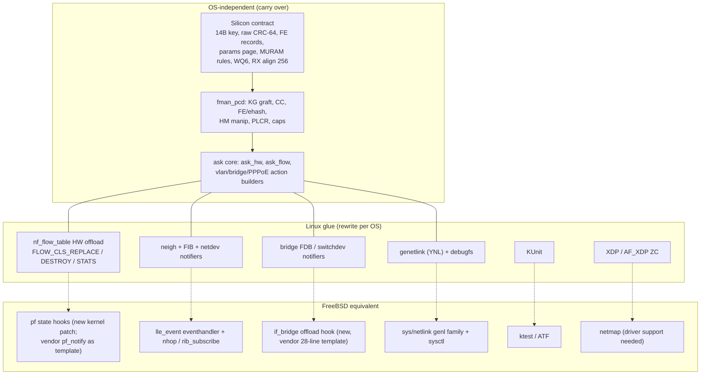
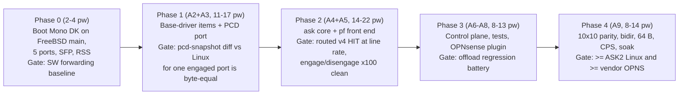

# Porting ASK2 and the DPAA1 drivers to FreeBSD, OpenBSD and NetBSD

Effort analysis, 2026-10-25. Repository state: branch `dpaa1` at `80ca4549`. Measured sources: the CI-equivalent patched kernel tree `/mnt/builds/ask2-review/linux-6.18.54` (commit `23098c1b5`, "fully patched+fixups"), `kernel/ask/oot-modules/ask/`, the vendor FreeBSD trees `we-are-mono/opnsense-src` (local `/mnt/builds/opnsense-src`, branch `stable/26.7`) and `we-are-mono/opnsense-deps`, the upstream FreeBSD, OpenBSD and NetBSD source trees (GitHub mirrors, read 2026-10-25), and qdrant.

## 1. Summary

Only FreeBSD is a realistic target. It is also the only one where the starting point has recently improved.

| | FreeBSD | OpenBSD | NetBSD |
|---|---|---|---|
| LS1046A SoC support upstream | Yes: clockgen, eSDHC, DW PCIe, GPIO, thermal (`sys/arm64/qoriq/`) | No Layerscape support at all | No Layerscape FDT support (only `nxpiic` over ACPI for LX2160A) |
| DPAA1 Ethernet upstream | Yes. A BSD-licensed rewrite landed on `main` in April 2026. It added a KeyGen driver and per-CPU RSS in August 2026 | None | None |
| Proven offload product on this board | Yes. The vendor ships OPNsense 26.7.7 with ASK 1.x (`cdx.ko`, CMM, `pf_notify`) | No | No |
| Flow-offload hook in the firewall | None upstream. The vendor patched `pf` with state-notification hooks (771 lines) | None (`pf`) | None (`npf`) |
| Licence fit for GPL ASK2 code | An out-of-tree GPL module is fine, as the vendor's `cdx.ko` shows. Upstreaming needs BSD | GPL is not acceptable in the kernel, and there are no loadable modules (removed in 5.7) | Discouraged in the kernel. An out-of-tree module is possible |
| DPAA1 driver only (no offload) | 6–11 person-weeks | 18–30 person-weeks | 18–30 person-weeks |
| ASK2 at today's Linux feature level | **44–72 person-weeks** | 54–91 person-weeks, plus a permanent fork | 53–89 person-weeks |
| Verdict | **Recommended if a BSD product is wanted** | Not recommended | Not recommended |

A person-week here means one engineer who is fluent in the target kernel, works from this repository's silicon references, and has a dedicated DUT plus the dell 10G rig.

"Today's Linux feature level" is the current ASK2 surface:
- routed IPv4/IPv6
- NAT44/NAT66/PAT
- single-tag VLAN pop/push/translate
- PPPoE encap/decap with MTU-shrink fragmentation
- learned/static bridging (B6/B7a)
- per-flow counters

It excludes the gaps ASK2 has not closed on Linux either: inline IPsec, multicast, tunnels, CEETM QoS, and QinQ (`plans/ASK2-MASTER-PLAN.md` §1.2).

Three facts drive these numbers:

1. **The expensive part of ASK2 is OS-independent and already paid for.** The silicon findings carry over unchanged to any OS, because they describe the hardware, not Linux:
   - the 14-byte `PORT_ID|SIP|DIP|PROTO|SPORT|DPORT` key and the raw CRC-64
   - FE_ENTER ALLOCATE and the per-port FM_CTL params page
   - the MURAM ownership rules
   - the FMPL_GCR enable bits
   - the offload TX FQ on WQ6 (F-199 starvation)
   - the 256-byte RX buffer start alignment (A6-LOSS)
   - the cold-boot discipline

   They are recorded in `arch/fman-microcode-210-programming-reference.md`, `specs/fman-keygen-flow-key-spec.md`, AGENTS.md S6 and qdrant. A port pays to re-apply and re-verify them, not to rediscover them.
2. **Every BSD lacks Linux's flowtable hardware-offload API.** ASK2 learns flows from `nf_flow_table` (`FLOW_CLS_REPLACE/DESTROY/STATS` through `ndo_setup_tc(TC_SETUP_FT)`). No BSD packet filter has an equivalent. The replacement front end is the largest and riskiest piece on every target.
3. **FreeBSD `main` now has the right base.** Justin Hibbits' 2026 DPAA rewrite has the same shape as the Linux mainline `dpaa`/`fman` driver that ASK2 extends: a thin FMan core, per-CPU portals, a KeyGen RSS scheme per port, and a `vmem` MURAM allocator. On Linux, ASK2 sits as a layer on top of that driver shape, so on FreeBSD it can extend the same shape.

## 2. What would be ported

### 2.1 Inventory

The line counts below come from the patched review tree against pristine 6.18.54. The whole patch stack adds 28,402 lines in 69 files. The DPAA1/ASK2-relevant part:

| Component | Lines | Portability |
|---|---:|---|
| FMan PCD subsystem: `fman_pcd.c` 6,076, `fman_pcd_kg.c` 1,594, `fman_pcd_cc.c` 1,193, `fman_pcd_manip.c` 872, `fman_pcd_plcr.c` 645, `fman_pcd_dcsr.c` 306, `include/linux/fsl/fman_pcd.h` 1,015, `fman_keygen_internal.h` 153 | ~11,850 | High. It programs registers and MURAM through `iowrite32be`/`memset_io`/`__iowrite32_copy` (210 sites), `gen_pool` (38), `dma_*` (17), mutexes, and lists. About 230 lines are debugfs bring-up verbs (26 `debugfs_create` calls), which become sysctl or are dropped |
| FMan port/core additions: `fman_port.c` +2,219, `fman_keygen.c` +339, `fman.c` +329, `fman_port.h` +99 | ~2,990 | Medium. These must be merged into the target driver's own port/KeyGen code, not copied |
| DPAA netdev additions: `dpaa_eth.c` +1,420, `dpaa_fman_caps.{c,h}` 1,782, `dpaa_flavor.{c,h}` 253, `dpaa_ethtool.c` +488, `dpaa_flow_offload.h` 83 | ~4,030 | Low to medium. The capability probe and offload TX FQ allocation port over. The flavor ops, ethtool ntuple bridge and `ndo_setup_tc` slot are Linux-shaped |
| QMan CEETM: `qman_ceetm.c` 1,233, `dpaa_ceetm.{c,h}` 881, `qman.h` +571, `qman_priv.h` +319 | ~3,000 | Optional. The vendor already has a FreeBSD CEETM (2,597 lines, on NCSW) |
| AF_XDP zero-copy BMan pool: `af_xdp_pool_main.c` 1,697 plus `dpaa_eth.c` XSK paths | ~2,000 | Not portable. XDP does not exist on any BSD. FreeBSD's analogue is netmap |
| KUnit and §17 tripwires: `fman_pcd_cc_test.c` 1,523, four small `tests/*_test.c`, `fman_pcd_fe_test.c` 142, `fman-pcd-fe-static-asserts.h` 114 | ~2,200 | The static asserts port as-is (C11). The KUnit cases become FreeBSD `ktest` or ATF |
| `ask.ko`: `ask_flow_offload.c` 4,491, `ask_hw.c` 2,306, `ask_internal.h` 1,328, `ask_flow.c` 956, `ask_genl.c` 940, `ask_bridge.c` 940, `ask_vlan_cc.c` 511, `ask_neigh.c` 285, others ~830 | 12,588 | Split. `ask_hw`, `ask_flow`, `ask_vlan_cc` and the bridge action builder are portable logic (~5,000 lines). `ask_flow_offload`, `ask_genl` and `ask_neigh` (~5,700 lines) are Linux glue that must be rewritten for the target packet filter and stack |
| `ask.ko` KUnit (`tests/`) | 3,688 | Rewrite to `ktest`/ATF |
| YNL family `kernel/ask/uapi/ask.yaml` | 299 | FreeBSD `netlink` supports generic-netlink families from modules (`sys/netlink/netlink_generic.c`). The family can keep its shape; the generated code cannot be reused |
| VyOS integration: `data/vyos-1x-031/033/035/036` patches, `board/scripts/{vyos-offload-ask,ask-check,pcd-snapshot,…}` | — | Not portable. VyOS is Linux-only, so the product layer becomes an OPNsense plugin. `pcd-snapshot` (Python plus `/dev/mem`) works on FreeBSD unchanged |

The 60 count-gated kernel fixups (`bin/kernel-fixups/`) are already folded into the review tree above. A port starts from the post-fixup source, never from the raw patch series.

### 2.2 Linux dependencies and their BSD equivalents

| Linux facility used by ASK2 | FreeBSD | OpenBSD | NetBSD |
|---|---|---|---|
| `nf_flow_table` HW offload (flow learning, aging, stats pull) | None. Patch `pf` to emit state insert, established and remove events to an in-kernel consumer. `pfsync`/`pflow` export pointers exist but belong to those features | None. A `pf` patch would be fork-only | None. `npf_conn` has no hook |
| conntrack NAT tuple | `pf` state wire/stack keys | `pf` state keys | `npf` NAT policy |
| neighbour and FIB notifiers | `lle_event` eventhandler, `nhop_object`, `rib_subscribe` | route socket only, in-kernel listeners ad hoc | route socket |
| bridge FDB / switchdev | None. Needs an `if_bridge` hook | None | None |
| PPPoE session lookup | `ng_pppoe` (vendor added `NGM_PPPOE_GET_SESSION_INFO`, 136 lines) | `pppoe(4)` in kernel | `pppoe(4)` in kernel |
| genetlink/YNL | `netlink` generic families | ioctl/sysctl | ioctl/sysctl |
| debugfs | sysctl tree | sysctl | sysctl |
| KUnit | `ktest` (`sys/tests/ktest.c`) and ATF | regress | ATF |
| `EXPORT_SYMBOL_GPL` cross-module API | `MODULE_DEPEND` plus exported symbols or kobj interfaces (`fman_if.m`) | in-kernel only | modules |
| `gen_pool` MURAM | `vmem(9)`, already used by upstream `fman_muram.c` | `extent(9)` | `vmem(9)` |
| XDP/AF_XDP | netmap | — | — |
| xfrm offload (future IPsec) | `sys/netipsec/ipsec_offload.c` inline ESP offload | — | — |

## 3. Starting points

### 3.1 FreeBSD upstream (`main`)

Justin Hibbits replaced the NCSW-based `sys/dev/dpaa` with a home-grown driver. His commit says it "uses a combination of the NCSW driver and the Linux driver (BSD/GPL dual licensed) as a reference, but contains no actual code from them". The relevant commits:

| Date | Commit | Change |
|---|---|---|
| 2026-04-24 | `fd8d34ce272` | Migrate from the NCSW base to a home-grown driver. BMan, QMan, FMan ports, parser, KeyGen and Policer are described. The MACs are dTSEC and mEMAC. The commit names FMan v3 and LS1043 ARM as a motivation (41 files, +6,006/−3,356) |
| 2026-04-25 | `6464974c5a5` | IPv4/IPv6 checksum offload |
| 2026-04-29 | `9d423705db8` | Jumbo frames as multi-buffer frames |
| 2026-07-30 | `73bb2479274` | QorIQ SEC driver, job-ring based, about 200× AES-CBC speedup |
| 2026-08-10 | `4dccd3ac868` | `fman_keygen.[ch]`: `fman_kg_alloc_hash_scheme()` programs a 5-tuple RSS scheme per port |
| 2026-08-10 | `d7397e95685` | Per-CPU RX FQs hashed by KeyGen, aligned FQID ranges |
| 2026-08-10 | `aefd61a1de8` | Software LRO and batched receive |
| 2026-08-13 | `5d884fc0766` | Split the FMan port driver into RX and TX, explicitly to ease Offline/Host-Command ports |
| 2026-09-10 | `823466bd564` | `qman_fq_create()` takes Context A/B, needed for SEC and offload FQs |

The tree on `main` is about 420 KB of C: `sys/dev/dpaa/{bman,qman,fman,fman_port_rx,fman_port_tx,fman_keygen,fman_muram,if_memac,if_dtsec,dpaa_eth,sec_*}.c`. It is not on `stable/15` or `releng/15.1`; those still carry the old NCSW driver, which upstream only builds for PowerPC. The new driver therefore targets FreeBSD 16.

What it lacks for ASK2:
- CC nodes and FE/external hash
- header manipulation
- policer profiles
- KeyGen scheme grafts to a classifier
- the per-port FM_CTL params page
- an offload TX FQ API
- board pieces: SFP cages with LOS/TX-disable GPIO, the rollball SFP-10G-T, the GPY115 PHY

The commits cite LS1043 and T-series boards. LS1046A has the same FMan v3 and mEMAC but has not been verified here.

### 3.2 The vendor's FreeBSD port (OPNsense)

The vendor ported its ASK 1.x stack to FreeBSD 15.1 for OPNsense 26.7. The public history starts 2026-02-24 (`opnsense-deps` "Hello world"), and the `opnsense-src` bring-up commits are dated 2026-03-04 to 2026-03-15 (squashed, so the real duration is unknown). It shipped as `mono-gateway` 26.7.7_8 by 2026-10-18. The authors are Maurice Walker and Tomaz Zaman.

| Piece | Where | Size |
|---|---|---|
| NCSW (NXP NetCommSw) ported to arm64 | `opnsense-src` `1c79ccde311` | +4,728 on top of 110,220 lines of `sys/contrib/ncsw` |
| BMan/QMan/FMan portals and bus drivers | `912593e2e9b` | +3,393 |
| dTSEC/mEMAC Ethernet with checksum offload and RSS | `439613c1b7f` | +1,983 |
| Offline/HM port driver | `9b078cb83c5` | +659 |
| CEETM egress QoS | `6bbd4b44cdb` | +2,597 |
| `pf` state creation/destruction hooks | `4c9949f2bb0` | +771 |
| Bridge L2 offload hooks | `1d51a199a5e` | +28 |
| `ng_pppoe` session info | `c733f6cca82` | +136 |
| fmlib ioctl headers in the kernel | `5eed2f6efce` | +4,213 |
| SFP state machine, 10GBASE-T copper SFP+ PHY, GPY115 PHY, INA2xx, gpio-hog, LS1046A PCIe | several | about +3,500 |
| `cdx.ko`: the unmodified NXP vendor source plus FreeBSD files (`cdx_*_freebsd.c` and others) | `opnsense-deps/fastpath/cdx`, `fastpath/vendor` | about 520 KB |
| `fci.ko`, `auto_bridge.ko`, `pf_notify.ko` (BSD-2, `/dev/pfnotify`, 128K-entry ring) | `opnsense-deps/fastpath` | about 60 KB |
| CMM daemon reimplemented for FreeBSD (kqueue, `pfnotify`, `PF_ROUTE`, `PF_KEY`, `DIOCGETSTATESV2` poll), plus `cmmctl` | `opnsense-deps/fastpath/cmm*` | about 550 KB |
| Linux compatibility shims (`linux_compat.h`, list/mutex/workqueue/kthread) | `opnsense-deps/fastpath/include` | about 20 KB |

This is the ASK 1.x architecture ASK2 deliberately left behind: a userspace daemon, an IPC ring, XML-compiled PCD (`dpa_app`, `fmc`, `cdx_pcd.xml`), and NCSW as a second owner of FMan state. It runs on a branch upstream has abandoned: NCSW was removed from the `main` DPAA driver in April 2026.

The vendor port was measured on `.106` against ASK2 (`plans/ASK2-VENDOR-PARITY.md`, three-way summary 2026-10-18; qdrant 2026-10-16/17/18):

| Cell | OPNsense 26.7.7_8 | OpenWrt NXP ASK | ASK2 (VyOS) |
|---|---:|---:|---:|
| Routed / NAT / VLAN one-way, v4 | 9.26–9.32 Gbit/s (line rate) | 9.26–9.28 | 9.26–9.32 |
| Routed bidirectional v4 | 16.08 | 17.99 | 18.13 |
| VLAN strip+add bidirectional v4 | 11.47 | 12.93 | 13.00 |
| VLAN translate bidirectional v4 | 13.39 | 17.99 | 18.15 |
| 64 B one-way, highest rate at ≤0.001% loss | 0.85–1.12 Mpps | 1.84 Mpps | 2.64 Mpps |
| PPPoE decap/encap v4 (native `pppoe0`) | 9.25 / 9.27 | 9.28 / 9.23 | 9.32 / 9.37 |

There are also two vendor stability observations from 2026-10-16. First, every VLAN-ingress IPv4 flow stopped offloading after about 2.7 hours of churn until `service cmm restart`. Second, the CMM `pfnotify` ring saturated (`ring_used` 131071) under software load.

These results show three things:
- FreeBSD and FMan v3 can do line-rate offload on this board.
- The bidirectional and 64-byte gaps are the room an ASK2 port could improve on.
- An in-kernel consumer without a daemon removes the ring/daemon failure class.

### 3.3 OpenBSD

There is nothing to start from:
- `sys/dev/fdt` has no Layerscape clock, eSDHC, PCIe or GPIO driver. `imxesdhc` matches i.MX uSDHC only, `dwpcie` has no Layerscape glue (its only NXP parts are i.MX8M), and `imxtmu` matches i.MX8M only.
- `imxiic` (`fsl,vf610-i2c`) and `imxdog` (`fsl,imx21-wdt`) would probably attach to the LS1046A I2C and watchdog.
- arm64 `GENERIC` Ethernet is `dwqe`, `fec` and `mvpp`.

There are no loadable kernel modules (removed in 5.7), so ASK2 code must be compiled into the kernel. GPL code is not accepted in the kernel, and upstream acceptance of hardware-offload hooks in `pf` is unlikely.

### 3.4 NetBSD

There is no Layerscape FDT platform (`sys/arch/arm/nxp` is i.MX only) and no DPAA. `GENERIC64` has `nxpiic at acpi` for the LX2160A I2C and nothing else from Layerscape. Modules exist, so an out-of-tree GPL module is technically possible. `npf` has no offload interface. Its embedded/router user base on arm64 is the smallest of the three.

## 4. Work breakdown and estimates

Estimates are low/high person-weeks. "High" includes one round of the hardware wedges this project has hit repeatedly: BMI/MURAM corruption that survives a warm reboot, and a deaf port after engage.

### 4.1 FreeBSD, path A (recommended): upstream `main` driver as the base

| # | Work package | Low | High | Notes |
|---|---|---:|---:|---|
| A1 | Board bring-up on `main` | 3 | 6 | Mono DK DTB (`compatible = "mono,gateway-dk", "fsl,ls1046a"`), all five ports including 10G XFI (`xgmii`), SFP cages (LOS `GPIO_ACTIVE_HIGH`, TX-disable `GPIO_ACTIVE_LOW`), rollball SFP-10G-T, GPY115, EMC2305, INA234, U-Boot `booti` image. The vendor's BSD-licensed SFP/PHY/sensor code is the reference |
| A2 | Base-driver items ASK2 relies on | 3 | 5 | Offload TX FQ allocation on WQ6 (F-199). RX buffer start aligned to 256 (A6-LOSS: `fmbm_rebm` 0x01000000, not BSM 272). Hardware port-id accessor. In-place KeyGen scheme graft instead of a parallel scheme (the 0104 lesson). `IFCAP_VLAN_HWTAGGING`. Contribute upstream |
| A3 | PCD subsystem port | 8 | 12 | KG graft to AC_CC, CC tree, FE/ehash records, HM manip, PLCR (with `FMPL_GCR` EN/STEN), DCSR, caps probe, params page, MURAM ownership (§10.1), readback on every silent write (§10.2), key-layout self-test before engage (§10.4), §17 tripwires. Merge with upstream `fman_keygen.c` scheme ownership |
| A4 | `ask` core | 4 | 6 | `ask_hw`, `ask_flow`, VLAN/bridge/PPPoE action builders, per-flow stats, generation registry |
| A5 | Flow-learning front end on `pf` | 10 | 16 | Kernel `pf` hook (insert/established/remove) with an in-kernel consumer. NAT rewrite from state keys. Next hop through `nhop`/`rib_subscribe`, neighbour through `lle_event`. VLAN parent resolution, `ng_pppoe` sessions, `if_bridge` FDB. Push hardware counters back into `pf` state expiry. TCP FIN/RST punt (the F-266 lessons). Offload delay (`offload_delay_ms` semantics) |
| A6 | Control plane and observability | 2 | 3 | `netlink` generic family mirroring `ask.yaml` (or sysctl/ioctl), `ask-check` and `pcd-snapshot` on FreeBSD |
| A7 | Tests and CI | 3 | 5 | KUnit cases to `ktest`/ATF, `buildkernel` on the Cobalt 100 runner, rig harness (`testrig-offload-quick-opns.sh` already has a `DUT_KIND=opnsense` FreeBSD backend) |
| A8 | Product integration | 3 | 5 | OPNsense plugin: per-interface `offload ipv4/ipv6`, status page, configd actions |
| A9 | Parity, soak and defect burn-down | 8 | 14 | The 24-cell 10×10 protocol, bidirectional, 64 B, CPS/churn, cold-boot reversibility (`pcd-snapshot diff` clean) |
| | **Total** | **44** | **72** | One engineer: about 10–17 months. Two engineers: about 6–10 months, because A3 → A4 → A5 is a serial chain |

Optional additions:
- netmap support in the DPAA driver, for a VPP overlay like the Linux AF_XDP lane: 3–5
- CEETM egress QoS behind ALTQ or the OPNsense shaper: 4–6
- inline ESP through `ipsec_offload`: not estimated, because it is not done on Linux either

The driver alone, without ASK2, is A1 + A2 = **6–11 person-weeks**.

### 4.2 FreeBSD, path B (not recommended): the vendor's FreeBSD 15.1 fork

Path B reuses the vendor's dTSEC/NCSW driver, board support and `pf`/bridge/`ng_pppoe` hooks, so A1 and A2 shrink to 1–2 and A5 to 7–12. In exchange it has two problems:
- NCSW already owns the KeyGen, CC and MURAM state through its own FM_PCD layer and `/dev/fman`. ASK2's `fman_pcd` would be a second owner of the same silicon. The options are to rewrite `ask_hw` on the NCSW FM_PCD API (which is what `cdx` is) or to remove NCSW's PCD. Either costs 8–14.
- Everything stays on a fork of a branch upstream has dropped.

Path B totals **35–55** person-weeks with high long-term cost. Use it only as a stopgap.

### 4.3 OpenBSD

| # | Work package | Low | High |
|---|---|---:|---:|
| O1 | SoC bring-up: QorIQ clockgen, big-endian eSDHC, Layerscape DW PCIe glue, QorIQ GPIO, TMU, QSPI, pca9545 mux, SFP | 6 | 10 |
| O2 | DPAA1 driver: port the BSD-licensed FreeBSD driver (portals, FMan, mEMAC, MDIO/xMDIO, KeyGen RSS) to OpenBSD `ifq`/`intrmap` | 12 | 20 |
| O3 | Licence: provenance audit, then relicense or clean-room rewrite of the PCD and `ask` core (no GPL, no modules) | 2 | 6 |
| O4–O5 | PCD port and `ask` core (as A3 and A4) | 12 | 18 |
| O6 | `pf` front end, fork-only | 10 | 16 |
| O7 | Control, tests, CI | 4 | 7 |
| O8 | Parity and hardening | 8 | 14 |
| | **Total** | **54** | **91** |

After that comes a rebase every six-month release, indefinitely. The driver alone is O1 + O2 = **18–30 person-weeks**.

### 4.4 NetBSD

This is the same shape as OpenBSD, with `npf` instead of `pf` and modules available. O3 shrinks to 1–4. **Total 53–89 person-weeks.** The driver alone is **18–30**.

## 5. Licensing

- The ASK2 PCD files are `GPL-2.0` (`fman_pcd.c`, `fman_pcd_kg.c`, `fman_pcd_cc.c`, `fman_pcd_manip.c`, `fman_pcd_plcr.c`) and `GPL-2.0+` (`fman_pcd_dcsr.c`). Every `ask.ko` file is `GPL-2.0` with `MODULE_LICENSE("GPL")`.
- The mainline files ASK2 extends (`fman.c`, `fman_port.c`, `fman_keygen.c`, `dpaa_eth.c`, `dpaa_fman_caps.c`, and the QBMan headers) are dual `BSD-3-Clause OR GPL-2.0-or-later`.
- **FreeBSD:** an out-of-tree GPL module is acceptable and is exactly how the vendor ships `cdx.ko`. Getting the PCD/CC/FE layer into upstream `sys/dev/dpaa`, which avoids carrying a fork, requires relicensing it BSD-2.
- **OpenBSD:** relicensing is mandatory.
- **Provenance audit before any relicense.** `fman_pcd_crc64()` and `fman_pcd_ehash_bucket_index()` follow the SDK/ASK1 `get_indexed_hash_bucket()` idiom; the vendor `cdx` they are compared against is GPL-2.0+. `fman_pcd_fe_context_build()` was committed as a "faithful port of lf-5.4 LSDK `FmPcdCcBuildContextByFE`". The NCSW lineage is BSD-3, but this must be confirmed per function. Code derived only from the Reference Manual, the dual-licensed mainline driver or NCSW can go BSD. Anything else should be rewritten. The CRC-64 is a standard algorithm and trivial to reimplement.

## 6. Risks

| Risk | Effect | Mitigation |
|---|---|---|
| Silicon lessons silently lost in a new base driver: RX alignment, WQ6, the FMPL enable, the params page before FE_ENTER, MURAM ownership | The same wedges and starvation as Linux. Each one cost days to weeks to find | Use a differential register oracle: run Linux ASK2 and the FreeBSD port on the same flows, then diff `pcd-snapshot` captures (KG schemes, BMI binds, MURAM) byte for byte. Keep the §17 tripwires and the readback-on-write rule |
| `pf` semantics are not `nf_flow_table` semantics | Wrong offload eligibility, stale states, the FIN/RST linger (F-266 class), interactions with if-bound versus floating states and with `route-to`/`reply-to` | Start with an in-kernel consumer and a minimal hook (insert, established, remove). Admit only plain forward states first. Port F-266 and `offload_delay_ms` behaviour deliberately |
| Upstream driver churn (it is about six months old, with refactors in Aug–Sep 2026) | Rebase cost | Engage the maintainer early. Upstream the base-driver items (A2) and a PCD extension API instead of carrying them |
| LS1046A is unverified on the new upstream driver | A1 grows | Phase 0 boots the DK on `main` and measures software forwarding before committing |
| No FreeBSD DUT: `.106` became `.145` (VyOS) on 2026-10-19 | Blocks everything | Dedicate a board, preferably on a smart plug for cold boots |
| Software-path performance (CPS, first packets, control traffic) depends on the base driver and the FreeBSD stack | CPS/churn gates may lag Linux | Measure early (Phase 0). Treat CPS as a separate gate from offloaded throughput |
| OpenBSD/NetBSD: no SoC support, no modules (OpenBSD), resistance to offload hooks | A permanent fork and high cost per release | Do not pursue unless there is a product reason |

## 7. Recommended FreeBSD plan

Phase 0 is cheap and answers the biggest unknown, which is LS1046A on the new upstream driver, before any ASK2 code moves. Phase 1's oracle gate is the main de-risking device: the Linux ASK2 image already produces a reference silicon state for every engaged configuration.

## 8. Questions for the operator

1. What is the product goal: an OPNsense/pfSense appliance, or a BSD offload driver as a research or upstream contribution? Only the first justifies Phase 4 and A8.
2. Is relicensing the PCD/CC/FE layer BSD-2 acceptable, after the provenance audit, so it can go upstream into `sys/dev/dpaa`? Without that, path A carries a GPL module out of tree like the vendor does.
3. Should the work coordinate with the vendor, who already ships `pf`, bridge and `ng_pppoe` hooks and BSD-2 board drivers, and with the upstream maintainer? Sharing the `pf` hook design would avoid a third incompatible one.

## 9. Sources

- Repository: `plans/ASK2-MASTER-PLAN.md` v2.34.0, `plans/ASK2-VENDOR-PARITY.md` (OPNsense sections, 2026-10-16/18), `arch/dpaa-driver-vendor-vs-mainline.md`, `arch/ask1-vs-ask2-module-comparison.md`, `arch/fman-pcd-api-reference.md`, `kernel/ask/oot-modules/ask/`, `kernel/ask/uapi/ask.yaml`, AGENTS.md S5/S6.
- qdrant, by date: the opnsense-src repo summary (2026-08-13); the `.106` OPNsense rig (2026-10-16); the OPNsense supplemental measurements (2026-10-16); ASK2 2149 rerun "11.6–36.4% above OPNsense" (2026-10-17); vendor parity audit (2026-10-14); WQ6 starvation root cause (2026-10-14); A6-LOSS RX alignment (2026-10-06); flowtable front end (2026-08-14); `offload_delay_ms` (2026-10-10).
- Vendor: [we-are-mono/opnsense-src](https://github.com/we-are-mono/opnsense-src) (`stable/26.7`), [we-are-mono/opnsense-deps](https://github.com/we-are-mono/opnsense-deps) (`ARCHITECTURE.md`, `LICENSING.md`).
- FreeBSD: [sys/dev/dpaa history](https://github.com/freebsd/freebsd-src/commits/main/sys/dev/dpaa), [`fd8d34ce272`](https://github.com/freebsd/freebsd-src/commit/fd8d34ce272), [`4dccd3ac868`](https://github.com/freebsd/freebsd-src/commit/4dccd3ac868), [`d7397e95685`](https://github.com/freebsd/freebsd-src/commit/d7397e95685), [`73bb2479274`](https://github.com/freebsd/freebsd-src/commit/73bb2479274), [DPAA status report 2021Q2](https://freebsd.org/status/report-2021-04-2021-06/dpaa).
- OpenBSD: [sys/dev/fdt](https://github.com/openbsd/src/tree/master/sys/dev/fdt), [arm64 GENERIC](https://github.com/openbsd/src/blob/master/sys/arch/arm64/conf/GENERIC).
- NetBSD: [sys/arch/arm/nxp](https://github.com/NetBSD/src/tree/trunk/sys/arch/arm/nxp), [evbarm GENERIC64](https://github.com/NetBSD/src/blob/trunk/sys/arch/evbarm/conf/GENERIC64).
