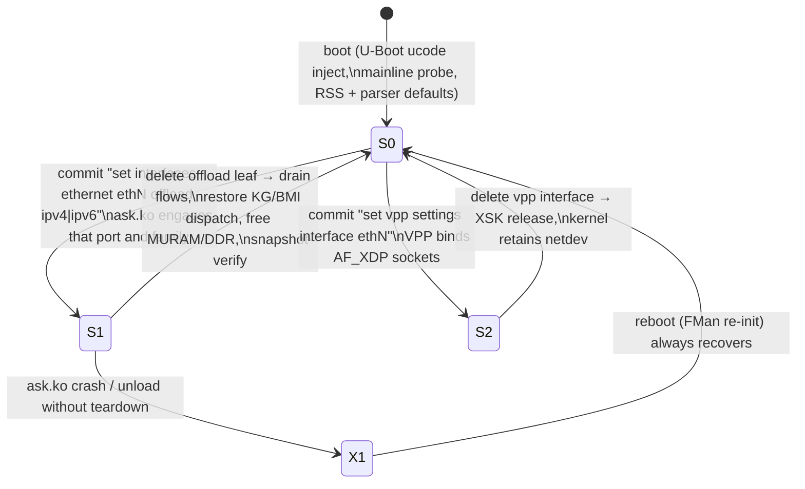

# Dual dataplane: runtime and CLI contract (kernel / ASK / VPP)

**2026-10-15 · dpaa1 · Binding runtime contract cited by `plans/ASK2-MASTER-PLAN.md` §2 and §8.** It defines the silicon mode state machine, the reversibility contract, the per-interface CLI and the ASK↔VPP mutual exclusion. Execution order, gates and acceptance belong to the master plan. The decision trail (evidence base, M0–M2 results, the CC-tree vs ehash re-litigation and the original milestone graph) is in `plans/archive/DUAL-DATAPLANE-2026-10-15.md`.

**Authority split.** This document does not re-specify either dataplane:

- ASK internals (`ask.ko`, YNL family, flow intent, FE records): `specs/ask2-rewrite-spec.md`, `arch/fman-fe-ehash.md`, `arch/fman-microcode-210-programming-reference.md`.
- VPP internals (AF_XDP ZC, XSK pool, `set vpp settings`): `specs/vpp-dpaa1-ls1046a-spec.md`, `specs/dpaa1-afxdp-modernization-spec.md`.

It owns only the glue that neither spec owns.

## 1. Settled facts

- **One image, three runtime states, no build-time dataplane choice.** Every ISO ships `ask.ko` and VPP, and the dataplane is selected by configuration.
- **S1 classification is the FE-VM enhanced external hash** (ehash), dispatched directly by RCCB to the per-port hash table. A HIT executes the inline opcodes in the record and enqueues to a per-egress no-confirm TX FQ. The CC-tree "top-N plus software tail" model is retired.
- **In hardware today:** routed IPv4/IPv6, NAT44/NAT66, single-tag VLAN pop/push/translate, PPPoE encap/decap, and bridge learned-MAC/B7a. Everything else is a kernel software fallback; the current list is in master §1.2.
- **Port init:** every RX port boots with a 96 B internal margin and parse-start offset (`FMBM_RIM 0x60000000`, `FMBM_RPSO 0x60`, patch 0217). This is static and identical in S0, S1 and S2, so it is not a mode-switch delta.

## 2. Silicon mode state machine

ASK-off **is** the VPP-ready state. VPP/AF_XDP needs the silicon exactly as mainline boots it (KG schemes in RSS direct-to-FQ mode, `fsl_dpa` netdevs owning every port), so switching ASK→VPP reduces to one requirement the vendor never had:

> **The reversibility contract.** Every silicon write ASK makes has an exact, ordered inverse. Disengaging (or unloading `ask.ko`) returns the port to a register-identical copy of the warm S0 state. This is verified by `pcd-snapshot`, not assumed.

The vendor stack is one-way: `cdx` and `dpa_app` program the FMan once at boot, and the only undo is a reboot.



| State | KG scheme | Port dispatch | MURAM / DDR | Who forwards |
|---|---|---|---|---|
| **S0** mainline | RSS (`…0002` DONE) | BMI → KG → RX FQ | FIFO/IC, warm params page | kernel |
| **S1** ASK | AC_CC with the 14-byte EKFC (`0x801C0006`) | BMI → KG → RCCB → ehash → FE opcodes → TX FQ | + FE workspace, hash table, per-egress TX FQs | FMan for HITs, kernel for misses and exceptions |
| **S2** VPP | RSS (same as S0) | same as S0 | same as S0 | VPP workers on XSK sockets |

Properties:

- **S2 is a userspace overlay on S0.** There is no silicon delta, so VPP needs no inverse beyond closing its sockets.
- **S1↔S0 is the only hard transition**, and it is entirely our code. There is no direct S1↔S2 edge.
- **Boot always lands in S0.** ASK engages only on a config commit, never unconditionally at probe. The boot-time commit of a config that carries `offload` leaves (including the factory default since 2026-10-16) is such a commit. A wedged S1 is recoverable by rebooting, but only into a config without those leaves, for example by deleting them or booting the previous image.

## 3. Teardown checklist (S1→S0)

Each forward write lands with its inverse in the same patch, and the inverse is soaked before the forward path counts as done.

| # | Forward (S0→S1) | Inverse (S1→S0) |
|---|---|---|
| 1 | KG scheme rewrite RSS→AC_CC (in place, EN-preserving) | restore the saved `kgse_*` words verbatim |
| 2 | Port BMI dispatch bind (`fmbm_rfpne`, `fmbm_rccb`) | restore the saved values |
| 3 | FE workspace, hash table and FE objects (owned `fman_muram_alloc()` and DDR allocations only) | quiesce, then free everything back to baseline |
| 4 | Per-port params page | allocate once and reuse by design (warm S0′ baseline: a one-time 256 B) |
| 5 | Flow records and per-egress TX FQs (runtime, driven by kernel events) | evict all records and retire the FQs |
| 6 | Feature structures (VLAN, PPPoE, bridge L2 table; later IPsec SA/CAAM, replication groups, soft-parser arena) | defined per feature; **no feature merges without its inverse** |
| 7 | FMPL policer (`FMPL_GCR`, owned by 0100/0104) | unchanged: the policer is mode-independent |

**Gate primitive:** `board/scripts/pcd-snapshot capture/diff` compares the live state after every S1→S0 transition with the warm S0 snapshot, byte for byte, with MURAM `used` back at baseline. This is the gate, not "ping still works". Mutate eth3 only, never eth0.

## 4. Operator model and CLI

```
set interfaces ethernet eth3 offload ipv4      # engage IPv4 ASK on eth3
set interfaces ethernet eth3 offload ipv6      # engage IPv6 ASK on eth3
delete interfaces ethernet eth3 offload ipv4   # that family back to S0
set vpp settings interface eth4                # VPP on another port
```

- **Granularity is per port and per IP family only** (`vyos-1x-031`, migration `039`). VLAN, NAT, PPPoE (on the PPPoE source-interface port) and bridge are automatic parts of an engaged port. There are no per-capability leaves (`054` removed them). The `ask.*` module parameters `vlan_offload`, `pppoe_offload`, `nat44_offload`, `nat66_offload`, `ipv6_hw_frag` and `bridge_offload` are global kill switches, not operator CLI.
- There is no global ASK knob. `set system offload classify` (`vyos-1x-026`) is deprecated: the mechanism stays and RSS plus the parser are silent defaults.

**Mutual exclusion (validator-enforced, per interface).** A port cannot be both ASK and VPP: commit rejects a config where the same `ethN` has an `offload` family leaf and appears in `vpp settings interface`. Other ports are free, because KG scheme binds and BMI dispatch are per port. Switching a port means removing one claim, committing (the port passes through S0), then setting the other. The hybrid flow-level mode (ASK fast path plus a memif promote-to-VPP ACL, ASK2 spec §9) is out of scope, and nothing here forecloses it.

| Transition | Mechanism | Reboot? |
|---|---|---|
| off → ASK | commit → `ask.ko` engage | no |
| ASK → off | commit → verified teardown | no (reboot is the documented fallback if the snapshot diff fails) |
| off → VPP | commit → the existing `vyos-1x-010` path | one-time hugepage kexec on first VPP use |
| VPP → off | commit → XSK release | no |
| ASK → VPP | two commits via off, or one commit that the validator orders teardown-then-VPP | no (plus the first-use kexec) |

## 5. Open contract obligations

These are gates in the master plan; they are listed here because they are properties of this contract.

1. **Trafficked reversibility.** The 2026-06-15 100× soak proved control-plane reversibility without traffic. Every current feature's teardown must also be snapshot-clean after a trafficked S1, with port recovery and VPP AF_XDP bind plus traffic on the same port afterwards (master §4.1 existing-feature acceptance, A15 soak).
2. **VPP regression in every gate.** After an ASK enable/disable cycle, `set vpp settings` on eth3/eth4 must still bind and pass traffic.
3. **New features inherit item 6.** IPsec (SA, CAAM descriptors, SEC FQs), multicast replication groups, the soft-parser arena (PPPoE remainder, tunnels) and fragment reassembly each define their inverse before merge.
4. **Default posture (changed 2026-10-16, commit `c84499e5`).** The kernel and module defaults are unchanged: probe lands in S0, and a config without `offload` leaves never engages ASK. The ISO's factory `config.boot.default` (`board/vyos-config/config.boot.dhcp`) now opts in: `offload ipv4 ipv6` on eth1–eth4 (never eth0, the management port) and a hardware flowtable. Fresh installs and live boots therefore reach S1 at the boot commit. Upgrades keep their existing config. The release gate must include a live boot of this default.

## 6. Risks

| # | Risk | Mitigation |
|---|---|---|
| 1 | Some silicon state is not invertible without an FMan reset (parser RAM, ucode-internal state) | The snapshot diff detects it; fallback "reboot to leave ASK" still satisfies the contract with degraded UX |
| 2 | Teardown races live traffic | Ordered drain: stop new inserts → evict records → quiesce the port (EN-preserving) → rewrite dispatch; test with active traffic during disable |
| 3 | VPP regression through shared PCD primitives | VPP bind+traffic check in every gate |
| 4 | Validator gaps let ASK and VPP both claim a port | Per-interface check in the validator; keep it trivially auditable |
| 5 | Watchdog reset under flood on a new silicon path | Pings and small UDP first; never flood-test a new path |
| 6 | MURAM is iomem | `memset_io`/`memcpy_toio`/`writel`/`readl` only; never write outside an owned allocation |
| 7 | Refcount or lock-order bug under concurrent engage/disengage leaks MURAM or leaves a stale pointer | Fixed lock order, atomic refcounts with `WARN_ON` on underflow, snapshot diff after every cycle |

## 7. Decisions

1. **Single dual-dataplane image** (adopted 2026-06-14; the `FLAVOR` variable was removed 2026-07-26). Do not reintroduce a build-time dataplane switch.
2. **S1 mechanism = FE-VM ehash** with direct RCCB dispatch (adopted after F-163 and the 2026-08-17 validation; the CC-tree S1 is retired).
3. **Mutual exclusion is per interface** (v1.3, 2026-07-19).
4. **CLI is `offload ipv4|ipv6` per port**; no per-feature leaves, no global knob.
5. **Default-off** in shipped configs.
