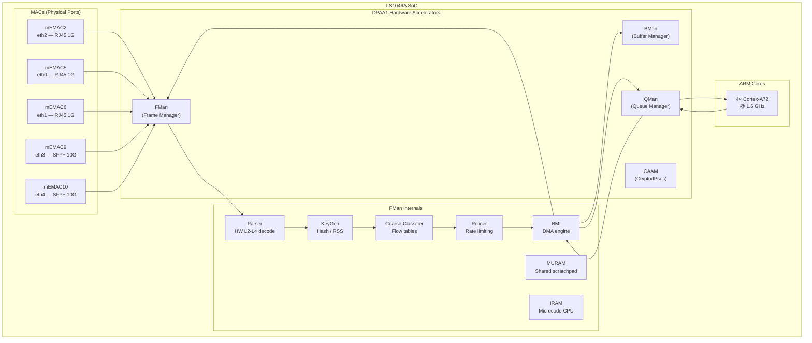
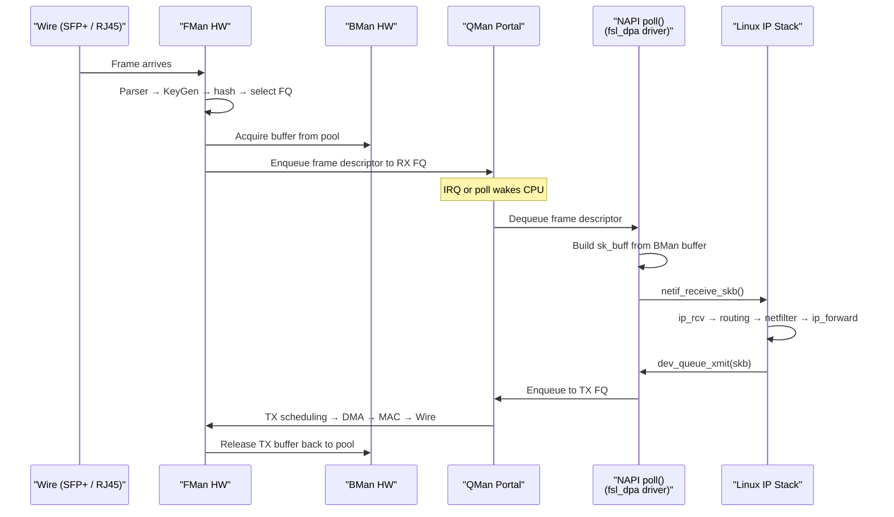
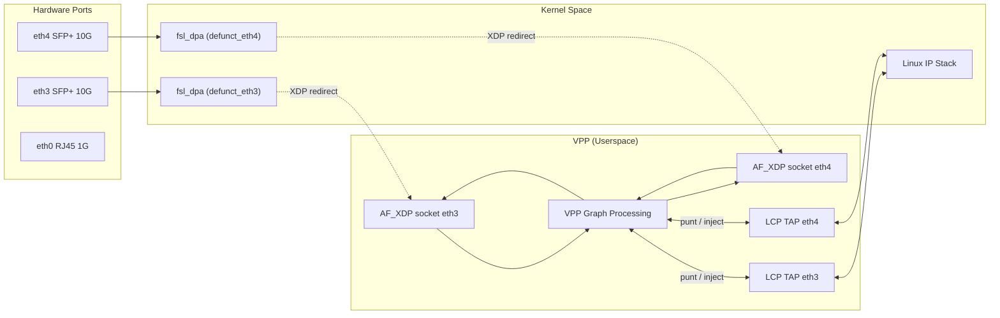
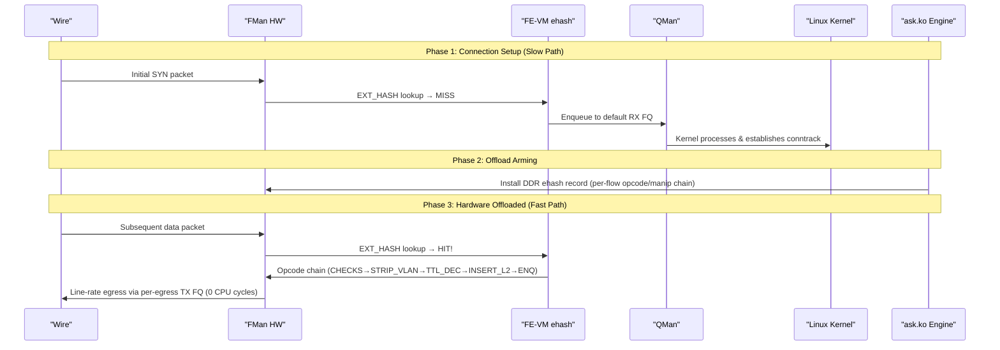

# LS1046A Networking Architecture Deep Dive
**Version 3.0.0** · 2026-10-15

---

## AI READING INSTRUCTION

Read `[SPEC]` and `[BUG]` blocks for authoritative facts.
Read `[NOTE]` only if additional context is needed.
`[?]` blocks are unverified — treat with lower confidence.

---

## 1. THE SILICON: HARDWARE ACCELERATION & FMAN

**[SPEC]**
- The NXP QorIQ LS1046A combines 4× Cortex-A72 cores (@ up to 1.8 GHz) with the Data Path Acceleration Architecture (DPAA1).
- Key hardware blocks:
  - **FMan (Frame Manager)**: Packet parsing, classification, KeyGen hash distribution, rate policing, and BMI DMA.
  - **BMan (Buffer Manager)**: Hardware buffer pool management (~15 ns atomic acquire/release).
  - **QMan (Queue Manager)**: 64K hardware Frame Queues with priority scheduling and WRED congestion management.
  - **CAAM (Crypto Acceleration)**: IPsec, AES, SHA offload via Job Rings and QI.

### 1.1 SoC Block Diagram

**[SPEC]**


### 1.2 Function Execution Matrix

**[SPEC]**

| Function | Execution Location | Operation Details |
|----------|-------------------|-------------------|
| **Ethernet MAC** | mEMAC Silicon | SerDes, PHY interface, CRC, flow control, pause frames. |
| **Frame Parser** | FMan Microcode (IRAM) | Walks L2→L3→L4 headers; generates Parse Result array. |
| **KeyGen (RSS)** | FMan Hardware | Computes hash over Parse Result fields; selects 1 of 128 HW Frame Queues. |
| **Coarse Classifier** | FMan Hardware | CONT_LOOKUP group table with match entries; TCAM-style flow classification. |
| **Policer** | FMan Hardware | Dual-rate token-bucket per-flow rate limiting (srTCM/trTCM). |
| **BMI (DMA)** | FMan Hardware | Transfers frame data between DRAM and FMan FIFO via BMan pools. |
| **BMan** | Dedicated HW Block | Manages 64 hardware buffer pools (~15 ns atomic acquire/release). |
| **QMan** | Dedicated HW Block | 64K Frame Queues with priority scheduling and WRED congestion avoidance. |
| **QMan Portals** | MMIO Registers | Per-CPU cache-inhibited portal regions for low-latency doorbells. |
| **CAAM** | Dedicated Engine | Crypto acceleration (AES, SHA, IPsec ESP/AH) via hardware Job Rings. |

### 1.3 FMan Microcode Variants

**[SPEC]**
- Microcode is loaded from SPI flash (`mtd3` `fman-ucode` @ `0x400000`) and injected into the device tree by U-Boot.
- Open-Source Baseline (`106.4.18`): Performs L2–L4 classification and KeyGen RSS distribution; always enqueues to QMan.
- Proprietary Production Microcode (`v210.10.1`): Adds Coarse Classifier CONT_LOOKUP group-table support and FE-VM opcode/manip chain execution (STRIP_ETH_HDR, TTL_DECREMENT, ETH_HEADER_REBUILD, ENQUEUE_PKT).

---

## 2. KERNEL DATAPLANE & DPAA1 DRIVER

### 2.1 Kernel Frame Path

**[SPEC]**


### 2.2 Per-Packet Cost Analysis

**[SPEC]**

| Processing Step | Estimated CPU Overhead | Cache & Memory Impact |
|-----------------|------------------------|-----------------------|
| QMan portal dequeue | ~50 ns | Cache-inhibited MMIO read |
| `sk_buff` allocation & setup | ~80 ns | L1/L2 cache allocation |
| `netif_receive_skb()` / GRO | ~100 ns | Protocol demux & NAPI bookkeeping |
| Netfilter / conntrack | ~200–500 ns | Connection tracking hash walk |
| IP routing lookup (FIB) | ~50–100 ns | Radix tree traversal |
| `ip_forward` + TTL / checksum | ~30 ns | Header modification |
| `dev_queue_xmit()` / qdisc | ~100 ns | Queue discipline processing |
| QMan portal enqueue | ~50 ns | Cache-inhibited MMIO write |
| BMan buffer release | ~15 ns | Hardware command execution |
| **Total Per-Packet** | **~700–1100 ns** | **Heavy L2 cache churn** |

---

## 3. VPP & AF_XDP INTEGRATION

### 3.1 Architecture Overview

**[SPEC]**
- VPP operates as a vector-based userspace forwarding engine processing batches of up to 256 packets.
- Interfaces hand off from kernel `fsl_dpa` to VPP via AF_XDP sockets using shared UMEM rings.
- Linux Control Plane (LCP) TAP interfaces mirror control packets (ARP, BGP, SSH) back to Linux.



### 3.2 Performance Metrics on Mono Gateway

**[SPEC]**

| Metric | Measured Parameter | Hardware Value |
|--------|-------------------|----------------|
| **AF_XDP RX/TX** | Functional state | Verified working (0% loss, 0.5ms RTT) |
| **Throughput** | Maximum single-core rate | ~3.5 Gbps |
| **CPU Utilization** | Core allocation | 1 core @ 100% (polling mode) |
| **Memory Footprint** | Reserved pages | ~512 MB hugepages (2M pages) |
| **Thermal Budget** | Steady-state requirement | Requires `poll-sleep-usec 100` to prevent thermal shutdown |
| **Maximum MTU** | XDP hardware cap | 3290 bytes (DPAA1 XDP hardware limit) |

---

## 4. ASK2 HARDWARE OFFLOAD ENGINE

### 4.1 Shipping Architecture: FE-VM ehash + Per-Flow Opcode/Manip Chains

The shipping HW-offload architecture is **FE-VM external-hash (ehash) classification with per-flow opcode/manip chains stored in DDR records**. Hardware HIT is confirmed and this is the production path: the first packet of a flow takes the CPU slow path, `ask.ko` installs a DDR ehash record, and every subsequent packet executes in silicon and egresses at line rate with ~0 incremental CPU. This is the Linux flow-offload model built on the vendor's real classifier — NXP `cdx.ko` classifies every accelerated flow via `ExternalHashTableAddKey()` (F-163). See `plans/ASK2-MASTER-PLAN.md` for the live work program.

- Dispatch: `RCCB → FE_ENTER` direct (vendor mechanism, `copy_td_to_ccbase()`). The CC group-table dispatch topology is dead (F-157/158, F-175).
- Per-flow opcode chain (vendor-verified): `PREEMPTIVE_CHECKS_ON_PKT(0x05) → STRIP_ALL_VLAN_HDRS(0x12) → UPDATE_TTL(0x21) → INSERT_L2_HDR(0x41) → ENQUEUE_PKT(0x01)` → per-egress-interface direct-to-wire TX FQ (F-198/F-199, no QMan confirm hop).
- Flow keys: 50-byte dual-lane GEC key (routed); distinct 16-byte L2 key for bridge (B7a). The historical 14-byte EKFC-only model (`EKFC 0x801C0006`, §4.3) is settled silicon fact but is not the routed recipe.
- Scale: DDR bucket/record store under an explicit resource budget; per-flow MURAM allocation is zero in the production path, so the MURAM ~2000-flow CC-tree ceiling does not apply. The long tail is handled by kernel `nf_flowtable`.

Working capabilities (board gates for image `2026.10.09-0415-rolling` on `.185`; current production image `2026.10.15-0551-rolling`, kernel `6.18.55-vyos`):

| Capability | HW state | 2026-10-09 gate result |
|---|---|---|
| Routed IPv4/IPv6 unicast | Shipping on eth0–eth4 (eth0 opt-in/high-risk) | 9.38 / 9.27 Gbit/s (v4/v6) |
| NAT44 / NAT66 / PAT | Automatic on an engaged family (F-230 bit-fused rewrite) | 9.36 / 9.24 Gbit/s |
| VLAN 802.1Q single tag | Inline ehash path (patches 0215–0218) | 9.31 / 9.22 Gbit/s |
| PPPoE encap/decap | F-260 decap (opcode `0x14`), F-261 encap (opcode `0x43`) | 9.09–9.35 Gbit/s |
| NAT44 over PPPoE, VLAN-VLAN NAT44 | Composed chains | 9.20 / 9.33 Gbit/s |
| MTU-shrink fragmentation | HW frag for IPv4 DF-clear; IPv6 HW frag default-on (`ask.ipv6_hw_frag=0` opts out to RFC 8200 behavior) | 1000/1000 probe packets delivered |
| Bridge | Learned/static unicast + B7a same-tagging hold dated silicon acceptance | current-image repeat pending |

CPU cost at these rates is ~3% DUT CPU; A6 bidirectional measured within −0.5%/+1.0% of the vendor NXP ASK stack. Engage granularity is per port plus per IP family (`offload ipv4` / `offload ipv6`); VLAN, NAT, PPPoE and bridge are automatic parts of an engaged port, with global kill switches `ask.vlan_offload`, `ask.pppoe_offload`, `ask.nat44_offload`, `ask.nat66_offload`, `ask.ipv6_hw_frag`, `ask.bridge_offload`. Hardware-offload MTU range: 1280–3600. Still open (not parity yet): IPsec ESP, multicast, QinQ/802.1ad, tunnels, QoS on ASK-forwarded traffic, and the F-266 TCP FIN/RST control punt (implemented, default-off) — tracked in `plans/ASK2-MASTER-PLAN.md` §1.2.

Historical numbers — do not cite as HW-offload proof:
- **M2 CC pass-through** (CONT_LOOKUP numKeys=0 → miss-AD → kernel FQ): 7.37 Gbps @ 0.16% CPU (2026-07-07) — MISS→kernel delivery, not offload.
- **M5 "CC-tree + SW flowtable"**: 10.259 Gbps @ 0.16% CPU (2026-07-24) — real throughput, mechanism unresolved (most likely kernel `nf_flowtable`).
- **NXP cdx.ko** (vendor production stack): 8.58 Gbps — the reference ASK2 now matches.

CC-tree status: never produced a confirmed HIT; the `ask.ko` insert path was deleted by CR-007 and the `cc_test` harness is retired (F-159–F-162). CC-tree scale-out is deferred (T-M6-5); it remains useful only for bounded coarse dispatch/policy roles and must not displace the proven ehash flow store. (Hardware allows 255 keys/node and ~8 nodes in the 64 KiB MURAM arena — design input only, not the flow-scale architecture.)

### 4.2 Offload Flow Architecture



### 4.3 CC Comparator: KG-Emitted Composite

This section documents the **deferred CC-tree comparator** (no confirmed HIT; §4.1) — silicon reference for any future bounded coarse-policy use, not the production classifier. Production ehash keys are the 50-byte dual-lane GEC key (routed) and the 16-byte L2 key (bridge B7a).

**[SPEC]** The CC comparator reads **KG-emitted bytes**, not a re-extracted canonical composite. Patch 0108 (`kernel/common/patches/board/0108-fman-pcd-cc-pack-key-kg-emitted-composite.patch`) rewrote `cc_pack_key()` to the silicon-truth KG-emitted composite:

```
[SIP(4)|DIP(4)|SPI(4)=0|SPORT(2)|DPORT(2)] = 16 bytes
```

The old 0098 layout (`[ETYPE|PROTO|FLAGS|SRCIP|DSTIP|SPORT|DPORT]`) "could NEVER match" because the CC comparator sees what KG emitted, not a software-reconstructed canonical form.

**[SPEC]** EKFC extraction order is MSB-first/descending-bit: PORT_ID, SIP, DIP, PROTO, SPORT, DPORT (14 bytes, EKFC=0x801C0006). Settled 2026-08-06/07/08 by hardware CRC-64 match (184,320-candidate brute force, 16-candidate batch test, independent re-confirmation). PORT_ID = `0x00` for eth4/port 0x11. The old 13-byte `0x001C0006` (2026-07-13) is superseded. The CC comparator's 16-byte compare window uses the KG-emitted composite (patch 0108), which includes a zero-filled SPI slot — a structurally different layout from the 14-byte EKFC extraction.

### 4.4 FE-VM ehash (EXT_HASH DDR Lookup) — Production Classifier (settled)

FE-VM ehash is the production classification mechanism, not an experiment:

- **F-163 (2026-08-05):** the deployed vendor `cdx.ko` classifies every accelerated flow via `insert_entry_in_classif_table()` → `fill_key_info()` → `ExternalHashTableAddKey()` — external hash IS the vendor production architecture; the opcode/manip chain executes from inside each DDR ehash entry.
- **Dispatch:** `RCCB → FE_ENTER` direct (`copy_td_to_ccbase()`); the CC group-AD topology is dead (F-157/158, F-175). `FMFP_EXTC[INV0]` SYNC is required before dispatch into a re-pointed live FMan-controller structure (F-168, RM §5.12.14.1). The F-165 scaffold-overwrite (caller's `fe_enter_off` clobbered when 0) is fixed — explicit-target arms reach the built chain.
- **Production terminal:** per-egress direct-to-wire TX FQ (F-198/F-199). The early "HIT reinjects to a kernel RX FQ" design (~1.5 Gbps single-portal ceiling) is gone.
- **Scale:** DDR bucket/record store under an explicit resource budget; zero per-flow MURAM.
- The 2026-08-01 "retirement" grounds are all resolved or refuted. The first real HIT was RCCB→FE_ENTER direct (2026-07-04, keysize=8 ICMP); HITs are now the routine shipping behavior evidenced by the §4.1 gate table.

---

## 5. ARCHITECTURAL COMPARISON MATRIX

**[SPEC]**

| Dimension | Linux Kernel | VPP (AF_XDP) | ASK2 (`ask.ko`) |
|-----------|--------------|--------------|-----------------|
| **Forwarding Engine** | CPU (kernel IP stack) | CPU (VPP graph) | FMan Silicon (FE-VM ehash + per-flow opcode/manip) |
| **Per-Packet CPU Cost** | ~700–1100 ns | ~250–400 ns | **0 ns** (offloaded) |
| **10G Throughput (1500B)** | ~3.6 Gbps | ~3.5 Gbps | **9.2–9.4 Gbit/s per direction @ ~3% CPU** (2026-10-09 gates) |
| **10G Throughput (64B)** | ~650 Mbps | ~1.5 Gbps | pending A2/A13 re-measurement |
| **Dedicated CPU Cores** | 0 (interrupts) | 1 (poll-mode) | **0** |
| **Thermal Overhead** | Low | High (requires sleep tuning) | **Low** (same as idle) |
| **Memory Footprint** | ~0 extra | ~512 MB hugepages | ~20 MB + DDR flow records (zero per-flow MURAM) |
| **VyOS CLI Status** | Native | `set vpp` | `set interfaces ethernet ethN offload ipv4\|ipv6` (VLAN/NAT/PPPoE/bridge automatic) |
| **HW Flow Capacity** | N/A | N/A | DDR ehash record store (resource-budgeted), tail via SW flowtable |
| **Offload Model** | N/A | N/A | Linux flow-offload (FE-VM ehash classifier + SW tail) |