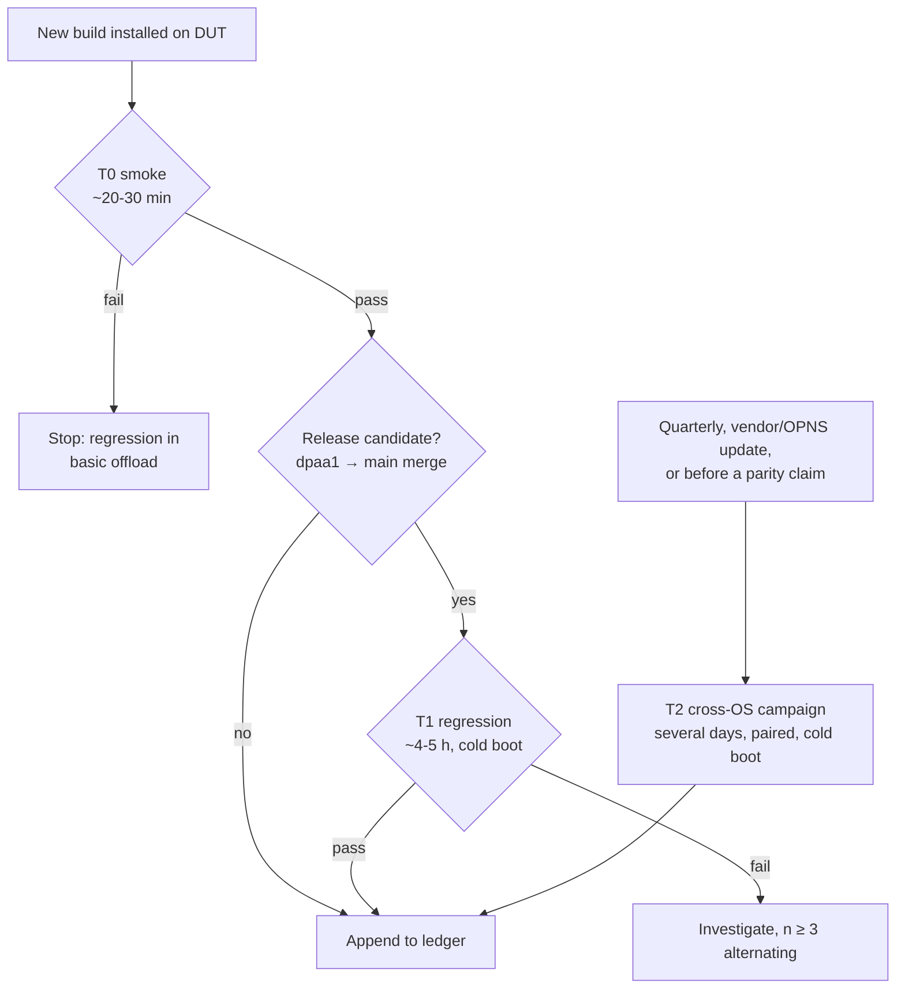
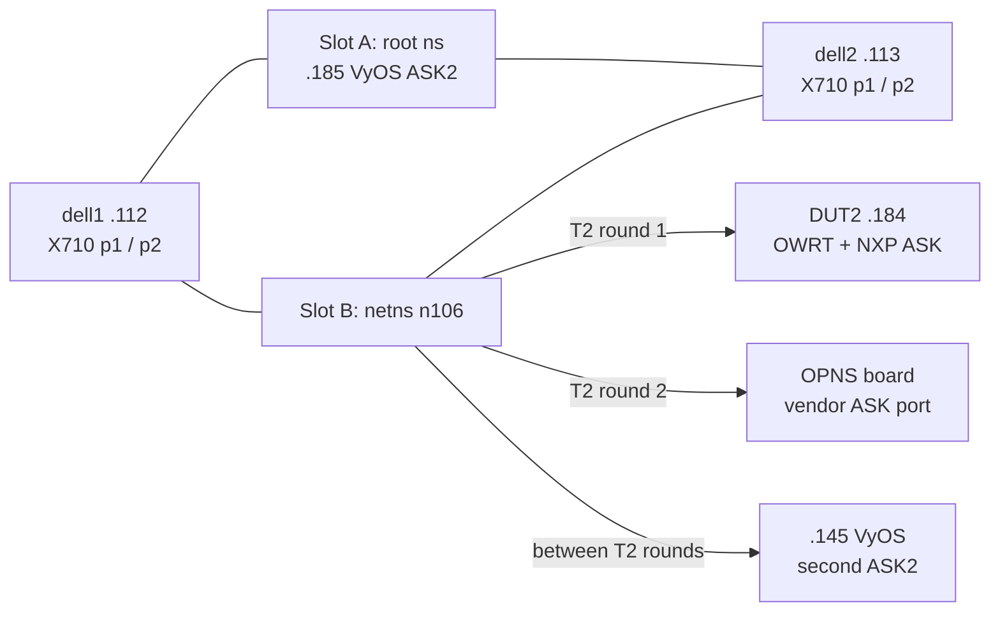

# Hardware-offload test catalogue and regression plan

2026-10-26. This plan lists every test that shows a hardware-offload capability
working on the Mono Gateway (LS1046A). It covers three stacks:

| Label | Stack | Fast path | Board(s) |
|---|---|---|---|
| **ASK2** | VyOS with ASK2 (this repository) | nftables HW flowtable → FMan ehash | `.185` (primary), `.145` |
| **OWRT** | OpenWrt 25.12 with NXP ASK (vendor reference) | CMM + CDX | DUT2 `.184` |
| **OPNS** | OPNsense with the vendor ASK port | pf + CMM | not on the rig now |

Scope:

- **Includes** capabilities the vendor has and ASK2 does not yet have (§4).
  These rows become regression tests once ASK2 implements them.
- **Defines** where results are stored (§7) and which tests run on each build,
  how often and with how many repetitions (§6).
- **Planning only:** no traffic tests were executed for this catalogue.
  Status and evidence columns are historical snapshots, not acceptance of a
  newly installed build. `TBD` drivers require manual execution or future
  automation; they are not runnable harness commands.

Related documents:

- `perf/catalogue.csv` is the authoritative machine-readable list. The tables
  in §3 and §4 are generated from it by `bin/perf-catalogue-render.py`. Edit
  the CSV, then re-render. `--check` fails when the doc is stale.
- `plans/ASK2-PERFORMANCE-TEST-HARNESS.md` is the runbook for rig setup,
  per-stack DUT configuration and the drivers.
- `plans/ASK2-VENDOR-PARITY.md` keeps the verdict history.

The acceptance rule set on 2026-10-14 applies to every comparative row:

- If ASK2 is slower than the vendor stack on any measured cell, the cell is a
  FAIL to investigate, not noise.
- First repeat the cell n ≥ 3 times, alternating boards.
- Then find the cause before declaring a pass.

## 1. Test groups

```mermaid
flowchart LR
  subgraph have["ASK2 has a hardware path"]
    R[Routed R01-R09]
    N[NAT N01-N06]
    V[VLAN V01-V13]
    C[Combos C01-C03]
    P[PPPoE P01-P07]
    F[MTU / fragments F01-F05]
    B[Bridge B01-B06]
    U[UDP regression U01-U14]
  end
  subgraph sys["System behaviour"]
    S[Capacity / scale S01-S09]
    X[Coexistence / safety X01-X09]
    K[Control plane / reversibility K01-K06]
    Q[Policer Q01]
    W[Software reference W01]
  end
  subgraph gap["Vendor only, ASK2 gap"]
    G[G01-G23 multicast, IPsec, tunnels,<br/>egress QoS, QinQ, PPPoE-over-VLAN,<br/>IRB / dispatch]
  end
  have --> sys
  gap -. "row joins T1 once the owner gate lands" .-> have
```



## 2. How a test proves offload

Throughput alone does not prove offload. A software-forwarded flow can reach
9 Gbit/s on a short run. Every throughput row therefore records a hardware
share as well as the rate, using a per-stack proof. The verdict comes from
`hw_ratio`:

| Verdict | `hw_ratio` |
|---|---|
| **HW** | ≥ 0.9 |
| **PARTIAL** | ≥ 0.1 and < 0.9 |
| **SW** | < 0.1 |

| Stack | Hardware proof | Driver mode |
|---|---|---|
| ASK2 | Growth of `pkt_count` per record in `fe_ehash_stats` (YNL `get-flow`), with `fe_arm` showing the port armed | `DUT_KIND=ask2` |
| OWRT | Frames that never reach the kernel: `ethtool -S ethN` `rx packets [TOTAL]` against the data packets the generator sent | `DUT_KIND=vendor` |
| OPNS | Packets that never reach the FreeBSD IP stack: `netstat -s` IP/IPv6 "total packets received" | `DUT_KIND=opnsense` |

These bypass counters are proxies for **routed** forwarding, not proof by
themselves. Record receiver delivery, port errors and the counter snapshots
over the same steady window. Dropped UDP packets also fail to reach the
kernel: never count them as hardware-forwarded packets. If loss prevents
attribution, require a positive fast-path forwarding counter or leave
`hw_ratio` empty and report `UNVERIFIED`. Bridged traffic requires L2-specific
hardware counters/records; low IP-stack counters also occur on a software
bridge. Inspect the actual UDP data tuples, not iperf3's TCP control flow.

Traps that have produced wrong verdicts before:

- ASK2 folds offloaded counters into netdev `rx_packets` in batches of about
  3 s. Never use netdev counters as the hardware proof on ASK2.
- ASK2 does not offload ICMP. Prove offload with TCP or UDP, never ping.
- Reusing a 4-tuple while the old connection is in TIME_WAIT reuses a stale
  record. Use random source ports.
- `ask-check` journal lines are history, not current state.

Status values in the tables:

| Value | Meaning |
|---|---|
| **HW** | Measured offloaded on this rig; no open deficit |
| **HW-open** | Offloaded, but a parity deficit or an acceptance gate is open (see the evidence column in the CSV) |
| **PASS / FAIL** | Result of a functional gate (not a throughput comparison) |
| **SW** | Software path by design on that stack |
| **gap** | No hardware path in ASK2 yet. Both boards must PASS functionally; ASK2 runs in software (slower is valid), with no stale hardware record |
| **src** | The vendor code has a handler, but it has not been proven on this rig. The row still runs on both boards; source support is not a benchmark |
| **open** | Implemented, never accepted on a current image |
| **-** | Not measured on that stack |
| **n/a** | Does not apply (ASK2-internal mechanism) |

The T0/T1/T2 column gives repetitions **per variant and offered-load point,
per stack** (§6). A 0 means the row is not in that tier. Missing hardware,
unsupported configurations and missing drivers are recorded as `BLOCKED`,
`UNSUPPORTED` or `NOT_RUN`, never a pass or an invented zero measurement.

## 3. Catalogue: capabilities with an ASK2 hardware path

### 3.1 Routed forwarding

<!-- BEGIN TABLE:routed -->
| ID | Test | Driver | Metric | Pass rule | ASK2 | OWRT | OPNS | T0/T1/T2 | Last evidence |
|---|---|---|---|---|---|---|---|---|---|
| R01 | Routed IPv4 eth3->eth4 | `bin/testrig-offload-quick.sh unicast-v4` | Gbit/s | HW verdict; >= baseline -1% | HW | HW | HW | 1/5/10 | 10x10 2149 2026-10-17 |
| R02 | Routed IPv4 eth4->eth3 | `bin/testrig-offload-quick.sh unicast-v4-rev` | Gbit/s | HW verdict; >= baseline -1% | HW | HW | HW | 0/5/10 | 10x10 2149 2026-10-17 |
| R03 | Routed IPv6 eth3->eth4 | `bin/testrig-offload-quick.sh unicast-v6` | Gbit/s | HW verdict; >= baseline -1% | HW | HW | HW | 1/5/10 | 10x10 2149 2026-10-17 |
| R04 | Routed IPv6 eth4->eth3 | `bin/testrig-offload-quick.sh unicast-v6-rev` | Gbit/s | HW verdict; >= baseline -1% | HW | HW | HW | 0/5/10 | 10x10 2149 2026-10-17 |
| R05 | Routed IPv4 bidirectional (one client --bidir) | `bin/testrig-parity-bidir.sh unicast-v4` | Gbit/s | HW both directions; ASK2 >= vendor | HW-open | HW | HW | 1/5/10 | -1.4% vs vendor 0217; drift per 2026-10-19 A/B |
| R06 | Routed IPv6 bidirectional | `bin/testrig-parity-bidir.sh unicast-v6` | Gbit/s | HW both directions; ASK2 >= vendor | HW-open | HW | HW | 1/5/10 | -0.6% vs vendor 0217 |
| R07 | Routed IPv4 single stream (-P1, per-flow ceiling) | `STREAMS=1 bin/testrig-offload-quick.sh unicast-v4` | Gbit/s | HW verdict; >= baseline -1% | HW | - | - | 0/5/10 | not on ledger yet |
| R08 | Routed IPv6 single stream (-P1) | `STREAMS=1 bin/testrig-offload-quick.sh unicast-v6` | Gbit/s | HW verdict; >= baseline -1% | HW | - | - | 0/5/10 | not on ledger yet |
| R09 | Concurrent eth3<->eth4 load after cold boot | `bin/testrig-concurrent.sh` | x | each direction >= 0.97x single-direction rate; HW hits grow | PASS | - | - | 0/1/3 | .185 1955 2026-10-22 |
<!-- END TABLE:routed -->

### 3.2 NAT

<!-- BEGIN TABLE:nat -->
| ID | Test | Driver | Metric | Pass rule | ASK2 | OWRT | OPNS | T0/T1/T2 | Last evidence |
|---|---|---|---|---|---|---|---|---|---|
| N01 | NAT44 source NAT / masquerade (PAT) out | `bin/testrig-offload-quick.sh nat-v4` | Gbit/s | HW verdict; >= baseline -1% | HW | HW | HW | 1/5/10 | 10x10 2149 2026-10-17 |
| N02 | NAT44 return / destination path in | `bin/testrig-offload-quick.sh nat-v4-rev` | Gbit/s | HW verdict; >= baseline -1% | HW | HW | HW | 0/5/10 | 10x10 2149 2026-10-17 |
| N03 | NAT66 masquerade out | `bin/testrig-offload-quick.sh nat-v6` | Gbit/s | HW verdict; >= baseline -1% | HW | HW | HW | 1/5/10 | 10x10 2149 2026-10-17 |
| N04 | NAT66 return path in | `bin/testrig-offload-quick.sh nat-v6-rev` | Gbit/s | HW verdict; >= baseline -1% | HW | HW | HW | 0/5/10 | 10x10 2149 2026-10-17 |
| N05 | NAT44 bidirectional | `bin/testrig-parity-bidir.sh nat-v4` | Gbit/s | HW both directions; ASK2 >= vendor | HW-open | HW | HW | 1/5/10 | -1.0% vs vendor 0217 |
| N06 | NAT66 bidirectional | `bin/testrig-parity-bidir.sh nat-v6` | Gbit/s | HW both directions; ASK2 >= vendor | HW-open | HW | HW | 1/5/10 | -1.8% vs vendor 0217 |
<!-- END TABLE:nat -->

### 3.3 VLAN

<!-- BEGIN TABLE:vlan -->
| ID | Test | Driver | Metric | Pass rule | ASK2 | OWRT | OPNS | T0/T1/T2 | Last evidence |
|---|---|---|---|---|---|---|---|---|---|
| V01 | VLAN translate IPv4 10->20 | `bin/testrig-offload-quick.sh vlan-v4` | Gbit/s | HW verdict; ASK2 >= vendor | HW-open | HW | HW | 0/5/10 | -0.13% FAIL in both 10x10 campaigns |
| V02 | VLAN translate IPv4 20->10 | `bin/testrig-offload-quick.sh vlan-v4-rev` | Gbit/s | HW verdict; >= baseline -1% | HW | HW | HW | 0/5/10 | 10x10 2149 2026-10-17 |
| V03 | VLAN translate IPv6 10->20 | `bin/testrig-offload-quick.sh vlan-v6` | Gbit/s | HW verdict; >= baseline -1% | HW | HW | HW | 0/5/10 | 10x10 2149 2026-10-17 |
| V04 | VLAN translate IPv6 20->10 | `bin/testrig-offload-quick.sh vlan-v6-rev` | Gbit/s | HW verdict; >= baseline -1% | HW | HW | HW | 0/5/10 | 10x10 2149 2026-10-17 |
| V05 | VLAN strip IPv4 (tagged in, untagged out) | `bin/testrig-offload-quick.sh vlanport-v4` | Gbit/s | HW verdict; >= baseline -1% | HW | HW | HW | 0/5/10 | 10x10 2149 2026-10-17 |
| V06 | VLAN push IPv4 (untagged in, tagged out) | `bin/testrig-offload-quick.sh portvlan-v4` | Gbit/s | HW verdict; >= baseline -1% | HW | HW | HW | 0/5/10 | 10x10 2149 2026-10-17 |
| V07 | VLAN strip IPv6 | `bin/testrig-offload-quick.sh vlanport-v6` | Gbit/s | HW verdict; >= baseline -1% | HW | HW | HW | 0/5/10 | 10x10 2149 2026-10-17 |
| V08 | VLAN push IPv6 | `bin/testrig-offload-quick.sh portvlan-v6` | Gbit/s | HW verdict; >= baseline -1% | HW | HW | HW | 0/5/10 | 10x10 2149 2026-10-17 |
| V09 | VLAN translate IPv4 bidirectional | `bin/testrig-parity-bidir.sh vlan-v4` | Gbit/s | HW both directions; ASK2 >= vendor | HW | HW | HW | 1/5/10 | 10x10 2149 2026-10-17 |
| V10 | VLAN translate IPv6 bidirectional | `bin/testrig-parity-bidir.sh vlan-v6` | Gbit/s | HW both directions; ASK2 >= vendor | HW | HW | HW | 1/5/10 | 10x10 2149 2026-10-17 |
| V11 | VLAN<->port IPv4 bidirectional | `bin/testrig-parity-bidir.sh vlanport-v4` | Gbit/s | HW both directions; ASK2 >= vendor | HW | HW | HW | 1/5/10 | 10x10 2149 2026-10-17 |
| V12 | VLAN<->port IPv6 bidirectional | `bin/testrig-parity-bidir.sh vlanport-v6` | Gbit/s | HW both directions; ASK2 >= vendor | HW-open | HW | HW | 1/5/10 | -0.70% FAIL in both 10x10 campaigns |
| V13 | Routed tagged frames with PCP != 0 (PCP preserved or clean SW fallback) | TBD (scapy PCP 5 over vlan-v4) | - | frames delivered intact; PCP as configured; no stale record | open | - | - | 0/1/1 | needs board proof (master plan 1.2) |
<!-- END TABLE:vlan -->

### 3.4 Feature combinations

<!-- BEGIN TABLE:combo -->
| ID | Test | Driver | Metric | Pass rule | ASK2 | OWRT | OPNS | T0/T1/T2 | Last evidence |
|---|---|---|---|---|---|---|---|---|---|
| C01 | NAT44 across VLANs | `bin/testrig-offload-quick.sh nat-vlan-v4` | Gbit/s | HW verdict; >= baseline -1% | HW | HW | HW | 1/5/10 | OPNS 26.7.7_8 n=10 HW; ASK2 quick historical |
| C02 | NAT66 across VLANs | `bin/testrig-offload-quick.sh nat-vlan-v6` | Gbit/s | HW verdict; >= baseline -1% | HW | HW | HW | 1/5/10 | OPNS 26.7.7_8 n=10 HW; ASK2 quick historical |
| C03 | NAT44 over PPPoE upstream | `bin/testrig-offload-quick.sh nat-pppoe-up-v4` | Gbit/s | HW verdict; >= baseline -1% | HW | HW | - | 1/5/10 | not same-session |
<!-- END TABLE:combo -->

### 3.5 PPPoE

<!-- BEGIN TABLE:pppoe -->
| ID | Test | Driver | Metric | Pass rule | ASK2 | OWRT | OPNS | T0/T1/T2 | Last evidence |
|---|---|---|---|---|---|---|---|---|---|
| P01 | PPPoE decap IPv4 (WAN session -> LAN) | `bin/testrig-offload-quick.sh pppoe-down-v4` | Gbit/s | HW verdict; >= baseline -1% | HW | HW | HW | 1/5/10 | needs dell1 RPS fe; vendor pppoe10 up |
| P02 | PPPoE encap IPv4 (LAN -> WAN session) | `bin/testrig-offload-quick.sh pppoe-up-v4` | Gbit/s | HW verdict; >= baseline -1% | HW | HW | HW | 1/5/10 | – |
| P03 | PPPoE decap IPv6 | `bin/testrig-offload-quick.sh pppoe-down-v6` | Gbit/s | HW verdict; >= baseline -1% | HW | HW | HW | 1/5/10 | – |
| P04 | PPPoE encap IPv6 | `bin/testrig-offload-quick.sh pppoe-up-v6` | Gbit/s | HW verdict; >= baseline -1% | HW | HW | HW | 1/5/10 | – |
| P05 | PPPoE 1500->1492 fragmentation correctness (controls/warm/new/DF/PTB) | `bin/testrig-pppoe-frag.py` | - | all datagrams delivered intact (UDP header and payload checksum ok); DF gets PTB | PASS | FAIL | - | 0/1/3 | ASK2 2012 2026-10-17; vendor zeroed UDP headers historically |
| P06 | PPPoE session churn 10,000 cycles under traffic | `bin/testrig-pppoe-churn.sh` | - | no stale record or mapping; MURAM back to baseline; 0 kernel errors | open | n/a | n/a | 0/0/1 | not run on current image |
| P07 | PPPoE fragment-pool exhaustion and long mixed-size soak | `bin/testrig-pppoe-resources.sh` | - | pool recovers; no leak; no wedge | open | n/a | n/a | 0/0/1 | not run on current image |
<!-- END TABLE:pppoe -->

### 3.6 MTU and fragmentation

<!-- BEGIN TABLE:frag -->
| ID | Test | Driver | Metric | Pass rule | ASK2 | OWRT | OPNS | T0/T1/T2 | Last evidence |
|---|---|---|---|---|---|---|---|---|---|
| F01 | MTU steps 1280/2500/3600/1500 with offload engaged | `bin/testrig-mtu-steps.sh` | Gbit/s | DF ping passes at each MTU; HW verdict; no wedge | PASS | - | - | 0/1/1 | .185 2044 2026-10-23 (9.2-9.7) |
| F02 | UDP payload sweep 1472-2400 incl. 1473 at MTU 2500 | `bin/testrig-udp-sweep.sh` | % | 0 receiver loss at every size; no wedge | PASS | - | - | 0/1/1 | .185 2044 2026-10-23 |
| F03 | Routed IPv4 MTU shrink: HW fragmentation (DF clear) and ICMP frag-needed (DF set) | TBD (iperf3 -u -l 1472 into MTU 1400 egress) | - | fragments reassemble at receiver; DF set yields ICMP 3/4; no SW fallback | PASS | HW | - | 0/1/1 | F-262 silicon verified (dated) |
| F04 | Routed IPv6 MTU shrink: HW fragmentation (ipv6_hw_frag) and PTB | TBD (iperf3 -u -6 into MTU 1400 egress) | - | fragments reassemble at receiver; PTB when ipv6_hw_frag=0 | PASS | HW | - | 0/1/1 | F-262 silicon verified (dated) |
| F05 | Incoming fragmented flows forwarded correctly (software by policy) | TBD (iperf3 -u -l 4000 at MTU 1500) | - | delivered intact; no HW record for fragments | SW | SW | SW | 0/1/1 | policy: default punt |
<!-- END TABLE:frag -->

### 3.7 Bridge (L2 flows)

<!-- BEGIN TABLE:bridge -->
| ID | Test | Driver | Metric | Pass rule | ASK2 | OWRT | OPNS | T0/T1/T2 | Last evidence |
|---|---|---|---|---|---|---|---|---|---|
| B01 | Learned-MAC bridge forwarding (B6) | `bin/testrig-bridge-b6.sh` | - | per-flow L2 records hit; frames delivered; teardown exact | PASS | src | - | 0/1/3 | 2012 cold 2026-10-17; vendor throughput per VLAN mode not measured |
| B02 | VLAN-aware bridge, same tag in and out (B7a) | `VLAN=10 bin/testrig-bridge-b6.sh` | - | tagged L2 records hit; PCP record correct | PASS | src | - | 0/1/3 | 2012 cold 2026-10-17 |
| B03 | Bridge access<->trunk VLAN pop/push (B7b) | `bin/testrig-bridge-b7b.sh` | - | IPv4/IPv6 pop and push wire, hit, fallback and churn gates | HW-open | src | - | 0/1/3 | .155 0326 cold 2026-10-20; parity and soak open |
| B04 | L2 learned-MAC churn under line-rate bridged traffic | `bin/testrig-bridge-soak.sh` | - | base records keep hitting; no leak after N cycles | PASS | n/a | n/a | 0/0/1 | 100-cycle 2012 2026-10-17 |
| B05 | L2 table capacity 8192 entries and lookup at occupancy | `bin/testrig-bridge-capacity.sh` | entries | all N insert and hit; misses still punt | open | n/a | n/a | 0/0/1 | needs debugfs (kunit=true) image |
| B06 | Short non-IP frames on the L2 path (no FE stall) | `bin/testrig-bridge-b2.sh` | - | ARP/short frames punt; hits keep counting afterwards | open | n/a | n/a | 0/0/1 | stall seen 2026-10-11; needs debugfs image |
<!-- END TABLE:bridge -->

### 3.8 Capacity and scale

<!-- BEGIN TABLE:scale -->
| ID | Test | Driver | Metric | Pass rule | ASK2 | OWRT | OPNS | T0/T1/T2 | Last evidence |
|---|---|---|---|---|---|---|---|---|---|
| S01 | 64-byte IPv4 routed pps, offered sweep | `bin/testrig-pktgen.sh` | Mpps | capacity at <=0.001% loss plus loss curve; ASK2 >= vendor | HW | HW | HW | 0/3/3 | ASK2 3.10 Mpps 0 loss vs vendor 0.05% (2026-10-10); OPNS ~1.1 |
| S02 | 82-byte IPv6 routed pps, offered sweep | `bin/testrig-pktgen.sh (port-v6)` | Mpps | capacity at <=0.001% loss plus loss curve; ASK2 >= vendor | HW | HW | - | 0/3/3 | ASK2 3.17 Mpps vs vendor 3.21 (2026-10-10) |
| S03 | IMIX pps and overload recovery | `bin/testrig-pktgen.sh IMIX=1` | Mpps | delivered >= vendor; recovers after overload | open | - | - | 0/1/3 | historical, not current-image |
| S04 | Flow scale: 8k-session bidirectional PDR (<=0.5% loss) | `bin/testrig-compare.sh pdr` | Mpps | no FE wedge; PDR >= vendor | open | - | - | 0/0/3 | FE wedge pre-F-264; vendor figure is other-rig target |
| S05 | New connections per second, held sessions, with and without NAT | `bin/testrig-compare.sh cps` | conn/s | 0 failures; CPS >= vendor same rig | FAIL | - | - | 0/1/3 | ASK2 ceiling ~10-11k at 30-40k offered (P5 2026-10-21); vendor 20k is other-rig target |
| S06 | Flow install rate and first-insert latency | TBD (conntrack HW_OFFLOAD count vs time under testrig-cps.py) | flows/s | >= 2,370/s; first insert < 2.6 s | FAIL | HW | - | 0/1/3 | ASK2 ~550/s; vendor >= 2,370/s lower bound |
| S07 | Latency through DUT at idle/10/50/90% load (HW timestamps) | `bin/testrig-compare.sh lat` | us | p50/p99 <= vendor at each load | open | - | - | 0/1/3 | pending |
| S08 | Offload engage delay (time from flow start to HW forwarding) | `bin/testrig-offload-delay.py` | s | <= vendor (per-flow target < 100 ms) | FAIL | HW | - | 0/20/20 | ASK2 1.0-1.06 s vs vendor ~0 s (2026-10-14) |
| S09 | Kernel/miss path capacity (offload off and engaged-miss) | `bin/testrig-compare.sh kpath` | Mpps | >= baseline -3% (SW regression sentinel) | SW | SW | SW | 0/1/3 | ref ~0.29 Mpps external |
<!-- END TABLE:scale -->

### 3.9 Coexistence and safety

These rows check that offload never breaks traffic it does not carry. This
includes ICMP, connection setup, TTL expiry, neighbour changes and control
protocols. Several of them are the current ASK2 blockers.

<!-- BEGIN TABLE:safety -->
| ID | Test | Driver | Metric | Pass rule | ASK2 | OWRT | OPNS | T0/T1/T2 | Last evidence |
|---|---|---|---|---|---|---|---|---|---|
| X01 | Slow-path starvation: ping + 10 TCP connects beside line-rate offloaded bulk, both egress ports | `dell2 ~/testrig/starvation-check.py (not in repo)` | ms | bulk stays HW; ping max < 10 ms; 10/10 connects < 50 ms | FAIL | PASS | - | 0/3/3 | ASK2 ping avg 4.1-4.5 s, 3-6/10 connects (0217); vendor 0.57 ms 10/10; post-F-199 retest pending |
| X02 | DUT-side jobs (commit, show, ask-check) during 60 s bidir | `bin/testrig-trigger-probe.py` | Gbit/s | no throughput collapse; no HW verdict loss | open | - | - | 0/1/1 | informational |
| X03 | Neighbour change under load (flush, bogus MAC, restore), v4/v6, plain and VLAN | `bin/testrig-neigh-change.sh` | - | traffic follows neighbour within 1 s; HW hits before/after; 0 kernel errors | PASS | - | - | 0/1/1 | .185 2044 2026-10-23 (needs fe80 on eth3/eth4) |
| X04 | TTL / hop-limit expiry on a live offloaded tuple | `bin/testrig-a14.sh ttl (FAM=4,6)` | - | TTL/hlim 0-1 punted with ICMP time-exceeded; never forwarded with hlim 0/255 | FAIL | PASS | - | 0/1/1 | v6 hlim wraps 0->255, v4 silent drop (2026-10-20); vendor soft parser punts |
| X05 | Stale hardware rewrite after neighbour replace | `bin/testrig-a14.sh neigh (FAM=4,6)` | - | frames stop reaching old MAC within ~1 s | FAIL | - | - | 0/1/1 | FAILED 2026-10-18; reconcile with X03 PASS |
| X06 | 5-tuple reuse and TCP close handling (F-266) | `bin/testrig-a14.sh f266 (REUSE=k)` | - | 100/100 complete; 0 HW_OFFLOAD ct and 0 ehash records after close | FAIL | PASS | - | 0/1/1 | transit gate FAILED 2026-10-18; close fix live 2026-10-20, CI retest pending |
| X07 | Closed-flow conntrack linger (FIN/RST swallowed by HW) | TBD (conntrack -L count after testrig-cps.py run) | entries | no ESTABLISHED entries left for closed flows | FAIL | PASS | - | 0/1/1 | open FAIL 2026-10-15 |
| X08 | IKE / NAT-T control traffic not offloaded (UDP 500/4500) | TBD | - | IKE and NAT-T control/keepalives reach the CPU; distinguish ESP-in-UDP data tested by G06 | open | - | - | 0/1/1 | untested |
| X09 | 30-minute mixed-feature soak (routed+NAT+VLAN+PPPoE concurrent) | TBD (testrig-combo-matrix.sh setup + parallel cells) | - | 0 kernel errors; MURAM flat; throughput stable | open | - | - | 0/0/1 | pending |
<!-- END TABLE:safety -->

### 3.10 Control plane and reversibility (ASK2 only)

<!-- BEGIN TABLE:control -->
| ID | Test | Driver | Metric | Pass rule | ASK2 | OWRT | OPNS | T0/T1/T2 | Last evidence |
|---|---|---|---|---|---|---|---|---|---|
| K01 | CLI offload delete/set x10 with ping running | `bin/testrig-cli-cycle.sh` | - | ping uninterrupted beyond commit; MURAM back to baseline | PASS | n/a | n/a | 0/1/1 | .185 2044 |
| K02 | Per-port loop: idempotent engage, MTU, link flap x3, 100 disengage/engage cycles | `bin/testrig-port-loop.sh` | - | ask-check clean; MURAM baseline; pcd-snapshot diff clean | PASS | n/a | n/a | 0/1/1 | .185 2044 2026-10-21..23 |
| K03 | Reversibility: disengage returns PCD and MURAM to boot baseline | `board/scripts/pcd-snapshot capture/diff` | - | diff clean; muram_budget used == baseline | PASS | n/a | n/a | 1/1/1 | MURAM 52922 (2044) |
| K04 | Kill switches (vlan_offload, pppoe_offload, nat44_offload, nat66_offload, ipv6_hw_frag = 0) | TBD (module param + affected quick cells) | - | affected cell forwards in SW correctly; other cells stay HW | PASS | n/a | n/a | 0/1/1 | dated |
| K05 | Per-flow counters match traffic (YNL get-flow / fe_ehash_stats) | `bin/ask-check + YNL get-flow` | - | record bytes within 1% of receiver bytes | PASS | src | - | 0/1/1 | .145 2149 2026-10-19 |
| K06 | Factory default engages after cold boot (offload ipv4 ipv6 on eth1-eth4) | `reboot + bin/testrig-offload-quick.sh unicast-v4` | - | HW verdict without manual commit | PASS | n/a | n/a | 0/1/1 | fresh install 2149 .145 2026-10-19 |
<!-- END TABLE:control -->

### 3.11 Policer

<!-- BEGIN TABLE:qos -->
| ID | Test | Driver | Metric | Pass rule | ASK2 | OWRT | OPNS | T0/T1/T2 | Last evidence |
|---|---|---|---|---|---|---|---|---|---|
| Q01 | Ingress policer accuracy on a non-ASK port (FMPL) | `set interfaces ethernet ethN ingress-policer + iperf3` | Gbit/s | delivered within +-15% of configured rate; G/Y/R counters move | HW-open | src | - | 0/1/3 | cap measured historically; accuracy pending |
<!-- END TABLE:qos -->

### 3.12 Software-path reference

WireGuard is software on all three stacks. It is tracked because kernel and
driver changes move it, and it is the reference for the "SW cost" comparison.

<!-- BEGIN TABLE:sw-ref -->
| ID | Test | Driver | Metric | Pass rule | ASK2 | OWRT | OPNS | T0/T1/T2 | Last evidence |
|---|---|---|---|---|---|---|---|---|---|
| W01 | WireGuard 1 tunnel, eth3/eth4 x IPv4/IPv6 x up/down/bidir | `bin/wg-parity.sh` | Gbit/s | SW on all stacks; ASK2 >= vendor | SW | SW | SW | 0/0/10 | ASK2 ~1.5-1.7 at 92-95% busy; OPNS 0.4-0.9 |
| SW01 | Routed IPv4 bidirectional with offload disabled (software baseline) | TBD (R05 cell with offload off on every stack) | Gbit/s | PASS; hw_ratio < 0.1; >= baseline -3% (SW regression sentinel) | open | open | open | 0/3/10 | planned; offload off = delete interfaces ethernet eth3/eth4 offload |
| SW02 | Routed IPv6 bidirectional with offload disabled | TBD (R06 cell with offload off) | Gbit/s | as SW01 | open | open | open | 0/3/10 | planned |
| SW03 | NAT44 bidirectional with offload disabled | TBD (N05 cell with offload off) | Gbit/s | as SW01 | open | open | open | 0/3/10 | planned |
| SW04 | NAT66 bidirectional with offload disabled | TBD (N06 cell with offload off) | Gbit/s | as SW01 | open | open | open | 0/3/10 | planned |
<!-- END TABLE:sw-ref -->

### 3.13 UDP throughput, loss and jitter (all three stacks)

TCP throughput does not cover UDP forwarding, packet loss or jitter. F02 is
only a 2-second, 30 Mbit/s ASK2 MTU/wedge check; it does **not** replace these
tests. Run U01–U06 as the recurring cross-OS baseline on VyOS ASK2, OpenWrt
vendor ASK and OPNsense vendor ASK. U07–U14 exercise UDP-specific NAT checksum,
VLAN, PPPoE, bridge and combined rewrite paths. Historical TCP HW verdicts do
not count as evidence for these new UDP rows.

<!-- BEGIN TABLE:udp -->
| ID | Test | Driver | Metric | Pass rule | ASK2 | OWRT | OPNS | T0/T1/T2 | Last evidence |
|---|---|---|---|---|---|---|---|---|---|
| U01 | UDP routed IPv4 eth3->eth4 | TBD (iperf3 -u -4; R01 topology; section 3.13) | Gbit/s;%;ms | UDP profile gates in section 8; HW proof required | open | - | - | 0/3/10 | planned cross-OS baseline; not measured |
| U02 | UDP routed IPv4 eth4->eth3 | TBD (iperf3 -u -4 -R; R01 topology; section 3.13) | Gbit/s;%;ms | UDP profile gates in section 8; HW proof required | open | - | - | 0/3/10 | planned cross-OS baseline; not measured |
| U03 | UDP routed IPv6 eth3->eth4 | TBD (iperf3 -u -6; R03 topology; section 3.13) | Gbit/s;%;ms | UDP profile gates in section 8; HW proof required | open | - | - | 0/3/10 | planned cross-OS baseline; not measured |
| U04 | UDP routed IPv6 eth4->eth3 | TBD (iperf3 -u -6 -R; R03 topology; section 3.13) | Gbit/s;%;ms | UDP profile gates in section 8; HW proof required | open | - | - | 0/3/10 | planned cross-OS baseline; not measured |
| U05 | UDP routed IPv4 simultaneous bidirectional | TBD (iperf3 -u -4 --bidir; section 3.13) | Gbit/s;%;ms | UDP profile gates in section 8 independently per direction; HW both ways | open | - | - | 1/3/10 | planned cross-OS baseline; not measured |
| U06 | UDP routed IPv6 simultaneous bidirectional | TBD (iperf3 -u -6 --bidir; section 3.13) | Gbit/s;%;ms | UDP profile gates in section 8 independently per direction; HW both ways | open | - | - | 1/3/10 | planned cross-OS baseline; not measured |
| U07 | UDP NAT44 outbound and return traffic | TBD (iperf3 -u; N01 topology with -R for return; section 3.13) | Gbit/s;%;ms | UDP profile gates; translated tuple and checksum correct; HW proof | open | - | - | 0/0/3 | planned cross-OS feature coverage; not measured |
| U08 | UDP NAT66 outbound and return traffic | TBD (iperf3 -u -6; N03 topology with -R for return; section 3.13) | Gbit/s;%;ms | UDP profile gates; translated tuple and checksum correct; HW proof | open | - | - | 0/0/3 | planned cross-OS feature coverage; not measured |
| U09 | UDP IPv4 VLAN translate both ways and strip/push | TBD (iperf3 -u; V01/V02/V05/V06 topologies; section 3.13) | Gbit/s;%;ms | UDP profile gates; correct on-wire tags; HW proof | open | - | - | 0/0/3 | planned cross-OS feature coverage; not measured |
| U10 | UDP IPv6 VLAN translate both ways and strip/push | TBD (iperf3 -u -6; V03/V04/V07/V08 topologies; section 3.13) | Gbit/s;%;ms | UDP profile gates; correct on-wire tags; HW proof | open | - | - | 0/0/3 | planned cross-OS feature coverage; not measured |
| U11 | UDP IPv4 PPPoE encap and decap | TBD (iperf3 -u; P01/P02 topologies; section 3.13) | Gbit/s;%;ms | UDP profile gates; correct session and checksum; HW proof | open | - | - | 0/0/3 | planned cross-OS feature coverage; not measured |
| U12 | UDP IPv6 PPPoE encap and decap | TBD (iperf3 -u -6; P03/P04 topologies; section 3.13) | Gbit/s;%;ms | UDP profile gates; correct session and checksum; HW proof | open | - | - | 0/0/3 | planned cross-OS feature coverage; not measured |
| U13 | UDP bridge untagged/same-tag/access-trunk IPv4 and IPv6 both ways | TBD (iperf3 -u; B01/B02/B03 topologies; section 3.13) | Gbit/s;%;ms | UDP profile gates; correct L2 forwarding; L2-specific HW proof | open | - | - | 0/0/3 | planned cross-OS feature coverage; not measured |
| U14 | UDP NAT-over-VLAN v4/v6 and NAT-over-PPPoE v4 outbound/return | TBD (iperf3 -u; C01/C02/C03 topologies; section 3.13) | Gbit/s;%;ms | UDP profile gates; combined rewrites and checksums correct; HW proof | open | - | - | 0/0/3 | planned cross-OS feature coverage; not measured |
<!-- END TABLE:udp -->

The U rows share this protocol. A **variant** identifies the topology,
address family, direction, payload size, stream count and offered rate.
Never pool variants when calculating a regression.

| Tier / rows | UDP payload (`-l`, bytes, not Ethernet frame size) | Offered wire-load points | Repetitions per point per OS | Warmup + measurement |
|---|---|---|---|---|
| T0: U05–U06 | 1400 | 50% | 1 | 5 s + 15 s |
| T1: U01–U06 | 1400 | 50%, 90% | 3 | 10 s + 20 s |
| T2: U01–U06 | 64, 512, 1400 | 10%, 50%, 90%, 99% at each size | 10 alternating paired rounds | 10 s + 20 s |
| T2: U07–U14 | 1400; every named topology/direction/family | 50%, 90% | 3 alternating paired rounds | 10 s + 20 s |

Use four parallel UDP streams per direction (`-P4`) throughout. For U07/U08,
keep the NAT mapping established from inside and test outbound and return
traffic as separate variants; do not equate a new outside connection with a
return packet. U13 has twelve variants: three bridge modes × two families ×
two directions. U14 has six: three combo paths × outbound/return. Apply
configuration using each stack's supported mechanism, not ASK2 commands on
other OSes.

The offered points are fixed across OSes, **not** percentages of each DUT's
measured TCP performance. Convert wire load to application payload bitrate
before setting `-b`:

- For each link in the path, Ethernet wire bytes per datagram are
  `max(64, 14 + VLAN_bytes + encapsulation_bytes + IP_header_bytes + 8 + payload_bytes + 4) + 20`.
  This includes FCS, preamble and IFG. IPv4 headers are 20 bytes, IPv6 40,
  each VLAN tag adds 4, and PPPoE plus PPP adds 8.
- The path payload ceiling is the minimum of
  `link_bps * payload_bytes / wire_bytes` across those links.
- `offered_bps` is the selected fraction of that ceiling, **aggregate per
  direction**. iperf3 `-b` applies **per stream**, so divide by four and record
  the actual rounded aggregate. `--bidir` offers that rate in each direction,
  not half of it.
- At 10G, routed IPv4, 1400-byte payload and 90% load, this is approximately
  8.595 Gbit/s aggregate, or 2.149 Gbit/s per stream. Small payloads must not
  use the same `-b` as large payloads: their wire overhead is much larger.

Command shape for future manual runs, **not executed here** (substitute
addresses, filenames, family and the computed integer rate):

```sh
# Receiver, on the generator beyond the DUT, not on the DUT itself:
iperf3 -s -1 -J > server.json
# Sender; this example is the 30-second T1/T2 timing:
iperf3 -c "$DEST" -B "$SRC" -4 -u -P 4 -l 1400 \
  -b "$PER_STREAM_BPS" -O 10 -t 20 -i 1 --udp-counters-64bit \
  -J --get-server-output > client.json
```

Use `-6` for IPv6, `-R` for reverse and a **single** `--bidir` client for
simultaneous directions. Use a fresh server/output pair for each invocation.
Keep iperf3 versions (≥3.16), pacing, socket buffers, endpoint NIC offloads,
RSS/RPS and CPU placement identical across OS comparisons and record them
in the manifest. Do not silently tune one OS's generator differently.

The ten-second warmup keeps the same UDP tuples alive; verify eligibility
and per-flow hardware hits before the measured window. Where stateful
offload requires replies, verify the UDP state sees both directions during
priming; a successful TCP control connection is not sufficient. Failure to
arm is a recorded offload failure, not grounds for discarding that sample.

Save both endpoints' JSON, exact argv, per-stream receiver statistics, DUT
hardware counters, CPU/softirq, generator and receiver CPU, NIC drop/error
and UDP socket-drop deltas. Receiver rate/loss/jitter are authoritative.
Sum delivered bytes and packet counts across streams; compute loss from
summed lost/expected datagrams, not the mean of stream percentages. Define
`jitter_ms` as the maximum final receiver jitter across streams in that
direction, retaining every stream value in raw JSON. It is iperf's jitter
estimate, **not** p99 latency. Do not combine the two directions' loss or
jitter into one number. Omit warmup consistently from throughput, loss and
counter windows; archive warmup separately for engage-delay analysis.

A sender unable to achieve within 2% of the requested rate, or demonstrated
generator/receiver CPU or socket-drop saturation, yields `INVALID` with
evidence, not a DUT regression or pass. Zero receiver packets with a healthy
sender is a failure, not zero loss. High-rate/small-packet points deliberately
map a loss curve; they need not all be loss-free. S01/S02 remain the dedicated
minimum-frame packet-rate tests. Endpoint calibration and an offload-disabled
control establish that an apparent fast-path benefit is not a generator
ceiling; never mix those controls into the HW sample set.

Sources: [iperf3 option semantics](https://software.es.net/iperf/invoking.html)
(`-b`, `-P`, `-O`, `-R`, `--bidir`, JSON and UDP counters) and
[ESnet tool comparison](https://fasterdata.es.net/performance-testing/network-troubleshooting-tools/throughput-tool-comparision/).
The existing quick driver/parser is TCP-only; U-row automation is still TBD.

## 4. Capabilities without an ASK2 hardware path (gap rows)

Every row runs on both boards and must PASS functionally on both. Nothing is
vendor-proof-only. When a stack has no hardware path, the traffic runs in
software: it must still be correct, only slower.

1. **Functional pass is mandatory on both boards.** Correct delivery, no loss
   above the UDP gate, no corruption, no wedge, no stale hardware record. This
   covers IPsec, tunnels, multicast, QoS, QinQ, PPPoE variants and IRB.
2. **Speed and `hw_ratio` are recorded, not gated.** An offloaded run is fast,
   a software run is slow, and both are valid PASS results. The ledger keeps
   the verdict (HW, PARTIAL or SW) so the gain is visible when the owner gate
   lands. Rows whose pass rule names a vendor-only mechanism (qm shaper,
   ff_rate, expt_rate, secfailstats) use the generic Linux equivalent (tc,
   nftables limit) on a software stack, with the same functional expectation.
3. **Measure the gain when the owner gate lands.** Once ASK2 implements the
   capability, the row becomes a normal T1 regression row with a hardware
   verdict and an "ASK2 ≥ vendor" pass rule.

If the vendor path turns out to be software, the row moves to §5.

Owner IDs refer to `plans/ASK2-MASTER-PLAN.md` §1.2 and
`plans/OFFLOAD-CAPABILITY-PLAN.md` §2.

iperf3 cannot generate multicast; G01–G03 need iperf2 or a multicast packet
generator, plus captures and per-listener counters. Include group join/leave
and verify traffic does not leak to non-listeners. For G04–G08 include both
ESP directions, supported cipher suites, replay/ESN and invalid-SA handling,
rekey/expiry and encrypted MTU/fragmentation cases. Preserve the documented
CAAM A24a GCM refusal; a crypto-engine hit alone does not prove full
FMan→CAAM→FMan forwarding. These lifecycle/correctness checks need captures
and protocol tools in addition to iperf.

<!-- BEGIN TABLE:gap -->
| ID | Test | Driver | Metric | Pass rule | ASK2 | OWRT | OPNS | T0/T1/T2 | Owner gate |
|---|---|---|---|---|---|---|---|---|---|
| G01 | IPv4 routed multicast replication (mc4 routed) | TBD (iperf2 UDP multicast to 239.x, 2 listeners) | - | ASK2 gap: correct SW forwarding, no HW record | gap | src | - | 0/0/3 | T-M6-MC |
| G02 | IPv6 routed multicast replication (mc6 routed) | TBD (iperf2 UDP multicast to ff3e::x) | - | ASK2 gap: correct SW forwarding, no HW record | gap | src | - | 0/0/3 | T-M6-MC |
| G03 | Bridged multicast replication (mc4/mc6 bridged, MDB) | TBD | - | ASK2 gap: correct SW forwarding, no HW record | gap | src | - | 0/0/3 | T-M6-MC |
| G04 | IPsec ESP tunnel IPv4, AES-CBC-SHA256, FMan->CAAM->FMan | TBD (strongSwan peer on dell2) | Gbit/s | ASK2 today: host-terminated ESP with CAAM crypto (Tier 1), SW forwarding | gap | src | - | 0/0/3 | T-M6-4 |
| G05 | IPsec ESP tunnel IPv6 | TBD | Gbit/s | as G04 | gap | src | - | 0/0/3 | T-M6-4 |
| G06 | IPsec ESP with NAT-T (UDP 4500 encapsulation) | TBD | Gbit/s | as G04 | gap | src | - | 0/0/3 | T-M6-4 |
| G07 | IPsec SA rekey and expiry under load | TBD | - | no stale SA; loss bounded during rekey | gap | src | - | 0/0/3 | T-M6-4 |
| G08 | SEC/CAAM rate limit (qm sec_rate) and SA failure stats | TBD | - | rate enforced; query secfailstats moves | gap | src | - | 0/0/3 | T-M6-4 |
| G09 | 6in4 (SIT) tunnel encap/decap with inner flow offload | TBD | Gbit/s | ASK2 gap: correct SW forwarding, no HW record | gap | src | - | 0/0/3 | T-M6-SP5 |
| G10 | 4in6 (IPIP6) tunnel encap/decap with inner flow offload | TBD | Gbit/s | ASK2 gap: correct SW forwarding, no HW record | gap | src | - | 0/0/3 | T-M6-SP5 |
| G11 | Egress shaping on a port carrying offloaded flows (CEETM shaper) | TBD (tc on egress + iperf3) | Gbit/s | shaped rate within +-5%; offloaded flows obey it | gap | src | - | 0/0/3 | T-M6-QOS |
| G12 | Egress scheduling: strict priority and WBFQ across class queues | TBD (two marked flows) | x | class shares within +-10% of weights | gap | src | - | 0/0/3 | T-M6-QOS |
| G13 | DSCP -> frame-queue classification on egress | TBD | - | DSCP-marked flow lands in its class queue | gap | src | - | 0/0/3 | T-M6-QOS |
| G14 | Exception-path rate limit (protects CPU from miss floods) | TBD (64B miss flood + mgmt ping) | - | CPU-bound traffic capped; management stays responsive | gap | src | - | 0/0/3 | T-M6-QOS |
| G15 | Rate limit on fast-forwarded (offloaded) traffic | TBD | Gbit/s | offloaded flow capped within +-15% | gap | src | - | 0/0/3 | T-M6-QOS |
| G16 | Ingress policer on an ASK-engaged port | `set ... ingress-policer on eth3 with offload engaged` | Gbit/s | policed rate enforced on offloaded flows | gap | src | - | 0/0/3 | T-M6-QOS |
| G17 | QinQ / 802.1ad stacked tags routed | TBD | Gbit/s | ASK2 gap: correct SW forwarding, no HW record | gap | src | - | 0/0/3 | T-M6-VLAN2 |
| G18 | DSCP -> VLAN PCP mapping on push | TBD | - | pushed tag carries mapped PCP | gap | src | - | 0/0/3 | T-M6-VLAN2 |
| G19 | PPPoE over a VLAN subinterface encap/decap | TBD (pppoe on eth4.vif) | Gbit/s | ASK2 gap: correct SW forwarding, no HW record | gap | src | - | 0/0/3 | T-M6-SP4 |
| G20 | PPPoE relay / pass-through | TBD | - | ASK2 gap: correct SW forwarding, no HW record | gap | src | - | 0/0/3 | T-M6-SP4 |
| G21 | PPPoE-session bridging (L2 flow with PPPoE session id) | TBD | - | ASK2 gap: correct SW forwarding, no HW record | gap | src | - | 0/0/3 | T-M6-2 |
| G22 | IRB: routed traffic to/from a bridge member port | TBD | Gbit/s | ASK2 gap: correct SW forwarding, no HW record | gap | src | - | 0/0/3 | T-M6-DISPATCH |
| G23 | Routed and bridged classes on the same port at once | TBD | Gbit/s | ASK2 gap: correct SW forwarding, no HW record | gap | src | - | 0/0/3 | T-M6-DISPATCH |
<!-- END TABLE:gap -->

## 5. Out of scope

None of these is an established vendor hardware capability on this board, or
each is excluded by decision. No row is tracked:

- NAT46/NAT64.
- GRE over IPv6.
- IPsec transport mode.
- Hardware IP reassembly (T-M6-FR: default punt; F05 checks the software path).
- 3-tuple/coarse flows (T-M6-T3, conditional).
- MACVLAN, ICC.
- Packet capture.
- Wi-Fi/VAP.
- RTP/RTCP relay and voice buffers.

## 6. Run tiers



| Tier | Trigger | Boot | Rows | Reps | Duration per rep | Wall time |
|---|---|---|---|---|---|---|
| **T0 smoke** | Every installed build, on whichever OS is being evaluated | Warm is fine for ordinary smoke; cold for silicon experiments | 22 rows. Bidirectional per feature (R05, R06, N05, N06, V09–V12) with per-direction numbers and `hw_ratio`; one-way sanity for routed and NAT (R01, R03, N01, N03); PPPoE one-way (P01–P04, no bidir driver yet); combos C01–C03; UDP bidir U05–U06; K03 (ASK2 only) | 1 per point | 20 s including 5 s warmup | ~15–20 min |
| **T1 regression** | Every release candidate; also weekly during active development | **Cold** | 77 rows: T0, all one-way directions (R/N/V/P), single stream, U01–U06, software baseline SW01–SW04 (offload off), MTU, fragments, bridge, pps, delay, safety and control | TCP ×5; UDP ×3 per load point; SW01–SW04 and S01/S02 and starvation ×3; delay ×20; other counts in CSV | 30 s including 10 s warmup for throughput | ~4–5 h |
| **T2 cross-OS** | Quarterly; after a vendor or OPNS update; before any parity claim | **Cold**, each DUT | All 116 catalogue rows, including vendor gaps and U07–U14; exclude only explicitly inapplicable rows | TCP and U01–U06 ×10 paired rounds; U07–U14 and G rows ×3 per variant/point; other counts in CSV | 30 s including 10 s warmup for throughput | Several days for three stacks |

Why bidirectional leads T0: one-way cells sit at the wire-rate ceiling (about
9.28–9.41 Gbit/s) and only fail when offload falls off a cliff. Every FAIL in
the 10x10 campaigns was a bidirectional cell, because bidir exercises the FMan,
the queue manager and the CPU together and exposes lost headroom. Bidir
results must keep the per-direction numbers so a dead direction stays visible.
The one-way directions run at T1.

These are planning budgets, not measured runtimes. Row counts are not
invocation counts: U01–U06 alone add 36 invocations per OS in T1 and 720 in
T2. The T2 routed UDP matrix consumes six hours of traffic time per OS before
setup, feature variants, controls or retries. The existing campaign controller
does not implement all of this catalogue yet.

On a change to NAT, VLAN, PPPoE, bridge, crypto, parser or QoS, promote the
affected feature rows (including U07–U14/G rows where relevant) into that
build's T1 session; do not wait until the quarterly campaign. A three-repeat
feature screen is not a parity claim: use ten paired rounds for any new
throughput parity claim.

Why these repetition counts:

- **One-way throughput is bimodal.** About 1.3% separates the MSS steps, with a
  per-cell SD of about 0.04 Gbit/s.
  - One rep is enough to catch a lost hardware verdict or a gross drop (T0).
  - Five reps give a stable median for a −1% regression flag against the
    previous release (T1).
  - Start cross-OS comparisons with ten alternating pairs and a paired
    bootstrap (20k resamples, seed 10551), matching the existing
    `ask2-campaign.py` protocol. Ten pairs do not guarantee resolution of a
    0.1–0.7% difference; retain the uncertainty and add rounds when needed.
- **UDP:** three repetitions at each fixed T1 point detect repeatable rate,
  loss and jitter changes; ten paired T2 rounds characterize the full curve.
  Pair the same variant/rate across OSes and reverse OS order each round.
- **Pps and latency:** three T2 repetitions are an initial capacity/loss or
  percentile-curve screen, not proof that rare failures cannot occur.
- **Functional gates** have internal cycle counts (for example, cli-cycle ×10
  and port-loop ×100), so one pass is enough.

Every T1 session also re-measures R01, R05 and U01 (at both T1 load points)
three times on the reference board in the same session (the **drift sentinel**,
§8). If that reference is unavailable, label the result unpaired/provisional.

Eight original T1 rows still have no driver: V13, F03, F04, F05, S06, X07, X08
and K04; X09 is T2-only. U01–U14 also need a UDP runner/collector or manual
execution using §3.13. Log manual results with `note=manual`; otherwise
record `NOT_RUN`. X01's driver, `starvation-check.py`, lives only on the Dells.

## 7. Data storage

Results go to a CSV ledger in the repository, under `perf/`. Raw artefacts stay
on the rig.

| File | Content | Rows grow by |
|---|---|---|
| `perf/catalogue.csv` | Test definitions: ID, group, driver, metric, pass rule, per-stack status, reps per tier, owner gate, last evidence | Edit when a test or status changes |
| `perf/campaigns.csv` | One row per session. Fields: tier, image, kernel, git commit, boot type, harness SHA-256, reference board, status (`running`/`complete`/`complete_with_issues`/`aborted`), raw directory | 1 per run |
| `perf/runs.csv` | Append-only long-format ledger: one row per invocation, direction and metric, with explicit traffic parameters and evidence references | Each measured metric at each variant/load point; multiple rows per invocation |

Why CSV:

- It diffs cleanly in git and needs no service.
- pandas, DuckDB and SQLite read it directly.
- It is close to the existing campaign `measurements.csv`, which makes
  backfilling mechanical.

The long format (`metric`, `value`, `unit`) lets one ledger hold Gbit/s, Mpps,
loss %, µs, conn/s and functional results. Preserve every attempt, including
failures and invalid samples. CSVs currently contain headers only: no
measurements or historical backfill are fabricated by this planning task.

Mandatory UDP metric rows, **separately for each receive direction**:

| `metric` | `unit` | Meaning |
|---|---|---|
| `rx_gbps` | `Gbit/s` | Receiver application goodput over the measured window |
| `tx_gbps` | `Gbit/s` | Actual sender application rate, not the requested `-b` |
| `loss_pct` | `%` | `100 * lost_datagrams / expected_datagrams`; empty if denominator is zero |
| `jitter_ms` | `ms` | Maximum of the per-stream receiver jitter estimates (§3.13) |
| `lost_datagrams` / `expected_datagrams` / `received_datagrams` | `packets` | Receiver packet accounting, with raw counters preserved for audit |
| `out_of_order` | `packets` | Receiver-reported out-of-order count; empty if unavailable |

The UDP `metric` and `unit` cells in `catalogue.csv` contain semicolon-separated
primary metrics; `runs.csv` always has **one metric per row**. Store the other
required UDP metrics above as well. TCP retransmits are inapplicable to UDP
and stay empty. Functional `pass` values use 1/0; failed or missing tools with
no measurement get an empty `value`, never a synthetic zero-throughput result.

`variant_id`, `protocol`, `family`, `direction`, `payload_bytes`, `streams`,
`offered_bps`, `duration_s` and `warmup_s` make each result reproducible.
`duration_s` excludes warmup (T1 UDP: 20 and 10 respectively). `offered_bps`
is aggregate per direction, not per stream. `proof_ref` points at before/after
hardware-counter evidence; `raw_ref` points at a per-invocation manifest
linking client/server JSON and endpoint/DUT samples. Record the exact command,
IP/port tuples, MTUs, wire-rate calculation, generator versions, buffer/pacing
settings, NIC offloads and topology there. Config snapshots must be redacted
of credentials and IPsec keys.

`verdict` records `PASS`, `FAIL`, `INVALID`, `UNVERIFIED`, `NOT_RUN`, `BLOCKED`
or `UNSUPPORTED`; the separate `hw_ratio` determines HW/PARTIAL/SW (§2).
Missing proof stays empty, not zero. A known ASK2 gap passing its correct
software-fallback check is a functional `PASS` with SW proof, not HW parity.

Identifiers:

| Field | Format | Example / notes |
|---|---|---|
| `campaign_id` | `<tier>-<dut_os>-<image>-<UTC stamp>` | `t1-vyos-ask2-2026.10.25-2105-20261026T1500Z` |
| `run_id` | `<campaign_id>/<test_id>/<variant_id>/<rep>` | One invocation; metric rows share this ID |
| `dut_os` | one of `vyos-ask2`, `owrt-ask`, `opns-ask` | — |
| `slot` | `A` or `B` | §10 |
| `variant_id` | stable slug for the exact traffic configuration | `routed-v4-fwd-l1400-p4-load90-hw-on`; SW controls use a distinct slug |
| `pair_id` | shared comparison/variant/round identifier, independent of OS | Same value on adjacent OS runs; empty for unpaired runs |
| `direction` | `eth3-to-eth4` or `eth4-to-eth3` (logical port mapping on OPNS) | A bidirectional invocation has separate rows for each direction |

The metric-row key is `(run_id, direction, metric)`. Repetitions restart at 1
for each variant. Each OS/build gets its own campaign row; `pair_id` connects
paired measurements across those campaigns. Do not aggregate across image,
OS, topology, packet size, load, direction or offload state.

Raw iperf3 JSON, pktgen counters, captures and `manifest.json` stay where the
controller writes them:

- dell2 `~/testrig/campaigns/<campaign_id>/`, mirrored to
  `/mnt/builds/ask2-review/oracle/<campaign_id>/`.
- `raw_ref` holds the path relative to that root.
- Do not commit raw JSON.

Future backfill can give the first T1 a baseline (not part of this task):

- `parity-10x10-20261015T2130Z` (ASK2 + OWRT).
- `ask2-10x10-2149-20261017T0000Z`.
- `opns-10x10-20261016T0643Z` and `opns-battery-20261018`.
- The partial `ask2-10x10-2105-20261025` (145/240, `status=aborted`).

The existing campaign columns
`rep,mode,board,cell,…,gbps,dut_busy,dut_softirq,gen_cpu,retrans,hw_pkts,…,hw_ratio,verdict,raw_csv`
provide much of the ledger context, but require normalization: supply
variant/pair IDs, separate hardware proof from the final verdict, and do not
invent missing per-direction metrics from a bidirectional total. Quick-cell
names map to test IDs through the `driver` column of the catalogue.

## 8. Regression and verdict rules

Hard fail, any tier:

- A cell expected to run in hardware loses its HW verdict (not an expected SW
  fallback or a blocked capability).
- A functional gate fails.
- New kernel errors appear (`dmesg` WARN/BUG, `fman_pcd`/`ask` errors).
- `muram_budget used` does not return to its baseline after disengage.
- `pcd-snapshot diff` is not clean.

T0 throughput regression flag: a cell's value is more than 3% below the median
of the last T1 for the same OS, test and variant. A first run without a
matching baseline establishes evidence; it cannot prove no regression.

T1 TCP regression flag (UDP thresholds follow below):

- **Condition:** the 5-rep median is more than 1.0% below the previous
  release median, **and** the drift sentinel moved by less than 0.5%.
- **Drift adjustment:** if the sentinel moved too, compare the ASK2-minus-
  sentinel deltas. The rig drifts from day to day, so a release-to-release
  comparison without a same-session reference is not evidence.
- **Reporting:** give the median and the count of upper MSS-step reps. Do not
  use the mean alone; one-way results are bimodal.

T2 verdict:

- Paired bootstrap of ASK2 minus vendor per cell.
- Apply the existing strict paired-mean rule: lower ASK2 throughput is a
  **FAIL to investigate even if the 95% CI includes zero**. An overlapping
  interval reports uncertainty, not equivalence or a pass.
- Any cell where ASK2 is lower gets n ≥ 3 more alternating reps and a cause
  analysis (2026-10-14 rule).

Pps rows: report the capacity at ≤ 0.001% loss **and** the loss curve. The
threshold point alone is unstable between runs.

UDP-specific gates (all three stacks):

- At T0/T1 1400-byte points, require receiver loss ≤0.1%, valid hardware
  evidence and no new DUT errors. Record loss and jitter even when throughput
  passes; high sender rate alone never passes a test.
- For T1 compare the three-rep medians against the same OS/build baseline at
  each matched point. Flag receiver goodput falling >1%, loss increasing by
  >0.1 percentage point, or jitter rising by both >20% and >0.05 ms. Use U01's
  same-session reference to distinguish rig drift; retain the flag if the
  cause is unknown. These are initial alert thresholds, not measured SLAs.
- For T2 publish receiver-goodput/loss/jitter curves at identical offered
  loads. Report the largest tested offered rate for which **all valid reps**
  meet loss ≤0.1% and the HW requirement, plus receiver goodput there. If the
  highest point qualifies, it is a lower bound on capacity, not a discovered
  ceiling. If none qualify, report no qualifying point rather than zero.
- Expected loss at a small-packet/near-line-rate characterization point is
  not by itself a functional failure; reduced low-loss capacity, loss of
  offload, failure to recover, or a worsening matched curve is investigated.
  Keep these characterization points separate from the T0/T1 loss gate.
- T2 comparisons use the strict throughput rule above and explicitly report
  loss and jitter deltas (lower is better). Never hide one impaired direction
  behind a bidirectional sum or discard a low sample without an evidenced
  endpoint failure. Invalid attempts remain in the ledger and must be
  repeated, not silently removed from the requested sample count.

## 9. Preconditions for every run

- [ ] Recorded: boot type (cold/warm), image, kernel, git commit and harness
  SHA-256 in `perf/campaigns.csv`.
- [ ] Comparable hardware, link speed, CPU clocks/governor and thermal state;
  capture temperatures and throttling before/after. An unavailable sensor is
  recorded explicitly, not silently assumed equal across OSes.
- [ ] Identical endpoint versions/settings and matching MTUs throughout the
  path, except in an explicitly isolated fragmentation test. Record effective
  MTU and encapsulation overhead; never accidentally send jumbo frames into a
  smaller-MTU port.
- [ ] On the ASK2 DUT:
  - `ask-check` clean, and `muram_budget used` at its baseline (52922 on
    current images);
  - `pcd-snapshot capture` taken before the run;
  - `dhclient@eth1..4` stopped;
  - `fe80::185/64` on eth3/eth4 for forwarded IPv6.
- [ ] No other campaign running: dell2 `~/soak/STATUS` and
  `~/testrig/campaigns/*/status.json` are not `RUNNING`.
- [ ] PPPoE rows: the vendor `pppoe10` session is up, and dell1 RPS is set to
  `fe` (otherwise decap caps at about 5–6 Gbit/s on the generator).
- [ ] Bidir rows: one iperf3 client with `--bidir`. Never two clients, because
  ASK2 starvation (X01) can turn them into two sequential unidir runs.
- [ ] Source ports randomised. TCP/UDP only for hardware proof.
- [ ] UDP eligibility, offered rate, measured-window receiver statistics and
  endpoint drop counters captured as specified in §3.13.
- [ ] Policer load tests Q01/G16 remain safety-gated until the documented
  flood-crash risk has been cleared with serial capture and cold-boot recovery;
  their presence in the catalogue is not permission to flood a known-unsafe
  configuration.
- [ ] OPNS bidir: capture dtsec RX errors (8–19% observed). They are part of
  the result.
- [ ] `~/.config/testrig.env` names the slot-B board (`VENDOR_DUT`). It is
  currently commented out, so vendor-mode drivers fail fast.

## 10. Rig slots and OS rotation

The generators have two DUT slots, so all three stacks cannot be on the rig at
once:

- **Slot A:** X710 port 1, root namespace.
- **Slot B:** X710 port 2, netns `n106`.

VyOS ASK2 stays in slot A as the common anchor. Slot B rotates between OWRT and
OPNS. That way every cross-OS comparison is paired against the same ASK2
board. An OWRT-versus-OPNS comparison through that anchor is indirect, not
proof of equivalence. For a direct claim, rotate the two OSes on the same
reference hardware and remeasure the anchor each session. A slot/board swap
control in T2 distinguishes a hardware/port bias from an OS effect.



Slot B currently holds `.145` (VyOS). To start T2 against OWRT:

- Cable DUT2 `.184` eth3/eth4 into the `n106` DACs.
- Apply the OWRT DUT configuration from the harness runbook §3.2 on top of the
  stripped network (`bin/owrt-strip-network.sh`).
- Set `VENDOR_DUT=root@192.168.1.184`.

There is no OPNS board on the rig at the moment.

## 11. Open items (2026-10-26 snapshot)

Rows that currently fail or are open on ASK2, in rough priority order:

1. **X01 slow-path starvation (FAIL).**
   - ASK2: ping averages 4.1–4.5 s and 3–6 of 10 connects succeed beside
     offloaded bulk traffic (image `0217`).
   - Vendor: 0.57 ms and 10/10 connects.
   - The F-199 work-queue fix is in production fixups. A retest after the fix
     is required before closing.
2. **X04 / X05 / X06 / X07: A14 and F-266 (FAIL).**
   - X04: hop-limit wraps 0→255 on IPv6; IPv4 TTL expiry is a silent drop.
   - X05: stale rewrite after a neighbour replace.
   - X06: transit gate failed; a CI-image retest of the close fix is pending.
   - X07: closed flows linger in conntrack.
   - X04 and X06 depend on loading the soft parser.
3. **S05 / S06 / S08: scale (FAIL).**
   - S05: CPS ceiling about 10–11k.
   - S06: install rate about 550/s against a vendor lower bound of 2,370/s.
   - S08: engage delay about 1 s against about 0 s on the vendor.
4. **V01, V12, R05, R06, N05, N06: small throughput deficits (HW-open).**
   VLAN-translate IPv4 3→4 at −0.13%, VLAN↔port bidir IPv6 at −0.70%, and
   bidir cells at −0.6% to −1.8% on `0217`. These need a same-session paired
   rerun against OWRT in slot B. Also HW-open:
   - B03: the B7b silicon gate passed (`.155`, 2026-10-20), but parity and
     soak are open.
   - Q01: policer cap accuracy is not measured at wire level.
5. **P05: PPPoE fragmentation.** ASK2 passes. The vendor half is the
   historical UDP-header corruption, which needs a same-session matrix on
   DUT2.
6. **Never accepted on a current image (open):** V13, P06, P07, B05, B06, S03,
   S04, S07, X02, X08 and X09.
7. **The 2105 campaign died.**
   - `ask2-10x10-2105-20261025` stopped at 145/240.
   - It was in round 7, cell `unicast-v6`; that run's log holds only the
     header.
   - `status.json` still reads `RUNNING` (last update 2026-10-25T23:18Z), and
     no controller process exists.
   - Mark it aborted and rerun it under T1 rules.
