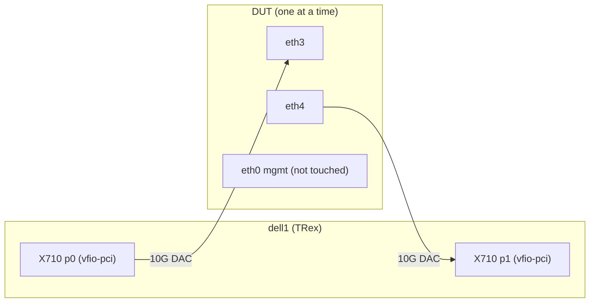

# TRex NDR performance test plan (kernel, ASK2, VPP)

Goal: a report per run in the style of performance.vyos.dev (bitrate, packet rate, drop rate at the no-drop rate), for the three dataplanes of one ISO: **S0 kernel**, **S1 ASK2**, **S2 VPP**. Mode definitions: `plans/DUAL-DATAPLANE.md`. VPP setup: `plans/VPP.md`.

Status: plan only. Nothing here has been measured. The tables in §8 are a mockup of the report layout, not data.

## 1. Rig

Generator: dell1 (access in `.agents/local.md`, i7-7700, 4C/8T), TRex v3.08 in `/opt/trex`, both ports of its X710 (`0000:01:00.0`, `0000:01:00.1`, i40e) bound to `vfio-pci`.

Required cabling: dell1 X710 p0 to DUT eth3, dell1 X710 p1 to DUT eth4. This is a rewire from the standard testrig, where each Dell has one X710 port per DUT. dell2 is not used.



The ConnectX-3 cards cannot be TRex ports: mlx4 PMD receive fails with `cannot attach flow rules (code 95)` on this firmware, and transmit caps near 5.9 Mpps at 64 B. Use the X710 only.

Ceiling per direction at 10G L1 (frame + 20 B preamble and IFG):

| Frame | Line rate (Mpps) | L2 bitrate (Gbit/s) |
|---|---|---|
| 64 B | 14.881 | 7.619 |
| 512 B | 2.349 | 9.622 |
| 1518 B | 0.8127 | 9.869 |

Reports count both directions summed, so the maximum is twice these values.

## 2. Matrix

| Axis | Values |
|---|---|
| Dataplane | S0 kernel, S1 ASK2, S2 VPP |
| Frame size | 64, 512, 1518 B (add IMIX later) |
| Flows | 1, 1024, 65536 UDP 5-tuples |
| Direction | bidirectional, symmetric |
| Traffic | routed IPv4 first; IPv6, NAT44 and VLAN as follow-ups |

One run is one cell. Change one axis at a time. Cold-boot the DUT when the dataplane changes (warm reboot does not clear BMI or MURAM state).

## 3. Dataplane setup

- **S0:** no `offload` leaves on eth3 or eth4, no `vpp settings interface` for them. Commit, verify `ask-check` shows nothing armed on them.
- **S1:** `set interfaces ethernet eth3 offload ipv4` and the same for eth4. A hit needs an established flow, so prime each tuple with a short low-rate burst in both directions first. Gate: `ask-check` passes, FE hit counters grow during the run, and the hit ratio is recorded per cell. A run with a low hit ratio is reported as such, not as an ASK2 result.
- **S2 VPP:** `set vpp settings interface eth3` and `eth4`, commit. A port cannot be ASK and VPP at once, so remove the `offload` leaves first and commit. Check that VPP actually binds both AF_XDP sockets before measuring. If VPP cannot be enabled on the build under test, skip S2 and say so in the report.

Routing: DUT eth3 `10.99.1.185/24`, eth4 `10.99.2.185/24`. TRex port 0 uses a 10.99.1.x source and port 1 a 10.99.2.x source, with the DUT MACs (`e8:f6:d7:00:16:02` and `...:03` on dut1) as `dest_mac`. Verify the live addresses on the board; do not assume.

## 4. TRex configuration

`/etc/trex_cfg.yaml`, same shape as the performance.vyos.dev example:

```yaml
- version: 2
  interfaces: ['0000:01:00.0', '0000:01:00.1']
  port_info:
    - ip: 10.99.1.112
      default_gw: 10.99.1.185
    - ip: 10.99.2.113
      default_gw: 10.99.2.185
  platform:
    master_thread_id: 0
    latency_thread_id: 1
    dual_if:
      - socket: 0
        threads: [2, 3]
```

The 4-core i7 leaves two traffic threads, which is enough for 10G at 512 B and 1518 B. At 64 B the generator may be the limit; the report must say so when it saturates (§6).

## 5. Procedure per cell

1. Cold-boot the DUT. Wait for login. Run the dataplane setup (§3).
2. Baseline: `ask-check`, MURAM used and high-water, `/proc/net/dev` for eth3 and eth4, DUT temperature, CPU load.
3. Sanity: a few seconds at 1 percent of line rate. Expect zero drops and correct MACs. Do not start at the NDR search rate.
4. NDR search with `/opt/trex/ndr`. Precision 0.5 percent of line rate, 30 s trials, loss tolerance 0.001 percent (the Spirent tolerance used in the NXP SDK reproducibility chapter). Stop the search if the DUT shows a kernel error, a watchdog message, or loses link.
5. Confirmation: 60 s at the found NDR, then 60 s at NDR plus one step to show the knee.
6. Capture: DUT `/proc/net/dev` before and after (authoritative ingress and egress counts), `ask-check`, FE hit counters for S1, VPP interface counters for S2, `dmesg` errors, CPU per core.
7. Cold-boot before the next dataplane.

## 6. Pass and caveats

- NDR is the highest offered rate whose confirmation run shows drop at or below 0.001 percent. Drop rate = (TRex tx minus TRex rx) over tx, cross-checked against DUT counters. They must agree within one frame per 1e6.
- Report the generator ceiling for the frame size. If NDR equals the TRex ceiling at that size, mark the cell generator-limited.
- Never run an NDR search against an unprimed S1 table or without the sanity step. A policed iperf3 flood has watchdog-reset the board. Ramp up, and stop at the first reset or kernel error.
- Do not touch eth0. Do not change DUT configuration during a run.
- Cells that wedge FMan need an operator cold power-cycle (Hubitat plug); record the wedge and stop the series.

## 7. Report format

One report per cell, same fields as performance.vyos.dev: VyOS version, date, generator (TRex), method (ndr), frame size, a summary (bitrate, packet rate, drop rate), generator CPU and config, DUT CPU, interface info (`ethtool -i`, `-l`, `-g`, `-k`), and DUT config. Add: dataplane, flow count, hit ratio (S1), boot type (cold), generator-limited flag. Store raw TRex JSON and DUT snapshots next to the report. Record results in qdrant with the image name, board and tags.

## 8. Mockup of the results layout (not measured)

> MOCKUP. Every number below is invented to show the layout. None was measured. Replace with measured values; do not quote.

Summary, 1518 B, 1024 flows, routed IPv4, both directions summed:

| Dataplane | Bitrate | Packet rate | Drop rate | Notes |
|---|---|---|---|---|
| S0 kernel | 19.20 Gbit/s | 1.58 Mpps | 0.000 % | |
| S1 ASK2 | 19.74 Gbit/s | 1.63 Mpps | 0.000 % | FE hit ratio 99.9 %, line rate |
| S2 VPP | 19.52 Gbit/s | 1.61 Mpps | 0.000 % | |

Full matrix, NDR in Mpps (both directions summed), 1024 flows:

| Frame | S0 kernel | S1 ASK2 | S2 VPP | Line rate (both dirs) |
|---|---|---|---|---|
| 64 B | 1.9 | 8.4 (generator-limited) | 5.2 | 29.76 |
| 512 B | 2.6 | 4.70 | 4.1 | 4.70 |
| 1518 B | 1.58 | 1.63 | 1.61 | 1.63 |

Flow-count sensitivity, S1 ASK2, 64 B, NDR in Mpps (mockup):

| Flows | NDR | FE hit ratio |
|---|---|---|
| 1 | 7.9 | 100 % |
| 1024 | 8.4 | 99.9 % |
| 65536 | 3.1 | 61 % (table pressure, rest to kernel) |

Per-cell report skeleton:

```text
# Performance Test Report (MOCKUP)
VyOS version:      <image name>
Date:              <UTC>
Traffic generator: TRex v3.08 (dell1, X710 x2, vfio-pci)
Traffic method:    ndr, tolerance 0.001 %, 30 s trials
Dataplane:         S1 ASK2 | S0 kernel | S2 VPP
Packet size:       1518
Flows:             1024
Boot:              cold

Test Summary
  Bitrate      <x.xx> Gbps
  Packet rate  <x.xx> Mpps
  Drop Rate    <x.xxx> %
  FE hit ratio <x.x> %        (S1 only)
  Generator-limited: yes|no
```
