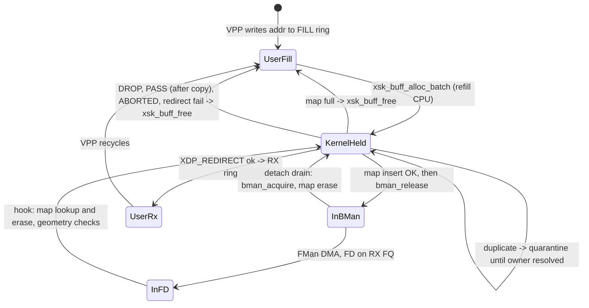
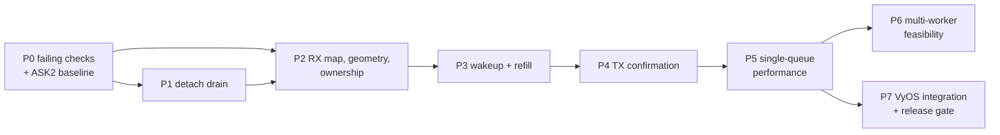

# VPP AF_XDP zero-copy: repair and performance plan

Owner of the VPP zero-copy follow-up in `plans/ASK2-MASTER-PLAN.md` §4.5. Task IDs T-M4-5a and T-M4-4d to 4g keep their meaning; §8 maps them to the phases below.

**Status.** On the current image, VPP binds eth3/eth4 (`defunct_eth3`, `defunct_eth4`) and receives nothing. The cause on DUT2 (`.106`) is proven and set out in §2.1. Source review found further defects in RX buffer geometry, frame ownership, wakeup, TX completion and detach, any of which would block a working path once the first is fixed. No fix has landed. Every claim below is labelled with its evidence level.

Scope: the AF_XDP overlay (state S2 in `plans/DUAL-DATAPLANE.md`). The kernel keeps the netdev and VPP runs XSK sockets on top. ASK2 hardware offload (S1) is out of scope, except that this plan must not cost it any performance (§5).

## 1. Goal and constraints

Goal, in order:

1. Correct ZC RX and TX through VPP on one queue per port, with every buffer owned exactly once.
2. `delete vpp` returns the ports to the kernel without a power cycle, and `pcd-snapshot` matches S0.
3. Best sustained single-core throughput, measured with iperf3 and TRex (`plans/TREX-NDR-PERF-PLAN.md`, S2 cell).
4. A measured decision on more than one VPP worker (§4, P6).

Constraints that hold in every phase:

- No ASK2 regression. The gates are in §5.
- A new datapath is tested with pings and small UDP first. Never flood a path that has not passed its correctness gate.
- Cold-boot before each silicon experiment, and record the boot type with every result.
- Use eth3/eth4 only; never touch eth0.
- Image installation is the operator's step.
- Run the qdrant gate and the independent-review steps listed per phase before changing FMan, BMan or BMI-facing code.

## 2. Evidence

### 2.1 Proven on DUT2

Image 2026.11.11-2140, kernel 6.18.62, VPP 25.10, cold boot. VPP is bound to eth3/eth4 with `cpu-cores 1` and `poll-sleep-usec 100`.

- Kernel log: `F-115 build: band=0 cnt=39139 pool_headroom=256 first_head_dma=0x0`, then `F-115 recover-miss: fd_dma=0x89e6c4000 ... base[0]=0x0 base[cnt-1]=0x0`.
- `ethtool -S defunct_eth3`: `xsk_zc_eligible` climbs with pings, while `xsk_zc_rx_recovered`, `xsk_zc_recover_lookup` and `xsk_zc_rx_redirect` stay 0. `xsk_tx_zc_submit` is 2, `xsk_tx_conf_zc` is 0, and qmap debugfs shows `xsk_tx_inflight=13` on qband 0.
- `FMBM_EBMPI[0]` holds the XSK BPID (5 on eth3, 6 on eth4) with buffer size 3584.
- VPP's UMEM is unaligned. Upstream `src/plugins/af_xdp/device.c` sets `XDP_UMEM_UNALIGNED_CHUNK_FLAG`, `frame_headroom = sizeof(vlib_buffer_t)` and `frame_size = sizeof(vlib_buffer_t) + default data size`, and binds with `XDP_USE_NEED_WAKEUP`.

Mechanism: `dpaa_xsk_build_dma_index()` snapshots `pool->heads[i]` DMA addresses at attach. In unaligned mode the kernel assigns `addr`/`dma` to an xskb only when it is allocated (`xp_init_dma_info()` skips it; `xp_get_xskb()` sets it). So every snapshot entry is 0, every lookup misses, the hook returns false, and the FD goes to the mainline path. There `dpaa_bpid2pool()` returns NULL for the XSK BPID and the frame is dropped silently. `xsk_rx_branch` is a dead counter; the oracles are `xsk_zc_rx_recovered` and `xsk_zc_rx_redirect`.

### 2.2 Defects found in source

File: `kernel/common/files/drivers/net/ethernet/freescale/dpaa/af_xdp_pool/af_xdp_pool_main.c`, except where noted. "Source" means read in the code and checked against kernel 6.18.60. "DUT-consistent" means a live counter or log on DUT2 matches the prediction. None of these is DUT-proven by a controlled A/B test yet.

| ID | Defect | Evidence | Effect |
|---|---|---|---|
| D1 | The recover index is a static snapshot of head DMA addresses, which is empty in unaligned mode (§2.1). | Proven | No ZC RX for VPP |
| D2 | `xsk_chunk_map_len` is `DPAA1_XSK_INITIAL_SEED` (8192) while `heads_cnt` can be far larger (39139 on DUT2). `dpaa_xsk_chunk_record()` silently ignores larger indexes. | Source | Misses even in aligned mode with large UMEMs |
| D3 | RX geometry. BMan receives `xsk_buff_xdp_get_dma()`, which is the XSK *data* address (`frame_dma + headroom + XDP_PACKET_HEADROOM`). FMan writes its buffer prefix there and the frame at FD offset, about 256 B later. The hook calls `xsk_buff_set_size(xdp, len)` without applying the FD offset, so VPP would get the prefix followed by a truncated frame. `fman_port_set_rx_bpool()` (patch 0102) swaps only the BPID and leaves the kernel pool size (3584) in `FMBM_EBMPI`, while VPP's usable frame is about 1792 B. A frame larger than the usable space overruns the next chunk. The hook also does not reject scatter/gather FDs, which become possible with `fsl_fm_max_frm=9600`. | Source; EBMPI size DUT-consistent | Wrong payload; UMEM overrun above about MTU 1500 |
| D4 | Frame ownership is not exactly-once. A miss, no XDP program, `XDP_PASS`, `XDP_ABORTED` or a failed redirect returns false, and the mainline path drops the FD with no buffer owner. `XDP_DROP` sets `consumed` without `xsk_buff_free()`. The refill duplicate guard drops the round without freeing the handles it allocated. | Source | Pool drains to empty over time and RX stalls |
| D5 | The TX ZC FD carries `bpid = xsk_bpid` with no `FM_FD_CMD_FCO` and no confirmation FQID. Mainline egress FQs are initialised with ContextA `EBD=1` ("deallocate buffers inside FMan", `dpaa_eth.c` `dpaa_fq_init()`). Mainline gets a TX confirmation only with `bpid = FSL_DPAA_BPID_INV`, `FCO` and `conf_fqid` (`dpaa_xmit()`). So FMan most likely releases each transmitted UMEM chunk into the XSK *RX* pool and sends no confirmation. | Source; DUT-consistent (`xsk_tx_conf_zc=0`, inflight stuck at 13) | VPP TX buffers never complete; TX chunks enter RX unrecorded |
| D6 | Detach drain can never succeed. `bman_acquire()` returns `-ENOMEM` whenever the returned count differs from the requested count, so it never returns 0 (`drivers/soc/fsl/qbman/bman.c`). The drain loop treats `n < 0` as "not drained" and `n == 0` as empty, so every detach with a BMan pool returns `-EAGAIN`. Mainline `dpaa_bp_drain()` falls back from 8 to 1 on `-ENOMEM` and treats `-ENOMEM` at 1 as empty. Introduced by `2a0f0260` (the F-275/F-276 detach-retry work), which replaced `n <= 0` (empty) with fail-closed semantics. Before that, timeouts and partial pools were treated as empty. Drained cookies are also dropped without `xsk_buff_free()`. `bin/test-xsk-detach-retry.py` checks statement order only and does not model acquire semantics. | Source | `delete vpp` cannot release ZC; ports stay `defunct_*` until power cycle |
| D7 | Wakeup runs on the wrong CPU. `af_xdp_pool_xsk_wakeup()` calls `napi_schedule_irqoff()` from VPP's syscall context, with IRQs enabled, on VPP's CPU (isolated CPU 3). DPAA NAPI belongs to a CPU-affine QMan portal, and both `af_xdp_pool_napi_refill()` and `af_xdp_pool_napi_tx_zc()` skip any CPU other than `qmap[q].cpu`. So a wakeup either refills nothing or polls another CPU's portal. `XDP_WAKEUP_TX` is not handled at all ("arrives with patch 0078", never landed). The attach seed is 0 because VPP fills its ring after bind, so refill depends on the first ingress interrupt on the portal CPU. | Source; DUT-consistent (`xsk_bman_seed_short=1`, refill only after ingress) | Cold-start RX and TX depend on unrelated traffic; possible portal race |
| D8 | Each frame runs `bpf_net_ctx_set()`, `rcu_read_lock()` and `xdp_do_flush()` individually. | Source | Per-frame overhead; a performance item, not a correctness one |
| D9 | Single queue by construction. Patch 4006 registers every rxq with `queue_index = 0`. The RX port has one primary pool (`FMBM_EBMPI[0]`), and BMI picks the pool by buffer size, not by FQ. Every qband maps to CPU 0 in qmap. | Source; DUT-consistent | Multi-queue ZC is blocked (P6) |
| D11 | Detach retry is not lifetime-safe. The XSK core (`net/xdp/xsk_buff_pool.c`, `xp_clear_dev`/`xp_release_deferred`) logs a failed `ndo_bpf(XDP_SETUP_XSK_POOL, NULL)` and still clears and frees the pool, so F-275/F-276's pending raw pool pointer is not a lifetime guarantee. | Review, source | Use-after-free if a drain stays incomplete; detach must quiesce before returning |
| D12 | Attach can report success after RXQ registration or BPID reprogramming fails (ZC RX disabled, bind still returns 0). | Review, source | False "ZC bound" with a dead RX path; roll back and fail the bind |
| D10 | Debug noise in the hot setup paths (`pr_err("ZCBIND: ...")`, F-115 prints) and dead counters (`xsk_rx_branch`). | Source | Log noise; misleading oracles |

### 2.3 Corrections to earlier documents

- The earlier version of this plan assumed a 6.18.34→6.18.38 regression in hook placement. That is superseded by D1. It also said copy mode is a dead end; that is untested on the current image and irrelevant once ZC works. The "MTU ≤ 1766" rule is replaced by an MTU limit derived from the geometry (P2).
- `plans/DUAL-DATAPLANE.md` said S2 has no silicon delta. True-ZC attach reprograms the RX port's primary BMI pool (`FMBM_EBMPI[0]` BPID) and must restore it on detach. That document now says so.
- The single-core ceiling of about 3.5 Gbit/s quoted in older notes was never measured on a working ZC path. Treat it as unknown until P5.

## 3. Target design

### 3.1 Buffer ownership contract

Each UMEM chunk handed to BMan has exactly one owner at every moment, and every exit path returns it to a known owner.

Rules:

- **Map.** Use a per-band map keyed by the exact BMan cookie, holding the `xdp_buff *`. An entry is inserted *before* `bman_release()` and rolled back if the release fails. It is erased on lookup or drain. Size it from the outstanding bound, which is the fill ring size, not `heads_cnt`. An insert that collides with a live key is a duplicate: count it and quarantine the new handle, because `xsk_buff_free()` recycles it and the original may still be in BMan and DMA-writable. Release it only after the live owner is resolved. The recommended implementation is an open-addressed table with a power-of-two size of at least 2× the fill ring. Whether it needs locking depends on whether RX for the band always runs on `qmap[q].cpu` (P0 measures this). If not, use a per-band spinlock taken with BH disabled. A validated in-buffer back-pointer is a later optimisation only if the map shows up in profiles. It must range-check against `pool->heads` and compare `xskb->dma`, because the headroom is user-writable.
- **Geometry.** Define `rx_off` as the FD data offset the port produces (read back at arm time). BMan receives `xskb->dma - rx_off`, so FMan writes the prefix into XSK headroom and the frame lands at `xdp->data`. Attach requires `pool->headroom + XDP_PACKET_HEADROOM >= rx_off`. The XSK pool's `FMBM_EBMPI` entry gets size `xsk_pool_get_rx_frame_size(pool) + rx_off`, not the kernel pool size. Detach restores both the BPID and the size. The hook accepts only contiguous FDs with `qm_fd_get_offset(fd) == rx_off` and length within the frame size. Anything else is freed and counted. MTU admission is computed from the same numbers, replacing the fixed `mtu <= 3290` check.
- **Outcomes.** `XDP_REDIRECT` success hands the buffer to the RX ring. `XDP_PASS` copies into an skb (the way mainline ZC drivers do) and then frees the buffer. Every other outcome calls `xsk_buff_free()`. The hook always consumes an FD that carries the XSK BPID, so such an FD never reaches the mainline path. A map miss means the owner is unknown. It is counted (`xsk_zc_rx_miss`), warned about once, and dropped. A non-zero miss count fails every gate.
- **Wakeup.** `ndo_xsk_wakeup` must make the band's NAPI run on `qmap[q].cpu`. One way is a per-band `call_single_data_t` IPI whose handler calls `napi_schedule_irqoff()` on that CPU. Never schedule the portal NAPI on the calling CPU. Handle both `XDP_WAKEUP_RX` (refill) and `XDP_WAKEUP_TX` (TX drain).
- **TX.** Use the mainline confirmation contract: `bpid = FSL_DPAA_BPID_INV`, `FM_FD_CMD_FCO` and a confirmation FQID. The claim discriminator cannot be the BPID any more. The recommended design is a dedicated XSK confirmation FQ per band, created at attach and retired at detach. The fallback is a UMEM DMA-range check on the shared confirmation FQ. Keep one egress FQ per band, so confirmations arrive in submit order before `xsk_tx_completed()`.
- **Detach.** Order: disable the port, restore the BPID and size, unpublish the pool, then drain with the mainline idiom (8, then 1, where `-ENOMEM` at 1 means empty and `-ETIMEDOUT` means retry with `-EAGAIN`). For each drained cookie, erase the map entry and call `xsk_buff_free()`. Retire the XSK confirmation FQ, then unmap. The F-276 pending-owner retry stays. The F-274 caveat (port-disable return does not prove the ehash walkers have drained) stays open and documented.

### 3.2 Phase dependencies

P1 comes first because a working detach lets each experiment end with `delete vpp` instead of a power cycle.

## 4. Phases

### P0: failing checks and baseline (no behaviour change)

- **T-P0-1 host harness.** Add `tests/dut/dpaa_xsk_zc.c` and `tests/dpaa_xsk_zc.py` (`pytestmark = pytest.mark.host`), modelled on `tests/ask_hw_disengage.py`. Cases, each failing on the current tree:
  - The drain loop against a mock `bman_acquire()` with kernel semantics (`-ENOMEM` unless count == num), for pools of 0, 1, 7, 8 and 9 buffers (D6).
  - Recovery against a mock unaligned pool where `heads[].dma` is 0 until allocation (D1).
  - A recorded index above 8192 (D2).
  - An ownership ledger across every hook outcome (D4).
- **T-P0-2 bind probe.** Extend `bin/dpaa1-xsk-bind-probe.py` with three options. `--unaligned` with `--frame`/`--headroom` reproduces VPP's geometry (frame 2304, headroom 256). `--verify-l2` checks the destination MAC and ethertype of the first RX descriptors. `--tx N` submits N frames. With `ping -I eth3` from the DUT, the probe reproduces D1 without VPP, and later checks D3 payloads.
- **T-P0-3 arm-time readback.** Log the expected `rx_off` once per attach, plus the `FMBM_EBMPI` id and size after reprogram, the pool headroom and `rx_frame_size`. Add per-CPU hit counters for the RX hook and refill, to settle the map locking decision.
- **T-P0-4 D5 check.** With no ingress on the port, submit N TX ZC frames. Read the XSK BPID's free count with `bin/bman-pool-count.py` before and after, along with `xsk_tx_conf_zc`. A count rise of N with no confirmations confirms D5.
- **T-P0-5 D7 check.** Start VPP with no ingress traffic. Then record `xsk_bman_refill_batches`, a new `xsk_wakeup_rx`/`xsk_wakeup_tx`/`xsk_wakeup_cpu_mismatch` counter set and the XSK pool count for 10 s.
- **T-P0-6 ASK2 baseline** on the image under test, before any driver change. Capture `ask-check`, `pcd-snapshot`, and routed v4 uni and bidir throughput with n ≥ 3 alternating runs (§5). This is the reference for every later gate.

Exit: every D1 to D7 is either reproduced by a failing check or downgraded in §2.2 with the evidence.

### P1: detach drain (D6)

- Make detach quiesce before returning (D11): the core destroys the pool even when `ndo_bpf` fails, so either drain to completion in the call or hold the pool through a core-compatible lifetime. Roll back and fail the bind on attach errors (D12). Use the mainline drain idiom described in §3.1. Free every drained cookie through the map, and keep the F-276 pending retry.
- Extend `bin/test-xsk-detach-retry.py`, or the P0 harness, to model acquire semantics, so the order-only check cannot pass a broken loop again.
- Qdrant gate: BMan acquire/drain, F-274/F-275/F-276, and AF_XDP detach quiescence. Get an independent review of the diagnosis before the fix and of the fix before reporting done.
- **Gate (T-M4-4f).** After a cold boot, run attach and `delete vpp` 10 times with pings between cycles. Pass criteria:
  - eth3/eth4 return as kernel netdevs and kernel pings pass.
  - No `deferring detach` and no `Failed to disable zero-copy`.
  - `pcd-snapshot` diff against S0 is empty.
  - Kernel BMan pool counts are stable.
  - S0→S1→S0 ASK2 engage/disengage still passes after the cycles.

### P2: RX correctness (D1 to D4, D10)

- Replace the snapshot index and the head-index map with the live cookie map from §3.1, and delete the sort, bsearch and F-115 code.
- Apply the geometry contract. Extend the 0102 primitive (or add a sibling) so it sets the size of the XSK pool's `FMBM_EBMPI` entry and restores the original id and size. The kernel pool entry of an S0/S1 port is never touched.
- Implement the outcome table, the new counters (`xsk_zc_rx_miss`, `xsk_zc_rx_free`, `xsk_zc_rx_pass_copy`, `xsk_zc_rx_bad_fd`, `xsk_zc_map_dup`), and the removal of the debug prints and dead counters.
- Qdrant gate on `FMBM_EBMPI` layout and size semantics, the BMI buffer prefix and FD offset (`FMBM_RIM`/`FMBM_RPSO`, patch 0217), and scatter/gather selection. Cross-check against `arch/fman-microcode-210-programming-reference.md` and the LS1046A DPAA RM. Get independent review before and after.
- **Gate (T-M4-4d).** Pass criteria:
  - The probe with unaligned geometry, and then VPP, receives pings with correct L2 headers.
  - `xsk_zc_rx_redirect` equals `xsk_zc_rx_recovered`.
  - Miss and bad-FD counts are 0.
  - Map occupancy returns to the BMan pool count after traffic stops.
  - VPP `show interface` RX increments.
  - A frame that is one byte over the derived MTU is rejected at admission, not overrun.

### P3: wakeup and refill (D7)

- Route RX and TX wakeups to `qmap[q].cpu`. The candidate mechanism is an IPI per band, kept only if a review confirms it is safe against the portal IRQ handler. Seed the pool on the first wakeup after attach.
- Confirm VPP's behaviour against upstream `src/plugins/af_xdp/input.c` and `output.c`. VPP refills when at least 16 slots are free and calls `recvmsg(MSG_DONTWAIT)` only when `NEED_WAKEUP` is set. VyOS sets `no_syscall_lock` for DPAA1 (`data/vyos-1x-010-vpp-platform-bus.patch`), which changes the `trylock` path.
- **Gate.** Pass criteria:
  - Within 1 s of VPP start with no ingress, the XSK pool count is above 0 and `xsk_wakeup_cpu_mismatch` is 0.
  - The first ping is answered.
  - No `napi_schedule_irqoff` warnings with lockdep enabled in a debug build.

### P4: TX ZC confirmation (D5)

- Apply the confirmation contract and dedicated confirmation FQ from §3.1, keep the per-band inflight budget, and make detach retire the FQ.
- Qdrant gate on TX FQ ContextA/EBD, `FCO` and the confirmation FQ lifecycle. Get independent review before and after.
- **Gate.** Pass criteria:
  - `xsk_tx_conf_zc` equals the frames submitted.
  - Inflight returns to 0 when idle.
  - The XSK RX pool count does not change from TX.
  - VPP answers pings, and a bidirectional UDP stream at a fixed low rate shows no buffer loss in VPP `show buffers`.

### P5: single-queue performance (T-M4-4e)

- Batch the flush per NAPI poll: add a flavor op called at the end of `dpaa_eth_poll()`, and run one `bpf_net_ctx` and one flush per poll (D8). Tune the refill batch and threshold against BMan depletion. Profile the RX hook and refill with `perf`.
- On the VPP side, tune `rxq_size`/`txq_size`, buffers and `poll-sleep-usec`. Watch the thermal trade-off: a poll-mode core without sleep has shut the board down, and `board/scripts/fan-check` must be logged.
- Measure with iperf3 (60 s, both directions) and TRex NDR (64 B, 512 B, 1518 B and IMIX; S2 cell of `plans/TREX-NDR-PERF-PLAN.md`), and record VPP `show runtime`.
- **Gate.** Pass criteria:
  - At least 3.0 Gbit/s single-stream sustained for 60 s.
  - Every correctness counter clean.
  - Temperature within limits.
  - Results recorded in qdrant.

  Report the NDR figures as measured; this plan sets no target for them.

### P6: more than one worker (D9)

- Analysis to verify: the BMI chooses the pool by buffer size, not by FQ, so one port cannot give each RSS queue its own XSK pool. A frame filled from queue A's pool can arrive on queue B, where the XSK core would refuse it. Multi-queue ZC on one port therefore needs either a shared pool across queues or RSS collapsed to one queue (old Option B).
- The cheaper gain is one queue per port with two workers (eth3 on one, eth4 on the other). This needs `isolate-cpus 2-3` and a reboot, and must be measured against the thermal limit.
- **Gate:** a measured decision, recorded in this document, with throughput per worker count. Do not advertise more than one channel (F_104) until it delivers frames.

### P7: VyOS integration and release (T-M4-5a, T-M4-4g)

- Fold any board-side fixes into `data/vyos-1x-010-vpp-platform-bus.patch`:
  - Explicit zero-copy mode for DPAA1, which fails loudly when attach falls back.
  - MTU admission from the P2 geometry.
  - Single queue until P6 says otherwise.
- Pass `git apply --3way --check` against the pinned upstream. The CI log must show `### Cached N vyos-1x .deb(s)` with N ≥ 1.
- Build a CI ISO and publish it to the relay. The operator installs it, and the gates are re-run after a cold boot. T-M4-4g is complete only when steered ZC RX, TX and reversibility all pass on a freshly installed image.

## 5. ASK2 no-regression gates

Every driver change in this plan must pass these before it is reported done:

1. `bin/test-fixups.sh` and `bin/kernel-roundtrip.sh verify` pass. `bin/dev-build.sh kernel` builds with no new warnings, and module vermagic ends in `-vyos`.
2. `bin/test-xsk-detach-retry.py <prepared af_xdp_pool_main.c>` and the P0 host harness pass.
3. The RX hook stays cheap when no XSK pool is attached: one BPID compare per FD on the kernel path. FMan-forwarded hits never reach the CPU. If profiling shows a cost in S1, gate the hook with a static key that is enabled only while an XSK pool is attached.
4. On an ASK2 port after a cold boot: `ask-check` is clean and the `pcd-snapshot` diff against the P0 baseline is empty. Routed v4 uni and bidir throughput is measured with n ≥ 3 alternating runs against the baseline image. A shortfall beyond run-to-run noise is a failure to root-cause, not to waive.
5. Mixed mode (VPP on one port, ASK2 on the other) runs once per phase from P2 onward, with both gates checked.

## 6. Bench and tooling

- DUT2 (`.106`) carries VPP work. Access and serial details are in `.agents/local.md`. Traffic comes from dell1 and dell2 in the `n106` network namespace, and can only reach a ZC-armed port as peer-initiated traffic. DUT-local pings on the bound port use the probe's XSKMAP path.
- Oracles: `ethtool -S defunct_ethN | grep xsk_`, `/sys/kernel/debug/af_xdp_pool/qmap`, `bin/bman-pool-count.py`, `board/scripts/pcd-snapshot`, and VPP `show interface`, `show errors`, `show buffers` and `show runtime`.

## 7. Risks

| Risk | Mitigation |
|---|---|
| A geometry or EBMPI size change corrupts memory | P0 readback first; host harness; independent review; pings only until the P2 gate |
| A wakeup IPI races the portal IRQ handler | Review against `qman.c` portal locking before P3; lockdep debug build |
| A dedicated TX confirmation FQ leaks on detach | Detach retire path in the P0 harness; 10-cycle P1/P4 gate |
| Detach while FMan walkers are active (F-274) | Keep the F-276 pending retry; do not inject port-disable faults until quiescence is proven |
| Thermal shutdown under poll mode | `poll-sleep-usec 100` stays the default; log temperatures in P5/P6 |
| Fixups mutate the ZC path after patches apply | Edit the plain source or owning patch, re-run `bin/test-fixups.sh`, and confirm the counts still match for F_101 (`DPAA1_MIN_UMEM_CHUNK`), F_274 (`fman_port_disable`), F_275 (`net/xdp`) and F_276 (pending XSK ownership) |

## 8. Master-plan task mapping

| Task (master §4.5) | Phase gate |
|---|---|
| T-M4-5a operator installs a current image | P7, and before each DUT gate |
| T-M4-4d DRV mode, `xsks_map[0]`, `xsk_zc_rx_redirect > 0` | P2 |
| T-M4-4e ≥ 3.0 Gbit/s | P5 |
| T-M4-4f reversibility | P1, re-checked in P4 and P7 |
| T-M4-4g completion after steered ZC RX | P7 |

## 9. Not yet verified

- Independent review confirmed D6 and D7, and rated D1, D3 and D5 as source-correct but hardware-dependent (D1 is empty only for never-allocated heads; D5's release to the RX pool is a hypothesis). D3 to D7 are source-derived. P0 must reproduce each on DUT2 or downgrade it.
- The FD data offset on the XSK pool, and whether the RX hook for a band always runs on `qmap[q].cpu`.
- Whether the BMI can return any XSK buffer as part of a scatter/gather frame when the XSK pool size is programmed correctly.
- The P6 claim that per-queue pools cannot work on one port.
- The single-core throughput ceiling of a working ZC path.
