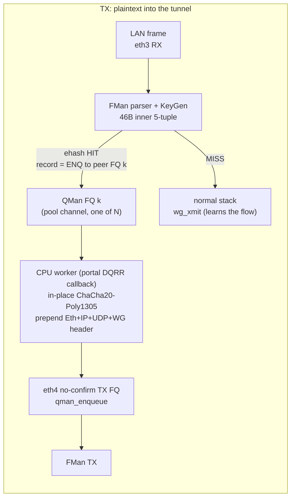
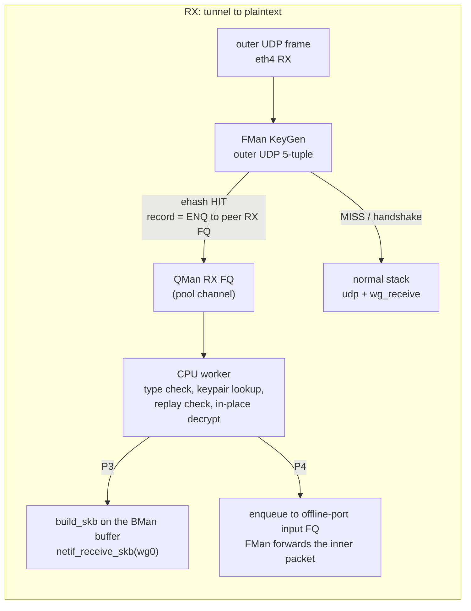

# ASK2 WireGuard fast path (stages 5 and 6): FMan classification, QMan queues, a zero-skb datapath

**2026-10-12 · dpaa1 · Status: P0, P1 and P2a done: gate G1 passed, and the lab transmit path seals and sends about 465k packets/s (5.3 Gbit/s inner) with valid ChaCha20-Poly1305 output. P2b (real peer) and later not started.** This plan replaces the "stage 5 / stage 6" sketch in `plans/ask2-wireguard-plan.md` with a design grounded in this tree's code and the qdrant FMan/QMan manual extracts. Every number marked *estimate* is derived from the profiles in `ask2-wireguard-plan.md` 2.8 to 2.16 and must be replaced by measurements at the gate that is named next to it.

## 0. Why this, and what changed from the earlier sketch

The software work is finished (patches 4011, 056, 057, GRO retired): `.185` does 1.1 to 1.6 Gbit/s on one tunnel and 1.8 to 1.9 on four, about 36k cycles per inner packet, of which ChaCha20-Poly1305 is about 9k. The earlier ceiling for an FMan fast path (about 30%) counted only the forwarding-equivalent work (about 12k cycles). That was too pessimistic, for two reasons found while preparing this plan:

1. A fast path that never builds an `sk_buff` also removes the **outer-packet transmit path** (`udp_tunnel_xmit_skb`, netfilter output hooks, `dev_queue_xmit`, qdisc, `dpaa_start_xmit`), which is about 37% of cycles on the serial worker, plus the queueing/wakeup cost between the two worker stages. Only the crypto itself (about 26% leaf, about 36% including the scatter/gather and interrupt-attributed extras) cannot be removed.
2. **Ordering is mostly free.** The serial `wg_packet_tx_worker` exists so that outer packets leave in nonce order. A receiver's replay window (8128 packets) tolerates reordering far beyond what a few CPUs produce, and TCP only cares about order *within* an inner flow. If each inner flow is pinned to one frame queue (QMan keeps an FQ in order and dequeues it on one portal at a time), per-flow order is automatic and **stage 6 (order restoration) is needed only to parallelise a single flow**, not to scale in general.

Corrections to claims made earlier in this project: ASK2 *does* have offline-port substrate (patches 0175 to 0184), and mainline `qbman` *already* carries the order-restoration fields (section 3). The "KeyGen byte extraction after the UDP header" open item is **not needed**: the outer WireGuard flow is an ordinary UDP 5-tuple, which the existing 46-byte dual-lane ehash key already matches; handshake packets from the same peer are separated in software by the message-type byte.

## 1. Target and honest expectations

Gateway role as before: the DUT terminates the tunnel; dell1 and dell2 are the endpoints. All figures TCP, MTU 1420.

| | Today (image 1740, 4 tunnels) | Estimate after P2 (TX) | Estimate after P3 (RX, skb reinject) | Estimate after P4 (RX, offline-port reinject) |
|---|---|---|---|---|
| Cycles per inner packet, TX direction | about 36k | about 13k | n/a | n/a |
| Cycles per inner packet, RX direction | about 36k | n/a | about 19k | about 13k |
| Aggregate `up` / `down`, 4+ inner flows | 1.8 / 1.9 Gbit/s | 3.5 to 4.5 / unchanged | unchanged / 2.8 to 3.4 | unchanged / 3.5 to 4.5 |
| Single inner flow | 0.9 to 1.3 up | about 1.5 (one core) | about 1.5 | about 1.5; stage 6 lifts it |

Basis of the TX estimate: crypto 9.3k + FQ dequeue and frame descriptor handling 1.5k + outer header build from a cached route/neighbour 1k + TX enqueue 0.8k + nonce atomic and bookkeeping 0.5k = about 13k, so four A72 cores at 1.6 GHz, 90% usable, give about 440k packets/s, which is about 5.0 Gbit/s of 1420-byte payload before memory-bandwidth losses (the original model warns of a DRAM limit near 4 Gbit/s). The range above takes that limit into account. These are estimates; **gate G1 measures the real ceiling before any WireGuard code is written.**

10G WireGuard stays out of reach (crypto alone caps four cores at about 7.9 Gbit/s). This plan can at best double the current result.

## 2. Architecture

Design rules that fall out of the existing ASK2 constraints:

- **Per-peer fast-path object inside the `wireguard` module** (a carried out-of-tree patch, like 4011), not a separate module. It needs the peer's current keypair, the noise counter, the replay counter, the timers and the endpoint, none of which are exported. `ask.ko` supplies only the hardware side (record insert/delete, FQ ids) through a small registration API.
- **Records are installed by the slow path.** The first packets of an inner flow go through the normal stack and `wg_xmit`; when `wg_xmit` has resolved the peer, the endpoint and the keypair, the module asks `ask.ko` to install an inner-5-tuple record that ENQs to one of the peer's TX FQs. A MISS is always safe (it just stays on today's path), which is the same fail-open property the rest of ASK2 relies on.
- **N frame queues per peer, not one.** The module creates N (start with 4) TX FQs per peer on a pool channel and assigns inner flows to them round-robin when it installs records. Per-flow order is then guaranteed by QMan, and four flows can run on four cores at once. The QMan manual (qdrant: Chapter 3 scheduling, BSP Chapter 5 FQ configuration) advises 4 or more active FQs per active portal and at most about 1024 ingress FQs in total, so the design stays well inside the limits.
- **In-place operation on the BMan buffer.** DPAA RX buffers carry headroom and tailroom (`dpaa_eth` sets them up for `build_skb`, XDP and AF_XDP; the exact figures are an open item, section 8). The inner IP packet is encrypted where it lies, the 44-byte WireGuard/UDP/IP header and the 14-byte Ethernet header are written into the headroom, the 16-byte tag into the tailroom, and the same frame descriptor is enqueued to the egress port's no-confirm TX FQ (the F-fix FQ already used for offloaded traffic). No `memcpy` of the payload, no `sk_buff`.
- **FMan keeps doing what it already does well**: TTL decrement and MTU check run in the record's opcode chain before the ENQ (opcode families `05`, `41`, `42` are in the vendor record layout, `arch/fman-fe-ehash.md`); DF-set oversize frames are host-punted today and keep working.

## 3. Facts this plan stands on

From this tree (verified in source on 2026-10-12, not on silicon unless stated):

- **QMan order restoration is mostly present in mainline 6.18.55.** `struct qm_eqcr_entry` has `seqnum` and the `NESN`/`NLIS`/`SEQMASK` bits (`drivers/soc/fsl/qbman/qman.c:180-195`); `struct qm_dqrr_entry` has `seqnum` (`include/soc/fsl/qman.h:249`); `struct qm_fqd` has `orpc` and `QM_INITFQ_WE_ORPC` exists; `QM_FQCTRL_AVOIDBLOCK` ("don't block active") exists; ORP window result codes exist (`QM_MR_RC_ORPWINDOW_*`). What is missing is an enqueue helper that fills the ORP field (`__reserved[4]` in the entry) and sets the sequence number: a patch of roughly 40 lines. The LS1046A manual (qdrant) states sequence numbers are 14 bits modulo 2^14, the ORL records live in portal SRAM for 256 entries and spill to PFDR, and early/late/retired windows reject frames rather than reordering them.
- **Records already carry an arbitrary target FQID.** `ask_fe_*` action builders take `tx_fqid`; the B2 bridge path resolves the destination netdev's FQID and installs the record. Nothing in the record format requires the FQID to belong to a transmit queue.
- **Offline-port substrate exists:** patches 0175 to 0184 (device-tree bind, register bring-up, debugfs harness, input-FQ scheduling board-validated through phase 1d; inject/capture/dump 0183/0184 never board-tested).
- **A "FQ drained by a CPU without an skb" pattern exists:** the AF_XDP pool/true-ZC RX patches (0073 to 0114) already dequeue from dedicated FQs into XSK buffers (`af_xdp_pool_rx_hook` appears in the profile at 0.5%), and patch 0134 (`caam_qi_ext_consumer_register`) redirects a CAAM response FQ to a caller-supplied sink FQID.
- **No-confirm per-port TX FQs exist** (the global TX-confirm bypass was removed for a per-port FQ after the 2026-08-21 skb leak).
- **Stats are O(1)-able:** counters sit at `record+256/+264` and are written unconditionally by the silicon (qdrant 2026-08-22); the O(N^2) stats refresh collapse (2026-10-10) must be fixed before large flow counts, but WireGuard needs only tens of records per peer.

From the manuals (qdrant): offline/host ports can dequeue from QMan, run parser/classifier/controller logic and enqueue to QMan (LS1043A/1046A RM Chapter 5; offline ports share the FMan aggregate budget of about 13 Gbit/s at 1518 B); pool channels are serviced by any portal that enables them, dedicated channels by one; a held-active FQ keeps order inside one portal; AVOIDBLOCK plus ORP is the documented way to fan a single FQ out to several consumers and restore order on enqueue.

Known hazards from ASK2 history that apply directly (S0 of `AGENTS.md`): the FE engine wedges when a second v6 port is armed; non-IP frames hitting DA records are dropped silently; `fe_lock` convoy under thousands of flows; PORT_ID in the 14-byte key is already the 46-byte dual-lane key now; `softlockup_panic` and `panic_on_rcu_stall` must be armed during any experiment, and cold boot before silicon experiments.

## 4. Phases, gates and kill criteria

Each phase is one variable, ends in a measurement, and has a kill criterion. S0 applies to every phase that touches FMan: three or more focused qdrant queries before the change, cross-check against `arch/fman-microcode-210-programming-reference.md` and `specs/fman-keygen-flow-key-spec.md`, readback of every silicon write, cold boot per experiment.

### P0. Feasibility (done in this document)

Deliverables: this plan, the correction of the offline-port claim, the facts in section 3. No code.

### P1. How fast can the CPUs drain a flow-engine-fed queue? (gate G1)

**Narrowed by what the project already proved.** Delivering a flow-engine HIT to a chosen CPU queue is silicon-verified: patch 0194 gives records an explicit `rx_fqid`, and the 2026-09-06 board pass recorded a 514/512 FQID differential (matched flows reached the rule's queue, mismatches went to the default queue). The debugfs `fe_flow add <tbl> <keyhex> <fqid>` path can already target any FQID. So P1 no longer has to prove delivery, only the drain rate of a light consumer: a consumer that does not build an `sk_buff`.

**Built (patch 4013, `dpaa_wgfp.c`, compiled against the 6.18.55 CI tree, not yet run):** per-CPU sink queues on each CPU's affine channel; the dequeue callback follows the `dpaa_eth` NAPI/portal hand-off exactly (the 4012 lockup came from mishandling portals shared between netdevs, so the sink never assumes its own NAPI is the one polling); each frame is DMA-synced for the CPU, optionally touched (none / first and last 64 bytes / read all / read and write all), synced back and returned to its BMan pool through three narrow helpers in `dpaa_eth.c`. Inert until `echo "create N" > /sys/kernel/debug/dpaa_wgfp/ctl`.

**Harness:** `bin/testrig-wgfp-p1.sh` creates the sinks, inserts one 46-byte-key record per test flow into the per-port IPv4 tables, drives dell1's kernel packet generator (`testrig-pktgen.sh`, 16 flows by default) at increasing rates, and reports delivered frames per second, delivery percentage, per-core load and queue backlog. Records inserted by debugfs cannot be removed one by one, so the board is rebooted after the run.

**Gate G1:** at least 600k frames/s delivered over four CPUs at under 0.1% loss, 1434-byte frames, "read all" touch, no wedge, no buffer-pool depletion over a 10-minute soak. **Kill:** under 350k frames/s. Also measure the "read and write all" mode (it mimics in-place encryption) and one, two and four sinks.

Not measured by P1 and still open: behaviour when a sink queue is full (no tail-drop is configured; the earlier A6-LOSS finding shows a queue without congestion control can hold a very large invisible backlog), and the buffer-pool accounting when buffers leave and re-enter a pool outside `dpaa_eth`.

Effort: 3 to 5 days including CI cycles. Risk: low (default-off lab code, existing record format).

**P1 result (image 1943, `.185`, 2026-10-12): gate G1 PASSED with a large margin.** 16 UDP flows (dell1 pktgen, 1434-byte wire frames) matched by one flow record each, in the three 50-byte-key tables, enqueued to four sink queues (one per CPU); the sinks read the whole frame (touch 2) or read and write it (touch 3), then return the buffer to BMan. Board state: production kernel, flow engine engaged, lockup-to-panic armed, no kernel errors.

| Run | Offered | Delivered | Per-core load |
|---|---|---|---|
| 4 sinks, touch 2, 100k to 700k paced | 98k to 687k/s | 100.00% at every step | 3 to 15% |
| 4 sinks, touch 2, unpaced (line rate) | 856k/s | 100.00% (6.88M frames) | 15 to 24% |
| 4 sinks, touch 3 (read+write), 500k to 800k paced | 489k to 784k/s | 99.93 to 100.00% | 7 to 25% |
| 4 sinks, touch 3, unpaced | 850k/s | 94.1 to 94.7% (809k to 814k/s) | 16 to 28% |
| 2 sinks, touch 3, unpaced | 850k/s | 95.1% (818k/s) | 34% on the two busy cores |
| 1 sink, touch 3, unpaced | 858k/s | 74.9% (644k/s) | 52% on its core |
| 4 sinks, touch 3, 10-minute soak, unpaced | 859k/s | 94.5% (487M of 516M frames, 812k/s) | 26 to 42% |

- Delivery of a hit to a software queue works exactly as 0194 predicted; no errors, no scatter/gather frames, no backlog left at the end of any run, no wedge in the 10-minute soak, nothing in `dmesg`.
- The consumer framework is cheap: one core sustains at least 644k frames/s at 52% load, which is about 0.8 microseconds (about 1,300 cycles) per frame for dequeue, DMA sync, touching the whole 1.4 KB and returning the buffer. The plan assumed 1,500 cycles for this slice, so the 13k-cycle transmit estimate stands.
- Capacity is not the limit: with read and write, the sinks are lossless up to 800k frames/s on four CPUs. The 5% loss at full line rate (850k+) happens with the cores far from saturated and with fewer sinks it grows (75% delivery with one sink), so it is a burst-absorption limit upstream of the CPU (the RX buffer pool is only about 2,270 buffers, about 2.7 ms at line rate), not a drain-rate limit. It was not localised further: the BMI discard counters read zero on this image (they are not enabled), so the cause is inferred, not measured.
- Flow spread over the sinks was uneven in the soak (one sink received about 25% fewer frames than the others with 16 flows over 4 sinks); the real fast path assigns flows round-robin when it installs records.
- The sink records stay in the flow tables until reboot (debugfs `del` only covers table 0).

Open from P1, carried into P2: behaviour with a full sink queue (no tail-drop was configured, and the run never overloaded a queue), the 5% line-rate loss mechanism, and the F-232 transmit-confirm prerequisite below.

### P2a. Lab seal: the real transmit cost before any peer integration

Built before P2 proper because it answers the question P2 depends on, using only what P1 proved. **F-232 is closed** (verified on image 1943: 6.8M offloaded frames produced zero TX-confirm frames and no F-227 drops; the no-confirm queue now uses the vendor-proven `context_a` 0x9a000000c0000000 with tail-drop, commits `eaf2efa4` and `0460d6a3`), so the transmit queue may carry frames that are not `sk_buff`s.

- **Architecture (patches 4014 and 4015).** `fsl_dpa` is built in and the ChaCha20-Poly1305 library is a module (`=m`), so the sealing code lives in the `wireguard` module, which will own the keypairs in P2b. `dpaa_wgfp.c` exposes a consumer hook (`include/linux/fsl/dpaa_wgfp.h`): `dpaa_wgfp_register`, `dpaa_wgfp_set_egress` (resolves the egress port's no-confirm TX queue), `dpaa_wgfp_xmit` (DMA sync, then enqueue the same buffer) and `dpaa_wgfp_drop`. `wireguard/fastpath.c`, built only with `CONFIG_FSL_DPAA_ETH`, registers the hook when root writes a configuration to the `wgfp_lab` module parameter.
- **Lab behaviour.** Each steered Ethernet+IPv4 frame is sealed in place with a fixed lab key (inner IP packet padded to 16 bytes, 16-byte tag appended), the Ethernet, IPv4, UDP and WireGuard transport headers (58 bytes) are written into the buffer headroom, and the same buffer is enqueued to eth4's no-confirm queue. No peer, no handshake, a global counter, IPv4 outer with a zero UDP checksum: it measures the cost and proves the bytes, it is not a VPN.
- **Harness `bin/testrig-wgfp-p2a.sh`.** Same flows and records as P1; reports sealed packets per second, what dell2 receives (X710 MAC counter), transmit failures and per-core load, and decrypts one captured packet on dell2 with `cryptography` to prove the sealed bytes are valid. Frame size 1438 on the wire gives a 1420-byte inner IP packet (sealed IP length 1484, inside the 1500 MTU).
- **Expectation to test:** about 13k cycles per packet, about 440k packets/s on four cores. A result under 250k packets/s means the model is wrong and P2 needs re-planning before any WireGuard integration.

**P2a result (image 2243, `.185`, 2026-10-12): the lab transmit path works and runs at about 465k packets/s.** 16 flows, four sinks, 1438-byte wire frames (1420-byte inner IP), real ChaCha20-Poly1305 in place, headers written into the buffer headroom, same buffer enqueued to eth4's no-confirm queue. dell2 counts what arrives at its NIC. (`/mnt/builds/ask2-review/oracle/wgfp-p2a-20261012-2301.csv`)

| Offered (frames/s) | Sealed | dell2 received | Transmit failures | Core load |
|---|---|---|---|---|
| 98k | 100.00% | 100.00% of sealed | 0 | 3 to 8% |
| 196k | 100.00% | 100.00% | 0 | 8 to 9% |
| 295k | 100.00% | 100.00% | 0 | 12 to 18% |
| 391k | 99.99% (399,972/s) | 100.00% | 0 | 16 to 25% |
| 491k | 93.6% (468,132/s) | 100.00% | 0 | 19 to 40% |
| 853k (unpaced) | 54.2% (464,825/s) | 100.00% | 0 | 43% on every core |

- **Correctness:** two captured packets were decrypted on dell2 with a userspace ChaCha20-Poly1305 and the lab key: WireGuard type 4, receiver index 7, counters 0 and 1, outer frame 1498 bytes, inner IPv4 `10.99.1.112:1000x -> 10.99.2.113:9000`, total length 1420, 4 pad bytes. The sealed bytes are valid.
- **Ceiling:** the sealer plateaus at about 465k packets/s, which is 5.3 Gbit/s of inner payload (5.57 Gbit/s on the wire) and 2.9 times today's software WireGuard (about 158k packets/s at 1.8 Gbit/s). The estimate was 420k with an 80% range of 330k to 520k; the model's CPU-bound figure was 460k.
- **Everything the sealer emitted arrived:** dell2 received 100% of sealed frames at every rate and there were no enqueue failures, so the loss at the top rates is before the sealer (the same burst-absorption effect seen in P1), not in transmit.
- **Unexplained, and worth explaining before P2b:** at the plateau every core reports only 43% busy, which does not look CPU-bound, yet the plateau is flat from 500k to 853k offered and almost exactly at the model's CPU-bound figure. Either `/proc/stat` under-reports the time spent in NAPI with NEON, or a hardware or queue limit sits near 465k packets/s. `perf stat -a -e cycles` on the DUT during an unpaced run would separate the two (cycles stop counting when a core idles).
- **Still not shown:** a real peer and keypair, rekey and timers, TCP with its ACK stream (the receive path is still the software path), IPv6 and the receive direction.

### P2. TX fast path (stage 5, transmit half) (gate G2)

**Prerequisite found while preparing P1: the "no-confirm" TX queue still emits TX-confirm frames.** The 2026-08-24 F-232 board run showed records correctly target the no-confirm queues (0x2ba/0x2bb) yet F-227 keeps dropping bogus confirmations, i.e. the intended `context_a` (B0V=0) does not suppress them on 210.10.1 silicon; the vendor uses a different `context_a` (low word 0xC0000000, qdrant 2026-08-15). The transmit fast path enqueues frames it did not allocate as `sk_buff`s, so a TX-confirm for them lands in `dpaa_eth`'s confirm handler. Resolve this first (correct the `context_a` encoding or keep F-227's drop path as the supported mechanism and measure its cost) before building P2 on it.

Inside the `wireguard` module (new `fastpath.c`, hooks in `device.c` and `send.c`, carried as a board patch): on the first `wg_xmit` for a flow whose peer, endpoint and valid keypair are known and whose ingress interface is an ASK-engaged port, ask `ask.ko` to install the record; the worker (the sink callback from P1, now doing real work) does: keypair validity and counter (`atomic64_inc_return`) check, in-place `chacha20poly1305_encrypt` on the contiguous buffer, header build from a cached route and neighbour entry (invalidated on route/neighbour events), UDP checksum policy (zero checksum is legal for IPv4; IPv6 needs the FMan checksum command or a software sum, deferred), enqueue to the no-confirm TX FQ. Anything unexpected (keypair near `REKEY_AFTER_*`, no neighbour, oversize, keepalive timer due, peer removed) punts the frame to the normal stack by building an skb and calling `wg_xmit`'s slow path, and the record is withdrawn.

**Gate G2:** with dell1 sending four inner TCP flows, dell2 (stock Linux WireGuard) receives and decrypts correctly (no `Invalid MAC` counters, tunnel stays up across a forced rekey at 120 s and a flow teardown), and `up` aggregate is at least 2.6 Gbit/s on the validated matrix. **Kill:** under 2.2 Gbit/s, or any silent corruption.

Effort: 3 to 4 weeks. Risk: medium (module internals, rekey/timer semantics, endpoint roaming).

### P3. RX fast path with skb reinjection (stage 5, receive half) (gate G3)

Install an outer-UDP record per peer endpoint that ENQs to a peer RX FQ set; the worker validates the message type, finds the keypair by receiver index (existing index hashtable), checks the replay counter, decrypts in place, strips the outer headers, `build_skb`s the same buffer and calls `netif_receive_skb` on `wg0` so the inner packet takes the normal forwarding path. Handshake and cookie messages are handed to the stack unchanged.

**Gate G3:** `down` aggregate at least 2.6 Gbit/s with four flows, replay-window and out-of-order tests from `tools/testing/selftests/wireguard/netns.sh` pass. **Kill:** under 2.2 Gbit/s.

Effort: 2 to 3 weeks after P2 (shares the keypair/replay code).

### P4. Offline-port reinjection of the decrypted packet (shared with IPsec Tier 2) (gate G4)

Instead of `build_skb`, enqueue the decrypted frame to the offline port's input FQ so FMan classifies and forwards the inner packet in hardware. This is exactly the substrate `ASK2-IPSEC-OFFLOAD-PLAN.md` Phase 2 needs; the work should be done once, for both consumers, and starts by board-validating patches 0183/0184 (inject/capture) which are untested. **Gate G4:** frames injected by the CPU into the offline port reach the LAN egress with correct L2 rewrite and TTL, no FE leak (reversibility, `pcd-snapshot` clean). **Kill/defer:** if the offline-port FE path wedges or leaks, stop at P3; the RX direction then stays at the P3 level.

Effort: 4 to 8 weeks, mostly silicon bring-up; this is the highest-risk phase.

### P5. Stage 6: order restoration for a single flow (gate G5)

Only if the product needs more than about 1.5 Gbit/s per inner flow. Add `qman_enqueue_orp()` (about 40 lines in `qman.c` and `qman.h`), create the input FQ with `QM_FQCTRL_AVOIDBLOCK` and `orpc` set (window smaller than the receiver's replay window, start at 256 of 8128), read `dq->seqnum` in the worker and enqueue the sealed frame to the egress FQ through the ORP with that sequence number, handle `ORPWINDOW_LATE/EARLY` rejects as drops with counters. **Gate G5:** one inner TCP flow reaches at least 2.2 Gbit/s with zero inner-TCP reorder retransmits beyond baseline. **Kill:** reject rate above 0.1% or any stall.

Effort: 2 to 3 weeks. The fallback the original sketch mentions (KeyGen hashing on counter bits) is rejected: it reorders TCP at burst edges.

### Cross-cutting work

- Registration API between `wireguard` and `ask.ko` (insert/delete record by key, FQ allocation, port lookup), with the same reversibility contract as the rest of ASK2: every insert has an inverse, `pcd-snapshot diff` clean after disengage.
- Security review of the fast path: no key material in debugfs/logs, constant-time primitives only (the library functions already are), counter handling identical to `send.c`, the carry cost of re-checking every upstream WireGuard fix against `fastpath.c` is real and permanent.
- Harness: `bin/testrig-wireguard-multi.sh` already runs N tunnels; the fast path needs **at least four inner flows**, so the harness gains `STREAMS`-per-tunnel control (done) and a single-flow cell; add FQ/record counters to the per-run CSV.
- Safety: arm `kernel.softlockup_panic=1` and `kernel.panic_on_rcu_stall=1` for every experiment (see `bin/testrig-wireguard-gro-check.sh`); never experiment on `eth0` (the SSH lifeline).

## 5. Alternatives considered

| Option | Verdict |
|---|---|
| Keep software WireGuard as is | Valid. 1.8 to 1.9 Gbit/s with four tunnels. This plan is the only route to roughly double it. |
| IPsec through CAAM (`ASK2-IPSEC-OFFLOAD-PLAN.md`) | Ruled out by the product: home users run WireGuard. (WireGuard cannot use CAAM anyway: no ChaCha20-Poly1305 on Era 8.) The offline-port substrate is still shared work if IPsec is ever funded for other reasons. |
| Offload the crypto to CAAM-style hardware | Not possible for WireGuard on this SoC. |
| KeyGen hash on the WireGuard counter to spread one peer | Rejected: reorders inner TCP at burst edges, and the spread is available for free from flow pinning. |
| FMan message-type classification (UDP payload byte 0) | Not needed: software separates handshakes after the FQ; avoids an unverified KeyGen extraction past the UDP header. |
| Userspace/AF_XDP WireGuard (`wireguard-go` style) | Considered and rejected: the AF_XDP zero-copy path on this driver is limited to MTU 3290 and the cost of crossing to userspace is higher than the in-kernel FQ worker. |

## 6. Risks and how each phase contains them

| Risk | Where it bites | Containment |
|---|---|---|
| FE engine wedge or FE-index leak on a new record shape | P1, P2, P4 | Records are the existing shape (only the target FQID differs); one port at a time; cold boot per experiment; panic-on-lockup armed; `pcd-snapshot` diff after each run. |
| Sink FQ full backs up into the FE (tail drop vs wedge) | P1 | Explicit test (P1 measurement d); size FQ and congestion group before enabling; kill criterion. |
| Buffer pool accounting (BMan depletion or double release) | P1 to P4 | Release only through the existing `dpaa_fd_release` path; 10-minute soak with BMan depletion counters. |
| Fast path diverges from upstream WireGuard semantics (rekey, roaming, timers, cookie handling) | P2, P3 | Punt-to-stack on any doubt; run the upstream netns selftest suite on every change; keep the slow path authoritative. |
| Carry cost: every upstream WireGuard security fix must be reviewed against `fastpath.c` | permanent | Keep the module patch small and isolated; document the invariants it copies from `send.c`/`receive.c`. |
| Memory bandwidth limit near 4 Gbit/s | P2 to P4 | Measure in G1; targets above are already derated. |
| O(N^2) flow-stats collapse and `fe_lock` convoys | multi-peer deployments | WireGuard needs tens of records; still fix the stats path before shipping (separate ASK2 item). |
| ASK engages per port: a WireGuard peer behind a non-engaged port gets no fast path | product | Documented; fast path is an add-on for ASK-engaged ports, slow path is unchanged. |
| ASK and VPP are mutually exclusive per interface | product | Same rule as every ASK2 capability. |

## 7. Decision points

1. **After P1/G1:** continue only if the drain rate is at least 600k frames/s. This is a one-week, low-risk experiment and it resolves the largest unknown.
2. **After P2/G2:** if TX reaches 2.6 Gbit/s on four flows, the project has paid for itself; P3 then follows mechanically.
3. **Before P4:** decide jointly with the IPsec plan whether the offline-port reinjection substrate is worth building (it serves both).
4. **Before P5:** only if single-flow throughput matters to a named workload.
5. At any kill criterion: stop that phase, keep everything shipped so far, and re-plan the remaining phases (IPsec is not an option: the target users run WireGuard).

## 8. Open items to close before or during P1

- [x] RX buffer headroom and tailroom (source, mainline 6.18.55 `dpaa_eth.c`): `DPAA_RX_PRIV_DATA_DEFAULT_SIZE = DPAA_TX_PRIV_DATA_SIZE (16) + XDP_PACKET_HEADROOM (256) - DPAA_HWA_SIZE`, buffers are `DPAA_BP_RAW_SIZE` 4096 bytes, so there are at least 256 bytes of headroom before the frame data (Ethernet plus outer IP, UDP and WireGuard headers need 58) and more than 2.5 KB behind a 1420-byte inner packet for the 16-byte tag. Still to confirm on a live FD dump on `.185` in P1, because this tree's order-0 buffer patches (F-203/F-222) change buffer sizing.
- [ ] Exact ENQ record semantics for a non-transmit FQID (does the FE need the FQID's channel/WQ or only the id?). Expected same as a TX FQ; P1 proves it.
- [ ] How pool-channel FQs are created and serviced today in `dpaa_eth` (`dpaa_fq_setup`, channel allocation) so the sink FQs reuse the same helpers; whether a portal limit (10 portals, 4 CPUs used) restricts K.
- [ ] Current state of the O(1) stats fix and of the FE wedge history for the shapes used here.
- [ ] `qman_enqueue_orp` verb and ORP-field encoding checked against the LS1046A RM Chapter 3 enqueue command table (qdrant chunk "QMan enqueue and dequeue command formats") before writing the helper.
- [ ] UDP checksum offload for IPv6 outer packets from the TX FQ (FMan TX parse/checksum command in the FD) or a software sum.
- [ ] Whether the neighbour/route cache for the outer header can be shared with the existing `ask_neigh.c` machinery.

## 9. References

- `plans/ask2-wireguard-plan.md` (measurements, profiles, 2.13 to 2.16), `plans/ASK2-IPSEC-OFFLOAD-PLAN.md` (shared offline-port substrate), `plans/ASK2-MASTER-PLAN.md`.
- `arch/fman-fe-ehash.md`, `arch/fman-microcode-210-programming-reference.md`, `specs/fman-keygen-flow-key-spec.md`, `specs/ask2-ipv6-dual-lane-key-design.md`.
- Source: `kernel/ask/oot-modules/ask/ask_hw.c` (`ask_hw_resolve_oif_fqid`, `ask_hw_b2_l2_record`), `kernel/common/patches/board/0153-fman-pcd-fe-engage-api.patch` (`struct fman_pcd_fe_flow_action`), patches 0134, 0175 to 0184, 0073 to 0114; mainline 6.18.55 `drivers/soc/fsl/qbman/qman.c`, `include/soc/fsl/qman.h`, `drivers/net/wireguard/`.
- qdrant: LS1046A/LS1043A DPAA reference manual extracts (Chapter 3 QMan order restoration, enqueue/dequeue formats, scheduling; Chapter 5 offline ports and QMI), BSP guide Chapter 5 FQ configuration, ASK2 entries 2026-08-15, 2026-08-22, 2026-10-03, 2026-10-08 to 2026-10-10.
