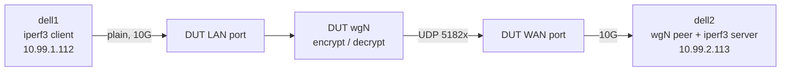

# WireGuard throughput matrix: `.106` reference against `.185` (VyOS)

**Measured 2026-10-12 to 2026-10-13.** Nine cells on each board (1, 2 and 4 tunnels, each up, down and bidirectional), same method, medians reported. This is the record of the measurement: result, raw values, per-run load, configuration, method, caveats and how to repeat it. The optimisation work that produced the `.185` configuration is in `plans/ask2-wireguard-plan.md`; the zero-skb fast path plan is `plans/ASK2-WIREGUARD-FASTPATH-PLAN.md`.

## 1. Result

IPv4 inner traffic, tunnel MTU 1420, iperf3 TCP, aggregate Gbit/s, median (minimum to maximum).

| Tunnels | Direction | `.106` reference | `.185` VyOS | `.185` against `.106` |
|---|---|---|---|---|
| 1 | up | 1.38 (0.91 - 1.44) | 1.17 (1.10 - 1.21) | -15% |
| 1 | down | 1.30 (1.29 - 1.55) | 1.56 (1.49 - 1.60) | +20% |
| 1 | bidir | 1.51 (1.36 - 1.68) | 1.54 (1.41 - 1.61) | +2% |
| 2 | up | 1.44 (1.44 - 1.44) | 1.60 (1.58 - 1.61) | +11% |
| 2 | down | 1.58 (1.57 - 1.61) | 1.64 (1.60 - 1.70) | +4% |
| 2 | bidir | 1.68 (1.68 - 1.68) | 1.79 (1.78 - 1.80) | +7% |
| 4 | up | 1.57 (1.56 - 1.57) | 1.77 (1.73 - 1.85) | +13% |
| 4 | down | 1.66 (1.66 - 1.66) | 1.87 (1.86 - 1.88) | +13% |
| 4 | bidir | 1.69 (1.69 - 1.69) | 1.86 (1.84 - 1.91) | +10% |

`up` means the board encrypts (traffic enters on the LAN port and leaves through the tunnel), `down` means the board decrypts, `bidir` means both at the same time (the figure is the sum of both directions).

What the table says:

- `.185` is ahead in eight of nine cells. The exception is single-tunnel `up`, the case bounded by WireGuard's single serial transmit stage (section 5).
- Adding tunnels helps both boards, but `.185` scales further: about 1.2 to 1.9 Gbit/s from one to four tunnels against about 1.4 to 1.7 for `.106`.
- Neither board gets near the crypto ceiling of about 7.9 Gbit/s for four cores (6.45 cycles per byte measured), so per-packet overhead outside the crypto is what both are limited by.

## 2. Raw values (Gbit/s, in run order)

| Cell | `.106` runs | `.185` runs |
|---|---|---|
| 1 tunnel up | 1.375, 1.441, 1.408, 0.909, 1.363 | 1.148, 1.208, 1.098, 1.192, 1.171 |
| 1 tunnel down | 1.308, 1.547, 1.289, 1.304, 1.301 | 1.588, 1.544, 1.563, 1.601, 1.490 |
| 1 tunnel bidir | 1.515, 1.360, 1.610, 1.679, 1.498 | 1.606, 1.413, 1.543, 1.586, 1.421 |
| 2 tunnels up | 1.438, 1.444, 1.440 | 1.611, 1.582, 1.599 |
| 2 tunnels down | 1.572, 1.608, 1.583 | 1.639, 1.696, 1.599 |
| 2 tunnels bidir | 1.677, 1.678, 1.677 | 1.795, 1.805, 1.783 |
| 4 tunnels up | 1.556, 1.571, 1.566 | 1.849, 1.732, 1.772 |
| 4 tunnels down | 1.664, 1.662, 1.656 | 1.883, 1.873, 1.862 |
| 4 tunnels bidir | 1.689, 1.688, 1.689 | 1.840, 1.907, 1.856 |

Files: `/mnt/builds/ask2-review/oracle/wgfull-106-t{1,2,4}.csv` and `wgfull-185-t{1,2,4}.csv` (one CSV per tunnel count and board; the 1-tunnel files also carry DUT load, retransmits and the busiest CPU for each run). The raw iperf3 JSON of every run is in `/mnt/builds/ask2-review/oracle/json-wg/`.

## 3. Per-run board load

DUT busy is the share of all four cores that was non-idle during the steady window; "busiest core" is the highest single-core load and which core it was.

| Cell | `.106` busy / busiest core | `.185` busy / busiest core |
|---|---|---|
| 1 tunnel up | 59 to 88% / 96 to 100% (cpu2, cpu1, cpu0, cpu1, cpu2) | 67 to 76% / 99 to 100% (cpu3, cpu1, cpu2, cpu3, cpu1) |
| 1 tunnel down | 70 to 83% / 97 to 98% (always cpu0) | 85 to 92% / 90 to 95% (cpu2, cpu0, cpu0, cpu2, cpu0) |
| 1 tunnel bidir | 79 to 92% / 98 to 100% | 84 to 87% / 89 to 98% |
| 2 tunnels up / down / bidir | 88% / 88 to 90% / 95% | 90 to 93% / 87 to 94% / 92 to 94% |
| 4 tunnels up / down / bidir | 95% / 96% / 98 to 99% | 89 to 93% / 83 to 89% / 89 to 94% |

Retransmissions differ in kind. `.106` shows hundreds of thousands per run in every cell (for example 280k to 570k on one-tunnel `up`, 0.9M to 1.4M on four tunnels), which is WireGuard's parallel decrypt reordering packets. `.185` shows almost none on `up` (0 to 49 on one tunnel, 0 to 2 on two) and tens to hundreds of thousands on `down`.

## 4. Configuration of each system

| | `.106` | `.185` |
|---|---|---|
| Role | Reference: the vendor image | New VyOS |
| OS | OpenWrt "Mono 25.12.5 r1789410073-1758687cb1" (the vendor ASK stack; WireGuard added with `owut`, see `ask2-wireguard-plan.md` 1) | VyOS 2026.10.12-2243-rolling |
| Kernel | 6.12.103 | 6.18.55-vyos (production config, no lock debugging) |
| WireGuard | `kmod-wireguard` 6.12.103-r1, `wireguard-tools` 1.0.20250521 | in-tree module with patch 4011, `serial_cpus=14` from `/etc/modprobe.d/ls1046a-wireguard.conf` |
| CPU governor | `schedutil` (default), 1.4 GHz observed idle | `performance`, 1.6 GHz (as shipped) |
| Tunnel creation | `ip link add ... type wireguard` plus runtime `fw4` forward-accept rules (comment `wgrig`), removed afterwards | `ip link add ... type wireguard`; conntrack ignore rules through VyOS config for UDP 51820-51833 in both directions, removed afterwards |
| Hardware offload | not used by WireGuard traffic | not used by WireGuard traffic |

Generators: `dell1` (client) and `dell2` (server and tunnel peer), Debian 7.2.8 kernel, `iperf3` 3.22, `wireguard-tools` 1.0.20260223, `performance` governor, Intel i7-7700 and i7-6700, X710 10G links to the board. `.185` uses the root namespace on the dells and `.106` the namespace `n106` with identical addresses (`bin/testrig-dell-net.sh`).

## 5. Method



- **One tunnel:** `bin/testrig-wireguard.sh run wg-v4` with 4 TCP streams, 5 runs, `RECREATE=1` so every run builds a new tunnel. This matters because WireGuard homes the serial transmit stage of a peer on a CPU chosen from the peer's id, and the id changes with every new tunnel; reusing one tunnel would measure a single placement.
- **Two and four tunnels:** `bin/testrig-wireguard-multi.sh run` with all tunnels active, 2 TCP streams per tunnel, 3 runs. Tunnel k uses UDP port 51830+k, inner subnet 10.99.(210+k).0/24 and iperf3 port 5240+k. One tunnel set is built per row, so these rows do not sample placement and their ranges are narrow.
- **Every run:** 30 s, the first 10 s discarded, steady-window mean of the interval throughput; bidirectional runs sum both directions.
- **Order:** `.106` first, then `.185`, never in parallel (they share the dells), driven by `bin/wg-matrix.sh 106|185`; the table is produced by `bin/wg-matrix-table.py`.
- **Safety on `.185`:** `kernel.softlockup_panic=1` and `kernel.panic_on_rcu_stall=1` armed; the harness refuses to run on a kernel with lock debugging.

## 6. Caveats and confounds

1. **Governors differ.** `.106` ran on its default `schedutil`, `.185` on the `performance` governor it ships with. Both are defaults, but a governor effect cannot be separated here. Earlier single-tunnel `up` runs on `.106` gave 1.42 with `performance` and 1.53 with `schedutil`, so the difference does not favour `.185`.
2. **Conntrack ignore rules on `.185` only.** They remove the conntrack and helper chain cost on the outer UDP (worth +15 to 26% on `up` on this board, `ask2-wireguard-plan.md` 2.5 and 2.7). Images from 1909 on apply the equivalent automatically for WireGuard interfaces that are configured through VyOS (patches 056 and 057); this rig creates the tunnels with `ip link`, so the rules were applied through VyOS config for the run. `.106` has no equivalent mechanism and its fw4 rules are the ones documented in `ask2-wireguard-plan.md` 1.
3. **The `.106` single-tunnel `up` minimum (0.91) is unexplained.** The earlier explanation (serial-worker placement) is not supported by this data: the 0.909 run and the 1.441 run both had cpu1 as the busiest core. That run also had far fewer retransmits (48,754 against 235k to 568k), so it ran in a different regime. The median is not affected.
4. **Single-tunnel `down` on `.106`** has one run at 1.547 against four at 1.29 to 1.31, with 836k retransmits; the median (1.30) is robust, the mean would not be.
5. **IPv4 and TCP only.** IPv6 inner traffic, UDP and small-packet rates were not part of this matrix (earlier runs put IPv6 within about 5% of IPv4).
6. **Tunnel rows 2 and 4 use one tunnel set**, so they understate run-to-run placement spread; the one-tunnel row is the honest spread.
7. **Stream counts differ by row:** 4 streams on one tunnel, 2 per tunnel on two and four (so 4 and 8 streams in total).
8. The `.185` serial transmit worker on one tunnel stays on cpu1, cpu2 or cpu3 (never cpu0), confirming `serial_cpus=14` is active.

## 7. Interpretation

- **Why `.185` wins with more tunnels and on `down`:** the serial stage is the limit only for one tunnel's transmit. With several tunnels the serial stages spread over the cores, and `.185`'s removal of the conntrack cost and the placement fix leave more cycles for crypto.
- **Why `.185` loses on single-tunnel `up`:** a single tunnel is bound by its one serial transmit worker, saturated at 99 to 100% of one core in all five runs. Why `.106` does that stage in fewer cycles per packet is not known (it runs kernel 6.12 with a different netfilter and ASK path); it was not profiled.
- **What would move it:** `plans/ASK2-WIREGUARD-FASTPATH-PLAN.md` (the zero-skb transmit path measured at about 465k packets per second in the P2a lab, 2.9 times today's 158k) is the route to roughly double these numbers with several inner flows. A single inner flow stays at about 1.3 to 1.5 Gbit/s until order restoration (stage 6).

## 8. Repeat

```bash
# on the control host, with both boards reachable and the rig wired as in bin/testrig-dell-net.sh
bin/wg-matrix.sh 106        # ~28 min; .106 must be powered on
bin/wg-matrix.sh 185        # ~28 min; reboot .185 first if a sink/lab test ran before
bin/wg-matrix-table.py      # median (min - max) table from the CSVs
# knobs: REPS1=5 REPSN=3 DUR=30 STEADY_FROM=10 OUTDIR=... TAG=wgfull
```

Related records: `plans/ask2-wireguard-plan.md` (2.1 to 2.17), `plans/ASK2-WIREGUARD-FASTPATH-PLAN.md`, `plans/ASK2-PERFORMANCE-TEST-HARNESS.md`. qdrant tags: `wireguard`, `matrix`, `106-vs-185`.
