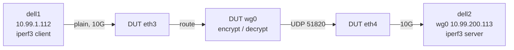
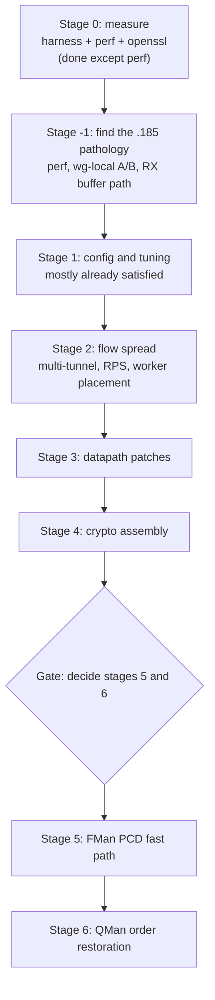

# ASK2 WireGuard Throughput Plan

**Status: open, 2026-10-12.** Stage 0 is measured and the stage -1 cause is found: the `.185` shortfall was a lockdep/KUnit debug kernel, not WireGuard or DPAA. On the production image `.185` is level with `.106`.

WireGuard cannot be hardware-offloaded on the LS1046A: FMan cannot see inside the tunnel and the SEC (CAAM Era 8) has no ChaCha20-Poly1305. WireGuard therefore always runs in software on the four A72 cores. This plan covers how to raise that software throughput on the ASK2 image (`.185`), what the vendor ASK image (`.106`) achieves for comparison, and which of the proposed optimisation stages are worth doing.

It replaces an earlier modelled plan (stages 0 to 6, 1.4 to 4.0 to 5.5 Gbit/s) whose figures were derived from published cycle counts and comparable hardware, not measured on this board. The measurements below change the order of work and remove one stage.

## 1. Role and test rig

The board is a gateway: it forwards traffic into and out of a tunnel it terminates, and the endpoints live elsewhere.



- **Harness:** `bin/testrig-wireguard.sh`. Cells `plain-v4`, `wg-v4`, `wg-v6`, `ceiling-v4`; directions `up` (DUT encrypts), `down` (DUT decrypts), `bidir`; `MODE=udp` for packet-rate runs; `DUT_KIND=ask2` for `.185`, `DUT_KIND=vendor` for `.106`. Everything is runtime-only and removed by an EXIT trap.
- **`ceiling-v4`:** dell1 to dell2 over the ConnectX-3 link with no DUT. It measures the generator pair's own WireGuard limit so a DUT result is never generator-limited.
- **Inner/outer addressing:** inner `10.99.200.0/24` and `fd99:200::/64`, outer `10.99.2.185` to `10.99.2.113` (IPv6 outer with `OUTER=6`). Tunnel MTU 1420, pinned on the dell1 route so no path-MTU discovery is involved.
- **`.106` prerequisite:** the stock image has no `wireguard.ko`. Installed 2026-10-12 with OpenWrt attended sysupgrade: `owut download --force -a "kmod-wireguard wireguard-tools" -k` then `owut install` (one `-a` only, quote the list). The ASK modules and `cmm` survived. OpenWrt's fw4 has no zone for `wg0`, so the harness inserts runtime accept rules (comment `wgrig`) in `inet fw4 forward` and removes them in teardown.

## 2. Measured baseline (stage 0)

16 s runs, 4 TCP streams, MTU 1420, one direction.

| DUT | Direction | Throughput | DUT CPU | Notes |
|---|---|---|---|---|
| `.106` vendor ASK, kernel 6.12.103 | up | 1.54 Gbit/s | about 90% | 383k retransmits |
| `.106` | down | 1.34 Gbit/s | about 72% | 287k retransmits |
| `.185` ASK2, kernel 6.18.55 | up | about 0.13 to 0.16 Gbit/s | 67 to 69%, one core pegged | 0 retransmits, RTT 7.7 ms under load |
| dell1 to dell2, no DUT | up | 5.0 Gbit/s | n/a | about 1M retransmits |

Crypto cost, measured with `openssl speed` (the same CRYPTOGAMS assembly the model assumed), pinned to one core on `.185`:

| Item | Model | Measured |
|---|---|---|
| Core clock | 1.8 GHz | 1.6 GHz (performance governor) |
| ChaCha20-Poly1305, 1424 B | 5.3 cycles/byte, 2.7 Gbit/s | 6.45 cycles/byte, 248 MB/s, about 2.0 Gbit/s |
| ChaCha20 alone | 4.2 cycles/byte | 5.2 cycles/byte (309 MB/s) |
| Four-core crypto ceiling | 10.9 Gbit/s | about 7.9 Gbit/s |
| Crypto per 1420 B packet | about 7,600 cycles | about 9,300 cycles |

### 2.1 Stage -1 result: the board was running a debug kernel

Profiling `.185` with `perf record -a -g` (static `perf` built natively from the 6.18.55 tree, copied to `/tmp/perf`) showed the time in lockdep, not crypto. The top symbols were `__local_bh_enable_ip` (15%), `finish_task_switch` (8.6%), `lock_acquire` (8.3%), `lock_is_held_type` (6.6%), `lock_release` (3.8%), `rcu_is_watching`, `rcu_lockdep_current_cpu_online` and `debug_lockdep_rcu_enabled`; `chacha_4block_xor_neon` was 2.3%. The running kernel config had `CONFIG_PROVE_LOCKING=y`, `PROVE_RCU`, `DEBUG_SPINLOCK`, `DEBUG_MUTEXES`, `DEBUG_LOCK_ALLOC`, `TRACE_IRQFLAGS` and `DEBUG_LIST`.

Cause: image `2026.10.11-0348-rolling` (and `0257`) were built with the opt-in KUnit debug input (`bin/ci-setup-kernel.sh`, lines near 959 to 979, `kernel/ask/kernel-config/90-kunit.config`). The earlier "no debug options" check was wrong because the config grep was truncated with `head -30`. Both debug images have a vmlinuz about 0.8 MB larger than the production ones (14.6 MB against 13.8 MB), and `zcat vmlinuz | grep -ac "Lock dependency validator"` is 1 for them and 0 for `2340`. **The `latest.iso` on lxc200 pointed at the 0348 debug build.**

A/B on the same board, rig and harness settings (16 s, 4 streams, MTU 1420, TCP):

| Kernel | up (DUT encrypts) | down (DUT decrypts) | Notes |
|---|---|---|---|
| `0348` debug (PROVE_LOCKING) | 0.13 to 0.16 Gbit/s | not measured | 68% CPU, lockdep symbols about half of all samples |
| `2340` production | **0.90 Gbit/s** | **1.34 Gbit/s** | up: one core at 99%, 0 retransmits; down: 85% CPU, 9k retransmits |
| `.106` vendor (for reference) | 1.54 Gbit/s | 1.34 Gbit/s | |

So the debug kernel cost about 6 times on `up`. The measured `.185` numbers in the table above are debug-kernel numbers; use the `2340` rows from now on.

Profile of the production kernel, `up` direction (`/tmp/prod.data` on `.185`):

- `kworker/*+wg-crypt-wg0` on CPU 3 is the single serial `wg_packet_tx_worker` (about 26% of all samples, one CPU saturated). The parallel `wg_packet_encrypt_worker` stage is about 29% spread over the cores; `chacha_4block_xor_neon` plus `poly1305_blocks_neon` plus `chacha_permute` are about 20%. Crypto is now the largest single cost but the cap is the serial stage.
- Inside the serial tx worker, `wg_socket_send_skb_to_peer` is 24% inclusive, `udp_tunnel_xmit_skb` 20%, and **`nf_hook_slow` 19%** (nftables chains `nft_do_chain` 6.5%, plus VyOS firewall/conntrack hooks), `dev_hard_start_xmit` 11%. About three quarters of the serial stage is netfilter and output path, not WireGuard.
- Experiment: `WG_NOTRACK=1` (outer UDP 51820 untracked in an `inet wgnt` table at priority -300) gave `up` 0.94 Gbit/s (+4%) and `down` 1.53 Gbit/s (+14%, more reordering retransmits). Conntrack for the outer flow is therefore not the main cost; the nftables rule evaluation on the output and postrouting hooks is.

Consequences for the stages: stage 1 changes from "already satisfied" to "was violated": production images must not carry the KUnit debug config, and the harness must record the kernel config (stage 1 item 2). The serial tx stage, netfilter cost on the outer packets, and WireGuard's in-order stage are what stage 2 and 3 now attack. The crypto-assembly stage is worth more than first thought because crypto is already the top single cost.

Findings that shaped the plan before the stage -1 result (items 2 to 5 are superseded by 2.1; the numbers in them are debug-kernel numbers):

1. **`.106` is within the model's stage-0 range** (about 44k cycles per packet against 17 to 22k modelled, with heavy reordering retransmits).
2. **`.185` is about 10 times worse than `.106` and about 18 times worse than the model.** 128 Mbit/s is about 11k packets per second; with about 2.7 cores busy at 1.6 GHz that is roughly 390k cycles per packet. At 248 MB/s per core, crypto for that traffic needs about 6% of one core. **Crypto is not the bottleneck on `.185`; something in the packet path is.**
3. During load on `.185` the top consumers were `kworker/*+wg-crypt-wg0` (69% on one CPU) and `napi/wg0` (42%), with high system time rather than softirq time.
4. **Ruled out on `.185`:** debug/tracer options (`PREEMPT_NONE`, no tracers, no lock debugging) and generic-C crypto (the NEON `chacha_4block_xor_neon` and `poly1305_blocks_neon` symbols are present in `libchacha` / `libpoly1305`; that they are used at runtime is not yet confirmed).
5. **Not yet ruled out:** cache maintenance on the DPAA RX buffers (the live device tree has no `dma-coherent` node), per-packet buffer copies or `skb_cow_data`, and placement of the wg crypt workers relative to the `dpaa-rps` mask (`0xe`, CPUs 1 to 3).
6. The dell-to-dell ceiling of 5.0 Gbit/s with about 1M retransmits is not a clean ceiling: one tunnel is one UDP 5-tuple, so the X710 hashes it to one RX queue, and WireGuard's parallel crypto reorders packets. Treat it as a lower bound until multi-tunnel and UDP runs exist.

### 2.2 Validated numbers (production kernels, two independent sessions)

Method: `REPS=3 DUR=30 STEADY_FROM=10 STREAMS=4`, TCP, MTU 1420, steady-window mean, performance governor at 1.6 GHz on both DUTs, lock debugging absent (the harness now records the kernel and refuses to run on a lockdep kernel; zero-traffic reps are retried and never averaged). Files: `/mnt/builds/ask2-review/oracle/wg-validated-{185,106}{,-s2}.csv`. Gbit/s, mean of 3 reps; the spread inside a session is under 0.06, the spread between sessions is the placement effect in 2.3.

| DUT | Cell | up | down | bidir |
|---|---|---|---|---|
| `.185` image 0117, session 1 | wg-v4 | 0.88 | 1.36 | 1.14 |
| `.185` session 2 | wg-v4 | 1.02 | 1.41 | 1.49 |
| `.185` session 1 / 2 | wg-v6 | 0.88 / 1.02 | 1.37 / 1.43 | 1.17 / 1.43 |
| `.106` vendor, session 2 | wg-v4 | 1.46 | 1.55 | 1.55 |
| `.106` session 2 | wg-v6 | 1.36 | 1.53 | 1.50 |
| dell1 to dell2, no DUT | ceiling-v4 | 5.14 | 5.48 | 9.28 |

The ceiling is far above both DUTs, so the DUT is the limit in every cell. `.106` also gives 1.42 with the performance governor and 1.53 with its default `schedutil` on `wg-v4 up`; one earlier `.106` session read 0.96 on the same cell (see 2.3).

### 2.3 Run-to-run variance is serial-worker placement

`.185` `wg-v4 up` moved between 0.82 and 1.03 Gbit/s with no change in the kernel or the rig. Cause: WireGuard queues a peer's serial `wg_packet_tx_worker` on a CPU picked once per peer as `peer->internal_id % online_cpus` (`wg_cpumask_choose_online`), and `internal_id` is a global counter that grows with every peer created since boot. Each harness run creates a new `wg0`, so the serial stage rotates over the CPUs between runs. Recreating `wg0` eight times and recording the pegged CPU (`REPS=8 RECREATE=1`, `wg-placement-185.csv`):

| Serial tx worker CPU | `wg-v4 up` (Gbit/s, 2 runs each) |
|---|---|
| CPU 0 | 0.82, 0.82 |
| CPU 2 | 0.89, 0.92 |
| CPU 1 | 1.03, 1.02 |
| CPU 3 | 1.03, 1.02 |

Run-to-run repeatability for a fixed CPU is about 0.5%. CPU 0 loses 20% because the QMan portal 0 RX NAPI (`dpaa_eth_poll`, 21% of that core's samples in a CPU 0 profile) shares the core with the serial stage. Profile of the serial core: `wg_packet_tx_worker` 75% inclusive, of which `udp_tunnel_xmit_skb` 49% (`nf_hook_slow` 19%, `nft_do_chain` 10%, `nf_conntrack_in` 4.7%, `__dev_queue_xmit` 19%, `dpaa_start_xmit` 4.5%), and ChaCha/Poly1305 10 to 13% (encrypt workers also run on that core).

Rule for all comparisons: report `up`/`bidir` per serial-CPU placement, or use `RECREATE=1` with at least 4 reps (one per CPU) and quote the mean and the CPU 1/3 value. Single-session numbers without the placement are not comparable.

### 2.4 Stage 2 results (2026-10-12)

**2c, serial-CPU placement.** Patch `kernel/common/patches/board/4011-wireguard-serial-cpu-mask.patch` (series entry added, Risk-Tier B) adds the module parameter `wireguard.serial_cpus` (ulong bitmask, default 0 = stock). The module compiles against the 6.18.55 tree; it has not run on a board because loading a module needs a CI-built image (module signing is enforced). Until then the harness controls placement without a kernel change: `WG_SERIAL_CPU=n` recreates `wg0` until the pegged CPU observed under a probe load equals CPU n (2 to 4 attempts). Expected use after the CI image: `echo 10 > /sys/module/wireguard/parameters/serial_cpus` (CPUs 1 and 3) before creating the tunnel, or `options wireguard serial_cpus=10` in a modprobe.d file for VyOS.

**2a, netfilter cost on the outer packets** (same peer instance, serial stage fixed on CPU 3, 20 s runs, `wg-v4 up`, Gbit/s; tables were saved, deleted and restored, and VyOS config reverted afterwards):

| Variant | Gbit/s | vs baseline |
|---|---|---|
| Baseline | 1.01 | |
| Delete `vyos_conntrack` tables (ip, ip6) | 1.17 | +14% |
| Delete `raw`, `vrf_zones`, `mangle` tables, each on its own | 1.00 to 1.04 | none |
| All of the above removed | 1.19 | +18% |
| ...and outer UDP 51820 `notrack` | 1.36 | +35% |
| ...and the NAT tables removed | 1.35 | no further gain |
| VyOS config `delete system conntrack modules` (all 7 helpers), committed | 1.13 | +10.5% (back to 0.99 when restored) |

The whole table-level gain sits in the `vyos_conntrack` tables (helper assignment and the per-packet counters and jumps in their prerouting and output chains), not in the firewall, rpfilter, VRF or NAT tables. Skipping connection tracking for the outer UDP adds another 15% on top. Both are fixable at the VyOS level without touching the datapath: stop generating the helper rules when no helper module is configured, and add a `notrack` rule for local WireGuard endpoint traffic (for example from the `interfaces wireguard` code, in the `vyos_conntrack` raw-priority chains).

Implications: a stock `.185` WireGuard `up` rate of about 1.0 Gbit/s becomes about 1.3 to 1.4 Gbit/s with those two changes and CPU 3 placement, which puts `.185` ahead of the `.106` `up` result on the same crypto. Down and bidir were not part of this experiment.

### 2.5 VyOS-native conntrack fix (stage 2a, implemented as patch 056)

Same method as 2.4 (serial stage on CPU 3, same tunnel instance, `wg-v4 up`, 2 reps of 20 s); only committed VyOS config or a rendered template changed:

| Variant | Gbit/s | vs baseline |
|---|---|---|
| Baseline (7 helper modules, no ignore rules) | 0.995 | |
| `set system conntrack ignore ipv4 rule 10 protocol udp destination port 51820` plus rule 20 with `source port 51820` | 1.13 | +14% |
| Same, plus `ct state untracked accept` after `jump VYOS_CT_IGNORE` (PREROUTING and OUTPUT) and in the `*_HELPER` chains | 1.22 | +22% |
| Same, plus all helper modules removed | 1.21 | no further gain |

`data/vyos-1x-056-conntrack-untracked-shortcut.patch` adds the short-circuit to `nftables-ct.j2` (IPv4 and IPv6, eight lines). It is generic: any flow matched by a `system conntrack ignore` rule no longer walks `FW_CONNTRACK`, `NAT_CONNTRACK`, `WLB_CONNTRACK` or `VYOS_CT_HELPER`. Behaviour is otherwise unchanged (the trailing `notrack` only covered packets none of the earlier jumps accepted). It was validated live on `.185`: the patched template renders, `nft -c` accepts it, and the board was restored afterwards (template, ignore rules and configd restart; `vyos-configd` caches templates, so restart it after changing one).

WireGuard recipe, one endpoint on port 51820 (config only, no kernel change):

```
set system conntrack ignore ipv4 rule 10 protocol udp
set system conntrack ignore ipv4 rule 10 destination port 51820
set system conntrack ignore ipv4 rule 20 protocol udp
set system conntrack ignore ipv4 rule 20 source port 51820
```

Caveat: untracked packets have `ct state untracked`, so a firewall that only accepts `state new` or `established` for the WireGuard port will drop them; allow the port explicitly (no state match), which is the usual VyOS WireGuard firewall rule. A fully automatic rule per WireGuard listen port was left out for that reason. The remaining distance to the all-tables-removed result (1.36) is the rest of the `vyos_conntrack` prerouting and output chains, not the helpers.

### 2.6 Multi-tunnel scaling (stage 2b)

`bin/testrig-wireguard-multi.sh` runs N tunnels with distinct listen ports (`wgm0..`, outer UDP 51830+K, inner `10.99.(210+K).0/24`), one iperf3 pair per tunnel, all started together. Four tunnels are configured and 1, 2 or 4 of them carry traffic; 2 reps of 20 s, 2 streams per tunnel, `.185` image 0117, aggregate Gbit/s:

| Active tunnels | up | down | Busy CPUs (up) |
|---|---|---|---|
| 1 | 0.85 | 1.33 | one (the serial stage) |
| 2 | 1.27 | 1.67 | two |
| 4 | 1.56 | 1.76 | all four, DUT 92% busy |

Per-tunnel up at 4 tunnels is 0.27 to 0.50 Gbit/s (placement again: tunnels on CPU 0 get the least). So spreading helps (+84% from 1 to 4 tunnels on `up`, +32% on `down`) and then the box is CPU-bound at about 1.6 Gbit/s up and 1.75 Gbit/s down. At 1420-byte packets 1.56 Gbit/s is about 137k packets per second, about 46k cycles per packet across four cores at 1.6 GHz, of which crypto is about 9.3k, so about 80% is per-packet overhead outside the crypto. That makes the stage 3 datapath work (GRO decryption, no `skb_cow_data`, batched NEON sections, less cross-core traffic) the next lever, ahead of crypto assembly, matching the gate in section 6. The 4-tunnel number is the practical aggregate ceiling to beat.

### 2.7 Image 0350 validation (4011 and 056 on the board, 2026-10-12)

Image `2026.10.12-0350-rolling` (production, no lock debugging). `wireguard.serial_cpus` exists and defaults to 0.

- **4011:** with `echo 10 > /sys/module/wireguard/parameters/serial_cpus` (CPUs 1 and 3) and `wg0` recreated 8 times, the serial stage landed only on CPU 1 and CPU 3 (alternating) and `wg-v4 up` was 0.998 Gbit/s mean (min 0.975, max 1.022, sd 0.015). Without the mask the same test spread 0.82 to 1.03 (sd 0.086). The CPU 0 and CPU 2 placements, and the 20% loss on CPU 0, are gone. (`wg-4011-mask10.csv`)
- **056 plus the ignore-rule recipe from 2.5, same peer:** 0.99 Gbit/s without the rules (3 reps), 1.25 with them (+26%); `nft list chain ip vyos_conntrack PREROUTING` shows `ct state untracked accept` after the ignore jump.
- **Validated matrix with both applied** (`wg-validated-185-0350.csv`, 3 x 30 s, 4 streams, performance governor, mask 10, recipe applied), Gbit/s:

| Cell | up | down | bidir |
|---|---|---|---|
| wg-v4 | 1.21 | 1.46 | 1.48 |
| wg-v6 | 1.22 | 1.40 | 1.45 |

Against the earlier `.185` sessions (2.2): `up` went from 0.88 / 1.02 to 1.21 to 1.22 and is now repeatable (sd below 0.04); `down` from 1.36 / 1.41 to 1.40 to 1.46; `bidir` is unchanged within noise (1.45 to 1.48 against 1.14 to 1.49). `.106` session 2 stays ahead on `up` (1.46 v4, 1.36 v6) and `down` (1.55 v4, 1.53 v6), and equal on `bidir`; `.185` is within 6% of `.106` on `down` and 17% behind on `up`. The ignore rules and the mask are runtime/config only here (not saved in the board config; the mask resets at reboot).

### 2.8 Stage 3 profile on image 0350 (4 tunnels, `up`, 2026-10-12)

Four tunnels keep all four cores busy, so the profile shows where the per-packet cost really goes. Aggregate throughput first: four tunnels reach 1.50 Gbit/s on image 0350; with the conntrack ignore rules for the four outer ports (recipe in 2.5, port range 51830-51833) they reach 1.74 Gbit/s (+16%); two more runs with the recipe gave 1.70 and 1.73 to 1.77. Profile with the recipe applied (`perf record -a -g`, 8 s, percentages of all samples):

| Cost | Share | Notes |
|---|---|---|
| Crypto leaf (`chacha_4block_xor_neon` 18.8, `poly1305_blocks_neon` 4.3, `chacha_permute` 1.8, `kernel_neon_begin/end` about 1.4) | about 28% | Encrypt workers are 42% inclusive; the rest is interrupt and scheduler noise attributed into them |
| RX: `dpaa_eth_poll` 16.4 (`rx_default_dqrr` 9.2) plus `net_rx_action` | about 29% inclusive | QMan portal dequeue and the forwarding stack on RX |
| TX serial worker `wg_packet_tx_worker` | about 30% inclusive | `udp_tunnel_xmit_skb` 19.9, `__dev_queue_xmit` 14.5 |
| Netfilter `nf_hook_slow` | about 16% inclusive | `nft_do_chain` 6.7 (3.8 self), `nft_counter_eval` 1.4, conntrack about 3 |
| Workqueue and scheduling (`queue_work_on` 1.5, `finish_task_switch` 1.7, spin unlock paths about 3) | about 6% | |
| AF_PACKET (`packet_rcv`) | about 0.7% self, 3% inclusive without the recipe | `dhclient` holds ETH_P_ALL raw sockets on every interface it runs on, here eth3 and eth4 |

Findings that change stage 3:

- `skb_cow_data` and similar copy paths do not appear. The "no `skb_cow_data`" item is dropped.
- Crypto leaf per-call overhead outside the bulk cipher is small: the generic C `chacha_permute` for the Poly1305 key block (`chacha_crypt_arch` falls back to generic C for 64 bytes or less) is 1.8%, `kernel_neon_begin/end` about 1.4%. Together at most 3%, so a first-block NEON patch is not worth a CI cycle on its own.
- GRO is enabled on eth3 and eth4 and makes no difference: 4-tunnel `up` is 1.73 Gbit/s with GRO on and 1.72 with it off (3 reps each). Inner TCP is not being aggregated before it reaches the tunnel, so the forwarding stack runs once per 1448-byte segment. Making GRO effective on the DPAA RX path (batching same-flow packets per NAPI poll, tying RSS and `gro_flush_timeout`/`napi_defer_hard_irqs` together) is the one large structural lever left, because every RX-side cost (about 29%) and the netfilter forward path would then run once per aggregate.
- The remaining netfilter share (about 16% inclusive) is the VyOS firewall base chains and per-rule counters on forwarded inner traffic and the tunnel's input and output; a lean firewall configuration, or removing the `counter` statements from default-action rules, is the cheap lever before any datapath code.
- dhclient on a data interface costs an AF_PACKET delivery on every packet; relevant for WAN-DHCP deployments, not for static addressing.

Revised stage 3 order: (1) make GRO effective on `fsl_dpa` RX and measure forwarding cost per aggregate; (2) lean firewall and no per-packet counters for the tunnel path; (3) fewer cross-core handoffs (`queue_work_on`, lock traffic) only if (1) and (2) leave the same profile; (4) batched NEON sections and the first-block NEON path are bundled into stage 4 with the assembly work.

### 2.9 Patch 4012 (GRO on DPAA RX): v1 lockup, v2 results (image 1538, 2026-10-12)

Patch 4012 changes `rx_default_dqrr()` from `netif_receive_skb()` (which never went through GRO) to `napi_gro_receive()`.

- **v1 (image 0530) hard-locked the board** under 4-tunnel and IPv6 load (RCU stall, CPU0 soft lockup in `swapper/0`, hung tasks on `mmcblk0p3`; power cycle needed). Likely cause: the per-CPU QMan portal is shared by all DPAA netdevs, so one netdev's NAPI also delivers other netdevs' frames, and v1 handed those to an unscheduled NAPI. The call trace was not captured, so this is the working hypothesis, not proven.
- **v2 (image 1538)** uses `napi_gro_receive()` only when `np->napi` is scheduled and keeps `netif_receive_skb()` for the rest. The board ran all matrices (about 45 minutes under 4-tunnel and single-tunnel load, plain-v4 hardware offload, IPv4 and IPv6) with `kernel.softlockup_panic=1` and `panic_on_rcu_stall=1` armed and no stall. (The 169 hits of a naive `dmesg | grep stall` are the word "installs" in ASK flow-offload lines.)
- **Hardware offload unaffected:** plain-v4 9.30 Gbit/s with about 10.2M offload hits per 20 s run.

Single tunnel, serial worker on CPUs 1/3, conntrack ignore rules applied, 3 x 30 s, Gbit/s:

| Variant | wg-v4 up | down | bidir | 4 tunnels up |
|---|---|---|---|---|
| Image 0350 (no 4012, same as GRO never running) | 1.21 | 1.46 | 1.48 | 1.74 |
| Image 1538, GRO on | 1.26 | 1.47 | 1.50 | 1.70 |
| Image 1538, GRO off on eth3/eth4 | 1.25 | 1.49 | 1.56 | 1.82 |

Reading: GRO aggregation does not help WireGuard (4 tunnels: 1.70 with GRO on, 1.82 off); the tunnel's transmit step has to split the aggregated segments again. The measurable gain of the patch comes from the receive-list batching that `napi_gro_receive()` does even with GRO off: +3 to +5% on single-tunnel `up`/`bidir` and +5% on 4 tunnels against image 0350. With GRO on the patch is neutral to slightly negative at 4 tunnels. So the recommended WireGuard setting on the tunnel-facing ports is GRO off (VyOS `offload gro` unset), with patch 4012 v2 in the image. The structural lever predicted in 2.8 (aggregation) turned out not to be one for tunnel forwarding; it may still help terminated or non-tunnel traffic, which was not measured. A software-forwarding regression run (plain routed TCP with the hardware offload disabled) is still open.

Best recorded numbers now (image 1538, GRO off, mask 10, conntrack ignore): wg-v4 1.25 up, 1.49 down, 1.56 bidir; 4 tunnels 1.82 up. Files: `wg-validated-185-1538.csv` (GRO on), `wg-1538-groff.csv`.

### 2.10 Decisions after the 4012 and mask experiments (2026-10-12)

**4012 is retired** (patch moved to `kernel/common/patches/archive/`, series entry replaced by a `# SKIP` note). Software-forwarding regression, plain routed TCP, hardware offload removed from the flowtable and verified `Armed ports: (none)` and `hw_hits 0` for every run, 8 flows, `up`, Gbit/s:

| Image | up | bidir |
|---|---|---|
| 0350 (no 4012) | 6.43 (sd 0.09, 3 reps) | 6.33 |
| 1538 4012 v2, GRO on | 5.33 (sd 0.60) | 6.19 |
| 1538 4012 v2, GRO off | 6.02 (sd 0.18, 6 reps) | 5.93 |

The patch costs 6% (GRO off) to 17% (GRO on, with a large retransmit count) on software-forwarded TCP and buys only +3 to 5% on WireGuard, so it is a net loss, apart from the earlier lockup risk. The board's `config.boot.default` also enables `offload gro` on every port, so a default install would have been on the worse GRO-on side.

**Serial CPU mask: use 14 (CPUs 1, 2, 3), not 10.** 4 tunnels, recipe on, GRO off, image 1538, 3 reps of 20 s, aggregate Gbit/s:

| `serial_cpus` | up | down |
|---|---|---|
| 0 (stock) | 1.79 | 1.91 |
| 10 (CPUs 1, 3) | 1.66 | 1.92 |
| 14 (CPUs 1, 2, 3) | 1.76 | 1.94 |

Mask 10 gives the best single tunnel (1.03 against an unmasked mean of 0.94) but costs 7% when several tunnels or peers run, because only two CPUs host serial stages. Mask 14 keeps CPU 0 (the worst placement) out, costs nothing measurable with 4 tunnels, and takes the single-tunnel placements to 0.90 to 1.03. The image now sets `options wireguard serial_cpus=14` in `/etc/modprobe.d/ls1046a-wireguard.conf` (hook `96-enable-services.chroot`); the module parameter is also writable at runtime.

Next image content: patch 4011, vyos-1x 056, the modprobe option; no 4012. The conntrack ignore rules stay a documented per-deployment step (2.5); making them automatic needs a product decision because untracked packets break firewall rules that match only `state new`.

### 2.11 Final validation of image 1740 (4011 + 056 + serial_cpus=14, no 4012), 2026-10-12

Installed by the operator; production kernel, no lock debugging, `softlockup_panic` and `panic_on_rcu_stall` armed, no BUG/stall/OOM messages for the whole run. `/etc/modprobe.d/ls1046a-wireguard.conf` loads `wireguard serial_cpus=14` (read back as 14 after `modprobe`).

- **Placement:** 8 recreated tunnels put the serial worker only on CPUs 1, 2, 3 (never 0): CPU1 0.98 to 1.01, CPU3 0.95 to 1.00, CPU2 0.86 to 0.88 Gbit/s (`wg-v4 up`, no ignore rules). Unmasked it ranged 0.82 to 1.03.
- **Validated matrix, conntrack ignore recipe on, GRO default (on), 3 x 30 s, 4 streams, Gbit/s:**

| Cell | up | down | bidir |
|---|---|---|---|
| wg-v4 | 1.13 | 1.60 | 1.46 |
| wg-v6 | 1.09 | 1.50 | 1.40 |

- **Recipe effect, same image:** `wg-v4 up` 0.99 without the ignore rules, 1.13 with them (+15%).
- **Software forwarding** (hardware offload removed, `Armed ports: (none)`, 8 flows, GRO on as shipped): up 5.65 (sd 0.69; reps 4.71, 5.90, 6.34), bidir 6.13. Image 0350 gave 6.43 (sd 0.09) and 6.33. The two images have the same forwarding code, so the difference is run-to-run noise (first rep 4.71 with 194k retransmits), but 3 reps cannot prove it; a 6-rep rerun is the cheap way to close it.

Reading against 2.7 (image 0350, mask 10): `up` is lower (1.13 against 1.21) because mask 14 admits CPU 2, the weakest single-tunnel placement; `down` is higher (1.60 against 1.46). Net: mask 14 trades about 7% of single-tunnel `up` for no multi-tunnel loss, and no CPU 0. If the target workload is exactly one tunnel, mask 10 is the better setting; for several peers, 14.

Best shipped-image numbers (1740, single tunnel, recipe on): wg-v4 1.13 up, 1.60 down, 1.46 bidir. Best measured anywhere: 4 tunnels 1.82 up (GRO off, 4012 v2, now retired) and 1.79 with the shipped build (mask 0).

### 2.12 Patch 057: automatic conntrack bypass for WireGuard listen ports

`data/vyos-1x-057-conntrack-wireguard-bypass.patch` (applies after 056) makes the VyOS conntrack script collect the listen port of every enabled `interfaces wireguard` interface and render, in the IPv4 and IPv6 `vyos_conntrack` tables:

- PREROUTING: `udp dport { ports } fib daddr type local counter notrack`
- OUTPUT: `udp sport { ports } counter notrack`

Scope is deliberately narrow: only packets addressed to this router, and only packets it sends from the listen port. Forwarded traffic that happens to use the same port numbers (for example a WireGuard client behind the router) stays tracked. `interfaces_wireguard` now triggers `system_conntrack` when a port is added, changed, disabled or deleted (`config-mode-dependencies`: `interfaces_wireguard -> conntrack`). New leaf `system conntrack disable-wireguard-bypass` turns the behaviour off. Default is on, which is a behaviour change: a firewall rule that accepts the WireGuard port only with `state new` or `established` no longer sees these packets (state `untracked`) and must allow the port statelessly; a plain `destination port 51820` accept rule is unaffected.

Live test on `.185` (image 1740 with the changed scripts and template installed temporarily; the new XML leaf needs a full image, so `disable-wireguard-bypass` was not exercised): adding `wg100` port 51899 produced the rules in both families; adding `wg101` merged to `{ 51898, 51899 }`; changing `wg100` to 51897, disabling `wg101` and deleting both each updated the set, ending with no rule. Traffic: 3 UDP packets to 10.99.1.185:51899 hit the rule (counter 3, no conntrack entry) while 3 packets to the same port forwarded to 10.99.2.113 were still tracked (3 entries). Originals restored afterwards. The throughput effect is the one measured in 2.5 and 2.11 (+15 to 26% on `up`); it still has to be confirmed on the next image with a VyOS-managed tunnel.

### 2.13 Reassessment against the original model (2026-10-12)

The original staged model (1.4 to 4.0-5.5 Gbit/s aggregate, "every figure modelled, not measured") was checked against the measurements in 2.1 to 2.12.

| Item | Model | Measured on `.185` |
|---|---|---|
| Clock | 1.8 GHz | 1.6 GHz |
| ChaCha20-Poly1305 | 5.3 cycles/byte, 10.9 Gbit/s on 4 cores | 6.45 cycles/byte, about 7.9 Gbit/s |
| Stage 0, single tunnel | 1.2 to 1.6 | up 0.88 to 1.02, down 1.36 to 1.41 (`.106`: 1.4 to 1.5) |
| Stage 1, config | 1.1 to 1.2x | about 0; the real risk was a lockdep image costing 6x |
| Stage 2, spread, 4 tunnels | 1.5 to 1.6x | 1.84x up, 1.32x down; single peer unchanged |
| Stage 3, datapath | about 1.3x | conntrack/netfilter bypass +15 to 26%; nothing else validated |
| Stage 4, assembly | 1.05x | consistent, at most about 5% |
| Software-only end state | 2.7 to 4.0 | 1.8 up / 1.9 down with 4 tunnels; 1.1 to 1.6 single |
| Non-crypto cycles per packet | 7k to 10k at stage 4 | about 27k (total about 36k, crypto about 9k) |

Conclusions:

- The ordering of stages holds (config, spread, datapath, assembly last), and the exclusions (SEC/CAAM, FMan header edits, AES/PMULL, hardware flow offload of tunnel traffic, 10G) are confirmed. `/proc/crypto` shows no CAAM ChaCha/Poly1305.
- The model's non-crypto cost is off by about 3x, so 2.7 to 4.0 Gbit/s is not reachable with stages 3 and 4 as written. Revised software-only estimate: 2.2 to 2.8 Gbit/s aggregate (unverified until the null-cipher run in stage 3a).
- Missed by the model: serial-stage placement (about 25% on one tunnel), debug kernels, and netfilter/conntrack on the outer packets (our largest software gain, now patches 4011, 056, 057).
- Stage 3 items that no longer hold: `skb_cow_data` (absent from the profile); inner GRO aggregation (no gain, -7% at 4 tunnels because the tunnel re-splits); GRO-layer decryption needs GRO on the DPAA RX path, which patch 4012 tried: v1 hard-locked the board, v2 cost software forwarding 6 to 17% (retired). A selective variant (GRO only for outer UDP to WireGuard ports) is unproven.
- Stage 5 (FMan fast path): forwarding-equivalent work is about 12k of 36k cycles, so the ceiling is about 30%, realistically 15 to 20%; it needs an offline port for reinjection (CORRECTION 2026-10-12: ASK2 does have an offline-port substrate, patches 0175 to 0184, board-validated through phase 1d) and sits on the flow engine with the thousands-of-flows collapse. Stage 6 (QMan order restoration) is the only item that lifts a single flow; mainline `qbman` already has the ORP fields (see 2.17). CORRECTION 2026-10-12: the 30% ceiling above counted only the forwarding-equivalent work; a zero-skb design also removes the outer-packet transmit path, which changes the estimate. See `plans/ASK2-WIREGUARD-FASTPATH-PLAN.md`.
- Verified open items: CAAM Era 8 has no ChaCha/Poly1305 (done); cycles per byte measured in userspace (done). Still open: `qbman` ORP enqueue, KeyGen byte extraction at the WireGuard counter offset, kernel-side cycles/byte.

Revised stage 3 plan:

1. **3a: null-cipher ceiling.** A test-only build that replaces ChaCha20-Poly1305 with a copy (insecure, never shipped) to measure everything except crypto in one run. Decision rule: null-cipher at or above 3 Gbit/s on 4 tunnels means the non-crypto overhead is the target (do 3b, then stage 5/6 on the numbers); below 2.4 means crypto assembly (stage 4) is worth its 5% and stages 5/6 are not justified.
2. **3b: cross-core handoffs.** Batch `queue_work_on` and the per-packet queue operations in WireGuard (the 15k cycles of WireGuard-specific overhead). Upstreamable.
3. **3c: lean firewall path.** Per-rule counters and chains on the tunnel path.
4. Stage 4 and stages 5/6 stay gated on 3a.

Product note (2026-10-12): IPsec/CAAM is not an alternative; the target users (home gateways) run WireGuard, so the FMan/QMan fast path (`ASK2-WIREGUARD-FASTPATH-PLAN.md`) is the only route to higher throughput.

### 2.14 Stage 3a result: where the non-crypto cycles go (image 1740, 4 tunnels up, 2026-10-12)

The null-cipher build was dropped before it was built: crypto is about 28% of cycles, so removing it entirely predicts about 2.5 Gbit/s from 1.8, between the 2.4 and 3.0 decision thresholds, so the run could not have decided anything, and it needs a CI image with an insecure Kconfig option (the running kernel only loads modules signed with its own build key). A function-level attribution of one more profile replaced it.

Profile: `perf record -a -g -F 1999`, 10 s, 4 tunnels, conntrack ignore ports applied, GRO off, aggregate 1.61 Gbit/s while profiling. Shares of all samples (self unless marked inclusive):

| Bucket | Share | Detail |
|---|---|---|
| Crypto leaf | about 26.5% | `chacha_4block_xor_neon` 18.5, `poly1305_blocks_neon` 4.2, `chacha_permute` 1.7 (Poly1305 key block in generic C), `kernel_neon_begin/end` + `fpsimd_flush_cpu_state` 1.8 |
| Rest of the encrypt call | about 10% | `chacha20poly1305_encrypt_sg_inplace` is 36.8% inclusive against 26.5% of leaves; scatterlist setup and copies, and interrupt time landing inside it |
| Outer TX, serial `wg_packet_tx_worker` (inclusive) | 37.1% | `udp_tunnel_xmit_skb` 18.8, `__dev_queue_xmit` 14.5, `dpaa_start_xmit` 2.3 |
| RX softirq (inclusive) | 29.6% | `dpaa_eth_poll` 16.3 (`rx_default_dqrr` 9.2 incl, 3.6 self), `wg_packet_rx_poll` 6.3, `ip_forward` 2.7 |
| Netfilter (inclusive) | 16.4% | `nf_hook_slow`; `nft_do_chain` 4.1 self (6.9 incl), `nft_counter_eval` 1.4, conntrack about 3, `nf_flow_offload_ip_hook` 0.4 (flowtable ingress hook runs on the outer packets too) |
| Handoff, wakeup, scheduling | about 10 to 12% | `queue_work_on` 2.0, `finish_task_switch` 2.4, `schedule` 2.4, `__local_bh_enable_ip` 1.75, spin unlocks about 2.6, `wg_prev_queue_dequeue` 0.7 |

Findings:

- There is no single dominant remaining bucket. Handoff and scheduling (stage 3b) is capped at about 10%. The remaining netfilter share is capped at roughly 8 to 11% (the earlier all-tables-removed run reached 1.36 against 1.22 with the recipe). Crypto assembly is capped near 5%. Together they are worth about +25%, which is consistent with the revised 2.2 to 2.8 Gbit/s software-only estimate.
- The earlier "15k cycles of WireGuard-specific overhead" was mostly the second pass of the outer packet through the IP, netfilter and `dev_queue_xmit` path (about 30% of cycles) and not queueing.
- The GRO-off, notrack recipe aggregate (1.61 under profiling, 1.8 unprofiled) leaves RX plus outer TX plus netfilter as roughly 60% of all cycles, i.e. the work an FMan fast path would remove; its ceiling stays about 30% (2.13).

Revised order: 3c (trim the remaining netfilter hooks on the tunnel path: per-rule counters, flowtable ingress hook for WireGuard ports) as cheap config/patch experiments; 3b (batching) and stage 4 as bounded 5 to 10% items; stages 5 and 6 only if the product wants more than about 2.5 Gbit/s from software WireGuard.

### 2.15 Stage 3c result: netfilter hooks on the tunnel path are not worth a patch (2026-10-12)

Per-chain counters were diffed over 12 s of 4-tunnel `up` load (recipe on, 1.65 Gbit/s). Base chains traversed (packets seen in 12 s):

| Hook | Chains evaluated | Packets |
|---|---|---|
| output (outer packets leaving) | `vyos_filter` `VYOS_OUTPUT_raw`, `vyos_conntrack` `OUTPUT` (raw), `vyos_filter` `VYOS_OUTPUT_filter`, `vyos_conntrack` `OUTPUT_HELPER` | 2.26 M |
| prerouting (inner and returning packets) | `ip raw` `vyos_rpfilter`, `VYOS_PREROUTING_raw`, `vyos_conntrack` `PREROUTING`, `PREROUTING_HELPER` | 0.78 M |
| forward / input | `VYOS_FORWARD_filter`, `VYOS_INPUT_filter` | 0.39 M each |

Every one is a default-action chain (`counter accept` or a jump pair) that VyOS creates whenever the firewall exists. About 15 base-chain evaluations happen per inner packet. The profile puts all of `nft_do_chain` at 6.9% inclusive (4.1% self) and the per-rule counters at 1.4%, which is about 165 cycles per evaluation. Removing the counters saves about 1.4%; removing every VyOS base chain would save at most about 7%, and those chains are the firewall framework (default actions, state policy, rpfilter), so no patch is planned. The 056 and 057 changes already removed the part that mattered (conntrack and its helper/NAT/WLB chains: +15 to 26%). Stage 3c is closed; its remaining ceiling (about 3 to 5%) is below the noise of a single placement.

Remaining software levers, in order: 3b handoff and scheduling batching (about 10% ceiling, upstreamable), stage 4 crypto assembly (about 5%). The rest of the encrypt call (about 10%, scatterlist setup, copies) and the DPAA RX path (`rx_default_dqrr` 9.2% inclusive: `build_skb`, buffer refill, DMA unmap, and the shared BMan refill) are not WireGuard-specific and would also help plain forwarding.

### 2.16 Stage 3b result: handoff batching is already happening and is not worth a patch (2026-10-12)

Code review (`queueing.h`, `send.c`, 6.18.55): every inner packet does `ptr_ring_produce_bh` and one `queue_work_on()` into the encrypt worker, and the encrypt worker does one `queue_work_on()` per packet into the peer's serial tx worker. Without inner GRO each forwarded TCP segment is its own queue element, so there is no per-burst `skb` list to amortise over.

Measured during 4-tunnel `up` load (recipe on, 1.6 Gbit/s): about 162k inner packets/s in and 162k outer packets/s out. Context switches: 29k/s by the `/proc/stat` `ctxt` delta over 10 s, but only 9.6k/s (47.8k in 5 s) by `perf stat -a`; the two counters disagree by 3x and I did not resolve which is right. Wakeups: 6.4k/s (`sched_wakeup`, 32k in 5 s). CPU migrations: 25/s. Either way that is at most 0.18 context switches per packet (0.06 by the perf figure): the workers already drain several packets per wakeup, because the ptr_ring fills while a worker runs. The scheduler share in the profile (`finish_task_switch` 2.4% plus `schedule` 2.4%) is the price of those switches, not of per-packet handoffs.

What is left to win: a plain-read `work_pending()` check before `queue_work_on()` (needs an `smp_mb()` to avoid a lost wakeup) would remove most of the 2.0% `queue_work_on` self time, i.e. at most 1 to 2%; raising the batch per wakeup would trade latency for at most another 2%. The run-to-run spread of one placement is 3 to 4%, so a 2 to 3% change cannot be measured with this rig, and WireGuard upstream would be unlikely to take a hot-path change it cannot show a gain for. Stage 3b is closed without a patch.

Stage 4 (crypto assembly, about 5%) is in the same position. Software WireGuard on this board is at its practical limit: about 1.1 to 1.6 Gbit/s single tunnel and 1.8 to 1.9 Gbit/s with four tunnels. The only remaining items above measurement noise are stage 5/6 (FMan/QMan, months, out of tree) or the IPsec/CAAM offload plan for VPN throughput.

### 2.17 Full matrix, .106 reference against .185 (2026-10-13)

Same method for both boards: IPv4 inner, MTU 1420, iperf3 TCP, 30 s runs with the first 10 s discarded, medians. One tunnel: 4 streams and a new tunnel for every run (5 runs), which samples serial-worker placement. Two and four tunnels: 2 streams per tunnel, one tunnel set per row (3 runs). `.106` is OpenWrt with the vendor ASK stack on its default config (`schedutil` governor); `.185` is image 2243 (`serial_cpus=14` from modprobe.d, `performance` governor as shipped) with the conntrack ignore rules for the tunnel ports applied through VyOS config. Harness: `bin/wg-matrix.sh` and `bin/wg-matrix-table.py`; data `oracle/wgfull-{106,185}-t{1,2,4}.csv`. Gbit/s, median (min - max):

| Tunnels | Dir | .106 | .185 | Gain |
|---|---|---|---|---|
| 1 | up | 1.38 (0.91 - 1.44) | 1.17 (1.10 - 1.21) | -15% |
| 1 | down | 1.30 (1.29 - 1.55) | 1.56 (1.49 - 1.60) | +20% |
| 1 | bidir | 1.51 (1.36 - 1.68) | 1.54 (1.41 - 1.61) | +2% |
| 2 | up | 1.44 | 1.60 (1.58 - 1.61) | +11% |
| 2 | down | 1.58 (1.57 - 1.61) | 1.64 (1.60 - 1.70) | +4% |
| 2 | bidir | 1.68 | 1.79 (1.78 - 1.80) | +7% |
| 4 | up | 1.57 (1.56 - 1.57) | 1.77 (1.73 - 1.85) | +13% |
| 4 | down | 1.66 | 1.87 (1.86 - 1.88) | +13% |
| 4 | bidir | 1.69 | 1.86 (1.84 - 1.91) | +10% |

`.185` leads in eight of nine cells; the exception is single-tunnel `up` (-15%), the cell bounded by the serial transmit stage. `.106` scales from about 1.4 to 1.7 Gbit/s with four tunnels; `.185` from 1.2 to 1.9. `.106` single-tunnel `up` shows a large placement spread (one run at 0.91 among four at 1.36 to 1.44), `.185`'s is narrow (1.10 to 1.21). Multi-tunnel ranges are tight because each row uses one tunnel set.

### 2.18 Why one tunnel is low, and the fix plan (2026-10-13)

**Analysis (from 2.3, 2.6, 2.8 to 2.17; no new measurement).** One tunnel is one peer, one UDP 5-tuple and one serial stage. The 1T `up` cell (1.17 Gbit/s median, about 103k pkt/s) is bounded by `wg_packet_tx_worker` running at 99 to 100% of one core while whole-box load is only 67 to 76%. That worker does the entire outer transmit for the peer (`udp_tunnel_xmit_skb` 19%, `__dev_queue_xmit` 14.5%, netfilter output hooks, `dpaa_start_xmit`), about 15k cycles per packet at 1.6 GHz. The encrypt stage, RX and everything else are spread over the other cores and have headroom. Evidence it is structural and not tuning: 2 tunnels give 1.60, 4 tunnels 1.77 (the same code, serial stages on different cores), and balanced work would be about 4 x 1.6 GHz x 0.9 / 36k = 160k pkt/s = 1.8 Gbit/s. A single tunnel therefore reaches about 65% of the box's software ceiling. `.106` runs the same stock WireGuard design (1.38 up) and has the same cap; it is not a regression of `.185`.

`down` (1.56) is limited differently: all outer packets of the tunnel hash to one FMan RX queue (one core for `dpaa_eth_poll` plus UDP receive), parallel decrypt reorders packets, and the 70k to 140k retransmits are TCP reacting to that. No cheap lever remains there (2.16).

**Fix plan, cheapest first, each ends in a `bin/wg-matrix.sh 185` 1T row:**

1. **E1, qdisc on the tunnel egress port (config only, one hour).** `__dev_queue_xmit` is 14.5% inclusive but `dpaa_start_xmit` is only 2.3%, so about 12% is qdisc and queueing on the outer path, which no earlier stage tested. Compare `tc qdisc show dev eth4` (default, mq/fq_codel/pfifo_fast) against `noqueue` or a single `pfifo`, serial worker pinned, `RECREATE=1`, 5 reps. Expected up to +10% on 1T `up`. Fallback if it helps: set it from the VyOS `offload`/`ask` interface hook or document it; no kernel patch.
2. **E2, per-flow transmit lanes in `wireguard.ko` (patch 4016, Risk-Tier C, 1 to 2 weeks, main lever).** Replace the single per-peer serial stage with N lanes (start N = 3, CPUs from `serial_cpus`): `wg_packet_send` picks a lane by `skb->hash` (inner flow), each lane has its own `prev_queue` and serial worker; the nonce is still assigned in order at submit, so the receiver's replay window (8128) absorbs the small cross-lane skew, and per-flow order is kept because a flow never changes lane. This is the software form of the fast-path rule "pin each inner flow to one queue" (`ASK2-WIREGUARD-FASTPATH-PLAN.md` section 0). Expected `up` with at least 4 inner flows: 1.17 to about 1.6 to 1.75 (the 2T/4T results are the bound). A single inner flow does not improve. Gate: 1T `up` at least 1.5 with retransmits not above baseline, stock dell2 shows no `Invalid MAC`, netns selftest `tools/testing/selftests/wireguard/netns.sh` passes, rekey at 120 s survives. Kill: under 1.3 or any receive-side drop in the replay window.
3. **E3, fast path P2b (already planned, 3 to 4 weeks).** Do not start before E2 is measured: E2 raises the software baseline cheaply, and P2b's value is judged against it (gate G2 2.6 Gbit/s stays valid). P2a's open question (plateau at 465k pkt/s with cores at 43%) should be closed with `perf stat -a -e cycles` first, since it sets the P2b ceiling.
4. **Down direction:** only P3 (FQ-pinned RX, no serial napi per peer) changes it; stage 6 is needed only for a single inner flow.

**E1 result (2026-10-13, image 2243, `.185`, wg-v4 `up`, 5 x 20 s, `RECREATE=1`, 4 streams, no ignore rules, mask 14; files `oracle/wg-e1-{base,noqueue}.csv`):** default `mq` + per-queue `fq_codel` on eth4 gave 0.928 Gbit/s (0.852 to 0.978); `tc qdisc replace dev eth4 root noqueue` gave 1.001 (0.942 to 1.056), **+7.9%**, and the gain shows at every serial-CPU placement (CPU1 0.958 to 1.056, CPU2 0.880 to 0.942, CPU3 0.978 to 1.020). Serial worker stays at 99% of one core, so this shaves cycles from the serial stage rather than removing the cap. Runtime only; qdisc restored afterwards. Cost: no AQM or fairness on the outer port, so apply it only to a WAN port that is not shaped (a VyOS `traffic-policy` on eth4 replaces it anyway). A persistent form is not yet implemented (candidates: a udev rule or boot hook on the tunnel egress port, or `IFF_NO_QUEUE`-style handling in `fsl_dpa`; decide with the product). Next: E2 (patch 4016) needs a CI image to run.

**E2 status (2026-10-13):** `kernel/common/patches/board/4016-wireguard-tx-lanes.patch` written and in `series` (Risk-Tier C). Module parameter `wireguard.tx_lanes` (1 to 4, default 1 = stock, read at peer creation); per-peer `tx_lane[]` each with its own `prev_queue`, work item and CPU (`peer->internal_id + lane` over `serial_cpus`); `wg_packet_send_staged_packets` assigns nonces in order, then splits the batch by `skb_get_hash` so a flow keeps its lane, and each sub-list takes its own peer and keypair reference. `git apply --check` passes on the pristine 4011/4014/4015 files and the module builds against the 6.18.55 tree without warnings. **Not yet run on a board** (needs a CI image because of module signing). Validation recipe: `echo 3 > /sys/module/wireguard/parameters/tx_lanes` before creating the tunnel, then `REPS=5 RECREATE=1 DIRS=up bin/testrig-wireguard.sh run wg-v4` and a 1-stream cell (must be unchanged), the 4-stream cell must reach at least 1.5 Gbit/s; arm `softlockup_panic` and `panic_on_rcu_stall`; check dell2 `wg show` for no invalid MACs and run the netns selftest. Ship with `tx_lanes=3` in `/etc/modprobe.d/ls1046a-wireguard.conf` only after the gate passes.

**E2 board result (2026-10-13, image 2026.10.13-0051, `.185`, wg-v4 `up`, 4 streams, 5 x 30 s, `RECREATE=1`, mask 14, `softlockup_panic`/`panic_on_rcu_stall` armed; files `oracle/wg-e2-lanes{1,3}.csv`):** `tx_lanes=1` 0.959 Gbit/s (0.874 to 0.999, sd 0.05, box 67% busy); `tx_lanes=3` **1.332** (0.991 to 1.571, sd 0.19, box 86% busy), **+39% like for like**, but below the 1.5 pass bar and above the 1.3 kill line, so inconclusive. Busiest core stays at 99% in both, so the cap moved rather than vanished: lane CPUs (1 to 3) share cores with RPS receive work, and the hot core is probably CPU 0 (NIC interrupt) or a lane colliding with RX. Next: per-core `mpstat` during a lanes=3 run, try `serial_cpus` placements, a 1-stream cell, dell2 invalid-MAC check, netns selftest and rekey before any decision on shipping `tx_lanes=3`.

**E2 follow-up (2026-10-13, same image and method):** per-core `top` with `tx_lanes=3` shows all four cores at about 99% busy, so the cap is now total CPU (about 150k to 165k pkt/s, the balanced ceiling in 2.18), not one serial stage. 1 stream is unchanged (1.03 vs 0.96 stock, noise). No lockup/RCU messages on the DUT and no `Invalid MAC` on dell2. **`tx_lanes=3` plus `tc qdisc replace dev eth4 root noqueue` (E1): 1.491 Gbit/s mean (1.370 to 1.610, sd 0.10), `oracle/wg-e2-lanes3-noq.csv`**, which is above the `.106` single-tunnel `up` median (1.38) and within noise of the 1.5 gate; runs landing the serial CPU on CPU0 reach 1.6 but show retransmits (1278 and 1771). Every other matrix cell was already ahead of `.106`, so single-tunnel `up` was the only gap. Done afterwards: a two-namespace veth smoke test with `tx_lanes=3` (ping 0% loss, 4-stream iperf3 1.41 Gbit/s, forced re-handshake recovers, a 135 s run crosses the 120 s rekey with a fresh handshake and steady 1.31 Gbit/s, no kernel warnings or lockups), and `tx_lanes=3` added to `/etc/modprobe.d/ls1046a-wireguard.conf` in `data/hooks/96-enable-services.chroot` (uncommitted; ships with the next CI image). Still open: the upstream `netns.sh` selftest (not run here), a persistent form of `noqueue`, and a full 9-cell matrix re-run on the shipping image.

**Full matrix with `tx_lanes=3` (2026-10-13, image 0051, default `mq` qdisc, no `noqueue`, same method as 2.17; `oracle/wgfull-lanes3-185-t{1,2,4}.csv`), Gbit/s median:**

| Tunnels | Dir | `.106` | `.185` before | `.185` lanes=3 |
|---|---|---|---|---|
| 1 | up | 1.38 | 1.17 | **1.65** |
| 1 | down | 1.30 | 1.56 | 1.58 |
| 1 | bidir | 1.51 | 1.54 | **1.44** (1.39 - 1.60) |
| 2 | up | 1.44 | 1.60 | 1.72 |
| 2 | down | 1.58 | 1.64 | 1.67 |
| 2 | bidir | 1.68 | 1.79 | 1.81 |
| 4 | up | 1.57 | 1.77 | 1.91 |
| 4 | down | 1.66 | 1.87 | 1.82 |
| 4 | bidir | 1.69 | 1.86 | 1.89 |

`.185` leads `.106` in eight of nine cells; the exception is 1-tunnel `bidir` (1.44 vs 1.51), which also regressed from 1.54 and is the next target (hypothesis: three TX lanes compete with RX/decrypt work when both directions run; not yet measured). 4-tunnel `down` is 0.05 lower than before (within the 1.72 to 1.85 spread).

**1T `bidir` investigation (2026-10-13, `oracle/wg-bidir-*.csv`):** (a) three repeat sessions of 5 fresh tunnels on `.185` with `tx_lanes=3`: 1.402, 1.445, 1.400, so the matrix cell is real and not a dip. (b) `tx_lanes=1` on the same image: 1.410 (1.17 to 1.50), so the lanes are not the cause. (c) `noqueue` on eth3 and eth4 with lanes=3: 1.479 (+4%). (d) `.106` with 12 fresh tunnels: mean **1.551** (1.356 to 1.675) and the result is set by where the serial worker lands: CPU2 or CPU3 gives 1.66 to 1.67 at 176k pkt/s (92% busy, sirq 43%, 530k retransmits), CPU0 1.49 to 1.51, CPU1 1.36 to 1.39. `.185` never reaches the 176k pkt/s state in bidir (best 1.62, typical 150k pkt/s at 89% busy, sirq 27 to 35%), so it spends about 15% more CPU per packet in bidir: roughly 38k cycles per packet against `.106` at about 33k. The 5-rep `.106` median in the 9-cell table (1.515) understated its best mode. Mitigations do not explain it (`.185` reports spectre_v2 "Vulnerable", `.106` has BHB hardening). Cause of the extra per-packet cost is NOT identified: needs a CPU profile during `bidir` (no `perf` on the board image), then compare `.185` against the `.106` sirq/softirq split. Candidates to profile: netfilter/nft hooks (442 nft lines), conntrack on the inner path, `fsl_dpa` RX/TX cost with both directions active, 6.18 vs 6.12 differences in the UDP/GRO path.

Not planned: more netfilter trimming, GRO, handoff batching, crypto assembly (2.9, 2.15, 2.16 closed them at under 5% each). Measurement rules stay as in 2.3: `RECREATE=1`, at least 5 reps, quote median and range, record serial CPU and kernel config.

## 3. What does not help

Evaluated and dropped; no time should go into these.

| Idea | Why it gives nothing here |
|---|---|
| SEC / CAAM crypto | CAAM Era 8 registers no ChaCha20 or Poly1305 (`/proc/crypto` on `.185` shows CAAM algorithms but no ChaCha/Poly1305 from CAAM), and WireGuard calls the synchronous crypto library, never the crypto API. |
| FMan header manipulation | It could add outer IP and UDP headers, but the nonce and authentication tag come from software. |
| ARMv8 AES / PMULL / SHA extensions | ChaCha20-Poly1305 uses none of them. |
| SVE, SVE2, SME | The A72 has none. |
| Floating-point FMA | The integer multiply-accumulate already used in Poly1305 is the right tool. |
| NEON BLAKE2s | Handshake only; block size too small for NEON to pay. |
| Hardware flow offload of tunnel traffic | FMan cannot see inside encrypted packets. |
| AES-based WireGuard variants | They break protocol compatibility. |
| Tuning `netdev_budget` | Archived PR14z23 showed larger budgets worsened softirq load. |

## 4. Updated stages



Stages are ordered by return on effort, so stopping after any stage keeps everything gained so far. Every step is re-measured with the harness; the model's gains are replaced by measured ones as they arrive.

### Stage -1: find the `.185` shortfall (new, first) - DONE 2026-10-12, see 2.1

Nothing in stages 1 to 4 can recover a 10-times gap that is not crypto and not flow spread.

1. Build `perf` natively on the Cobalt build host for the running kernel (`6.18.55-vyos`) and copy it to `.185` (it is not installed there).
2. `perf record -a -g` during a `wg-v4 up` run and a `wg-v4 down` run. Record the share in crypto symbols, `skb_cow_data`, `skb_*`, DMA sync / cache-maintenance functions, `clear_page`, page allocation, `memcpy`, `napi_gro_receive` and the workqueue.
3. Add a `wg-local` harness cell: iperf3 on the DUT itself, terminated or originated through the tunnel. It removes the DPAA forwarding path. A fast result there points at the RX buffer handling; a slow result points at WireGuard or the workers.
4. Confirm the NEON path is live at runtime (`perf top` shows `chacha_4block_xor_neon` and `poly1305_blocks_neon`).
5. Check where the wg crypt workers run against the RPS mask, and whether RPS on `eth3`/`eth4` hurts or helps this workload.
6. Exit criterion: `.185` reaches the `.106` level (1.3 to 1.5 Gbit/s) or the cause is identified and fixed. If the cause is the DPAA RX buffer layout, it feeds stage 3.

### Stage 1: kernel configuration and tuning

`PREEMPT_NONE`, no tracers, 1.6 GHz performance governor are right; **lock debugging was on in the 0257/0348 images (6x loss)**. The fix is operational: only benchmark production images (`zcat /proc/config.gz | grep -E '^CONFIG_(PROVE_LOCKING|LOCKDEP|DEBUG_SPINLOCK)='` must print nothing), never publish a KUnit build as `latest.iso`, and have the harness refuse to run on a lockdep kernel. Remaining items: confirm the NEON paths (stage -1 step 4) and record the environment (kernel, compiler, full config, `lscpu`, FMan microcode) next to every result.

### Stage 2: flow spread and serial-stage placement

Phase 2 work items, in order (status 2026-10-12):

1. **2c, placement (measured 2.3, patch 4011 written, harness control done, board validation waiting on a CI image):** the serial tx worker CPU should be chosen away from the QMan portal RX CPU. First measure the effect of keeping RX NAPI off the serial CPU; then a small WireGuard patch giving the device a configurable serial CPU mask (net-next candidate), instead of `internal_id % online_cpus`. Expected up to +25% on `up` for a bad placement; the best placement already reaches about 1.03.
2. **2a, netfilter on outer packets (measured 2.4, patch 056 and config recipe in 2.5):** `nf_hook_slow` is 19% of the serial core; the `vyos_conntrack` helper chains and conntrack on the outer flow are the cost (+35% together). Trim or bypass the VyOS output/prerouting chains for the tunnel endpoint (measured so far: conntrack bypass alone +4%/+14%). Compare on the same peer instance so placement does not mask the result.
3. **2b, multi-peer and multi-port (done, 2.6):** `bin/testrig-wireguard-multi.sh`; 4 tunnels reach 1.56 up / 1.76 down aggregate and saturate all four cores.

One peer is one outer UDP 5-tuple, so KeyGen hashes it to one frame queue and one core.

- Run several tunnels on distinct listen ports and spread traffic with ECMP or policy routing. The harness needs multi-peer and multi-port support first, and the dells must also spread (separate ports per tunnel, RPS on the dell NICs), otherwise the dell side limits the result.
- Enable RPS on the underlay interface for the single-peer case; measure it, do not assume it.
- Consider patching WireGuard's round-robin crypt worker selection to skip the core doing RX softirq work (a small net-next candidate).
- Expect almost nothing for a single peer.
- Use UDP mode for packet-rate and loss measurements; TCP is distorted by WireGuard's reordering.

### Stage 3: datapath patches

- **GRO-layer decryption:** register a UDP GRO handler that decrypts before aggregation, as ESP offload does. The Cilium proof of concept gained 15 to 17% on x86.
- **No `skb_cow_data`:** make `fsl_dpa` RX buffers arrive linear, unshared and with at least 16 bytes of tailroom; set headroom and tailroom on TX so encapsulation never reallocates. Verify the actual RX skb layout first (open item below).
- **Batched NEON sections:** process N packets per `scoped_ksimd()` region in the crypt worker instead of one.
- **Less cross-core bouncing:** group hot peer and device fields by cache line and replace the shared atomic queue counter with per-CPU counters. The A72 has no LSE atomics, so contended atomics are LL/SC loops.
- **BIG TCP:** small gain, a few lines.
- Files: `drivers/net/wireguard/{receive,send,queueing,device}.c`, `drivers/net/ethernet/freescale/dpaa/dpaa_eth.c`. Upstream path: netdev, reasonable odds.

### Stage 4: crypto assembly

At 6.45 cycles per byte measured, crypto is about 9,300 cycles per packet, more than modelled, so this stage matters more than the model's "3 to 8%" estimate suggests once the packet path is fixed. Candidates: the CRYPTOGAMS 6x NEON plus 2x scalar ChaCha20 path (about 10% on A57-class cores), a BoringSSL-style single-pass ChaCha20-Poly1305 with Poly1305 on the integer pipes, and formally verified s2n-bignum X25519 (handshake rate only, no throughput change). New code must be constant time with correct PAC and BTI annotations. Files: `lib/crypto/arm64/`, `lib/crypto/chacha20poly1305.c`.

Gate: if crypto symbols exceed 40% of cycles after stage 3, do this stage before any FMan work.

### Stages 5 and 6: FMan fast path and QMan order restoration

Decide only after stage 3 numbers exist. Both are out of tree, cost months, and need review against every upstream WireGuard security fix.

- **Stage 5 (FMan PCD fast path):** coarse classification of outer UDP destination port plus the WireGuard message-type byte, with data messages on dedicated frame queues and handshakes behind a policer profile; exact match on the inner 5-tuple with the peer in the frame-queue context; reinjection of decrypted packets through an offline port. It reuses ASK2's ehash and FE-VM machinery, which carries two known risks: the control-plane collapse at thousands of flows (the O(N^2) stats refresh recorded 2026-10-10) and the FE wedge history. (Checked 2026-10-12: ASK2 does have offline-port substrate, patches 0175 to 0184, board-validated through phase 1d; frame injection and capture (0183, 0184) are untested.)
- **Stage 6 (QMan order restoration):** the only stage that changes the single-peer result. Put data frame queues on a pool channel, take sequence numbers at dequeue and enqueue results through an order restoration point, keeping the window smaller than WireGuard's replay window. I believe mainline `drivers/soc/fsl/qbman` does not expose `qman_enqueue_orp`; verify. Fallback: KeyGen hashing on masked WireGuard counter bits, which reorders inner TCP at burst edges.

## 5. Expected outcome

The model's end state (4.0 to 5.5 Gbit/s aggregate) is not trustworthy until stage -1 is done. Revised bounds from the measured crypto cost:

- **Crypto-only ceiling:** about 7.9 Gbit/s for four cores at 1.6 GHz (not 10.9). Per-packet overhead never reaches zero, so a realistic software end state is well below that.
- **Near-term:** `.185` on the production kernel already reaches 0.90 (up) and 1.34 (down) Gbit/s, near the `.106` level. Assign numbers to the remaining stages only from re-measurements on this baseline.
- **10G WireGuard is not reachable on this SoC by any software path.**
- **For VPN throughput, IPsec is the stronger target.** `plans/ASK2-IPSEC-OFFLOAD-PLAN.md` covers IPsec Tier 1 with CAAM (the README cites about 2 to 3 Gbit/s). WireGuard stages 5 and 6 must justify their carrying cost against that.
- **Small packets** (64 to 256 B) are packet-rate bound; expect crypto assembly to be irrelevant there. Measure with `MODE=udp LEN=...`.

## 6. Measurement plan

1. **Environment record:** kernel and compiler versions, full config, `lscpu`, FMan microcode, CPU frequency, `dpaa-rps` mask.
2. **Correctness:** `tools/testing/selftests/wireguard/netns.sh` after every kernel change.
3. **Throughput:** `bin/testrig-wireguard.sh run <cells>` with `DIRS="up down bidir"`, `STREAMS=8`, plus UDP runs at 64, 512 and 1420 B for packet rate. Run `ceiling-v4` first in every session.
4. **Cycle split:** `perf top` / `perf record -a -g` during each run.
5. **Contention:** `perf c2c` on the peer and queue structures.
6. **Crypto cost:** `openssl speed -evp chacha20-poly1305` for a userspace figure (done: 6.45 cycles/byte); the `lib/crypto` KUnit benchmarks (`kernel/ask/kernel-config/90-kunit.config`, not applied to production builds) for the in-kernel figure.
7. **Gates between stages:** if a stage delivers less than half of its estimated low value, stop and re-profile before the next one. Keep every range at plus or minus 30% until measured.

Rig rules from `plans/ASK2-PERFORMANCE-TEST-HARNESS.md` apply: do not run two harnesses at once, never `pkill -f` with a pattern present in the same SSH command line, and cold-boot `.185` before silicon experiments (WireGuard itself touches no FMan state).

## 7. Open items

- [x] (done, see 2.7) Validate CI image `2026.10.12-0350-rolling` (contains 4011 and vyos-1x 056; also carries the bridge F-255 commit) on `.185` after the operator installs it: (1) `cat /sys/module/wireguard/parameters/serial_cpus` exists and is 0; (2) `echo 10 > /sys/module/wireguard/parameters/serial_cpus` then recreate the tunnel, run `REPS=8 RECREATE=1 DIRS=up` and expect the busy CPU only on CPU 1 and 3 and about 1.03 Gbit/s, never 0.82; (3) apply the config recipe in 2.5 and expect the 056 chains (`nft list chain ip vyos_conntrack PREROUTING` shows `ct state untracked accept`) and about +22% on `wg-v4 up`; (4) re-run section 2.2 and 2.6 matrices.

- [x] Profile `.185` with `perf` and identify the cause of about 390k cycles per packet (stage -1): lockdep debug kernel, 2.1.
- [ ] Make `bin/testrig-wireguard.sh` (and the other `testrig-*` scripts) refuse to run, or loudly flag the CSV, when the DUT kernel has `PROVE_LOCKING`.
- [ ] Repoint `latest.iso` on lxc200 at a production image; decide how KUnit builds are named so they cannot be taken for releases.
- [ ] Re-check earlier ASK2 numbers measured on 0257/0348 for lockdep influence (most offload results bypass the CPU, so little should change).
- [ ] Serial tx stage: measure the cost of the VyOS firewall/nftables hooks on the outer UDP (trim or bypass rules for the tunnel endpoint), then re-profile.
- [ ] `wg-local` cell: iperf3 terminated on the DUT.
- [ ] Multi-peer and multi-port support in `bin/testrig-wireguard.sh`; dell-side RPS and per-tunnel ports.
- [ ] Re-measure `ceiling-v4` with UDP mode and multiple tunnels to get a clean generator ceiling.
- [ ] Confirm the NEON ChaCha20 and Poly1305 paths run at runtime on `.185`.
- [ ] `fsl_dpa` RX skb layout: linear, unshared, tailroom of at least 16 bytes.
- [ ] Whether `/sys` / `dmesg` report CAAM Era 8 (`dmesg` needs root on `.185`; `/proc/crypto` already shows no CAAM ChaCha/Poly1305).
- [ ] Whether mainline `qbman` in the target tree exposes order-restoration enqueue.
- [ ] Whether KeyGen can extract and mask bytes at the WireGuard counter offset after the UDP header (check `arch/fman-microcode-210-programming-reference.md` before any PCD work, per AGENTS S0).
- [ ] `.106` numbers have 287k to 383k retransmits per 16 s run; find out whether that is WireGuard reordering or dell-side loss before using `.106` as the reference.

## 8. References

- Harness: `bin/testrig-wireguard.sh`; results CSV in `/mnt/builds/ask2-review/oracle/wg-*.csv`, JSON in `/mnt/builds/ask2-review/oracle/json-wg/`.
- Rig topology and conventions: `plans/ASK2-PERFORMANCE-TEST-HARNESS.md`.
- IPsec alternative: `plans/ASK2-IPSEC-OFFLOAD-PLAN.md`.
- CAAM Era per SoC (LS1046A is Era 8) and the Era 10 start of ChaCha20-Poly1305 support: Horia Geanta (NXP), LKML 2022; linux-crypto "caam/jr: add support for Chacha20 + Poly1305", 2018.
- CRYPTOGAMS `chacha-armv8.pl` and `poly1305-armv8.pl` cycle counts; s2n-bignum (formally verified arm64 X25519).
- WireGuard and GRO: Borkmann, Protopopov, Pumputis, LPC 2024. Tailscale, "Surpassing 10 Gbit/s with wireguard-go".
- DPDK `bus/dpaa` ORP queue creation and burst enqueue, August 2026.

### 2.19 P2b-1: real-peer fast path (patch 4017, 2026-10-13)

perf of 1T bidir on .185 (tx_lanes=3): crypto about 22% of samples (chacha 15.2, poly1305 4.9, permute 1.4), netfilter about 7% (nft_do_chain 4.0, nft_counter_eval 1.1, conntrack about 1.5), worker handoff about 6% (finish_task_switch 4.2, queue_work_on 2.2), DPAA RX/TX under 4%. No FMan/BMan hotspot, so any further gain comes from skipping the software path (P2b) or trimming the nft ruleset.

Patch 4017 adds `wgfp_peer` ("<wg dev> <egress dev>") to `drivers/net/wireguard/fastpath.c`: frames from the dpaa_wgfp sink FQs are sealed in place with the first peer's current keypair (atomic counter, remote_index, REJECT/REKEY limits), padded within the device MTU, with peer timers fed at most every 10 ms, and the outer header taken from a route+neighbour template refreshed every 1 s. Not yet done: AllowedIPs check, slow-path punt for declined frames (P2b-3), automatic flow install (P2b-2). Compiles clean at W=1 on 6.18.55. Not board-tested: needs a CI image (module signing). Test plan: cold boot, arm softlockup_panic/panic_on_rcu_stall, create 1 tunnel with stock dell2, `echo "wg0 eth4" > wgfp_peer`, steer 4 flows via debugfs fe_flow, require 4-stream up >= 2.6 Gbit/s, no Invalid MAC, rekey at 120 s survives.

First P2b-1 board result (image 2026.10.13-0303, cold boot, 4 TCP flows steered to 4 sinks, `bin/testrig-wgfp-p2b.sh`): 2.58 Gbit/s received (2.60 sent) vs 1.65 software lanes=3 and 1.38 .106; sealed 4.73M frames, declined 0, xmit_fail 0, dell2 `Invalid MAC` 0, 7.4 GB decrypted by stock dell2. Gate G2 (>= 2.6) is just short. Bug found by review: the rekey trigger `ctr == 0` could never fire after 120 s; moved into the 10 ms timer block (same test as keep_key_fresh). Rekey-at-120 s run pending the fixed image.

P2b-1 G2 PASS (image 2026.10.13-0347, cold boot, 140 s, 4 flows): 2.621 Gbit/s sent; 33.5M frames sealed, declined 0, xmit_fail 0, rekeys=1 (120 s rekey fired and tunnel kept running), no Invalid MAC on dell2, no kernel splats. Gate: >= 2.6 met (vs 1.65 software, 1.38 .106).

#### 2.19.1 1T bidir on .185 vs .106: netfilter/conntrack root cause (2026-10-13)

Fast path 1T (wgfp_peer, REV=4): up 2.62, bidir 1.96 (0.89 up + 1.08 down), down 1.41 (software; fast path is TX-only). Multi-peer (2T/4T) fast-path cells are untestable until multi-peer binding exists.

Software 1T bidir, 4 reps each, tx_lanes=3 (Gbit/s mean): normal ruleset 1.49; `nft flush ruleset` 1.61; ruleset restored 1.47; `.106` 12-run mean 1.551. The VyOS nft ruleset costs about 0.12-0.14 Gbit/s (8-9%).

Bisect by deleting table groups does not recover it (raw/mangle/vrf 1.39, conntrack tables 1.48, nat 1.42, filter 1.42): the cost is not one table. Clean-ruleset probes: empty base chains on prerouting/forward/postrouting 1.60; one `counter` rule 1.60 (counters are free); one `ct state new` rule 1.43 (loading nf_conntrack hooks costs about 0.17); notrack-all at raw priority on top of the full ruleset 1.43 (no gain, hooks still present). Conclusion: the cost is the presence of the conntrack hooks (nf_conntrack_in/defrag) on every packet, which any stateful firewall/NAT config needs. No safe VyOS-semantics-preserving elimination found; it is a config trade (no conntrack users = 1.6). Test aid: `WG_NOTRACK=1|2` in `bin/testrig-wireguard.sh`.
